# foxy_xml_entities

> FoXy XML character references handling and character data values.

 *text_value*, *without_markup* and *strip_blanks* (values of raw character data) and *is_name* are public for the other
 FoXy modules, not re-exported by *foxy*.

 What StringiFor does, FoXy delegates to it (escaping, decoding, number conversion, replacements). Kept here, with
 their reasons: *strip_blanks* and *line_ends_normalized* work on document-sized text (contents over 2 GiB) with 64-bit
 positions and no copy, while StringiFor's `strip` and `replace` use default-integer positions on a copy; *is_name*
 and *without_markup* are XML rules StringiFor does not have.

 Character references are the predefined entities `&lt;`, `&gt;`, `&amp;`, `&quot;`, `&apos;` and the numeric
 references `&#N;` (decimal) and `&#xH;` (hexadecimal) of a Unicode code point, decoded as UTF-8 bytes; escaping and
 decoding are StringiFor's (`string%escape_xml`, `string%unescape_xml`).

**Source**: `src/third_party/FoXy/src/lib/foxy_xml_entities.f90`

**Dependencies**

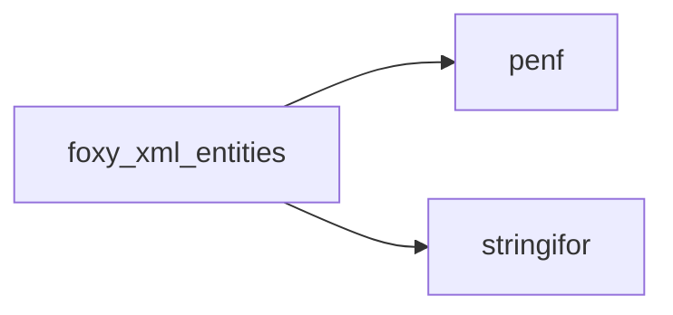

## Contents

- [is_name](#is-name)
- [attribute_value](#attribute-value)
- [character_data](#character-data)
- [first_bad_reference](#first-bad-reference)
- [first_utf8_error](#first-utf8-error)
- [xml_escape](#xml-escape)
- [xml_unescape](#xml-unescape)
- [text_value](#text-value)
- [line_ends_normalized](#line-ends-normalized)
- [without_markup](#without-markup)
- [utf8_tail_len](#utf8-tail-len)
- [strip_blanks](#strip-blanks)
- [blanks_as_spaces](#blanks-as-spaces)
- [is_continuation](#is-continuation)
- [is_name_start_char](#is-name-start-char)
- [is_name_char](#is-name-char)

## Variables

| Name | Type | Attributes | Description |
|------|------|------------|-------------|
| `SLICE_LEN` | integer(kind=[I8P](/api/src/third_party/PENF/src/lib/penf_global_parameters_variables)) | parameter | Longest string passed whole to StringiFor (1 GiB). |
| `MAX_REFERENCE_LEN` | integer(kind=[I8P](/api/src/third_party/PENF/src/lib/penf_global_parameters_variables)) | parameter | Longest reference kept whole when a string is sliced. |
| `BLANKS` | character(len=*) | parameter | XML blanks: space, tab, new line, CR. |
| `CR` | character(len=*) | parameter | Carriage return. |
| `LF` | character(len=*) | parameter | Line feed. |
| `CDATA_START` | character(len=*) | parameter | CDATA section start. |
| `CDATA_END` | character(len=*) | parameter | CDATA section end, escaped as `]]&gt;` in content. |
| `FIRST_NON_ASCII` | integer | parameter | First non ASCII byte (UTF-8 multi-byte sequences). |
| `FIRST_LEAD` | integer | parameter | First byte above the UTF-8 continuation bytes, 10xxxxxx. |

## Functions

### is_name

Return true if *string* is an XML name (XML 1.0 5th edition, production *Name*): its first character a
 *NameStartChar*, the others *NameChar*s (the XML ranges of letters, digits, combining characters, ...).

 @note An ASCII name is checked byte by byte; a name with other bytes is decoded by StringiFor (`string%codepoints`),
 an ill-formed UTF-8 byte is not a name character.

**Attributes**: pure

**Returns**: `logical`

```fortran
function is_name(string) result(is_valid)
```

**Arguments**

| Name | Type | Intent | Attributes | Description |
|------|------|--------|------------|-------------|
| `string` | character(len=*) | in |  | String. |

**Call graph**

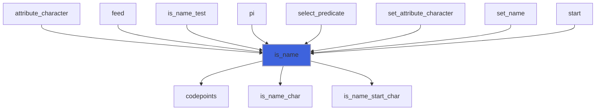

### attribute_value

Return the value of a raw attribute value (as in the source): each literal tab, new line and carriage return (a CR LF
 pair as one) read as a space (XML 1.0 3.3.3), then its references decoded.

**Attributes**: pure

**Returns**: `character(len=:)`

```fortran
function attribute_value(raw) result(value)
```

**Arguments**

| Name | Type | Intent | Attributes | Description |
|------|------|--------|------------|-------------|
| `raw` | character(len=*) | in |  | Raw attribute value. |

**Call graph**

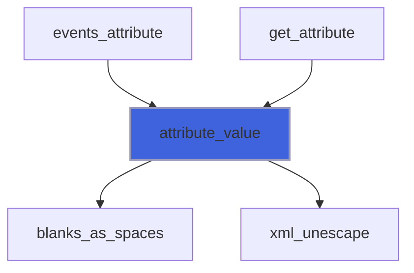

### character_data

Return the value of raw character data, without removing anything: line ends normalized (CR LF and CR read as LF),
 references decoded (the streaming parser gives it in pieces; *text_value* also strips and drops markup).

**Attributes**: pure

**Returns**: `character(len=:)`

```fortran
function character_data(raw) result(value)
```

**Arguments**

| Name | Type | Intent | Attributes | Description |
|------|------|--------|------------|-------------|
| `raw` | character(len=*) | in |  | Raw character data. |

**Call graph**

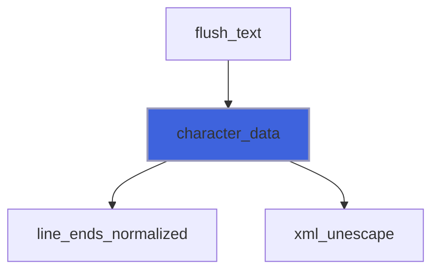

### first_bad_reference

Return the position of the `&` of the first malformed reference of *text*, 0 if there is none: an `&` that does not
 start a predefined entity (`&amp; &lt; &gt; &quot; &apos;`) or a character reference (`&#N;`, `&#xH;`) of a Unicode
 scalar value other than 0 (a bare `&`, a missing `;`, `&nbsp;` of a DTD, `&#X41;`, a surrogate, `&#0;`).

 @note StringiFor (`string%xml_error`) checks; texts longer than *SLICE_LEN* are checked in slices never cut inside a
 reference.

**Attributes**: pure

**Returns**: integer(kind=[I8P](/api/src/third_party/PENF/src/lib/penf_global_parameters_variables))

```fortran
function first_bad_reference(text) result(position)
```

**Arguments**

| Name | Type | Intent | Attributes | Description |
|------|------|--------|------------|-------------|
| `text` | character(len=*) | in |  | Text. |

**Call graph**

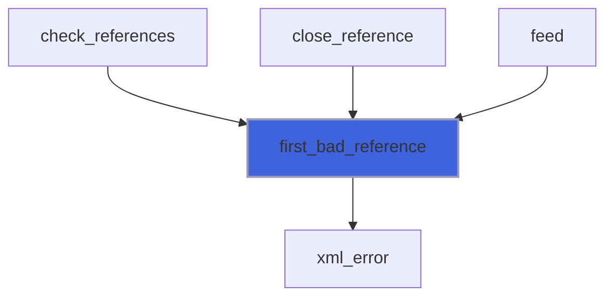

### first_utf8_error

Return the position of the first byte of *text* that is not part of a well-formed UTF-8 sequence (Unicode Table 3-7:
 no overlong form, no surrogate, nothing above U+10FFFF, no truncated sequence, no stray continuation byte), 0 if
 there is none.

 @note StringiFor (`string%utf8_error`) checks; texts longer than *SLICE_LEN* are checked in slices cut before a lead
 byte, so that no sequence is split.

**Attributes**: pure

**Returns**: integer(kind=[I8P](/api/src/third_party/PENF/src/lib/penf_global_parameters_variables))

```fortran
function first_utf8_error(text) result(position)
```

**Arguments**

| Name | Type | Intent | Attributes | Description |
|------|------|--------|------------|-------------|
| `text` | character(len=*) | in |  | Text. |

**Call graph**

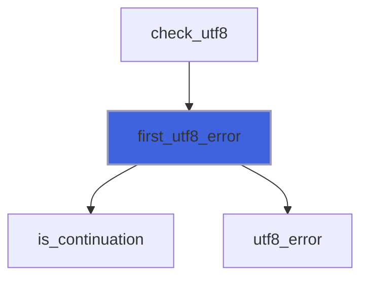

### xml_escape

Return *string* with `&`, `<`, `>`, `"` and `'` replaced by their predefined references, ready to be used as XML
 content or as an attribute value; with *attribute* true, tab, new line and carriage return also become `&#9;`,
 `&#10;` and `&#13;`, so that an attribute value reads back exactly (a parser turns them into spaces otherwise).

 @note StringiFor (`string%escape_xml`) escapes; FoXy passes strings longer than *SLICE_LEN* in slices (StringiFor
 positions are default integers): every escaped character is escaped wherever the string is cut.

**Attributes**: pure

**Returns**: `character(len=:)`

```fortran
function xml_escape(string, attribute) result(escaped)
```

**Arguments**

| Name | Type | Intent | Attributes | Description |
|------|------|--------|------------|-------------|
| `string` | character(len=*) | in |  | String to escape. |
| `attribute` | logical | in | optional | Escape tab, new line and carriage return too, for an attribute value. |

**Call graph**

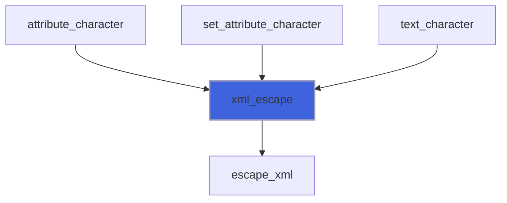

### xml_unescape

Return *string* with its character references decoded: the predefined entities `&lt;`, `&gt;`, `&amp;`, `&quot;`,
 `&apos;` and the numeric references `&#N;`, `&#xH;` of a Unicode scalar value (other than 0), as UTF-8 bytes.

 @note StringiFor (`string%unescape_xml`) decodes: the string is scanned once, a decoded `&` never starts a new
 reference (`&amp;lt;` gives `&lt;`); a malformed reference (`&nbsp;`, defined only by a DTD, a bare `&`, `&#0;`, a
 surrogate) is left verbatim. Strings longer than *SLICE_LEN* are decoded in slices never cut inside a reference
 (one longer than *MAX_REFERENCE_LEN* characters, possible only with many leading zeros, may then be left verbatim).

**Attributes**: pure

**Returns**: `character(len=:)`

```fortran
function xml_unescape(string) result(unescaped)
```

**Arguments**

| Name | Type | Intent | Attributes | Description |
|------|------|--------|------------|-------------|
| `string` | character(len=*) | in |  | String to unescape. |

**Call graph**

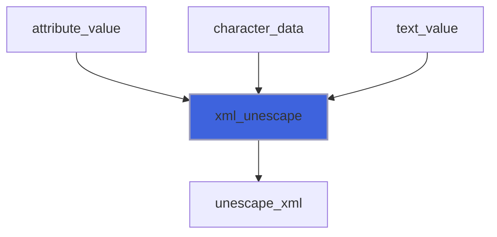

### text_value

Return the value of raw character data: line ends normalized (CR LF and CR read as LF, XML 1.0 2.11, CDATA sections
 included), comments and PIs removed, layout blanks stripped, character references decoded, CDATA sections literal.

**Attributes**: pure

**Returns**: `character(len=:)`

```fortran
function text_value(raw) result(value)
```

**Arguments**

| Name | Type | Intent | Attributes | Description |
|------|------|--------|------------|-------------|
| `raw` | character(len=*) | in |  | Raw character data. |

**Call graph**

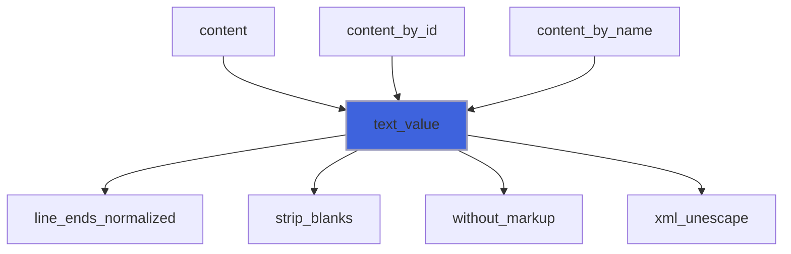

### line_ends_normalized

Return raw character data with each CR LF pair and each lone CR replaced by LF (XML 1.0 2.11).

**Attributes**: pure

**Returns**: `character(len=:)`

```fortran
function line_ends_normalized(raw) result(text)
```

**Arguments**

| Name | Type | Intent | Attributes | Description |
|------|------|--------|------------|-------------|
| `raw` | character(len=*) | in |  | Raw character data. |

**Call graph**

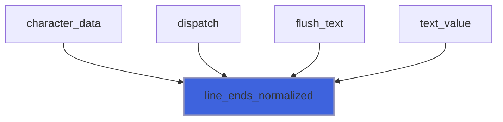

### without_markup

Return raw character data without comments and processing instructions (and CDATA sections, if asked); markup inside
 a CDATA section is data, an unterminated markup is kept as it is.

**Attributes**: pure

**Returns**: `character(len=:)`

```fortran
function without_markup(raw, is_cdata_removed) result(text)
```

**Arguments**

| Name | Type | Intent | Attributes | Description |
|------|------|--------|------------|-------------|
| `raw` | character(len=*) | in |  | Raw character data. |
| `is_cdata_removed` | logical | in | optional | Remove CDATA sections too. |

**Call graph**

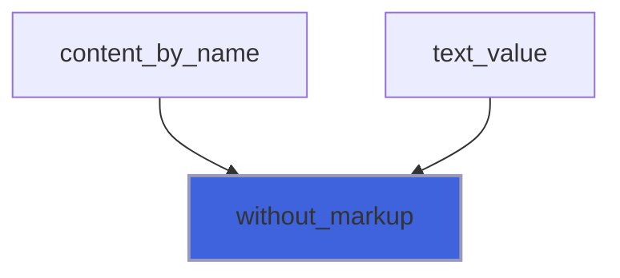

### utf8_tail_len

Return the number of bytes at the end of *bytes* that start a UTF-8 sequence not complete in them (0 to 3).

**Attributes**: pure

**Returns**: integer(kind=[I8P](/api/src/third_party/PENF/src/lib/penf_global_parameters_variables))

```fortran
function utf8_tail_len(bytes) result(n)
```

**Arguments**

| Name | Type | Intent | Attributes | Description |
|------|------|--------|------------|-------------|
| `bytes` | character(len=*) | in |  | Bytes. |

**Call graph**

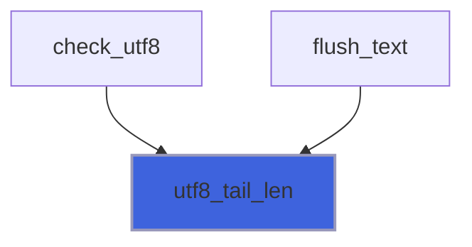

### strip_blanks

Return string without leading and trailing blanks: spaces, tabs, new lines and carriage returns.

**Attributes**: pure

**Returns**: `character(len=:)`

```fortran
function strip_blanks(string) result(stripped)
```

**Arguments**

| Name | Type | Intent | Attributes | Description |
|------|------|--------|------------|-------------|
| `string` | character(len=*) | in |  | String to strip. |

**Call graph**

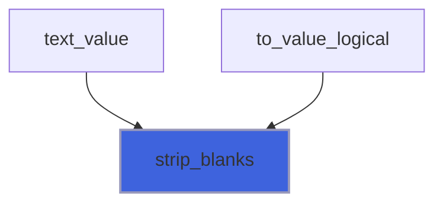

### blanks_as_spaces

Return a text with each blank (tab, new line, carriage return) replaced by a space, a CR LF pair by one space: the
 normalization of attribute values (XML 1.0 3.3.3), done by StringiFor `string%replace`.

**Attributes**: pure

**Returns**: `character(len=:)`

```fortran
function blanks_as_spaces(text) result(normalized)
```

**Arguments**

| Name | Type | Intent | Attributes | Description |
|------|------|--------|------------|-------------|
| `text` | character(len=*) | in |  | Text. |

**Call graph**

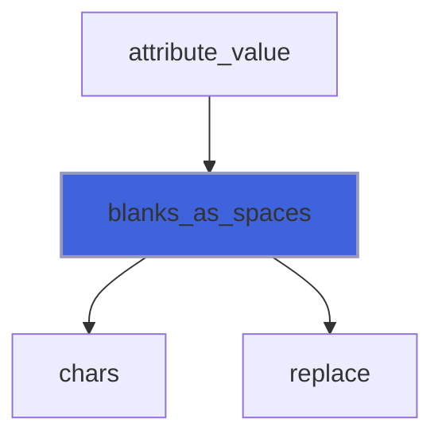

### is_continuation

Return true if *byte* is a UTF-8 continuation byte, 10xxxxxx.

**Attributes**: elemental

**Returns**: `logical`

```fortran
function is_continuation(byte) result(is_cont)
```

**Arguments**

| Name | Type | Intent | Attributes | Description |
|------|------|--------|------------|-------------|
| `byte` | character(len=1) | in |  | Byte. |

**Call graph**

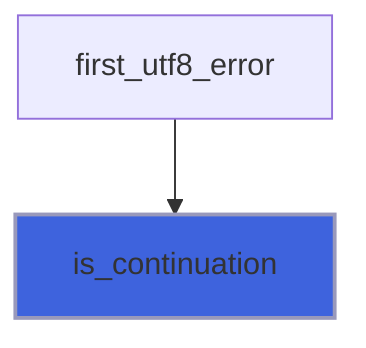

### is_name_start_char

Return true if the code point *code* is an XML 1.0 *NameStartChar* (a negative code, an ill-formed byte, is not).

**Attributes**: elemental

**Returns**: `logical`

```fortran
function is_name_start_char(code) result(is_valid)
```

**Arguments**

| Name | Type | Intent | Attributes | Description |
|------|------|--------|------------|-------------|
| `code` | integer(kind=[I4P](/api/src/third_party/PENF/src/lib/penf_global_parameters_variables)) | in |  | Code point. |

**Call graph**

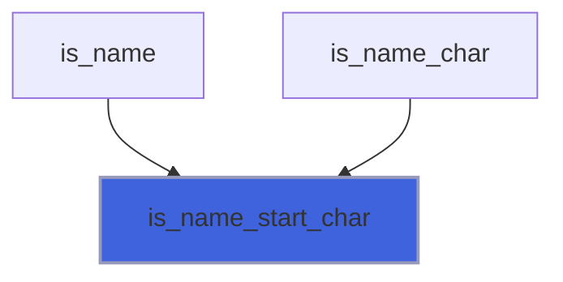

### is_name_char

Return true if the code point *code* is an XML 1.0 *NameChar*: a *NameStartChar*, `-`, `.`, a digit, U+00B7,
 U+0300 to U+036F (combining marks), U+203F or U+2040.

**Attributes**: elemental

**Returns**: `logical`

```fortran
function is_name_char(code) result(is_valid)
```

**Arguments**

| Name | Type | Intent | Attributes | Description |
|------|------|--------|------------|-------------|
| `code` | integer(kind=[I4P](/api/src/third_party/PENF/src/lib/penf_global_parameters_variables)) | in |  | Code point. |

**Call graph**

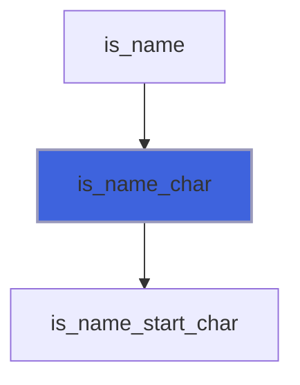
