# foxy_xml_events

> FoXy streaming parser: the document as a sequence of events, reported to a handler of yours.

 Extend *xml_handler*, override the callbacks you need (each one does nothing by default) and call *parse* on a string
 or a file: the callbacks come in source order (`start_element`, `characters`, `end_element`, ...), the source is read
 in chunks and the memory used does not depend on its size. The callbacks are ordinary procedures (they may write
 files, print, keep any state in your type).

 @note The pure tokenizer drives an *event_builder*, which queues the events of one chunk; *parse* then decodes them
 and calls the handler. Character data (and CDATA) is reported in pieces, decoded (references, line ends), never
 splitting a reference, a CR LF pair or a UTF-8 character; attribute values are normalized and decoded as
 `xml_file%attribute` returns them. Elements are always balanced: an element closed implicitly (malformed input, or
 open at the source end) gets its `end_element`. Problems are reported in source order among the other events; a
 problem inside character data may come between two pieces of that text (where depends on the chunks).

**Source**: `src/third_party/FoXy/src/lib/foxy_xml_events.f90`

**Dependencies**

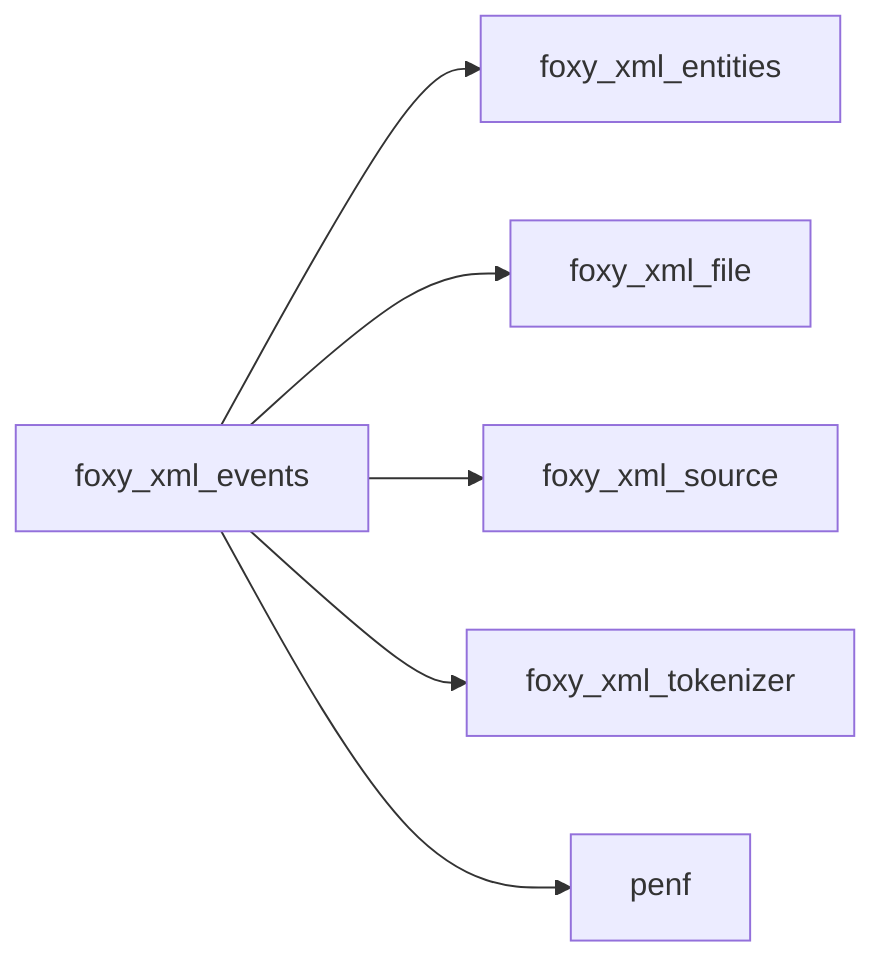

## Contents

- [xml_attribute](#xml-attribute)
- [xml_handler](#xml-handler)
- [event_record](#event-record)
- [event_builder](#event-builder)
- [text_decoder](#text-decoder)
- [start_element](#start-element)
- [end_element](#end-element)
- [characters](#characters)
- [cdata](#cdata)
- [comment](#comment)
- [processing_instruction](#processing-instruction)
- [doctype](#doctype)
- [problem](#problem)
- [stop_parsing](#stop-parsing)
- [parse](#parse)
- [dispatch](#dispatch)
- [add_text](#add-text)
- [flush_text](#flush-text)
- [push_event](#push-event)
- [pop_element](#pop-element)
- [queue_start](#queue-start)
- [events_start_tag](#events-start-tag)
- [events_attribute](#events-attribute)
- [events_start_tag_end](#events-start-tag-end)
- [events_end_tag](#events-end-tag)
- [events_data](#events-data)
- [close_markup](#close-markup)
- [events_problem](#events-problem)
- [events_finish](#events-finish)
- [adjustl_blanks](#adjustl-blanks)
- [lines_to](#lines-to)
- [count_new_lines](#count-new-lines)

## Variables

| Name | Type | Attributes | Description |
|------|------|------------|-------------|
| `DEFAULT_CHUNK` | integer(kind=[I8P](/api/src/third_party/PENF/src/lib/penf_global_parameters_variables)) | parameter | Default size of the chunks read (1 MiB). |
| `MAX_REFERENCE` | integer(kind=[I8P](/api/src/third_party/PENF/src/lib/penf_global_parameters_variables)) | parameter | Longest reference start kept for the next piece. |
| `EVENT_START` | integer(kind=[I4P](/api/src/third_party/PENF/src/lib/penf_global_parameters_variables)) | parameter | A start tag (with its attributes). |
| `EVENT_END` | integer(kind=[I4P](/api/src/third_party/PENF/src/lib/penf_global_parameters_variables)) | parameter | An end tag (or the end of a self closing tag). |
| `EVENT_TEXT` | integer(kind=[I4P](/api/src/third_party/PENF/src/lib/penf_global_parameters_variables)) | parameter | Character data, raw. |
| `EVENT_CDATA` | integer(kind=[I4P](/api/src/third_party/PENF/src/lib/penf_global_parameters_variables)) | parameter | CDATA content, raw. |
| `EVENT_COMMENT` | integer(kind=[I4P](/api/src/third_party/PENF/src/lib/penf_global_parameters_variables)) | parameter | A comment, whole. |
| `EVENT_PI` | integer(kind=[I4P](/api/src/third_party/PENF/src/lib/penf_global_parameters_variables)) | parameter | A processing instruction, whole. |
| `EVENT_DOCTYPE` | integer(kind=[I4P](/api/src/third_party/PENF/src/lib/penf_global_parameters_variables)) | parameter | A declaration (DOCTYPE), whole. |
| `EVENT_PROBLEM` | integer(kind=[I4P](/api/src/third_party/PENF/src/lib/penf_global_parameters_variables)) | parameter | A problem of malformed input. |

## Derived Types

### xml_attribute

An attribute of a start element: its name, as written, and its value, normalized and decoded.

#### Components

| Name | Type | Attributes | Description |
|------|------|------------|-------------|
| `name` | character(len=:) | allocatable | Name (prefix included). |
| `value` | character(len=:) | allocatable | Value (blanks as spaces, references decoded). |

### xml_handler

Handler of the events of a document: extend it, override the callbacks you need, call *parse*.

**Attributes**: abstract

#### Components

| Name | Type | Attributes | Description |
|------|------|------------|-------------|
| `level` | integer(kind=[I4P](/api/src/third_party/PENF/src/lib/penf_global_parameters_variables)) |  | Depth of the current element (1 for the root), set by *parse*. |
| `pos` | integer(kind=[I8P](/api/src/third_party/PENF/src/lib/penf_global_parameters_variables)) |  | Position (byte) in the source of the current event, set by *parse*. |
| `is_stopped` | logical |  | *stop_parsing* was called. |

#### Type-Bound Procedures

| Name | Attributes | Description |
|------|------------|-------------|
| `start_element` | pass(self) | A start tag, with its attributes. |
| `end_element` | pass(self) | An end tag (also right after a self closing start tag). |
| `characters` | pass(self) | Character data, decoded (maybe in pieces). |
| `cdata` | pass(self) | CDATA content, literal (maybe in pieces). |
| `comment` | pass(self) | A comment, without its markup. |
| `processing_instruction` | pass(self) | A processing instruction: target and data. |
| `doctype` | pass(self) | A declaration (DOCTYPE), as in the source. |
| `problem` | pass(self) | A problem of malformed input, with its line. |
| `parse` | pass(self) | Parse a string or a file, calling the callbacks. |
| `stop_parsing` | pass(self) | No more callbacks: *parse* returns. |

### event_record

An event of the queue.

#### Components

| Name | Type | Attributes | Description |
|------|------|------------|-------------|
| `kind` | integer(kind=[I4P](/api/src/third_party/PENF/src/lib/penf_global_parameters_variables)) |  | Event kind, EVENT_*. |
| `level` | integer(kind=[I4P](/api/src/third_party/PENF/src/lib/penf_global_parameters_variables)) |  | Element depth. |
| `pos` | integer(kind=[I8P](/api/src/third_party/PENF/src/lib/penf_global_parameters_variables)) |  | Position in the source. |
| `name` | character(len=:) | allocatable | Element name (start, end), or the message (problem). |
| `text` | character(len=:) | allocatable | Raw text (character data, CDATA, comment, PI, declaration). |
| `attributes` | type([xml_attribute](/api/src/third_party/FoXy/src/lib/foxy_xml_events#xml-attribute)) | allocatable | Attributes (start). |

### event_builder

Builder queuing the events of one chunk (pure, as the tokenizer requires).

**Inheritance**

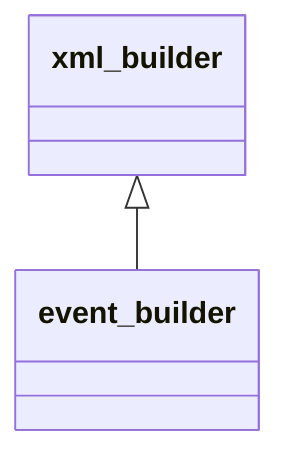

**Extends**: [`xml_builder`](/api/src/third_party/FoXy/src/lib/foxy_xml_tokenizer#xml-builder)

#### Components

| Name | Type | Attributes | Description |
|------|------|------------|-------------|
| `is_stopped` | logical |  | Set by the builder to stop the tokenizer (checked after each complete start or end tag). |
| `sanitize` | logical |  | Trim leading and trailing spaces of attribute values. |
| `events` | type([event_record](/api/src/third_party/FoXy/src/lib/foxy_xml_events#event-record)) | allocatable | Events queued. |
| `ne` | integer(kind=[I4P](/api/src/third_party/PENF/src/lib/penf_global_parameters_variables)) |  | Number of events queued. |
| `open_name` | character(len=:) | allocatable | Name of the start tag being read. |
| `open_pos` | integer(kind=[I8P](/api/src/third_party/PENF/src/lib/penf_global_parameters_variables)) |  | Its position. |
| `open_level` | integer(kind=[I4P](/api/src/third_party/PENF/src/lib/penf_global_parameters_variables)) |  | Its level. |
| `open_attributes` | type([xml_attribute](/api/src/third_party/FoXy/src/lib/foxy_xml_events#xml-attribute)) | allocatable | Its attributes. |
| `na` | integer(kind=[I4P](/api/src/third_party/PENF/src/lib/penf_global_parameters_variables)) |  | Number of its attributes. |
| `stack_id` | integer(kind=[I4P](/api/src/third_party/PENF/src/lib/penf_global_parameters_variables)) | allocatable | IDs of the open elements. |
| `stack_name` | type([xml_attribute](/api/src/third_party/FoXy/src/lib/foxy_xml_events#xml-attribute)) | allocatable | Names of the open elements (in *name*). |
| `depth` | integer(kind=[I4P](/api/src/third_party/PENF/src/lib/penf_global_parameters_variables)) |  | Number of open elements. |
| `in_cdata` | logical |  | A CDATA section continues in the next piece. |
| `markup_kind` | integer(kind=[I4P](/api/src/third_party/PENF/src/lib/penf_global_parameters_variables)) |  | Kind of the comment/PI being collected, 0 if none. |
| `markup` | character(len=:) | allocatable | Comment/PI being collected. |
| `markup_pos` | integer(kind=[I8P](/api/src/third_party/PENF/src/lib/penf_global_parameters_variables)) |  | Its position. |

#### Type-Bound Procedures

| Name | Attributes | Description |
|------|------------|-------------|
| `start_tag` | pass(self) | A start tag begins. |
| `attribute` | pass(self) | An attribute of the current start tag. |
| `start_tag_end` | pass(self) | The current start tag is complete. |
| `end_tag` | pass(self) | An open tag is closed by its end tag. |
| `data` | pass(self) | Character data or other markup. |
| `problem` | pass(self) | A problem of malformed input. |
| `finish` | pass(self) | The source is ended. |

### text_decoder

Decoder of character data (or CDATA) given in pieces: a final part that may continue in the next piece (a
 reference without its `;`, a CR, an incomplete UTF-8 character) is carried.

#### Components

| Name | Type | Attributes | Description |
|------|------|------------|-------------|
| `carry` | character(len=:) | allocatable | Raw characters carried. |
| `pos` | integer(kind=[I8P](/api/src/third_party/PENF/src/lib/penf_global_parameters_variables)) |  | Position of the first character carried. |
| `is_cdata` | logical |  | CDATA: references are not decoded. |

## Subroutines

### start_element

A start tag, with its attributes (in source order, values normalized and decoded); does nothing unless overridden.

```fortran
subroutine start_element(self, name, attributes)
```

**Arguments**

| Name | Type | Intent | Attributes | Description |
|------|------|--------|------------|-------------|
| `self` | class([xml_handler](/api/src/third_party/FoXy/src/lib/foxy_xml_events#xml-handler)) | inout |  | Handler. |
| `name` | character(len=*) | in |  | Element name, as written. |
| `attributes` | type([xml_attribute](/api/src/third_party/FoXy/src/lib/foxy_xml_events#xml-attribute)) | in |  | Attributes, size 0 if none. |

**Call graph**

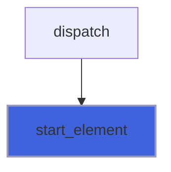

### end_element

An end tag (also right after a self closing start tag); does nothing unless overridden.

```fortran
subroutine end_element(self, name)
```

**Arguments**

| Name | Type | Intent | Attributes | Description |
|------|------|--------|------------|-------------|
| `self` | class([xml_handler](/api/src/third_party/FoXy/src/lib/foxy_xml_events#xml-handler)) | inout |  | Handler. |
| `name` | character(len=*) | in |  | Element name, as written. |

**Call graph**


### characters

Character data, decoded; the text between two tags may come in pieces (never splitting a reference or a UTF-8
 character); does nothing unless overridden.

```fortran
subroutine characters(self, text)
```

**Arguments**

| Name | Type | Intent | Attributes | Description |
|------|------|--------|------------|-------------|
| `self` | class([xml_handler](/api/src/third_party/FoXy/src/lib/foxy_xml_events#xml-handler)) | inout |  | Handler. |
| `text` | character(len=*) | in |  | Text. |

**Call graph**

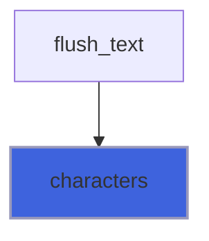

### cdata

CDATA content, literal (line ends normalized), maybe in pieces; does nothing unless overridden.

```fortran
subroutine cdata(self, text)
```

**Arguments**

| Name | Type | Intent | Attributes | Description |
|------|------|--------|------------|-------------|
| `self` | class([xml_handler](/api/src/third_party/FoXy/src/lib/foxy_xml_events#xml-handler)) | inout |  | Handler. |
| `text` | character(len=*) | in |  | Text. |

**Call graph**

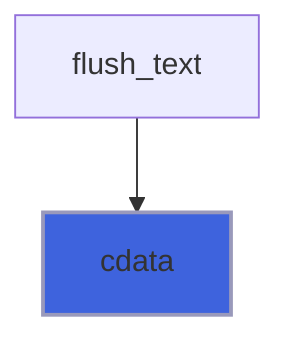

### comment

A comment, without `<!--` and `-->`; does nothing unless overridden.

```fortran
subroutine comment(self, text)
```

**Arguments**

| Name | Type | Intent | Attributes | Description |
|------|------|--------|------------|-------------|
| `self` | class([xml_handler](/api/src/third_party/FoXy/src/lib/foxy_xml_events#xml-handler)) | inout |  | Handler. |
| `text` | character(len=*) | in |  | Comment. |

**Call graph**

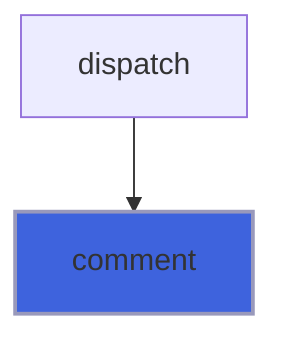

### processing_instruction

A processing instruction `<?target data?>` (the XML declaration included); does nothing unless overridden.

```fortran
subroutine processing_instruction(self, target, data)
```

**Arguments**

| Name | Type | Intent | Attributes | Description |
|------|------|--------|------------|-------------|
| `self` | class([xml_handler](/api/src/third_party/FoXy/src/lib/foxy_xml_events#xml-handler)) | inout |  | Handler. |
| `target` | character(len=*) | in |  | Target. |
| `data` | character(len=*) | in |  | Data, after the blanks following the target. |

**Call graph**

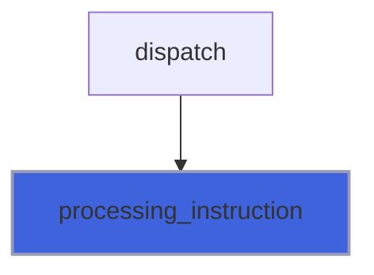

### doctype

A declaration (`<!DOCTYPE ...>`), as in the source; does nothing unless overridden.

```fortran
subroutine doctype(self, text)
```

**Arguments**

| Name | Type | Intent | Attributes | Description |
|------|------|--------|------------|-------------|
| `self` | class([xml_handler](/api/src/third_party/FoXy/src/lib/foxy_xml_events#xml-handler)) | inout |  | Handler. |
| `text` | character(len=*) | in |  | Declaration. |

**Call graph**

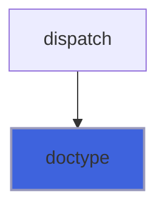

### problem

A problem of malformed input, as `line N: ...`; parsing goes on; does nothing unless overridden.

```fortran
subroutine problem(self, message)
```

**Arguments**

| Name | Type | Intent | Attributes | Description |
|------|------|--------|------------|-------------|
| `self` | class([xml_handler](/api/src/third_party/FoXy/src/lib/foxy_xml_events#xml-handler)) | inout |  | Handler. |
| `message` | character(len=*) | in |  | Problem description. |

**Call graph**

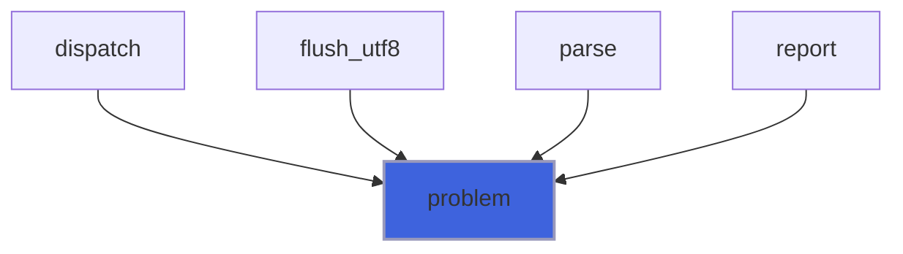

### stop_parsing

Stop parsing: no more callbacks, the rest of the source is not read, *parse* returns.

```fortran
subroutine stop_parsing(self)
```

**Arguments**

| Name | Type | Intent | Attributes | Description |
|------|------|--------|------------|-------------|
| `self` | class([xml_handler](/api/src/third_party/FoXy/src/lib/foxy_xml_events#xml-handler)) | inout |  | Handler. |

### parse

Parse a string or a file, calling the callbacks of the handler in source order.

 @note *iostat* is 0, the runtime I/O error code if the file cannot be read, or *XML_MALFORMED* if the input is
 malformed (every problem is also passed to *problem*; parsing is tolerant); *iomsg* holds the first problem, as
 `line N: ...`. Stopped by *stop_parsing*, *parse* returns the problems met so far.

```fortran
subroutine parse(self, string, filename, chunk_size, sanitize_attributes_value, iostat, iomsg)
```

**Arguments**

| Name | Type | Intent | Attributes | Description |
|------|------|--------|------------|-------------|
| `self` | class([xml_handler](/api/src/third_party/FoXy/src/lib/foxy_xml_events#xml-handler)) | inout |  | Handler. |
| `string` | character(len=*) | in | optional | Source string. |
| `filename` | character(len=*) | in | optional | Source file name. |
| `chunk_size` | integer(kind=[I8P](/api/src/third_party/PENF/src/lib/penf_global_parameters_variables)) | in | optional | Size of the chunks (default 1 MiB). |
| `sanitize_attributes_value` | logical | in | optional | Trim the spaces around values (default true). |
| `iostat` | integer(kind=[I4P](/api/src/third_party/PENF/src/lib/penf_global_parameters_variables)) | out | optional | IO status. |
| `iomsg` | character(len=*) | inout | optional | IO message. |

**Call graph**

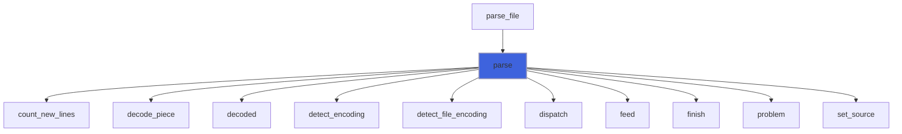

### dispatch

Call the handler for the events queued, then empty the queue.

 @note A module procedure with explicit arguments, not an internal procedure of *parse*: nvfortran 26.9 gives stale
 values of host-associated variables there.

```fortran
subroutine dispatch(self, builder, text_dec, cdata_dec, window, offset, lines, first_problem, is_last, is_file, chunk, unit, string, encoding)
```

**Arguments**

| Name | Type | Intent | Attributes | Description |
|------|------|--------|------------|-------------|
| `self` | class([xml_handler](/api/src/third_party/FoXy/src/lib/foxy_xml_events#xml-handler)) | inout |  | Handler. |
| `builder` | type([event_builder](/api/src/third_party/FoXy/src/lib/foxy_xml_events#event-builder)) | inout |  | Event builder. |
| `text_dec` | type([text_decoder](/api/src/third_party/FoXy/src/lib/foxy_xml_events#text-decoder)) | inout |  | Decoder of character data. |
| `cdata_dec` | type([text_decoder](/api/src/third_party/FoXy/src/lib/foxy_xml_events#text-decoder)) | inout |  | Decoder of CDATA. |
| `window` | character(len=*) | in |  | Window fed. |
| `offset` | integer(kind=[I8P](/api/src/third_party/PENF/src/lib/penf_global_parameters_variables)) | in |  | Position of the character before the window. |
| `lines` | integer(kind=[I8P](/api/src/third_party/PENF/src/lib/penf_global_parameters_variables)) | in |  | New lines before the window. |
| `first_problem` | character(len=:) | inout | allocatable | First problem, located. |
| `is_last` | logical | in |  | The source ended. |
| `is_file` | logical | in |  | The source is a file. |
| `chunk` | integer(kind=[I8P](/api/src/third_party/PENF/src/lib/penf_global_parameters_variables)) | in |  | Size of the chunks. |
| `unit` | integer(kind=[I4P](/api/src/third_party/PENF/src/lib/penf_global_parameters_variables)) | in |  | Unit of the source file (if a file). |
| `string` | character(len=*) | in | optional | Source string. |
| `encoding` | type([source_encoding](/api/src/third_party/FoXy/src/lib/foxy_xml_source#source-encoding)) | in |  | Encoding of the source. |

**Call graph**

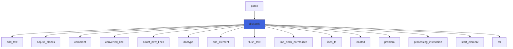

### add_text

Add a raw piece of text to a decoder.

**Attributes**: pure

```fortran
subroutine add_text(decoder, raw, pos)
```

**Arguments**

| Name | Type | Intent | Attributes | Description |
|------|------|--------|------------|-------------|
| `decoder` | type([text_decoder](/api/src/third_party/FoXy/src/lib/foxy_xml_events#text-decoder)) | inout |  | Decoder. |
| `raw` | character(len=*) | in |  | Raw piece. |
| `pos` | integer(kind=[I8P](/api/src/third_party/PENF/src/lib/penf_global_parameters_variables)) | in |  | Its position. |

**Call graph**

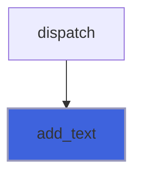

### flush_text

Pass to the handler the decoded text of a decoder: all of it if *is_final*, otherwise all but a final part that may
 continue in the next piece (a reference without `;`, a CR, an incomplete UTF-8 character).

```fortran
subroutine flush_text(self, decoder, is_final)
```

**Arguments**

| Name | Type | Intent | Attributes | Description |
|------|------|--------|------------|-------------|
| `self` | class([xml_handler](/api/src/third_party/FoXy/src/lib/foxy_xml_events#xml-handler)) | inout |  | Handler. |
| `decoder` | type([text_decoder](/api/src/third_party/FoXy/src/lib/foxy_xml_events#text-decoder)) | inout |  | Decoder. |
| `is_final` | logical | in |  | The text is complete. |

**Call graph**

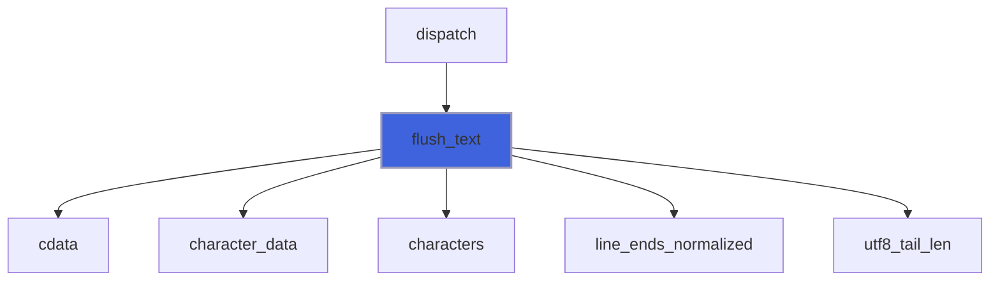

### push_event

Queue an event.

**Attributes**: pure

```fortran
subroutine push_event(self, kind, level, pos, name, text)
```

**Arguments**

| Name | Type | Intent | Attributes | Description |
|------|------|--------|------------|-------------|
| `self` | class([event_builder](/api/src/third_party/FoXy/src/lib/foxy_xml_events#event-builder)) | inout |  | Event builder. |
| `kind` | integer(kind=[I4P](/api/src/third_party/PENF/src/lib/penf_global_parameters_variables)) | in |  | Event kind. |
| `level` | integer(kind=[I4P](/api/src/third_party/PENF/src/lib/penf_global_parameters_variables)) | in |  | Element depth. |
| `pos` | integer(kind=[I8P](/api/src/third_party/PENF/src/lib/penf_global_parameters_variables)) | in |  | Position. |
| `name` | character(len=*) | in | optional | Element name, or message. |
| `text` | character(len=*) | in | optional | Raw text. |

**Call graph**

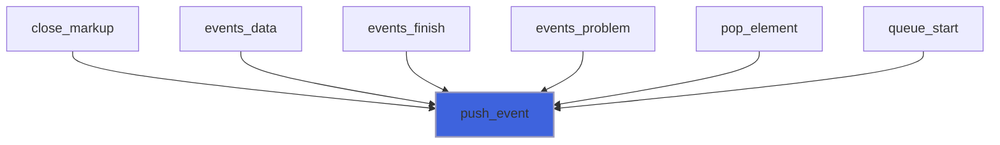

### pop_element

Close the innermost open element: queue its end event.

**Attributes**: pure

```fortran
subroutine pop_element(self, pos)
```

**Arguments**

| Name | Type | Intent | Attributes | Description |
|------|------|--------|------------|-------------|
| `self` | class([event_builder](/api/src/third_party/FoXy/src/lib/foxy_xml_events#event-builder)) | inout |  | Event builder. |
| `pos` | integer(kind=[I8P](/api/src/third_party/PENF/src/lib/penf_global_parameters_variables)) | in |  | Position of the end. |

**Call graph**

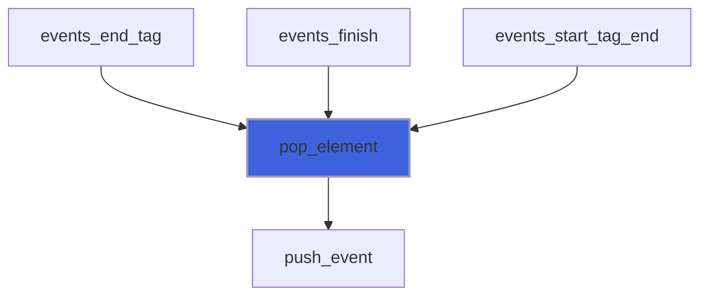

### queue_start

Queue the start event of the start tag read (with its attributes).

**Attributes**: pure

```fortran
subroutine queue_start(self)
```

**Arguments**

| Name | Type | Intent | Attributes | Description |
|------|------|--------|------------|-------------|
| `self` | class([event_builder](/api/src/third_party/FoXy/src/lib/foxy_xml_events#event-builder)) | inout |  | Event builder. |

**Call graph**

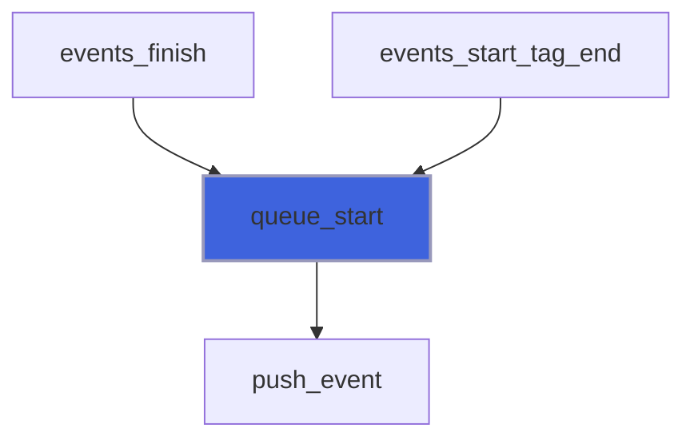

### events_start_tag

A start tag begins: its attributes follow.

**Attributes**: pure

```fortran
subroutine events_start_tag(self, id, parent_id, level, name, start)
```

**Arguments**

| Name | Type | Intent | Attributes | Description |
|------|------|--------|------------|-------------|
| `self` | class([event_builder](/api/src/third_party/FoXy/src/lib/foxy_xml_events#event-builder)) | inout |  | Event builder. |
| `id` | integer(kind=[I4P](/api/src/third_party/PENF/src/lib/penf_global_parameters_variables)) | in |  | Tag ID. |
| `parent_id` | integer(kind=[I4P](/api/src/third_party/PENF/src/lib/penf_global_parameters_variables)) | in |  | Parent tag ID. |
| `level` | integer(kind=[I4P](/api/src/third_party/PENF/src/lib/penf_global_parameters_variables)) | in |  | Tag level. |
| `name` | character(len=*) | in |  | Tag name. |
| `start` | integer(kind=[I8P](/api/src/third_party/PENF/src/lib/penf_global_parameters_variables)) | in |  | Position of `<`. |

### events_attribute

An attribute of the current start tag: normalized and decoded.

**Attributes**: pure

```fortran
subroutine events_attribute(self, id, name, value)
```

**Arguments**

| Name | Type | Intent | Attributes | Description |
|------|------|--------|------------|-------------|
| `self` | class([event_builder](/api/src/third_party/FoXy/src/lib/foxy_xml_events#event-builder)) | inout |  | Event builder. |
| `id` | integer(kind=[I4P](/api/src/third_party/PENF/src/lib/penf_global_parameters_variables)) | in |  | Tag ID. |
| `name` | character(len=*) | in |  | Attribute name. |
| `value` | character(len=*) | in |  | Attribute value, as in the source. |

**Call graph**

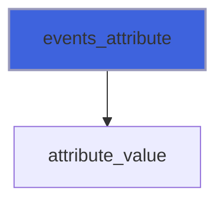

### events_start_tag_end

The current start tag is complete: queue its start (and, if self closing, its end).

**Attributes**: pure

```fortran
subroutine events_start_tag_end(self, id, start, open_end, is_self_closing)
```

**Arguments**

| Name | Type | Intent | Attributes | Description |
|------|------|--------|------------|-------------|
| `self` | class([event_builder](/api/src/third_party/FoXy/src/lib/foxy_xml_events#event-builder)) | inout |  | Event builder. |
| `id` | integer(kind=[I4P](/api/src/third_party/PENF/src/lib/penf_global_parameters_variables)) | in |  | Tag ID. |
| `start` | integer(kind=[I8P](/api/src/third_party/PENF/src/lib/penf_global_parameters_variables)) | in |  | Position of `<`. |
| `open_end` | integer(kind=[I8P](/api/src/third_party/PENF/src/lib/penf_global_parameters_variables)) | in |  | Position of `>`. |
| `is_self_closing` | logical | in |  | The tag is self closing. |

**Call graph**

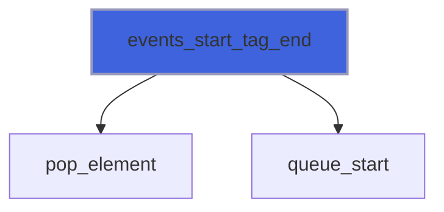

### events_end_tag

An open tag is closed by its end tag: queue the end of the inner open elements (closed implicitly), then its own.

**Attributes**: pure

```fortran
subroutine events_end_tag(self, id, start, open_end, end_start, end_end)
```

**Arguments**

| Name | Type | Intent | Attributes | Description |
|------|------|--------|------------|-------------|
| `self` | class([event_builder](/api/src/third_party/FoXy/src/lib/foxy_xml_events#event-builder)) | inout |  | Event builder. |
| `id` | integer(kind=[I4P](/api/src/third_party/PENF/src/lib/penf_global_parameters_variables)) | in |  | Tag ID. |
| `start` | integer(kind=[I8P](/api/src/third_party/PENF/src/lib/penf_global_parameters_variables)) | in |  | Position of the start tag `<`. |
| `open_end` | integer(kind=[I8P](/api/src/third_party/PENF/src/lib/penf_global_parameters_variables)) | in |  | Position of the start tag `>`. |
| `end_start` | integer(kind=[I8P](/api/src/third_party/PENF/src/lib/penf_global_parameters_variables)) | in |  | Position of the end tag `<`. |
| `end_end` | integer(kind=[I8P](/api/src/third_party/PENF/src/lib/penf_global_parameters_variables)) | in |  | Position of the end tag `>`. |

**Call graph**

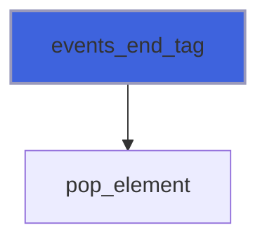

### events_data

Character data or other markup: text and CDATA queued as they come (CDATA without its markup), comments and PIs
 collected whole, declarations queued.

**Attributes**: pure

```fortran
subroutine events_data(self, kind, chars, first)
```

**Arguments**

| Name | Type | Intent | Attributes | Description |
|------|------|--------|------------|-------------|
| `self` | class([event_builder](/api/src/third_party/FoXy/src/lib/foxy_xml_events#event-builder)) | inout |  | Event builder. |
| `kind` | integer(kind=[I4P](/api/src/third_party/PENF/src/lib/penf_global_parameters_variables)) | in |  | Data kind, DATA_*. |
| `chars` | character(len=*) | in |  | Characters, as in the source. |
| `first` | integer(kind=[I8P](/api/src/third_party/PENF/src/lib/penf_global_parameters_variables)) | in |  | Position of the first character. |

**Call graph**

```mermaid
flowchart TD
  events_data["events_data"] --> close_markup["close_markup"]
  events_data["events_data"] --> push_event["push_event"]
  style events_data fill:#3e63dd,stroke:#99b,stroke-width:2px
```

### close_markup

Queue the comment or PI collected, if it is complete (or, with *is_final*, as it is: unterminated).

**Attributes**: pure

```fortran
subroutine close_markup(self, is_final)
```

**Arguments**

| Name | Type | Intent | Attributes | Description |
|------|------|--------|------------|-------------|
| `self` | class([event_builder](/api/src/third_party/FoXy/src/lib/foxy_xml_events#event-builder)) | inout |  | Event builder. |
| `is_final` | logical | in |  | The source ended. |

**Call graph**

```mermaid
flowchart TD
  events_data["events_data"] --> close_markup["close_markup"]
  events_finish["events_finish"] --> close_markup["close_markup"]
  events_problem["events_problem"] --> close_markup["close_markup"]
  close_markup["close_markup"] --> push_event["push_event"]
  style close_markup fill:#3e63dd,stroke:#99b,stroke-width:2px
```

### events_problem

A problem of malformed input: queued (every one, in order).

**Attributes**: pure

```fortran
subroutine events_problem(self, pos, message)
```

**Arguments**

| Name | Type | Intent | Attributes | Description |
|------|------|--------|------------|-------------|
| `self` | class([event_builder](/api/src/third_party/FoXy/src/lib/foxy_xml_events#event-builder)) | inout |  | Event builder. |
| `pos` | integer(kind=[I8P](/api/src/third_party/PENF/src/lib/penf_global_parameters_variables)) | in |  | Position of the problem. |
| `message` | character(len=*) | in |  | Problem description. |

**Call graph**

```mermaid
flowchart TD
  events_problem["events_problem"] --> close_markup["close_markup"]
  events_problem["events_problem"] --> push_event["push_event"]
  style events_problem fill:#3e63dd,stroke:#99b,stroke-width:2px
```

### events_finish

The source is ended: a start tag not completed, a comment/PI not terminated and the open elements are closed.

**Attributes**: pure

```fortran
subroutine events_finish(self)
```

**Arguments**

| Name | Type | Intent | Attributes | Description |
|------|------|--------|------------|-------------|
| `self` | class([event_builder](/api/src/third_party/FoXy/src/lib/foxy_xml_events#event-builder)) | inout |  | Event builder. |

**Call graph**

```mermaid
flowchart TD
  events_finish["events_finish"] --> close_markup["close_markup"]
  events_finish["events_finish"] --> pop_element["pop_element"]
  events_finish["events_finish"] --> push_event["push_event"]
  events_finish["events_finish"] --> queue_start["queue_start"]
  style events_finish fill:#3e63dd,stroke:#99b,stroke-width:2px
```

## Functions

### adjustl_blanks

Return a text without its leading XML blanks.

**Attributes**: pure

**Returns**: `character(len=:)`

```fortran
function adjustl_blanks(text) result(adjusted)
```

**Arguments**

| Name | Type | Intent | Attributes | Description |
|------|------|--------|------------|-------------|
| `text` | character(len=*) | in |  | Text. |

**Call graph**

```mermaid
flowchart TD
  dispatch["dispatch"] --> adjustl_blanks["adjustl_blanks"]
  style adjustl_blanks fill:#3e63dd,stroke:#99b,stroke-width:2px
```

### lines_to

Return the line of a position of an open stream file, counting its new lines (positioned reads, in chunks).

**Returns**: integer(kind=[I8P](/api/src/third_party/PENF/src/lib/penf_global_parameters_variables))

```fortran
function lines_to(unit, pos, chunk) result(line)
```

**Arguments**

| Name | Type | Intent | Attributes | Description |
|------|------|--------|------------|-------------|
| `unit` | integer(kind=[I4P](/api/src/third_party/PENF/src/lib/penf_global_parameters_variables)) | in |  | File unit. |
| `pos` | integer(kind=[I8P](/api/src/third_party/PENF/src/lib/penf_global_parameters_variables)) | in |  | Position. |
| `chunk` | integer(kind=[I8P](/api/src/third_party/PENF/src/lib/penf_global_parameters_variables)) | in |  | Size of the chunks read. |

**Call graph**

```mermaid
flowchart TD
  dispatch["dispatch"] --> lines_to["lines_to"]
  lines_to["lines_to"] --> count_new_lines["count_new_lines"]
  style lines_to fill:#3e63dd,stroke:#99b,stroke-width:2px
```

### count_new_lines

Return the number of new lines of a text.

**Attributes**: pure

**Returns**: integer(kind=[I8P](/api/src/third_party/PENF/src/lib/penf_global_parameters_variables))

```fortran
function count_new_lines(text) result(n)
```

**Arguments**

| Name | Type | Intent | Attributes | Description |
|------|------|--------|------------|-------------|
| `text` | character(len=*) | in |  | Text. |

**Call graph**

```mermaid
flowchart TD
  dispatch["dispatch"] --> count_new_lines["count_new_lines"]
  lines_to["lines_to"] --> count_new_lines["count_new_lines"]
  parse["parse"] --> count_new_lines["count_new_lines"]
  style count_new_lines fill:#3e63dd,stroke:#99b,stroke-width:2px
```
