# foxy_xml_file

> FoXy XML file class.

**Source**: `src/third_party/FoXy/src/lib/foxy_xml_file.f90`

**Dependencies**

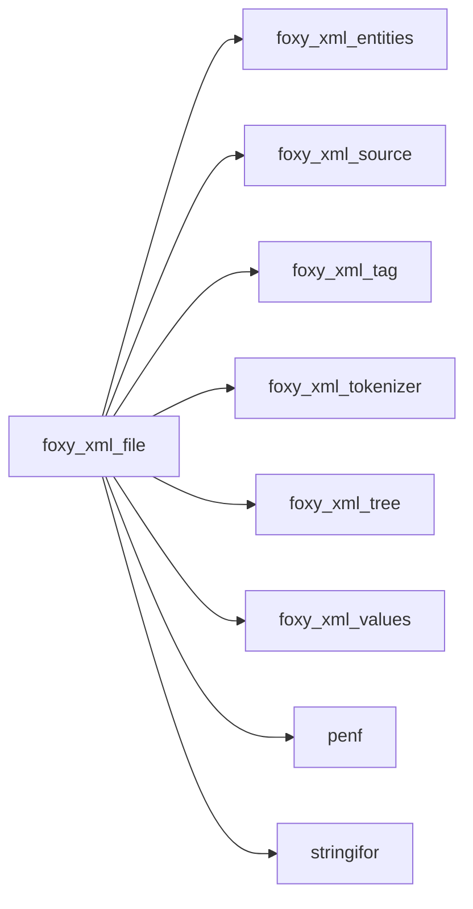

## Contents

- [xml_file](#xml-file)
- [dom_builder](#dom-builder)
- [add_tag](#add-tag)
- [make_room](#make-room)
- [insert_child](#insert-child)
- [delete_tag](#delete-tag)
- [delete_attribute](#delete-attribute)
- [set_attribute_character](#set-attribute-character)
- [set_content_character](#set-content-character)
- [set_attribute_I1P](#set-attribute-i1p)
- [set_attribute_I2P](#set-attribute-i2p)
- [set_attribute_I4P](#set-attribute-i4p)
- [set_attribute_I8P](#set-attribute-i8p)
- [set_attribute_R4P](#set-attribute-r4p)
- [set_attribute_R8P](#set-attribute-r8p)
- [set_attribute_logical](#set-attribute-logical)
- [set_attribute_I1P_1](#set-attribute-i1p-1)
- [set_attribute_I2P_1](#set-attribute-i2p-1)
- [set_attribute_I4P_1](#set-attribute-i4p-1)
- [set_attribute_I8P_1](#set-attribute-i8p-1)
- [set_attribute_R4P_1](#set-attribute-r4p-1)
- [set_attribute_R8P_1](#set-attribute-r8p-1)
- [set_content_I1P](#set-content-i1p)
- [set_content_I2P](#set-content-i2p)
- [set_content_I4P](#set-content-i4p)
- [set_content_I8P](#set-content-i8p)
- [set_content_R4P](#set-content-r4p)
- [set_content_R8P](#set-content-r8p)
- [set_content_logical](#set-content-logical)
- [set_content_I1P_1](#set-content-i1p-1)
- [set_content_I2P_1](#set-content-i2p-1)
- [set_content_I4P_1](#set-content-i4p-1)
- [set_content_I8P_1](#set-content-i8p-1)
- [set_content_R4P_1](#set-content-r4p-1)
- [set_content_R8P_1](#set-content-r8p-1)
- [set_name](#set-name)
- [free](#free)
- [parse](#parse)
- [save](#save)
- [append_inline](#append-inline)
- [append_inline_body](#append-inline-body)
- [delete_subtree](#delete-subtree)
- [parse_from_file](#parse-from-file)
- [parse_from_string](#parse-from-string)
- [stringify_recursive](#stringify-recursive)
- [attribute_text](#attribute-text)
- [content_text](#content-text)
- [get_attribute_I1P](#get-attribute-i1p)
- [get_attribute_I2P](#get-attribute-i2p)
- [get_attribute_I4P](#get-attribute-i4p)
- [get_attribute_I8P](#get-attribute-i8p)
- [get_attribute_R4P](#get-attribute-r4p)
- [get_attribute_R8P](#get-attribute-r8p)
- [get_attribute_logical](#get-attribute-logical)
- [get_attribute_I1P_1](#get-attribute-i1p-1)
- [get_attribute_I2P_1](#get-attribute-i2p-1)
- [get_attribute_I4P_1](#get-attribute-i4p-1)
- [get_attribute_I8P_1](#get-attribute-i8p-1)
- [get_attribute_R4P_1](#get-attribute-r4p-1)
- [get_attribute_R8P_1](#get-attribute-r8p-1)
- [get_content_I1P](#get-content-i1p)
- [get_content_I2P](#get-content-i2p)
- [get_content_I4P](#get-content-i4p)
- [get_content_I8P](#get-content-i8p)
- [get_content_R4P](#get-content-r4p)
- [get_content_R8P](#get-content-r8p)
- [get_content_logical](#get-content-logical)
- [get_content_I1P_1](#get-content-i1p-1)
- [get_content_I2P_1](#get-content-i2p-1)
- [get_content_I4P_1](#get-content-i4p-1)
- [get_content_I8P_1](#get-content-i8p-1)
- [get_content_R4P_1](#get-content-r4p-1)
- [get_content_R8P_1](#get-content-r8p-1)
- [finalize](#finalize)
- [dom_start_tag](#dom-start-tag)
- [dom_attribute](#dom-attribute)
- [dom_start_tag_end](#dom-start-tag-end)
- [dom_end_tag](#dom-end-tag)
- [dom_data](#dom-data)
- [dom_problem](#dom-problem)
- [dom_finish](#dom-finish)
- [dom_flush](#dom-flush)
- [append](#append)
- [last_in_subtree](#last-in-subtree)
- [attribute](#attribute)
- [children](#children)
- [content_by_id](#content-by-id)
- [find](#find)
- [find_all](#find-all)
- [select](#select)
- [content_by_name](#content-by-name)
- [attribute_name](#attribute-name)
- [attributes_number](#attributes-number)
- [tags_number](#tags-number)
- [level](#level)
- [local_name](#local-name)
- [matching](#matching)
- [name](#name)
- [namespace](#namespace)
- [parent](#parent)
- [prefix](#prefix)
- [stringify](#stringify)
- [direct_text](#direct-text)
- [is_mixed](#is-mixed)
- [raw_text](#raw-text)
- [starts_with_declaration](#starts-with-declaration)

## Variables

| Name | Type | Attributes | Description |
|------|------|------------|-------------|
| `XML_MALFORMED` | integer(kind=[I4P](/api/src/third_party/PENF/src/lib/penf_global_parameters_variables)) | parameter | *iostat* of parse for malformed XML input. |
| `INITIAL_CAPACITY` | integer(kind=[I4P](/api/src/third_party/PENF/src/lib/penf_global_parameters_variables)) | parameter | Initial capacity of the tags array, doubled when full. |
| `INITIAL_BUFFER_LEN` | integer(kind=[I8P](/api/src/third_party/PENF/src/lib/penf_global_parameters_variables)) | parameter | Initial length of the stringify buffer, doubled when full. |
| `FILE_CHUNK_SIZE` | integer(kind=[I8P](/api/src/third_party/PENF/src/lib/penf_global_parameters_variables)) | parameter | Default size of the chunks read from a file (1 MiB). |
| `BLANKS` | character(len=*) | parameter | XML blanks: space, tab, new line, CR. |
| `XML_DECLARATION` | character(len=*) | parameter | XML declaration written by *save*. |

## Derived Types

### xml_file

XML file class.

#### Components

| Name | Type | Attributes | Description |
|------|------|------------|-------------|
| `tag` | type([xml_tag](/api/src/third_party/FoXy/src/lib/foxy_xml_tag#xml-tag)) | allocatable | XML tags array. |
| `nt` | integer(kind=[I4P](/api/src/third_party/PENF/src/lib/penf_global_parameters_variables)) |  | Number of XML tags. |
| `prolog` | character(len=:) | allocatable | Markup before the root tag (XML declaration, DOCTYPE, comments, PIs), |

#### Type-Bound Procedures

| Name | Attributes | Description |
|------|------------|-------------|
| `add_tag` | pass(self) | Add tag to XML file. |
| `attribute` | pass(self) | Return the value of an attribute of the tag with a given ID. |
| `attribute_name` | pass(self) | Return the name of the attribute with a given index of a tag. |
| `attributes_number` | pass(self) | Return the number of attributes of the tag with a given ID. |
| `children` | pass(self) | Return the IDs of the children of the tag with a given ID. |
| `content` |  | Return tag content, by tag name or ID. |
| `delete_attribute` | pass(self) | Delete an attribute of the tag with a given ID. |
| `delete_tag` | pass(self) | Delete a tag (by name or ID) with its subtree. |
| `find` | pass(self) | Return the ID of the first tag matching a name or a path. |
| `find_all` | pass(self) | Return the IDs of all tags matching a name or a path. |
| `select` | pass(self) | Return the IDs of the tags selected by a path expression. |
| `free` | pass(self) | Free dynamic memory. |
| `get_attribute` |  | Get the value of an attribute as number(s) or logical. |
| `get_content` |  | Get the content of a tag as number(s) or logical. |
| `level` | pass(self) | Return the level of the tag with a given ID. |
| `local_name` | pass(self) | Return the local name of the tag with a given ID. |
| `matching` | pass(self) | Filter tags by a regular expression (name, content, attribute). |
| `name` | pass(self) | Return the name of the tag with a given ID. |
| `namespace` | pass(self) | Return the namespace of the tag with a given ID. |
| `parent` | pass(self) | Return the parent ID of the tag with a given ID. |
| `prefix` | pass(self) | Return the name prefix of the tag with a given ID. |
| `parse` | pass(self) | Parse xml file. |
| `save` | pass(self) | Save the whole file data into a file. |
| `set_attribute` |  | Set an attribute of a tag (text, number, list). |
| `set_content` |  | Set the content of a tag (text, number, list). |
| `set_name` | pass(self) | Rename the tag with a given ID. |
| `stringify` | pass(self) | Convert the whole file data into a string. |
| `tags_number` | pass(self) | Return the number of tags. |
| `append_inline` | pass(self) | Append a tag with its subtree, without layout. |
| `set_attribute_character` | pass(self) |  |
| `set_attribute_I1P` | pass(self) |  |
| `set_attribute_I2P` | pass(self) |  |
| `set_attribute_I4P` | pass(self) |  |
| `set_attribute_I8P` | pass(self) |  |
| `set_attribute_R4P` | pass(self) |  |
| `set_attribute_R8P` | pass(self) |  |
| `set_attribute_logical` | pass(self) |  |
| `set_attribute_I1P_1` | pass(self) |  |
| `set_attribute_I2P_1` | pass(self) |  |
| `set_attribute_I4P_1` | pass(self) |  |
| `set_attribute_I8P_1` | pass(self) |  |
| `set_attribute_R4P_1` | pass(self) |  |
| `set_attribute_R8P_1` | pass(self) |  |
| `set_content_character` | pass(self) |  |
| `set_content_I1P` | pass(self) |  |
| `set_content_I2P` | pass(self) |  |
| `set_content_I4P` | pass(self) |  |
| `set_content_I8P` | pass(self) |  |
| `set_content_R4P` | pass(self) |  |
| `set_content_R8P` | pass(self) |  |
| `set_content_logical` | pass(self) |  |
| `set_content_I1P_1` | pass(self) |  |
| `set_content_I2P_1` | pass(self) |  |
| `set_content_I4P_1` | pass(self) |  |
| `set_content_I8P_1` | pass(self) |  |
| `set_content_R4P_1` | pass(self) |  |
| `set_content_R8P_1` | pass(self) |  |
| `delete_subtree` | pass(self) | Delete a tag and its subtree, renumbering the others. |
| `last_in_subtree` | pass(self) | Return the greatest ID of a subtree. |
| `make_room` | pass(self) | Move the tags from an ID on by one place. |
| `append_inline_body` | pass(self) | Append a tag text, children and their tails, without layout. |
| `direct_text` | pass(self) | Return a tag text plus its children tails (raw). |
| `is_mixed` | pass(self) | Check if a tag has mixed content. |
| `raw_text` | pass(self) | Return a tag stored text (raw). |
| `content_by_id` | pass(self) | Return tag content of the tag with a given ID. |
| `content_by_name` | pass(self) | Return tag content of tag named *name*. |
| `parse_from_file` | pass(self) | Parse xml data from a file, read in chunks. |
| `parse_from_string` | pass(self) | Parse xml data from string. |
| `stringify_recursive` | pass(self) | Convert recursively tags with children into a string. |
| `attribute_text` | pass(self) | Return an attribute value, reporting a missing one. |
| `content_text` | pass(self) | Return a tag content, reporting a missing tag. |
| `get_attribute_I1P` | pass(self) |  |
| `get_attribute_I2P` | pass(self) |  |
| `get_attribute_I4P` | pass(self) |  |
| `get_attribute_I8P` | pass(self) |  |
| `get_attribute_R4P` | pass(self) |  |
| `get_attribute_R8P` | pass(self) |  |
| `get_attribute_logical` | pass(self) |  |
| `get_attribute_I1P_1` | pass(self) |  |
| `get_attribute_I2P_1` | pass(self) |  |
| `get_attribute_I4P_1` | pass(self) |  |
| `get_attribute_I8P_1` | pass(self) |  |
| `get_attribute_R4P_1` | pass(self) |  |
| `get_attribute_R8P_1` | pass(self) |  |
| `get_content_I1P` | pass(self) |  |
| `get_content_I2P` | pass(self) |  |
| `get_content_I4P` | pass(self) |  |
| `get_content_I8P` | pass(self) |  |
| `get_content_R4P` | pass(self) |  |
| `get_content_R8P` | pass(self) |  |
| `get_content_logical` | pass(self) |  |
| `get_content_I1P_1` | pass(self) |  |
| `get_content_I2P_1` | pass(self) |  |
| `get_content_I4P_1` | pass(self) |  |
| `get_content_I8P_1` | pass(self) |  |
| `get_content_R4P_1` | pass(self) |  |
| `get_content_R8P_1` | pass(self) |  |

### dom_builder

Builder of the DOM of an XML file, driven by the tokenizer.

 The text of a tag ends at its first child or at its end tag; the tail of a tag (mixed content) is the character data
 after its end tag, up to the next sibling or the parent end tag. Tails and the text of a tag with children are stored
 raw (they are written back verbatim by mixed content tags), the text of a leaf tag is trimmed of spaces. CDATA
 sections, comments and processing instructions are part of the text; the markup before the first tag is the prolog.

**Inheritance**

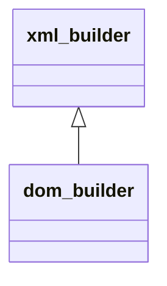

**Extends**: [`xml_builder`](/api/src/third_party/FoXy/src/lib/foxy_xml_tokenizer#xml-builder)

#### Components

| Name | Type | Attributes | Description |
|------|------|------------|-------------|
| `is_stopped` | logical |  | Set by the builder to stop the tokenizer (checked after each complete start or end tag). |
| `doc` | type([xml_file](/api/src/third_party/FoXy/src/lib/foxy_xml_file#xml-file)) |  | Document being built. |
| `sanitize` | logical |  | Trim leading and trailing spaces of attribute values. |
| `owner` | integer(kind=[I4P](/api/src/third_party/PENF/src/lib/penf_global_parameters_variables)) |  | ID of the tag owning the current character data, 0 if none. |
| `is_tail` | logical |  | The current character data is the owner tail, not its text. |
| `text` | character(len=:) | allocatable | Current character data (buffer). |
| `text_n` | integer(kind=[I8P](/api/src/third_party/PENF/src/lib/penf_global_parameters_variables)) |  | Length of the current character data. |
| `prolog` | character(len=:) | allocatable | Markup before the first tag (buffer). |
| `prolog_n` | integer(kind=[I8P](/api/src/third_party/PENF/src/lib/penf_global_parameters_variables)) |  | Length of the markup before the first tag. |
| `first_problem` | character(len=:) | allocatable | First problem of malformed input, unallocated if none. |
| `problem_pos` | integer(kind=[I8P](/api/src/third_party/PENF/src/lib/penf_global_parameters_variables)) |  | Position of the first problem. |

#### Type-Bound Procedures

| Name | Attributes | Description |
|------|------------|-------------|
| `start_tag` | pass(self) | A start tag begins. |
| `attribute` | pass(self) | An attribute of the current start tag. |
| `start_tag_end` | pass(self) | The current start tag is complete. |
| `end_tag` | pass(self) | An open tag is closed by its end tag. |
| `data` | pass(self) | Character data or other markup. |
| `problem` | pass(self) | A problem of malformed input. |
| `finish` | pass(self) | Complete the DOM at the source end. |
| `flush` | pass(self) | Store the current character data into its owner. |

## Subroutines

### add_tag

Add tag to XML file: as the last child of the tag with ID *parent* or, if *parent* is not passed (or 0), as a root tag;
 with *before* (or *after*), as the sibling right before (after) the tag with that ID. Its own children (if any) are
 not kept.

 @note Tags IDs are the tags indexes into the tags array. Appended, the tag gets the new number of tags as ID: in a
 built document IDs follow the insertion order. Inserted (*before*, *after*), it takes the place of the sibling (or
 the place after the sibling subtree) and the following tags are renumbered, so that a parsed document keeps the
 document order; a child ID is always greater than its parent one, as *delete_tag* requires.
 @note The tags array capacity is doubled when full, thus adding n tags costs O(n) tags copies, not O(n^2): only the
 first *nt* elements are tags, the others are spare capacity.
 @note The tag is not added (*id* is 0) if *parent* is not a tag ID, if *before* (or *after*) is not a tag ID or not a
 child of *parent* (when passed), or if both *before* and *after* are passed.

**Attributes**: elemental

```fortran
subroutine add_tag(self, tag, parent, id, before, after)
```

**Arguments**

| Name | Type | Intent | Attributes | Description |
|------|------|--------|------------|-------------|
| `self` | class([xml_file](/api/src/third_party/FoXy/src/lib/foxy_xml_file#xml-file)) | inout |  | XML file. |
| `tag` | type([xml_tag](/api/src/third_party/FoXy/src/lib/foxy_xml_tag#xml-tag)) | in |  | XML tag. |
| `parent` | integer(kind=[I4P](/api/src/third_party/PENF/src/lib/penf_global_parameters_variables)) | in | optional | Parent tag ID, 0 for a root tag. |
| `id` | integer(kind=[I4P](/api/src/third_party/PENF/src/lib/penf_global_parameters_variables)) | out | optional | ID of the added tag, 0 if not added. |
| `before` | integer(kind=[I4P](/api/src/third_party/PENF/src/lib/penf_global_parameters_variables)) | in | optional | ID of the sibling the tag is inserted before. |
| `after` | integer(kind=[I4P](/api/src/third_party/PENF/src/lib/penf_global_parameters_variables)) | in | optional | ID of the sibling the tag is inserted after. |

**Call graph**

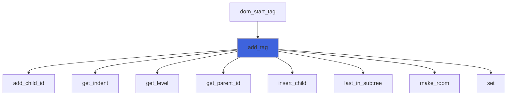

### make_room

Move the tags from ID *k* on by one place, renumbering every reference to them (IDs, parents, children lists).

**Attributes**: pure

```fortran
subroutine make_room(self, k)
```

**Arguments**

| Name | Type | Intent | Attributes | Description |
|------|------|--------|------------|-------------|
| `self` | class([xml_file](/api/src/third_party/FoXy/src/lib/foxy_xml_file#xml-file)) | inout |  | XML file (with spare capacity for one more tag). |
| `k` | integer(kind=[I4P](/api/src/third_party/PENF/src/lib/penf_global_parameters_variables)) | in |  | First ID moved. |

**Call graph**

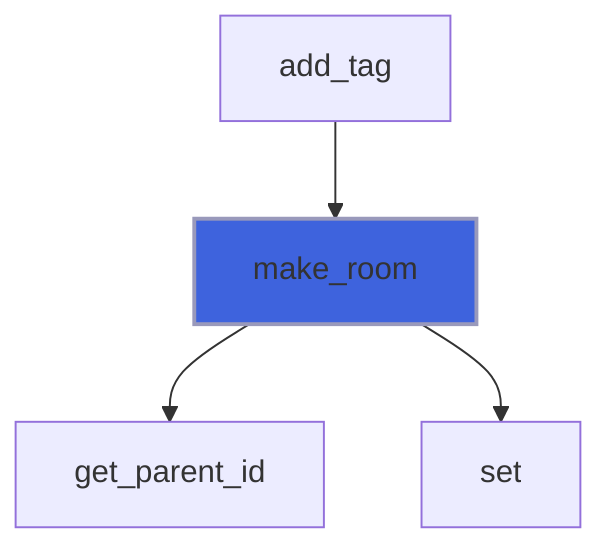

### insert_child

Insert *child* in the children list of *parent*, before (or after) the child with ID *at*.

**Attributes**: pure

```fortran
subroutine insert_child(parent, child, at, is_before)
```

**Arguments**

| Name | Type | Intent | Attributes | Description |
|------|------|--------|------------|-------------|
| `parent` | type([xml_tag](/api/src/third_party/FoXy/src/lib/foxy_xml_tag#xml-tag)) | inout |  | Parent tag. |
| `child` | integer(kind=[I4P](/api/src/third_party/PENF/src/lib/penf_global_parameters_variables)) | in |  | Child ID. |
| `at` | integer(kind=[I4P](/api/src/third_party/PENF/src/lib/penf_global_parameters_variables)) | in |  | ID of the sibling. |
| `is_before` | logical | in |  | Insert before the sibling, otherwise after. |

**Call graph**

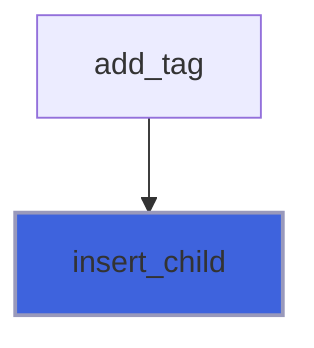

### delete_tag

Delete from XML file the first tag named *name* or, if *id* is passed, the tag with ID *id*, together with its whole
 subtree (nothing is deleted if there is no such tag).

 @note Tags IDs are the tags indexes into the tags array: the remaining tags are renumbered, parent and children IDs
 included (the IDs before the deleted tag do not change).

**Attributes**: elemental

```fortran
subroutine delete_tag(self, name, id)
```

**Arguments**

| Name | Type | Intent | Attributes | Description |
|------|------|--------|------------|-------------|
| `self` | class([xml_file](/api/src/third_party/FoXy/src/lib/foxy_xml_file#xml-file)) | inout |  | XML file. |
| `name` | character(len=*) | in | optional | XML tag name. |
| `id` | integer(kind=[I4P](/api/src/third_party/PENF/src/lib/penf_global_parameters_variables)) | in | optional | XML tag ID. |

**Call graph**

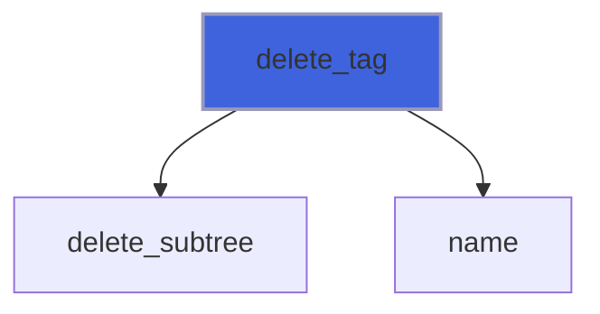

### delete_attribute

Delete the attribute named *name* of the tag with ID *id*.

 @note *iostat* is *XML_NOT_FOUND* if the tag or the attribute does not exist (*iomsg* unchanged on success).

**Attributes**: pure

```fortran
subroutine delete_attribute(self, id, name, iostat, iomsg)
```

**Arguments**

| Name | Type | Intent | Attributes | Description |
|------|------|--------|------------|-------------|
| `self` | class([xml_file](/api/src/third_party/FoXy/src/lib/foxy_xml_file#xml-file)) | inout |  | XML file. |
| `id` | integer(kind=[I4P](/api/src/third_party/PENF/src/lib/penf_global_parameters_variables)) | in |  | Tag ID. |
| `name` | character(len=*) | in |  | Attribute name. |
| `iostat` | integer(kind=[I4P](/api/src/third_party/PENF/src/lib/penf_global_parameters_variables)) | out | optional | IO status. |
| `iomsg` | character(len=*) | inout | optional | IO message. |

**Call graph**

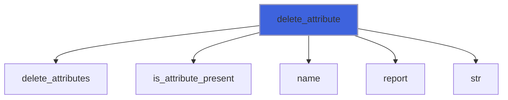

### set_attribute_character

Set the attribute named *name* of the tag with ID *id*: added (last) or, if present, its value replaced; *value* is
 escaped (markup characters, tab, new line and CR), *attribute* returns it as passed.

 @note *iostat* is *XML_NOT_FOUND* if the tag does not exist, *XML_MALFORMED* if *name* is not an XML name (nothing is
 set); *iomsg* is unchanged on success.

**Attributes**: pure

```fortran
subroutine set_attribute_character(self, id, name, value, iostat, iomsg)
```

**Arguments**

| Name | Type | Intent | Attributes | Description |
|------|------|--------|------------|-------------|
| `self` | class([xml_file](/api/src/third_party/FoXy/src/lib/foxy_xml_file#xml-file)) | inout |  | XML file. |
| `id` | integer(kind=[I4P](/api/src/third_party/PENF/src/lib/penf_global_parameters_variables)) | in |  | Tag ID. |
| `name` | character(len=*) | in |  | Attribute name. |
| `value` | character(len=*) | in |  | Attribute value. |
| `iostat` | integer(kind=[I4P](/api/src/third_party/PENF/src/lib/penf_global_parameters_variables)) | out | optional | IO status. |
| `iomsg` | character(len=*) | inout | optional | IO message. |

**Call graph**

```mermaid
flowchart TD
  set_attribute_I1P["set_attribute_I1P"] --> set_attribute_character["set_attribute_character"]
  set_attribute_I1P_1["set_attribute_I1P_1"] --> set_attribute_character["set_attribute_character"]
  set_attribute_I2P["set_attribute_I2P"] --> set_attribute_character["set_attribute_character"]
  set_attribute_I2P_1["set_attribute_I2P_1"] --> set_attribute_character["set_attribute_character"]
  set_attribute_I4P["set_attribute_I4P"] --> set_attribute_character["set_attribute_character"]
  set_attribute_I4P_1["set_attribute_I4P_1"] --> set_attribute_character["set_attribute_character"]
  set_attribute_I8P["set_attribute_I8P"] --> set_attribute_character["set_attribute_character"]
  set_attribute_I8P_1["set_attribute_I8P_1"] --> set_attribute_character["set_attribute_character"]
  set_attribute_R4P["set_attribute_R4P"] --> set_attribute_character["set_attribute_character"]
  set_attribute_R4P_1["set_attribute_R4P_1"] --> set_attribute_character["set_attribute_character"]
  set_attribute_R8P["set_attribute_R8P"] --> set_attribute_character["set_attribute_character"]
  set_attribute_R8P_1["set_attribute_R8P_1"] --> set_attribute_character["set_attribute_character"]
  set_attribute_logical["set_attribute_logical"] --> set_attribute_character["set_attribute_character"]
  set_attribute_character["set_attribute_character"] --> is_name["is_name"]
  set_attribute_character["set_attribute_character"] --> report["report"]
  set_attribute_character["set_attribute_character"] --> set["set"]
  set_attribute_character["set_attribute_character"] --> str["str"]
  set_attribute_character["set_attribute_character"] --> xml_escape["xml_escape"]
  style set_attribute_character fill:#3e63dd,stroke:#99b,stroke-width:2px
```

### set_content_character

Set the content of the tag with ID *id*: its children (with their subtrees) are deleted, *content* becomes its whole
 content (a self closing tag gets an end tag).

 @note As for *xml_tag* contents, *content* is stored as it is (it may hold markup): character data from the user must
 be escaped first with *xml_escape*. The children deleted renumber the following tags, as *delete_tag*.
 @note *iostat* is *XML_NOT_FOUND* if the tag does not exist (*iomsg* unchanged on success).

**Attributes**: pure

```fortran
subroutine set_content_character(self, id, content, iostat, iomsg)
```

**Arguments**

| Name | Type | Intent | Attributes | Description |
|------|------|--------|------------|-------------|
| `self` | class([xml_file](/api/src/third_party/FoXy/src/lib/foxy_xml_file#xml-file)) | inout |  | XML file. |
| `id` | integer(kind=[I4P](/api/src/third_party/PENF/src/lib/penf_global_parameters_variables)) | in |  | Tag ID. |
| `content` | character(len=*) | in |  | Tag content. |
| `iostat` | integer(kind=[I4P](/api/src/third_party/PENF/src/lib/penf_global_parameters_variables)) | out | optional | IO status. |
| `iomsg` | character(len=*) | inout | optional | IO message. |

**Call graph**

```mermaid
flowchart TD
  set_content_I1P["set_content_I1P"] --> set_content_character["set_content_character"]
  set_content_I1P_1["set_content_I1P_1"] --> set_content_character["set_content_character"]
  set_content_I2P["set_content_I2P"] --> set_content_character["set_content_character"]
  set_content_I2P_1["set_content_I2P_1"] --> set_content_character["set_content_character"]
  set_content_I4P["set_content_I4P"] --> set_content_character["set_content_character"]
  set_content_I4P_1["set_content_I4P_1"] --> set_content_character["set_content_character"]
  set_content_I8P["set_content_I8P"] --> set_content_character["set_content_character"]
  set_content_I8P_1["set_content_I8P_1"] --> set_content_character["set_content_character"]
  set_content_R4P["set_content_R4P"] --> set_content_character["set_content_character"]
  set_content_R4P_1["set_content_R4P_1"] --> set_content_character["set_content_character"]
  set_content_R8P["set_content_R8P"] --> set_content_character["set_content_character"]
  set_content_R8P_1["set_content_R8P_1"] --> set_content_character["set_content_character"]
  set_content_logical["set_content_logical"] --> set_content_character["set_content_character"]
  set_content_character["set_content_character"] --> delete_subtree["delete_subtree"]
  set_content_character["set_content_character"] --> report["report"]
  set_content_character["set_content_character"] --> set["set"]
  set_content_character["set_content_character"] --> str["str"]
  style set_content_character fill:#3e63dd,stroke:#99b,stroke-width:2px
```

### set_attribute_I1P

Set the attribute named *name* of the tag with ID *id* to integer(I1P) value (as *to_text*).

**Attributes**: pure

```fortran
subroutine set_attribute_I1P(self, id, name, value, fmt, iostat, iomsg)
```

**Arguments**

| Name | Type | Intent | Attributes | Description |
|------|------|--------|------------|-------------|
| `self` | class([xml_file](/api/src/third_party/FoXy/src/lib/foxy_xml_file#xml-file)) | inout |  | XML file. |
| `id` | integer(kind=[I4P](/api/src/third_party/PENF/src/lib/penf_global_parameters_variables)) | in |  | Tag ID. |
| `name` | character(len=*) | in |  | Attribute name. |
| `value` | integer(kind=[I1P](/api/src/third_party/PENF/src/lib/penf_global_parameters_variables)) | in |  | Value. |
| `fmt` | character(len=*) | in | optional | Format (of each value), e.g. `(F6.3)`. |
| `iostat` | integer(kind=[I4P](/api/src/third_party/PENF/src/lib/penf_global_parameters_variables)) | out | optional | IO status. |
| `iomsg` | character(len=*) | inout | optional | IO message. |

**Call graph**


### set_attribute_I2P

Set the attribute named *name* of the tag with ID *id* to integer(I2P) value (as *to_text*).

**Attributes**: pure

```fortran
subroutine set_attribute_I2P(self, id, name, value, fmt, iostat, iomsg)
```

**Arguments**

| Name | Type | Intent | Attributes | Description |
|------|------|--------|------------|-------------|
| `self` | class([xml_file](/api/src/third_party/FoXy/src/lib/foxy_xml_file#xml-file)) | inout |  | XML file. |
| `id` | integer(kind=[I4P](/api/src/third_party/PENF/src/lib/penf_global_parameters_variables)) | in |  | Tag ID. |
| `name` | character(len=*) | in |  | Attribute name. |
| `value` | integer(kind=[I2P](/api/src/third_party/PENF/src/lib/penf_global_parameters_variables)) | in |  | Value. |
| `fmt` | character(len=*) | in | optional | Format (of each value), e.g. `(F6.3)`. |
| `iostat` | integer(kind=[I4P](/api/src/third_party/PENF/src/lib/penf_global_parameters_variables)) | out | optional | IO status. |
| `iomsg` | character(len=*) | inout | optional | IO message. |

**Call graph**


### set_attribute_I4P

Set the attribute named *name* of the tag with ID *id* to integer(I4P) value (as *to_text*).

**Attributes**: pure

```fortran
subroutine set_attribute_I4P(self, id, name, value, fmt, iostat, iomsg)
```

**Arguments**

| Name | Type | Intent | Attributes | Description |
|------|------|--------|------------|-------------|
| `self` | class([xml_file](/api/src/third_party/FoXy/src/lib/foxy_xml_file#xml-file)) | inout |  | XML file. |
| `id` | integer(kind=[I4P](/api/src/third_party/PENF/src/lib/penf_global_parameters_variables)) | in |  | Tag ID. |
| `name` | character(len=*) | in |  | Attribute name. |
| `value` | integer(kind=[I4P](/api/src/third_party/PENF/src/lib/penf_global_parameters_variables)) | in |  | Value. |
| `fmt` | character(len=*) | in | optional | Format (of each value), e.g. `(F6.3)`. |
| `iostat` | integer(kind=[I4P](/api/src/third_party/PENF/src/lib/penf_global_parameters_variables)) | out | optional | IO status. |
| `iomsg` | character(len=*) | inout | optional | IO message. |

**Call graph**


### set_attribute_I8P

Set the attribute named *name* of the tag with ID *id* to integer(I8P) value (as *to_text*).

**Attributes**: pure

```fortran
subroutine set_attribute_I8P(self, id, name, value, fmt, iostat, iomsg)
```

**Arguments**

| Name | Type | Intent | Attributes | Description |
|------|------|--------|------------|-------------|
| `self` | class([xml_file](/api/src/third_party/FoXy/src/lib/foxy_xml_file#xml-file)) | inout |  | XML file. |
| `id` | integer(kind=[I4P](/api/src/third_party/PENF/src/lib/penf_global_parameters_variables)) | in |  | Tag ID. |
| `name` | character(len=*) | in |  | Attribute name. |
| `value` | integer(kind=[I8P](/api/src/third_party/PENF/src/lib/penf_global_parameters_variables)) | in |  | Value. |
| `fmt` | character(len=*) | in | optional | Format (of each value), e.g. `(F6.3)`. |
| `iostat` | integer(kind=[I4P](/api/src/third_party/PENF/src/lib/penf_global_parameters_variables)) | out | optional | IO status. |
| `iomsg` | character(len=*) | inout | optional | IO message. |

**Call graph**

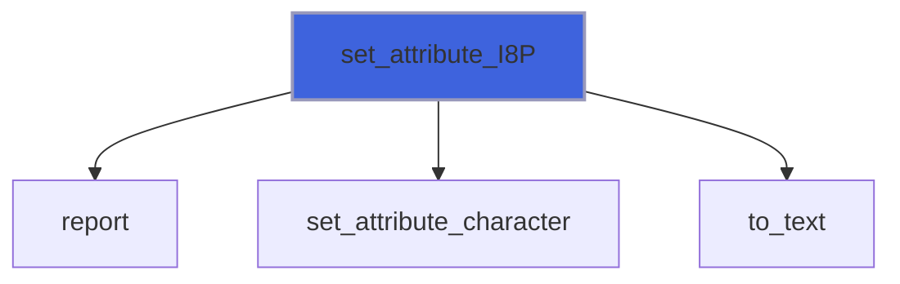

### set_attribute_R4P

Set the attribute named *name* of the tag with ID *id* to real(R4P) value (as *to_text*).

**Attributes**: pure

```fortran
subroutine set_attribute_R4P(self, id, name, value, fmt, iostat, iomsg)
```

**Arguments**

| Name | Type | Intent | Attributes | Description |
|------|------|--------|------------|-------------|
| `self` | class([xml_file](/api/src/third_party/FoXy/src/lib/foxy_xml_file#xml-file)) | inout |  | XML file. |
| `id` | integer(kind=[I4P](/api/src/third_party/PENF/src/lib/penf_global_parameters_variables)) | in |  | Tag ID. |
| `name` | character(len=*) | in |  | Attribute name. |
| `value` | real(kind=[R4P](/api/src/third_party/PENF/src/lib/penf_global_parameters_variables)) | in |  | Value. |
| `fmt` | character(len=*) | in | optional | Format (of each value), e.g. `(F6.3)`. |
| `iostat` | integer(kind=[I4P](/api/src/third_party/PENF/src/lib/penf_global_parameters_variables)) | out | optional | IO status. |
| `iomsg` | character(len=*) | inout | optional | IO message. |

**Call graph**

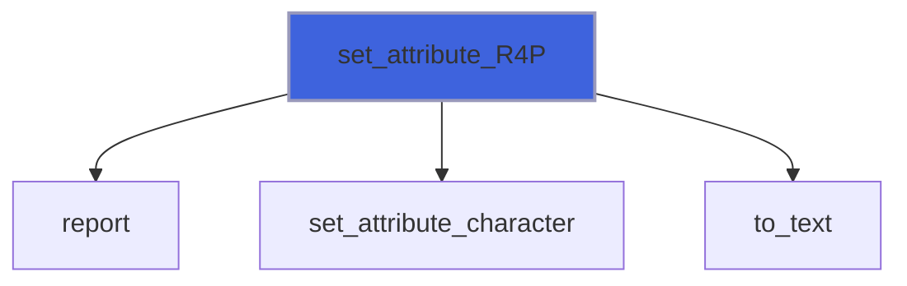

### set_attribute_R8P

Set the attribute named *name* of the tag with ID *id* to real(R8P) value (as *to_text*).

**Attributes**: pure

```fortran
subroutine set_attribute_R8P(self, id, name, value, fmt, iostat, iomsg)
```

**Arguments**

| Name | Type | Intent | Attributes | Description |
|------|------|--------|------------|-------------|
| `self` | class([xml_file](/api/src/third_party/FoXy/src/lib/foxy_xml_file#xml-file)) | inout |  | XML file. |
| `id` | integer(kind=[I4P](/api/src/third_party/PENF/src/lib/penf_global_parameters_variables)) | in |  | Tag ID. |
| `name` | character(len=*) | in |  | Attribute name. |
| `value` | real(kind=[R8P](/api/src/third_party/PENF/src/lib/penf_global_parameters_variables)) | in |  | Value. |
| `fmt` | character(len=*) | in | optional | Format (of each value), e.g. `(F6.3)`. |
| `iostat` | integer(kind=[I4P](/api/src/third_party/PENF/src/lib/penf_global_parameters_variables)) | out | optional | IO status. |
| `iomsg` | character(len=*) | inout | optional | IO message. |

**Call graph**


### set_attribute_logical

Set the attribute named *name* of the tag with ID *id* to logical value (as *to_text*).

**Attributes**: pure

```fortran
subroutine set_attribute_logical(self, id, name, value, iostat, iomsg)
```

**Arguments**

| Name | Type | Intent | Attributes | Description |
|------|------|--------|------------|-------------|
| `self` | class([xml_file](/api/src/third_party/FoXy/src/lib/foxy_xml_file#xml-file)) | inout |  | XML file. |
| `id` | integer(kind=[I4P](/api/src/third_party/PENF/src/lib/penf_global_parameters_variables)) | in |  | Tag ID. |
| `name` | character(len=*) | in |  | Attribute name. |
| `value` | logical | in |  | Value. |
| `iostat` | integer(kind=[I4P](/api/src/third_party/PENF/src/lib/penf_global_parameters_variables)) | out | optional | IO status. |
| `iomsg` | character(len=*) | inout | optional | IO message. |

**Call graph**


### set_attribute_I1P_1

Set the attribute named *name* of the tag with ID *id* to a list of integer(I1P) values (as *to_text*).

**Attributes**: pure

```fortran
subroutine set_attribute_I1P_1(self, id, name, values, fmt, iostat, iomsg)
```

**Arguments**

| Name | Type | Intent | Attributes | Description |
|------|------|--------|------------|-------------|
| `self` | class([xml_file](/api/src/third_party/FoXy/src/lib/foxy_xml_file#xml-file)) | inout |  | XML file. |
| `id` | integer(kind=[I4P](/api/src/third_party/PENF/src/lib/penf_global_parameters_variables)) | in |  | Tag ID. |
| `name` | character(len=*) | in |  | Attribute name. |
| `values` | integer(kind=[I1P](/api/src/third_party/PENF/src/lib/penf_global_parameters_variables)) | in |  | Values. |
| `fmt` | character(len=*) | in | optional | Format (of each value), e.g. `(F6.3)`. |
| `iostat` | integer(kind=[I4P](/api/src/third_party/PENF/src/lib/penf_global_parameters_variables)) | out | optional | IO status. |
| `iomsg` | character(len=*) | inout | optional | IO message. |

**Call graph**

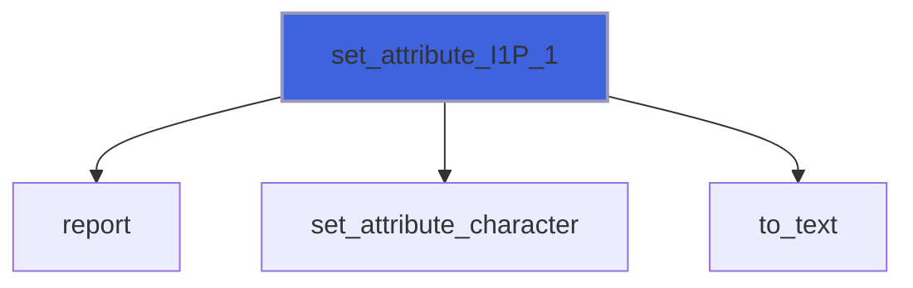

### set_attribute_I2P_1

Set the attribute named *name* of the tag with ID *id* to a list of integer(I2P) values (as *to_text*).

**Attributes**: pure

```fortran
subroutine set_attribute_I2P_1(self, id, name, values, fmt, iostat, iomsg)
```

**Arguments**

| Name | Type | Intent | Attributes | Description |
|------|------|--------|------------|-------------|
| `self` | class([xml_file](/api/src/third_party/FoXy/src/lib/foxy_xml_file#xml-file)) | inout |  | XML file. |
| `id` | integer(kind=[I4P](/api/src/third_party/PENF/src/lib/penf_global_parameters_variables)) | in |  | Tag ID. |
| `name` | character(len=*) | in |  | Attribute name. |
| `values` | integer(kind=[I2P](/api/src/third_party/PENF/src/lib/penf_global_parameters_variables)) | in |  | Values. |
| `fmt` | character(len=*) | in | optional | Format (of each value), e.g. `(F6.3)`. |
| `iostat` | integer(kind=[I4P](/api/src/third_party/PENF/src/lib/penf_global_parameters_variables)) | out | optional | IO status. |
| `iomsg` | character(len=*) | inout | optional | IO message. |

**Call graph**


### set_attribute_I4P_1

Set the attribute named *name* of the tag with ID *id* to a list of integer(I4P) values (as *to_text*).

**Attributes**: pure

```fortran
subroutine set_attribute_I4P_1(self, id, name, values, fmt, iostat, iomsg)
```

**Arguments**

| Name | Type | Intent | Attributes | Description |
|------|------|--------|------------|-------------|
| `self` | class([xml_file](/api/src/third_party/FoXy/src/lib/foxy_xml_file#xml-file)) | inout |  | XML file. |
| `id` | integer(kind=[I4P](/api/src/third_party/PENF/src/lib/penf_global_parameters_variables)) | in |  | Tag ID. |
| `name` | character(len=*) | in |  | Attribute name. |
| `values` | integer(kind=[I4P](/api/src/third_party/PENF/src/lib/penf_global_parameters_variables)) | in |  | Values. |
| `fmt` | character(len=*) | in | optional | Format (of each value), e.g. `(F6.3)`. |
| `iostat` | integer(kind=[I4P](/api/src/third_party/PENF/src/lib/penf_global_parameters_variables)) | out | optional | IO status. |
| `iomsg` | character(len=*) | inout | optional | IO message. |

**Call graph**

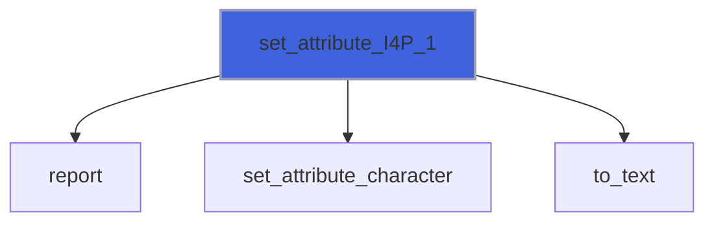

### set_attribute_I8P_1

Set the attribute named *name* of the tag with ID *id* to a list of integer(I8P) values (as *to_text*).

**Attributes**: pure

```fortran
subroutine set_attribute_I8P_1(self, id, name, values, fmt, iostat, iomsg)
```

**Arguments**

| Name | Type | Intent | Attributes | Description |
|------|------|--------|------------|-------------|
| `self` | class([xml_file](/api/src/third_party/FoXy/src/lib/foxy_xml_file#xml-file)) | inout |  | XML file. |
| `id` | integer(kind=[I4P](/api/src/third_party/PENF/src/lib/penf_global_parameters_variables)) | in |  | Tag ID. |
| `name` | character(len=*) | in |  | Attribute name. |
| `values` | integer(kind=[I8P](/api/src/third_party/PENF/src/lib/penf_global_parameters_variables)) | in |  | Values. |
| `fmt` | character(len=*) | in | optional | Format (of each value), e.g. `(F6.3)`. |
| `iostat` | integer(kind=[I4P](/api/src/third_party/PENF/src/lib/penf_global_parameters_variables)) | out | optional | IO status. |
| `iomsg` | character(len=*) | inout | optional | IO message. |

**Call graph**


### set_attribute_R4P_1

Set the attribute named *name* of the tag with ID *id* to a list of real(R4P) values (as *to_text*).

**Attributes**: pure

```fortran
subroutine set_attribute_R4P_1(self, id, name, values, fmt, iostat, iomsg)
```

**Arguments**

| Name | Type | Intent | Attributes | Description |
|------|------|--------|------------|-------------|
| `self` | class([xml_file](/api/src/third_party/FoXy/src/lib/foxy_xml_file#xml-file)) | inout |  | XML file. |
| `id` | integer(kind=[I4P](/api/src/third_party/PENF/src/lib/penf_global_parameters_variables)) | in |  | Tag ID. |
| `name` | character(len=*) | in |  | Attribute name. |
| `values` | real(kind=[R4P](/api/src/third_party/PENF/src/lib/penf_global_parameters_variables)) | in |  | Values. |
| `fmt` | character(len=*) | in | optional | Format (of each value), e.g. `(F6.3)`. |
| `iostat` | integer(kind=[I4P](/api/src/third_party/PENF/src/lib/penf_global_parameters_variables)) | out | optional | IO status. |
| `iomsg` | character(len=*) | inout | optional | IO message. |

**Call graph**

```mermaid
flowchart TD
  set_attribute_R4P_1["set_attribute_R4P_1"] --> report["report"]
  set_attribute_R4P_1["set_attribute_R4P_1"] --> set_attribute_character["set_attribute_character"]
  set_attribute_R4P_1["set_attribute_R4P_1"] --> to_text["to_text"]
  style set_attribute_R4P_1 fill:#3e63dd,stroke:#99b,stroke-width:2px
```

### set_attribute_R8P_1

Set the attribute named *name* of the tag with ID *id* to a list of real(R8P) values (as *to_text*).

**Attributes**: pure

```fortran
subroutine set_attribute_R8P_1(self, id, name, values, fmt, iostat, iomsg)
```

**Arguments**

| Name | Type | Intent | Attributes | Description |
|------|------|--------|------------|-------------|
| `self` | class([xml_file](/api/src/third_party/FoXy/src/lib/foxy_xml_file#xml-file)) | inout |  | XML file. |
| `id` | integer(kind=[I4P](/api/src/third_party/PENF/src/lib/penf_global_parameters_variables)) | in |  | Tag ID. |
| `name` | character(len=*) | in |  | Attribute name. |
| `values` | real(kind=[R8P](/api/src/third_party/PENF/src/lib/penf_global_parameters_variables)) | in |  | Values. |
| `fmt` | character(len=*) | in | optional | Format (of each value), e.g. `(F6.3)`. |
| `iostat` | integer(kind=[I4P](/api/src/third_party/PENF/src/lib/penf_global_parameters_variables)) | out | optional | IO status. |
| `iomsg` | character(len=*) | inout | optional | IO message. |

**Call graph**

```mermaid
flowchart TD
  set_attribute_R8P_1["set_attribute_R8P_1"] --> report["report"]
  set_attribute_R8P_1["set_attribute_R8P_1"] --> set_attribute_character["set_attribute_character"]
  set_attribute_R8P_1["set_attribute_R8P_1"] --> to_text["to_text"]
  style set_attribute_R8P_1 fill:#3e63dd,stroke:#99b,stroke-width:2px
```

### set_content_I1P

Set the content of the tag with ID *id* to integer(I1P) value (as *to_text*: integers with their digits, reals the shortest
 text that reads back, logicals `true`/`false`, lists separated by a space), replacing its children.

**Attributes**: pure

```fortran
subroutine set_content_I1P(self, id, value, fmt, iostat, iomsg)
```

**Arguments**

| Name | Type | Intent | Attributes | Description |
|------|------|--------|------------|-------------|
| `self` | class([xml_file](/api/src/third_party/FoXy/src/lib/foxy_xml_file#xml-file)) | inout |  | XML file. |
| `id` | integer(kind=[I4P](/api/src/third_party/PENF/src/lib/penf_global_parameters_variables)) | in |  | Tag ID. |
| `value` | integer(kind=[I1P](/api/src/third_party/PENF/src/lib/penf_global_parameters_variables)) | in |  | Value. |
| `fmt` | character(len=*) | in | optional | Format (of each value), e.g. `(F6.3)`. |
| `iostat` | integer(kind=[I4P](/api/src/third_party/PENF/src/lib/penf_global_parameters_variables)) | out | optional | IO status. |
| `iomsg` | character(len=*) | inout | optional | IO message. |

**Call graph**

```mermaid
flowchart TD
  set_content_I1P["set_content_I1P"] --> report["report"]
  set_content_I1P["set_content_I1P"] --> set_content_character["set_content_character"]
  set_content_I1P["set_content_I1P"] --> to_text["to_text"]
  style set_content_I1P fill:#3e63dd,stroke:#99b,stroke-width:2px
```

### set_content_I2P

Set the content of the tag with ID *id* to integer(I2P) value (as *to_text*: integers with their digits, reals the shortest
 text that reads back, logicals `true`/`false`, lists separated by a space), replacing its children.

**Attributes**: pure

```fortran
subroutine set_content_I2P(self, id, value, fmt, iostat, iomsg)
```

**Arguments**

| Name | Type | Intent | Attributes | Description |
|------|------|--------|------------|-------------|
| `self` | class([xml_file](/api/src/third_party/FoXy/src/lib/foxy_xml_file#xml-file)) | inout |  | XML file. |
| `id` | integer(kind=[I4P](/api/src/third_party/PENF/src/lib/penf_global_parameters_variables)) | in |  | Tag ID. |
| `value` | integer(kind=[I2P](/api/src/third_party/PENF/src/lib/penf_global_parameters_variables)) | in |  | Value. |
| `fmt` | character(len=*) | in | optional | Format (of each value), e.g. `(F6.3)`. |
| `iostat` | integer(kind=[I4P](/api/src/third_party/PENF/src/lib/penf_global_parameters_variables)) | out | optional | IO status. |
| `iomsg` | character(len=*) | inout | optional | IO message. |

**Call graph**

```mermaid
flowchart TD
  set_content_I2P["set_content_I2P"] --> report["report"]
  set_content_I2P["set_content_I2P"] --> set_content_character["set_content_character"]
  set_content_I2P["set_content_I2P"] --> to_text["to_text"]
  style set_content_I2P fill:#3e63dd,stroke:#99b,stroke-width:2px
```

### set_content_I4P

Set the content of the tag with ID *id* to integer(I4P) value (as *to_text*: integers with their digits, reals the shortest
 text that reads back, logicals `true`/`false`, lists separated by a space), replacing its children.

**Attributes**: pure

```fortran
subroutine set_content_I4P(self, id, value, fmt, iostat, iomsg)
```

**Arguments**

| Name | Type | Intent | Attributes | Description |
|------|------|--------|------------|-------------|
| `self` | class([xml_file](/api/src/third_party/FoXy/src/lib/foxy_xml_file#xml-file)) | inout |  | XML file. |
| `id` | integer(kind=[I4P](/api/src/third_party/PENF/src/lib/penf_global_parameters_variables)) | in |  | Tag ID. |
| `value` | integer(kind=[I4P](/api/src/third_party/PENF/src/lib/penf_global_parameters_variables)) | in |  | Value. |
| `fmt` | character(len=*) | in | optional | Format (of each value), e.g. `(F6.3)`. |
| `iostat` | integer(kind=[I4P](/api/src/third_party/PENF/src/lib/penf_global_parameters_variables)) | out | optional | IO status. |
| `iomsg` | character(len=*) | inout | optional | IO message. |

**Call graph**

```mermaid
flowchart TD
  set_content_I4P["set_content_I4P"] --> report["report"]
  set_content_I4P["set_content_I4P"] --> set_content_character["set_content_character"]
  set_content_I4P["set_content_I4P"] --> to_text["to_text"]
  style set_content_I4P fill:#3e63dd,stroke:#99b,stroke-width:2px
```

### set_content_I8P

Set the content of the tag with ID *id* to integer(I8P) value (as *to_text*: integers with their digits, reals the shortest
 text that reads back, logicals `true`/`false`, lists separated by a space), replacing its children.

**Attributes**: pure

```fortran
subroutine set_content_I8P(self, id, value, fmt, iostat, iomsg)
```

**Arguments**

| Name | Type | Intent | Attributes | Description |
|------|------|--------|------------|-------------|
| `self` | class([xml_file](/api/src/third_party/FoXy/src/lib/foxy_xml_file#xml-file)) | inout |  | XML file. |
| `id` | integer(kind=[I4P](/api/src/third_party/PENF/src/lib/penf_global_parameters_variables)) | in |  | Tag ID. |
| `value` | integer(kind=[I8P](/api/src/third_party/PENF/src/lib/penf_global_parameters_variables)) | in |  | Value. |
| `fmt` | character(len=*) | in | optional | Format (of each value), e.g. `(F6.3)`. |
| `iostat` | integer(kind=[I4P](/api/src/third_party/PENF/src/lib/penf_global_parameters_variables)) | out | optional | IO status. |
| `iomsg` | character(len=*) | inout | optional | IO message. |

**Call graph**

```mermaid
flowchart TD
  set_content_I8P["set_content_I8P"] --> report["report"]
  set_content_I8P["set_content_I8P"] --> set_content_character["set_content_character"]
  set_content_I8P["set_content_I8P"] --> to_text["to_text"]
  style set_content_I8P fill:#3e63dd,stroke:#99b,stroke-width:2px
```

### set_content_R4P

Set the content of the tag with ID *id* to real(R4P) value (as *to_text*: integers with their digits, reals the shortest
 text that reads back, logicals `true`/`false`, lists separated by a space), replacing its children.

**Attributes**: pure

```fortran
subroutine set_content_R4P(self, id, value, fmt, iostat, iomsg)
```

**Arguments**

| Name | Type | Intent | Attributes | Description |
|------|------|--------|------------|-------------|
| `self` | class([xml_file](/api/src/third_party/FoXy/src/lib/foxy_xml_file#xml-file)) | inout |  | XML file. |
| `id` | integer(kind=[I4P](/api/src/third_party/PENF/src/lib/penf_global_parameters_variables)) | in |  | Tag ID. |
| `value` | real(kind=[R4P](/api/src/third_party/PENF/src/lib/penf_global_parameters_variables)) | in |  | Value. |
| `fmt` | character(len=*) | in | optional | Format (of each value), e.g. `(F6.3)`. |
| `iostat` | integer(kind=[I4P](/api/src/third_party/PENF/src/lib/penf_global_parameters_variables)) | out | optional | IO status. |
| `iomsg` | character(len=*) | inout | optional | IO message. |

**Call graph**

```mermaid
flowchart TD
  set_content_R4P["set_content_R4P"] --> report["report"]
  set_content_R4P["set_content_R4P"] --> set_content_character["set_content_character"]
  set_content_R4P["set_content_R4P"] --> to_text["to_text"]
  style set_content_R4P fill:#3e63dd,stroke:#99b,stroke-width:2px
```

### set_content_R8P

Set the content of the tag with ID *id* to real(R8P) value (as *to_text*: integers with their digits, reals the shortest
 text that reads back, logicals `true`/`false`, lists separated by a space), replacing its children.

**Attributes**: pure

```fortran
subroutine set_content_R8P(self, id, value, fmt, iostat, iomsg)
```

**Arguments**

| Name | Type | Intent | Attributes | Description |
|------|------|--------|------------|-------------|
| `self` | class([xml_file](/api/src/third_party/FoXy/src/lib/foxy_xml_file#xml-file)) | inout |  | XML file. |
| `id` | integer(kind=[I4P](/api/src/third_party/PENF/src/lib/penf_global_parameters_variables)) | in |  | Tag ID. |
| `value` | real(kind=[R8P](/api/src/third_party/PENF/src/lib/penf_global_parameters_variables)) | in |  | Value. |
| `fmt` | character(len=*) | in | optional | Format (of each value), e.g. `(F6.3)`. |
| `iostat` | integer(kind=[I4P](/api/src/third_party/PENF/src/lib/penf_global_parameters_variables)) | out | optional | IO status. |
| `iomsg` | character(len=*) | inout | optional | IO message. |

**Call graph**

```mermaid
flowchart TD
  set_content_R8P["set_content_R8P"] --> report["report"]
  set_content_R8P["set_content_R8P"] --> set_content_character["set_content_character"]
  set_content_R8P["set_content_R8P"] --> to_text["to_text"]
  style set_content_R8P fill:#3e63dd,stroke:#99b,stroke-width:2px
```

### set_content_logical

Set the content of the tag with ID *id* to logical value (as *to_text*: integers with their digits, reals the shortest
 text that reads back, logicals `true`/`false`, lists separated by a space), replacing its children.

**Attributes**: pure

```fortran
subroutine set_content_logical(self, id, value, iostat, iomsg)
```

**Arguments**

| Name | Type | Intent | Attributes | Description |
|------|------|--------|------------|-------------|
| `self` | class([xml_file](/api/src/third_party/FoXy/src/lib/foxy_xml_file#xml-file)) | inout |  | XML file. |
| `id` | integer(kind=[I4P](/api/src/third_party/PENF/src/lib/penf_global_parameters_variables)) | in |  | Tag ID. |
| `value` | logical | in |  | Value. |
| `iostat` | integer(kind=[I4P](/api/src/third_party/PENF/src/lib/penf_global_parameters_variables)) | out | optional | IO status. |
| `iomsg` | character(len=*) | inout | optional | IO message. |

**Call graph**

```mermaid
flowchart TD
  set_content_logical["set_content_logical"] --> report["report"]
  set_content_logical["set_content_logical"] --> set_content_character["set_content_character"]
  set_content_logical["set_content_logical"] --> to_text["to_text"]
  style set_content_logical fill:#3e63dd,stroke:#99b,stroke-width:2px
```

### set_content_I1P_1

Set the content of the tag with ID *id* to a list of integer(I1P) values (as *to_text*: integers with their
 digits, reals the shortest
 text that reads back, logicals `true`/`false`, lists separated by a space), replacing its children.

**Attributes**: pure

```fortran
subroutine set_content_I1P_1(self, id, values, fmt, iostat, iomsg)
```

**Arguments**

| Name | Type | Intent | Attributes | Description |
|------|------|--------|------------|-------------|
| `self` | class([xml_file](/api/src/third_party/FoXy/src/lib/foxy_xml_file#xml-file)) | inout |  | XML file. |
| `id` | integer(kind=[I4P](/api/src/third_party/PENF/src/lib/penf_global_parameters_variables)) | in |  | Tag ID. |
| `values` | integer(kind=[I1P](/api/src/third_party/PENF/src/lib/penf_global_parameters_variables)) | in |  | Values. |
| `fmt` | character(len=*) | in | optional | Format (of each value), e.g. `(F6.3)`. |
| `iostat` | integer(kind=[I4P](/api/src/third_party/PENF/src/lib/penf_global_parameters_variables)) | out | optional | IO status. |
| `iomsg` | character(len=*) | inout | optional | IO message. |

**Call graph**

```mermaid
flowchart TD
  set_content_I1P_1["set_content_I1P_1"] --> report["report"]
  set_content_I1P_1["set_content_I1P_1"] --> set_content_character["set_content_character"]
  set_content_I1P_1["set_content_I1P_1"] --> to_text["to_text"]
  style set_content_I1P_1 fill:#3e63dd,stroke:#99b,stroke-width:2px
```

### set_content_I2P_1

Set the content of the tag with ID *id* to a list of integer(I2P) values (as *to_text*: integers with their
 digits, reals the shortest
 text that reads back, logicals `true`/`false`, lists separated by a space), replacing its children.

**Attributes**: pure

```fortran
subroutine set_content_I2P_1(self, id, values, fmt, iostat, iomsg)
```

**Arguments**

| Name | Type | Intent | Attributes | Description |
|------|------|--------|------------|-------------|
| `self` | class([xml_file](/api/src/third_party/FoXy/src/lib/foxy_xml_file#xml-file)) | inout |  | XML file. |
| `id` | integer(kind=[I4P](/api/src/third_party/PENF/src/lib/penf_global_parameters_variables)) | in |  | Tag ID. |
| `values` | integer(kind=[I2P](/api/src/third_party/PENF/src/lib/penf_global_parameters_variables)) | in |  | Values. |
| `fmt` | character(len=*) | in | optional | Format (of each value), e.g. `(F6.3)`. |
| `iostat` | integer(kind=[I4P](/api/src/third_party/PENF/src/lib/penf_global_parameters_variables)) | out | optional | IO status. |
| `iomsg` | character(len=*) | inout | optional | IO message. |

**Call graph**

```mermaid
flowchart TD
  set_content_I2P_1["set_content_I2P_1"] --> report["report"]
  set_content_I2P_1["set_content_I2P_1"] --> set_content_character["set_content_character"]
  set_content_I2P_1["set_content_I2P_1"] --> to_text["to_text"]
  style set_content_I2P_1 fill:#3e63dd,stroke:#99b,stroke-width:2px
```

### set_content_I4P_1

Set the content of the tag with ID *id* to a list of integer(I4P) values (as *to_text*: integers with their
 digits, reals the shortest
 text that reads back, logicals `true`/`false`, lists separated by a space), replacing its children.

**Attributes**: pure

```fortran
subroutine set_content_I4P_1(self, id, values, fmt, iostat, iomsg)
```

**Arguments**

| Name | Type | Intent | Attributes | Description |
|------|------|--------|------------|-------------|
| `self` | class([xml_file](/api/src/third_party/FoXy/src/lib/foxy_xml_file#xml-file)) | inout |  | XML file. |
| `id` | integer(kind=[I4P](/api/src/third_party/PENF/src/lib/penf_global_parameters_variables)) | in |  | Tag ID. |
| `values` | integer(kind=[I4P](/api/src/third_party/PENF/src/lib/penf_global_parameters_variables)) | in |  | Values. |
| `fmt` | character(len=*) | in | optional | Format (of each value), e.g. `(F6.3)`. |
| `iostat` | integer(kind=[I4P](/api/src/third_party/PENF/src/lib/penf_global_parameters_variables)) | out | optional | IO status. |
| `iomsg` | character(len=*) | inout | optional | IO message. |

**Call graph**

```mermaid
flowchart TD
  set_content_I4P_1["set_content_I4P_1"] --> report["report"]
  set_content_I4P_1["set_content_I4P_1"] --> set_content_character["set_content_character"]
  set_content_I4P_1["set_content_I4P_1"] --> to_text["to_text"]
  style set_content_I4P_1 fill:#3e63dd,stroke:#99b,stroke-width:2px
```

### set_content_I8P_1

Set the content of the tag with ID *id* to a list of integer(I8P) values (as *to_text*: integers with their
 digits, reals the shortest
 text that reads back, logicals `true`/`false`, lists separated by a space), replacing its children.

**Attributes**: pure

```fortran
subroutine set_content_I8P_1(self, id, values, fmt, iostat, iomsg)
```

**Arguments**

| Name | Type | Intent | Attributes | Description |
|------|------|--------|------------|-------------|
| `self` | class([xml_file](/api/src/third_party/FoXy/src/lib/foxy_xml_file#xml-file)) | inout |  | XML file. |
| `id` | integer(kind=[I4P](/api/src/third_party/PENF/src/lib/penf_global_parameters_variables)) | in |  | Tag ID. |
| `values` | integer(kind=[I8P](/api/src/third_party/PENF/src/lib/penf_global_parameters_variables)) | in |  | Values. |
| `fmt` | character(len=*) | in | optional | Format (of each value), e.g. `(F6.3)`. |
| `iostat` | integer(kind=[I4P](/api/src/third_party/PENF/src/lib/penf_global_parameters_variables)) | out | optional | IO status. |
| `iomsg` | character(len=*) | inout | optional | IO message. |

**Call graph**

```mermaid
flowchart TD
  set_content_I8P_1["set_content_I8P_1"] --> report["report"]
  set_content_I8P_1["set_content_I8P_1"] --> set_content_character["set_content_character"]
  set_content_I8P_1["set_content_I8P_1"] --> to_text["to_text"]
  style set_content_I8P_1 fill:#3e63dd,stroke:#99b,stroke-width:2px
```

### set_content_R4P_1

Set the content of the tag with ID *id* to a list of real(R4P) values (as *to_text*: integers with their digits,
 reals the shortest
 text that reads back, logicals `true`/`false`, lists separated by a space), replacing its children.

**Attributes**: pure

```fortran
subroutine set_content_R4P_1(self, id, values, fmt, iostat, iomsg)
```

**Arguments**

| Name | Type | Intent | Attributes | Description |
|------|------|--------|------------|-------------|
| `self` | class([xml_file](/api/src/third_party/FoXy/src/lib/foxy_xml_file#xml-file)) | inout |  | XML file. |
| `id` | integer(kind=[I4P](/api/src/third_party/PENF/src/lib/penf_global_parameters_variables)) | in |  | Tag ID. |
| `values` | real(kind=[R4P](/api/src/third_party/PENF/src/lib/penf_global_parameters_variables)) | in |  | Values. |
| `fmt` | character(len=*) | in | optional | Format (of each value), e.g. `(F6.3)`. |
| `iostat` | integer(kind=[I4P](/api/src/third_party/PENF/src/lib/penf_global_parameters_variables)) | out | optional | IO status. |
| `iomsg` | character(len=*) | inout | optional | IO message. |

**Call graph**

```mermaid
flowchart TD
  set_content_R4P_1["set_content_R4P_1"] --> report["report"]
  set_content_R4P_1["set_content_R4P_1"] --> set_content_character["set_content_character"]
  set_content_R4P_1["set_content_R4P_1"] --> to_text["to_text"]
  style set_content_R4P_1 fill:#3e63dd,stroke:#99b,stroke-width:2px
```

### set_content_R8P_1

Set the content of the tag with ID *id* to a list of real(R8P) values (as *to_text*: integers with their digits,
 reals the shortest
 text that reads back, logicals `true`/`false`, lists separated by a space), replacing its children.

**Attributes**: pure

```fortran
subroutine set_content_R8P_1(self, id, values, fmt, iostat, iomsg)
```

**Arguments**

| Name | Type | Intent | Attributes | Description |
|------|------|--------|------------|-------------|
| `self` | class([xml_file](/api/src/third_party/FoXy/src/lib/foxy_xml_file#xml-file)) | inout |  | XML file. |
| `id` | integer(kind=[I4P](/api/src/third_party/PENF/src/lib/penf_global_parameters_variables)) | in |  | Tag ID. |
| `values` | real(kind=[R8P](/api/src/third_party/PENF/src/lib/penf_global_parameters_variables)) | in |  | Values. |
| `fmt` | character(len=*) | in | optional | Format (of each value), e.g. `(F6.3)`. |
| `iostat` | integer(kind=[I4P](/api/src/third_party/PENF/src/lib/penf_global_parameters_variables)) | out | optional | IO status. |
| `iomsg` | character(len=*) | inout | optional | IO message. |

**Call graph**

```mermaid
flowchart TD
  set_content_R8P_1["set_content_R8P_1"] --> report["report"]
  set_content_R8P_1["set_content_R8P_1"] --> set_content_character["set_content_character"]
  set_content_R8P_1["set_content_R8P_1"] --> to_text["to_text"]
  style set_content_R8P_1 fill:#3e63dd,stroke:#99b,stroke-width:2px
```

### set_name

Rename the tag with ID *id* (its end tag follows); its namespace is resolved again from the new prefix.

 @note *iostat* is *XML_NOT_FOUND* if the tag does not exist, *XML_MALFORMED* if *name* is not an XML name (nothing is
 changed); *iomsg* is unchanged on success.

**Attributes**: pure

```fortran
subroutine set_name(self, id, name, iostat, iomsg)
```

**Arguments**

| Name | Type | Intent | Attributes | Description |
|------|------|--------|------------|-------------|
| `self` | class([xml_file](/api/src/third_party/FoXy/src/lib/foxy_xml_file#xml-file)) | inout |  | XML file. |
| `id` | integer(kind=[I4P](/api/src/third_party/PENF/src/lib/penf_global_parameters_variables)) | in |  | Tag ID. |
| `name` | character(len=*) | in |  | New name. |
| `iostat` | integer(kind=[I4P](/api/src/third_party/PENF/src/lib/penf_global_parameters_variables)) | out | optional | IO status. |
| `iomsg` | character(len=*) | inout | optional | IO message. |

**Call graph**

```mermaid
flowchart TD
  set_name["set_name"] --> is_name["is_name"]
  set_name["set_name"] --> report["report"]
  set_name["set_name"] --> set["set"]
  set_name["set_name"] --> str["str"]
  style set_name fill:#3e63dd,stroke:#99b,stroke-width:2px
```

### free

Free dynamic memory.

**Attributes**: elemental

```fortran
subroutine free(self)
```

**Arguments**

| Name | Type | Intent | Attributes | Description |
|------|------|--------|------------|-------------|
| `self` | class([xml_file](/api/src/third_party/FoXy/src/lib/foxy_xml_file#xml-file)) | inout |  | XML file. |

### parse

Parse xml data from string or file.
 XML data is linearized, a DOM structured is used.

 @note Self data are free before trying to parse new xml data: all previously parsed data are lost.
 @note Parsing is tolerant: malformed input is parsed as far as possible. If *iostat* is passed, it returns 0 on
 success, the runtime I/O error code if the file cannot be read, *XML_MALFORMED* if the input is malformed; *iomsg*
 (unchanged on success) describes the error, for malformed input the first problem found with its line.
 @note Leading and trailing spaces of attribute values are trimmed (default), unless *sanitize_attributes_value* is
 false: then values are kept as in the source (XML data).
 @note A file is read in chunks of *chunk_size* characters (default 1 MiB): it is never loaded whole in memory.

```fortran
subroutine parse(self, string, filename, iostat, iomsg, sanitize_attributes_value, chunk_size)
```

**Arguments**

| Name | Type | Intent | Attributes | Description |
|------|------|--------|------------|-------------|
| `self` | class([xml_file](/api/src/third_party/FoXy/src/lib/foxy_xml_file#xml-file)) | inout |  | XML file. |
| `string` | character(len=*) | in | optional | String containing xml data. |
| `filename` | character(len=*) | in | optional | File name containing xml data. |
| `iostat` | integer(kind=[I4P](/api/src/third_party/PENF/src/lib/penf_global_parameters_variables)) | out | optional | IO status. |
| `iomsg` | character(len=*) | inout | optional | IO message. |
| `sanitize_attributes_value` | logical | in | optional | Trim attribute values spaces (default .true.). |
| `chunk_size` | integer(kind=[I8P](/api/src/third_party/PENF/src/lib/penf_global_parameters_variables)) | in | optional | Size of the chunks read from a file. |

**Call graph**

```mermaid
flowchart TD
  parse_file["parse_file"] --> parse["parse"]
  parse["parse"] --> parse_from_file["parse_from_file"]
  parse["parse"] --> parse_from_string["parse_from_string"]
  style parse fill:#3e63dd,stroke:#99b,stroke-width:2px
```

### save

Save the whole file data into a file: the prolog and the tags (as *stringify*), ended by a new line.

 @note If *is_declared* is true and the prolog does not start with an XML declaration (e.g. a document built in
 code), the declaration `<?xml version="1.0"?>` is written first.
 @note If *iostat* is passed, it returns 0 on success, the runtime I/O error code, or *XML_MALFORMED* for a document
 with more root tags (not well-formed XML, written anyway), and *iomsg* (unchanged on success) describes the error;
 without *iostat* an I/O error stops the program, as Fortran I/O statements do (more root tags are not reported).

```fortran
subroutine save(self, filename, is_declared, iostat, iomsg)
```

**Arguments**

| Name | Type | Intent | Attributes | Description |
|------|------|--------|------------|-------------|
| `self` | class([xml_file](/api/src/third_party/FoXy/src/lib/foxy_xml_file#xml-file)) | in |  | XML file. |
| `filename` | character(len=*) | in |  | File name. |
| `is_declared` | logical | in | optional | Write the XML declaration, if missing. |
| `iostat` | integer(kind=[I4P](/api/src/third_party/PENF/src/lib/penf_global_parameters_variables)) | out | optional | IO status. |
| `iomsg` | character(len=*) | inout | optional | IO message. |

**Call graph**

```mermaid
flowchart TD
  save["save"] --> get_parent_id["get_parent_id"]
  save["save"] --> starts_with_declaration["starts_with_declaration"]
  save["save"] --> str["str"]
  save["save"] --> stringify["stringify"]
  style save fill:#3e63dd,stroke:#99b,stroke-width:2px
```

### append_inline

Append to buffer a tag with its whole subtree as in the source, without added layout (mixed content).

**Attributes**: pure, recursive

```fortran
subroutine append_inline(self, t, is_done, buffer, n)
```

**Arguments**

| Name | Type | Intent | Attributes | Description |
|------|------|--------|------------|-------------|
| `self` | class([xml_file](/api/src/third_party/FoXy/src/lib/foxy_xml_file#xml-file)) | in |  | XML file. |
| `t` | integer(kind=[I4P](/api/src/third_party/PENF/src/lib/penf_global_parameters_variables)) | in |  | Tag ID. |
| `is_done` | logical | inout |  | List of stringified tags. |
| `buffer` | character(len=:) | inout | allocatable | Output buffer. |
| `n` | integer(kind=[I8P](/api/src/third_party/PENF/src/lib/penf_global_parameters_variables)) | inout |  | Used length of the buffer. |

**Call graph**

```mermaid
flowchart TD
  append_inline_body["append_inline_body"] --> append_inline["append_inline"]
  append_inline["append_inline"] --> append["append"]
  append_inline["append_inline"] --> append_inline_body["append_inline_body"]
  append_inline["append_inline"] --> end_tag["end_tag"]
  append_inline["append_inline"] --> start_tag["start_tag"]
  append_inline["append_inline"] --> stringify["stringify"]
  style append_inline fill:#3e63dd,stroke:#99b,stroke-width:2px
```

### append_inline_body

Append to buffer the text of a tag, then each child (inline) followed by its tail.

**Attributes**: pure, recursive

```fortran
subroutine append_inline_body(self, t, is_done, buffer, n)
```

**Arguments**

| Name | Type | Intent | Attributes | Description |
|------|------|--------|------------|-------------|
| `self` | class([xml_file](/api/src/third_party/FoXy/src/lib/foxy_xml_file#xml-file)) | in |  | XML file. |
| `t` | integer(kind=[I4P](/api/src/third_party/PENF/src/lib/penf_global_parameters_variables)) | in |  | Tag ID. |
| `is_done` | logical | inout |  | List of stringified tags. |
| `buffer` | character(len=:) | inout | allocatable | Output buffer. |
| `n` | integer(kind=[I8P](/api/src/third_party/PENF/src/lib/penf_global_parameters_variables)) | inout |  | Used length of the buffer. |

**Call graph**

```mermaid
flowchart TD
  append_inline["append_inline"] --> append_inline_body["append_inline_body"]
  stringify["stringify"] --> append_inline_body["append_inline_body"]
  stringify_recursive["stringify_recursive"] --> append_inline_body["append_inline_body"]
  append_inline_body["append_inline_body"] --> append["append"]
  append_inline_body["append_inline_body"] --> append_inline["append_inline"]
  append_inline_body["append_inline_body"] --> get_tail["get_tail"]
  append_inline_body["append_inline_body"] --> raw_text["raw_text"]
  style append_inline_body fill:#3e63dd,stroke:#99b,stroke-width:2px
```

### delete_subtree

Delete the subtree of the tag with ID *id* (the tag included if *is_root_deleted*), renumbering the other tags.

 @note A child index is always greater than its parent one (document order for parsed tags, insertion order for added
 ones), thus the subtree is collected by a single forward sweep.

**Attributes**: pure

```fortran
subroutine delete_subtree(self, id, is_root_deleted)
```

**Arguments**

| Name | Type | Intent | Attributes | Description |
|------|------|--------|------------|-------------|
| `self` | class([xml_file](/api/src/third_party/FoXy/src/lib/foxy_xml_file#xml-file)) | inout |  | XML file. |
| `id` | integer(kind=[I4P](/api/src/third_party/PENF/src/lib/penf_global_parameters_variables)) | in |  | Tag ID. |
| `is_root_deleted` | logical | in |  | The tag itself is deleted too. |

**Call graph**

```mermaid
flowchart TD
  delete_tag["delete_tag"] --> delete_subtree["delete_subtree"]
  set_content_character["set_content_character"] --> delete_subtree["delete_subtree"]
  delete_subtree["delete_subtree"] --> get_parent_id["get_parent_id"]
  delete_subtree["delete_subtree"] --> set["set"]
  style delete_subtree fill:#3e63dd,stroke:#99b,stroke-width:2px
```

### parse_from_file

Parse xml data from a file, read in chunks: the tokenizer drives the DOM builder, the file is never loaded whole.

 @note The first problem of malformed input is returned; *iostat* and *iomsg* report the file errors (the document is
 left empty).

```fortran
subroutine parse_from_file(self, filename, sanitize, chunk_size, problem, iostat, iomsg)
```

**Arguments**

| Name | Type | Intent | Attributes | Description |
|------|------|--------|------------|-------------|
| `self` | class([xml_file](/api/src/third_party/FoXy/src/lib/foxy_xml_file#xml-file)) | inout |  | XML file handler. |
| `filename` | character(len=*) | in |  | File name. |
| `sanitize` | logical | in |  | Trim leading and trailing spaces of attribute values. |
| `chunk_size` | integer(kind=[I8P](/api/src/third_party/PENF/src/lib/penf_global_parameters_variables)) | in |  | Size of the chunks read from the file. |
| `problem` | character(len=:) | out | allocatable | First problem of malformed input, unallocated if none. |
| `iostat` | integer(kind=[I4P](/api/src/third_party/PENF/src/lib/penf_global_parameters_variables)) | out |  | IO status. |
| `iomsg` | character(len=*) | inout |  | IO message. |

**Call graph**

```mermaid
flowchart TD
  parse["parse"] --> parse_from_file["parse_from_file"]
  parse_from_file["parse_from_file"] --> decode_piece["decode_piece"]
  parse_from_file["parse_from_file"] --> detect_file_encoding["detect_file_encoding"]
  parse_from_file["parse_from_file"] --> feed["feed"]
  parse_from_file["parse_from_file"] --> finish["finish"]
  parse_from_file["parse_from_file"] --> located_in_file["located_in_file"]
  parse_from_file["parse_from_file"] --> set_source["set_source"]
  parse_from_file["parse_from_file"] --> with_utf8_declaration["with_utf8_declaration"]
  style parse_from_file fill:#3e63dd,stroke:#99b,stroke-width:2px
```

### parse_from_string

Parse xml data from a string: the tokenizer drives the DOM builder. The first problem of malformed input is returned.

```fortran
subroutine parse_from_string(self, source_string, sanitize, problem)
```

**Arguments**

| Name | Type | Intent | Attributes | Description |
|------|------|--------|------------|-------------|
| `self` | class([xml_file](/api/src/third_party/FoXy/src/lib/foxy_xml_file#xml-file)) | inout |  | XML file handler. |
| `source_string` | character(len=*) | in |  | String containing xml data. |
| `sanitize` | logical | in |  | Trim leading and trailing spaces of attribute values. |
| `problem` | character(len=:) | out | allocatable | First problem of malformed input, unallocated if none. |

**Call graph**

```mermaid
flowchart TD
  parse["parse"] --> parse_from_string["parse_from_string"]
  parse_from_string["parse_from_string"] --> decoded["decoded"]
  parse_from_string["parse_from_string"] --> detect_encoding["detect_encoding"]
  parse_from_string["parse_from_string"] --> feed["feed"]
  parse_from_string["parse_from_string"] --> finish["finish"]
  parse_from_string["parse_from_string"] --> located["located"]
  parse_from_string["parse_from_string"] --> set_source["set_source"]
  parse_from_string["parse_from_string"] --> with_utf8_declaration["with_utf8_declaration"]
  style parse_from_string fill:#3e63dd,stroke:#99b,stroke-width:2px
```

### stringify_recursive

Append to buffer, recursively, a (nested) tag with its children, each line preceded by a new line.

**Attributes**: pure, recursive

```fortran
subroutine stringify_recursive(self, tag, is_done, buffer, n)
```

**Arguments**

| Name | Type | Intent | Attributes | Description |
|------|------|--------|------------|-------------|
| `self` | class([xml_file](/api/src/third_party/FoXy/src/lib/foxy_xml_file#xml-file)) | in |  | XML file. |
| `tag` | type([xml_tag](/api/src/third_party/FoXy/src/lib/foxy_xml_tag#xml-tag)) | in |  | XML tag. |
| `is_done` | logical | inout |  | List of stringified tags. |
| `buffer` | character(len=:) | inout | allocatable | Output buffer. |
| `n` | integer(kind=[I8P](/api/src/third_party/PENF/src/lib/penf_global_parameters_variables)) | inout |  | Used length of the buffer. |

**Call graph**

```mermaid
flowchart TD
  stringify["stringify"] --> stringify_recursive["stringify_recursive"]
  stringify_recursive["stringify_recursive"] --> stringify_recursive["stringify_recursive"]
  stringify_recursive["stringify_recursive"] --> append["append"]
  stringify_recursive["stringify_recursive"] --> append_inline_body["append_inline_body"]
  stringify_recursive["stringify_recursive"] --> end_tag["end_tag"]
  stringify_recursive["stringify_recursive"] --> get_id["get_id"]
  stringify_recursive["stringify_recursive"] --> is_mixed["is_mixed"]
  stringify_recursive["stringify_recursive"] --> start_tag["start_tag"]
  stringify_recursive["stringify_recursive"] --> stringify["stringify"]
  stringify_recursive["stringify_recursive"] --> stringify_recursive["stringify_recursive"]
  style stringify_recursive fill:#3e63dd,stroke:#99b,stroke-width:2px
```

### attribute_text

Return the value of the attribute named *name* of the tag with ID *id*; *iostat* is *XML_NOT_FOUND* if the tag or the
 attribute does not exist.

```fortran
subroutine attribute_text(self, id, name, text, iostat, iomsg)
```

**Arguments**

| Name | Type | Intent | Attributes | Description |
|------|------|--------|------------|-------------|
| `self` | class([xml_file](/api/src/third_party/FoXy/src/lib/foxy_xml_file#xml-file)) | in |  | XML file. |
| `id` | integer(kind=[I4P](/api/src/third_party/PENF/src/lib/penf_global_parameters_variables)) | in |  | Tag ID. |
| `name` | character(len=*) | in |  | Attribute name. |
| `text` | character(len=:) | out | allocatable | Attribute value. |
| `iostat` | integer(kind=[I4P](/api/src/third_party/PENF/src/lib/penf_global_parameters_variables)) | out |  | IO status. |
| `iomsg` | character(len=:) | out | allocatable | IO message. |

**Call graph**

```mermaid
flowchart TD
  get_attribute_I1P["get_attribute_I1P"] --> attribute_text["attribute_text"]
  get_attribute_I1P["get_attribute_I1P"] --> attribute_text["attribute_text"]
  get_attribute_I1P_1["get_attribute_I1P_1"] --> attribute_text["attribute_text"]
  get_attribute_I1P_1["get_attribute_I1P_1"] --> attribute_text["attribute_text"]
  get_attribute_I2P["get_attribute_I2P"] --> attribute_text["attribute_text"]
  get_attribute_I2P["get_attribute_I2P"] --> attribute_text["attribute_text"]
  get_attribute_I2P_1["get_attribute_I2P_1"] --> attribute_text["attribute_text"]
  get_attribute_I2P_1["get_attribute_I2P_1"] --> attribute_text["attribute_text"]
  get_attribute_I4P["get_attribute_I4P"] --> attribute_text["attribute_text"]
  get_attribute_I4P["get_attribute_I4P"] --> attribute_text["attribute_text"]
  get_attribute_I4P_1["get_attribute_I4P_1"] --> attribute_text["attribute_text"]
  get_attribute_I4P_1["get_attribute_I4P_1"] --> attribute_text["attribute_text"]
  get_attribute_I8P["get_attribute_I8P"] --> attribute_text["attribute_text"]
  get_attribute_I8P["get_attribute_I8P"] --> attribute_text["attribute_text"]
  get_attribute_I8P_1["get_attribute_I8P_1"] --> attribute_text["attribute_text"]
  get_attribute_I8P_1["get_attribute_I8P_1"] --> attribute_text["attribute_text"]
  get_attribute_R4P["get_attribute_R4P"] --> attribute_text["attribute_text"]
  get_attribute_R4P["get_attribute_R4P"] --> attribute_text["attribute_text"]
  get_attribute_R4P_1["get_attribute_R4P_1"] --> attribute_text["attribute_text"]
  get_attribute_R4P_1["get_attribute_R4P_1"] --> attribute_text["attribute_text"]
  get_attribute_R8P["get_attribute_R8P"] --> attribute_text["attribute_text"]
  get_attribute_R8P["get_attribute_R8P"] --> attribute_text["attribute_text"]
  get_attribute_R8P_1["get_attribute_R8P_1"] --> attribute_text["attribute_text"]
  get_attribute_R8P_1["get_attribute_R8P_1"] --> attribute_text["attribute_text"]
  get_attribute_logical["get_attribute_logical"] --> attribute_text["attribute_text"]
  get_attribute_logical["get_attribute_logical"] --> attribute_text["attribute_text"]
  attribute_text["attribute_text"] --> tree_attribute_text["tree_attribute_text"]
  style attribute_text fill:#3e63dd,stroke:#99b,stroke-width:2px
```

### content_text

Return the content of the tag with ID *id* (see *content*); *iostat* is *XML_NOT_FOUND* if the tag does not exist.

```fortran
subroutine content_text(self, id, text, iostat, iomsg)
```

**Arguments**

| Name | Type | Intent | Attributes | Description |
|------|------|--------|------------|-------------|
| `self` | class([xml_file](/api/src/third_party/FoXy/src/lib/foxy_xml_file#xml-file)) | in |  | XML file. |
| `id` | integer(kind=[I4P](/api/src/third_party/PENF/src/lib/penf_global_parameters_variables)) | in |  | Tag ID. |
| `text` | character(len=:) | out | allocatable | Tag content. |
| `iostat` | integer(kind=[I4P](/api/src/third_party/PENF/src/lib/penf_global_parameters_variables)) | out |  | IO status. |
| `iomsg` | character(len=:) | out | allocatable | IO message. |

**Call graph**

```mermaid
flowchart TD
  get_content_I1P["get_content_I1P"] --> content_text["content_text"]
  get_content_I1P["get_content_I1P"] --> content_text["content_text"]
  get_content_I1P_1["get_content_I1P_1"] --> content_text["content_text"]
  get_content_I1P_1["get_content_I1P_1"] --> content_text["content_text"]
  get_content_I2P["get_content_I2P"] --> content_text["content_text"]
  get_content_I2P["get_content_I2P"] --> content_text["content_text"]
  get_content_I2P_1["get_content_I2P_1"] --> content_text["content_text"]
  get_content_I2P_1["get_content_I2P_1"] --> content_text["content_text"]
  get_content_I4P["get_content_I4P"] --> content_text["content_text"]
  get_content_I4P["get_content_I4P"] --> content_text["content_text"]
  get_content_I4P_1["get_content_I4P_1"] --> content_text["content_text"]
  get_content_I4P_1["get_content_I4P_1"] --> content_text["content_text"]
  get_content_I8P["get_content_I8P"] --> content_text["content_text"]
  get_content_I8P["get_content_I8P"] --> content_text["content_text"]
  get_content_I8P_1["get_content_I8P_1"] --> content_text["content_text"]
  get_content_I8P_1["get_content_I8P_1"] --> content_text["content_text"]
  get_content_R4P["get_content_R4P"] --> content_text["content_text"]
  get_content_R4P["get_content_R4P"] --> content_text["content_text"]
  get_content_R4P_1["get_content_R4P_1"] --> content_text["content_text"]
  get_content_R4P_1["get_content_R4P_1"] --> content_text["content_text"]
  get_content_R8P["get_content_R8P"] --> content_text["content_text"]
  get_content_R8P["get_content_R8P"] --> content_text["content_text"]
  get_content_R8P_1["get_content_R8P_1"] --> content_text["content_text"]
  get_content_R8P_1["get_content_R8P_1"] --> content_text["content_text"]
  get_content_logical["get_content_logical"] --> content_text["content_text"]
  get_content_logical["get_content_logical"] --> content_text["content_text"]
  content_text["content_text"] --> content["content"]
  content_text["content_text"] --> str["str"]
  style content_text fill:#3e63dd,stroke:#99b,stroke-width:2px
```

### get_attribute_I1P

Get the attribute named *name* of the tag with ID *id* as a integer(I1P) value.

```fortran
subroutine get_attribute_I1P(self, id, name, value, iostat, iomsg)
```

**Arguments**

| Name | Type | Intent | Attributes | Description |
|------|------|--------|------------|-------------|
| `self` | class([xml_file](/api/src/third_party/FoXy/src/lib/foxy_xml_file#xml-file)) | in |  | XML file. |
| `id` | integer(kind=[I4P](/api/src/third_party/PENF/src/lib/penf_global_parameters_variables)) | in |  | Tag ID. |
| `name` | character(len=*) | in |  | Attribute name. |
| `value` | integer(kind=[I1P](/api/src/third_party/PENF/src/lib/penf_global_parameters_variables)) | inout |  | Value, unchanged on error. |
| `iostat` | integer(kind=[I4P](/api/src/third_party/PENF/src/lib/penf_global_parameters_variables)) | out | optional | IO status. |
| `iomsg` | character(len=*) | inout | optional | IO message. |

**Call graph**

```mermaid
flowchart TD
  get_attribute_I1P["get_attribute_I1P"] --> attribute_text["attribute_text"]
  get_attribute_I1P["get_attribute_I1P"] --> name["name"]
  get_attribute_I1P["get_attribute_I1P"] --> report["report"]
  get_attribute_I1P["get_attribute_I1P"] --> to_value["to_value"]
  style get_attribute_I1P fill:#3e63dd,stroke:#99b,stroke-width:2px
```

### get_attribute_I2P

Get the attribute named *name* of the tag with ID *id* as a integer(I2P) value.

```fortran
subroutine get_attribute_I2P(self, id, name, value, iostat, iomsg)
```

**Arguments**

| Name | Type | Intent | Attributes | Description |
|------|------|--------|------------|-------------|
| `self` | class([xml_file](/api/src/third_party/FoXy/src/lib/foxy_xml_file#xml-file)) | in |  | XML file. |
| `id` | integer(kind=[I4P](/api/src/third_party/PENF/src/lib/penf_global_parameters_variables)) | in |  | Tag ID. |
| `name` | character(len=*) | in |  | Attribute name. |
| `value` | integer(kind=[I2P](/api/src/third_party/PENF/src/lib/penf_global_parameters_variables)) | inout |  | Value, unchanged on error. |
| `iostat` | integer(kind=[I4P](/api/src/third_party/PENF/src/lib/penf_global_parameters_variables)) | out | optional | IO status. |
| `iomsg` | character(len=*) | inout | optional | IO message. |

**Call graph**

```mermaid
flowchart TD
  get_attribute_I2P["get_attribute_I2P"] --> attribute_text["attribute_text"]
  get_attribute_I2P["get_attribute_I2P"] --> name["name"]
  get_attribute_I2P["get_attribute_I2P"] --> report["report"]
  get_attribute_I2P["get_attribute_I2P"] --> to_value["to_value"]
  style get_attribute_I2P fill:#3e63dd,stroke:#99b,stroke-width:2px
```

### get_attribute_I4P

Get the attribute named *name* of the tag with ID *id* as a integer(I4P) value.

```fortran
subroutine get_attribute_I4P(self, id, name, value, iostat, iomsg)
```

**Arguments**

| Name | Type | Intent | Attributes | Description |
|------|------|--------|------------|-------------|
| `self` | class([xml_file](/api/src/third_party/FoXy/src/lib/foxy_xml_file#xml-file)) | in |  | XML file. |
| `id` | integer(kind=[I4P](/api/src/third_party/PENF/src/lib/penf_global_parameters_variables)) | in |  | Tag ID. |
| `name` | character(len=*) | in |  | Attribute name. |
| `value` | integer(kind=[I4P](/api/src/third_party/PENF/src/lib/penf_global_parameters_variables)) | inout |  | Value, unchanged on error. |
| `iostat` | integer(kind=[I4P](/api/src/third_party/PENF/src/lib/penf_global_parameters_variables)) | out | optional | IO status. |
| `iomsg` | character(len=*) | inout | optional | IO message. |

**Call graph**

```mermaid
flowchart TD
  get_attribute_I4P["get_attribute_I4P"] --> attribute_text["attribute_text"]
  get_attribute_I4P["get_attribute_I4P"] --> name["name"]
  get_attribute_I4P["get_attribute_I4P"] --> report["report"]
  get_attribute_I4P["get_attribute_I4P"] --> to_value["to_value"]
  style get_attribute_I4P fill:#3e63dd,stroke:#99b,stroke-width:2px
```

### get_attribute_I8P

Get the attribute named *name* of the tag with ID *id* as a integer(I8P) value.

```fortran
subroutine get_attribute_I8P(self, id, name, value, iostat, iomsg)
```

**Arguments**

| Name | Type | Intent | Attributes | Description |
|------|------|--------|------------|-------------|
| `self` | class([xml_file](/api/src/third_party/FoXy/src/lib/foxy_xml_file#xml-file)) | in |  | XML file. |
| `id` | integer(kind=[I4P](/api/src/third_party/PENF/src/lib/penf_global_parameters_variables)) | in |  | Tag ID. |
| `name` | character(len=*) | in |  | Attribute name. |
| `value` | integer(kind=[I8P](/api/src/third_party/PENF/src/lib/penf_global_parameters_variables)) | inout |  | Value, unchanged on error. |
| `iostat` | integer(kind=[I4P](/api/src/third_party/PENF/src/lib/penf_global_parameters_variables)) | out | optional | IO status. |
| `iomsg` | character(len=*) | inout | optional | IO message. |

**Call graph**

```mermaid
flowchart TD
  get_attribute_I8P["get_attribute_I8P"] --> attribute_text["attribute_text"]
  get_attribute_I8P["get_attribute_I8P"] --> name["name"]
  get_attribute_I8P["get_attribute_I8P"] --> report["report"]
  get_attribute_I8P["get_attribute_I8P"] --> to_value["to_value"]
  style get_attribute_I8P fill:#3e63dd,stroke:#99b,stroke-width:2px
```

### get_attribute_R4P

Get the attribute named *name* of the tag with ID *id* as a real(R4P) value.

```fortran
subroutine get_attribute_R4P(self, id, name, value, iostat, iomsg)
```

**Arguments**

| Name | Type | Intent | Attributes | Description |
|------|------|--------|------------|-------------|
| `self` | class([xml_file](/api/src/third_party/FoXy/src/lib/foxy_xml_file#xml-file)) | in |  | XML file. |
| `id` | integer(kind=[I4P](/api/src/third_party/PENF/src/lib/penf_global_parameters_variables)) | in |  | Tag ID. |
| `name` | character(len=*) | in |  | Attribute name. |
| `value` | real(kind=[R4P](/api/src/third_party/PENF/src/lib/penf_global_parameters_variables)) | inout |  | Value, unchanged on error. |
| `iostat` | integer(kind=[I4P](/api/src/third_party/PENF/src/lib/penf_global_parameters_variables)) | out | optional | IO status. |
| `iomsg` | character(len=*) | inout | optional | IO message. |

**Call graph**

```mermaid
flowchart TD
  get_attribute_R4P["get_attribute_R4P"] --> attribute_text["attribute_text"]
  get_attribute_R4P["get_attribute_R4P"] --> name["name"]
  get_attribute_R4P["get_attribute_R4P"] --> report["report"]
  get_attribute_R4P["get_attribute_R4P"] --> to_value["to_value"]
  style get_attribute_R4P fill:#3e63dd,stroke:#99b,stroke-width:2px
```

### get_attribute_R8P

Get the attribute named *name* of the tag with ID *id* as a real(R8P) value.

```fortran
subroutine get_attribute_R8P(self, id, name, value, iostat, iomsg)
```

**Arguments**

| Name | Type | Intent | Attributes | Description |
|------|------|--------|------------|-------------|
| `self` | class([xml_file](/api/src/third_party/FoXy/src/lib/foxy_xml_file#xml-file)) | in |  | XML file. |
| `id` | integer(kind=[I4P](/api/src/third_party/PENF/src/lib/penf_global_parameters_variables)) | in |  | Tag ID. |
| `name` | character(len=*) | in |  | Attribute name. |
| `value` | real(kind=[R8P](/api/src/third_party/PENF/src/lib/penf_global_parameters_variables)) | inout |  | Value, unchanged on error. |
| `iostat` | integer(kind=[I4P](/api/src/third_party/PENF/src/lib/penf_global_parameters_variables)) | out | optional | IO status. |
| `iomsg` | character(len=*) | inout | optional | IO message. |

**Call graph**

```mermaid
flowchart TD
  get_attribute_R8P["get_attribute_R8P"] --> attribute_text["attribute_text"]
  get_attribute_R8P["get_attribute_R8P"] --> name["name"]
  get_attribute_R8P["get_attribute_R8P"] --> report["report"]
  get_attribute_R8P["get_attribute_R8P"] --> to_value["to_value"]
  style get_attribute_R8P fill:#3e63dd,stroke:#99b,stroke-width:2px
```

### get_attribute_logical

Get the attribute named *name* of the tag with ID *id* as a logical value.

```fortran
subroutine get_attribute_logical(self, id, name, value, iostat, iomsg)
```

**Arguments**

| Name | Type | Intent | Attributes | Description |
|------|------|--------|------------|-------------|
| `self` | class([xml_file](/api/src/third_party/FoXy/src/lib/foxy_xml_file#xml-file)) | in |  | XML file. |
| `id` | integer(kind=[I4P](/api/src/third_party/PENF/src/lib/penf_global_parameters_variables)) | in |  | Tag ID. |
| `name` | character(len=*) | in |  | Attribute name. |
| `value` | logical | inout |  | Value, unchanged on error. |
| `iostat` | integer(kind=[I4P](/api/src/third_party/PENF/src/lib/penf_global_parameters_variables)) | out | optional | IO status. |
| `iomsg` | character(len=*) | inout | optional | IO message. |

**Call graph**

```mermaid
flowchart TD
  get_attribute_logical["get_attribute_logical"] --> attribute_text["attribute_text"]
  get_attribute_logical["get_attribute_logical"] --> name["name"]
  get_attribute_logical["get_attribute_logical"] --> report["report"]
  get_attribute_logical["get_attribute_logical"] --> to_value["to_value"]
  style get_attribute_logical fill:#3e63dd,stroke:#99b,stroke-width:2px
```

### get_attribute_I1P_1

Get the attribute named *name* of the tag with ID *id* as a list of integer(I1P) values (blank separated).

```fortran
subroutine get_attribute_I1P_1(self, id, name, values, iostat, iomsg)
```

**Arguments**

| Name | Type | Intent | Attributes | Description |
|------|------|--------|------------|-------------|
| `self` | class([xml_file](/api/src/third_party/FoXy/src/lib/foxy_xml_file#xml-file)) | in |  | XML file. |
| `id` | integer(kind=[I4P](/api/src/third_party/PENF/src/lib/penf_global_parameters_variables)) | in |  | Tag ID. |
| `name` | character(len=*) | in |  | Attribute name. |
| `values` | integer(kind=[I1P](/api/src/third_party/PENF/src/lib/penf_global_parameters_variables)) | out | allocatable | Values, empty on error. |
| `iostat` | integer(kind=[I4P](/api/src/third_party/PENF/src/lib/penf_global_parameters_variables)) | out | optional | IO status. |
| `iomsg` | character(len=*) | inout | optional | IO message. |

**Call graph**

```mermaid
flowchart TD
  get_attribute_I1P_1["get_attribute_I1P_1"] --> attribute_text["attribute_text"]
  get_attribute_I1P_1["get_attribute_I1P_1"] --> name["name"]
  get_attribute_I1P_1["get_attribute_I1P_1"] --> report["report"]
  get_attribute_I1P_1["get_attribute_I1P_1"] --> to_values["to_values"]
  style get_attribute_I1P_1 fill:#3e63dd,stroke:#99b,stroke-width:2px
```

### get_attribute_I2P_1

Get the attribute named *name* of the tag with ID *id* as a list of integer(I2P) values (blank separated).

```fortran
subroutine get_attribute_I2P_1(self, id, name, values, iostat, iomsg)
```

**Arguments**

| Name | Type | Intent | Attributes | Description |
|------|------|--------|------------|-------------|
| `self` | class([xml_file](/api/src/third_party/FoXy/src/lib/foxy_xml_file#xml-file)) | in |  | XML file. |
| `id` | integer(kind=[I4P](/api/src/third_party/PENF/src/lib/penf_global_parameters_variables)) | in |  | Tag ID. |
| `name` | character(len=*) | in |  | Attribute name. |
| `values` | integer(kind=[I2P](/api/src/third_party/PENF/src/lib/penf_global_parameters_variables)) | out | allocatable | Values, empty on error. |
| `iostat` | integer(kind=[I4P](/api/src/third_party/PENF/src/lib/penf_global_parameters_variables)) | out | optional | IO status. |
| `iomsg` | character(len=*) | inout | optional | IO message. |

**Call graph**

```mermaid
flowchart TD
  get_attribute_I2P_1["get_attribute_I2P_1"] --> attribute_text["attribute_text"]
  get_attribute_I2P_1["get_attribute_I2P_1"] --> name["name"]
  get_attribute_I2P_1["get_attribute_I2P_1"] --> report["report"]
  get_attribute_I2P_1["get_attribute_I2P_1"] --> to_values["to_values"]
  style get_attribute_I2P_1 fill:#3e63dd,stroke:#99b,stroke-width:2px
```

### get_attribute_I4P_1

Get the attribute named *name* of the tag with ID *id* as a list of integer(I4P) values (blank separated).

```fortran
subroutine get_attribute_I4P_1(self, id, name, values, iostat, iomsg)
```

**Arguments**

| Name | Type | Intent | Attributes | Description |
|------|------|--------|------------|-------------|
| `self` | class([xml_file](/api/src/third_party/FoXy/src/lib/foxy_xml_file#xml-file)) | in |  | XML file. |
| `id` | integer(kind=[I4P](/api/src/third_party/PENF/src/lib/penf_global_parameters_variables)) | in |  | Tag ID. |
| `name` | character(len=*) | in |  | Attribute name. |
| `values` | integer(kind=[I4P](/api/src/third_party/PENF/src/lib/penf_global_parameters_variables)) | out | allocatable | Values, empty on error. |
| `iostat` | integer(kind=[I4P](/api/src/third_party/PENF/src/lib/penf_global_parameters_variables)) | out | optional | IO status. |
| `iomsg` | character(len=*) | inout | optional | IO message. |

**Call graph**

```mermaid
flowchart TD
  get_attribute_I4P_1["get_attribute_I4P_1"] --> attribute_text["attribute_text"]
  get_attribute_I4P_1["get_attribute_I4P_1"] --> name["name"]
  get_attribute_I4P_1["get_attribute_I4P_1"] --> report["report"]
  get_attribute_I4P_1["get_attribute_I4P_1"] --> to_values["to_values"]
  style get_attribute_I4P_1 fill:#3e63dd,stroke:#99b,stroke-width:2px
```

### get_attribute_I8P_1

Get the attribute named *name* of the tag with ID *id* as a list of integer(I8P) values (blank separated).

```fortran
subroutine get_attribute_I8P_1(self, id, name, values, iostat, iomsg)
```

**Arguments**

| Name | Type | Intent | Attributes | Description |
|------|------|--------|------------|-------------|
| `self` | class([xml_file](/api/src/third_party/FoXy/src/lib/foxy_xml_file#xml-file)) | in |  | XML file. |
| `id` | integer(kind=[I4P](/api/src/third_party/PENF/src/lib/penf_global_parameters_variables)) | in |  | Tag ID. |
| `name` | character(len=*) | in |  | Attribute name. |
| `values` | integer(kind=[I8P](/api/src/third_party/PENF/src/lib/penf_global_parameters_variables)) | out | allocatable | Values, empty on error. |
| `iostat` | integer(kind=[I4P](/api/src/third_party/PENF/src/lib/penf_global_parameters_variables)) | out | optional | IO status. |
| `iomsg` | character(len=*) | inout | optional | IO message. |

**Call graph**

```mermaid
flowchart TD
  get_attribute_I8P_1["get_attribute_I8P_1"] --> attribute_text["attribute_text"]
  get_attribute_I8P_1["get_attribute_I8P_1"] --> name["name"]
  get_attribute_I8P_1["get_attribute_I8P_1"] --> report["report"]
  get_attribute_I8P_1["get_attribute_I8P_1"] --> to_values["to_values"]
  style get_attribute_I8P_1 fill:#3e63dd,stroke:#99b,stroke-width:2px
```

### get_attribute_R4P_1

Get the attribute named *name* of the tag with ID *id* as a list of real(R4P) values (blank separated).

```fortran
subroutine get_attribute_R4P_1(self, id, name, values, iostat, iomsg)
```

**Arguments**

| Name | Type | Intent | Attributes | Description |
|------|------|--------|------------|-------------|
| `self` | class([xml_file](/api/src/third_party/FoXy/src/lib/foxy_xml_file#xml-file)) | in |  | XML file. |
| `id` | integer(kind=[I4P](/api/src/third_party/PENF/src/lib/penf_global_parameters_variables)) | in |  | Tag ID. |
| `name` | character(len=*) | in |  | Attribute name. |
| `values` | real(kind=[R4P](/api/src/third_party/PENF/src/lib/penf_global_parameters_variables)) | out | allocatable | Values, empty on error. |
| `iostat` | integer(kind=[I4P](/api/src/third_party/PENF/src/lib/penf_global_parameters_variables)) | out | optional | IO status. |
| `iomsg` | character(len=*) | inout | optional | IO message. |

**Call graph**

```mermaid
flowchart TD
  get_attribute_R4P_1["get_attribute_R4P_1"] --> attribute_text["attribute_text"]
  get_attribute_R4P_1["get_attribute_R4P_1"] --> name["name"]
  get_attribute_R4P_1["get_attribute_R4P_1"] --> report["report"]
  get_attribute_R4P_1["get_attribute_R4P_1"] --> to_values["to_values"]
  style get_attribute_R4P_1 fill:#3e63dd,stroke:#99b,stroke-width:2px
```

### get_attribute_R8P_1

Get the attribute named *name* of the tag with ID *id* as a list of real(R8P) values (blank separated).

```fortran
subroutine get_attribute_R8P_1(self, id, name, values, iostat, iomsg)
```

**Arguments**

| Name | Type | Intent | Attributes | Description |
|------|------|--------|------------|-------------|
| `self` | class([xml_file](/api/src/third_party/FoXy/src/lib/foxy_xml_file#xml-file)) | in |  | XML file. |
| `id` | integer(kind=[I4P](/api/src/third_party/PENF/src/lib/penf_global_parameters_variables)) | in |  | Tag ID. |
| `name` | character(len=*) | in |  | Attribute name. |
| `values` | real(kind=[R8P](/api/src/third_party/PENF/src/lib/penf_global_parameters_variables)) | out | allocatable | Values, empty on error. |
| `iostat` | integer(kind=[I4P](/api/src/third_party/PENF/src/lib/penf_global_parameters_variables)) | out | optional | IO status. |
| `iomsg` | character(len=*) | inout | optional | IO message. |

**Call graph**

```mermaid
flowchart TD
  get_attribute_R8P_1["get_attribute_R8P_1"] --> attribute_text["attribute_text"]
  get_attribute_R8P_1["get_attribute_R8P_1"] --> name["name"]
  get_attribute_R8P_1["get_attribute_R8P_1"] --> report["report"]
  get_attribute_R8P_1["get_attribute_R8P_1"] --> to_values["to_values"]
  style get_attribute_R8P_1 fill:#3e63dd,stroke:#99b,stroke-width:2px
```

### get_content_I1P

Get the content of the tag with ID *id* as a integer(I1P) value.

```fortran
subroutine get_content_I1P(self, id, value, iostat, iomsg)
```

**Arguments**

| Name | Type | Intent | Attributes | Description |
|------|------|--------|------------|-------------|
| `self` | class([xml_file](/api/src/third_party/FoXy/src/lib/foxy_xml_file#xml-file)) | in |  | XML file. |
| `id` | integer(kind=[I4P](/api/src/third_party/PENF/src/lib/penf_global_parameters_variables)) | in |  | Tag ID. |
| `value` | integer(kind=[I1P](/api/src/third_party/PENF/src/lib/penf_global_parameters_variables)) | inout |  | Value, unchanged on error. |
| `iostat` | integer(kind=[I4P](/api/src/third_party/PENF/src/lib/penf_global_parameters_variables)) | out | optional | IO status. |
| `iomsg` | character(len=*) | inout | optional | IO message. |

**Call graph**

```mermaid
flowchart TD
  get_content_I1P["get_content_I1P"] --> content_text["content_text"]
  get_content_I1P["get_content_I1P"] --> name["name"]
  get_content_I1P["get_content_I1P"] --> report["report"]
  get_content_I1P["get_content_I1P"] --> to_value["to_value"]
  style get_content_I1P fill:#3e63dd,stroke:#99b,stroke-width:2px
```

### get_content_I2P

Get the content of the tag with ID *id* as a integer(I2P) value.

```fortran
subroutine get_content_I2P(self, id, value, iostat, iomsg)
```

**Arguments**

| Name | Type | Intent | Attributes | Description |
|------|------|--------|------------|-------------|
| `self` | class([xml_file](/api/src/third_party/FoXy/src/lib/foxy_xml_file#xml-file)) | in |  | XML file. |
| `id` | integer(kind=[I4P](/api/src/third_party/PENF/src/lib/penf_global_parameters_variables)) | in |  | Tag ID. |
| `value` | integer(kind=[I2P](/api/src/third_party/PENF/src/lib/penf_global_parameters_variables)) | inout |  | Value, unchanged on error. |
| `iostat` | integer(kind=[I4P](/api/src/third_party/PENF/src/lib/penf_global_parameters_variables)) | out | optional | IO status. |
| `iomsg` | character(len=*) | inout | optional | IO message. |

**Call graph**

```mermaid
flowchart TD
  get_content_I2P["get_content_I2P"] --> content_text["content_text"]
  get_content_I2P["get_content_I2P"] --> name["name"]
  get_content_I2P["get_content_I2P"] --> report["report"]
  get_content_I2P["get_content_I2P"] --> to_value["to_value"]
  style get_content_I2P fill:#3e63dd,stroke:#99b,stroke-width:2px
```

### get_content_I4P

Get the content of the tag with ID *id* as a integer(I4P) value.

```fortran
subroutine get_content_I4P(self, id, value, iostat, iomsg)
```

**Arguments**

| Name | Type | Intent | Attributes | Description |
|------|------|--------|------------|-------------|
| `self` | class([xml_file](/api/src/third_party/FoXy/src/lib/foxy_xml_file#xml-file)) | in |  | XML file. |
| `id` | integer(kind=[I4P](/api/src/third_party/PENF/src/lib/penf_global_parameters_variables)) | in |  | Tag ID. |
| `value` | integer(kind=[I4P](/api/src/third_party/PENF/src/lib/penf_global_parameters_variables)) | inout |  | Value, unchanged on error. |
| `iostat` | integer(kind=[I4P](/api/src/third_party/PENF/src/lib/penf_global_parameters_variables)) | out | optional | IO status. |
| `iomsg` | character(len=*) | inout | optional | IO message. |

**Call graph**

```mermaid
flowchart TD
  get_content_I4P["get_content_I4P"] --> content_text["content_text"]
  get_content_I4P["get_content_I4P"] --> name["name"]
  get_content_I4P["get_content_I4P"] --> report["report"]
  get_content_I4P["get_content_I4P"] --> to_value["to_value"]
  style get_content_I4P fill:#3e63dd,stroke:#99b,stroke-width:2px
```

### get_content_I8P

Get the content of the tag with ID *id* as a integer(I8P) value.

```fortran
subroutine get_content_I8P(self, id, value, iostat, iomsg)
```

**Arguments**

| Name | Type | Intent | Attributes | Description |
|------|------|--------|------------|-------------|
| `self` | class([xml_file](/api/src/third_party/FoXy/src/lib/foxy_xml_file#xml-file)) | in |  | XML file. |
| `id` | integer(kind=[I4P](/api/src/third_party/PENF/src/lib/penf_global_parameters_variables)) | in |  | Tag ID. |
| `value` | integer(kind=[I8P](/api/src/third_party/PENF/src/lib/penf_global_parameters_variables)) | inout |  | Value, unchanged on error. |
| `iostat` | integer(kind=[I4P](/api/src/third_party/PENF/src/lib/penf_global_parameters_variables)) | out | optional | IO status. |
| `iomsg` | character(len=*) | inout | optional | IO message. |

**Call graph**

```mermaid
flowchart TD
  get_content_I8P["get_content_I8P"] --> content_text["content_text"]
  get_content_I8P["get_content_I8P"] --> name["name"]
  get_content_I8P["get_content_I8P"] --> report["report"]
  get_content_I8P["get_content_I8P"] --> to_value["to_value"]
  style get_content_I8P fill:#3e63dd,stroke:#99b,stroke-width:2px
```

### get_content_R4P

Get the content of the tag with ID *id* as a real(R4P) value.

```fortran
subroutine get_content_R4P(self, id, value, iostat, iomsg)
```

**Arguments**

| Name | Type | Intent | Attributes | Description |
|------|------|--------|------------|-------------|
| `self` | class([xml_file](/api/src/third_party/FoXy/src/lib/foxy_xml_file#xml-file)) | in |  | XML file. |
| `id` | integer(kind=[I4P](/api/src/third_party/PENF/src/lib/penf_global_parameters_variables)) | in |  | Tag ID. |
| `value` | real(kind=[R4P](/api/src/third_party/PENF/src/lib/penf_global_parameters_variables)) | inout |  | Value, unchanged on error. |
| `iostat` | integer(kind=[I4P](/api/src/third_party/PENF/src/lib/penf_global_parameters_variables)) | out | optional | IO status. |
| `iomsg` | character(len=*) | inout | optional | IO message. |

**Call graph**

```mermaid
flowchart TD
  get_content_R4P["get_content_R4P"] --> content_text["content_text"]
  get_content_R4P["get_content_R4P"] --> name["name"]
  get_content_R4P["get_content_R4P"] --> report["report"]
  get_content_R4P["get_content_R4P"] --> to_value["to_value"]
  style get_content_R4P fill:#3e63dd,stroke:#99b,stroke-width:2px
```

### get_content_R8P

Get the content of the tag with ID *id* as a real(R8P) value.

```fortran
subroutine get_content_R8P(self, id, value, iostat, iomsg)
```

**Arguments**

| Name | Type | Intent | Attributes | Description |
|------|------|--------|------------|-------------|
| `self` | class([xml_file](/api/src/third_party/FoXy/src/lib/foxy_xml_file#xml-file)) | in |  | XML file. |
| `id` | integer(kind=[I4P](/api/src/third_party/PENF/src/lib/penf_global_parameters_variables)) | in |  | Tag ID. |
| `value` | real(kind=[R8P](/api/src/third_party/PENF/src/lib/penf_global_parameters_variables)) | inout |  | Value, unchanged on error. |
| `iostat` | integer(kind=[I4P](/api/src/third_party/PENF/src/lib/penf_global_parameters_variables)) | out | optional | IO status. |
| `iomsg` | character(len=*) | inout | optional | IO message. |

**Call graph**

```mermaid
flowchart TD
  get_content_R8P["get_content_R8P"] --> content_text["content_text"]
  get_content_R8P["get_content_R8P"] --> name["name"]
  get_content_R8P["get_content_R8P"] --> report["report"]
  get_content_R8P["get_content_R8P"] --> to_value["to_value"]
  style get_content_R8P fill:#3e63dd,stroke:#99b,stroke-width:2px
```

### get_content_logical

Get the content of the tag with ID *id* as a logical value.

```fortran
subroutine get_content_logical(self, id, value, iostat, iomsg)
```

**Arguments**

| Name | Type | Intent | Attributes | Description |
|------|------|--------|------------|-------------|
| `self` | class([xml_file](/api/src/third_party/FoXy/src/lib/foxy_xml_file#xml-file)) | in |  | XML file. |
| `id` | integer(kind=[I4P](/api/src/third_party/PENF/src/lib/penf_global_parameters_variables)) | in |  | Tag ID. |
| `value` | logical | inout |  | Value, unchanged on error. |
| `iostat` | integer(kind=[I4P](/api/src/third_party/PENF/src/lib/penf_global_parameters_variables)) | out | optional | IO status. |
| `iomsg` | character(len=*) | inout | optional | IO message. |

**Call graph**

```mermaid
flowchart TD
  get_content_logical["get_content_logical"] --> content_text["content_text"]
  get_content_logical["get_content_logical"] --> name["name"]
  get_content_logical["get_content_logical"] --> report["report"]
  get_content_logical["get_content_logical"] --> to_value["to_value"]
  style get_content_logical fill:#3e63dd,stroke:#99b,stroke-width:2px
```

### get_content_I1P_1

Get the content of the tag with ID *id* as a list of integer(I1P) values (blank separated).

```fortran
subroutine get_content_I1P_1(self, id, values, iostat, iomsg)
```

**Arguments**

| Name | Type | Intent | Attributes | Description |
|------|------|--------|------------|-------------|
| `self` | class([xml_file](/api/src/third_party/FoXy/src/lib/foxy_xml_file#xml-file)) | in |  | XML file. |
| `id` | integer(kind=[I4P](/api/src/third_party/PENF/src/lib/penf_global_parameters_variables)) | in |  | Tag ID. |
| `values` | integer(kind=[I1P](/api/src/third_party/PENF/src/lib/penf_global_parameters_variables)) | out | allocatable | Values, empty on error. |
| `iostat` | integer(kind=[I4P](/api/src/third_party/PENF/src/lib/penf_global_parameters_variables)) | out | optional | IO status. |
| `iomsg` | character(len=*) | inout | optional | IO message. |

**Call graph**

```mermaid
flowchart TD
  get_content_I1P_1["get_content_I1P_1"] --> content_text["content_text"]
  get_content_I1P_1["get_content_I1P_1"] --> name["name"]
  get_content_I1P_1["get_content_I1P_1"] --> report["report"]
  get_content_I1P_1["get_content_I1P_1"] --> to_values["to_values"]
  style get_content_I1P_1 fill:#3e63dd,stroke:#99b,stroke-width:2px
```

### get_content_I2P_1

Get the content of the tag with ID *id* as a list of integer(I2P) values (blank separated).

```fortran
subroutine get_content_I2P_1(self, id, values, iostat, iomsg)
```

**Arguments**

| Name | Type | Intent | Attributes | Description |
|------|------|--------|------------|-------------|
| `self` | class([xml_file](/api/src/third_party/FoXy/src/lib/foxy_xml_file#xml-file)) | in |  | XML file. |
| `id` | integer(kind=[I4P](/api/src/third_party/PENF/src/lib/penf_global_parameters_variables)) | in |  | Tag ID. |
| `values` | integer(kind=[I2P](/api/src/third_party/PENF/src/lib/penf_global_parameters_variables)) | out | allocatable | Values, empty on error. |
| `iostat` | integer(kind=[I4P](/api/src/third_party/PENF/src/lib/penf_global_parameters_variables)) | out | optional | IO status. |
| `iomsg` | character(len=*) | inout | optional | IO message. |

**Call graph**

```mermaid
flowchart TD
  get_content_I2P_1["get_content_I2P_1"] --> content_text["content_text"]
  get_content_I2P_1["get_content_I2P_1"] --> name["name"]
  get_content_I2P_1["get_content_I2P_1"] --> report["report"]
  get_content_I2P_1["get_content_I2P_1"] --> to_values["to_values"]
  style get_content_I2P_1 fill:#3e63dd,stroke:#99b,stroke-width:2px
```

### get_content_I4P_1

Get the content of the tag with ID *id* as a list of integer(I4P) values (blank separated).

```fortran
subroutine get_content_I4P_1(self, id, values, iostat, iomsg)
```

**Arguments**

| Name | Type | Intent | Attributes | Description |
|------|------|--------|------------|-------------|
| `self` | class([xml_file](/api/src/third_party/FoXy/src/lib/foxy_xml_file#xml-file)) | in |  | XML file. |
| `id` | integer(kind=[I4P](/api/src/third_party/PENF/src/lib/penf_global_parameters_variables)) | in |  | Tag ID. |
| `values` | integer(kind=[I4P](/api/src/third_party/PENF/src/lib/penf_global_parameters_variables)) | out | allocatable | Values, empty on error. |
| `iostat` | integer(kind=[I4P](/api/src/third_party/PENF/src/lib/penf_global_parameters_variables)) | out | optional | IO status. |
| `iomsg` | character(len=*) | inout | optional | IO message. |

**Call graph**

```mermaid
flowchart TD
  get_content_I4P_1["get_content_I4P_1"] --> content_text["content_text"]
  get_content_I4P_1["get_content_I4P_1"] --> name["name"]
  get_content_I4P_1["get_content_I4P_1"] --> report["report"]
  get_content_I4P_1["get_content_I4P_1"] --> to_values["to_values"]
  style get_content_I4P_1 fill:#3e63dd,stroke:#99b,stroke-width:2px
```

### get_content_I8P_1

Get the content of the tag with ID *id* as a list of integer(I8P) values (blank separated).

```fortran
subroutine get_content_I8P_1(self, id, values, iostat, iomsg)
```

**Arguments**

| Name | Type | Intent | Attributes | Description |
|------|------|--------|------------|-------------|
| `self` | class([xml_file](/api/src/third_party/FoXy/src/lib/foxy_xml_file#xml-file)) | in |  | XML file. |
| `id` | integer(kind=[I4P](/api/src/third_party/PENF/src/lib/penf_global_parameters_variables)) | in |  | Tag ID. |
| `values` | integer(kind=[I8P](/api/src/third_party/PENF/src/lib/penf_global_parameters_variables)) | out | allocatable | Values, empty on error. |
| `iostat` | integer(kind=[I4P](/api/src/third_party/PENF/src/lib/penf_global_parameters_variables)) | out | optional | IO status. |
| `iomsg` | character(len=*) | inout | optional | IO message. |

**Call graph**

```mermaid
flowchart TD
  get_content_I8P_1["get_content_I8P_1"] --> content_text["content_text"]
  get_content_I8P_1["get_content_I8P_1"] --> name["name"]
  get_content_I8P_1["get_content_I8P_1"] --> report["report"]
  get_content_I8P_1["get_content_I8P_1"] --> to_values["to_values"]
  style get_content_I8P_1 fill:#3e63dd,stroke:#99b,stroke-width:2px
```

### get_content_R4P_1

Get the content of the tag with ID *id* as a list of real(R4P) values (blank separated).

```fortran
subroutine get_content_R4P_1(self, id, values, iostat, iomsg)
```

**Arguments**

| Name | Type | Intent | Attributes | Description |
|------|------|--------|------------|-------------|
| `self` | class([xml_file](/api/src/third_party/FoXy/src/lib/foxy_xml_file#xml-file)) | in |  | XML file. |
| `id` | integer(kind=[I4P](/api/src/third_party/PENF/src/lib/penf_global_parameters_variables)) | in |  | Tag ID. |
| `values` | real(kind=[R4P](/api/src/third_party/PENF/src/lib/penf_global_parameters_variables)) | out | allocatable | Values, empty on error. |
| `iostat` | integer(kind=[I4P](/api/src/third_party/PENF/src/lib/penf_global_parameters_variables)) | out | optional | IO status. |
| `iomsg` | character(len=*) | inout | optional | IO message. |

**Call graph**

```mermaid
flowchart TD
  get_content_R4P_1["get_content_R4P_1"] --> content_text["content_text"]
  get_content_R4P_1["get_content_R4P_1"] --> name["name"]
  get_content_R4P_1["get_content_R4P_1"] --> report["report"]
  get_content_R4P_1["get_content_R4P_1"] --> to_values["to_values"]
  style get_content_R4P_1 fill:#3e63dd,stroke:#99b,stroke-width:2px
```

### get_content_R8P_1

Get the content of the tag with ID *id* as a list of real(R8P) values (blank separated).

```fortran
subroutine get_content_R8P_1(self, id, values, iostat, iomsg)
```

**Arguments**

| Name | Type | Intent | Attributes | Description |
|------|------|--------|------------|-------------|
| `self` | class([xml_file](/api/src/third_party/FoXy/src/lib/foxy_xml_file#xml-file)) | in |  | XML file. |
| `id` | integer(kind=[I4P](/api/src/third_party/PENF/src/lib/penf_global_parameters_variables)) | in |  | Tag ID. |
| `values` | real(kind=[R8P](/api/src/third_party/PENF/src/lib/penf_global_parameters_variables)) | out | allocatable | Values, empty on error. |
| `iostat` | integer(kind=[I4P](/api/src/third_party/PENF/src/lib/penf_global_parameters_variables)) | out | optional | IO status. |
| `iomsg` | character(len=*) | inout | optional | IO message. |

**Call graph**

```mermaid
flowchart TD
  get_content_R8P_1["get_content_R8P_1"] --> content_text["content_text"]
  get_content_R8P_1["get_content_R8P_1"] --> name["name"]
  get_content_R8P_1["get_content_R8P_1"] --> report["report"]
  get_content_R8P_1["get_content_R8P_1"] --> to_values["to_values"]
  style get_content_R8P_1 fill:#3e63dd,stroke:#99b,stroke-width:2px
```

### finalize

Free dynamic memory when finalizing.

```fortran
subroutine finalize(self)
```

**Arguments**

| Name | Type | Intent | Attributes | Description |
|------|------|--------|------------|-------------|
| `self` | type([xml_file](/api/src/third_party/FoXy/src/lib/foxy_xml_file#xml-file)) | inout |  | XML file. |

### dom_start_tag

A start tag begins: the text so far ends, a new tag is added.

**Attributes**: pure

```fortran
subroutine dom_start_tag(self, id, parent_id, level, name, start)
```

**Arguments**

| Name | Type | Intent | Attributes | Description |
|------|------|--------|------------|-------------|
| `self` | class([dom_builder](/api/src/third_party/FoXy/src/lib/foxy_xml_file#dom-builder)) | inout |  | DOM builder. |
| `id` | integer(kind=[I4P](/api/src/third_party/PENF/src/lib/penf_global_parameters_variables)) | in |  | Tag ID (start tags count). |
| `parent_id` | integer(kind=[I4P](/api/src/third_party/PENF/src/lib/penf_global_parameters_variables)) | in |  | Parent tag ID, 0 for a root tag. |
| `level` | integer(kind=[I4P](/api/src/third_party/PENF/src/lib/penf_global_parameters_variables)) | in |  | Tag level, 1 for a root tag. |
| `name` | character(len=*) | in |  | Tag name. |
| `start` | integer(kind=[I8P](/api/src/third_party/PENF/src/lib/penf_global_parameters_variables)) | in |  | Position of `<`. |

**Call graph**

```mermaid
flowchart TD
  dom_start_tag["dom_start_tag"] --> add_tag["add_tag"]
  dom_start_tag["dom_start_tag"] --> set["set"]
  style dom_start_tag fill:#3e63dd,stroke:#99b,stroke-width:2px
```

### dom_attribute

An attribute of the current start tag.

**Attributes**: pure

```fortran
subroutine dom_attribute(self, id, name, value)
```

**Arguments**

| Name | Type | Intent | Attributes | Description |
|------|------|--------|------------|-------------|
| `self` | class([dom_builder](/api/src/third_party/FoXy/src/lib/foxy_xml_file#dom-builder)) | inout |  | DOM builder. |
| `id` | integer(kind=[I4P](/api/src/third_party/PENF/src/lib/penf_global_parameters_variables)) | in |  | Tag ID. |
| `name` | character(len=*) | in |  | Attribute name. |
| `value` | character(len=*) | in |  | Attribute value. |

**Call graph**

```mermaid
flowchart TD
  dom_attribute["dom_attribute"] --> set["set"]
  style dom_attribute fill:#3e63dd,stroke:#99b,stroke-width:2px
```

### dom_start_tag_end

The current start tag is complete: the following character data are its text (its tail if self closing).

**Attributes**: pure

```fortran
subroutine dom_start_tag_end(self, id, start, open_end, is_self_closing)
```

**Arguments**

| Name | Type | Intent | Attributes | Description |
|------|------|--------|------------|-------------|
| `self` | class([dom_builder](/api/src/third_party/FoXy/src/lib/foxy_xml_file#dom-builder)) | inout |  | DOM builder. |
| `id` | integer(kind=[I4P](/api/src/third_party/PENF/src/lib/penf_global_parameters_variables)) | in |  | Tag ID. |
| `start` | integer(kind=[I8P](/api/src/third_party/PENF/src/lib/penf_global_parameters_variables)) | in |  | Position of `<`. |
| `open_end` | integer(kind=[I8P](/api/src/third_party/PENF/src/lib/penf_global_parameters_variables)) | in |  | Position of `>`. |
| `is_self_closing` | logical | in |  | The tag is self closing. |

**Call graph**

```mermaid
flowchart TD
  dom_start_tag_end["dom_start_tag_end"] --> set["set"]
  style dom_start_tag_end fill:#3e63dd,stroke:#99b,stroke-width:2px
```

### dom_end_tag

An open tag is closed: the text so far ends, the following character data are its tail.

**Attributes**: pure

```fortran
subroutine dom_end_tag(self, id, start, open_end, end_start, end_end)
```

**Arguments**

| Name | Type | Intent | Attributes | Description |
|------|------|--------|------------|-------------|
| `self` | class([dom_builder](/api/src/third_party/FoXy/src/lib/foxy_xml_file#dom-builder)) | inout |  | DOM builder. |
| `id` | integer(kind=[I4P](/api/src/third_party/PENF/src/lib/penf_global_parameters_variables)) | in |  | Tag ID. |
| `start` | integer(kind=[I8P](/api/src/third_party/PENF/src/lib/penf_global_parameters_variables)) | in |  | Position of the start tag `<`. |
| `open_end` | integer(kind=[I8P](/api/src/third_party/PENF/src/lib/penf_global_parameters_variables)) | in |  | Position of the start tag `>`. |
| `end_start` | integer(kind=[I8P](/api/src/third_party/PENF/src/lib/penf_global_parameters_variables)) | in |  | Position of the end tag `<`. |
| `end_end` | integer(kind=[I8P](/api/src/third_party/PENF/src/lib/penf_global_parameters_variables)) | in |  | Position of the end tag `>`. |

**Call graph**

```mermaid
flowchart TD
  dom_end_tag["dom_end_tag"] --> set["set"]
  style dom_end_tag fill:#3e63dd,stroke:#99b,stroke-width:2px
```

### dom_data

Character data or other markup: part of the prolog before the first tag, of the owner text afterwards (CDATA,
 comments and PIs included, declarations and ignored markup excluded).

**Attributes**: pure

```fortran
subroutine dom_data(self, kind, chars, first)
```

**Arguments**

| Name | Type | Intent | Attributes | Description |
|------|------|--------|------------|-------------|
| `self` | class([dom_builder](/api/src/third_party/FoXy/src/lib/foxy_xml_file#dom-builder)) | inout |  | DOM builder. |
| `kind` | integer(kind=[I4P](/api/src/third_party/PENF/src/lib/penf_global_parameters_variables)) | in |  | Data kind, DATA_*. |
| `chars` | character(len=*) | in |  | Characters, as in the source. |
| `first` | integer(kind=[I8P](/api/src/third_party/PENF/src/lib/penf_global_parameters_variables)) | in |  | Position of the first character. |

**Call graph**

```mermaid
flowchart TD
  dom_data["dom_data"] --> append["append"]
  style dom_data fill:#3e63dd,stroke:#99b,stroke-width:2px
```

### dom_problem

A problem of malformed input: only the first one is kept.

**Attributes**: pure

```fortran
subroutine dom_problem(self, pos, message)
```

**Arguments**

| Name | Type | Intent | Attributes | Description |
|------|------|--------|------------|-------------|
| `self` | class([dom_builder](/api/src/third_party/FoXy/src/lib/foxy_xml_file#dom-builder)) | inout |  | DOM builder. |
| `pos` | integer(kind=[I8P](/api/src/third_party/PENF/src/lib/penf_global_parameters_variables)) | in |  | Position of the problem. |
| `message` | character(len=*) | in |  | Problem description. |

### dom_finish

Complete the DOM at the source end: store the last character data, build the children lists.

**Attributes**: pure

```fortran
subroutine dom_finish(self)
```

**Arguments**

| Name | Type | Intent | Attributes | Description |
|------|------|--------|------------|-------------|
| `self` | class([dom_builder](/api/src/third_party/FoXy/src/lib/foxy_xml_file#dom-builder)) | inout |  | DOM builder. |

**Call graph**

```mermaid
flowchart TD
  dom_finish["dom_finish"] --> tree_build_children["tree_build_children"]
  style dom_finish fill:#3e63dd,stroke:#99b,stroke-width:2px
```

### dom_flush

Store the current character data into its owner tag, if any, and reset them.

**Attributes**: pure

```fortran
subroutine dom_flush(self, is_parent)
```

**Arguments**

| Name | Type | Intent | Attributes | Description |
|------|------|--------|------------|-------------|
| `self` | class([dom_builder](/api/src/third_party/FoXy/src/lib/foxy_xml_file#dom-builder)) | inout |  | DOM builder. |
| `is_parent` | logical | in |  | The text ends because the owner first child starts. |

**Call graph**

```mermaid
flowchart TD
  dom_flush["dom_flush"] --> set["set"]
  style dom_flush fill:#3e63dd,stroke:#99b,stroke-width:2px
```

### append

Append a piece to a buffer of used length *n*, doubling its capacity when full.

**Attributes**: pure

```fortran
subroutine append(buffer, n, piece)
```

**Arguments**

| Name | Type | Intent | Attributes | Description |
|------|------|--------|------------|-------------|
| `buffer` | character(len=:) | inout | allocatable | Buffer. |
| `n` | integer(kind=[I8P](/api/src/third_party/PENF/src/lib/penf_global_parameters_variables)) | inout |  | Used length of the buffer. |
| `piece` | character(len=*) | in |  | Piece to append. |

**Call graph**

```mermaid
flowchart TD
  append_inline["append_inline"] --> append["append"]
  append_inline_body["append_inline_body"] --> append["append"]
  direct_text["direct_text"] --> append["append"]
  dom_data["dom_data"] --> append["append"]
  stringify["stringify"] --> append["append"]
  stringify_recursive["stringify_recursive"] --> append["append"]
  sub_character["sub_character"] --> append["append"]
  style append fill:#3e63dd,stroke:#99b,stroke-width:2px
```

## Functions

### last_in_subtree

Return the greatest ID of the subtree of the tag with ID *id* (the tag included): children IDs are greater than their
 parent one, so a forward sweep collects the subtree.

**Attributes**: pure

**Returns**: integer(kind=[I4P](/api/src/third_party/PENF/src/lib/penf_global_parameters_variables))

```fortran
function last_in_subtree(self, id) result(last)
```

**Arguments**

| Name | Type | Intent | Attributes | Description |
|------|------|--------|------------|-------------|
| `self` | class([xml_file](/api/src/third_party/FoXy/src/lib/foxy_xml_file#xml-file)) | in |  | XML file. |
| `id` | integer(kind=[I4P](/api/src/third_party/PENF/src/lib/penf_global_parameters_variables)) | in |  | Tag ID. |

**Call graph**

```mermaid
flowchart TD
  add_tag["add_tag"] --> last_in_subtree["last_in_subtree"]
  last_in_subtree["last_in_subtree"] --> get_parent_id["get_parent_id"]
  style last_in_subtree fill:#3e63dd,stroke:#99b,stroke-width:2px
```

### attribute

Return the value of the attribute named *name* of the tag with ID *id*.

 @note If the tag or the attribute does not exist, an empty string is returned.

**Attributes**: pure

**Returns**: `character(len=:)`

```fortran
function attribute(self, id, name) result(value)
```

**Arguments**

| Name | Type | Intent | Attributes | Description |
|------|------|--------|------------|-------------|
| `self` | class([xml_file](/api/src/third_party/FoXy/src/lib/foxy_xml_file#xml-file)) | in |  | XML file. |
| `id` | integer(kind=[I4P](/api/src/third_party/PENF/src/lib/penf_global_parameters_variables)) | in |  | Tag ID. |
| `name` | character(len=*) | in |  | Attribute name. |

**Call graph**

```mermaid
flowchart TD
  feed["feed"] --> attribute["attribute"]
  attribute["attribute"] --> tree_attribute["tree_attribute"]
  style attribute fill:#3e63dd,stroke:#99b,stroke-width:2px
```

### children

Return the IDs of the direct children of the tag with ID *id*, in document order.

 @note The ID 0 is the document root: its children are the root tags.

**Attributes**: pure

**Returns**: integer(kind=[I4P](/api/src/third_party/PENF/src/lib/penf_global_parameters_variables))

```fortran
function children(self, id) result(ids)
```

**Arguments**

| Name | Type | Intent | Attributes | Description |
|------|------|--------|------------|-------------|
| `self` | class([xml_file](/api/src/third_party/FoXy/src/lib/foxy_xml_file#xml-file)) | in |  | XML file. |
| `id` | integer(kind=[I4P](/api/src/third_party/PENF/src/lib/penf_global_parameters_variables)) | in |  | Tag ID. |

**Call graph**

```mermaid
flowchart TD
  children["children"] --> tree_children["tree_children"]
  style children fill:#3e63dd,stroke:#99b,stroke-width:2px
```

### content_by_id

Return tag content of the tag with ID *id*.

 @note Only the tag own content is returned, without leading and trailing blanks and with character references
 decoded; if the tag does not exist or has no content, an empty string is returned.

**Attributes**: pure

**Returns**: `character(len=:)`

```fortran
function content_by_id(self, id) result(content)
```

**Arguments**

| Name | Type | Intent | Attributes | Description |
|------|------|--------|------------|-------------|
| `self` | class([xml_file](/api/src/third_party/FoXy/src/lib/foxy_xml_file#xml-file)) | in |  | XML file. |
| `id` | integer(kind=[I4P](/api/src/third_party/PENF/src/lib/penf_global_parameters_variables)) | in |  | Tag ID. |

**Call graph**

```mermaid
flowchart TD
  content_by_id["content_by_id"] --> direct_text["direct_text"]
  content_by_id["content_by_id"] --> text_value["text_value"]
  style content_by_id fill:#3e63dd,stroke:#99b,stroke-width:2px
```

### find

Return the ID of the first tag (in document order) matching *name* or *path*, 0 if there is none.

 @note See *find_all* for the matching rules.

**Attributes**: pure

**Returns**: integer(kind=[I4P](/api/src/third_party/PENF/src/lib/penf_global_parameters_variables))

```fortran
function find(self, name, path, parent, namespaces) result(id)
```

**Arguments**

| Name | Type | Intent | Attributes | Description |
|------|------|--------|------------|-------------|
| `self` | class([xml_file](/api/src/third_party/FoXy/src/lib/foxy_xml_file#xml-file)) | in |  | XML file. |
| `name` | character(len=*) | in | optional | Tag name. |
| `path` | character(len=*) | in | optional | Tags path, e.g. `origin/latitude/value`. |
| `parent` | integer(kind=[I4P](/api/src/third_party/PENF/src/lib/penf_global_parameters_variables)) | in | optional | Parent tag ID, 0 for the document root. |
| `namespaces` | character(len=*) | in | optional | Declarations of the names prefixes. |

**Call graph**

```mermaid
flowchart TD
  find["find"] --> tree_find["tree_find"]
  style find fill:#3e63dd,stroke:#99b,stroke-width:2px
```

### find_all

Return the IDs of all tags (in document order) matching *name* or *path*.

 Matching rules:

 + *name*: tags named *name* at any depth or, if *parent* is passed, only the direct children of *parent*;
 + *path*: `/`-separated tags names; the first one is matched as *name*, each following one must be a direct child
   of the previous one; all the tags matching a segment are explored, thus repeated parents are handled.

 @note If both *name* and *path* are passed, *path* is used; if none is passed, no tag is returned.

**Attributes**: pure

**Returns**: integer(kind=[I4P](/api/src/third_party/PENF/src/lib/penf_global_parameters_variables))

```fortran
function find_all(self, name, path, parent, namespaces) result(ids)
```

**Arguments**

| Name | Type | Intent | Attributes | Description |
|------|------|--------|------------|-------------|
| `self` | class([xml_file](/api/src/third_party/FoXy/src/lib/foxy_xml_file#xml-file)) | in |  | XML file. |
| `name` | character(len=*) | in | optional | Tag name. |
| `path` | character(len=*) | in | optional | Tags path, e.g. `origin/latitude/value`. |
| `parent` | integer(kind=[I4P](/api/src/third_party/PENF/src/lib/penf_global_parameters_variables)) | in | optional | Parent tag ID, 0 for the document root. |
| `namespaces` | character(len=*) | in | optional | Declarations of the names prefixes. |

**Call graph**

```mermaid
flowchart TD
  find_all["find_all"] --> tree_find_all["tree_find_all"]
  style find_all fill:#3e63dd,stroke:#99b,stroke-width:2px
```

### select

Return the IDs (in document order) of the tags selected by the path *expression*, an XPath subset:

 + steps separated by `/` (direct children) or `//` (descendants at any depth); a leading `/` anchors the first step
   to the root tags, a leading `//` or none searches it at any depth (as *find_all* with a path);
 + a step is a name (`*` for any, `{uri}local`, prefixes resolved by *namespaces* as *find_all*) and predicates:
   `[@a]` (the attribute exists), `[@a="v"]` (its decoded value is *v*), `[@a~="re"]` (its value matches the
   regular expression *re* anywhere), `[n]` (the *n*-th among its siblings that passed the previous predicates).

 A malformed expression selects nothing and returns `iostat=XML_MALFORMED`, *iomsg* giving the problem and its column.

 @note Not pure (the regular expressions are compiled): *find* and *find_all* are the pure lookups.

**Returns**: integer(kind=[I4P](/api/src/third_party/PENF/src/lib/penf_global_parameters_variables))

```fortran
function select(self, expression, namespaces, iostat, iomsg) result(ids)
```

**Arguments**

| Name | Type | Intent | Attributes | Description |
|------|------|--------|------------|-------------|
| `self` | class([xml_file](/api/src/third_party/FoXy/src/lib/foxy_xml_file#xml-file)) | in |  | XML file. |
| `expression` | character(len=*) | in |  | Path expression, e.g. `//event[@type="x"]/origin`. |
| `namespaces` | character(len=*) | in | optional | Namespaces declarations of the names prefixes. |
| `iostat` | integer(kind=[I4P](/api/src/third_party/PENF/src/lib/penf_global_parameters_variables)) | out | optional | IO status, `XML_MALFORMED` for a malformed expression. |
| `iomsg` | character(len=*) | inout | optional | IO message. |

**Call graph**

```mermaid
flowchart TD
  select["select"] --> report["report"]
  select["select"] --> tree_select["tree_select"]
  style select fill:#3e63dd,stroke:#99b,stroke-width:2px
```

### content_by_name

Return tag content of tag named *name*.

 @note If there is no value, the *tag_content* string is returned empty, but allocated.
 @note Leading and trailing blanks (new lines included) are layout, not data: they are stripped from the returned
 content, while the stored content keeps them for a faithful *stringify*.
 @note Character references are decoded in the returned content, the stored content keeps them.

**Attributes**: pure

**Returns**: `character(len=:)`

```fortran
function content_by_name(self, name) result(content)
```

**Arguments**

| Name | Type | Intent | Attributes | Description |
|------|------|--------|------------|-------------|
| `self` | class([xml_file](/api/src/third_party/FoXy/src/lib/foxy_xml_file#xml-file)) | in |  | XML file. |
| `name` | character(len=*) | in |  | Tag name. |

**Call graph**

```mermaid
flowchart TD
  content_by_name["content_by_name"] --> direct_text["direct_text"]
  content_by_name["content_by_name"] --> get_content["get_content"]
  content_by_name["content_by_name"] --> is_content_markup["is_content_markup"]
  content_by_name["content_by_name"] --> is_named["is_named"]
  content_by_name["content_by_name"] --> raw_text["raw_text"]
  content_by_name["content_by_name"] --> text_value["text_value"]
  content_by_name["content_by_name"] --> without_markup["without_markup"]
  style content_by_name fill:#3e63dd,stroke:#99b,stroke-width:2px
```

### attribute_name

Return the name of the attribute with index *a* (1 for the first one, in source order) of the tag with ID *id*, an
 empty string if it does not exist; with *attributes_number*, the attributes of a tag can be listed.

**Attributes**: pure

**Returns**: `character(len=:)`

```fortran
function attribute_name(self, id, a) result(name)
```

**Arguments**

| Name | Type | Intent | Attributes | Description |
|------|------|--------|------------|-------------|
| `self` | class([xml_file](/api/src/third_party/FoXy/src/lib/foxy_xml_file#xml-file)) | in |  | XML file. |
| `id` | integer(kind=[I4P](/api/src/third_party/PENF/src/lib/penf_global_parameters_variables)) | in |  | Tag ID. |
| `a` | integer(kind=[I4P](/api/src/third_party/PENF/src/lib/penf_global_parameters_variables)) | in |  | Attribute index. |

**Call graph**

```mermaid
flowchart TD
  attribute_name["attribute_name"] --> tree_attribute_name["tree_attribute_name"]
  style attribute_name fill:#3e63dd,stroke:#99b,stroke-width:2px
```

### attributes_number

Return the number of attributes of the tag with ID *id*, 0 if it does not exist.

**Attributes**: pure

**Returns**: integer(kind=[I4P](/api/src/third_party/PENF/src/lib/penf_global_parameters_variables))

```fortran
function attributes_number(self, id) result(number)
```

**Arguments**

| Name | Type | Intent | Attributes | Description |
|------|------|--------|------------|-------------|
| `self` | class([xml_file](/api/src/third_party/FoXy/src/lib/foxy_xml_file#xml-file)) | in |  | XML file. |
| `id` | integer(kind=[I4P](/api/src/third_party/PENF/src/lib/penf_global_parameters_variables)) | in |  | Tag ID. |

**Call graph**

```mermaid
flowchart TD
  attributes_number["attributes_number"] --> tree_attributes_number["tree_attributes_number"]
  style attributes_number fill:#3e63dd,stroke:#99b,stroke-width:2px
```

### tags_number

Return the number of tags (IDs are 1 to the number of tags).

**Attributes**: elemental

**Returns**: integer(kind=[I4P](/api/src/third_party/PENF/src/lib/penf_global_parameters_variables))

```fortran
function tags_number(self) result(number)
```

**Arguments**

| Name | Type | Intent | Attributes | Description |
|------|------|--------|------------|-------------|
| `self` | class([xml_file](/api/src/third_party/FoXy/src/lib/foxy_xml_file#xml-file)) | in |  | XML file. |

### level

Return the level of the tag with ID *id* (1 for a root tag), 0 if it does not exist.

**Attributes**: pure

**Returns**: integer(kind=[I4P](/api/src/third_party/PENF/src/lib/penf_global_parameters_variables))

```fortran
function level(self, id) result(level_)
```

**Arguments**

| Name | Type | Intent | Attributes | Description |
|------|------|--------|------------|-------------|
| `self` | class([xml_file](/api/src/third_party/FoXy/src/lib/foxy_xml_file#xml-file)) | in |  | XML file. |
| `id` | integer(kind=[I4P](/api/src/third_party/PENF/src/lib/penf_global_parameters_variables)) | in |  | Tag ID. |

**Call graph**

```mermaid
flowchart TD
  level["level"] --> tree_level["tree_level"]
  style level fill:#3e63dd,stroke:#99b,stroke-width:2px
```

### local_name

Return the local name (without prefix) of the tag with ID *id*, an empty string if it does not exist.

**Attributes**: pure

**Returns**: `character(len=:)`

```fortran
function local_name(self, id) result(local_name_)
```

**Arguments**

| Name | Type | Intent | Attributes | Description |
|------|------|--------|------------|-------------|
| `self` | class([xml_file](/api/src/third_party/FoXy/src/lib/foxy_xml_file#xml-file)) | in |  | XML file. |
| `id` | integer(kind=[I4P](/api/src/third_party/PENF/src/lib/penf_global_parameters_variables)) | in |  | Tag ID. |

**Call graph**

```mermaid
flowchart TD
  local_name["local_name"] --> tree_local_name["tree_local_name"]
  style local_name fill:#3e63dd,stroke:#99b,stroke-width:2px
```

### matching

Return the IDs of the tags (of *ids*, in their order, or all of them) whose name, content or attribute value matches
 the compiled regular expression *re* (StringiFor `regex`): a part of the text, or the whole of it with *whole*.

 @note *on* is `name` (default), `content` or `attribute` (implied by *attribute*). Names are matched as written,
 contents and attribute values decoded (as *content* and
 *attribute* return them); a tag without the attribute never matches; a regex not compiled matches nothing.

**Attributes**: pure

**Returns**: integer(kind=[I4P](/api/src/third_party/PENF/src/lib/penf_global_parameters_variables))

```fortran
function matching(self, re, ids, on, attribute, whole) result(matched)
```

**Arguments**

| Name | Type | Intent | Attributes | Description |
|------|------|--------|------------|-------------|
| `self` | class([xml_file](/api/src/third_party/FoXy/src/lib/foxy_xml_file#xml-file)) | in |  | XML file. |
| `re` | type([regex](/api/src/third_party/StringiFor/src/lib/stringifor_regex#regex)) | in |  | Compiled regular expression. |
| `ids` | integer(kind=[I4P](/api/src/third_party/PENF/src/lib/penf_global_parameters_variables)) | in | optional | Tags IDs to filter (default: all the tags). |
| `on` | character(len=*) | in | optional | What is matched. |
| `attribute` | character(len=*) | in | optional | Attribute name. |
| `whole` | logical | in | optional | Match the whole text. |

**Call graph**

```mermaid
flowchart TD
  matching["matching"] --> content["content"]
  matching["matching"] --> is_compiled["is_compiled"]
  matching["matching"] --> regex_matches["regex_matches"]
  matching["matching"] --> tags_indexes["tags_indexes"]
  matching["matching"] --> tree_matching["tree_matching"]
  style matching fill:#3e63dd,stroke:#99b,stroke-width:2px
```

### name

Return the name of the tag with ID *id*, an empty string if it does not exist.

**Attributes**: pure

**Returns**: `character(len=:)`

```fortran
function name(self, id) result(name_)
```

**Arguments**

| Name | Type | Intent | Attributes | Description |
|------|------|--------|------------|-------------|
| `self` | class([xml_file](/api/src/third_party/FoXy/src/lib/foxy_xml_file#xml-file)) | in |  | XML file. |
| `id` | integer(kind=[I4P](/api/src/third_party/PENF/src/lib/penf_global_parameters_variables)) | in |  | Tag ID. |

**Call graph**

```mermaid
flowchart TD
  delete_attribute["delete_attribute"] --> name["name"]
  delete_tag["delete_tag"] --> name["name"]
  get_attribute_I1P["get_attribute_I1P"] --> name["name"]
  get_attribute_I1P["get_attribute_I1P"] --> name["name"]
  get_attribute_I1P_1["get_attribute_I1P_1"] --> name["name"]
  get_attribute_I1P_1["get_attribute_I1P_1"] --> name["name"]
  get_attribute_I2P["get_attribute_I2P"] --> name["name"]
  get_attribute_I2P["get_attribute_I2P"] --> name["name"]
  get_attribute_I2P_1["get_attribute_I2P_1"] --> name["name"]
  get_attribute_I2P_1["get_attribute_I2P_1"] --> name["name"]
  get_attribute_I4P["get_attribute_I4P"] --> name["name"]
  get_attribute_I4P["get_attribute_I4P"] --> name["name"]
  get_attribute_I4P_1["get_attribute_I4P_1"] --> name["name"]
  get_attribute_I4P_1["get_attribute_I4P_1"] --> name["name"]
  get_attribute_I8P["get_attribute_I8P"] --> name["name"]
  get_attribute_I8P["get_attribute_I8P"] --> name["name"]
  get_attribute_I8P_1["get_attribute_I8P_1"] --> name["name"]
  get_attribute_I8P_1["get_attribute_I8P_1"] --> name["name"]
  get_attribute_R4P["get_attribute_R4P"] --> name["name"]
  get_attribute_R4P["get_attribute_R4P"] --> name["name"]
  get_attribute_R4P_1["get_attribute_R4P_1"] --> name["name"]
  get_attribute_R4P_1["get_attribute_R4P_1"] --> name["name"]
  get_attribute_R8P["get_attribute_R8P"] --> name["name"]
  get_attribute_R8P["get_attribute_R8P"] --> name["name"]
  get_attribute_R8P_1["get_attribute_R8P_1"] --> name["name"]
  get_attribute_R8P_1["get_attribute_R8P_1"] --> name["name"]
  get_attribute_logical["get_attribute_logical"] --> name["name"]
  get_attribute_logical["get_attribute_logical"] --> name["name"]
  get_content_I1P["get_content_I1P"] --> name["name"]
  get_content_I1P["get_content_I1P"] --> name["name"]
  get_content_I1P_1["get_content_I1P_1"] --> name["name"]
  get_content_I1P_1["get_content_I1P_1"] --> name["name"]
  get_content_I2P["get_content_I2P"] --> name["name"]
  get_content_I2P["get_content_I2P"] --> name["name"]
  get_content_I2P_1["get_content_I2P_1"] --> name["name"]
  get_content_I2P_1["get_content_I2P_1"] --> name["name"]
  get_content_I4P["get_content_I4P"] --> name["name"]
  get_content_I4P["get_content_I4P"] --> name["name"]
  get_content_I4P_1["get_content_I4P_1"] --> name["name"]
  get_content_I4P_1["get_content_I4P_1"] --> name["name"]
  get_content_I8P["get_content_I8P"] --> name["name"]
  get_content_I8P["get_content_I8P"] --> name["name"]
  get_content_I8P_1["get_content_I8P_1"] --> name["name"]
  get_content_I8P_1["get_content_I8P_1"] --> name["name"]
  get_content_R4P["get_content_R4P"] --> name["name"]
  get_content_R4P["get_content_R4P"] --> name["name"]
  get_content_R4P_1["get_content_R4P_1"] --> name["name"]
  get_content_R4P_1["get_content_R4P_1"] --> name["name"]
  get_content_R8P["get_content_R8P"] --> name["name"]
  get_content_R8P["get_content_R8P"] --> name["name"]
  get_content_R8P_1["get_content_R8P_1"] --> name["name"]
  get_content_R8P_1["get_content_R8P_1"] --> name["name"]
  get_content_logical["get_content_logical"] --> name["name"]
  get_content_logical["get_content_logical"] --> name["name"]
  index_start_tag_end["index_start_tag_end"] --> name["name"]
  is_matching["is_matching"] --> name["name"]
  raw_text["raw_text"] --> name["name"]
  resolve_namespace["resolve_namespace"] --> name["name"]
  tree_attribute_text["tree_attribute_text"] --> name["name"]
  tree_matching["tree_matching"] --> name["name"]
  tree_name["tree_name"] --> name["name"]
  name["name"] --> tree_name["tree_name"]
  style name fill:#3e63dd,stroke:#99b,stroke-width:2px
```

### namespace

Return the namespace of the tag with ID *id*, declared by the nearest `xmlns:prefix` (`xmlns` for an unprefixed
 name) attribute of the tag or of its ancestors.

 @note An empty string is returned for a tag in no namespace, for a prefix not declared (a prefixed tag without
 namespace) and if the tag does not exist; the *xml* prefix is bound to its namespace.

**Attributes**: pure

**Returns**: `character(len=:)`

```fortran
function namespace(self, id) result(namespace_)
```

**Arguments**

| Name | Type | Intent | Attributes | Description |
|------|------|--------|------------|-------------|
| `self` | class([xml_file](/api/src/third_party/FoXy/src/lib/foxy_xml_file#xml-file)) | in |  | XML file. |
| `id` | integer(kind=[I4P](/api/src/third_party/PENF/src/lib/penf_global_parameters_variables)) | in |  | Tag ID. |

**Call graph**

```mermaid
flowchart TD
  namespace["namespace"] --> tree_namespace["tree_namespace"]
  style namespace fill:#3e63dd,stroke:#99b,stroke-width:2px
```

### parent

Return the parent ID of the tag with ID *id* (0 for a root tag or if the tag does not exist).

**Attributes**: pure

**Returns**: integer(kind=[I4P](/api/src/third_party/PENF/src/lib/penf_global_parameters_variables))

```fortran
function parent(self, id) result(parent_)
```

**Arguments**

| Name | Type | Intent | Attributes | Description |
|------|------|--------|------------|-------------|
| `self` | class([xml_file](/api/src/third_party/FoXy/src/lib/foxy_xml_file#xml-file)) | in |  | XML file. |
| `id` | integer(kind=[I4P](/api/src/third_party/PENF/src/lib/penf_global_parameters_variables)) | in |  | Tag ID. |

**Call graph**

```mermaid
flowchart TD
  parent["parent"] --> tree_parent["tree_parent"]
  style parent fill:#3e63dd,stroke:#99b,stroke-width:2px
```

### prefix

Return the name prefix of the tag with ID *id*, an empty string if it has none or it does not exist.

**Attributes**: pure

**Returns**: `character(len=:)`

```fortran
function prefix(self, id) result(prefix_)
```

**Arguments**

| Name | Type | Intent | Attributes | Description |
|------|------|--------|------------|-------------|
| `self` | class([xml_file](/api/src/third_party/FoXy/src/lib/foxy_xml_file#xml-file)) | in |  | XML file. |
| `id` | integer(kind=[I4P](/api/src/third_party/PENF/src/lib/penf_global_parameters_variables)) | in |  | Tag ID. |

**Call graph**

```mermaid
flowchart TD
  prefix["prefix"] --> tree_prefix["tree_prefix"]
  style prefix fill:#3e63dd,stroke:#99b,stroke-width:2px
```

### stringify

Convert the whole file data into a string.

**Attributes**: pure

**Returns**: `character(len=:)`

```fortran
function stringify(self, linearize) result(string)
```

**Arguments**

| Name | Type | Intent | Attributes | Description |
|------|------|--------|------------|-------------|
| `self` | class([xml_file](/api/src/third_party/FoXy/src/lib/foxy_xml_file#xml-file)) | in |  | XML file. |
| `linearize` | logical | in | optional | Return a "linearized" string of tags without the XML hieararchy. |

**Call graph**

```mermaid
flowchart TD
  append_inline["append_inline"] --> stringify["stringify"]
  create_tag_nested["create_tag_nested"] --> stringify["stringify"]
  parse_file["parse_file"] --> stringify["stringify"]
  save["save"] --> stringify["stringify"]
  stringify["stringify"] --> stringify["stringify"]
  stringify_recursive["stringify_recursive"] --> stringify["stringify"]
  tag_str["tag_str"] --> stringify["stringify"]
  write_end_tag["write_end_tag"] --> stringify["stringify"]
  write_self_closing_tag["write_self_closing_tag"] --> stringify["stringify"]
  write_start_tag["write_start_tag"] --> stringify["stringify"]
  write_tag["write_tag"] --> stringify["stringify"]
  write_tag["write_tag"] --> stringify["stringify"]
  stringify["stringify"] --> append["append"]
  stringify["stringify"] --> append_inline_body["append_inline_body"]
  stringify["stringify"] --> end_tag["end_tag"]
  stringify["stringify"] --> get_parent_id["get_parent_id"]
  stringify["stringify"] --> get_tail["get_tail"]
  stringify["stringify"] --> is_mixed["is_mixed"]
  stringify["stringify"] --> start_tag["start_tag"]
  stringify["stringify"] --> stringify["stringify"]
  stringify["stringify"] --> stringify_recursive["stringify_recursive"]
  style stringify fill:#3e63dd,stroke:#99b,stroke-width:2px
```

### direct_text

Return the direct (raw) text of a tag: its text plus the tails of its children, the children text excluded.

**Attributes**: pure

**Returns**: `character(len=:)`

```fortran
function direct_text(self, t) result(text)
```

**Arguments**

| Name | Type | Intent | Attributes | Description |
|------|------|--------|------------|-------------|
| `self` | class([xml_file](/api/src/third_party/FoXy/src/lib/foxy_xml_file#xml-file)) | in |  | XML file. |
| `t` | integer(kind=[I4P](/api/src/third_party/PENF/src/lib/penf_global_parameters_variables)) | in |  | Tag ID. |

**Call graph**

```mermaid
flowchart TD
  content_by_id["content_by_id"] --> direct_text["direct_text"]
  content_by_name["content_by_name"] --> direct_text["direct_text"]
  direct_text["direct_text"] --> append["append"]
  direct_text["direct_text"] --> get_tail["get_tail"]
  direct_text["direct_text"] --> raw_text["raw_text"]
  style direct_text fill:#3e63dd,stroke:#99b,stroke-width:2px
```

### is_mixed

Return .true. if a tag has mixed content: children and not blank text or children tails.

**Attributes**: pure

**Returns**: `logical`

```fortran
function is_mixed(self, t) result(is_mixed_)
```

**Arguments**

| Name | Type | Intent | Attributes | Description |
|------|------|--------|------------|-------------|
| `self` | class([xml_file](/api/src/third_party/FoXy/src/lib/foxy_xml_file#xml-file)) | in |  | XML file. |
| `t` | integer(kind=[I4P](/api/src/third_party/PENF/src/lib/penf_global_parameters_variables)) | in |  | Tag ID. |

**Call graph**

```mermaid
flowchart TD
  stringify["stringify"] --> is_mixed["is_mixed"]
  stringify_recursive["stringify_recursive"] --> is_mixed["is_mixed"]
  is_mixed["is_mixed"] --> get_tail["get_tail"]
  is_mixed["is_mixed"] --> raw_text["raw_text"]
  style is_mixed fill:#3e63dd,stroke:#99b,stroke-width:2px
```

### raw_text

Return the stored (raw) text of a tag, an empty string if none.

**Attributes**: pure

**Returns**: `character(len=:)`

```fortran
function raw_text(self, t) result(text)
```

**Arguments**

| Name | Type | Intent | Attributes | Description |
|------|------|--------|------------|-------------|
| `self` | class([xml_file](/api/src/third_party/FoXy/src/lib/foxy_xml_file#xml-file)) | in |  | XML file. |
| `t` | integer(kind=[I4P](/api/src/third_party/PENF/src/lib/penf_global_parameters_variables)) | in |  | Tag ID. |

**Call graph**

```mermaid
flowchart TD
  append_inline_body["append_inline_body"] --> raw_text["raw_text"]
  content_by_name["content_by_name"] --> raw_text["raw_text"]
  direct_text["direct_text"] --> raw_text["raw_text"]
  is_mixed["is_mixed"] --> raw_text["raw_text"]
  raw_text["raw_text"] --> get_content["get_content"]
  raw_text["raw_text"] --> name["name"]
  style raw_text fill:#3e63dd,stroke:#99b,stroke-width:2px
```

### starts_with_declaration

Check if a prolog starts with the XML declaration (`<?xml` followed by a blank, not a PI named `xml-...`).

**Attributes**: pure

**Returns**: `logical`

```fortran
function starts_with_declaration(prolog) result(is_declaration)
```

**Arguments**

| Name | Type | Intent | Attributes | Description |
|------|------|--------|------------|-------------|
| `prolog` | character(len=*) | in |  | Prolog. |

**Call graph**

```mermaid
flowchart TD
  save["save"] --> starts_with_declaration["starts_with_declaration"]
  style starts_with_declaration fill:#3e63dd,stroke:#99b,stroke-width:2px
```
