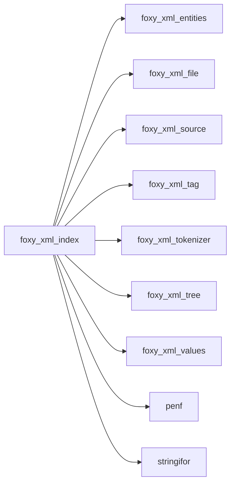
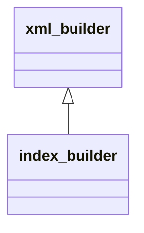
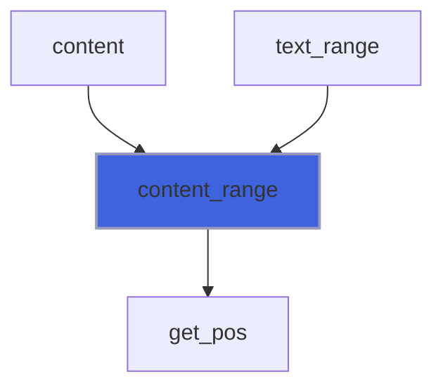
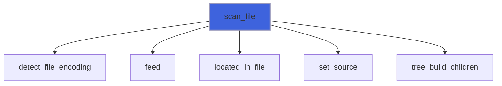
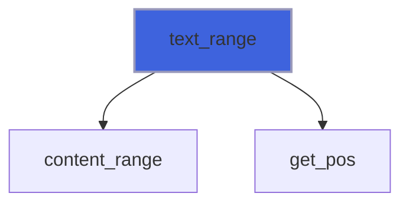
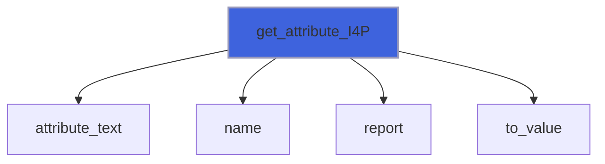
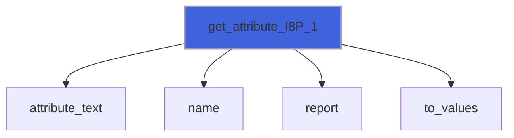
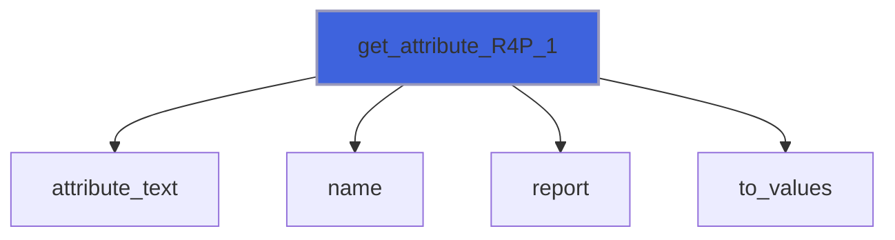

# foxy_xml_index

> FoXy XML index class: scan a file once and read the content of its tags on demand.

 The index stores, for each tag of a file, its name, attributes, hierarchy and the positions of its markup in the file,
 never its content: the memory used does not depend on the data held in the file, which is read in chunks. The content
 is read afterwards, on demand. The scan can stop after the start tag of a given tag (e.g. `AppendedData` of VTK files,
 whose content is raw binary). The queries are the same as *xml_file* ones (*find*, *find_all*, *children*, ...).

**Source**: `src/third_party/FoXy/src/lib/foxy_xml_index.f90`

**Dependencies**



## Contents

- [xml_index](#xml-index)
- [index_builder](#index-builder)
- [content_range](#content-range)
- [free](#free)
- [scan_file](#scan-file)
- [text_range](#text-range)
- [attribute_text](#attribute-text)
- [content_text](#content-text)
- [get_attribute_I1P](#get-attribute-i1p)
- [get_attribute_I2P](#get-attribute-i2p)
- [get_attribute_I4P](#get-attribute-i4p)
- [get_attribute_I8P](#get-attribute-i8p)
- [get_attribute_R4P](#get-attribute-r4p)
- [get_attribute_R8P](#get-attribute-r8p)
- [get_attribute_logical](#get-attribute-logical)
- [get_attribute_I1P_1](#get-attribute-i1p-1)
- [get_attribute_I2P_1](#get-attribute-i2p-1)
- [get_attribute_I4P_1](#get-attribute-i4p-1)
- [get_attribute_I8P_1](#get-attribute-i8p-1)
- [get_attribute_R4P_1](#get-attribute-r4p-1)
- [get_attribute_R8P_1](#get-attribute-r8p-1)
- [get_content_I1P](#get-content-i1p)
- [get_content_I2P](#get-content-i2p)
- [get_content_I4P](#get-content-i4p)
- [get_content_I8P](#get-content-i8p)
- [get_content_R4P](#get-content-r4p)
- [get_content_R8P](#get-content-r8p)
- [get_content_logical](#get-content-logical)
- [get_content_I1P_1](#get-content-i1p-1)
- [get_content_I2P_1](#get-content-i2p-1)
- [get_content_I4P_1](#get-content-i4p-1)
- [get_content_I8P_1](#get-content-i8p-1)
- [get_content_R4P_1](#get-content-r4p-1)
- [get_content_R8P_1](#get-content-r8p-1)
- [index_start_tag](#index-start-tag)
- [index_attribute](#index-attribute)
- [index_start_tag_end](#index-start-tag-end)
- [index_end_tag](#index-end-tag)
- [index_data](#index-data)
- [index_problem](#index-problem)
- [attribute_name](#attribute-name)
- [attributes_number](#attributes-number)
- [tags_number](#tags-number)
- [attribute](#attribute)
- [children](#children)
- [content](#content)
- [find](#find)
- [find_all](#find-all)
- [select](#select)
- [level](#level)
- [local_name](#local-name)
- [matching](#matching)
- [name](#name)
- [namespace](#namespace)
- [parent](#parent)
- [prefix](#prefix)
- [stop_position](#stop-position)

## Variables

| Name | Type | Attributes | Description |
|------|------|------------|-------------|
| `FILE_CHUNK_SIZE` | integer(kind=[I8P](/api/src/third_party/PENF/src/lib/penf_global_parameters_variables)) | parameter | Default size of the chunks read from the file (64 KiB). |
| `INITIAL_CAPACITY` | integer(kind=[I4P](/api/src/third_party/PENF/src/lib/penf_global_parameters_variables)) | parameter | Initial capacity of the tags arrays, doubled when full. |

## Derived Types

### xml_index

Index of the tags of an XML file.

#### Components

| Name | Type | Attributes | Description |
|------|------|------------|-------------|
| `tag` | type([xml_tag](/api/src/third_party/FoXy/src/lib/foxy_xml_tag#xml-tag)) | allocatable | Tags (no content): name, attributes, hierarchy, positions. |
| `last` | integer(kind=[I8P](/api/src/third_party/PENF/src/lib/penf_global_parameters_variables)) | allocatable | Position of the last character of each tag (`>`), 0 if unclosed. |
| `nt` | integer(kind=[I4P](/api/src/third_party/PENF/src/lib/penf_global_parameters_variables)) |  | Number of tags. |
| `filename` | character(len=:) | allocatable | Indexed file name. |
| `stop_pos` | integer(kind=[I8P](/api/src/third_party/PENF/src/lib/penf_global_parameters_variables)) |  | Position after the start tag where the scan stopped, 0 if none. |

#### Type-Bound Procedures

| Name | Attributes | Description |
|------|------------|-------------|
| `attribute` | pass(self) | Return the value of an attribute of the tag with a given ID. |
| `attribute_name` | pass(self) | Return the name of the attribute with a given index of a tag. |
| `attributes_number` | pass(self) | Return the number of attributes of the tag with a given ID. |
| `children` | pass(self) | Return the IDs of the children of the tag with a given ID. |
| `content` | pass(self) | Return the content of the tag with a given ID, read from the file. |
| `content_range` | pass(self) | Return the positions in the file of the content of a tag. |
| `find` | pass(self) | Return the ID of the first tag matching a name or a path. |
| `find_all` | pass(self) | Return the IDs of all tags matching a name or a path. |
| `select` | pass(self) | Return the IDs of the tags selected by a path expression. |
| `free` | pass(self) | Free dynamic memory. |
| `get_attribute` |  | Get the value of an attribute as number(s) or logical. |
| `get_content` |  | Get the content of a tag as number(s) or logical. |
| `level` | pass(self) | Return the level of the tag with a given ID. |
| `local_name` | pass(self) | Return the local name of the tag with a given ID. |
| `matching` | pass(self) | Filter tags by a regular expression (name, content, attribute). |
| `name` | pass(self) | Return the name of the tag with a given ID. |
| `namespace` | pass(self) | Return the namespace of the tag with a given ID. |
| `parent` | pass(self) | Return the parent ID of the tag with a given ID. |
| `prefix` | pass(self) | Return the name prefix of the tag with a given ID. |
| `scan` | pass(self) | Scan a file, indexing its tags (procedure renamed: nvfortran links |
| `stop_position` | pass(self) | Return the position after the start tag where the scan stopped. |
| `tags_number` | pass(self) | Return the number of tags. |
| `text_range` | pass(self) | Return the positions in the file of the text of a tag. |
| `attribute_text` | pass(self) | Return an attribute value, reporting a missing one. |
| `content_text` | pass(self) | Return a tag content, reporting a missing tag. |
| `get_attribute_I1P` | pass(self) |  |
| `get_attribute_I2P` | pass(self) |  |
| `get_attribute_I4P` | pass(self) |  |
| `get_attribute_I8P` | pass(self) |  |
| `get_attribute_R4P` | pass(self) |  |
| `get_attribute_R8P` | pass(self) |  |
| `get_attribute_logical` | pass(self) |  |
| `get_attribute_I1P_1` | pass(self) |  |
| `get_attribute_I2P_1` | pass(self) |  |
| `get_attribute_I4P_1` | pass(self) |  |
| `get_attribute_I8P_1` | pass(self) |  |
| `get_attribute_R4P_1` | pass(self) |  |
| `get_attribute_R8P_1` | pass(self) |  |
| `get_content_I1P` | pass(self) |  |
| `get_content_I2P` | pass(self) |  |
| `get_content_I4P` | pass(self) |  |
| `get_content_I8P` | pass(self) |  |
| `get_content_R4P` | pass(self) |  |
| `get_content_R8P` | pass(self) |  |
| `get_content_logical` | pass(self) |  |
| `get_content_I1P_1` | pass(self) |  |
| `get_content_I2P_1` | pass(self) |  |
| `get_content_I4P_1` | pass(self) |  |
| `get_content_I8P_1` | pass(self) |  |
| `get_content_R4P_1` | pass(self) |  |
| `get_content_R8P_1` | pass(self) |  |

### index_builder

Builder of the index, driven by the tokenizer: character data are not stored.

**Inheritance**



**Extends**: [`xml_builder`](/api/src/third_party/FoXy/src/lib/foxy_xml_tokenizer#xml-builder)

#### Components

| Name | Type | Attributes | Description |
|------|------|------------|-------------|
| `is_stopped` | logical |  | Set by the builder to stop the tokenizer (checked after each complete start or end tag). |
| `tag` | type([xml_tag](/api/src/third_party/FoXy/src/lib/foxy_xml_tag#xml-tag)) | allocatable | Tags. |
| `last` | integer(kind=[I8P](/api/src/third_party/PENF/src/lib/penf_global_parameters_variables)) | allocatable | Position of the last character of each tag. |
| `nt` | integer(kind=[I4P](/api/src/third_party/PENF/src/lib/penf_global_parameters_variables)) |  | Number of tags. |
| `sanitize` | logical |  | Trim leading and trailing spaces of attribute values. |
| `stop_at` | character(len=:) | allocatable | Name of the tag after whose start tag the scan stops. |
| `stop_pos` | integer(kind=[I8P](/api/src/third_party/PENF/src/lib/penf_global_parameters_variables)) |  | Position after the start tag where the scan stopped. |
| `first_problem` | character(len=:) | allocatable | First problem of malformed input, unallocated if none. |
| `problem_pos` | integer(kind=[I8P](/api/src/third_party/PENF/src/lib/penf_global_parameters_variables)) |  | Position of the first problem. |

#### Type-Bound Procedures

| Name | Attributes | Description |
|------|------------|-------------|
| `start_tag` | pass(self) | A start tag begins. |
| `attribute` | pass(self) | An attribute of the current start tag. |
| `start_tag_end` | pass(self) | The current start tag is complete. |
| `end_tag` | pass(self) | An open tag is closed by its end tag. |
| `data` | pass(self) | Character data or other markup: not stored. |
| `problem` | pass(self) | A problem of malformed input. |

## Subroutines

### content_range

Return the positions in the file of the content of the tag with ID *id* (between its start and end tags, children
 included); *last* < *first* if it is empty (also for a self closing or unclosed tag, or if the tag does not exist).

**Attributes**: elemental

```fortran
subroutine content_range(self, id, first, last)
```

**Arguments**

| Name | Type | Intent | Attributes | Description |
|------|------|--------|------------|-------------|
| `self` | class([xml_index](/api/src/third_party/FoXy/src/lib/foxy_xml_index#xml-index)) | in |  | XML index. |
| `id` | integer(kind=[I4P](/api/src/third_party/PENF/src/lib/penf_global_parameters_variables)) | in |  | Tag ID. |
| `first` | integer(kind=[I8P](/api/src/third_party/PENF/src/lib/penf_global_parameters_variables)) | out |  | First position. |
| `last` | integer(kind=[I8P](/api/src/third_party/PENF/src/lib/penf_global_parameters_variables)) | out |  | Last position. |

**Call graph**



### free

Free dynamic memory.

**Attributes**: elemental

```fortran
subroutine free(self)
```

**Arguments**

| Name | Type | Intent | Attributes | Description |
|------|------|--------|------------|-------------|
| `self` | class([xml_index](/api/src/third_party/FoXy/src/lib/foxy_xml_index#xml-index)) | inout |  | XML index. |

### scan_file

Scan a file, indexing its tags; the file is read in chunks (default 64 KiB), its content is not stored.

 @note If *stop_at* is passed, the scan stops after the start tag of the first tag with that name (the tags still
 open stay unclosed, without content); *stop_position* returns the position after it.
 @note As *xml_file%parse*: the scan is tolerant; *iostat* returns 0 on success, the runtime I/O error code if the
 file cannot be read, *XML_MALFORMED* if the input is malformed (*iomsg*, unchanged on success, describes the first
 problem with its line); attribute values are trimmed unless *sanitize_attributes_value* is false.

```fortran
subroutine scan_file(self, filename, stop_at, chunk_size, iostat, iomsg, sanitize_attributes_value)
```

**Arguments**

| Name | Type | Intent | Attributes | Description |
|------|------|--------|------------|-------------|
| `self` | class([xml_index](/api/src/third_party/FoXy/src/lib/foxy_xml_index#xml-index)) | inout |  | XML index. |
| `filename` | character(len=*) | in |  | File name. |
| `stop_at` | character(len=*) | in | optional | Name of the tag after whose start tag the scan stops. |
| `chunk_size` | integer(kind=[I8P](/api/src/third_party/PENF/src/lib/penf_global_parameters_variables)) | in | optional | Size of the chunks read from the file. |
| `iostat` | integer(kind=[I4P](/api/src/third_party/PENF/src/lib/penf_global_parameters_variables)) | out | optional | IO status. |
| `iomsg` | character(len=*) | inout | optional | IO message. |
| `sanitize_attributes_value` | logical | in | optional | Trim attribute values spaces (default .true.). |

**Call graph**



### text_range

Return the positions in the file of the text of the tag with ID *id*: from its start tag to its first child (or to
 its end tag); *last* < *first* if it is empty (also for a self closing or unclosed tag, or if the tag does not exist).

**Attributes**: elemental

```fortran
subroutine text_range(self, id, first, last)
```

**Arguments**

| Name | Type | Intent | Attributes | Description |
|------|------|--------|------------|-------------|
| `self` | class([xml_index](/api/src/third_party/FoXy/src/lib/foxy_xml_index#xml-index)) | in |  | XML index. |
| `id` | integer(kind=[I4P](/api/src/third_party/PENF/src/lib/penf_global_parameters_variables)) | in |  | Tag ID. |
| `first` | integer(kind=[I8P](/api/src/third_party/PENF/src/lib/penf_global_parameters_variables)) | out |  | First position. |
| `last` | integer(kind=[I8P](/api/src/third_party/PENF/src/lib/penf_global_parameters_variables)) | out |  | Last position. |

**Call graph**



### attribute_text

Return the value of the attribute named *name* of the tag with ID *id*; *iostat* is *XML_NOT_FOUND* if the tag or the
 attribute does not exist.

```fortran
subroutine attribute_text(self, id, name, text, iostat, iomsg)
```

**Arguments**

| Name | Type | Intent | Attributes | Description |
|------|------|--------|------------|-------------|
| `self` | class([xml_index](/api/src/third_party/FoXy/src/lib/foxy_xml_index#xml-index)) | in |  | XML index. |
| `id` | integer(kind=[I4P](/api/src/third_party/PENF/src/lib/penf_global_parameters_variables)) | in |  | Tag ID. |
| `name` | character(len=*) | in |  | Attribute name. |
| `text` | character(len=:) | out | allocatable | Attribute value. |
| `iostat` | integer(kind=[I4P](/api/src/third_party/PENF/src/lib/penf_global_parameters_variables)) | out |  | IO status. |
| `iomsg` | character(len=:) | out | allocatable | IO message. |

**Call graph**



```mermaid
flowchart TD
  get_attribute_I1P["get_attribute_I1P"] --> attribute_text["attribute_text"]
  get_attribute_I1P["get_attribute_I1P"] --> attribute_text["attribute_text"]
  get_attribute_I1P_1["get_attribute_I1P_1"] --> attribute_text["attribute_text"]
  get_attribute_I1P_1["get_attribute_I1P_1"] --> attribute_text["attribute_text"]
  get_attribute_I2P["get_attribute_I2P"] --> attribute_text["attribute_text"]
  get_attribute_I2P["get_attribute_I2P"] --> attribute_text["attribute_text"]
  get_attribute_I2P_1["get_attribute_I2P_1"] --> attribute_text["attribute_text"]
  get_attribute_I2P_1["get_attribute_I2P_1"] --> attribute_text["attribute_text"]
  get_attribute_I4P["get_attribute_I4P"] --> attribute_text["attribute_text"]
  get_attribute_I4P["get_attribute_I4P"] --> attribute_text["attribute_text"]
  get_attribute_I4P_1["get_attribute_I4P_1"] --> attribute_text["attribute_text"]
  get_attribute_I4P_1["get_attribute_I4P_1"] --> attribute_text["attribute_text"]
  get_attribute_I8P["get_attribute_I8P"] --> attribute_text["attribute_text"]
  get_attribute_I8P["get_attribute_I8P"] --> attribute_text["attribute_text"]
  get_attribute_I8P_1["get_attribute_I8P_1"] --> attribute_text["attribute_text"]
  get_attribute_I8P_1["get_attribute_I8P_1"] --> attribute_text["attribute_text"]
  get_attribute_R4P["get_attribute_R4P"] --> attribute_text["attribute_text"]
  get_attribute_R4P["get_attribute_R4P"] --> attribute_text["attribute_text"]
  get_attribute_R4P_1["get_attribute_R4P_1"] --> attribute_text["attribute_text"]
  get_attribute_R4P_1["get_attribute_R4P_1"] --> attribute_text["attribute_text"]
  get_attribute_R8P["get_attribute_R8P"] --> attribute_text["attribute_text"]
  get_attribute_R8P["get_attribute_R8P"] --> attribute_text["attribute_text"]
  get_attribute_R8P_1["get_attribute_R8P_1"] --> attribute_text["attribute_text"]
  get_attribute_R8P_1["get_attribute_R8P_1"] --> attribute_text["attribute_text"]
  get_attribute_logical["get_attribute_logical"] --> attribute_text["attribute_text"]
  get_attribute_logical["get_attribute_logical"] --> attribute_text["attribute_text"]
  attribute_text["attribute_text"] --> tree_attribute_text["tree_attribute_text"]
  style attribute_text fill:#3e63dd,stroke:#99b,stroke-width:2px
```

### content_text

Return the content of the tag with ID *id*, read from the file (see *content*); *iostat* is *XML_NOT_FOUND* if the
 tag does not exist, the runtime one if the file cannot be read.

```fortran
subroutine content_text(self, id, text, iostat, iomsg)
```

**Arguments**

| Name | Type | Intent | Attributes | Description |
|------|------|--------|------------|-------------|
| `self` | class([xml_index](/api/src/third_party/FoXy/src/lib/foxy_xml_index#xml-index)) | in |  | XML index. |
| `id` | integer(kind=[I4P](/api/src/third_party/PENF/src/lib/penf_global_parameters_variables)) | in |  | Tag ID. |
| `text` | character(len=:) | out | allocatable | Tag content. |
| `iostat` | integer(kind=[I4P](/api/src/third_party/PENF/src/lib/penf_global_parameters_variables)) | out |  | IO status. |
| `iomsg` | character(len=:) | out | allocatable | IO message. |

**Call graph**



```mermaid
flowchart TD
  get_content_I1P["get_content_I1P"] --> content_text["content_text"]
  get_content_I1P["get_content_I1P"] --> content_text["content_text"]
  get_content_I1P_1["get_content_I1P_1"] --> content_text["content_text"]
  get_content_I1P_1["get_content_I1P_1"] --> content_text["content_text"]
  get_content_I2P["get_content_I2P"] --> content_text["content_text"]
  get_content_I2P["get_content_I2P"] --> content_text["content_text"]
  get_content_I2P_1["get_content_I2P_1"] --> content_text["content_text"]
  get_content_I2P_1["get_content_I2P_1"] --> content_text["content_text"]
  get_content_I4P["get_content_I4P"] --> content_text["content_text"]
  get_content_I4P["get_content_I4P"] --> content_text["content_text"]
  get_content_I4P_1["get_content_I4P_1"] --> content_text["content_text"]
  get_content_I4P_1["get_content_I4P_1"] --> content_text["content_text"]
  get_content_I8P["get_content_I8P"] --> content_text["content_text"]
  get_content_I8P["get_content_I8P"] --> content_text["content_text"]
  get_content_I8P_1["get_content_I8P_1"] --> content_text["content_text"]
  get_content_I8P_1["get_content_I8P_1"] --> content_text["content_text"]
  get_content_R4P["get_content_R4P"] --> content_text["content_text"]
  get_content_R4P["get_content_R4P"] --> content_text["content_text"]
  get_content_R4P_1["get_content_R4P_1"] --> content_text["content_text"]
  get_content_R4P_1["get_content_R4P_1"] --> content_text["content_text"]
  get_content_R8P["get_content_R8P"] --> content_text["content_text"]
  get_content_R8P["get_content_R8P"] --> content_text["content_text"]
  get_content_R8P_1["get_content_R8P_1"] --> content_text["content_text"]
  get_content_R8P_1["get_content_R8P_1"] --> content_text["content_text"]
  get_content_logical["get_content_logical"] --> content_text["content_text"]
  get_content_logical["get_content_logical"] --> content_text["content_text"]
  content_text["content_text"] --> content["content"]
  content_text["content_text"] --> str["str"]
  style content_text fill:#3e63dd,stroke:#99b,stroke-width:2px
```

### get_attribute_I1P

Get the attribute named *name* of the tag with ID *id* as a integer(I1P) value.

```fortran
subroutine get_attribute_I1P(self, id, name, value, iostat, iomsg)
```

**Arguments**

| Name | Type | Intent | Attributes | Description |
|------|------|--------|------------|-------------|
| `self` | class([xml_index](/api/src/third_party/FoXy/src/lib/foxy_xml_index#xml-index)) | in |  | XML index. |
| `id` | integer(kind=[I4P](/api/src/third_party/PENF/src/lib/penf_global_parameters_variables)) | in |  | Tag ID. |
| `name` | character(len=*) | in |  | Attribute name. |
| `value` | integer(kind=[I1P](/api/src/third_party/PENF/src/lib/penf_global_parameters_variables)) | inout |  | Value, unchanged on error. |
| `iostat` | integer(kind=[I4P](/api/src/third_party/PENF/src/lib/penf_global_parameters_variables)) | out | optional | IO status. |
| `iomsg` | character(len=*) | inout | optional | IO message. |

**Call graph**


### get_attribute_I2P

Get the attribute named *name* of the tag with ID *id* as a integer(I2P) value.

```fortran
subroutine get_attribute_I2P(self, id, name, value, iostat, iomsg)
```

**Arguments**

| Name | Type | Intent | Attributes | Description |
|------|------|--------|------------|-------------|
| `self` | class([xml_index](/api/src/third_party/FoXy/src/lib/foxy_xml_index#xml-index)) | in |  | XML index. |
| `id` | integer(kind=[I4P](/api/src/third_party/PENF/src/lib/penf_global_parameters_variables)) | in |  | Tag ID. |
| `name` | character(len=*) | in |  | Attribute name. |
| `value` | integer(kind=[I2P](/api/src/third_party/PENF/src/lib/penf_global_parameters_variables)) | inout |  | Value, unchanged on error. |
| `iostat` | integer(kind=[I4P](/api/src/third_party/PENF/src/lib/penf_global_parameters_variables)) | out | optional | IO status. |
| `iomsg` | character(len=*) | inout | optional | IO message. |

**Call graph**


### get_attribute_I4P

Get the attribute named *name* of the tag with ID *id* as a integer(I4P) value.

```fortran
subroutine get_attribute_I4P(self, id, name, value, iostat, iomsg)
```

**Arguments**

| Name | Type | Intent | Attributes | Description |
|------|------|--------|------------|-------------|
| `self` | class([xml_index](/api/src/third_party/FoXy/src/lib/foxy_xml_index#xml-index)) | in |  | XML index. |
| `id` | integer(kind=[I4P](/api/src/third_party/PENF/src/lib/penf_global_parameters_variables)) | in |  | Tag ID. |
| `name` | character(len=*) | in |  | Attribute name. |
| `value` | integer(kind=[I4P](/api/src/third_party/PENF/src/lib/penf_global_parameters_variables)) | inout |  | Value, unchanged on error. |
| `iostat` | integer(kind=[I4P](/api/src/third_party/PENF/src/lib/penf_global_parameters_variables)) | out | optional | IO status. |
| `iomsg` | character(len=*) | inout | optional | IO message. |

**Call graph**



### get_attribute_I8P

Get the attribute named *name* of the tag with ID *id* as a integer(I8P) value.

```fortran
subroutine get_attribute_I8P(self, id, name, value, iostat, iomsg)
```

**Arguments**

| Name | Type | Intent | Attributes | Description |
|------|------|--------|------------|-------------|
| `self` | class([xml_index](/api/src/third_party/FoXy/src/lib/foxy_xml_index#xml-index)) | in |  | XML index. |
| `id` | integer(kind=[I4P](/api/src/third_party/PENF/src/lib/penf_global_parameters_variables)) | in |  | Tag ID. |
| `name` | character(len=*) | in |  | Attribute name. |
| `value` | integer(kind=[I8P](/api/src/third_party/PENF/src/lib/penf_global_parameters_variables)) | inout |  | Value, unchanged on error. |
| `iostat` | integer(kind=[I4P](/api/src/third_party/PENF/src/lib/penf_global_parameters_variables)) | out | optional | IO status. |
| `iomsg` | character(len=*) | inout | optional | IO message. |

**Call graph**


### get_attribute_R4P

Get the attribute named *name* of the tag with ID *id* as a real(R4P) value.

```fortran
subroutine get_attribute_R4P(self, id, name, value, iostat, iomsg)
```

**Arguments**

| Name | Type | Intent | Attributes | Description |
|------|------|--------|------------|-------------|
| `self` | class([xml_index](/api/src/third_party/FoXy/src/lib/foxy_xml_index#xml-index)) | in |  | XML index. |
| `id` | integer(kind=[I4P](/api/src/third_party/PENF/src/lib/penf_global_parameters_variables)) | in |  | Tag ID. |
| `name` | character(len=*) | in |  | Attribute name. |
| `value` | real(kind=[R4P](/api/src/third_party/PENF/src/lib/penf_global_parameters_variables)) | inout |  | Value, unchanged on error. |
| `iostat` | integer(kind=[I4P](/api/src/third_party/PENF/src/lib/penf_global_parameters_variables)) | out | optional | IO status. |
| `iomsg` | character(len=*) | inout | optional | IO message. |

**Call graph**


### get_attribute_R8P

Get the attribute named *name* of the tag with ID *id* as a real(R8P) value.

```fortran
subroutine get_attribute_R8P(self, id, name, value, iostat, iomsg)
```

**Arguments**

| Name | Type | Intent | Attributes | Description |
|------|------|--------|------------|-------------|
| `self` | class([xml_index](/api/src/third_party/FoXy/src/lib/foxy_xml_index#xml-index)) | in |  | XML index. |
| `id` | integer(kind=[I4P](/api/src/third_party/PENF/src/lib/penf_global_parameters_variables)) | in |  | Tag ID. |
| `name` | character(len=*) | in |  | Attribute name. |
| `value` | real(kind=[R8P](/api/src/third_party/PENF/src/lib/penf_global_parameters_variables)) | inout |  | Value, unchanged on error. |
| `iostat` | integer(kind=[I4P](/api/src/third_party/PENF/src/lib/penf_global_parameters_variables)) | out | optional | IO status. |
| `iomsg` | character(len=*) | inout | optional | IO message. |

**Call graph**


### get_attribute_logical

Get the attribute named *name* of the tag with ID *id* as a logical value.

```fortran
subroutine get_attribute_logical(self, id, name, value, iostat, iomsg)
```

**Arguments**

| Name | Type | Intent | Attributes | Description |
|------|------|--------|------------|-------------|
| `self` | class([xml_index](/api/src/third_party/FoXy/src/lib/foxy_xml_index#xml-index)) | in |  | XML index. |
| `id` | integer(kind=[I4P](/api/src/third_party/PENF/src/lib/penf_global_parameters_variables)) | in |  | Tag ID. |
| `name` | character(len=*) | in |  | Attribute name. |
| `value` | logical | inout |  | Value, unchanged on error. |
| `iostat` | integer(kind=[I4P](/api/src/third_party/PENF/src/lib/penf_global_parameters_variables)) | out | optional | IO status. |
| `iomsg` | character(len=*) | inout | optional | IO message. |

**Call graph**


### get_attribute_I1P_1

Get the attribute named *name* of the tag with ID *id* as a list of integer(I1P) values (blank separated).

```fortran
subroutine get_attribute_I1P_1(self, id, name, values, iostat, iomsg)
```

**Arguments**

| Name | Type | Intent | Attributes | Description |
|------|------|--------|------------|-------------|
| `self` | class([xml_index](/api/src/third_party/FoXy/src/lib/foxy_xml_index#xml-index)) | in |  | XML index. |
| `id` | integer(kind=[I4P](/api/src/third_party/PENF/src/lib/penf_global_parameters_variables)) | in |  | Tag ID. |
| `name` | character(len=*) | in |  | Attribute name. |
| `values` | integer(kind=[I1P](/api/src/third_party/PENF/src/lib/penf_global_parameters_variables)) | out | allocatable | Values, empty on error. |
| `iostat` | integer(kind=[I4P](/api/src/third_party/PENF/src/lib/penf_global_parameters_variables)) | out | optional | IO status. |
| `iomsg` | character(len=*) | inout | optional | IO message. |

**Call graph**


### get_attribute_I2P_1

Get the attribute named *name* of the tag with ID *id* as a list of integer(I2P) values (blank separated).

```fortran
subroutine get_attribute_I2P_1(self, id, name, values, iostat, iomsg)
```

**Arguments**

| Name | Type | Intent | Attributes | Description |
|------|------|--------|------------|-------------|
| `self` | class([xml_index](/api/src/third_party/FoXy/src/lib/foxy_xml_index#xml-index)) | in |  | XML index. |
| `id` | integer(kind=[I4P](/api/src/third_party/PENF/src/lib/penf_global_parameters_variables)) | in |  | Tag ID. |
| `name` | character(len=*) | in |  | Attribute name. |
| `values` | integer(kind=[I2P](/api/src/third_party/PENF/src/lib/penf_global_parameters_variables)) | out | allocatable | Values, empty on error. |
| `iostat` | integer(kind=[I4P](/api/src/third_party/PENF/src/lib/penf_global_parameters_variables)) | out | optional | IO status. |
| `iomsg` | character(len=*) | inout | optional | IO message. |

**Call graph**


### get_attribute_I4P_1

Get the attribute named *name* of the tag with ID *id* as a list of integer(I4P) values (blank separated).

```fortran
subroutine get_attribute_I4P_1(self, id, name, values, iostat, iomsg)
```

**Arguments**

| Name | Type | Intent | Attributes | Description |
|------|------|--------|------------|-------------|
| `self` | class([xml_index](/api/src/third_party/FoXy/src/lib/foxy_xml_index#xml-index)) | in |  | XML index. |
| `id` | integer(kind=[I4P](/api/src/third_party/PENF/src/lib/penf_global_parameters_variables)) | in |  | Tag ID. |
| `name` | character(len=*) | in |  | Attribute name. |
| `values` | integer(kind=[I4P](/api/src/third_party/PENF/src/lib/penf_global_parameters_variables)) | out | allocatable | Values, empty on error. |
| `iostat` | integer(kind=[I4P](/api/src/third_party/PENF/src/lib/penf_global_parameters_variables)) | out | optional | IO status. |
| `iomsg` | character(len=*) | inout | optional | IO message. |

**Call graph**


### get_attribute_I8P_1

Get the attribute named *name* of the tag with ID *id* as a list of integer(I8P) values (blank separated).

```fortran
subroutine get_attribute_I8P_1(self, id, name, values, iostat, iomsg)
```

**Arguments**

| Name | Type | Intent | Attributes | Description |
|------|------|--------|------------|-------------|
| `self` | class([xml_index](/api/src/third_party/FoXy/src/lib/foxy_xml_index#xml-index)) | in |  | XML index. |
| `id` | integer(kind=[I4P](/api/src/third_party/PENF/src/lib/penf_global_parameters_variables)) | in |  | Tag ID. |
| `name` | character(len=*) | in |  | Attribute name. |
| `values` | integer(kind=[I8P](/api/src/third_party/PENF/src/lib/penf_global_parameters_variables)) | out | allocatable | Values, empty on error. |
| `iostat` | integer(kind=[I4P](/api/src/third_party/PENF/src/lib/penf_global_parameters_variables)) | out | optional | IO status. |
| `iomsg` | character(len=*) | inout | optional | IO message. |

**Call graph**



### get_attribute_R4P_1

Get the attribute named *name* of the tag with ID *id* as a list of real(R4P) values (blank separated).

```fortran
subroutine get_attribute_R4P_1(self, id, name, values, iostat, iomsg)
```

**Arguments**

| Name | Type | Intent | Attributes | Description |
|------|------|--------|------------|-------------|
| `self` | class([xml_index](/api/src/third_party/FoXy/src/lib/foxy_xml_index#xml-index)) | in |  | XML index. |
| `id` | integer(kind=[I4P](/api/src/third_party/PENF/src/lib/penf_global_parameters_variables)) | in |  | Tag ID. |
| `name` | character(len=*) | in |  | Attribute name. |
| `values` | real(kind=[R4P](/api/src/third_party/PENF/src/lib/penf_global_parameters_variables)) | out | allocatable | Values, empty on error. |
| `iostat` | integer(kind=[I4P](/api/src/third_party/PENF/src/lib/penf_global_parameters_variables)) | out | optional | IO status. |
| `iomsg` | character(len=*) | inout | optional | IO message. |

**Call graph**



### get_attribute_R8P_1

Get the attribute named *name* of the tag with ID *id* as a list of real(R8P) values (blank separated).

```fortran
subroutine get_attribute_R8P_1(self, id, name, values, iostat, iomsg)
```

**Arguments**

| Name | Type | Intent | Attributes | Description |
|------|------|--------|------------|-------------|
| `self` | class([xml_index](/api/src/third_party/FoXy/src/lib/foxy_xml_index#xml-index)) | in |  | XML index. |
| `id` | integer(kind=[I4P](/api/src/third_party/PENF/src/lib/penf_global_parameters_variables)) | in |  | Tag ID. |
| `name` | character(len=*) | in |  | Attribute name. |
| `values` | real(kind=[R8P](/api/src/third_party/PENF/src/lib/penf_global_parameters_variables)) | out | allocatable | Values, empty on error. |
| `iostat` | integer(kind=[I4P](/api/src/third_party/PENF/src/lib/penf_global_parameters_variables)) | out | optional | IO status. |
| `iomsg` | character(len=*) | inout | optional | IO message. |

**Call graph**


### get_content_I1P

Get the content of the tag with ID *id* as a integer(I1P) value.

```fortran
subroutine get_content_I1P(self, id, value, iostat, iomsg)
```

**Arguments**

| Name | Type | Intent | Attributes | Description |
|------|------|--------|------------|-------------|
| `self` | class([xml_index](/api/src/third_party/FoXy/src/lib/foxy_xml_index#xml-index)) | in |  | XML index. |
| `id` | integer(kind=[I4P](/api/src/third_party/PENF/src/lib/penf_global_parameters_variables)) | in |  | Tag ID. |
| `value` | integer(kind=[I1P](/api/src/third_party/PENF/src/lib/penf_global_parameters_variables)) | inout |  | Value, unchanged on error. |
| `iostat` | integer(kind=[I4P](/api/src/third_party/PENF/src/lib/penf_global_parameters_variables)) | out | optional | IO status. |
| `iomsg` | character(len=*) | inout | optional | IO message. |

**Call graph**

```mermaid
flowchart TD
  get_content_I1P["get_content_I1P"] --> content_text["content_text"]
  get_content_I1P["get_content_I1P"] --> name["name"]
  get_content_I1P["get_content_I1P"] --> report["report"]
  get_content_I1P["get_content_I1P"] --> to_value["to_value"]
  style get_content_I1P fill:#3e63dd,stroke:#99b,stroke-width:2px
```

### get_content_I2P

Get the content of the tag with ID *id* as a integer(I2P) value.

```fortran
subroutine get_content_I2P(self, id, value, iostat, iomsg)
```

**Arguments**

| Name | Type | Intent | Attributes | Description |
|------|------|--------|------------|-------------|
| `self` | class([xml_index](/api/src/third_party/FoXy/src/lib/foxy_xml_index#xml-index)) | in |  | XML index. |
| `id` | integer(kind=[I4P](/api/src/third_party/PENF/src/lib/penf_global_parameters_variables)) | in |  | Tag ID. |
| `value` | integer(kind=[I2P](/api/src/third_party/PENF/src/lib/penf_global_parameters_variables)) | inout |  | Value, unchanged on error. |
| `iostat` | integer(kind=[I4P](/api/src/third_party/PENF/src/lib/penf_global_parameters_variables)) | out | optional | IO status. |
| `iomsg` | character(len=*) | inout | optional | IO message. |

**Call graph**

```mermaid
flowchart TD
  get_content_I2P["get_content_I2P"] --> content_text["content_text"]
  get_content_I2P["get_content_I2P"] --> name["name"]
  get_content_I2P["get_content_I2P"] --> report["report"]
  get_content_I2P["get_content_I2P"] --> to_value["to_value"]
  style get_content_I2P fill:#3e63dd,stroke:#99b,stroke-width:2px
```

### get_content_I4P

Get the content of the tag with ID *id* as a integer(I4P) value.

```fortran
subroutine get_content_I4P(self, id, value, iostat, iomsg)
```

**Arguments**

| Name | Type | Intent | Attributes | Description |
|------|------|--------|------------|-------------|
| `self` | class([xml_index](/api/src/third_party/FoXy/src/lib/foxy_xml_index#xml-index)) | in |  | XML index. |
| `id` | integer(kind=[I4P](/api/src/third_party/PENF/src/lib/penf_global_parameters_variables)) | in |  | Tag ID. |
| `value` | integer(kind=[I4P](/api/src/third_party/PENF/src/lib/penf_global_parameters_variables)) | inout |  | Value, unchanged on error. |
| `iostat` | integer(kind=[I4P](/api/src/third_party/PENF/src/lib/penf_global_parameters_variables)) | out | optional | IO status. |
| `iomsg` | character(len=*) | inout | optional | IO message. |

**Call graph**

```mermaid
flowchart TD
  get_content_I4P["get_content_I4P"] --> content_text["content_text"]
  get_content_I4P["get_content_I4P"] --> name["name"]
  get_content_I4P["get_content_I4P"] --> report["report"]
  get_content_I4P["get_content_I4P"] --> to_value["to_value"]
  style get_content_I4P fill:#3e63dd,stroke:#99b,stroke-width:2px
```

### get_content_I8P

Get the content of the tag with ID *id* as a integer(I8P) value.

```fortran
subroutine get_content_I8P(self, id, value, iostat, iomsg)
```

**Arguments**

| Name | Type | Intent | Attributes | Description |
|------|------|--------|------------|-------------|
| `self` | class([xml_index](/api/src/third_party/FoXy/src/lib/foxy_xml_index#xml-index)) | in |  | XML index. |
| `id` | integer(kind=[I4P](/api/src/third_party/PENF/src/lib/penf_global_parameters_variables)) | in |  | Tag ID. |
| `value` | integer(kind=[I8P](/api/src/third_party/PENF/src/lib/penf_global_parameters_variables)) | inout |  | Value, unchanged on error. |
| `iostat` | integer(kind=[I4P](/api/src/third_party/PENF/src/lib/penf_global_parameters_variables)) | out | optional | IO status. |
| `iomsg` | character(len=*) | inout | optional | IO message. |

**Call graph**

```mermaid
flowchart TD
  get_content_I8P["get_content_I8P"] --> content_text["content_text"]
  get_content_I8P["get_content_I8P"] --> name["name"]
  get_content_I8P["get_content_I8P"] --> report["report"]
  get_content_I8P["get_content_I8P"] --> to_value["to_value"]
  style get_content_I8P fill:#3e63dd,stroke:#99b,stroke-width:2px
```

### get_content_R4P

Get the content of the tag with ID *id* as a real(R4P) value.

```fortran
subroutine get_content_R4P(self, id, value, iostat, iomsg)
```

**Arguments**

| Name | Type | Intent | Attributes | Description |
|------|------|--------|------------|-------------|
| `self` | class([xml_index](/api/src/third_party/FoXy/src/lib/foxy_xml_index#xml-index)) | in |  | XML index. |
| `id` | integer(kind=[I4P](/api/src/third_party/PENF/src/lib/penf_global_parameters_variables)) | in |  | Tag ID. |
| `value` | real(kind=[R4P](/api/src/third_party/PENF/src/lib/penf_global_parameters_variables)) | inout |  | Value, unchanged on error. |
| `iostat` | integer(kind=[I4P](/api/src/third_party/PENF/src/lib/penf_global_parameters_variables)) | out | optional | IO status. |
| `iomsg` | character(len=*) | inout | optional | IO message. |

**Call graph**

```mermaid
flowchart TD
  get_content_R4P["get_content_R4P"] --> content_text["content_text"]
  get_content_R4P["get_content_R4P"] --> name["name"]
  get_content_R4P["get_content_R4P"] --> report["report"]
  get_content_R4P["get_content_R4P"] --> to_value["to_value"]
  style get_content_R4P fill:#3e63dd,stroke:#99b,stroke-width:2px
```

### get_content_R8P

Get the content of the tag with ID *id* as a real(R8P) value.

```fortran
subroutine get_content_R8P(self, id, value, iostat, iomsg)
```

**Arguments**

| Name | Type | Intent | Attributes | Description |
|------|------|--------|------------|-------------|
| `self` | class([xml_index](/api/src/third_party/FoXy/src/lib/foxy_xml_index#xml-index)) | in |  | XML index. |
| `id` | integer(kind=[I4P](/api/src/third_party/PENF/src/lib/penf_global_parameters_variables)) | in |  | Tag ID. |
| `value` | real(kind=[R8P](/api/src/third_party/PENF/src/lib/penf_global_parameters_variables)) | inout |  | Value, unchanged on error. |
| `iostat` | integer(kind=[I4P](/api/src/third_party/PENF/src/lib/penf_global_parameters_variables)) | out | optional | IO status. |
| `iomsg` | character(len=*) | inout | optional | IO message. |

**Call graph**

```mermaid
flowchart TD
  get_content_R8P["get_content_R8P"] --> content_text["content_text"]
  get_content_R8P["get_content_R8P"] --> name["name"]
  get_content_R8P["get_content_R8P"] --> report["report"]
  get_content_R8P["get_content_R8P"] --> to_value["to_value"]
  style get_content_R8P fill:#3e63dd,stroke:#99b,stroke-width:2px
```

### get_content_logical

Get the content of the tag with ID *id* as a logical value.

```fortran
subroutine get_content_logical(self, id, value, iostat, iomsg)
```

**Arguments**

| Name | Type | Intent | Attributes | Description |
|------|------|--------|------------|-------------|
| `self` | class([xml_index](/api/src/third_party/FoXy/src/lib/foxy_xml_index#xml-index)) | in |  | XML index. |
| `id` | integer(kind=[I4P](/api/src/third_party/PENF/src/lib/penf_global_parameters_variables)) | in |  | Tag ID. |
| `value` | logical | inout |  | Value, unchanged on error. |
| `iostat` | integer(kind=[I4P](/api/src/third_party/PENF/src/lib/penf_global_parameters_variables)) | out | optional | IO status. |
| `iomsg` | character(len=*) | inout | optional | IO message. |

**Call graph**

```mermaid
flowchart TD
  get_content_logical["get_content_logical"] --> content_text["content_text"]
  get_content_logical["get_content_logical"] --> name["name"]
  get_content_logical["get_content_logical"] --> report["report"]
  get_content_logical["get_content_logical"] --> to_value["to_value"]
  style get_content_logical fill:#3e63dd,stroke:#99b,stroke-width:2px
```

### get_content_I1P_1

Get the content of the tag with ID *id* as a list of integer(I1P) values (blank separated).

```fortran
subroutine get_content_I1P_1(self, id, values, iostat, iomsg)
```

**Arguments**

| Name | Type | Intent | Attributes | Description |
|------|------|--------|------------|-------------|
| `self` | class([xml_index](/api/src/third_party/FoXy/src/lib/foxy_xml_index#xml-index)) | in |  | XML index. |
| `id` | integer(kind=[I4P](/api/src/third_party/PENF/src/lib/penf_global_parameters_variables)) | in |  | Tag ID. |
| `values` | integer(kind=[I1P](/api/src/third_party/PENF/src/lib/penf_global_parameters_variables)) | out | allocatable | Values, empty on error. |
| `iostat` | integer(kind=[I4P](/api/src/third_party/PENF/src/lib/penf_global_parameters_variables)) | out | optional | IO status. |
| `iomsg` | character(len=*) | inout | optional | IO message. |

**Call graph**

```mermaid
flowchart TD
  get_content_I1P_1["get_content_I1P_1"] --> content_text["content_text"]
  get_content_I1P_1["get_content_I1P_1"] --> name["name"]
  get_content_I1P_1["get_content_I1P_1"] --> report["report"]
  get_content_I1P_1["get_content_I1P_1"] --> to_values["to_values"]
  style get_content_I1P_1 fill:#3e63dd,stroke:#99b,stroke-width:2px
```

### get_content_I2P_1

Get the content of the tag with ID *id* as a list of integer(I2P) values (blank separated).

```fortran
subroutine get_content_I2P_1(self, id, values, iostat, iomsg)
```

**Arguments**

| Name | Type | Intent | Attributes | Description |
|------|------|--------|------------|-------------|
| `self` | class([xml_index](/api/src/third_party/FoXy/src/lib/foxy_xml_index#xml-index)) | in |  | XML index. |
| `id` | integer(kind=[I4P](/api/src/third_party/PENF/src/lib/penf_global_parameters_variables)) | in |  | Tag ID. |
| `values` | integer(kind=[I2P](/api/src/third_party/PENF/src/lib/penf_global_parameters_variables)) | out | allocatable | Values, empty on error. |
| `iostat` | integer(kind=[I4P](/api/src/third_party/PENF/src/lib/penf_global_parameters_variables)) | out | optional | IO status. |
| `iomsg` | character(len=*) | inout | optional | IO message. |

**Call graph**

```mermaid
flowchart TD
  get_content_I2P_1["get_content_I2P_1"] --> content_text["content_text"]
  get_content_I2P_1["get_content_I2P_1"] --> name["name"]
  get_content_I2P_1["get_content_I2P_1"] --> report["report"]
  get_content_I2P_1["get_content_I2P_1"] --> to_values["to_values"]
  style get_content_I2P_1 fill:#3e63dd,stroke:#99b,stroke-width:2px
```

### get_content_I4P_1

Get the content of the tag with ID *id* as a list of integer(I4P) values (blank separated).

```fortran
subroutine get_content_I4P_1(self, id, values, iostat, iomsg)
```

**Arguments**

| Name | Type | Intent | Attributes | Description |
|------|------|--------|------------|-------------|
| `self` | class([xml_index](/api/src/third_party/FoXy/src/lib/foxy_xml_index#xml-index)) | in |  | XML index. |
| `id` | integer(kind=[I4P](/api/src/third_party/PENF/src/lib/penf_global_parameters_variables)) | in |  | Tag ID. |
| `values` | integer(kind=[I4P](/api/src/third_party/PENF/src/lib/penf_global_parameters_variables)) | out | allocatable | Values, empty on error. |
| `iostat` | integer(kind=[I4P](/api/src/third_party/PENF/src/lib/penf_global_parameters_variables)) | out | optional | IO status. |
| `iomsg` | character(len=*) | inout | optional | IO message. |

**Call graph**

```mermaid
flowchart TD
  get_content_I4P_1["get_content_I4P_1"] --> content_text["content_text"]
  get_content_I4P_1["get_content_I4P_1"] --> name["name"]
  get_content_I4P_1["get_content_I4P_1"] --> report["report"]
  get_content_I4P_1["get_content_I4P_1"] --> to_values["to_values"]
  style get_content_I4P_1 fill:#3e63dd,stroke:#99b,stroke-width:2px
```

### get_content_I8P_1

Get the content of the tag with ID *id* as a list of integer(I8P) values (blank separated).

```fortran
subroutine get_content_I8P_1(self, id, values, iostat, iomsg)
```

**Arguments**

| Name | Type | Intent | Attributes | Description |
|------|------|--------|------------|-------------|
| `self` | class([xml_index](/api/src/third_party/FoXy/src/lib/foxy_xml_index#xml-index)) | in |  | XML index. |
| `id` | integer(kind=[I4P](/api/src/third_party/PENF/src/lib/penf_global_parameters_variables)) | in |  | Tag ID. |
| `values` | integer(kind=[I8P](/api/src/third_party/PENF/src/lib/penf_global_parameters_variables)) | out | allocatable | Values, empty on error. |
| `iostat` | integer(kind=[I4P](/api/src/third_party/PENF/src/lib/penf_global_parameters_variables)) | out | optional | IO status. |
| `iomsg` | character(len=*) | inout | optional | IO message. |

**Call graph**

```mermaid
flowchart TD
  get_content_I8P_1["get_content_I8P_1"] --> content_text["content_text"]
  get_content_I8P_1["get_content_I8P_1"] --> name["name"]
  get_content_I8P_1["get_content_I8P_1"] --> report["report"]
  get_content_I8P_1["get_content_I8P_1"] --> to_values["to_values"]
  style get_content_I8P_1 fill:#3e63dd,stroke:#99b,stroke-width:2px
```

### get_content_R4P_1

Get the content of the tag with ID *id* as a list of real(R4P) values (blank separated).

```fortran
subroutine get_content_R4P_1(self, id, values, iostat, iomsg)
```

**Arguments**

| Name | Type | Intent | Attributes | Description |
|------|------|--------|------------|-------------|
| `self` | class([xml_index](/api/src/third_party/FoXy/src/lib/foxy_xml_index#xml-index)) | in |  | XML index. |
| `id` | integer(kind=[I4P](/api/src/third_party/PENF/src/lib/penf_global_parameters_variables)) | in |  | Tag ID. |
| `values` | real(kind=[R4P](/api/src/third_party/PENF/src/lib/penf_global_parameters_variables)) | out | allocatable | Values, empty on error. |
| `iostat` | integer(kind=[I4P](/api/src/third_party/PENF/src/lib/penf_global_parameters_variables)) | out | optional | IO status. |
| `iomsg` | character(len=*) | inout | optional | IO message. |

**Call graph**

```mermaid
flowchart TD
  get_content_R4P_1["get_content_R4P_1"] --> content_text["content_text"]
  get_content_R4P_1["get_content_R4P_1"] --> name["name"]
  get_content_R4P_1["get_content_R4P_1"] --> report["report"]
  get_content_R4P_1["get_content_R4P_1"] --> to_values["to_values"]
  style get_content_R4P_1 fill:#3e63dd,stroke:#99b,stroke-width:2px
```

### get_content_R8P_1

Get the content of the tag with ID *id* as a list of real(R8P) values (blank separated).

```fortran
subroutine get_content_R8P_1(self, id, values, iostat, iomsg)
```

**Arguments**

| Name | Type | Intent | Attributes | Description |
|------|------|--------|------------|-------------|
| `self` | class([xml_index](/api/src/third_party/FoXy/src/lib/foxy_xml_index#xml-index)) | in |  | XML index. |
| `id` | integer(kind=[I4P](/api/src/third_party/PENF/src/lib/penf_global_parameters_variables)) | in |  | Tag ID. |
| `values` | real(kind=[R8P](/api/src/third_party/PENF/src/lib/penf_global_parameters_variables)) | out | allocatable | Values, empty on error. |
| `iostat` | integer(kind=[I4P](/api/src/third_party/PENF/src/lib/penf_global_parameters_variables)) | out | optional | IO status. |
| `iomsg` | character(len=*) | inout | optional | IO message. |

**Call graph**

```mermaid
flowchart TD
  get_content_R8P_1["get_content_R8P_1"] --> content_text["content_text"]
  get_content_R8P_1["get_content_R8P_1"] --> name["name"]
  get_content_R8P_1["get_content_R8P_1"] --> report["report"]
  get_content_R8P_1["get_content_R8P_1"] --> to_values["to_values"]
  style get_content_R8P_1 fill:#3e63dd,stroke:#99b,stroke-width:2px
```

### index_start_tag

A start tag begins: a new tag is added.

**Attributes**: pure

```fortran
subroutine index_start_tag(self, id, parent_id, level, name, start)
```

**Arguments**

| Name | Type | Intent | Attributes | Description |
|------|------|--------|------------|-------------|
| `self` | class([index_builder](/api/src/third_party/FoXy/src/lib/foxy_xml_index#index-builder)) | inout |  | Index builder. |
| `id` | integer(kind=[I4P](/api/src/third_party/PENF/src/lib/penf_global_parameters_variables)) | in |  | Tag ID (start tags count). |
| `parent_id` | integer(kind=[I4P](/api/src/third_party/PENF/src/lib/penf_global_parameters_variables)) | in |  | Parent tag ID, 0 for a root tag. |
| `level` | integer(kind=[I4P](/api/src/third_party/PENF/src/lib/penf_global_parameters_variables)) | in |  | Tag level, 1 for a root tag. |
| `name` | character(len=*) | in |  | Tag name. |
| `start` | integer(kind=[I8P](/api/src/third_party/PENF/src/lib/penf_global_parameters_variables)) | in |  | Position of `<`. |

**Call graph**

```mermaid
flowchart TD
  index_start_tag["index_start_tag"] --> set["set"]
  style index_start_tag fill:#3e63dd,stroke:#99b,stroke-width:2px
```

### index_attribute

An attribute of the current start tag.

**Attributes**: pure

```fortran
subroutine index_attribute(self, id, name, value)
```

**Arguments**

| Name | Type | Intent | Attributes | Description |
|------|------|--------|------------|-------------|
| `self` | class([index_builder](/api/src/third_party/FoXy/src/lib/foxy_xml_index#index-builder)) | inout |  | Index builder. |
| `id` | integer(kind=[I4P](/api/src/third_party/PENF/src/lib/penf_global_parameters_variables)) | in |  | Tag ID. |
| `name` | character(len=*) | in |  | Attribute name. |
| `value` | character(len=*) | in |  | Attribute value. |

**Call graph**

```mermaid
flowchart TD
  index_attribute["index_attribute"] --> set["set"]
  style index_attribute fill:#3e63dd,stroke:#99b,stroke-width:2px
```

### index_start_tag_end

The current start tag is complete; the scan stops here if the tag is the *stop_at* one.

**Attributes**: pure

```fortran
subroutine index_start_tag_end(self, id, start, open_end, is_self_closing)
```

**Arguments**

| Name | Type | Intent | Attributes | Description |
|------|------|--------|------------|-------------|
| `self` | class([index_builder](/api/src/third_party/FoXy/src/lib/foxy_xml_index#index-builder)) | inout |  | Index builder. |
| `id` | integer(kind=[I4P](/api/src/third_party/PENF/src/lib/penf_global_parameters_variables)) | in |  | Tag ID. |
| `start` | integer(kind=[I8P](/api/src/third_party/PENF/src/lib/penf_global_parameters_variables)) | in |  | Position of `<`. |
| `open_end` | integer(kind=[I8P](/api/src/third_party/PENF/src/lib/penf_global_parameters_variables)) | in |  | Position of `>`. |
| `is_self_closing` | logical | in |  | The tag is self closing. |

**Call graph**

```mermaid
flowchart TD
  index_start_tag_end["index_start_tag_end"] --> name["name"]
  index_start_tag_end["index_start_tag_end"] --> set["set"]
  style index_start_tag_end fill:#3e63dd,stroke:#99b,stroke-width:2px
```

### index_end_tag

An open tag is closed by its end tag.

**Attributes**: pure

```fortran
subroutine index_end_tag(self, id, start, open_end, end_start, end_end)
```

**Arguments**

| Name | Type | Intent | Attributes | Description |
|------|------|--------|------------|-------------|
| `self` | class([index_builder](/api/src/third_party/FoXy/src/lib/foxy_xml_index#index-builder)) | inout |  | Index builder. |
| `id` | integer(kind=[I4P](/api/src/third_party/PENF/src/lib/penf_global_parameters_variables)) | in |  | Tag ID. |
| `start` | integer(kind=[I8P](/api/src/third_party/PENF/src/lib/penf_global_parameters_variables)) | in |  | Position of the start tag `<`. |
| `open_end` | integer(kind=[I8P](/api/src/third_party/PENF/src/lib/penf_global_parameters_variables)) | in |  | Position of the start tag `>`. |
| `end_start` | integer(kind=[I8P](/api/src/third_party/PENF/src/lib/penf_global_parameters_variables)) | in |  | Position of the end tag `<`. |
| `end_end` | integer(kind=[I8P](/api/src/third_party/PENF/src/lib/penf_global_parameters_variables)) | in |  | Position of the end tag `>`. |

**Call graph**

```mermaid
flowchart TD
  index_end_tag["index_end_tag"] --> set["set"]
  style index_end_tag fill:#3e63dd,stroke:#99b,stroke-width:2px
```

### index_data

Character data or other markup: not stored (the content is read on demand).

**Attributes**: pure

```fortran
subroutine index_data(self, kind, chars, first)
```

**Arguments**

| Name | Type | Intent | Attributes | Description |
|------|------|--------|------------|-------------|
| `self` | class([index_builder](/api/src/third_party/FoXy/src/lib/foxy_xml_index#index-builder)) | inout |  | Index builder. |
| `kind` | integer(kind=[I4P](/api/src/third_party/PENF/src/lib/penf_global_parameters_variables)) | in |  | Data kind, DATA_*. |
| `chars` | character(len=*) | in |  | Characters, as in the source. |
| `first` | integer(kind=[I8P](/api/src/third_party/PENF/src/lib/penf_global_parameters_variables)) | in |  | Position of the first character. |

### index_problem

A problem of malformed input: only the first one is kept.

**Attributes**: pure

```fortran
subroutine index_problem(self, pos, message)
```

**Arguments**

| Name | Type | Intent | Attributes | Description |
|------|------|--------|------------|-------------|
| `self` | class([index_builder](/api/src/third_party/FoXy/src/lib/foxy_xml_index#index-builder)) | inout |  | Index builder. |
| `pos` | integer(kind=[I8P](/api/src/third_party/PENF/src/lib/penf_global_parameters_variables)) | in |  | Position of the problem. |
| `message` | character(len=*) | in |  | Problem description. |

## Functions

### attribute_name

Return the name of the attribute with index *a* (source order) of the tag with ID *id* (as *xml_file%attribute_name*).

**Attributes**: pure

**Returns**: `character(len=:)`

```fortran
function attribute_name(self, id, a) result(name)
```

**Arguments**

| Name | Type | Intent | Attributes | Description |
|------|------|--------|------------|-------------|
| `self` | class([xml_index](/api/src/third_party/FoXy/src/lib/foxy_xml_index#xml-index)) | in |  | XML index. |
| `id` | integer(kind=[I4P](/api/src/third_party/PENF/src/lib/penf_global_parameters_variables)) | in |  | Tag ID. |
| `a` | integer(kind=[I4P](/api/src/third_party/PENF/src/lib/penf_global_parameters_variables)) | in |  | Attribute index. |

**Call graph**

```mermaid
flowchart TD
  attribute_name["attribute_name"] --> tree_attribute_name["tree_attribute_name"]
  style attribute_name fill:#3e63dd,stroke:#99b,stroke-width:2px
```

### attributes_number

Return the number of attributes of the tag with ID *id*, 0 if it does not exist.

**Attributes**: pure

**Returns**: integer(kind=[I4P](/api/src/third_party/PENF/src/lib/penf_global_parameters_variables))

```fortran
function attributes_number(self, id) result(number)
```

**Arguments**

| Name | Type | Intent | Attributes | Description |
|------|------|--------|------------|-------------|
| `self` | class([xml_index](/api/src/third_party/FoXy/src/lib/foxy_xml_index#xml-index)) | in |  | XML index. |
| `id` | integer(kind=[I4P](/api/src/third_party/PENF/src/lib/penf_global_parameters_variables)) | in |  | Tag ID. |

**Call graph**

```mermaid
flowchart TD
  attributes_number["attributes_number"] --> tree_attributes_number["tree_attributes_number"]
  style attributes_number fill:#3e63dd,stroke:#99b,stroke-width:2px
```

### tags_number

Return the number of tags indexed (IDs are 1 to the number of tags).

**Attributes**: elemental

**Returns**: integer(kind=[I4P](/api/src/third_party/PENF/src/lib/penf_global_parameters_variables))

```fortran
function tags_number(self) result(number)
```

**Arguments**

| Name | Type | Intent | Attributes | Description |
|------|------|--------|------------|-------------|
| `self` | class([xml_index](/api/src/third_party/FoXy/src/lib/foxy_xml_index#xml-index)) | in |  | XML index. |

### attribute

Return the value of the attribute named *name* of the tag with ID *id* (as *xml_file%attribute*).

**Attributes**: pure

**Returns**: `character(len=:)`

```fortran
function attribute(self, id, name) result(value)
```

**Arguments**

| Name | Type | Intent | Attributes | Description |
|------|------|--------|------------|-------------|
| `self` | class([xml_index](/api/src/third_party/FoXy/src/lib/foxy_xml_index#xml-index)) | in |  | XML index. |
| `id` | integer(kind=[I4P](/api/src/third_party/PENF/src/lib/penf_global_parameters_variables)) | in |  | Tag ID. |
| `name` | character(len=*) | in |  | Attribute name. |

**Call graph**

```mermaid
flowchart TD
  feed["feed"] --> attribute["attribute"]
  attribute["attribute"] --> tree_attribute["tree_attribute"]
  style attribute fill:#3e63dd,stroke:#99b,stroke-width:2px
```

### children

Return the IDs of the direct children of the tag with ID *id*, in document order (0: the root tags).

**Attributes**: pure

**Returns**: integer(kind=[I4P](/api/src/third_party/PENF/src/lib/penf_global_parameters_variables))

```fortran
function children(self, id) result(ids)
```

**Arguments**

| Name | Type | Intent | Attributes | Description |
|------|------|--------|------------|-------------|
| `self` | class([xml_index](/api/src/third_party/FoXy/src/lib/foxy_xml_index#xml-index)) | in |  | XML index. |
| `id` | integer(kind=[I4P](/api/src/third_party/PENF/src/lib/penf_global_parameters_variables)) | in |  | Tag ID. |

**Call graph**

```mermaid
flowchart TD
  children["children"] --> tree_children["tree_children"]
  style children fill:#3e63dd,stroke:#99b,stroke-width:2px
```

### content

Return the content of the tag with ID *id*, read from the file (as *xml_file%content*: the tag text plus its
 children tails, layout blanks stripped, references decoded, CDATA literal, comments and PIs removed).

 @note An empty string is returned if the tag does not exist, is self closing or unclosed (e.g. after a stopped
 scan), or the file cannot be read (reported by *iostat* and *iomsg*, if passed).

**Returns**: `character(len=:)`

```fortran
function content(self, id, iostat, iomsg) result(value)
```

**Arguments**

| Name | Type | Intent | Attributes | Description |
|------|------|--------|------------|-------------|
| `self` | class([xml_index](/api/src/third_party/FoXy/src/lib/foxy_xml_index#xml-index)) | in |  | XML index. |
| `id` | integer(kind=[I4P](/api/src/third_party/PENF/src/lib/penf_global_parameters_variables)) | in |  | Tag ID. |
| `iostat` | integer(kind=[I4P](/api/src/third_party/PENF/src/lib/penf_global_parameters_variables)) | out | optional | IO status. |
| `iomsg` | character(len=*) | inout | optional | IO message. |

**Call graph**

```mermaid
flowchart TD
  content_text["content_text"] --> content["content"]
  content_text["content_text"] --> content["content"]
  matching["matching"] --> content["content"]
  content["content"] --> content_range["content_range"]
  content["content"] --> get_pos["get_pos"]
  content["content"] --> read_segment["read_segment"]
  content["content"] --> text_value["text_value"]
  style content fill:#3e63dd,stroke:#99b,stroke-width:2px
```

### find

Return the ID of the first tag (in document order) matching *name* or *path*, 0 if there is none.

 @note See *xml_file%find_all* for the matching rules.

**Attributes**: pure

**Returns**: integer(kind=[I4P](/api/src/third_party/PENF/src/lib/penf_global_parameters_variables))

```fortran
function find(self, name, path, parent, namespaces) result(id)
```

**Arguments**

| Name | Type | Intent | Attributes | Description |
|------|------|--------|------------|-------------|
| `self` | class([xml_index](/api/src/third_party/FoXy/src/lib/foxy_xml_index#xml-index)) | in |  | XML index. |
| `name` | character(len=*) | in | optional | Tag name. |
| `path` | character(len=*) | in | optional | Tags path, e.g. `Piece/PointData/DataArray`. |
| `parent` | integer(kind=[I4P](/api/src/third_party/PENF/src/lib/penf_global_parameters_variables)) | in | optional | Parent tag ID, 0 for the document root. |
| `namespaces` | character(len=*) | in | optional | Declarations of the names prefixes. |

**Call graph**

```mermaid
flowchart TD
  find["find"] --> tree_find["tree_find"]
  style find fill:#3e63dd,stroke:#99b,stroke-width:2px
```

### find_all

Return the IDs of all tags (in document order) matching *name* or *path* (see *xml_file%find_all*).

**Attributes**: pure

**Returns**: integer(kind=[I4P](/api/src/third_party/PENF/src/lib/penf_global_parameters_variables))

```fortran
function find_all(self, name, path, parent, namespaces) result(ids)
```

**Arguments**

| Name | Type | Intent | Attributes | Description |
|------|------|--------|------------|-------------|
| `self` | class([xml_index](/api/src/third_party/FoXy/src/lib/foxy_xml_index#xml-index)) | in |  | XML index. |
| `name` | character(len=*) | in | optional | Tag name. |
| `path` | character(len=*) | in | optional | Tags path, e.g. `Piece/PointData/DataArray`. |
| `parent` | integer(kind=[I4P](/api/src/third_party/PENF/src/lib/penf_global_parameters_variables)) | in | optional | Parent tag ID, 0 for the document root. |
| `namespaces` | character(len=*) | in | optional | Declarations of the names prefixes. |

**Call graph**

```mermaid
flowchart TD
  find_all["find_all"] --> tree_find_all["tree_find_all"]
  style find_all fill:#3e63dd,stroke:#99b,stroke-width:2px
```

### select

Return the IDs (in document order) of the tags selected by the path *expression*, an XPath subset:

 + steps separated by `/` (direct children) or `//` (descendants at any depth); a leading `/` anchors the first step
   to the root tags, a leading `//` or none searches it at any depth (as *find_all* with a path);
 + a step is a name (`*` for any, `{uri}local`, prefixes resolved by *namespaces* as *find_all*) and predicates:
   `[@a]` (the attribute exists), `[@a="v"]` (its decoded value is *v*), `[@a~="re"]` (its value matches the
   regular expression *re* anywhere), `[n]` (the *n*-th among its siblings that passed the previous predicates).

 A malformed expression selects nothing and returns `iostat=XML_MALFORMED`, *iomsg* giving the problem and its column.

 @note Not pure (the regular expressions are compiled): *find* and *find_all* are the pure lookups.

**Returns**: integer(kind=[I4P](/api/src/third_party/PENF/src/lib/penf_global_parameters_variables))

```fortran
function select(self, expression, namespaces, iostat, iomsg) result(ids)
```

**Arguments**

| Name | Type | Intent | Attributes | Description |
|------|------|--------|------------|-------------|
| `self` | class([xml_index](/api/src/third_party/FoXy/src/lib/foxy_xml_index#xml-index)) | in |  | XML index. |
| `expression` | character(len=*) | in |  | Path expression, e.g. `//event[@type="x"]/origin`. |
| `namespaces` | character(len=*) | in | optional | Namespaces declarations of the names prefixes. |
| `iostat` | integer(kind=[I4P](/api/src/third_party/PENF/src/lib/penf_global_parameters_variables)) | out | optional | IO status, `XML_MALFORMED` for a malformed expression. |
| `iomsg` | character(len=*) | inout | optional | IO message. |

**Call graph**

```mermaid
flowchart TD
  select["select"] --> report["report"]
  select["select"] --> tree_select["tree_select"]
  style select fill:#3e63dd,stroke:#99b,stroke-width:2px
```

### level

Return the level of the tag with ID *id* (1 for a root tag), 0 if it does not exist.

**Attributes**: pure

**Returns**: integer(kind=[I4P](/api/src/third_party/PENF/src/lib/penf_global_parameters_variables))

```fortran
function level(self, id) result(level_)
```

**Arguments**

| Name | Type | Intent | Attributes | Description |
|------|------|--------|------------|-------------|
| `self` | class([xml_index](/api/src/third_party/FoXy/src/lib/foxy_xml_index#xml-index)) | in |  | XML index. |
| `id` | integer(kind=[I4P](/api/src/third_party/PENF/src/lib/penf_global_parameters_variables)) | in |  | Tag ID. |

**Call graph**

```mermaid
flowchart TD
  level["level"] --> tree_level["tree_level"]
  style level fill:#3e63dd,stroke:#99b,stroke-width:2px
```

### local_name

Return the local name (without prefix) of the tag with ID *id*, an empty string if it does not exist.

**Attributes**: pure

**Returns**: `character(len=:)`

```fortran
function local_name(self, id) result(local_name_)
```

**Arguments**

| Name | Type | Intent | Attributes | Description |
|------|------|--------|------------|-------------|
| `self` | class([xml_index](/api/src/third_party/FoXy/src/lib/foxy_xml_index#xml-index)) | in |  | XML index. |
| `id` | integer(kind=[I4P](/api/src/third_party/PENF/src/lib/penf_global_parameters_variables)) | in |  | Tag ID. |

**Call graph**

```mermaid
flowchart TD
  local_name["local_name"] --> tree_local_name["tree_local_name"]
  style local_name fill:#3e63dd,stroke:#99b,stroke-width:2px
```

### matching

Return the IDs of the tags (of *ids*, in their order, or all of them) whose name, content or attribute value matches
 the compiled regular expression *re* (StringiFor `regex`): a part of the text, or the whole of it with *whole*.

 @note *on* is `name` (default) or `attribute` (implied by *attribute*); the index holds no content. Names are
 matched as written, contents and attribute values decoded (as *content* and
 *attribute* return them); a tag without the attribute never matches; a regex not compiled matches nothing.

**Attributes**: pure

**Returns**: integer(kind=[I4P](/api/src/third_party/PENF/src/lib/penf_global_parameters_variables))

```fortran
function matching(self, re, ids, on, attribute, whole) result(matched)
```

**Arguments**

| Name | Type | Intent | Attributes | Description |
|------|------|--------|------------|-------------|
| `self` | class([xml_index](/api/src/third_party/FoXy/src/lib/foxy_xml_index#xml-index)) | in |  | XML index. |
| `re` | type([regex](/api/src/third_party/StringiFor/src/lib/stringifor_regex#regex)) | in |  | Compiled regular expression. |
| `ids` | integer(kind=[I4P](/api/src/third_party/PENF/src/lib/penf_global_parameters_variables)) | in | optional | Tags IDs to filter (default: all the tags). |
| `on` | character(len=*) | in | optional | What is matched. |
| `attribute` | character(len=*) | in | optional | Attribute name. |
| `whole` | logical | in | optional | Match the whole text. |

**Call graph**

```mermaid
flowchart TD
  matching["matching"] --> tags_indexes["tags_indexes"]
  matching["matching"] --> tree_matching["tree_matching"]
  style matching fill:#3e63dd,stroke:#99b,stroke-width:2px
```

### name

Return the name of the tag with ID *id*, an empty string if it does not exist.

**Attributes**: pure

**Returns**: `character(len=:)`

```fortran
function name(self, id) result(name_)
```

**Arguments**

| Name | Type | Intent | Attributes | Description |
|------|------|--------|------------|-------------|
| `self` | class([xml_index](/api/src/third_party/FoXy/src/lib/foxy_xml_index#xml-index)) | in |  | XML index. |
| `id` | integer(kind=[I4P](/api/src/third_party/PENF/src/lib/penf_global_parameters_variables)) | in |  | Tag ID. |

**Call graph**

```mermaid
flowchart TD
  delete_attribute["delete_attribute"] --> name["name"]
  delete_tag["delete_tag"] --> name["name"]
  get_attribute_I1P["get_attribute_I1P"] --> name["name"]
  get_attribute_I1P["get_attribute_I1P"] --> name["name"]
  get_attribute_I1P_1["get_attribute_I1P_1"] --> name["name"]
  get_attribute_I1P_1["get_attribute_I1P_1"] --> name["name"]
  get_attribute_I2P["get_attribute_I2P"] --> name["name"]
  get_attribute_I2P["get_attribute_I2P"] --> name["name"]
  get_attribute_I2P_1["get_attribute_I2P_1"] --> name["name"]
  get_attribute_I2P_1["get_attribute_I2P_1"] --> name["name"]
  get_attribute_I4P["get_attribute_I4P"] --> name["name"]
  get_attribute_I4P["get_attribute_I4P"] --> name["name"]
  get_attribute_I4P_1["get_attribute_I4P_1"] --> name["name"]
  get_attribute_I4P_1["get_attribute_I4P_1"] --> name["name"]
  get_attribute_I8P["get_attribute_I8P"] --> name["name"]
  get_attribute_I8P["get_attribute_I8P"] --> name["name"]
  get_attribute_I8P_1["get_attribute_I8P_1"] --> name["name"]
  get_attribute_I8P_1["get_attribute_I8P_1"] --> name["name"]
  get_attribute_R4P["get_attribute_R4P"] --> name["name"]
  get_attribute_R4P["get_attribute_R4P"] --> name["name"]
  get_attribute_R4P_1["get_attribute_R4P_1"] --> name["name"]
  get_attribute_R4P_1["get_attribute_R4P_1"] --> name["name"]
  get_attribute_R8P["get_attribute_R8P"] --> name["name"]
  get_attribute_R8P["get_attribute_R8P"] --> name["name"]
  get_attribute_R8P_1["get_attribute_R8P_1"] --> name["name"]
  get_attribute_R8P_1["get_attribute_R8P_1"] --> name["name"]
  get_attribute_logical["get_attribute_logical"] --> name["name"]
  get_attribute_logical["get_attribute_logical"] --> name["name"]
  get_content_I1P["get_content_I1P"] --> name["name"]
  get_content_I1P["get_content_I1P"] --> name["name"]
  get_content_I1P_1["get_content_I1P_1"] --> name["name"]
  get_content_I1P_1["get_content_I1P_1"] --> name["name"]
  get_content_I2P["get_content_I2P"] --> name["name"]
  get_content_I2P["get_content_I2P"] --> name["name"]
  get_content_I2P_1["get_content_I2P_1"] --> name["name"]
  get_content_I2P_1["get_content_I2P_1"] --> name["name"]
  get_content_I4P["get_content_I4P"] --> name["name"]
  get_content_I4P["get_content_I4P"] --> name["name"]
  get_content_I4P_1["get_content_I4P_1"] --> name["name"]
  get_content_I4P_1["get_content_I4P_1"] --> name["name"]
  get_content_I8P["get_content_I8P"] --> name["name"]
  get_content_I8P["get_content_I8P"] --> name["name"]
  get_content_I8P_1["get_content_I8P_1"] --> name["name"]
  get_content_I8P_1["get_content_I8P_1"] --> name["name"]
  get_content_R4P["get_content_R4P"] --> name["name"]
  get_content_R4P["get_content_R4P"] --> name["name"]
  get_content_R4P_1["get_content_R4P_1"] --> name["name"]
  get_content_R4P_1["get_content_R4P_1"] --> name["name"]
  get_content_R8P["get_content_R8P"] --> name["name"]
  get_content_R8P["get_content_R8P"] --> name["name"]
  get_content_R8P_1["get_content_R8P_1"] --> name["name"]
  get_content_R8P_1["get_content_R8P_1"] --> name["name"]
  get_content_logical["get_content_logical"] --> name["name"]
  get_content_logical["get_content_logical"] --> name["name"]
  index_start_tag_end["index_start_tag_end"] --> name["name"]
  is_matching["is_matching"] --> name["name"]
  raw_text["raw_text"] --> name["name"]
  resolve_namespace["resolve_namespace"] --> name["name"]
  tree_attribute_text["tree_attribute_text"] --> name["name"]
  tree_matching["tree_matching"] --> name["name"]
  tree_name["tree_name"] --> name["name"]
  name["name"] --> tree_name["tree_name"]
  style name fill:#3e63dd,stroke:#99b,stroke-width:2px
```

### namespace

Return the namespace of the tag with ID *id* (see *xml_file%namespace*).

**Attributes**: pure

**Returns**: `character(len=:)`

```fortran
function namespace(self, id) result(namespace_)
```

**Arguments**

| Name | Type | Intent | Attributes | Description |
|------|------|--------|------------|-------------|
| `self` | class([xml_index](/api/src/third_party/FoXy/src/lib/foxy_xml_index#xml-index)) | in |  | XML index. |
| `id` | integer(kind=[I4P](/api/src/third_party/PENF/src/lib/penf_global_parameters_variables)) | in |  | Tag ID. |

**Call graph**

```mermaid
flowchart TD
  namespace["namespace"] --> tree_namespace["tree_namespace"]
  style namespace fill:#3e63dd,stroke:#99b,stroke-width:2px
```

### parent

Return the parent ID of the tag with ID *id* (0 for a root tag or if the tag does not exist).

**Attributes**: pure

**Returns**: integer(kind=[I4P](/api/src/third_party/PENF/src/lib/penf_global_parameters_variables))

```fortran
function parent(self, id) result(parent_)
```

**Arguments**

| Name | Type | Intent | Attributes | Description |
|------|------|--------|------------|-------------|
| `self` | class([xml_index](/api/src/third_party/FoXy/src/lib/foxy_xml_index#xml-index)) | in |  | XML index. |
| `id` | integer(kind=[I4P](/api/src/third_party/PENF/src/lib/penf_global_parameters_variables)) | in |  | Tag ID. |

**Call graph**

```mermaid
flowchart TD
  parent["parent"] --> tree_parent["tree_parent"]
  style parent fill:#3e63dd,stroke:#99b,stroke-width:2px
```

### prefix

Return the name prefix of the tag with ID *id*, an empty string if it has none or it does not exist.

**Attributes**: pure

**Returns**: `character(len=:)`

```fortran
function prefix(self, id) result(prefix_)
```

**Arguments**

| Name | Type | Intent | Attributes | Description |
|------|------|--------|------------|-------------|
| `self` | class([xml_index](/api/src/third_party/FoXy/src/lib/foxy_xml_index#xml-index)) | in |  | XML index. |
| `id` | integer(kind=[I4P](/api/src/third_party/PENF/src/lib/penf_global_parameters_variables)) | in |  | Tag ID. |

**Call graph**

```mermaid
flowchart TD
  prefix["prefix"] --> tree_prefix["tree_prefix"]
  style prefix fill:#3e63dd,stroke:#99b,stroke-width:2px
```

### stop_position

Return the position in the file after the start tag where the scan stopped (*stop_at*), 0 if it did not stop.

**Attributes**: elemental

**Returns**: integer(kind=[I8P](/api/src/third_party/PENF/src/lib/penf_global_parameters_variables))

```fortran
function stop_position(self) result(pos)
```

**Arguments**

| Name | Type | Intent | Attributes | Description |
|------|------|--------|------------|-------------|
| `self` | class([xml_index](/api/src/third_party/FoXy/src/lib/foxy_xml_index#xml-index)) | in |  | XML index. |
