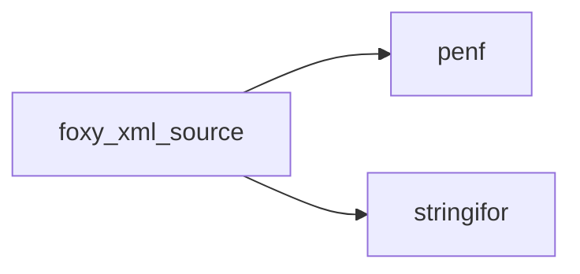
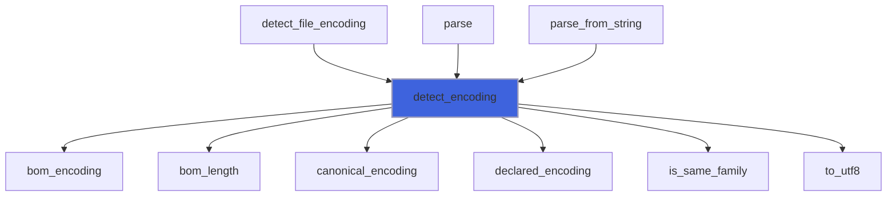
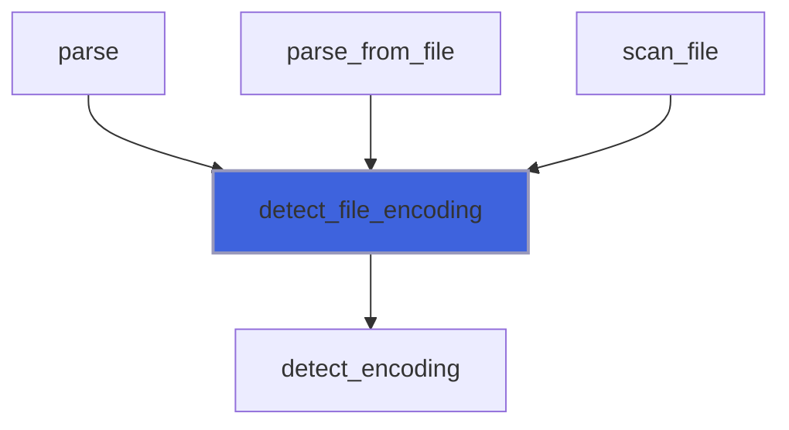
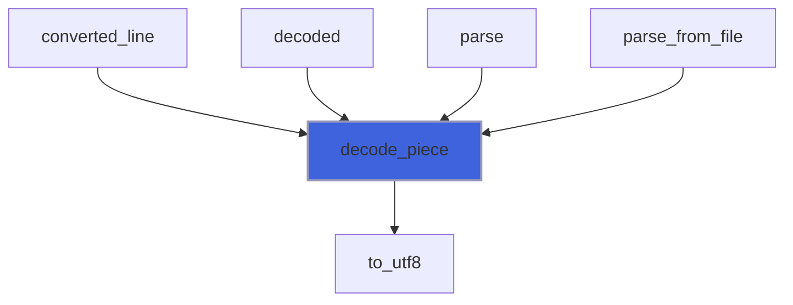
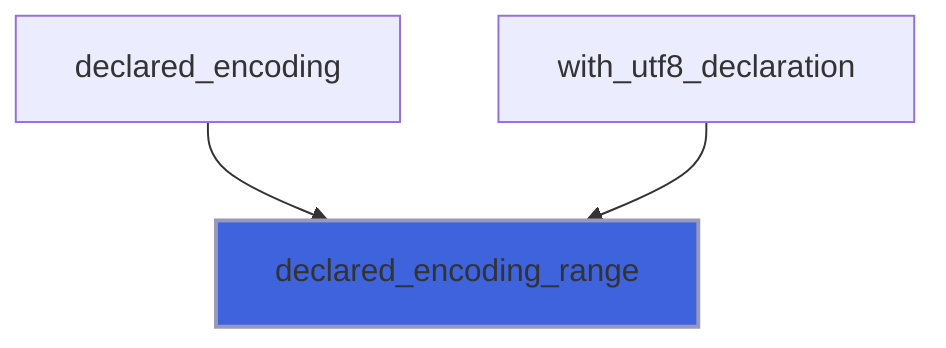
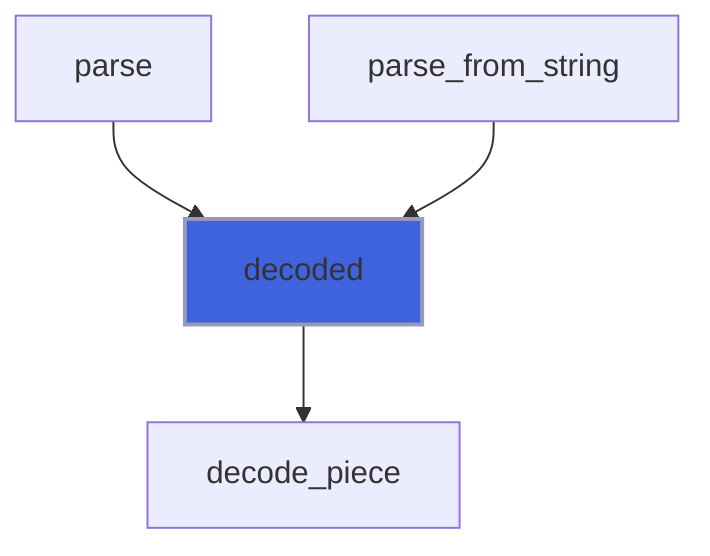
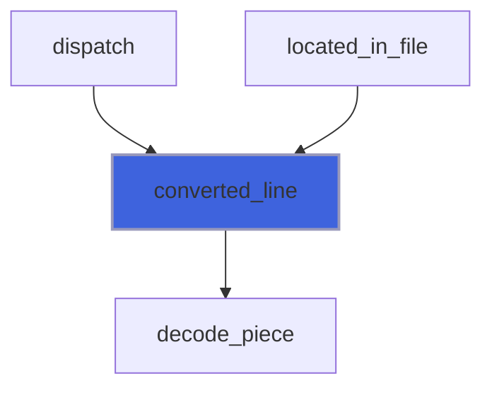
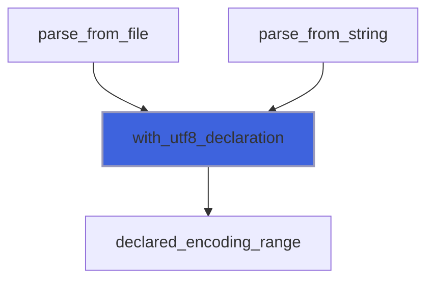
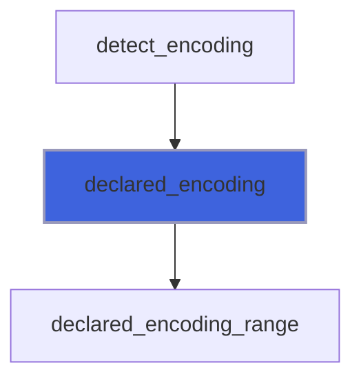
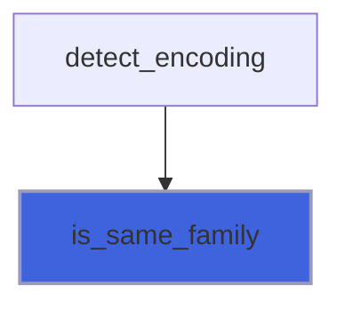

# foxy_xml_source

> FoXy sources encodings: detection (byte order mark, XML 1.0 Appendix F, encoding declaration) and conversion to UTF-8.

 FoXy parses UTF-8. A source in UTF-16, UTF-32, ISO-8859-1, windows-1252 or US-ASCII is converted to UTF-8 piece by
 piece (StringiFor `to_utf8`) before the tokenizer: positions refer to the converted text. The encoding is detected
 from the first bytes (XML 1.0 4.3.3 and Appendix F): a byte order mark, the patterns of `<?` in UTF-16/UTF-32, then
 the `encoding` of the XML declaration. An invalid sequence becomes the byte FF (never in UTF-8), so the tokenizer
 reports it at its place, in source order, as any other problem.

**Source**: `src/third_party/FoXy/src/lib/foxy_xml_source.f90`

**Dependencies**



## Contents

- [source_encoding](#source-encoding)
- [detect_encoding](#detect-encoding)
- [detect_file_encoding](#detect-file-encoding)
- [decode_piece](#decode-piece)
- [declared_encoding_range](#declared-encoding-range)
- [decoded](#decoded)
- [converted_line](#converted-line)
- [with_utf8_declaration](#with-utf8-declaration)
- [declared_encoding](#declared-encoding)
- [is_same_family](#is-same-family)

## Variables

| Name | Type | Attributes | Description |
|------|------|------------|-------------|
| `DETECT_LEN` | integer(kind=[I8P](/api/src/third_party/PENF/src/lib/penf_global_parameters_variables)) | parameter | Bytes read to detect the encoding. |
| `MAX_PIECE` | integer(kind=[I8P](/api/src/third_party/PENF/src/lib/penf_global_parameters_variables)) | parameter | Largest piece converted at once (StringiFor positions). |
| `INVALID_BYTE` | character(len=*) | parameter | Replacement of an invalid sequence (never in UTF-8). |
| `BLANKS` | character(len=*) | parameter | XML blanks. |

## Derived Types

### source_encoding

Encoding of a source, as detected, and the conversion state.

#### Components

| Name | Type | Attributes | Description |
|------|------|------------|-------------|
| `name` | character(len=:) | allocatable | Canonical name, endianness included (`UTF-8` if not converted). |
| `problem` | character(len=:) | allocatable | Problem of the encoding (reported at position 1), empty if none. |
| `carry` | character(len=:) | allocatable | Incomplete character between pieces. |
| `skip` | integer(kind=[I8P](/api/src/third_party/PENF/src/lib/penf_global_parameters_variables)) |  | Bytes of a UTF-16/UTF-32 byte order mark, not converted. |
| `is_converted` | logical |  | The source is converted to UTF-8. |

## Subroutines

### detect_encoding

Detect the encoding of a source from its first bytes (*DETECT_LEN* at most, all of them if the source is shorter).

 @note A declared encoding that is not supported (or that contradicts the byte order mark or the first bytes) is a
 problem: the source is then read in the detected encoding (UTF-8 if none), as tolerant parsing does.

**Attributes**: pure

```fortran
subroutine detect_encoding(prefix, encoding)
```

**Arguments**

| Name | Type | Intent | Attributes | Description |
|------|------|--------|------------|-------------|
| `prefix` | character(len=*) | in |  | First bytes of the source. |
| `encoding` | type([source_encoding](/api/src/third_party/FoXy/src/lib/foxy_xml_source#source-encoding)) | out |  | Detected encoding. |

**Call graph**



### detect_file_encoding

Detect the encoding of an open stream file from its first bytes (read at position 1).

```fortran
subroutine detect_file_encoding(unit, file_size, encoding, iostat, iomsg)
```

**Arguments**

| Name | Type | Intent | Attributes | Description |
|------|------|--------|------------|-------------|
| `unit` | integer(kind=[I4P](/api/src/third_party/PENF/src/lib/penf_global_parameters_variables)) | in |  | File unit. |
| `file_size` | integer(kind=[I8P](/api/src/third_party/PENF/src/lib/penf_global_parameters_variables)) | in |  | File size. |
| `encoding` | type([source_encoding](/api/src/third_party/FoXy/src/lib/foxy_xml_source#source-encoding)) | out |  | Detected encoding. |
| `iostat` | integer(kind=[I4P](/api/src/third_party/PENF/src/lib/penf_global_parameters_variables)) | out |  | IO status. |
| `iomsg` | character(len=*) | inout |  | IO message. |

**Call graph**



### decode_piece

Convert a piece of a source to UTF-8, carrying an incomplete character to the next piece.

**Attributes**: pure

```fortran
subroutine decode_piece(encoding, raw, is_last, utf8)
```

**Arguments**

| Name | Type | Intent | Attributes | Description |
|------|------|--------|------------|-------------|
| `encoding` | type([source_encoding](/api/src/third_party/FoXy/src/lib/foxy_xml_source#source-encoding)) | inout |  | Encoding (and conversion state). |
| `raw` | character(len=*) | in |  | Piece of the source (at most *MAX_PIECE* bytes). |
| `is_last` | logical | in |  | The source ends with this piece. |
| `utf8` | character(len=:) | out | allocatable | Piece converted. |

**Call graph**



### declared_encoding_range

Return the range of the encoding value of the XML declaration that starts *text* (after leading characters that
 are not markup, as a UTF-8 byte order mark), first 0 if there is none.

**Attributes**: pure

```fortran
subroutine declared_encoding_range(text, first, last)
```

**Arguments**

| Name | Type | Intent | Attributes | Description |
|------|------|--------|------------|-------------|
| `text` | character(len=*) | in |  | Text (UTF-8). |
| `first` | integer(kind=[I8P](/api/src/third_party/PENF/src/lib/penf_global_parameters_variables)) | out |  | First character of the value. |
| `last` | integer(kind=[I8P](/api/src/third_party/PENF/src/lib/penf_global_parameters_variables)) | out |  | Last character of the value. |

**Call graph**



## Functions

### decoded

Return a whole source (a string) converted to UTF-8, its byte order mark (*encoding%skip*) removed.

**Attributes**: pure

**Returns**: `character(len=:)`

```fortran
function decoded(source, encoding) result(utf8)
```

**Arguments**

| Name | Type | Intent | Attributes | Description |
|------|------|--------|------------|-------------|
| `source` | character(len=*) | in |  | Source. |
| `encoding` | type([source_encoding](/api/src/third_party/FoXy/src/lib/foxy_xml_source#source-encoding)) | in |  | Detected encoding. |

**Call graph**



### converted_line

Return the line of a position of the converted text of an open stream file (read again and converted, in chunks).

**Returns**: integer(kind=[I8P](/api/src/third_party/PENF/src/lib/penf_global_parameters_variables))

```fortran
function converted_line(unit, pos, chunk, encoding) result(line)
```

**Arguments**

| Name | Type | Intent | Attributes | Description |
|------|------|--------|------------|-------------|
| `unit` | integer(kind=[I4P](/api/src/third_party/PENF/src/lib/penf_global_parameters_variables)) | in |  | File unit. |
| `pos` | integer(kind=[I8P](/api/src/third_party/PENF/src/lib/penf_global_parameters_variables)) | in |  | Position in the converted text. |
| `chunk` | integer(kind=[I8P](/api/src/third_party/PENF/src/lib/penf_global_parameters_variables)) | in |  | Size of the chunks read. |
| `encoding` | type([source_encoding](/api/src/third_party/FoXy/src/lib/foxy_xml_source#source-encoding)) | in |  | Detected encoding. |

**Call graph**



### with_utf8_declaration

Return a prolog whose XML declaration (if it has one, with an `encoding`) declares `UTF-8`: the text of a converted
 source is UTF-8.

**Attributes**: pure

**Returns**: `character(len=:)`

```fortran
function with_utf8_declaration(prolog) result(rewritten)
```

**Arguments**

| Name | Type | Intent | Attributes | Description |
|------|------|--------|------------|-------------|
| `prolog` | character(len=*) | in |  | Prolog. |

**Call graph**



### declared_encoding

Return the encoding of the XML declaration that starts *text*, empty if there is none.

**Attributes**: pure

**Returns**: `character(len=:)`

```fortran
function declared_encoding(text) result(declared)
```

**Arguments**

| Name | Type | Intent | Attributes | Description |
|------|------|--------|------------|-------------|
| `text` | character(len=*) | in |  | Text (UTF-8). |

**Call graph**



### is_same_family

Return true if a declared encoding agrees with the one detected from the byte order mark or the first bytes.

**Attributes**: pure

**Returns**: `logical`

```fortran
function is_same_family(declared, detected) result(is_same)
```

**Arguments**

| Name | Type | Intent | Attributes | Description |
|------|------|--------|------------|-------------|
| `declared` | character(len=*) | in |  | Declared encoding, canonical name. |
| `detected` | character(len=*) | in |  | Detected encoding. |

**Call graph**


