# foxy_xml_tag

> FoXy XML tag class.

**Source**: `src/third_party/FoXy/src/lib/foxy_xml_tag.F90`

**Dependencies**

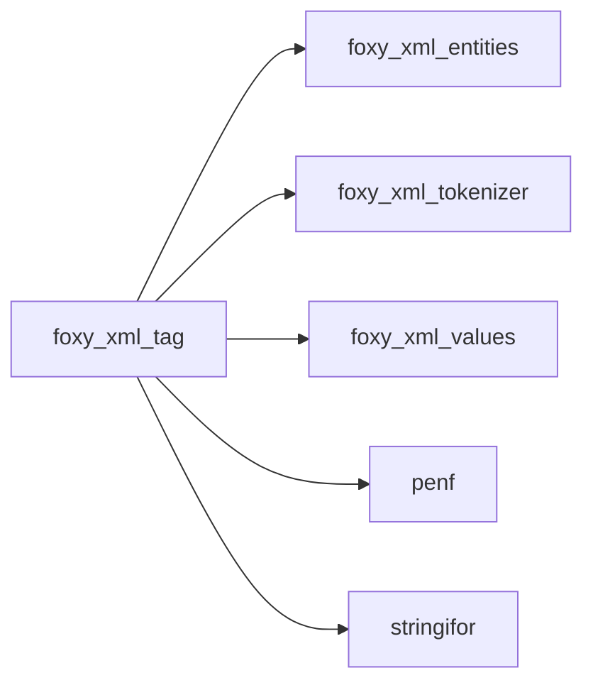

## Contents

- [xml_tag](#xml-tag)
- [attribute_pair](#attribute-pair)
- [tag_builder](#tag-builder)
- [xml_tag](#xml-tag)
- [add_child_id](#add-child-id)
- [free](#free)
- [get_content](#get-content)
- [parse](#parse)
- [set](#set)
- [write_tag](#write-tag)
- [add_single_attribute](#add-single-attribute)
- [add_attribute_value](#add-attribute-value)
- [add_multiple_attributes](#add-multiple-attributes)
- [add_stream_attributes](#add-stream-attributes)
- [delete_content](#delete-content)
- [delete_single_attribute](#delete-single-attribute)
- [delete_multiple_attributes](#delete-multiple-attributes)
- [scan_tag](#scan-tag)
- [tag_content](#tag-content)
- [tag_start_tag](#tag-start-tag)
- [tag_attribute](#tag-attribute)
- [tag_start_tag_end](#tag-start-tag-end)
- [tag_end_tag](#tag-end-tag)
- [tag_data](#tag-data)
- [tag_problem](#tag-problem)
- [assign_tag](#assign-tag)
- [finalize](#finalize)
- [create_tag_flat](#create-tag-flat)
- [create_tag_nested](#create-tag-nested)
- [attributes](#attributes)
- [end_tag](#end-tag)
- [get_attribute_name](#get-attribute-name)
- [get_attributes_number](#get-attributes-number)
- [get_attribute](#get-attribute)
- [get_id](#get-id)
- [get_tail](#get-tail)
- [get_parent_id](#get-parent-id)
- [get_indent](#get-indent)
- [get_level](#get-level)
- [get_pos](#get-pos)
- [is_attribute_present](#is-attribute-present)
- [is_parsed](#is-parsed)
- [is_content_markup](#is-content-markup)
- [is_named](#is-named)
- [name](#name)
- [self_closing_tag](#self-closing-tag)
- [start_tag](#start-tag)
- [stringify](#stringify)

## Derived Types

### xml_tag

XML tag class.

 A valid XML tag must have the following syntax for a tag without a content (with only attributes):
```xml
   <Tag_Name att#1_Name="att#1_val" att#2_Name="att#2_val"... att#Nt_Name="att#Nt_val"/>
```
 while a tag with a content must have the following syntax:
```xml
   <Tag_Name att#1_Name="att#1_val" att#2_Name="att#2_val"... att#Nt_Name="att#Nt_val">Tag_Content</Tag_Name>
```

 It is worth noting that the syntax is case sensitive and that the attributes are optional. Sources (*parse*,
 *get_content*, attributes streams) are read by the document tokenizer: attribute values are single or double quoted,
 blanks are allowed around `=`.

#### Components

| Name | Type | Attributes | Description |
|------|------|------------|-------------|
| `tag_name` | type([string](/api/src/third_party/StringiFor/src/lib/stringifor_string_t#string)) |  | Tag name. |
| `tag_content` | type([string](/api/src/third_party/StringiFor/src/lib/stringifor_string_t#string)) |  | Tag content. |
| `tag_tail` | type([string](/api/src/third_party/StringiFor/src/lib/stringifor_string_t#string)) |  | Text after the end tag, up to the next sibling or the |
| `pos` | integer(kind=[I8P](/api/src/third_party/PENF/src/lib/penf_global_parameters_variables)) |  | Characters position (in source) indexes (start, content, end). |
| `attribute` | type([string](/api/src/third_party/StringiFor/src/lib/stringifor_string_t#string)) | allocatable | Attributes names/values pairs, [1:2, 1:]. |
| `attributes_number` | integer(kind=[I4P](/api/src/third_party/PENF/src/lib/penf_global_parameters_variables)) |  | Number of defined attributes. |
| `indent` | integer(kind=[I4P](/api/src/third_party/PENF/src/lib/penf_global_parameters_variables)) |  | Number of indent-white-spaces. |
| `is_self_closing` | logical |  | Self closing tag flag. |
| `level` | integer(kind=[I4P](/api/src/third_party/PENF/src/lib/penf_global_parameters_variables)) |  | Tag hierarchy level. |
| `id` | integer(kind=[I4P](/api/src/third_party/PENF/src/lib/penf_global_parameters_variables)) |  | Uniq tag ID. |
| `parent_id` | integer(kind=[I4P](/api/src/third_party/PENF/src/lib/penf_global_parameters_variables)) |  | Uniq ID of parent tag. |
| `children_number` | integer(kind=[I4P](/api/src/third_party/PENF/src/lib/penf_global_parameters_variables)) |  | Number of children tags. |
| `child_id` | integer(kind=[I4P](/api/src/third_party/PENF/src/lib/penf_global_parameters_variables)) | allocatable | Uniq ID of children tags. |

#### Type-Bound Procedures

| Name | Attributes | Description |
|------|------------|-------------|
| `add_attributes` |  | Add attributes name/value pairs. |
| `add_child_id` | pass(self) | Add child ID to children IDs list. |
| `attributes` | pass(self) | Return attributes name/value pairs as string. |
| `delete_attributes` |  | Delete attributes name/value pairs. |
| `delete_content` | pass(self) | Delete tag conent. |
| `end_tag` | pass(self) | Return `` end tag. |
| `free` | pass(self) | Free (reset) tag. |
| `get_content` | pass(self) | Return tag content. |
| `get_attribute` | pass(self) | Return the value of the attribute named *name*. |
| `get_attribute_name` | pass(self) | Return the name of the attribute with a given index. |
| `get_attributes_number` | pass(self) | Return the number of attributes. |
| `get_id` | pass(self) | Return tag uniq ID. |
| `get_indent` | pass(self) | Return tag indentation. |
| `get_level` | pass(self) | Return tag hierarchy level. |
| `get_parent_id` | pass(self) | Return parent tag uniq ID. |
| `get_pos` | pass(self) | Return tag positions in the source. |
| `get_tail` | pass(self) | Return the text after the end tag. |
| `is_attribute_present` | pass(self) | Return .true. it the queried attribute name is defined. |
| `is_named` | pass(self) | Return .true. if the tag is named *name*. |
| `is_content_markup` | pass(self) | Return .true. if the content may hold markup. |
| `is_parsed` | pass(self) | Check is tag is correctly parsed, i.e. its *tag_name* is allocated. |
| `name` | pass(self) | Return tag name. |
| `parse` | pass(self) | Parse the tag contained into a source string. |
| `self_closing_tag` | pass(self) | Return `` self closing tag. |
| `set` | pass(self) | Set tag data. |
| `start_tag` | pass(self) | Return `` start tag. |
| `stringify` | pass(self) | Convert the whole tag into a string. |
| `write` | pass(self) | Write tag to unit file. |
| `assignment(=)` |  | Assignment operator overloading. |
| `add_single_attribute` | pass(self) | Add one attribute name/value pair. |
| `add_attribute_value` | pass(self) | Add one attribute, value stored exactly. |
| `add_multiple_attributes` | pass(self) | Add list of attributes name/value pairs. |
| `add_stream_attributes` | pass(self) | Add list of attributes name/value pairs passed as stream. |
| `delete_single_attribute` | pass(self) | Delete one attribute name/value pair. |
| `delete_multiple_attributes` | pass(self) | Delete list of attributes name/value pairs. |
| `assign_tag` | pass(lhs) | Assignment between two tags. |

### attribute_pair

An attribute of the found tag.

#### Components

| Name | Type | Attributes | Description |
|------|------|------------|-------------|
| `name` | character(len=:) | allocatable | Attribute name. |
| `value` | character(len=:) | allocatable | Attribute value. |

### tag_builder

Builder of a single tag of a source, driven by the tokenizer: the first tag or, if *name* is allocated, the first tag
 with that name (tags inside CDATA sections, comments and PIs excluded); the tokenizer stops once it is complete.

 @note The found tag is held by plain components, not by an *xml_tag*: nvfortran corrupts a local builder holding one.

**Inheritance**

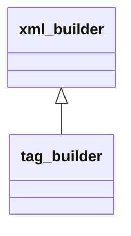

**Extends**: [`xml_builder`](/api/src/third_party/FoXy/src/lib/foxy_xml_tokenizer#xml-builder)

#### Components

| Name | Type | Attributes | Description |
|------|------|------------|-------------|
| `is_stopped` | logical |  | Set by the builder to stop the tokenizer (checked after each complete start or end tag). |
| `name` | character(len=:) | allocatable | Name of the searched tag, unallocated for the first tag. |
| `sanitize` | logical |  | Trim leading and trailing spaces of attribute values. |
| `tag_name` | character(len=:) | allocatable | Found tag name. |
| `pairs` | type([attribute_pair](/api/src/third_party/FoXy/src/lib/foxy_xml_tokenizer#attribute-pair)) | allocatable | Found tag attributes. |
| `na` | integer(kind=[I4P](/api/src/third_party/PENF/src/lib/penf_global_parameters_variables)) |  | Number of attributes of the found tag. |
| `id` | integer(kind=[I4P](/api/src/third_party/PENF/src/lib/penf_global_parameters_variables)) |  | Tokenizer ID of the found tag, 0 if none. |
| `start` | integer(kind=[I8P](/api/src/third_party/PENF/src/lib/penf_global_parameters_variables)) |  | Position of the start tag `<`. |
| `open_end` | integer(kind=[I8P](/api/src/third_party/PENF/src/lib/penf_global_parameters_variables)) |  | Position of the start tag `>`, 0 if unterminated. |
| `end_start` | integer(kind=[I8P](/api/src/third_party/PENF/src/lib/penf_global_parameters_variables)) |  | Position of the end tag `<`, 0 if none. |
| `end_end` | integer(kind=[I8P](/api/src/third_party/PENF/src/lib/penf_global_parameters_variables)) |  | Position of the end tag `>`, 0 if none. |
| `is_self_closing` | logical |  | The found tag is self closing. |

#### Type-Bound Procedures

| Name | Attributes | Description |
|------|------------|-------------|
| `start_tag` | pass(self) | A start tag begins. |
| `attribute` | pass(self) | An attribute of the current start tag. |
| `start_tag_end` | pass(self) | The current start tag is complete. |
| `end_tag` | pass(self) | An open tag is closed by its end tag. |
| `data` | pass(self) | Character data or other markup: ignored. |
| `problem` | pass(self) | A problem of malformed input: ignored. |

## Interfaces

### xml_tag

Overload *xml_tag* with creator procedures.

**Module procedures**: [`create_tag_flat`](/api/src/third_party/FoXy/src/lib/foxy_xml_tag#create-tag-flat), [`create_tag_nested`](/api/src/third_party/FoXy/src/lib/foxy_xml_tag#create-tag-nested)

## Subroutines

### add_child_id

Add child ID to children IDs list.

**Attributes**: pure

```fortran
subroutine add_child_id(self, child_id)
```

**Arguments**

| Name | Type | Intent | Attributes | Description |
|------|------|--------|------------|-------------|
| `self` | class([xml_tag](/api/src/third_party/FoXy/src/lib/foxy_xml_tag#xml-tag)) | inout |  | XML tag. |
| `child_id` | integer(kind=[I4P](/api/src/third_party/PENF/src/lib/penf_global_parameters_variables)) | in |  | Child ID. |

**Call graph**

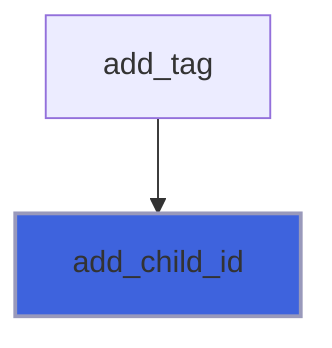

### free

Free (reset) tag.

**Attributes**: elemental

```fortran
subroutine free(self)
```

**Arguments**

| Name | Type | Intent | Attributes | Description |
|------|------|--------|------------|-------------|
| `self` | class([xml_tag](/api/src/third_party/FoXy/src/lib/foxy_xml_tag#xml-tag)) | inout |  | XML tag. |

### get_content

Return tag content of self (or its nested tags) if named *name*.

 @note A nested tag is the first tag named *name* in the content string (tags inside CDATA sections, comments and
 PIs excluded); its content is returned raw, as in the string.
 @note If there is no value, the *content* string is returned deallocated.

**Attributes**: pure

```fortran
subroutine get_content(self, name, content)
```

**Arguments**

| Name | Type | Intent | Attributes | Description |
|------|------|--------|------------|-------------|
| `self` | class([xml_tag](/api/src/third_party/FoXy/src/lib/foxy_xml_tag#xml-tag)) | in |  | XML tag. |
| `name` | character(len=*) | in |  | Searched tag name. |
| `content` | character(len=:) | out | allocatable | Tag content. |

**Call graph**

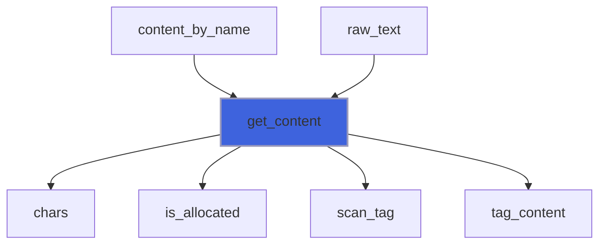

### parse

Parse the first tag contained into a source string: its name, attributes (values as in the source) and content (raw,
 nested tags included); the other tags eventually present are omitted.

 Valid syntax are:
 + `<tag_name att1="att1 val" att2='att2 val'...>...</tag_name>`
 + `<tag_name att1="att1 val" att2='att2 val'.../>`

 @note The source is read by the document tokenizer: `<`, `>`, `=` and the other quote kind are allowed in attribute
 values, the content ends at the matching end tag (nested tags with the same name included) or, if the tag is
 unclosed, at the source end. The tag positions *pos* are set; the name, attributes and content are replaced (the
 name is unallocated if there is no tag).

**Attributes**: elemental

```fortran
subroutine parse(self, source, tstart, tend)
```

**Arguments**

| Name | Type | Intent | Attributes | Description |
|------|------|--------|------------|-------------|
| `self` | class([xml_tag](/api/src/third_party/FoXy/src/lib/foxy_xml_tag#xml-tag)) | inout |  | XML tag. |
| `source` | character(len=*) | in |  | String containing the input. |
| `tstart` | integer(kind=[I8P](/api/src/third_party/PENF/src/lib/penf_global_parameters_variables)) | out | optional | Starting index of tag inside the string, 0 if there is no tag. |
| `tend` | integer(kind=[I8P](/api/src/third_party/PENF/src/lib/penf_global_parameters_variables)) | out | optional | Ending index of tag inside the string, 0 if there is no tag. |

**Call graph**

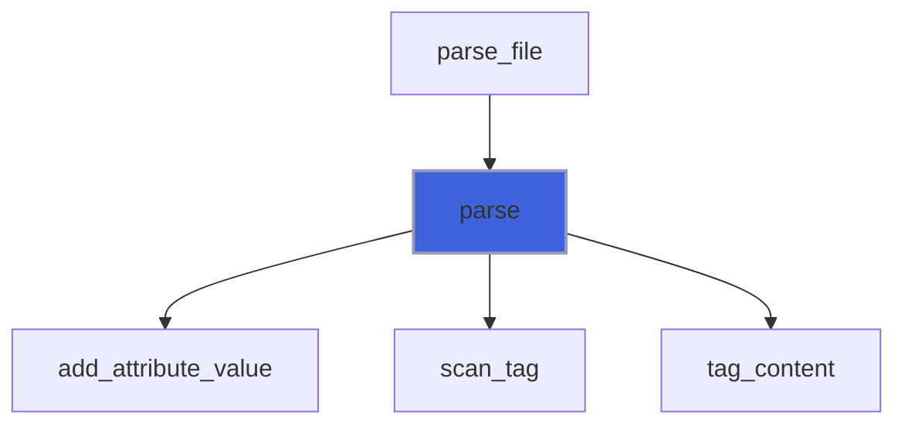

### set

Set tag data.

**Attributes**: pure

```fortran
subroutine set(self, name, attribute, attributes, attributes_stream, sanitize_attributes_value, content, pos, indent, is_content_indented, is_self_closing, id, level, parent_id, attributes_stream_alloc, content_alloc, tail, attribute_name, attribute_value)
```

**Arguments**

| Name | Type | Intent | Attributes | Description |
|------|------|--------|------------|-------------|
| `self` | class([xml_tag](/api/src/third_party/FoXy/src/lib/foxy_xml_tag#xml-tag)) | inout |  | XML tag. |
| `name` | character(len=*) | in | optional | Tag name. |
| `attribute` | character(len=*) | in | optional | Attribute name/value pair [1:2]. |
| `attributes` | character(len=*) | in | optional | Attributes list of name/value pairs [1:2,1:]. |
| `attributes_stream` | character(len=*) | in | optional | Attributes list of name/value pairs as stream. |
| `sanitize_attributes_value` | logical | in | optional | Sanitize attributes value. |
| `content` | character(len=*) | in | optional | Tag value. |
| `pos` | integer(kind=[I8P](/api/src/third_party/PENF/src/lib/penf_global_parameters_variables)) | in | optional | Characters position (in source) indexes. |
| `indent` | integer(kind=[I4P](/api/src/third_party/PENF/src/lib/penf_global_parameters_variables)) | in | optional | Number of indent-white-spaces. |
| `is_content_indented` | logical | in | optional | Activate value indentation. |
| `is_self_closing` | logical | in | optional | The tag is self closing. |
| `id` | integer(kind=[I4P](/api/src/third_party/PENF/src/lib/penf_global_parameters_variables)) | in | optional | Uniq ID. |
| `level` | integer(kind=[I4P](/api/src/third_party/PENF/src/lib/penf_global_parameters_variables)) | in | optional | Tag hierarchy level. |
| `parent_id` | integer(kind=[I4P](/api/src/third_party/PENF/src/lib/penf_global_parameters_variables)) | in | optional | Parent uniq ID. |
| `attributes_stream_alloc` | character(len=:) | in | allocatable, optional | Attributes list stream, allocatable input. |
| `content_alloc` | character(len=:) | in | allocatable, optional | Tag value, allocatable input. |
| `tail` | character(len=*) | in | optional | Text after the end tag. |
| `attribute_name` | character(len=*) | in | optional | Attribute name, with *attribute_value*. |
| `attribute_value` | character(len=*) | in | optional | Attribute value, stored exactly (unless |

**Call graph**

```mermaid
flowchart TD
  add_tag["add_tag"] --> set["set"]
  create_tag_flat["create_tag_flat"] --> set["set"]
  create_tag_nested["create_tag_nested"] --> set["set"]
  delete_subtree["delete_subtree"] --> set["set"]
  dom_attribute["dom_attribute"] --> set["set"]
  dom_end_tag["dom_end_tag"] --> set["set"]
  dom_flush["dom_flush"] --> set["set"]
  dom_start_tag["dom_start_tag"] --> set["set"]
  dom_start_tag_end["dom_start_tag_end"] --> set["set"]
  index_attribute["index_attribute"] --> set["set"]
  index_end_tag["index_end_tag"] --> set["set"]
  index_start_tag["index_start_tag"] --> set["set"]
  index_start_tag_end["index_start_tag_end"] --> set["set"]
  make_room["make_room"] --> set["set"]
  set_attribute_character["set_attribute_character"] --> set["set"]
  set_content_character["set_content_character"] --> set["set"]
  set_name["set_name"] --> set["set"]
  set["set"] --> add_attribute_value["add_attribute_value"]
  set["set"] --> add_multiple_attributes["add_multiple_attributes"]
  set["set"] --> add_single_attribute["add_single_attribute"]
  set["set"] --> add_stream_attributes["add_stream_attributes"]
  style set fill:#3e63dd,stroke:#99b,stroke-width:2px
```

### write_tag

Write tag to unit file.

 @note *form* is `'UNFORMATTED'` (the default, a stream unit) or `'FORMATTED'`, in any case: another one writes
 nothing, *iostat* is *XML_BAD_VALUE*.
 @note Without *iostat*, an error (a bad *form*, a failed write) stops the program with its message, as Fortran I/O
 statements do.

```fortran
subroutine write_tag(self, unit, is_indented, is_content_indented, form, end_record, only_start, only_content, only_end, iostat, iomsg)
```

**Arguments**

| Name | Type | Intent | Attributes | Description |
|------|------|--------|------------|-------------|
| `self` | class([xml_tag](/api/src/third_party/FoXy/src/lib/foxy_xml_tag#xml-tag)) | in |  | XML tag. |
| `unit` | integer(kind=[I4P](/api/src/third_party/PENF/src/lib/penf_global_parameters_variables)) | in |  | File unit. |
| `is_indented` | logical | in | optional | Activate content indentation. |
| `is_content_indented` | logical | in | optional | Activate content indentation. |
| `form` | character(len=*) | in | optional | Format. |
| `end_record` | character(len=*) | in | optional | Ending record. |
| `only_start` | logical | in | optional | Write only start tag. |
| `only_content` | logical | in | optional | Write only content. |
| `only_end` | logical | in | optional | Write only end tag. |
| `iostat` | integer(kind=[I4P](/api/src/third_party/PENF/src/lib/penf_global_parameters_variables)) | out | optional | IO status. |
| `iomsg` | character(len=*) | out | optional | IO message. |

**Call graph**

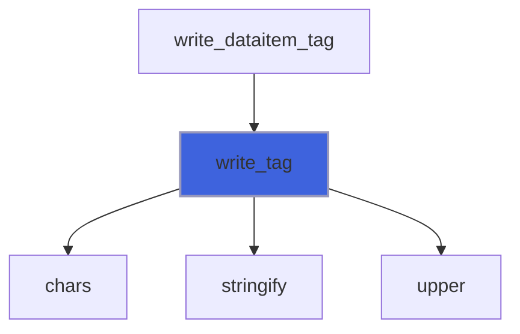

### add_single_attribute

Add one attribute name/value pair.

 @note Leading and trailing white spaces are trimmed out by attribute's name.
 @note The pair elements have the same length: a value shorter than the name is padded with trailing spaces (use
 *add_attribute_value* to store a value exactly).

**Attributes**: pure

```fortran
subroutine add_single_attribute(self, attribute, sanitize_value)
```

**Arguments**

| Name | Type | Intent | Attributes | Description |
|------|------|--------|------------|-------------|
| `self` | class([xml_tag](/api/src/third_party/FoXy/src/lib/foxy_xml_tag#xml-tag)) | inout |  | XML tag. |
| `attribute` | character(len=*) | in |  | Attribute name/value pair [1:2]. |
| `sanitize_value` | logical | in | optional | Sanitize attribute value. |

**Call graph**

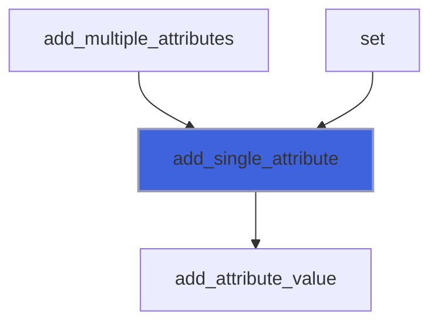

### add_attribute_value

Add one attribute, or update its value if already present; the value is stored exactly, unless sanitized (leading and
 trailing spaces trimmed).

**Attributes**: pure

```fortran
subroutine add_attribute_value(self, name, value, sanitize_value)
```

**Arguments**

| Name | Type | Intent | Attributes | Description |
|------|------|--------|------------|-------------|
| `self` | class([xml_tag](/api/src/third_party/FoXy/src/lib/foxy_xml_tag#xml-tag)) | inout |  | XML tag. |
| `name` | character(len=*) | in |  | Attribute name. |
| `value` | character(len=*) | in |  | Attribute value. |
| `sanitize_value` | logical | in | optional | Sanitize attribute value. |

**Call graph**

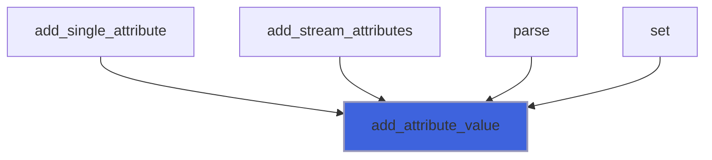

### add_multiple_attributes

Add list of attributes name/value pairs.

**Attributes**: pure

```fortran
subroutine add_multiple_attributes(self, attributes, sanitize_values)
```

**Arguments**

| Name | Type | Intent | Attributes | Description |
|------|------|--------|------------|-------------|
| `self` | class([xml_tag](/api/src/third_party/FoXy/src/lib/foxy_xml_tag#xml-tag)) | inout |  | XML tag. |
| `attributes` | character(len=*) | in |  | Attribute name/value pair list [1:2,1:]. |
| `sanitize_values` | logical | in | optional | Sanitize attribute values. |

**Call graph**

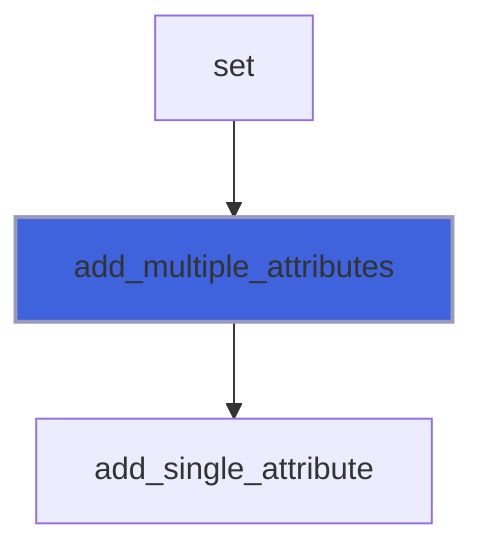

### add_stream_attributes

Add list of attributes name/value pairs passed as stream, e.g. `x="1" y='a > b'`.

 @note The stream is read by the document tokenizer as the attributes of a start tag: values are single or double
 quoted (`<`, `>`, `=` and the other quote kind allowed), blanks are allowed around `=`; values are stored as in the
 stream (unless sanitized), an existing attribute is updated.

**Attributes**: pure

```fortran
subroutine add_stream_attributes(self, attributes_stream, sanitize_values)
```

**Arguments**

| Name | Type | Intent | Attributes | Description |
|------|------|--------|------------|-------------|
| `self` | class([xml_tag](/api/src/third_party/FoXy/src/lib/foxy_xml_tag#xml-tag)) | inout |  | XML tag. |
| `attributes_stream` | character(len=*) | in |  | Attribute name/value pair list passed as stream. |
| `sanitize_values` | logical | in | optional | Sanitize attribute values. |

**Call graph**

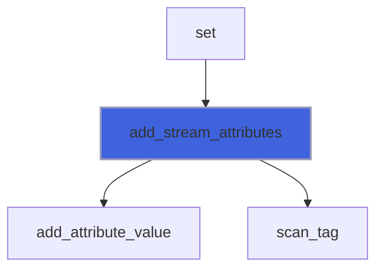

### delete_content

Delete tag content.

**Attributes**: pure

```fortran
subroutine delete_content(self)
```

**Arguments**

| Name | Type | Intent | Attributes | Description |
|------|------|--------|------------|-------------|
| `self` | class([xml_tag](/api/src/third_party/FoXy/src/lib/foxy_xml_tag#xml-tag)) | inout |  | XML tag. |

### delete_single_attribute

Delete one attribute name/value pair.

**Attributes**: pure

```fortran
subroutine delete_single_attribute(self, name)
```

**Arguments**

| Name | Type | Intent | Attributes | Description |
|------|------|--------|------------|-------------|
| `self` | class([xml_tag](/api/src/third_party/FoXy/src/lib/foxy_xml_tag#xml-tag)) | inout |  | XML tag. |
| `name` | character(len=*) | in |  | Attribute name. |

**Call graph**

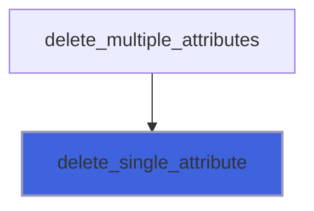

### delete_multiple_attributes

Delete list of attributes name/value pairs.

**Attributes**: pure

```fortran
subroutine delete_multiple_attributes(self, name)
```

**Arguments**

| Name | Type | Intent | Attributes | Description |
|------|------|--------|------------|-------------|
| `self` | class([xml_tag](/api/src/third_party/FoXy/src/lib/foxy_xml_tag#xml-tag)) | inout |  | XML tag. |
| `name` | character(len=*) | in |  | Attributes names. |

**Call graph**

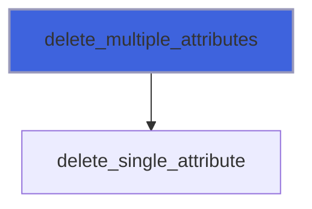

### scan_tag

Scan a source for its first tag or, if *name* is passed, its first tag with that name.

**Attributes**: pure

```fortran
subroutine scan_tag(source, sanitize, builder, name)
```

**Arguments**

| Name | Type | Intent | Attributes | Description |
|------|------|--------|------------|-------------|
| `source` | character(len=*) | in |  | Source. |
| `sanitize` | logical | in |  | Trim leading and trailing spaces of attribute values. |
| `builder` | type([tag_builder](/api/src/third_party/FoXy/src/lib/foxy_xml_tag#tag-builder)) | out |  | Single tag builder, the found tag. |
| `name` | character(len=*) | in | optional | Name of the searched tag. |

**Call graph**

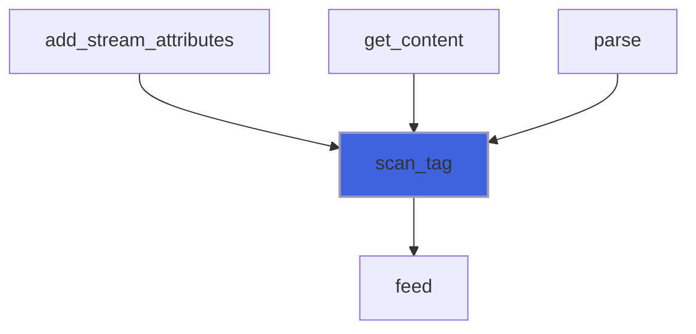

### tag_content

Return the content (raw) of the tag found by a builder: up to its end tag or, if unclosed, to the source end;
 unallocated if it is self closing or empty.

**Attributes**: pure

```fortran
subroutine tag_content(source, builder, content)
```

**Arguments**

| Name | Type | Intent | Attributes | Description |
|------|------|--------|------------|-------------|
| `source` | character(len=*) | in |  | Source. |
| `builder` | type([tag_builder](/api/src/third_party/FoXy/src/lib/foxy_xml_tag#tag-builder)) | in |  | Single tag builder, the found tag. |
| `content` | character(len=:) | out | allocatable | Tag content. |

**Call graph**

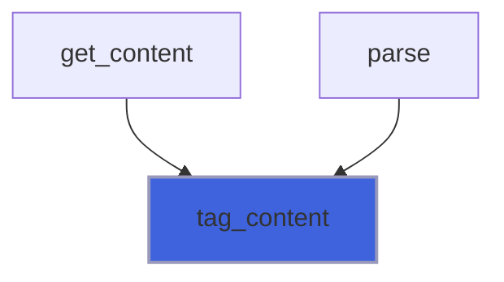

### tag_start_tag

A start tag begins: it is the found tag if none is found yet and it is the searched one.

**Attributes**: pure

```fortran
subroutine tag_start_tag(self, id, parent_id, level, name, start)
```

**Arguments**

| Name | Type | Intent | Attributes | Description |
|------|------|--------|------------|-------------|
| `self` | class([tag_builder](/api/src/third_party/FoXy/src/lib/foxy_xml_tag#tag-builder)) | inout |  | Single tag builder. |
| `id` | integer(kind=[I4P](/api/src/third_party/PENF/src/lib/penf_global_parameters_variables)) | in |  | Tag ID (start tags count). |
| `parent_id` | integer(kind=[I4P](/api/src/third_party/PENF/src/lib/penf_global_parameters_variables)) | in |  | Parent tag ID, 0 for a root tag. |
| `level` | integer(kind=[I4P](/api/src/third_party/PENF/src/lib/penf_global_parameters_variables)) | in |  | Tag level, 1 for a root tag. |
| `name` | character(len=*) | in |  | Tag name. |
| `start` | integer(kind=[I8P](/api/src/third_party/PENF/src/lib/penf_global_parameters_variables)) | in |  | Position of `<`. |

### tag_attribute

An attribute of the current start tag: stored if it is of the found tag.

**Attributes**: pure

```fortran
subroutine tag_attribute(self, id, name, value)
```

**Arguments**

| Name | Type | Intent | Attributes | Description |
|------|------|--------|------------|-------------|
| `self` | class([tag_builder](/api/src/third_party/FoXy/src/lib/foxy_xml_tag#tag-builder)) | inout |  | Single tag builder. |
| `id` | integer(kind=[I4P](/api/src/third_party/PENF/src/lib/penf_global_parameters_variables)) | in |  | Tag ID. |
| `name` | character(len=*) | in |  | Attribute name. |
| `value` | character(len=*) | in |  | Attribute value. |

### tag_start_tag_end

The current start tag is complete: a found self closing tag is complete, the tokenizer stops.

**Attributes**: pure

```fortran
subroutine tag_start_tag_end(self, id, start, open_end, is_self_closing)
```

**Arguments**

| Name | Type | Intent | Attributes | Description |
|------|------|--------|------------|-------------|
| `self` | class([tag_builder](/api/src/third_party/FoXy/src/lib/foxy_xml_tag#tag-builder)) | inout |  | Single tag builder. |
| `id` | integer(kind=[I4P](/api/src/third_party/PENF/src/lib/penf_global_parameters_variables)) | in |  | Tag ID. |
| `start` | integer(kind=[I8P](/api/src/third_party/PENF/src/lib/penf_global_parameters_variables)) | in |  | Position of `<`. |
| `open_end` | integer(kind=[I8P](/api/src/third_party/PENF/src/lib/penf_global_parameters_variables)) | in |  | Position of `>`. |
| `is_self_closing` | logical | in |  | The tag is self closing. |

### tag_end_tag

An open tag is closed by its end tag: the found tag is complete, the tokenizer stops.

**Attributes**: pure

```fortran
subroutine tag_end_tag(self, id, start, open_end, end_start, end_end)
```

**Arguments**

| Name | Type | Intent | Attributes | Description |
|------|------|--------|------------|-------------|
| `self` | class([tag_builder](/api/src/third_party/FoXy/src/lib/foxy_xml_tag#tag-builder)) | inout |  | Single tag builder. |
| `id` | integer(kind=[I4P](/api/src/third_party/PENF/src/lib/penf_global_parameters_variables)) | in |  | Tag ID. |
| `start` | integer(kind=[I8P](/api/src/third_party/PENF/src/lib/penf_global_parameters_variables)) | in |  | Position of the start tag `<`. |
| `open_end` | integer(kind=[I8P](/api/src/third_party/PENF/src/lib/penf_global_parameters_variables)) | in |  | Position of the start tag `>`. |
| `end_start` | integer(kind=[I8P](/api/src/third_party/PENF/src/lib/penf_global_parameters_variables)) | in |  | Position of the end tag `<`. |
| `end_end` | integer(kind=[I8P](/api/src/third_party/PENF/src/lib/penf_global_parameters_variables)) | in |  | Position of the end tag `>`. |

### tag_data

Character data or other markup: ignored (the content is cut from the source).

**Attributes**: pure

```fortran
subroutine tag_data(self, kind, chars, first)
```

**Arguments**

| Name | Type | Intent | Attributes | Description |
|------|------|--------|------------|-------------|
| `self` | class([tag_builder](/api/src/third_party/FoXy/src/lib/foxy_xml_tag#tag-builder)) | inout |  | Single tag builder. |
| `kind` | integer(kind=[I4P](/api/src/third_party/PENF/src/lib/penf_global_parameters_variables)) | in |  | Data kind, DATA_*. |
| `chars` | character(len=*) | in |  | Characters, as in the source. |
| `first` | integer(kind=[I8P](/api/src/third_party/PENF/src/lib/penf_global_parameters_variables)) | in |  | Position of the first character. |

### tag_problem

A problem of malformed input: ignored (parsing is tolerant).

**Attributes**: pure

```fortran
subroutine tag_problem(self, pos, message)
```

**Arguments**

| Name | Type | Intent | Attributes | Description |
|------|------|--------|------------|-------------|
| `self` | class([tag_builder](/api/src/third_party/FoXy/src/lib/foxy_xml_tag#tag-builder)) | inout |  | Single tag builder. |
| `pos` | integer(kind=[I8P](/api/src/third_party/PENF/src/lib/penf_global_parameters_variables)) | in |  | Position of the problem. |
| `message` | character(len=*) | in |  | Problem description. |

### assign_tag

Assignment between two tags.

**Attributes**: elemental

```fortran
subroutine assign_tag(lhs, rhs)
```

**Arguments**

| Name | Type | Intent | Attributes | Description |
|------|------|--------|------------|-------------|
| `lhs` | class([xml_tag](/api/src/third_party/FoXy/src/lib/foxy_xml_tag#xml-tag)) | inout |  | Left hand side. |
| `rhs` | type([xml_tag](/api/src/third_party/FoXy/src/lib/foxy_xml_tag#xml-tag)) | in |  | Right hand side. |

**Call graph**

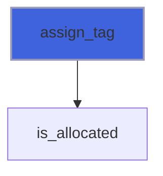

### finalize

Free dynamic memory when finalizing.

**Attributes**: elemental

```fortran
subroutine finalize(tag)
```

**Arguments**

| Name | Type | Intent | Attributes | Description |
|------|------|--------|------------|-------------|
| `tag` | type([xml_tag](/api/src/third_party/FoXy/src/lib/foxy_xml_tag#xml-tag)) | inout |  | XML tag. |

## Functions

### create_tag_flat

Return an instance of xml tag.

**Attributes**: pure

**Returns**: type([xml_tag](/api/src/third_party/FoXy/src/lib/foxy_xml_tag#xml-tag))

```fortran
function create_tag_flat(name, attribute, attributes, attributes_stream, sanitize_attributes_value, pos, content, indent, is_content_indented, is_self_closing, id, level, parent_id, attributes_stream_alloc, content_alloc) result(tag)
```

**Arguments**

| Name | Type | Intent | Attributes | Description |
|------|------|--------|------------|-------------|
| `name` | character(len=*) | in |  | Tag name. |
| `attribute` | character(len=*) | in | optional | Attribute name/value pair [1:2]. |
| `attributes` | character(len=*) | in | optional | Attributes list of name/value pairs [1:2,1:]. |
| `attributes_stream` | character(len=*) | in | optional | Attributes list as single stream. |
| `sanitize_attributes_value` | logical | in | optional | Sanitize attributes value. |
| `pos` | integer(kind=[I8P](/api/src/third_party/PENF/src/lib/penf_global_parameters_variables)) | in | optional | Characters position (in source) indexes. |
| `content` | character(len=*) | in | optional | Tag value. |
| `indent` | integer(kind=[I4P](/api/src/third_party/PENF/src/lib/penf_global_parameters_variables)) | in | optional | Number of indent-white-spaces. |
| `is_content_indented` | logical | in | optional | Activate content indentation. |
| `is_self_closing` | logical | in | optional | The tag is self closing. |
| `id` | integer(kind=[I4P](/api/src/third_party/PENF/src/lib/penf_global_parameters_variables)) | in | optional | Uniq ID. |
| `level` | integer(kind=[I4P](/api/src/third_party/PENF/src/lib/penf_global_parameters_variables)) | in | optional | Tag hierarchy level. |
| `parent_id` | integer(kind=[I4P](/api/src/third_party/PENF/src/lib/penf_global_parameters_variables)) | in | optional | Parent uniq ID. |
| `attributes_stream_alloc` | character(len=:) | in | allocatable, optional | Attributes list stream, allocatable input. |
| `content_alloc` | character(len=:) | in | allocatable, optional | Tag value, allocatable input. |

**Call graph**

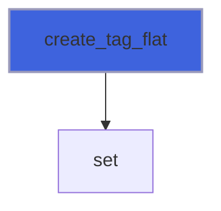

### create_tag_nested

Return an instance of xml tag with value being a nested tag.

**Attributes**: pure

**Returns**: type([xml_tag](/api/src/third_party/FoXy/src/lib/foxy_xml_tag#xml-tag))

```fortran
function create_tag_nested(name, content, attribute, attributes, attributes_stream, sanitize_attributes_value, pos, indent, is_content_indented, id, level, parent_id, attributes_stream_alloc, content_alloc) result(tag)
```

**Arguments**

| Name | Type | Intent | Attributes | Description |
|------|------|--------|------------|-------------|
| `name` | character(len=*) | in |  | Tag name. |
| `content` | type([xml_tag](/api/src/third_party/FoXy/src/lib/foxy_xml_tag#xml-tag)) | in |  | Tag value as nested tag.. |
| `attribute` | character(len=*) | in | optional | Attribute name/value pair [1:2]. |
| `attributes` | character(len=*) | in | optional | Attributes list of name/value pairs [1:2,1:]. |
| `attributes_stream` | character(len=*) | in | optional | Attributes list as single stream. |
| `sanitize_attributes_value` | logical | in | optional | Sanitize attributes value. |
| `pos` | integer(kind=[I8P](/api/src/third_party/PENF/src/lib/penf_global_parameters_variables)) | in | optional | Characters position (in source) indexes. |
| `indent` | integer(kind=[I4P](/api/src/third_party/PENF/src/lib/penf_global_parameters_variables)) | in | optional | Number of indent-white-spaces. |
| `is_content_indented` | logical | in | optional | Activate value indentation. |
| `id` | integer(kind=[I4P](/api/src/third_party/PENF/src/lib/penf_global_parameters_variables)) | in | optional | Uniq ID. |
| `level` | integer(kind=[I4P](/api/src/third_party/PENF/src/lib/penf_global_parameters_variables)) | in | optional | Tag hierarchy level. |
| `parent_id` | integer(kind=[I4P](/api/src/third_party/PENF/src/lib/penf_global_parameters_variables)) | in | optional | Parent uniq ID. |
| `attributes_stream_alloc` | character(len=:) | in | allocatable, optional | Attributes list stream, allocatable input. |
| `content_alloc` | character(len=:) | in | allocatable, optional | Tag value, allocatable input. |

**Call graph**

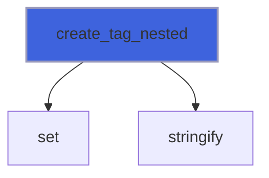

### attributes

Return attributes name/value pairs as string, `''` if the tag has none.

**Attributes**: pure

**Returns**: `character(len=:)`

```fortran
function attributes(self) result(att_)
```

**Arguments**

| Name | Type | Intent | Attributes | Description |
|------|------|--------|------------|-------------|
| `self` | class([xml_tag](/api/src/third_party/FoXy/src/lib/foxy_xml_tag#xml-tag)) | in |  | XML tag. |

**Call graph**

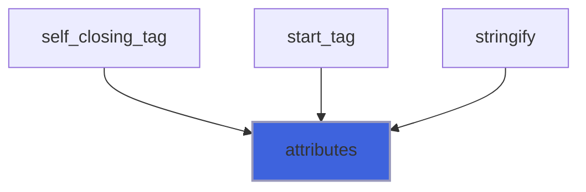

### end_tag

Return `</tag_name>` end tag.

**Attributes**: pure

**Returns**: `character(len=:)`

```fortran
function end_tag(self, is_indented) result(tag_)
```

**Arguments**

| Name | Type | Intent | Attributes | Description |
|------|------|--------|------------|-------------|
| `self` | class([xml_tag](/api/src/third_party/FoXy/src/lib/foxy_xml_tag#xml-tag)) | in |  | XML tag. |
| `is_indented` | logical | in | optional | Activate content indentation. |

**Call graph**

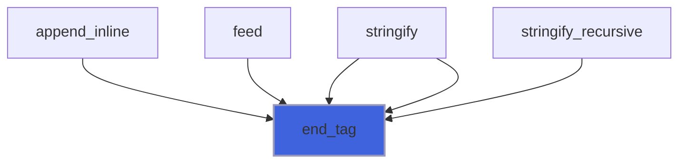

### get_attribute_name

Return the name of the attribute with index *a* (1 for the first one, in source order), empty if it does not exist.

**Attributes**: pure

**Returns**: `character(len=:)`

```fortran
function get_attribute_name(self, a) result(name)
```

**Arguments**

| Name | Type | Intent | Attributes | Description |
|------|------|--------|------------|-------------|
| `self` | class([xml_tag](/api/src/third_party/FoXy/src/lib/foxy_xml_tag#xml-tag)) | in |  | XML tag. |
| `a` | integer(kind=[I4P](/api/src/third_party/PENF/src/lib/penf_global_parameters_variables)) | in |  | Attribute index. |

**Call graph**

```mermaid
flowchart TD
  tree_attribute_name["tree_attribute_name"] --> get_attribute_name["get_attribute_name"]
  get_attribute_name["get_attribute_name"] --> chars["chars"]
  style get_attribute_name fill:#3e63dd,stroke:#99b,stroke-width:2px
```

### get_attributes_number

Return the number of attributes.

**Attributes**: elemental

**Returns**: integer(kind=[I4P](/api/src/third_party/PENF/src/lib/penf_global_parameters_variables))

```fortran
function get_attributes_number(self) result(number)
```

**Arguments**

| Name | Type | Intent | Attributes | Description |
|------|------|--------|------------|-------------|
| `self` | class([xml_tag](/api/src/third_party/FoXy/src/lib/foxy_xml_tag#xml-tag)) | in |  | XML tag. |

**Call graph**

```mermaid
flowchart TD
  tree_attributes_number["tree_attributes_number"] --> get_attributes_number["get_attributes_number"]
  style get_attributes_number fill:#3e63dd,stroke:#99b,stroke-width:2px
```

### get_attribute

Return the value of the attribute named *name*.

 @note If the attribute is not defined (or has no value), an empty string is returned. The value is normalized as by
 XML 1.0 (3.3.3), for attributes of CDATA type: each literal blank (tab, new line, carriage return, a CR LF pair as one)
 becomes a space, then character references are decoded (blanks written as references are kept).

**Attributes**: pure

**Returns**: `character(len=:)`

```fortran
function get_attribute(self, name) result(value)
```

**Arguments**

| Name | Type | Intent | Attributes | Description |
|------|------|--------|------------|-------------|
| `self` | class([xml_tag](/api/src/third_party/FoXy/src/lib/foxy_xml_tag#xml-tag)) | in |  | XML tag. |
| `name` | character(len=*) | in |  | Attribute name. |

**Call graph**

```mermaid
flowchart TD
  attribute_filtered["attribute_filtered"] --> get_attribute["get_attribute"]
  name_pattern_of["name_pattern_of"] --> get_attribute["get_attribute"]
  resolve_namespace["resolve_namespace"] --> get_attribute["get_attribute"]
  tree_attribute["tree_attribute"] --> get_attribute["get_attribute"]
  tree_attribute_text["tree_attribute_text"] --> get_attribute["get_attribute"]
  tree_matching["tree_matching"] --> get_attribute["get_attribute"]
  get_attribute["get_attribute"] --> attribute_value["attribute_value"]
  get_attribute["get_attribute"] --> chars["chars"]
  get_attribute["get_attribute"] --> is_allocated["is_allocated"]
  style get_attribute fill:#3e63dd,stroke:#99b,stroke-width:2px
```

### get_id

Return tag uniq ID.

**Attributes**: elemental

**Returns**: integer(kind=[I4P](/api/src/third_party/PENF/src/lib/penf_global_parameters_variables))

```fortran
function get_id(self) result(id)
```

**Arguments**

| Name | Type | Intent | Attributes | Description |
|------|------|--------|------------|-------------|
| `self` | class([xml_tag](/api/src/third_party/FoXy/src/lib/foxy_xml_tag#xml-tag)) | in |  | XML tag. |

**Call graph**

```mermaid
flowchart TD
  stringify_recursive["stringify_recursive"] --> get_id["get_id"]
  style get_id fill:#3e63dd,stroke:#99b,stroke-width:2px
```

### get_tail

Return the text after the end tag (mixed content), an empty string if none.

**Attributes**: pure

**Returns**: `character(len=:)`

```fortran
function get_tail(self) result(tail)
```

**Arguments**

| Name | Type | Intent | Attributes | Description |
|------|------|--------|------------|-------------|
| `self` | class([xml_tag](/api/src/third_party/FoXy/src/lib/foxy_xml_tag#xml-tag)) | in |  | XML tag. |

**Call graph**

```mermaid
flowchart TD
  append_inline_body["append_inline_body"] --> get_tail["get_tail"]
  direct_text["direct_text"] --> get_tail["get_tail"]
  is_mixed["is_mixed"] --> get_tail["get_tail"]
  stringify["stringify"] --> get_tail["get_tail"]
  get_tail["get_tail"] --> chars["chars"]
  get_tail["get_tail"] --> is_allocated["is_allocated"]
  style get_tail fill:#3e63dd,stroke:#99b,stroke-width:2px
```

### get_parent_id

Return parent tag uniq ID.

**Attributes**: elemental

**Returns**: integer(kind=[I4P](/api/src/third_party/PENF/src/lib/penf_global_parameters_variables))

```fortran
function get_parent_id(self) result(parent_id)
```

**Arguments**

| Name | Type | Intent | Attributes | Description |
|------|------|--------|------------|-------------|
| `self` | class([xml_tag](/api/src/third_party/FoXy/src/lib/foxy_xml_tag#xml-tag)) | in |  | XML tag. |

**Call graph**

```mermaid
flowchart TD
  add_tag["add_tag"] --> get_parent_id["get_parent_id"]
  children_named["children_named"] --> get_parent_id["get_parent_id"]
  delete_subtree["delete_subtree"] --> get_parent_id["get_parent_id"]
  descendants_named["descendants_named"] --> get_parent_id["get_parent_id"]
  last_in_subtree["last_in_subtree"] --> get_parent_id["get_parent_id"]
  make_room["make_room"] --> get_parent_id["get_parent_id"]
  resolve_namespace["resolve_namespace"] --> get_parent_id["get_parent_id"]
  save["save"] --> get_parent_id["get_parent_id"]
  siblings_at["siblings_at"] --> get_parent_id["get_parent_id"]
  stringify["stringify"] --> get_parent_id["get_parent_id"]
  tree_build_children["tree_build_children"] --> get_parent_id["get_parent_id"]
  tree_children["tree_children"] --> get_parent_id["get_parent_id"]
  tree_parent["tree_parent"] --> get_parent_id["get_parent_id"]
  style get_parent_id fill:#3e63dd,stroke:#99b,stroke-width:2px
```

### get_indent

Return tag indentation (number of spaces).

**Attributes**: elemental

**Returns**: integer(kind=[I4P](/api/src/third_party/PENF/src/lib/penf_global_parameters_variables))

```fortran
function get_indent(self) result(indent)
```

**Arguments**

| Name | Type | Intent | Attributes | Description |
|------|------|--------|------------|-------------|
| `self` | class([xml_tag](/api/src/third_party/FoXy/src/lib/foxy_xml_tag#xml-tag)) | in |  | XML tag. |

**Call graph**

```mermaid
flowchart TD
  add_tag["add_tag"] --> get_indent["get_indent"]
  style get_indent fill:#3e63dd,stroke:#99b,stroke-width:2px
```

### get_level

Return tag hierarchy level.

**Attributes**: elemental

**Returns**: integer(kind=[I4P](/api/src/third_party/PENF/src/lib/penf_global_parameters_variables))

```fortran
function get_level(self) result(level)
```

**Arguments**

| Name | Type | Intent | Attributes | Description |
|------|------|--------|------------|-------------|
| `self` | class([xml_tag](/api/src/third_party/FoXy/src/lib/foxy_xml_tag#xml-tag)) | in |  | XML tag. |

**Call graph**

```mermaid
flowchart TD
  add_tag["add_tag"] --> get_level["get_level"]
  tree_level["tree_level"] --> get_level["get_level"]
  style get_level fill:#3e63dd,stroke:#99b,stroke-width:2px
```

### get_pos

Return tag positions in the source: start tag `<`, start tag `>`, end tag `<` (-1 if self closing, 0 if unclosed).

**Attributes**: pure

**Returns**: integer(kind=[I8P](/api/src/third_party/PENF/src/lib/penf_global_parameters_variables))

```fortran
function get_pos(self) result(pos)
```

**Arguments**

| Name | Type | Intent | Attributes | Description |
|------|------|--------|------------|-------------|
| `self` | class([xml_tag](/api/src/third_party/FoXy/src/lib/foxy_xml_tag#xml-tag)) | in |  | XML tag. |

**Call graph**

```mermaid
flowchart TD
  content["content"] --> get_pos["get_pos"]
  content_range["content_range"] --> get_pos["get_pos"]
  text_range["text_range"] --> get_pos["get_pos"]
  style get_pos fill:#3e63dd,stroke:#99b,stroke-width:2px
```

### is_attribute_present

Return .true. it the queried attribute name is defined, .false. otherwise.

**Attributes**: pure

**Returns**: `logical`

```fortran
function is_attribute_present(self, name) result(is_present)
```

**Arguments**

| Name | Type | Intent | Attributes | Description |
|------|------|--------|------------|-------------|
| `self` | class([xml_tag](/api/src/third_party/FoXy/src/lib/foxy_xml_tag#xml-tag)) | in |  | XML tag. |
| `name` | character(len=*) | in |  | Attribute name. |

**Call graph**

```mermaid
flowchart TD
  attribute_filtered["attribute_filtered"] --> is_attribute_present["is_attribute_present"]
  delete_attribute["delete_attribute"] --> is_attribute_present["is_attribute_present"]
  feed["feed"] --> is_attribute_present["is_attribute_present"]
  name_pattern_of["name_pattern_of"] --> is_attribute_present["is_attribute_present"]
  resolve_namespace["resolve_namespace"] --> is_attribute_present["is_attribute_present"]
  tree_attribute_text["tree_attribute_text"] --> is_attribute_present["is_attribute_present"]
  tree_matching["tree_matching"] --> is_attribute_present["is_attribute_present"]
  style is_attribute_present fill:#3e63dd,stroke:#99b,stroke-width:2px
```

### is_parsed

Check is tag is correctly parsed, i.e. its *tag_name* is allocated.

**Attributes**: elemental

**Returns**: `logical`

```fortran
function is_parsed(self)
```

**Arguments**

| Name | Type | Intent | Attributes | Description |
|------|------|--------|------------|-------------|
| `self` | class([xml_tag](/api/src/third_party/FoXy/src/lib/foxy_xml_tag#xml-tag)) | in |  | XML tag. |

**Call graph**

```mermaid
flowchart TD
  is_parsed["is_parsed"] --> is_allocated["is_allocated"]
  style is_parsed fill:#3e63dd,stroke:#99b,stroke-width:2px
```

### is_content_markup

Return true if the content holds a `<` (it may hold markup, e.g. nested tags), without copying it.

**Attributes**: elemental

**Returns**: `logical`

```fortran
function is_content_markup(self) result(is_markup)
```

**Arguments**

| Name | Type | Intent | Attributes | Description |
|------|------|--------|------------|-------------|
| `self` | class([xml_tag](/api/src/third_party/FoXy/src/lib/foxy_xml_tag#xml-tag)) | in |  | XML tag. |

**Call graph**

```mermaid
flowchart TD
  content_by_name["content_by_name"] --> is_content_markup["is_content_markup"]
  is_content_markup["is_content_markup"] --> is_allocated["is_allocated"]
  style is_content_markup fill:#3e63dd,stroke:#99b,stroke-width:2px
```

### is_named

Return true if the tag is named *name* (no copy of the name, for lookups).

**Attributes**: elemental

**Returns**: `logical`

```fortran
function is_named(self, name) result(is_match)
```

**Arguments**

| Name | Type | Intent | Attributes | Description |
|------|------|--------|------------|-------------|
| `self` | class([xml_tag](/api/src/third_party/FoXy/src/lib/foxy_xml_tag#xml-tag)) | in |  | XML tag. |
| `name` | character(len=*) | in |  | Name. |

**Call graph**

```mermaid
flowchart TD
  content_by_name["content_by_name"] --> is_named["is_named"]
  is_matching["is_matching"] --> is_named["is_named"]
  is_named["is_named"] --> is_allocated["is_allocated"]
  style is_named fill:#3e63dd,stroke:#99b,stroke-width:2px
```

### name

Return tag name.

**Attributes**: pure

**Returns**: `character(len=:)`

```fortran
function name(self)
```

**Arguments**

| Name | Type | Intent | Attributes | Description |
|------|------|--------|------------|-------------|
| `self` | class([xml_tag](/api/src/third_party/FoXy/src/lib/foxy_xml_tag#xml-tag)) | in |  | XML tag. |

**Call graph**

```mermaid
flowchart TD
  delete_attribute["delete_attribute"] --> name["name"]
  delete_tag["delete_tag"] --> name["name"]
  get_attribute_I1P["get_attribute_I1P"] --> name["name"]
  get_attribute_I1P["get_attribute_I1P"] --> name["name"]
  get_attribute_I1P_1["get_attribute_I1P_1"] --> name["name"]
  get_attribute_I1P_1["get_attribute_I1P_1"] --> name["name"]
  get_attribute_I2P["get_attribute_I2P"] --> name["name"]
  get_attribute_I2P["get_attribute_I2P"] --> name["name"]
  get_attribute_I2P_1["get_attribute_I2P_1"] --> name["name"]
  get_attribute_I2P_1["get_attribute_I2P_1"] --> name["name"]
  get_attribute_I4P["get_attribute_I4P"] --> name["name"]
  get_attribute_I4P["get_attribute_I4P"] --> name["name"]
  get_attribute_I4P_1["get_attribute_I4P_1"] --> name["name"]
  get_attribute_I4P_1["get_attribute_I4P_1"] --> name["name"]
  get_attribute_I8P["get_attribute_I8P"] --> name["name"]
  get_attribute_I8P["get_attribute_I8P"] --> name["name"]
  get_attribute_I8P_1["get_attribute_I8P_1"] --> name["name"]
  get_attribute_I8P_1["get_attribute_I8P_1"] --> name["name"]
  get_attribute_R4P["get_attribute_R4P"] --> name["name"]
  get_attribute_R4P["get_attribute_R4P"] --> name["name"]
  get_attribute_R4P_1["get_attribute_R4P_1"] --> name["name"]
  get_attribute_R4P_1["get_attribute_R4P_1"] --> name["name"]
  get_attribute_R8P["get_attribute_R8P"] --> name["name"]
  get_attribute_R8P["get_attribute_R8P"] --> name["name"]
  get_attribute_R8P_1["get_attribute_R8P_1"] --> name["name"]
  get_attribute_R8P_1["get_attribute_R8P_1"] --> name["name"]
  get_attribute_logical["get_attribute_logical"] --> name["name"]
  get_attribute_logical["get_attribute_logical"] --> name["name"]
  get_content_I1P["get_content_I1P"] --> name["name"]
  get_content_I1P["get_content_I1P"] --> name["name"]
  get_content_I1P_1["get_content_I1P_1"] --> name["name"]
  get_content_I1P_1["get_content_I1P_1"] --> name["name"]
  get_content_I2P["get_content_I2P"] --> name["name"]
  get_content_I2P["get_content_I2P"] --> name["name"]
  get_content_I2P_1["get_content_I2P_1"] --> name["name"]
  get_content_I2P_1["get_content_I2P_1"] --> name["name"]
  get_content_I4P["get_content_I4P"] --> name["name"]
  get_content_I4P["get_content_I4P"] --> name["name"]
  get_content_I4P_1["get_content_I4P_1"] --> name["name"]
  get_content_I4P_1["get_content_I4P_1"] --> name["name"]
  get_content_I8P["get_content_I8P"] --> name["name"]
  get_content_I8P["get_content_I8P"] --> name["name"]
  get_content_I8P_1["get_content_I8P_1"] --> name["name"]
  get_content_I8P_1["get_content_I8P_1"] --> name["name"]
  get_content_R4P["get_content_R4P"] --> name["name"]
  get_content_R4P["get_content_R4P"] --> name["name"]
  get_content_R4P_1["get_content_R4P_1"] --> name["name"]
  get_content_R4P_1["get_content_R4P_1"] --> name["name"]
  get_content_R8P["get_content_R8P"] --> name["name"]
  get_content_R8P["get_content_R8P"] --> name["name"]
  get_content_R8P_1["get_content_R8P_1"] --> name["name"]
  get_content_R8P_1["get_content_R8P_1"] --> name["name"]
  get_content_logical["get_content_logical"] --> name["name"]
  get_content_logical["get_content_logical"] --> name["name"]
  index_start_tag_end["index_start_tag_end"] --> name["name"]
  is_matching["is_matching"] --> name["name"]
  raw_text["raw_text"] --> name["name"]
  resolve_namespace["resolve_namespace"] --> name["name"]
  tree_attribute_text["tree_attribute_text"] --> name["name"]
  tree_matching["tree_matching"] --> name["name"]
  tree_name["tree_name"] --> name["name"]
  name["name"] --> chars["chars"]
  style name fill:#3e63dd,stroke:#99b,stroke-width:2px
```

### self_closing_tag

Return `<tag_name.../>` self closing tag.

**Attributes**: pure

**Returns**: `character(len=:)`

```fortran
function self_closing_tag(self, is_indented) result(tag_)
```

**Arguments**

| Name | Type | Intent | Attributes | Description |
|------|------|--------|------------|-------------|
| `self` | class([xml_tag](/api/src/third_party/FoXy/src/lib/foxy_xml_tag#xml-tag)) | in |  | XML tag. |
| `is_indented` | logical | in | optional | Flag to check if tag is indented. |

**Call graph**

```mermaid
flowchart TD
  stringify["stringify"] --> self_closing_tag["self_closing_tag"]
  self_closing_tag["self_closing_tag"] --> attributes["attributes"]
  style self_closing_tag fill:#3e63dd,stroke:#99b,stroke-width:2px
```

### start_tag

Return `<tag_name...>` start tag.

**Attributes**: pure

**Returns**: `character(len=:)`

```fortran
function start_tag(self, is_indented) result(tag_)
```

**Arguments**

| Name | Type | Intent | Attributes | Description |
|------|------|--------|------------|-------------|
| `self` | class([xml_tag](/api/src/third_party/FoXy/src/lib/foxy_xml_tag#xml-tag)) | in |  | XML tag. |
| `is_indented` | logical | in | optional | Flag to check if tag is indented. |

**Call graph**

```mermaid
flowchart TD
  append_inline["append_inline"] --> start_tag["start_tag"]
  feed["feed"] --> start_tag["start_tag"]
  stringify["stringify"] --> start_tag["start_tag"]
  stringify["stringify"] --> start_tag["start_tag"]
  stringify_recursive["stringify_recursive"] --> start_tag["start_tag"]
  start_tag["start_tag"] --> attributes["attributes"]
  style start_tag fill:#3e63dd,stroke:#99b,stroke-width:2px
```

### stringify

Convert the whole tag into a string.

**Attributes**: pure

**Returns**: `character(len=:)`

```fortran
function stringify(self, is_indented, is_content_indented, only_start, only_content, only_end, linearize) result(stringed)
```

**Arguments**

| Name | Type | Intent | Attributes | Description |
|------|------|--------|------------|-------------|
| `self` | class([xml_tag](/api/src/third_party/FoXy/src/lib/foxy_xml_tag#xml-tag)) | in |  | XML tag. |
| `is_indented` | logical | in | optional | Activate content indentation. |
| `is_content_indented` | logical | in | optional | Activate content indentation. |
| `only_start` | logical | in | optional | Write only start tag. |
| `only_content` | logical | in | optional | Write only content. |
| `only_end` | logical | in | optional | Write only end tag. |
| `linearize` | logical | in | optional | Return a "linearized" string of tags without the XML hieararchy. |

**Call graph**

```mermaid
flowchart TD
  append_inline["append_inline"] --> stringify["stringify"]
  create_tag_nested["create_tag_nested"] --> stringify["stringify"]
  parse_file["parse_file"] --> stringify["stringify"]
  save["save"] --> stringify["stringify"]
  stringify["stringify"] --> stringify["stringify"]
  stringify_recursive["stringify_recursive"] --> stringify["stringify"]
  tag_str["tag_str"] --> stringify["stringify"]
  write_end_tag["write_end_tag"] --> stringify["stringify"]
  write_self_closing_tag["write_self_closing_tag"] --> stringify["stringify"]
  write_start_tag["write_start_tag"] --> stringify["stringify"]
  write_tag["write_tag"] --> stringify["stringify"]
  write_tag["write_tag"] --> stringify["stringify"]
  stringify["stringify"] --> attributes["attributes"]
  stringify["stringify"] --> chars["chars"]
  stringify["stringify"] --> end_tag["end_tag"]
  stringify["stringify"] --> is_allocated["is_allocated"]
  stringify["stringify"] --> self_closing_tag["self_closing_tag"]
  stringify["stringify"] --> start_tag["start_tag"]
  stringify["stringify"] --> str["str"]
  style stringify fill:#3e63dd,stroke:#99b,stroke-width:2px
```
