# foxy_xml_tokenizer

> FoXy XML tokenizer: a single pass, quotes-aware and resumable tokenizer driving a builder.

 The tokenizer recognizes the markup in source order: start, self closing and end tags (any blank separates names and
 attributes, attribute values single or double quoted), CDATA sections, comments, processing instructions and
 declarations (e.g. DOCTYPE). It keeps the stack of the open tags (an end tag closes up to its matching start tag, inner
 open tags are closed implicitly, a stray end tag is ignored) and reports each token to a *builder*, which builds what
 it needs (e.g. the DOM of *xml_file*).

 The source is fed in pieces (*feed*): each call processes the complete tokens of the piece and returns how many
 characters it consumed; the caller passes the rest again, followed by more characters. Character data, comments, CDATA
 sections and processing instructions are reported in pieces (a long one never has to fit in memory), tags and
 declarations whole. All positions are absolute (1 is the first character of the source).

 Besides the tags structure, the problems reported (parsing goes on) are: invalid tag and attribute names, duplicate
 attributes, character data outside the root tag (blanks and a leading UTF-8 byte order mark excepted), a second root
 tag (XML 1.0 2.1: exactly one root element), a source without tags, ill-formed UTF-8 and malformed references in
 character data and attribute values. Each piece is checked for UTF-8 once, when it is fed; its first error is reported
 when the tokenizer reaches it, so that problems are always reported in the order they are met. A UTF-8 sequence or a
 reference split by the piece end is checked with the next piece.

**Source**: `src/third_party/FoXy/src/lib/foxy_xml_tokenizer.f90`

**Dependencies**

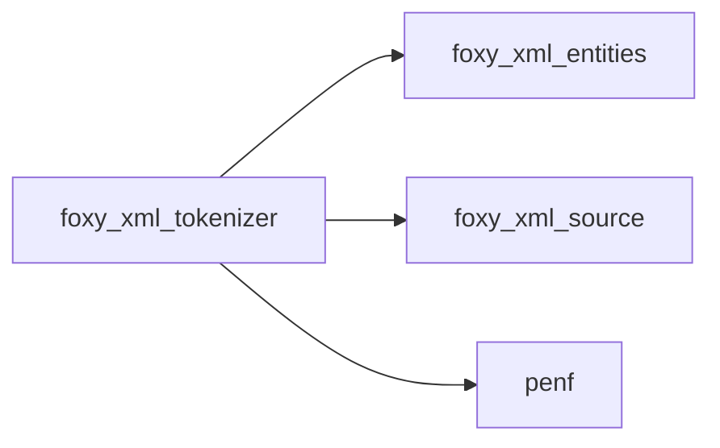

## Contents

- [xml_builder](#xml-builder)
- [open_tag](#open-tag)
- [attribute_pair](#attribute-pair)
- [xml_tokenizer](#xml-tokenizer)
- [feed](#feed)
- [reset](#reset)
- [report_markup](#report-markup)
- [add_attribute](#add-attribute)
- [set_source](#set-source)
- [check_utf8](#check-utf8)
- [check_references](#check-references)
- [close_reference](#close-reference)
- [flush_utf8](#flush-utf8)
- [report](#report)
- [first_problem](#first-problem)
- [read_name](#read-name)
- [skip_blanks](#skip-blanks)
- [located](#located)
- [located_in_file](#located-in-file)
- [reference_excerpt](#reference-excerpt)
- [is_attribute_present](#is-attribute-present)
- [is_data_outside](#is-data-outside)
- [after_declaration](#after-declaration)
- [escaped_double_quotes](#escaped-double-quotes)

## Variables

| Name | Type | Attributes | Description |
|------|------|------------|-------------|
| `DATA_TEXT` | integer(kind=[I4P](/api/src/third_party/PENF/src/lib/penf_global_parameters_variables)) | parameter | Character data. |
| `DATA_CDATA` | integer(kind=[I4P](/api/src/third_party/PENF/src/lib/penf_global_parameters_variables)) | parameter | CDATA section (markup included). |
| `DATA_COMMENT` | integer(kind=[I4P](/api/src/third_party/PENF/src/lib/penf_global_parameters_variables)) | parameter | Comment (markup included). |
| `DATA_PI` | integer(kind=[I4P](/api/src/third_party/PENF/src/lib/penf_global_parameters_variables)) | parameter | Processing instruction (markup included). |
| `DATA_DECLARATION` | integer(kind=[I4P](/api/src/third_party/PENF/src/lib/penf_global_parameters_variables)) | parameter | Declaration, e.g. DOCTYPE (markup included). |
| `DATA_IGNORED` | integer(kind=[I4P](/api/src/third_party/PENF/src/lib/penf_global_parameters_variables)) | parameter | Ignored markup, e.g. a stray end tag. |
| `INITIAL_DEPTH` | integer(kind=[I4P](/api/src/third_party/PENF/src/lib/penf_global_parameters_variables)) | parameter | Initial capacity of the open tags stack, doubled when full. |
| `LOOKAHEAD` | integer(kind=[I8P](/api/src/third_party/PENF/src/lib/penf_global_parameters_variables)) | parameter | Characters needed to classify a markup (`<) | parameter | Longest reference start carried to the next piece. |
| `BOM` | character(len=*) | parameter | UTF-8 byte order mark (checked byte by byte: |

## Derived Types

### xml_builder

Builder driven by the tokenizer: one call per token (character data and similar in pieces).

**Inheritance**

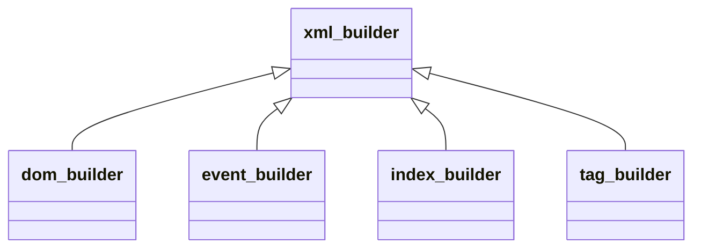

**Attributes**: abstract

#### Components

| Name | Type | Attributes | Description |
|------|------|------------|-------------|
| `is_stopped` | logical |  | Set by the builder to stop the tokenizer (checked after each complete start or end tag). |

#### Type-Bound Procedures

| Name | Attributes | Description |
|------|------------|-------------|
| `start_tag` | pass(self) | A start tag begins. |
| `attribute` | pass(self) | An attribute of the current start tag. |
| `start_tag_end` | pass(self) | The current start tag is complete. |
| `end_tag` | pass(self) | An open tag is closed by its end tag. |
| `data` | pass(self) | Character data or other markup. |
| `problem` | pass(self) | A problem of malformed input. |

### open_tag

An open tag of the stack.

#### Components

| Name | Type | Attributes | Description |
|------|------|------------|-------------|
| `id` | integer(kind=[I4P](/api/src/third_party/PENF/src/lib/penf_global_parameters_variables)) |  | Tag ID. |
| `start` | integer(kind=[I8P](/api/src/third_party/PENF/src/lib/penf_global_parameters_variables)) |  | Position of `<`. |
| `open_end` | integer(kind=[I8P](/api/src/third_party/PENF/src/lib/penf_global_parameters_variables)) |  | Position of `>`. |
| `name` | character(len=:) | allocatable | Tag name. |

### attribute_pair

An attribute of the current start tag.

#### Components

| Name | Type | Attributes | Description |
|------|------|------------|-------------|
| `name` | character(len=:) | allocatable | Attribute name. |
| `value` | character(len=:) | allocatable | Attribute value. |

### xml_tokenizer

Resumable tokenizer.

#### Components

| Name | Type | Attributes | Description |
|------|------|------------|-------------|
| `stack` | type([open_tag](/api/src/third_party/FoXy/src/lib/foxy_xml_tokenizer#open-tag)) | allocatable | Open tags. |
| `depth` | integer(kind=[I4P](/api/src/third_party/PENF/src/lib/penf_global_parameters_variables)) |  | Number of open tags. |
| `nt` | integer(kind=[I4P](/api/src/third_party/PENF/src/lib/penf_global_parameters_variables)) |  | Number of start tags. |
| `open_kind` | integer(kind=[I4P](/api/src/third_party/PENF/src/lib/penf_global_parameters_variables)) |  | Kind of the comment/CDATA/PI continuing in the next piece, 0 if none. |
| `open_start` | integer(kind=[I8P](/api/src/third_party/PENF/src/lib/penf_global_parameters_variables)) |  | Position of the comment/CDATA/PI continuing in the next piece. |
| `is_done` | logical |  | The source is ended (or parsing is stopped). |
| `is_outside_reported` | logical |  | Character data outside the root tags already reported. |
| `is_root_seen` | logical |  | A root tag has been started. |
| `is_second_root_reported` | logical |  | A second root tag already reported. |
| `utf8_checked` | integer(kind=[I8P](/api/src/third_party/PENF/src/lib/penf_global_parameters_variables)) |  | Last position checked for UTF-8. |
| `utf8_carry` | character(len=:) | allocatable | Bytes of a sequence split by the piece end, checked with the next. |
| `utf8_error` | integer(kind=[I8P](/api/src/third_party/PENF/src/lib/penf_global_parameters_variables)) |  | Position of the first ill-formed UTF-8 byte, 0 if none (yet). |
| `utf8_byte` | character(len=2) |  | That byte, in hexadecimal. |
| `is_utf8_reported` | logical |  | The UTF-8 error has been reported. |
| `ref_carry` | character(len=:) | allocatable | Start of a reference split by the piece end (from its `&`). |
| `ref_carry_pos` | integer(kind=[I8P](/api/src/third_party/PENF/src/lib/penf_global_parameters_variables)) |  | Position of that `&`. |
| `is_ref_reported` | logical |  | A malformed reference has been reported. |
| `source_name` | character(len=:) | allocatable | Encoding of the source if not UTF-8, for the messages. |
| `is_converted` | logical |  | The source is converted to UTF-8 (an FF byte is an invalid sequence). |

#### Type-Bound Procedures

| Name | Attributes | Description |
|------|------------|-------------|
| `feed` | pass(self) | Feed a piece of the source. |
| `reset` | pass(self) | Reset the tokenizer, ready for a new source. |
| `set_source` | pass(self) | Set the encoding of the source, for the messages. |

## Subroutines

### feed

Feed a piece of the source: tokenize its complete tokens, reporting them to the builder.

 @note The characters not consumed (an incomplete token at the end of the piece) must be passed again, followed by
 more characters; with *is_last* true the source ends with this piece and everything is consumed. Parsing stops at an
 unterminated markup of the source.

**Attributes**: pure

```fortran
subroutine feed(self, chars, offset, is_last, builder, consumed)
```

**Arguments**

| Name | Type | Intent | Attributes | Description |
|------|------|--------|------------|-------------|
| `self` | class([xml_tokenizer](/api/src/third_party/FoXy/src/lib/foxy_xml_tokenizer#xml-tokenizer)) | inout |  | Tokenizer. |
| `chars` | character(len=*) | in |  | Piece of the source. |
| `offset` | integer(kind=[I8P](/api/src/third_party/PENF/src/lib/penf_global_parameters_variables)) | in |  | Position of the character before the piece (0 if first). |
| `is_last` | logical | in |  | The source ends with this piece. |
| `builder` | class([xml_builder](/api/src/third_party/FoXy/src/lib/foxy_xml_tokenizer#xml-builder)) | inout |  | Builder. |
| `consumed` | integer(kind=[I8P](/api/src/third_party/PENF/src/lib/penf_global_parameters_variables)) | out |  | Number of characters consumed. |

**Call graph**

```mermaid
flowchart TD
  parse["parse"] --> feed["feed"]
  parse_from_file["parse_from_file"] --> feed["feed"]
  parse_from_string["parse_from_string"] --> feed["feed"]
  scan_file["scan_file"] --> feed["feed"]
  scan_tag["scan_tag"] --> feed["feed"]
  feed["feed"] --> add_attribute["add_attribute"]
  feed["feed"] --> after_declaration["after_declaration"]
  feed["feed"] --> attribute["attribute"]
  feed["feed"] --> check_references["check_references"]
  feed["feed"] --> check_utf8["check_utf8"]
  feed["feed"] --> close_reference["close_reference"]
  feed["feed"] --> end_tag["end_tag"]
  feed["feed"] --> first_bad_reference["first_bad_reference"]
  feed["feed"] --> first_problem["first_problem"]
  feed["feed"] --> flush_utf8["flush_utf8"]
  feed["feed"] --> is_attribute_present["is_attribute_present"]
  feed["feed"] --> is_data_outside["is_data_outside"]
  feed["feed"] --> is_name["is_name"]
  feed["feed"] --> read_name["read_name"]
  feed["feed"] --> reference_excerpt["reference_excerpt"]
  feed["feed"] --> report["report"]
  feed["feed"] --> report_markup["report_markup"]
  feed["feed"] --> skip_blanks["skip_blanks"]
  feed["feed"] --> start_tag["start_tag"]
  feed["feed"] --> start_tag_end["start_tag_end"]
  style feed fill:#3e63dd,stroke:#99b,stroke-width:2px
```

### reset

Reset the tokenizer, ready for a new source.

**Attributes**: elemental

```fortran
subroutine reset(self)
```

**Arguments**

| Name | Type | Intent | Attributes | Description |
|------|------|--------|------------|-------------|
| `self` | class([xml_tokenizer](/api/src/third_party/FoXy/src/lib/foxy_xml_tokenizer#xml-tokenizer)) | inout |  | Tokenizer. |

### report_markup

Report an open comment, CDATA section or PI up to its end, or up to the piece end if it continues in the next piece.

 @note When the end is not in the piece, the last characters that may start the terminator are not consumed (never
 those before *search_from*, i.e. the opening markup). An unterminated markup is reported up to the source end.

**Attributes**: pure

```fortran
subroutine report_markup(self, chars, offset, from, search_from, is_last, builder, pos, is_closed)
```

**Arguments**

| Name | Type | Intent | Attributes | Description |
|------|------|--------|------------|-------------|
| `self` | class([xml_tokenizer](/api/src/third_party/FoXy/src/lib/foxy_xml_tokenizer#xml-tokenizer)) | inout |  | Tokenizer. |
| `chars` | character(len=*) | in |  | Piece of the source. |
| `offset` | integer(kind=[I8P](/api/src/third_party/PENF/src/lib/penf_global_parameters_variables)) | in |  | Position of the character before the piece. |
| `from` | integer(kind=[I8P](/api/src/third_party/PENF/src/lib/penf_global_parameters_variables)) | in |  | First character to report. |
| `search_from` | integer(kind=[I8P](/api/src/third_party/PENF/src/lib/penf_global_parameters_variables)) | in |  | First character where the terminator is searched. |
| `is_last` | logical | in |  | The source ends with this piece. |
| `builder` | class([xml_builder](/api/src/third_party/FoXy/src/lib/foxy_xml_tokenizer#xml-builder)) | inout |  | Builder. |
| `pos` | integer(kind=[I8P](/api/src/third_party/PENF/src/lib/penf_global_parameters_variables)) | inout |  | Position after the reported characters. |
| `is_closed` | logical | out |  | The markup is closed: tokenizing goes on in this piece. |

**Call graph**

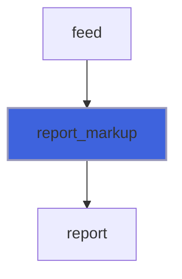

### add_attribute

Add an attribute to the list of the current start tag (values are double quoted: `"` escaped in single quoted ones).

**Attributes**: pure

```fortran
subroutine add_attribute(attributes, na, name, value, quote)
```

**Arguments**

| Name | Type | Intent | Attributes | Description |
|------|------|--------|------------|-------------|
| `attributes` | type([attribute_pair](/api/src/third_party/FoXy/src/lib/foxy_xml_tokenizer#attribute-pair)) | inout | allocatable | Attributes. |
| `na` | integer(kind=[I4P](/api/src/third_party/PENF/src/lib/penf_global_parameters_variables)) | inout |  | Number of attributes. |
| `name` | character(len=*) | in |  | Attribute name. |
| `value` | character(len=*) | in |  | Attribute value. |
| `quote` | character(len=1) | in |  | Attribute value quote. |

**Call graph**

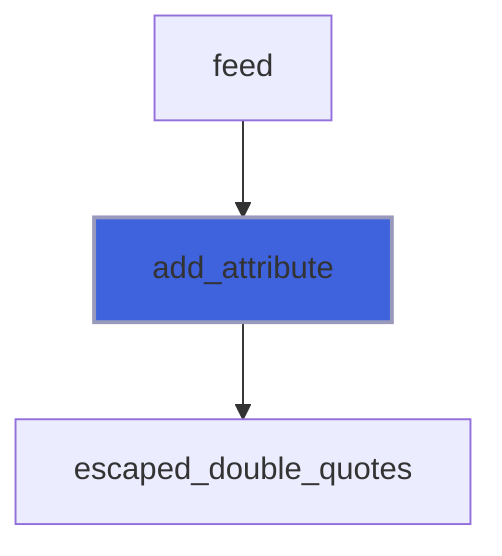

### set_source

Set the encoding of the source (not UTF-8), for the messages of the invalid sequences: converted to UTF-8, an
 invalid sequence is the byte FF; read as UTF-8, a byte not UTF-8 is reported with the encoding.

**Attributes**: pure

```fortran
subroutine set_source(self, name, is_converted)
```

**Arguments**

| Name | Type | Intent | Attributes | Description |
|------|------|--------|------------|-------------|
| `self` | class([xml_tokenizer](/api/src/third_party/FoXy/src/lib/foxy_xml_tokenizer#xml-tokenizer)) | inout |  | Tokenizer. |
| `name` | character(len=*) | in |  | Encoding name. |
| `is_converted` | logical | in |  | The source is converted to UTF-8. |

**Call graph**

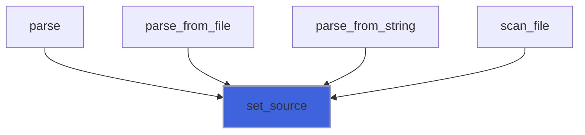

### check_utf8

Check for UTF-8 the bytes of a piece not checked yet (a piece may hold again the bytes not consumed before); the
 bytes of a sequence split by the piece end are kept, to be checked with the next piece. Only the first error is kept.

**Attributes**: pure

```fortran
subroutine check_utf8(self, chars, offset, is_last)
```

**Arguments**

| Name | Type | Intent | Attributes | Description |
|------|------|--------|------------|-------------|
| `self` | class([xml_tokenizer](/api/src/third_party/FoXy/src/lib/foxy_xml_tokenizer#xml-tokenizer)) | inout |  | Tokenizer. |
| `chars` | character(len=*) | in |  | Piece of the source. |
| `offset` | integer(kind=[I8P](/api/src/third_party/PENF/src/lib/penf_global_parameters_variables)) | in |  | Position of the character before the piece. |
| `is_last` | logical | in |  | The source ends with this piece. |

**Call graph**

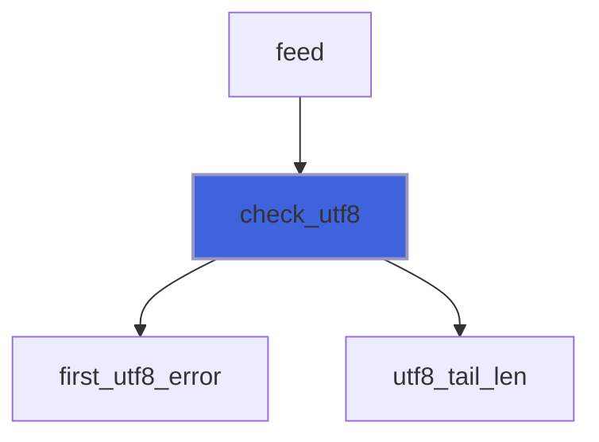

### check_references

Check the references of a piece of character data; with *is_open* (the data continues in the next piece) a final
 reference without its `;` is carried, to be checked with the continuation.

**Attributes**: pure

```fortran
subroutine check_references(self, builder, chars, first, is_open)
```

**Arguments**

| Name | Type | Intent | Attributes | Description |
|------|------|--------|------------|-------------|
| `self` | class([xml_tokenizer](/api/src/third_party/FoXy/src/lib/foxy_xml_tokenizer#xml-tokenizer)) | inout |  | Tokenizer. |
| `builder` | class([xml_builder](/api/src/third_party/FoXy/src/lib/foxy_xml_tokenizer#xml-builder)) | inout |  | Builder. |
| `chars` | character(len=*) | in |  | Character data. |
| `first` | integer(kind=[I8P](/api/src/third_party/PENF/src/lib/penf_global_parameters_variables)) | in |  | Position of the first character. |
| `is_open` | logical | in |  | The data continues in the next piece. |

**Call graph**

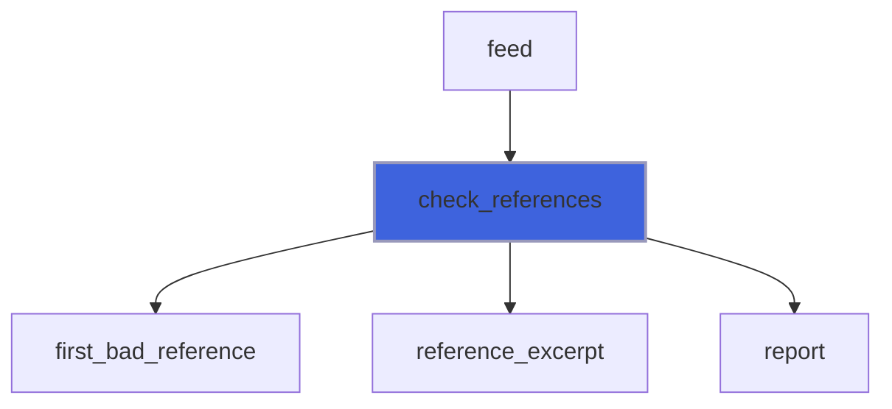

### close_reference

Check a carried reference whose character data ended (by markup or by the source end): it has no `;`.

**Attributes**: pure

```fortran
subroutine close_reference(self, builder, upto)
```

**Arguments**

| Name | Type | Intent | Attributes | Description |
|------|------|--------|------------|-------------|
| `self` | class([xml_tokenizer](/api/src/third_party/FoXy/src/lib/foxy_xml_tokenizer#xml-tokenizer)) | inout |  | Tokenizer. |
| `builder` | class([xml_builder](/api/src/third_party/FoXy/src/lib/foxy_xml_tokenizer#xml-builder)) | inout |  | Builder. |
| `upto` | integer(kind=[I8P](/api/src/third_party/PENF/src/lib/penf_global_parameters_variables)) | in |  | Position reached by the tokenizer. |

**Call graph**

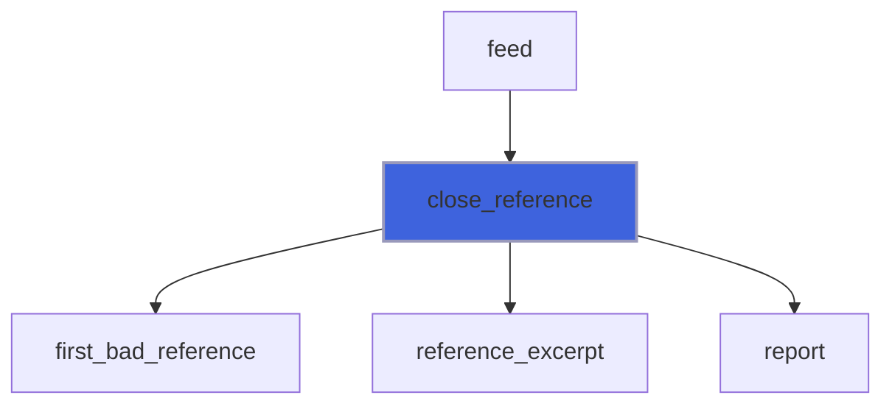

### flush_utf8

Report the UTF-8 error, if any and not reported yet, when the tokenizer has reached its position.

**Attributes**: pure

```fortran
subroutine flush_utf8(self, builder, upto)
```

**Arguments**

| Name | Type | Intent | Attributes | Description |
|------|------|--------|------------|-------------|
| `self` | class([xml_tokenizer](/api/src/third_party/FoXy/src/lib/foxy_xml_tokenizer#xml-tokenizer)) | inout |  | Tokenizer. |
| `builder` | class([xml_builder](/api/src/third_party/FoXy/src/lib/foxy_xml_tokenizer#xml-builder)) | inout |  | Builder. |
| `upto` | integer(kind=[I8P](/api/src/third_party/PENF/src/lib/penf_global_parameters_variables)) | in |  | Position reached by the tokenizer. |

**Call graph**

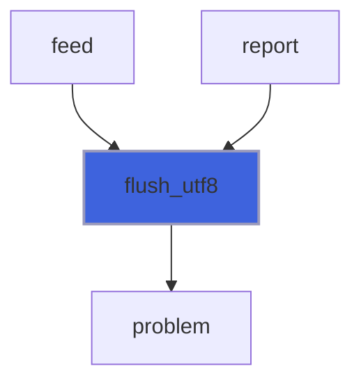

### report

Report a problem found when the tokenizer has reached *upto*, after the UTF-8 error met before it (if any).

**Attributes**: pure

```fortran
subroutine report(self, builder, upto, pos, message)
```

**Arguments**

| Name | Type | Intent | Attributes | Description |
|------|------|--------|------------|-------------|
| `self` | class([xml_tokenizer](/api/src/third_party/FoXy/src/lib/foxy_xml_tokenizer#xml-tokenizer)) | inout |  | Tokenizer. |
| `builder` | class([xml_builder](/api/src/third_party/FoXy/src/lib/foxy_xml_tokenizer#xml-builder)) | inout |  | Builder. |
| `upto` | integer(kind=[I8P](/api/src/third_party/PENF/src/lib/penf_global_parameters_variables)) | in |  | Position reached by the tokenizer. |
| `pos` | integer(kind=[I8P](/api/src/third_party/PENF/src/lib/penf_global_parameters_variables)) | in |  | Position of the problem. |
| `message` | character(len=*) | in |  | Problem description. |

**Call graph**

```mermaid
flowchart TD
  attribute_character["attribute_character"] --> report["report"]
  cdata["cdata"] --> report["report"]
  check_references["check_references"] --> report["report"]
  close["close"] --> report["report"]
  close_reference["close_reference"] --> report["report"]
  comment["comment"] --> report["report"]
  declaration["declaration"] --> report["report"]
  delete_attribute["delete_attribute"] --> report["report"]
  end["end"] --> report["report"]
  feed["feed"] --> report["report"]
  flush["flush"] --> report["report"]
  get_attribute_I1P["get_attribute_I1P"] --> report["report"]
  get_attribute_I1P["get_attribute_I1P"] --> report["report"]
  get_attribute_I1P_1["get_attribute_I1P_1"] --> report["report"]
  get_attribute_I1P_1["get_attribute_I1P_1"] --> report["report"]
  get_attribute_I2P["get_attribute_I2P"] --> report["report"]
  get_attribute_I2P["get_attribute_I2P"] --> report["report"]
  get_attribute_I2P_1["get_attribute_I2P_1"] --> report["report"]
  get_attribute_I2P_1["get_attribute_I2P_1"] --> report["report"]
  get_attribute_I4P["get_attribute_I4P"] --> report["report"]
  get_attribute_I4P["get_attribute_I4P"] --> report["report"]
  get_attribute_I4P_1["get_attribute_I4P_1"] --> report["report"]
  get_attribute_I4P_1["get_attribute_I4P_1"] --> report["report"]
  get_attribute_I8P["get_attribute_I8P"] --> report["report"]
  get_attribute_I8P["get_attribute_I8P"] --> report["report"]
  get_attribute_I8P_1["get_attribute_I8P_1"] --> report["report"]
  get_attribute_I8P_1["get_attribute_I8P_1"] --> report["report"]
  get_attribute_R4P["get_attribute_R4P"] --> report["report"]
  get_attribute_R4P["get_attribute_R4P"] --> report["report"]
  get_attribute_R4P_1["get_attribute_R4P_1"] --> report["report"]
  get_attribute_R4P_1["get_attribute_R4P_1"] --> report["report"]
  get_attribute_R8P["get_attribute_R8P"] --> report["report"]
  get_attribute_R8P["get_attribute_R8P"] --> report["report"]
  get_attribute_R8P_1["get_attribute_R8P_1"] --> report["report"]
  get_attribute_R8P_1["get_attribute_R8P_1"] --> report["report"]
  get_attribute_logical["get_attribute_logical"] --> report["report"]
  get_attribute_logical["get_attribute_logical"] --> report["report"]
  get_content_I1P["get_content_I1P"] --> report["report"]
  get_content_I1P["get_content_I1P"] --> report["report"]
  get_content_I1P_1["get_content_I1P_1"] --> report["report"]
  get_content_I1P_1["get_content_I1P_1"] --> report["report"]
  get_content_I2P["get_content_I2P"] --> report["report"]
  get_content_I2P["get_content_I2P"] --> report["report"]
  get_content_I2P_1["get_content_I2P_1"] --> report["report"]
  get_content_I2P_1["get_content_I2P_1"] --> report["report"]
  get_content_I4P["get_content_I4P"] --> report["report"]
  get_content_I4P["get_content_I4P"] --> report["report"]
  get_content_I4P_1["get_content_I4P_1"] --> report["report"]
  get_content_I4P_1["get_content_I4P_1"] --> report["report"]
  get_content_I8P["get_content_I8P"] --> report["report"]
  get_content_I8P["get_content_I8P"] --> report["report"]
  get_content_I8P_1["get_content_I8P_1"] --> report["report"]
  get_content_I8P_1["get_content_I8P_1"] --> report["report"]
  get_content_R4P["get_content_R4P"] --> report["report"]
  get_content_R4P["get_content_R4P"] --> report["report"]
  get_content_R4P_1["get_content_R4P_1"] --> report["report"]
  get_content_R4P_1["get_content_R4P_1"] --> report["report"]
  get_content_R8P["get_content_R8P"] --> report["report"]
  get_content_R8P["get_content_R8P"] --> report["report"]
  get_content_R8P_1["get_content_R8P_1"] --> report["report"]
  get_content_R8P_1["get_content_R8P_1"] --> report["report"]
  get_content_logical["get_content_logical"] --> report["report"]
  get_content_logical["get_content_logical"] --> report["report"]
  open["open"] --> report["report"]
  pi["pi"] --> report["report"]
  raw["raw"] --> report["report"]
  report_markup["report_markup"] --> report["report"]
  select["select"] --> report["report"]
  select["select"] --> report["report"]
  set_attribute_I1P["set_attribute_I1P"] --> report["report"]
  set_attribute_I1P_1["set_attribute_I1P_1"] --> report["report"]
  set_attribute_I2P["set_attribute_I2P"] --> report["report"]
  set_attribute_I2P_1["set_attribute_I2P_1"] --> report["report"]
  set_attribute_I4P["set_attribute_I4P"] --> report["report"]
  set_attribute_I4P_1["set_attribute_I4P_1"] --> report["report"]
  set_attribute_I8P["set_attribute_I8P"] --> report["report"]
  set_attribute_I8P_1["set_attribute_I8P_1"] --> report["report"]
  set_attribute_R4P["set_attribute_R4P"] --> report["report"]
  set_attribute_R4P_1["set_attribute_R4P_1"] --> report["report"]
  set_attribute_R8P["set_attribute_R8P"] --> report["report"]
  set_attribute_R8P_1["set_attribute_R8P_1"] --> report["report"]
  set_attribute_character["set_attribute_character"] --> report["report"]
  set_attribute_logical["set_attribute_logical"] --> report["report"]
  set_content_I1P["set_content_I1P"] --> report["report"]
  set_content_I1P_1["set_content_I1P_1"] --> report["report"]
  set_content_I2P["set_content_I2P"] --> report["report"]
  set_content_I2P_1["set_content_I2P_1"] --> report["report"]
  set_content_I4P["set_content_I4P"] --> report["report"]
  set_content_I4P_1["set_content_I4P_1"] --> report["report"]
  set_content_I8P["set_content_I8P"] --> report["report"]
  set_content_I8P_1["set_content_I8P_1"] --> report["report"]
  set_content_R4P["set_content_R4P"] --> report["report"]
  set_content_R4P_1["set_content_R4P_1"] --> report["report"]
  set_content_R8P["set_content_R8P"] --> report["report"]
  set_content_R8P_1["set_content_R8P_1"] --> report["report"]
  set_content_character["set_content_character"] --> report["report"]
  set_content_logical["set_content_logical"] --> report["report"]
  set_name["set_name"] --> report["report"]
  start["start"] --> report["report"]
  text_character["text_character"] --> report["report"]
  report["report"] --> flush_utf8["flush_utf8"]
  report["report"] --> problem["problem"]
  style report fill:#3e63dd,stroke:#99b,stroke-width:2px
```

### first_problem

Keep a problem only if it is the first one.

**Attributes**: pure

```fortran
subroutine first_problem(problem, problem_pos, pos, message)
```

**Arguments**

| Name | Type | Intent | Attributes | Description |
|------|------|--------|------------|-------------|
| `problem` | character(len=:) | inout | allocatable | First problem, unallocated if none yet. |
| `problem_pos` | integer(kind=[I8P](/api/src/third_party/PENF/src/lib/penf_global_parameters_variables)) | inout |  | Position of the first problem. |
| `pos` | integer(kind=[I8P](/api/src/third_party/PENF/src/lib/penf_global_parameters_variables)) | in |  | Position of the problem. |
| `message` | character(len=*) | in |  | Problem description. |

**Call graph**

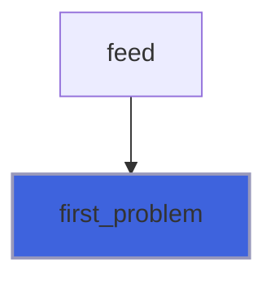

### read_name

Read a (tag or attribute) name starting at *pos*, ended by a blank, `/`, `>`, `=` or the source end; *pos* is moved
 after the name.

**Attributes**: pure

```fortran
subroutine read_name(source, pos, name)
```

**Arguments**

| Name | Type | Intent | Attributes | Description |
|------|------|--------|------------|-------------|
| `source` | character(len=*) | in |  | Source. |
| `pos` | integer(kind=[I8P](/api/src/third_party/PENF/src/lib/penf_global_parameters_variables)) | inout |  | Current position. |
| `name` | character(len=:) | out | allocatable | Name, empty if none. |

**Call graph**


### skip_blanks

Move *pos* after the blanks (space, tab, new line, carriage return) starting at it.

**Attributes**: pure

```fortran
subroutine skip_blanks(source, pos)
```

**Arguments**

| Name | Type | Intent | Attributes | Description |
|------|------|--------|------------|-------------|
| `source` | character(len=*) | in |  | Source. |
| `pos` | integer(kind=[I8P](/api/src/third_party/PENF/src/lib/penf_global_parameters_variables)) | inout |  | Current position. |

**Call graph**

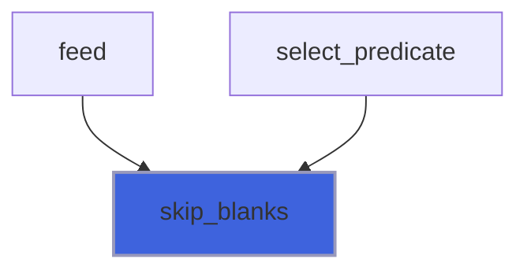

## Functions

### located

Return a problem description prefixed by its line in the source.

**Attributes**: pure

**Returns**: `character(len=:)`

```fortran
function located(source, pos, message) result(problem)
```

**Arguments**

| Name | Type | Intent | Attributes | Description |
|------|------|--------|------------|-------------|
| `source` | character(len=*) | in |  | Source. |
| `pos` | integer(kind=[I8P](/api/src/third_party/PENF/src/lib/penf_global_parameters_variables)) | in |  | Position of the problem. |
| `message` | character(len=*) | in |  | Problem description. |

**Call graph**

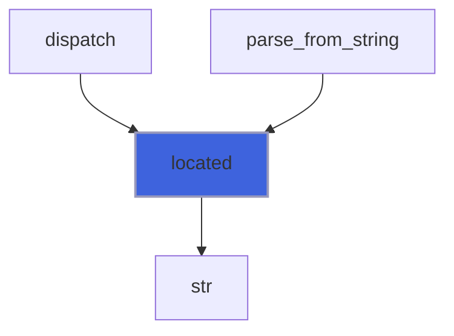

### located_in_file

Return a problem description prefixed by its line in a file (read again in chunks, counting the new lines; for a
 converted source, of the converted text).

**Returns**: `character(len=:)`

```fortran
function located_in_file(filename, pos, message, chunk_size, encoding) result(problem)
```

**Arguments**

| Name | Type | Intent | Attributes | Description |
|------|------|--------|------------|-------------|
| `filename` | character(len=*) | in |  | File name. |
| `pos` | integer(kind=[I8P](/api/src/third_party/PENF/src/lib/penf_global_parameters_variables)) | in |  | Position of the problem. |
| `message` | character(len=*) | in |  | Problem description. |
| `chunk_size` | integer(kind=[I8P](/api/src/third_party/PENF/src/lib/penf_global_parameters_variables)) | in |  | Size of the chunks read from the file. |
| `encoding` | type([source_encoding](/api/src/third_party/FoXy/src/lib/foxy_xml_source#source-encoding)) | in | optional | Encoding of the file. |

**Call graph**

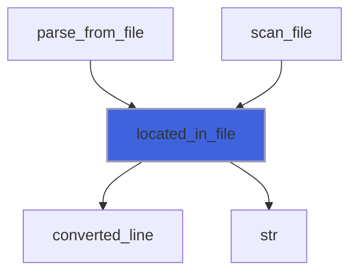

### reference_excerpt

Return the reference starting a text: up to its `;`, or its first characters if it has none.

**Attributes**: pure

**Returns**: `character(len=:)`

```fortran
function reference_excerpt(text) result(excerpt)
```

**Arguments**

| Name | Type | Intent | Attributes | Description |
|------|------|--------|------------|-------------|
| `text` | character(len=*) | in |  | Text starting with `&`. |

**Call graph**

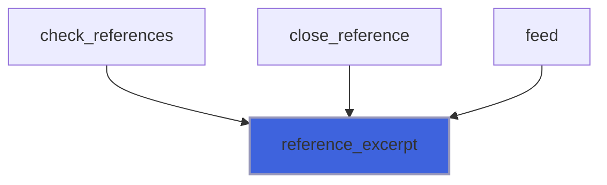

### is_attribute_present

Return true if the current start tag has already an attribute named *name*.

**Attributes**: pure

**Returns**: `logical`

```fortran
function is_attribute_present(attributes, na, name) result(is_present)
```

**Arguments**

| Name | Type | Intent | Attributes | Description |
|------|------|--------|------------|-------------|
| `attributes` | type([attribute_pair](/api/src/third_party/FoXy/src/lib/foxy_xml_tokenizer#attribute-pair)) | in | allocatable | Attributes. |
| `na` | integer(kind=[I4P](/api/src/third_party/PENF/src/lib/penf_global_parameters_variables)) | in |  | Number of attributes. |
| `name` | character(len=*) | in |  | Attribute name. |

**Call graph**

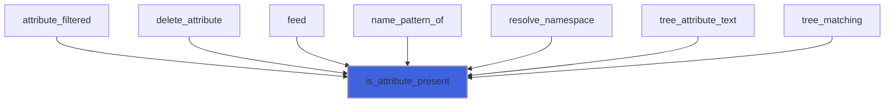

### is_data_outside

Return true if character data found outside the root tags is not only blanks (a byte order mark at the source start
 excepted).

**Attributes**: pure

**Returns**: `logical`

```fortran
function is_data_outside(chars, first) result(is_outside)
```

**Arguments**

| Name | Type | Intent | Attributes | Description |
|------|------|--------|------------|-------------|
| `chars` | character(len=*) | in |  | Characters. |
| `first` | integer(kind=[I8P](/api/src/third_party/PENF/src/lib/penf_global_parameters_variables)) | in |  | Position of the first character. |

**Call graph**

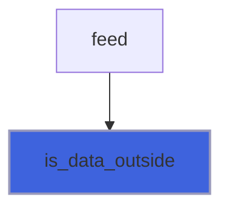

### after_declaration

Return the position after a `<!...>` declaration (e.g. DOCTYPE) starting at *start*, 0 if it is unterminated.

 @note Quoted strings and the `[...]` internal subset may contain `>`.

**Attributes**: pure

**Returns**: integer(kind=[I8P](/api/src/third_party/PENF/src/lib/penf_global_parameters_variables))

```fortran
function after_declaration(source, start) result(after)
```

**Arguments**

| Name | Type | Intent | Attributes | Description |
|------|------|--------|------------|-------------|
| `source` | character(len=*) | in |  | Source. |
| `start` | integer(kind=[I8P](/api/src/third_party/PENF/src/lib/penf_global_parameters_variables)) | in |  | Declaration start (`<`) position. |

**Call graph**


### escaped_double_quotes

Return string with `"` replaced by `&quot;`.

**Attributes**: pure

**Returns**: `character(len=:)`

```fortran
function escaped_double_quotes(string) result(escaped)
```

**Arguments**

| Name | Type | Intent | Attributes | Description |
|------|------|--------|------------|-------------|
| `string` | character(len=*) | in |  | String. |

**Call graph**

```mermaid
flowchart TD
  add_attribute["add_attribute"] --> escaped_double_quotes["escaped_double_quotes"]
  style escaped_double_quotes fill:#3e63dd,stroke:#99b,stroke-width:2px
```
