# foxy_xml_tree

> FoXy tree queries: lookups over a linearized array of tags, shared by the DOM (*xml_file*) and the index (*xml_index*).

 The tags are stored in document order (start tags order); each tag knows its ID (its index), its parent ID (0 for a
 root tag) and, once *tree_build_children* is called, its children IDs.

 Namespaces (Namespaces in XML 1.0) are resolved on demand, nothing is stored: the namespace of a tag is declared by
 the nearest `xmlns:prefix` (or `xmlns`, for an unprefixed name) attribute of the tag or of its ancestors.

**Source**: `src/third_party/FoXy/src/lib/foxy_xml_tree.f90`

**Dependencies**

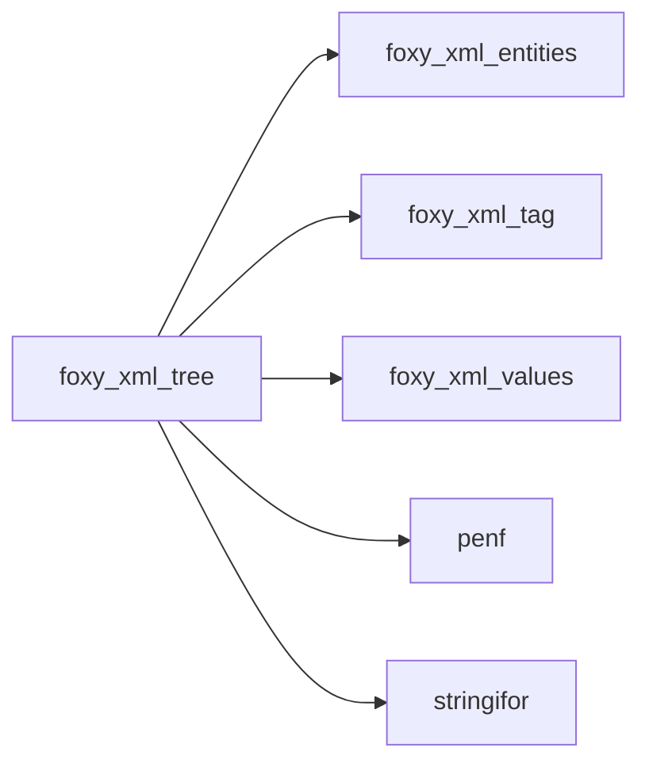

## Contents

- [name_pattern](#name-pattern)
- [tree_attribute_text](#tree-attribute-text)
- [tree_build_children](#tree-build-children)
- [tree_select](#tree-select)
- [select_failed](#select-failed)
- [skip_blanks](#skip-blanks)
- [select_predicate](#select-predicate)
- [merge_sort](#merge-sort)
- [resolve_namespace](#resolve-namespace)
- [next_path_segment](#next-path-segment)
- [tree_attribute_name](#tree-attribute-name)
- [tree_attributes_number](#tree-attributes-number)
- [tree_attribute](#tree-attribute)
- [tree_children](#tree-children)
- [tree_find_all](#tree-find-all)
- [tree_find](#tree-find)
- [tree_level](#tree-level)
- [tree_local_name](#tree-local-name)
- [tree_matching](#tree-matching)
- [regex_matches](#regex-matches)
- [tree_name](#tree-name)
- [tree_namespace](#tree-namespace)
- [tree_parent](#tree-parent)
- [tree_prefix](#tree-prefix)
- [tags_indexes](#tags-indexes)
- [attribute_filtered](#attribute-filtered)
- [descendants_named](#descendants-named)
- [siblings_at](#siblings-at)
- [is_name_test](#is-name-test)
- [find_tags](#find-tags)
- [children_named](#children-named)
- [declaration_name](#declaration-name)
- [is_matching](#is-matching)
- [name_local](#name-local)
- [name_pattern_of](#name-pattern-of)
- [name_prefix](#name-prefix)
- [separator_position](#separator-position)

## Variables

| Name | Type | Attributes | Description |
|------|------|------------|-------------|
| `DIGITS` | character(len=*) | parameter | Decimal digits. |
| `REGEX_MSG_LEN` | integer | parameter | Length of a regular expression compile message. |
| `MAX_POSITION_DIGITS` | integer(kind=[I4P](/api/src/third_party/PENF/src/lib/penf_global_parameters_variables)) | parameter | Digits of a `[n]` position at most (an I4P). |
| `XML_NAMESPACE` | character(len=*) | parameter | Namespace bound to the *xml* prefix. |

## Derived Types

### name_pattern

A tag name to match: a literal name or, if *is_expanded*, a namespace and a local name.

#### Components

| Name | Type | Attributes | Description |
|------|------|------------|-------------|
| `name` | character(len=:) | allocatable | Literal name, or local name if *is_expanded*. |
| `uri` | character(len=:) | allocatable | Namespace (empty for no namespace) if *is_expanded*. |
| `is_expanded` | logical |  | The name is expanded (namespace and local name). |
| `is_valid` | logical |  | The name can match (its prefix is declared). |
| `is_any` | logical |  | Any name matches (`*`). |

## Subroutines

### tree_attribute_text

Return the value of the attribute named *name* of the tag with ID *id* (as *tree_attribute*); *iostat* is
 *XML_NOT_FOUND* if the tag or the attribute does not exist.

**Attributes**: pure

```fortran
subroutine tree_attribute_text(tag, nt, id, name, value, iostat, iomsg)
```

**Arguments**

| Name | Type | Intent | Attributes | Description |
|------|------|--------|------------|-------------|
| `tag` | type([xml_tag](/api/src/third_party/FoXy/src/lib/foxy_xml_tag#xml-tag)) | in | allocatable | Tags. |
| `nt` | integer(kind=[I4P](/api/src/third_party/PENF/src/lib/penf_global_parameters_variables)) | in |  | Number of tags. |
| `id` | integer(kind=[I4P](/api/src/third_party/PENF/src/lib/penf_global_parameters_variables)) | in |  | Tag ID. |
| `name` | character(len=*) | in |  | Attribute name. |
| `value` | character(len=:) | out | allocatable | Attribute value, empty if it does not exist. |
| `iostat` | integer(kind=[I4P](/api/src/third_party/PENF/src/lib/penf_global_parameters_variables)) | out |  | IO status. |
| `iomsg` | character(len=:) | out | allocatable | IO message. |

**Call graph**

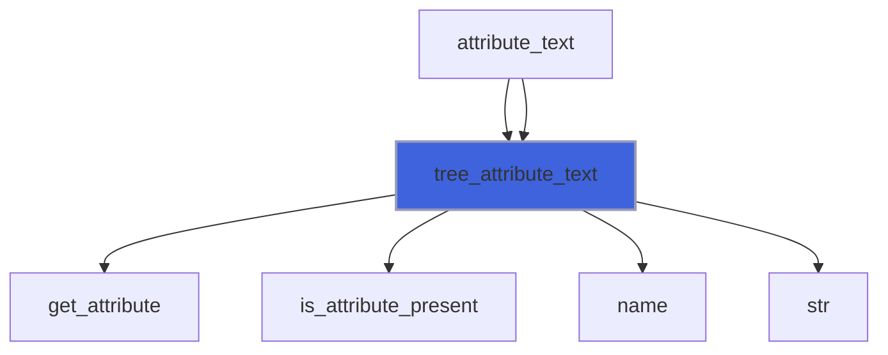

### tree_build_children

Build the children IDs lists (in document order) of all tags from their parents IDs, in O(n).

 @note Appending each child to its parent list while parsing costs O(children^2) for a parent with many children.

**Attributes**: pure

```fortran
subroutine tree_build_children(tag, nt)
```

**Arguments**

| Name | Type | Intent | Attributes | Description |
|------|------|--------|------------|-------------|
| `tag` | type([xml_tag](/api/src/third_party/FoXy/src/lib/foxy_xml_tag#xml-tag)) | inout | allocatable | Tags. |
| `nt` | integer(kind=[I4P](/api/src/third_party/PENF/src/lib/penf_global_parameters_variables)) | in |  | Number of tags. |

**Call graph**

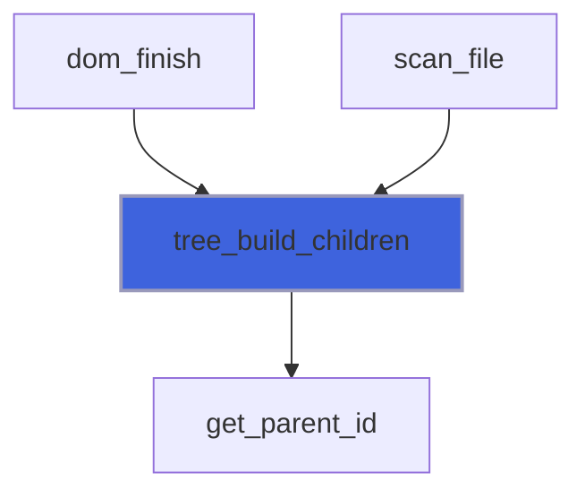

### tree_select

Select the tags matching a path *expression* (an XPath subset), returning their IDs in document order.

 Grammar: steps separated by `/` (the next step matches the direct children) or `//` (the descendants, at any
 depth); a leading `/` anchors the first step to the root tags, a leading `//` or none searches it at any depth (as
 *tree_find_all* does with a path). A step is a name test (a name, `*` for any name, `{uri}local` in Clark notation;
 prefixes resolved by *namespaces* if passed, see *tree_find_all*) followed by predicates, applied in order:

 + `[@a]`: the tag has the attribute *a*;
 + `[@a="v"]` (or `'v'`): the value of *a* (decoded, as *tree_attribute* returns it) is *v*;
 + `[@a~="re"]`: the value of *a* matches the regular expression *re* (StringiFor `regex`, anywhere);
 + `[n]`: the *n*-th tag (from 1) among its siblings that passed the previous predicates (as XPath: `//b[1]` is the
   first *b* child of each parent).

 Blanks are allowed around the predicate tokens only. A malformed expression (or regular expression) selects nothing:
 *column* is the column of the problem (0 if there is none) and *message* says what it is.

 @note Not pure: the regular expressions of the predicates are compiled (StringiFor `regex%compile`).

```fortran
subroutine tree_select(tag, nt, expression, namespaces, ids, column, message)
```

**Arguments**

| Name | Type | Intent | Attributes | Description |
|------|------|--------|------------|-------------|
| `tag` | type([xml_tag](/api/src/third_party/FoXy/src/lib/foxy_xml_tag#xml-tag)) | in | allocatable | Tags. |
| `nt` | integer(kind=[I4P](/api/src/third_party/PENF/src/lib/penf_global_parameters_variables)) | in |  | Number of tags. |
| `expression` | character(len=*) | in |  | Path expression, e.g. `//event[@type="x"]/origin`. |
| `namespaces` | character(len=*) | in | optional | Namespaces declarations of the names prefixes. |
| `ids` | integer(kind=[I4P](/api/src/third_party/PENF/src/lib/penf_global_parameters_variables)) | out | allocatable | Selected tags IDs, empty if there are none. |
| `column` | integer(kind=[I4P](/api/src/third_party/PENF/src/lib/penf_global_parameters_variables)) | out |  | Column of the problem, 0 if there is none. |
| `message` | character(len=:) | out | allocatable | Problem message, empty if there is none. |

**Call graph**

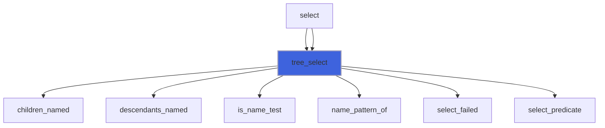

### select_failed

Report a problem of a selector expression at column *at*, selecting nothing.

```fortran
subroutine select_failed(expression, ids, column, message, at, what)
```

**Arguments**

| Name | Type | Intent | Attributes | Description |
|------|------|--------|------------|-------------|
| `expression` | character(len=*) | in |  | Path expression. |
| `ids` | integer(kind=[I4P](/api/src/third_party/PENF/src/lib/penf_global_parameters_variables)) | inout | allocatable | Selected tags IDs, emptied. |
| `column` | integer(kind=[I4P](/api/src/third_party/PENF/src/lib/penf_global_parameters_variables)) | out |  | Column of the problem. |
| `message` | character(len=:) | out | allocatable | Problem message. |
| `at` | integer(kind=[I4P](/api/src/third_party/PENF/src/lib/penf_global_parameters_variables)) | in |  | Column of the problem. |
| `what` | character(len=*) | in |  | Problem. |

**Call graph**

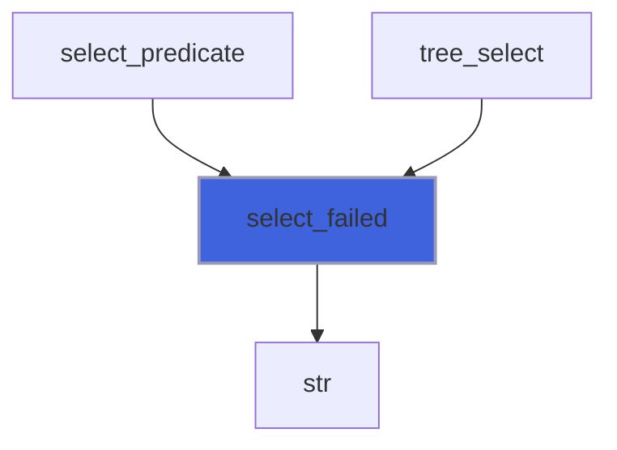

### skip_blanks

Skip the blanks of *expression* from column *c*.

**Attributes**: pure

```fortran
subroutine skip_blanks(expression, c)
```

**Arguments**

| Name | Type | Intent | Attributes | Description |
|------|------|--------|------------|-------------|
| `expression` | character(len=*) | in |  | Path expression. |
| `c` | integer(kind=[I4P](/api/src/third_party/PENF/src/lib/penf_global_parameters_variables)) | inout |  | Current column. |

**Call graph**

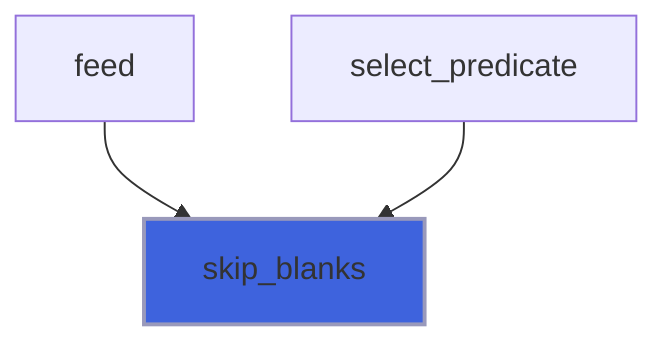

### select_predicate

Parse the predicate of a selector expression at column *c* (a `[`), moving *c* after it, and filter the selected
 tags by it (see *tree_select*); a problem empties *ids* and sets *column* and *message*.

```fortran
subroutine select_predicate(tag, nt, expression, c, ids, column, message)
```

**Arguments**

| Name | Type | Intent | Attributes | Description |
|------|------|--------|------------|-------------|
| `tag` | type([xml_tag](/api/src/third_party/FoXy/src/lib/foxy_xml_tag#xml-tag)) | in | allocatable | Tags. |
| `nt` | integer(kind=[I4P](/api/src/third_party/PENF/src/lib/penf_global_parameters_variables)) | in |  | Number of tags. |
| `expression` | character(len=*) | in |  | Path expression. |
| `c` | integer(kind=[I4P](/api/src/third_party/PENF/src/lib/penf_global_parameters_variables)) | inout |  | Current column. |
| `ids` | integer(kind=[I4P](/api/src/third_party/PENF/src/lib/penf_global_parameters_variables)) | inout | allocatable | Selected tags IDs. |
| `column` | integer(kind=[I4P](/api/src/third_party/PENF/src/lib/penf_global_parameters_variables)) | inout |  | Column of the problem, 0 if there is none. |
| `message` | character(len=:) | inout | allocatable | Problem message. |

**Call graph**

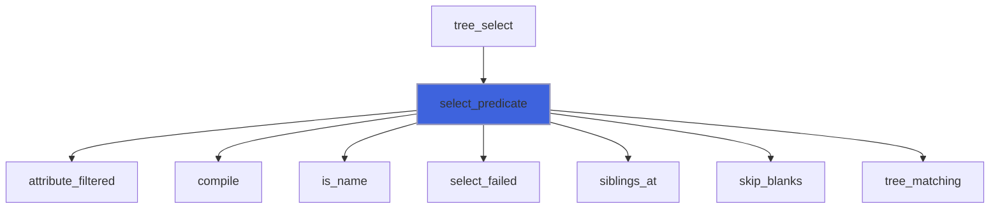

### merge_sort

Sort IDs in increasing order (merge sort, O(n log n)).

**Attributes**: pure, recursive

```fortran
subroutine merge_sort(ids)
```

**Arguments**

| Name | Type | Intent | Attributes | Description |
|------|------|--------|------------|-------------|
| `ids` | integer(kind=[I4P](/api/src/third_party/PENF/src/lib/penf_global_parameters_variables)) | inout |  | IDs. |

**Call graph**

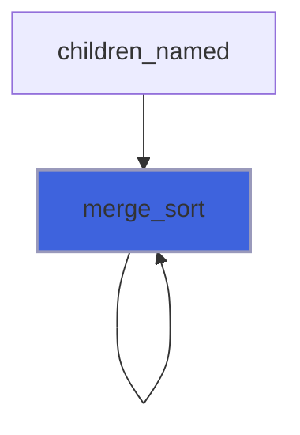

### resolve_namespace

Resolve the namespace of the tag with ID *id* (see *tree_namespace*); *is_declared* is false for a prefix not
 declared or a tag that does not exist.

**Attributes**: pure

```fortran
subroutine resolve_namespace(tag, nt, id, uri, is_declared)
```

**Arguments**

| Name | Type | Intent | Attributes | Description |
|------|------|--------|------------|-------------|
| `tag` | type([xml_tag](/api/src/third_party/FoXy/src/lib/foxy_xml_tag#xml-tag)) | in | allocatable | Tags. |
| `nt` | integer(kind=[I4P](/api/src/third_party/PENF/src/lib/penf_global_parameters_variables)) | in |  | Number of tags. |
| `id` | integer(kind=[I4P](/api/src/third_party/PENF/src/lib/penf_global_parameters_variables)) | in |  | Tag ID. |
| `uri` | character(len=:) | out | allocatable | Namespace, empty for no namespace. |
| `is_declared` | logical | out |  | The namespace is declared. |

**Call graph**

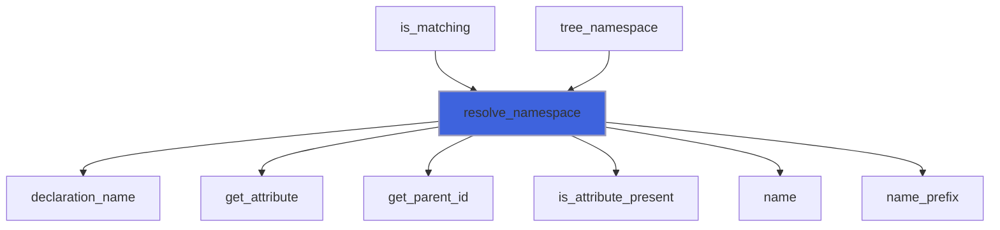

### next_path_segment

Pop the next not empty `/`-separated segment from a tags path; a `/` between braces (a namespace in Clark notation)
 is not a separator.

**Attributes**: pure

```fortran
subroutine next_path_segment(rest, segment)
```

**Arguments**

| Name | Type | Intent | Attributes | Description |
|------|------|--------|------------|-------------|
| `rest` | character(len=:) | inout | allocatable | Path segments still to pop. |
| `segment` | character(len=:) | out | allocatable | Popped segment, empty if there are no more. |

**Call graph**

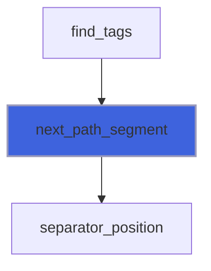

## Functions

### tree_attribute_name

Return the name of the attribute with index *a* (source order) of the tag with ID *id*, empty if it does not exist.

**Attributes**: pure

**Returns**: `character(len=:)`

```fortran
function tree_attribute_name(tag, nt, id, a) result(name)
```

**Arguments**

| Name | Type | Intent | Attributes | Description |
|------|------|--------|------------|-------------|
| `tag` | type([xml_tag](/api/src/third_party/FoXy/src/lib/foxy_xml_tag#xml-tag)) | in | allocatable | Tags. |
| `nt` | integer(kind=[I4P](/api/src/third_party/PENF/src/lib/penf_global_parameters_variables)) | in |  | Number of tags. |
| `id` | integer(kind=[I4P](/api/src/third_party/PENF/src/lib/penf_global_parameters_variables)) | in |  | Tag ID. |
| `a` | integer(kind=[I4P](/api/src/third_party/PENF/src/lib/penf_global_parameters_variables)) | in |  | Attribute index. |

**Call graph**

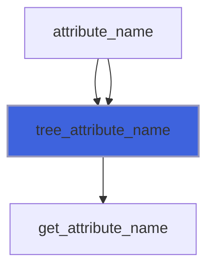

### tree_attributes_number

Return the number of attributes of the tag with ID *id*, 0 if it does not exist.

**Attributes**: pure

**Returns**: integer(kind=[I4P](/api/src/third_party/PENF/src/lib/penf_global_parameters_variables))

```fortran
function tree_attributes_number(tag, nt, id) result(number)
```

**Arguments**

| Name | Type | Intent | Attributes | Description |
|------|------|--------|------------|-------------|
| `tag` | type([xml_tag](/api/src/third_party/FoXy/src/lib/foxy_xml_tag#xml-tag)) | in | allocatable | Tags. |
| `nt` | integer(kind=[I4P](/api/src/third_party/PENF/src/lib/penf_global_parameters_variables)) | in |  | Number of tags. |
| `id` | integer(kind=[I4P](/api/src/third_party/PENF/src/lib/penf_global_parameters_variables)) | in |  | Tag ID. |

**Call graph**

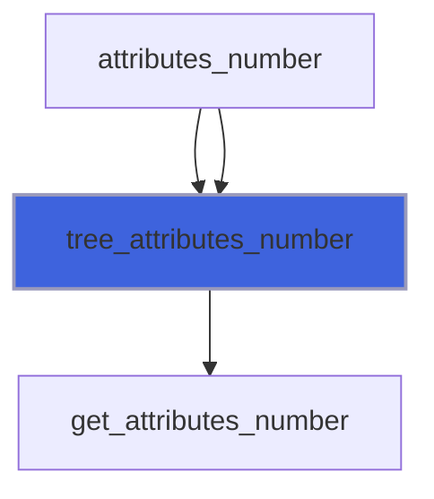

### tree_attribute

Return the value of the attribute named *name* of the tag with ID *id*.

 @note If the tag or the attribute does not exist, an empty string is returned.

**Attributes**: pure

**Returns**: `character(len=:)`

```fortran
function tree_attribute(tag, nt, id, name) result(value)
```

**Arguments**

| Name | Type | Intent | Attributes | Description |
|------|------|--------|------------|-------------|
| `tag` | type([xml_tag](/api/src/third_party/FoXy/src/lib/foxy_xml_tag#xml-tag)) | in | allocatable | Tags. |
| `nt` | integer(kind=[I4P](/api/src/third_party/PENF/src/lib/penf_global_parameters_variables)) | in |  | Number of tags. |
| `id` | integer(kind=[I4P](/api/src/third_party/PENF/src/lib/penf_global_parameters_variables)) | in |  | Tag ID. |
| `name` | character(len=*) | in |  | Attribute name. |

**Call graph**


### tree_children

Return the IDs of the direct children of the tag with ID *id*, in document order.

 @note The ID 0 is the document root: its children are the root tags (a sweep of all the tags); a tag's children
 are its children list, built by *tree_build_children* (the cost is the number of children).

**Attributes**: pure

**Returns**: integer(kind=[I4P](/api/src/third_party/PENF/src/lib/penf_global_parameters_variables))

```fortran
function tree_children(tag, nt, id) result(ids)
```

**Arguments**

| Name | Type | Intent | Attributes | Description |
|------|------|--------|------------|-------------|
| `tag` | type([xml_tag](/api/src/third_party/FoXy/src/lib/foxy_xml_tag#xml-tag)) | in | allocatable | Tags. |
| `nt` | integer(kind=[I4P](/api/src/third_party/PENF/src/lib/penf_global_parameters_variables)) | in |  | Number of tags. |
| `id` | integer(kind=[I4P](/api/src/third_party/PENF/src/lib/penf_global_parameters_variables)) | in |  | Tag ID. |

**Call graph**

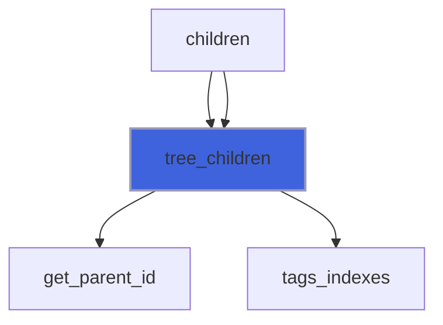

### tree_find_all

Return the IDs of all tags (in document order) matching *name* or *path*.

 Matching rules:

 + *name*: tags named *name* at any depth or, if *parent* is passed, only the direct children of *parent*;
 + *path*: `/`-separated tags names; the first one is matched as *name*, each following one must be a direct child
   of the previous one; all the tags matching a segment are explored, thus repeated parents are handled.

 Names are matched literally (prefix included), except:

 + `{uri}local` (Clark notation): tags with local name *local* in the namespace *uri* (`{}local`: in no namespace),
   whatever their prefix;
 + if *namespaces* is passed, every name: its prefix is resolved by the declarations of *namespaces*, written as in
   XML (e.g. `xmlns="uri1" xmlns:p="uri2"`), not by the document ones; an unprefixed name without a default
   declaration is in no namespace, a prefix not declared matches nothing.

 @note If both *name* and *path* are passed, *path* is used; if none is passed, no tag is returned.

**Attributes**: pure

**Returns**: integer(kind=[I4P](/api/src/third_party/PENF/src/lib/penf_global_parameters_variables))

```fortran
function tree_find_all(tag, nt, name, path, parent, namespaces) result(ids)
```

**Arguments**

| Name | Type | Intent | Attributes | Description |
|------|------|--------|------------|-------------|
| `tag` | type([xml_tag](/api/src/third_party/FoXy/src/lib/foxy_xml_tag#xml-tag)) | in | allocatable | Tags. |
| `nt` | integer(kind=[I4P](/api/src/third_party/PENF/src/lib/penf_global_parameters_variables)) | in |  | Number of tags. |
| `name` | character(len=*) | in | optional | Tag name. |
| `path` | character(len=*) | in | optional | Tags path, e.g. `origin/latitude/value`. |
| `parent` | integer(kind=[I4P](/api/src/third_party/PENF/src/lib/penf_global_parameters_variables)) | in | optional | Parent tag ID, 0 for the document root. |
| `namespaces` | character(len=*) | in | optional | Namespaces declarations of the names prefixes. |

**Call graph**

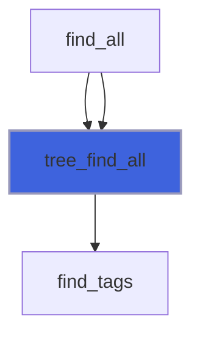

### tree_find

Return the ID of the first tag (in document order) matching *name* or *path* (see *tree_find_all*), 0 if none; a
 name is searched up to its first match only.

**Attributes**: pure

**Returns**: integer(kind=[I4P](/api/src/third_party/PENF/src/lib/penf_global_parameters_variables))

```fortran
function tree_find(tag, nt, name, path, parent, namespaces) result(id)
```

**Arguments**

| Name | Type | Intent | Attributes | Description |
|------|------|--------|------------|-------------|
| `tag` | type([xml_tag](/api/src/third_party/FoXy/src/lib/foxy_xml_tag#xml-tag)) | in | allocatable | Tags. |
| `nt` | integer(kind=[I4P](/api/src/third_party/PENF/src/lib/penf_global_parameters_variables)) | in |  | Number of tags. |
| `name` | character(len=*) | in | optional | Tag name. |
| `path` | character(len=*) | in | optional | Tags path, e.g. `origin/latitude/value`. |
| `parent` | integer(kind=[I4P](/api/src/third_party/PENF/src/lib/penf_global_parameters_variables)) | in | optional | Parent tag ID, 0 for the document root. |
| `namespaces` | character(len=*) | in | optional | Namespaces declarations of the names prefixes. |

**Call graph**

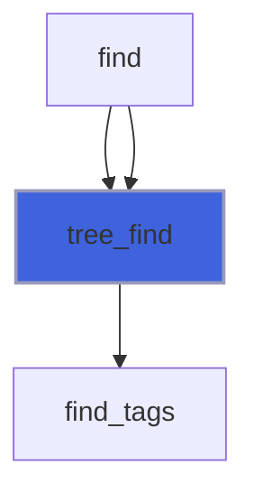

### tree_level

Return the level of the tag with ID *id* (1 for a root tag), 0 if it does not exist.

**Attributes**: pure

**Returns**: integer(kind=[I4P](/api/src/third_party/PENF/src/lib/penf_global_parameters_variables))

```fortran
function tree_level(tag, nt, id) result(level)
```

**Arguments**

| Name | Type | Intent | Attributes | Description |
|------|------|--------|------------|-------------|
| `tag` | type([xml_tag](/api/src/third_party/FoXy/src/lib/foxy_xml_tag#xml-tag)) | in | allocatable | Tags. |
| `nt` | integer(kind=[I4P](/api/src/third_party/PENF/src/lib/penf_global_parameters_variables)) | in |  | Number of tags. |
| `id` | integer(kind=[I4P](/api/src/third_party/PENF/src/lib/penf_global_parameters_variables)) | in |  | Tag ID. |

**Call graph**

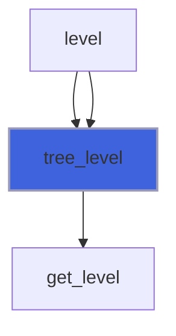

### tree_local_name

Return the local name (the name without prefix) of the tag with ID *id*, an empty string if it does not exist.

**Attributes**: pure

**Returns**: `character(len=:)`

```fortran
function tree_local_name(tag, nt, id) result(local_name)
```

**Arguments**

| Name | Type | Intent | Attributes | Description |
|------|------|--------|------------|-------------|
| `tag` | type([xml_tag](/api/src/third_party/FoXy/src/lib/foxy_xml_tag#xml-tag)) | in | allocatable | Tags. |
| `nt` | integer(kind=[I4P](/api/src/third_party/PENF/src/lib/penf_global_parameters_variables)) | in |  | Number of tags. |
| `id` | integer(kind=[I4P](/api/src/third_party/PENF/src/lib/penf_global_parameters_variables)) | in |  | Tag ID. |

**Call graph**

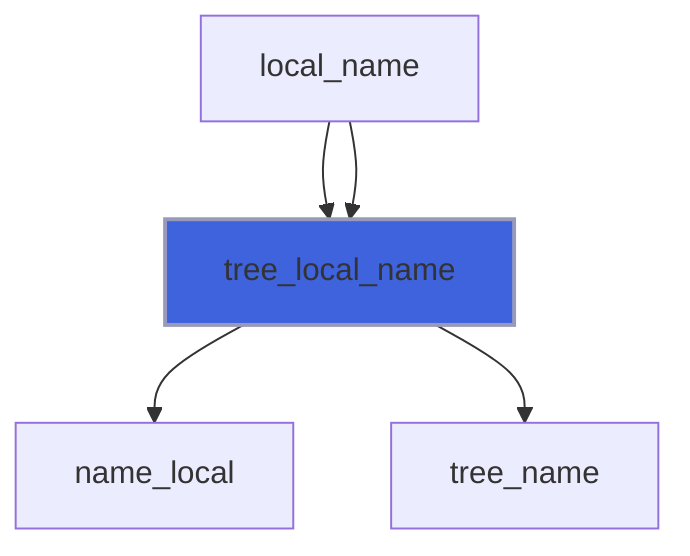

### tree_matching

Return the IDs of *ids* (in their order) whose name (*on*=`name`) or the value of *attribute* (*on*=`attribute`)
 matches the compiled regular expression *re* (anywhere, or the whole text with *whole*); a tag without the attribute
 never matches, a regex not compiled matches nothing.

**Attributes**: pure

**Returns**: integer(kind=[I4P](/api/src/third_party/PENF/src/lib/penf_global_parameters_variables))

```fortran
function tree_matching(tag, nt, ids, re, on, attribute, whole) result(matched)
```

**Arguments**

| Name | Type | Intent | Attributes | Description |
|------|------|--------|------------|-------------|
| `tag` | type([xml_tag](/api/src/third_party/FoXy/src/lib/foxy_xml_tag#xml-tag)) | in | allocatable | Tags. |
| `nt` | integer(kind=[I4P](/api/src/third_party/PENF/src/lib/penf_global_parameters_variables)) | in |  | Number of tags. |
| `ids` | integer(kind=[I4P](/api/src/third_party/PENF/src/lib/penf_global_parameters_variables)) | in |  | Tags IDs to filter. |
| `re` | type([regex](/api/src/third_party/StringiFor/src/lib/stringifor_regex#regex)) | in |  | Compiled regular expression. |
| `on` | character(len=*) | in |  | What is matched: `name` or `attribute`. |
| `attribute` | character(len=*) | in |  | Attribute name (with *on*=`attribute`). |
| `whole` | logical | in |  | Match the whole text, not a part of it. |

**Call graph**

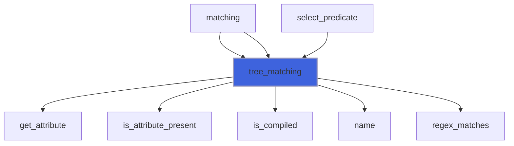

### regex_matches

Return true if the compiled regular expression *re* matches a part of *subject* (the whole of it with *whole*).

**Attributes**: pure

**Returns**: `logical`

```fortran
function regex_matches(re, subject, whole) result(is_match)
```

**Arguments**

| Name | Type | Intent | Attributes | Description |
|------|------|--------|------------|-------------|
| `re` | type([regex](/api/src/third_party/StringiFor/src/lib/stringifor_regex#regex)) | in |  | Compiled regular expression. |
| `subject` | character(len=*) | in |  | Subject. |
| `whole` | logical | in |  | Match the whole subject. |

**Call graph**

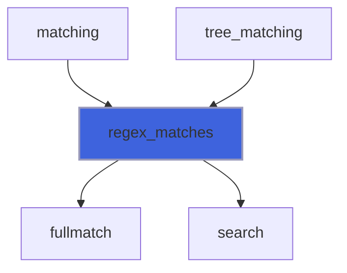

### tree_name

Return the name of the tag with ID *id*, an empty string if it does not exist.

**Attributes**: pure

**Returns**: `character(len=:)`

```fortran
function tree_name(tag, nt, id) result(name)
```

**Arguments**

| Name | Type | Intent | Attributes | Description |
|------|------|--------|------------|-------------|
| `tag` | type([xml_tag](/api/src/third_party/FoXy/src/lib/foxy_xml_tag#xml-tag)) | in | allocatable | Tags. |
| `nt` | integer(kind=[I4P](/api/src/third_party/PENF/src/lib/penf_global_parameters_variables)) | in |  | Number of tags. |
| `id` | integer(kind=[I4P](/api/src/third_party/PENF/src/lib/penf_global_parameters_variables)) | in |  | Tag ID. |

**Call graph**

```mermaid
flowchart TD
  name["name"] --> tree_name["tree_name"]
  name["name"] --> tree_name["tree_name"]
  tree_local_name["tree_local_name"] --> tree_name["tree_name"]
  tree_prefix["tree_prefix"] --> tree_name["tree_name"]
  tree_name["tree_name"] --> name["name"]
  style tree_name fill:#3e63dd,stroke:#99b,stroke-width:2px
```

### tree_namespace

Return the namespace of the tag with ID *id*: the value of the nearest declaration of its prefix (`xmlns:prefix`,
 or `xmlns` for an unprefixed name) on the tag or on its ancestors; the *xml* prefix is bound to its namespace.

 @note An empty string is returned for a tag in no namespace (unprefixed, without a default namespace declaration
 or with `xmlns=""`), for a prefix not declared and if the tag does not exist. A prefix cannot be declared empty
 (XML 1.0), thus a prefixed tag without namespace has its prefix not declared.

**Attributes**: pure

**Returns**: `character(len=:)`

```fortran
function tree_namespace(tag, nt, id) result(uri)
```

**Arguments**

| Name | Type | Intent | Attributes | Description |
|------|------|--------|------------|-------------|
| `tag` | type([xml_tag](/api/src/third_party/FoXy/src/lib/foxy_xml_tag#xml-tag)) | in | allocatable | Tags. |
| `nt` | integer(kind=[I4P](/api/src/third_party/PENF/src/lib/penf_global_parameters_variables)) | in |  | Number of tags. |
| `id` | integer(kind=[I4P](/api/src/third_party/PENF/src/lib/penf_global_parameters_variables)) | in |  | Tag ID. |

**Call graph**

```mermaid
flowchart TD
  namespace["namespace"] --> tree_namespace["tree_namespace"]
  namespace["namespace"] --> tree_namespace["tree_namespace"]
  tree_namespace["tree_namespace"] --> resolve_namespace["resolve_namespace"]
  style tree_namespace fill:#3e63dd,stroke:#99b,stroke-width:2px
```

### tree_parent

Return the parent ID of the tag with ID *id* (0 for a root tag or if the tag does not exist).

**Attributes**: pure

**Returns**: integer(kind=[I4P](/api/src/third_party/PENF/src/lib/penf_global_parameters_variables))

```fortran
function tree_parent(tag, nt, id) result(parent)
```

**Arguments**

| Name | Type | Intent | Attributes | Description |
|------|------|--------|------------|-------------|
| `tag` | type([xml_tag](/api/src/third_party/FoXy/src/lib/foxy_xml_tag#xml-tag)) | in | allocatable | Tags. |
| `nt` | integer(kind=[I4P](/api/src/third_party/PENF/src/lib/penf_global_parameters_variables)) | in |  | Number of tags. |
| `id` | integer(kind=[I4P](/api/src/third_party/PENF/src/lib/penf_global_parameters_variables)) | in |  | Tag ID. |

**Call graph**

```mermaid
flowchart TD
  parent["parent"] --> tree_parent["tree_parent"]
  parent["parent"] --> tree_parent["tree_parent"]
  tree_parent["tree_parent"] --> get_parent_id["get_parent_id"]
  style tree_parent fill:#3e63dd,stroke:#99b,stroke-width:2px
```

### tree_prefix

Return the prefix of the name of the tag with ID *id*, an empty string if it has none or it does not exist.

**Attributes**: pure

**Returns**: `character(len=:)`

```fortran
function tree_prefix(tag, nt, id) result(prefix)
```

**Arguments**

| Name | Type | Intent | Attributes | Description |
|------|------|--------|------------|-------------|
| `tag` | type([xml_tag](/api/src/third_party/FoXy/src/lib/foxy_xml_tag#xml-tag)) | in | allocatable | Tags. |
| `nt` | integer(kind=[I4P](/api/src/third_party/PENF/src/lib/penf_global_parameters_variables)) | in |  | Number of tags. |
| `id` | integer(kind=[I4P](/api/src/third_party/PENF/src/lib/penf_global_parameters_variables)) | in |  | Tag ID. |

**Call graph**

```mermaid
flowchart TD
  prefix["prefix"] --> tree_prefix["tree_prefix"]
  prefix["prefix"] --> tree_prefix["tree_prefix"]
  tree_prefix["tree_prefix"] --> name_prefix["name_prefix"]
  tree_prefix["tree_prefix"] --> tree_name["tree_name"]
  style tree_prefix fill:#3e63dd,stroke:#99b,stroke-width:2px
```

### tags_indexes

Return the tags indexes [1:nt].

**Attributes**: pure

**Returns**: integer(kind=[I4P](/api/src/third_party/PENF/src/lib/penf_global_parameters_variables))

```fortran
function tags_indexes(nt) result(indexes)
```

**Arguments**

| Name | Type | Intent | Attributes | Description |
|------|------|--------|------------|-------------|
| `nt` | integer(kind=[I4P](/api/src/third_party/PENF/src/lib/penf_global_parameters_variables)) | in |  | Number of tags. |

**Call graph**

```mermaid
flowchart TD
  matching["matching"] --> tags_indexes["tags_indexes"]
  matching["matching"] --> tags_indexes["tags_indexes"]
  tree_children["tree_children"] --> tags_indexes["tags_indexes"]
  style tags_indexes fill:#3e63dd,stroke:#99b,stroke-width:2px
```

### attribute_filtered

Return the IDs of *ids* (in their order) having the attribute *attribute* (valued *value*, if *is_valued*).

**Attributes**: pure

**Returns**: integer(kind=[I4P](/api/src/third_party/PENF/src/lib/penf_global_parameters_variables))

```fortran
function attribute_filtered(tag, nt, ids, attribute, is_valued, value) result(filtered)
```

**Arguments**

| Name | Type | Intent | Attributes | Description |
|------|------|--------|------------|-------------|
| `tag` | type([xml_tag](/api/src/third_party/FoXy/src/lib/foxy_xml_tag#xml-tag)) | in | allocatable | Tags. |
| `nt` | integer(kind=[I4P](/api/src/third_party/PENF/src/lib/penf_global_parameters_variables)) | in |  | Number of tags. |
| `ids` | integer(kind=[I4P](/api/src/third_party/PENF/src/lib/penf_global_parameters_variables)) | in |  | Tags IDs to filter. |
| `attribute` | character(len=*) | in |  | Attribute name. |
| `is_valued` | logical | in |  | The attribute value is checked. |
| `value` | character(len=:) | in | allocatable | Attribute value (with *is_valued*). |

**Call graph**

```mermaid
flowchart TD
  select_predicate["select_predicate"] --> attribute_filtered["attribute_filtered"]
  attribute_filtered["attribute_filtered"] --> get_attribute["get_attribute"]
  attribute_filtered["attribute_filtered"] --> is_attribute_present["is_attribute_present"]
  style attribute_filtered fill:#3e63dd,stroke:#99b,stroke-width:2px
```

### descendants_named

Return the IDs (in document order) of the tags matching *pattern* that are descendants of any of *contexts*.

 @note A child ID is greater than its parent one, but a subtree is not a range of IDs (a built document numbers tags
 in insertion order): one forward sweep flags the tags in a subtree of the contexts, a descendant has a flagged
 parent.

**Attributes**: pure

**Returns**: integer(kind=[I4P](/api/src/third_party/PENF/src/lib/penf_global_parameters_variables))

```fortran
function descendants_named(tag, nt, contexts, pattern) result(ids)
```

**Arguments**

| Name | Type | Intent | Attributes | Description |
|------|------|--------|------------|-------------|
| `tag` | type([xml_tag](/api/src/third_party/FoXy/src/lib/foxy_xml_tag#xml-tag)) | in | allocatable | Tags. |
| `nt` | integer(kind=[I4P](/api/src/third_party/PENF/src/lib/penf_global_parameters_variables)) | in |  | Number of tags. |
| `contexts` | integer(kind=[I4P](/api/src/third_party/PENF/src/lib/penf_global_parameters_variables)) | in |  | Context IDs (distinct), 0 for the document. |
| `pattern` | type([name_pattern](/api/src/third_party/FoXy/src/lib/foxy_xml_tree#name-pattern)) | in |  | Tag name to match. |

**Call graph**

```mermaid
flowchart TD
  tree_select["tree_select"] --> descendants_named["descendants_named"]
  descendants_named["descendants_named"] --> get_parent_id["get_parent_id"]
  descendants_named["descendants_named"] --> is_matching["is_matching"]
  style descendants_named fill:#3e63dd,stroke:#99b,stroke-width:2px
```

### siblings_at

Return the IDs of *ids* (in document order) that are the *position*-th among the ones of *ids* with the same parent.

**Attributes**: pure

**Returns**: integer(kind=[I4P](/api/src/third_party/PENF/src/lib/penf_global_parameters_variables))

```fortran
function siblings_at(tag, nt, ids, position) result(selected)
```

**Arguments**

| Name | Type | Intent | Attributes | Description |
|------|------|--------|------------|-------------|
| `tag` | type([xml_tag](/api/src/third_party/FoXy/src/lib/foxy_xml_tag#xml-tag)) | in | allocatable | Tags. |
| `nt` | integer(kind=[I4P](/api/src/third_party/PENF/src/lib/penf_global_parameters_variables)) | in |  | Number of tags. |
| `ids` | integer(kind=[I4P](/api/src/third_party/PENF/src/lib/penf_global_parameters_variables)) | in |  | Tags IDs (in document order). |
| `position` | integer(kind=[I4P](/api/src/third_party/PENF/src/lib/penf_global_parameters_variables)) | in |  | Position among the siblings, from 1. |

**Call graph**

```mermaid
flowchart TD
  select_predicate["select_predicate"] --> siblings_at["siblings_at"]
  siblings_at["siblings_at"] --> get_parent_id["get_parent_id"]
  style siblings_at fill:#3e63dd,stroke:#99b,stroke-width:2px
```

### is_name_test

Return true if *test* is a valid name test of a selector step: `*`, a name, or `{uri}local`.

**Attributes**: pure

**Returns**: `logical`

```fortran
function is_name_test(test) result(is_valid)
```

**Arguments**

| Name | Type | Intent | Attributes | Description |
|------|------|--------|------------|-------------|
| `test` | character(len=*) | in |  | Name test (not empty). |

**Call graph**

```mermaid
flowchart TD
  tree_select["tree_select"] --> is_name_test["is_name_test"]
  is_name_test["is_name_test"] --> is_name["is_name"]
  style is_name_test fill:#3e63dd,stroke:#99b,stroke-width:2px
```

### find_tags

Return the IDs of the tags (in document order) matching *name* or *path* (see *tree_find_all*), only the first one
 if *is_first*.

**Attributes**: pure

**Returns**: integer(kind=[I4P](/api/src/third_party/PENF/src/lib/penf_global_parameters_variables))

```fortran
function find_tags(tag, nt, name, path, parent, namespaces, is_first) result(ids)
```

**Arguments**

| Name | Type | Intent | Attributes | Description |
|------|------|--------|------------|-------------|
| `tag` | type([xml_tag](/api/src/third_party/FoXy/src/lib/foxy_xml_tag#xml-tag)) | in | allocatable | Tags. |
| `nt` | integer(kind=[I4P](/api/src/third_party/PENF/src/lib/penf_global_parameters_variables)) | in |  | Number of tags. |
| `name` | character(len=*) | in | optional | Tag name. |
| `path` | character(len=*) | in | optional | Tags path, e.g. `origin/latitude/value`. |
| `parent` | integer(kind=[I4P](/api/src/third_party/PENF/src/lib/penf_global_parameters_variables)) | in | optional | Parent tag ID, 0 for the document root. |
| `namespaces` | character(len=*) | in | optional | Namespaces declarations of the names prefixes. |
| `is_first` | logical | in |  | Only the first match is needed. |

**Call graph**

```mermaid
flowchart TD
  tree_find["tree_find"] --> find_tags["find_tags"]
  tree_find_all["tree_find_all"] --> find_tags["find_tags"]
  find_tags["find_tags"] --> children_named["children_named"]
  find_tags["find_tags"] --> is_matching["is_matching"]
  find_tags["find_tags"] --> name_pattern_of["name_pattern_of"]
  find_tags["find_tags"] --> next_path_segment["next_path_segment"]
  style find_tags fill:#3e63dd,stroke:#99b,stroke-width:2px
```

### children_named

Return the IDs (in document order) of the tags matching *pattern* that are direct children of any of *parents* (only
 the first one if *is_first*, for a single parent).

 @note The children lists of the parents are walked (the roots, for parent 0, by a sweep): the cost is the number of
 children, not of tags. Children of different parents are sorted if needed (nested parents interleave them).

**Attributes**: pure

**Returns**: integer(kind=[I4P](/api/src/third_party/PENF/src/lib/penf_global_parameters_variables))

```fortran
function children_named(tag, nt, parents, pattern, is_first) result(ids)
```

**Arguments**

| Name | Type | Intent | Attributes | Description |
|------|------|--------|------------|-------------|
| `tag` | type([xml_tag](/api/src/third_party/FoXy/src/lib/foxy_xml_tag#xml-tag)) | in | allocatable | Tags. |
| `nt` | integer(kind=[I4P](/api/src/third_party/PENF/src/lib/penf_global_parameters_variables)) | in |  | Number of tags. |
| `parents` | integer(kind=[I4P](/api/src/third_party/PENF/src/lib/penf_global_parameters_variables)) | in |  | Parents IDs (in document order, distinct), 0 for the root. |
| `pattern` | type([name_pattern](/api/src/third_party/FoXy/src/lib/foxy_xml_tree#name-pattern)) | in |  | Tag name to match. |
| `is_first` | logical | in |  | Only the first match is needed. |

**Call graph**

```mermaid
flowchart TD
  find_tags["find_tags"] --> children_named["children_named"]
  tree_select["tree_select"] --> children_named["children_named"]
  children_named["children_named"] --> get_parent_id["get_parent_id"]
  children_named["children_named"] --> is_matching["is_matching"]
  children_named["children_named"] --> merge_sort["merge_sort"]
  style children_named fill:#3e63dd,stroke:#99b,stroke-width:2px
```

### declaration_name

Return the name of the attribute declaring the namespace of *prefix* (`xmlns` for no prefix).

**Attributes**: pure

**Returns**: `character(len=:)`

```fortran
function declaration_name(prefix) result(name)
```

**Arguments**

| Name | Type | Intent | Attributes | Description |
|------|------|--------|------------|-------------|
| `prefix` | character(len=*) | in |  | Prefix. |

**Call graph**

```mermaid
flowchart TD
  name_pattern_of["name_pattern_of"] --> declaration_name["declaration_name"]
  resolve_namespace["resolve_namespace"] --> declaration_name["declaration_name"]
  style declaration_name fill:#3e63dd,stroke:#99b,stroke-width:2px
```

### is_matching

Return true if the tag with ID *id* matches *pattern*; an expanded name is checked on the local name first, the
 namespace (resolved through the ancestors) only if the local name matches.

**Attributes**: pure

**Returns**: `logical`

```fortran
function is_matching(tag, nt, id, pattern) result(is_match)
```

**Arguments**

| Name | Type | Intent | Attributes | Description |
|------|------|--------|------------|-------------|
| `tag` | type([xml_tag](/api/src/third_party/FoXy/src/lib/foxy_xml_tag#xml-tag)) | in | allocatable | Tags. |
| `nt` | integer(kind=[I4P](/api/src/third_party/PENF/src/lib/penf_global_parameters_variables)) | in |  | Number of tags. |
| `id` | integer(kind=[I4P](/api/src/third_party/PENF/src/lib/penf_global_parameters_variables)) | in |  | Tag ID. |
| `pattern` | type([name_pattern](/api/src/third_party/FoXy/src/lib/foxy_xml_tree#name-pattern)) | in |  | Tag name to match. |

**Call graph**

```mermaid
flowchart TD
  children_named["children_named"] --> is_matching["is_matching"]
  descendants_named["descendants_named"] --> is_matching["is_matching"]
  find_tags["find_tags"] --> is_matching["is_matching"]
  is_matching["is_matching"] --> is_named["is_named"]
  is_matching["is_matching"] --> name["name"]
  is_matching["is_matching"] --> name_local["name_local"]
  is_matching["is_matching"] --> resolve_namespace["resolve_namespace"]
  style is_matching fill:#3e63dd,stroke:#99b,stroke-width:2px
```

### name_local

Return the local name of a (qualified) name, `prefix:local`.

**Attributes**: pure

**Returns**: `character(len=:)`

```fortran
function name_local(name) result(local_name)
```

**Arguments**

| Name | Type | Intent | Attributes | Description |
|------|------|--------|------------|-------------|
| `name` | character(len=*) | in |  | Name. |

**Call graph**

```mermaid
flowchart TD
  is_matching["is_matching"] --> name_local["name_local"]
  name_pattern_of["name_pattern_of"] --> name_local["name_local"]
  tree_local_name["tree_local_name"] --> name_local["name_local"]
  style name_local fill:#3e63dd,stroke:#99b,stroke-width:2px
```

### name_pattern_of

Return the pattern matching *name*: expanded if *name* is in Clark notation (`{uri}local`) or if *is_mapped* (its
 prefix resolved by *declarations*), literal otherwise.

**Attributes**: pure

**Returns**: type([name_pattern](/api/src/third_party/FoXy/src/lib/foxy_xml_tree#name-pattern))

```fortran
function name_pattern_of(name, declarations, is_mapped) result(pattern)
```

**Arguments**

| Name | Type | Intent | Attributes | Description |
|------|------|--------|------------|-------------|
| `name` | character(len=*) | in |  | Name (not empty). |
| `declarations` | type([xml_tag](/api/src/third_party/FoXy/src/lib/foxy_xml_tag#xml-tag)) | in |  | Namespaces declarations, as attributes (used if *is_mapped*). |
| `is_mapped` | logical | in |  | Resolve the name prefix by *declarations*. |

**Call graph**

```mermaid
flowchart TD
  find_tags["find_tags"] --> name_pattern_of["name_pattern_of"]
  tree_select["tree_select"] --> name_pattern_of["name_pattern_of"]
  name_pattern_of["name_pattern_of"] --> declaration_name["declaration_name"]
  name_pattern_of["name_pattern_of"] --> get_attribute["get_attribute"]
  name_pattern_of["name_pattern_of"] --> is_attribute_present["is_attribute_present"]
  name_pattern_of["name_pattern_of"] --> name_local["name_local"]
  name_pattern_of["name_pattern_of"] --> name_prefix["name_prefix"]
  style name_pattern_of fill:#3e63dd,stroke:#99b,stroke-width:2px
```

### name_prefix

Return the prefix of a (qualified) name, `prefix:local`, empty if it has none.

**Attributes**: pure

**Returns**: `character(len=:)`

```fortran
function name_prefix(name) result(prefix)
```

**Arguments**

| Name | Type | Intent | Attributes | Description |
|------|------|--------|------------|-------------|
| `name` | character(len=*) | in |  | Name. |

**Call graph**

```mermaid
flowchart TD
  name_pattern_of["name_pattern_of"] --> name_prefix["name_prefix"]
  resolve_namespace["resolve_namespace"] --> name_prefix["name_prefix"]
  tree_prefix["tree_prefix"] --> name_prefix["name_prefix"]
  style name_prefix fill:#3e63dd,stroke:#99b,stroke-width:2px
```

### separator_position

Return the position of the first `/` of *path* not between braces, 0 if there is none.

**Attributes**: pure

**Returns**: integer(kind=[I4P](/api/src/third_party/PENF/src/lib/penf_global_parameters_variables))

```fortran
function separator_position(path) result(s)
```

**Arguments**

| Name | Type | Intent | Attributes | Description |
|------|------|--------|------------|-------------|
| `path` | character(len=*) | in |  | Tags path. |

**Call graph**

```mermaid
flowchart TD
  next_path_segment["next_path_segment"] --> separator_position["separator_position"]
  style separator_position fill:#3e63dd,stroke:#99b,stroke-width:2px
```
