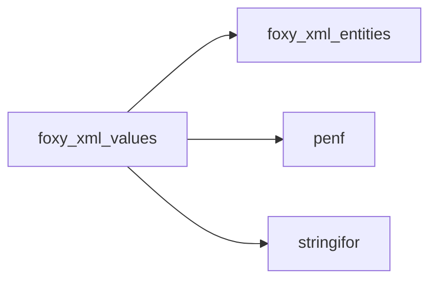
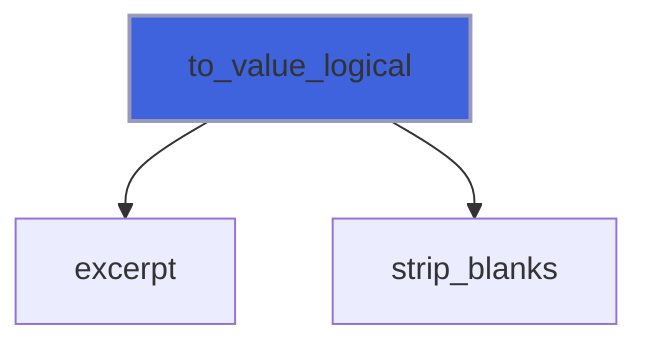
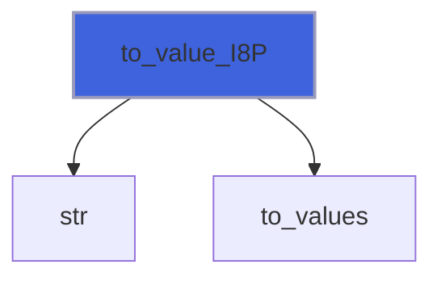
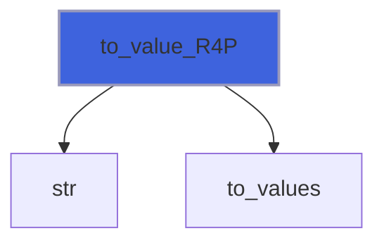
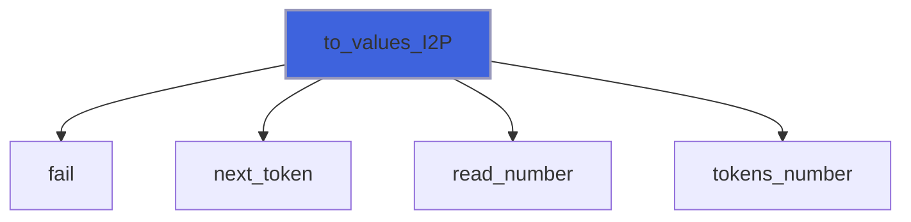
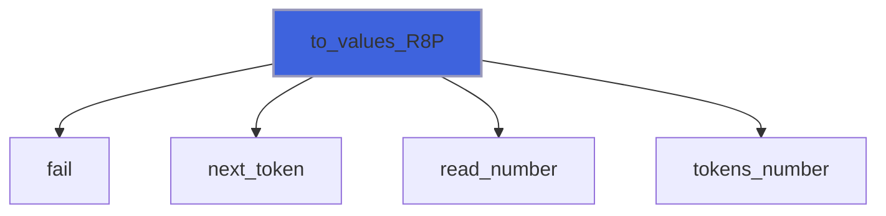
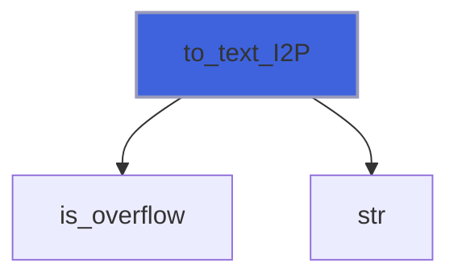
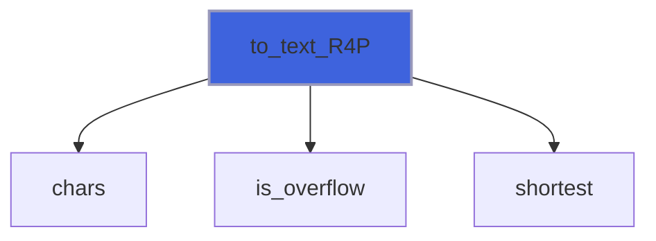

# foxy_xml_values

> FoXy typed values: conversion of attribute values and tag contents into numbers and logicals.

 A text is a list of tokens separated by XML blanks. Each token is converted by StringiFor (`string%read_number`:
 correctly rounded, exact range checks, no `read` statement, the same results with every compiler). An integer token
 must also be digits with an optional sign, as an XML integer: StringiFor would read `1e3` as 1000.

 Logical values are the XML Schema ones: `true`, `false`, `1`, `0`.

**Source**: `src/third_party/FoXy/src/lib/foxy_xml_values.f90`

**Dependencies**



## Contents

- [to_value](#to-value)
- [to_values](#to-values)
- [to_text](#to-text)
- [report](#report)
- [to_value_logical](#to-value-logical)
- [to_value_I1P](#to-value-i1p)
- [to_value_I2P](#to-value-i2p)
- [to_value_I4P](#to-value-i4p)
- [to_value_I8P](#to-value-i8p)
- [to_value_R4P](#to-value-r4p)
- [to_value_R8P](#to-value-r8p)
- [to_values_I1P](#to-values-i1p)
- [to_values_I2P](#to-values-i2p)
- [to_values_I4P](#to-values-i4p)
- [to_values_I8P](#to-values-i8p)
- [to_values_R4P](#to-values-r4p)
- [to_values_R8P](#to-values-r8p)
- [to_text_I1P](#to-text-i1p)
- [to_text_I2P](#to-text-i2p)
- [to_text_I4P](#to-text-i4p)
- [to_text_I8P](#to-text-i8p)
- [to_text_R4P](#to-text-r4p)
- [to_text_R8P](#to-text-r8p)
- [to_text_logical](#to-text-logical)
- [to_text_I1P_1](#to-text-i1p-1)
- [to_text_I2P_1](#to-text-i2p-1)
- [to_text_I4P_1](#to-text-i4p-1)
- [to_text_I8P_1](#to-text-i8p-1)
- [to_text_R4P_1](#to-text-r4p-1)
- [to_text_R8P_1](#to-text-r8p-1)
- [fail](#fail)
- [next_token](#next-token)
- [excerpt](#excerpt)
- [tokens_number](#tokens-number)
- [is_overflow](#is-overflow)

## Variables

| Name | Type | Attributes | Description |
|------|------|------------|-------------|
| `XML_NOT_FOUND` | integer(kind=[I4P](/api/src/third_party/PENF/src/lib/penf_global_parameters_variables)) | parameter | *iostat* of a missing tag or attribute. |
| `XML_BAD_VALUE` | integer(kind=[I4P](/api/src/third_party/PENF/src/lib/penf_global_parameters_variables)) | parameter | *iostat* of a value that is not of the requested type. |
| `EXCERPT_LEN` | integer(kind=[I8P](/api/src/third_party/PENF/src/lib/penf_global_parameters_variables)) | parameter | Max length of a token quoted in a message. |
| `BLANKS` | character(len=*) | parameter | XML blanks: space, tab, new line, CR. |
| `FORMATTED_LEN` | integer | parameter | Length of the buffer of a value formatted by *fmt*. |
| `INTEGER_CHARS` | character(len=*) | parameter | Characters of integer tokens (XML integers). |

## Interfaces

### to_value

Convert a text holding one value.

**Module procedures**: [`to_value_I1P`](/api/src/third_party/FoXy/src/lib/foxy_xml_values#to-value-i1p), [`to_value_I2P`](/api/src/third_party/FoXy/src/lib/foxy_xml_values#to-value-i2p), [`to_value_I4P`](/api/src/third_party/FoXy/src/lib/foxy_xml_values#to-value-i4p), [`to_value_I8P`](/api/src/third_party/FoXy/src/lib/foxy_xml_values#to-value-i8p), [`to_value_R4P`](/api/src/third_party/FoXy/src/lib/foxy_xml_values#to-value-r4p), [`to_value_R8P`](/api/src/third_party/FoXy/src/lib/foxy_xml_values#to-value-r8p), [`to_value_logical`](/api/src/third_party/FoXy/src/lib/foxy_xml_values#to-value-logical)

### to_values

Convert a text holding a list of values.

**Module procedures**: [`to_values_I1P`](/api/src/third_party/FoXy/src/lib/foxy_xml_values#to-values-i1p), [`to_values_I2P`](/api/src/third_party/FoXy/src/lib/foxy_xml_values#to-values-i2p), [`to_values_I4P`](/api/src/third_party/FoXy/src/lib/foxy_xml_values#to-values-i4p), [`to_values_I8P`](/api/src/third_party/FoXy/src/lib/foxy_xml_values#to-values-i8p), [`to_values_R4P`](/api/src/third_party/FoXy/src/lib/foxy_xml_values#to-values-r4p), [`to_values_R8P`](/api/src/third_party/FoXy/src/lib/foxy_xml_values#to-values-r8p)

### to_text

Convert a value, or a list of values, into text.

**Module procedures**: [`to_text_I1P`](/api/src/third_party/FoXy/src/lib/foxy_xml_values#to-text-i1p), [`to_text_I2P`](/api/src/third_party/FoXy/src/lib/foxy_xml_values#to-text-i2p), [`to_text_I4P`](/api/src/third_party/FoXy/src/lib/foxy_xml_values#to-text-i4p), [`to_text_I8P`](/api/src/third_party/FoXy/src/lib/foxy_xml_values#to-text-i8p), [`to_text_R4P`](/api/src/third_party/FoXy/src/lib/foxy_xml_values#to-text-r4p), [`to_text_R8P`](/api/src/third_party/FoXy/src/lib/foxy_xml_values#to-text-r8p), [`to_text_logical`](/api/src/third_party/FoXy/src/lib/foxy_xml_values#to-text-logical), [`to_text_I1P_1`](/api/src/third_party/FoXy/src/lib/foxy_xml_values#to-text-i1p-1), [`to_text_I2P_1`](/api/src/third_party/FoXy/src/lib/foxy_xml_values#to-text-i2p-1), [`to_text_I4P_1`](/api/src/third_party/FoXy/src/lib/foxy_xml_values#to-text-i4p-1), [`to_text_I8P_1`](/api/src/third_party/FoXy/src/lib/foxy_xml_values#to-text-i8p-1), [`to_text_R4P_1`](/api/src/third_party/FoXy/src/lib/foxy_xml_values#to-text-r4p-1), [`to_text_R8P_1`](/api/src/third_party/FoXy/src/lib/foxy_xml_values#to-text-r8p-1)

## Subroutines

### report

Report a status (local variables) through the optional *iostat* and *iomsg* of a public procedure; the *context* of
 a value not converted (e.g. the attribute name) is appended to its message.

 @note *iomsg* is left unchanged on success.

**Attributes**: pure

```fortran
subroutine report(iostat_, iomsg_, iostat, iomsg, context)
```

**Arguments**

| Name | Type | Intent | Attributes | Description |
|------|------|--------|------------|-------------|
| `iostat_` | integer(kind=[I4P](/api/src/third_party/PENF/src/lib/penf_global_parameters_variables)) | in |  | IO status, local variable. |
| `iomsg_` | character(len=*) | in |  | IO message, local variable. |
| `iostat` | integer(kind=[I4P](/api/src/third_party/PENF/src/lib/penf_global_parameters_variables)) | out | optional | IO status. |
| `iomsg` | character(len=*) | inout | optional | IO message. |
| `context` | character(len=*) | in | optional | Context of the converted value. |

**Call graph**

```mermaid
flowchart TD
  attribute_character["attribute_character"] --> report["report"]
  cdata["cdata"] --> report["report"]
  check_references["check_references"] --> report["report"]
  close["close"] --> report["report"]
  close_reference["close_reference"] --> report["report"]
  comment["comment"] --> report["report"]
  declaration["declaration"] --> report["report"]
  delete_attribute["delete_attribute"] --> report["report"]
  end["end"] --> report["report"]
  feed["feed"] --> report["report"]
  flush["flush"] --> report["report"]
  get_attribute_I1P["get_attribute_I1P"] --> report["report"]
  get_attribute_I1P["get_attribute_I1P"] --> report["report"]
  get_attribute_I1P_1["get_attribute_I1P_1"] --> report["report"]
  get_attribute_I1P_1["get_attribute_I1P_1"] --> report["report"]
  get_attribute_I2P["get_attribute_I2P"] --> report["report"]
  get_attribute_I2P["get_attribute_I2P"] --> report["report"]
  get_attribute_I2P_1["get_attribute_I2P_1"] --> report["report"]
  get_attribute_I2P_1["get_attribute_I2P_1"] --> report["report"]
  get_attribute_I4P["get_attribute_I4P"] --> report["report"]
  get_attribute_I4P["get_attribute_I4P"] --> report["report"]
  get_attribute_I4P_1["get_attribute_I4P_1"] --> report["report"]
  get_attribute_I4P_1["get_attribute_I4P_1"] --> report["report"]
  get_attribute_I8P["get_attribute_I8P"] --> report["report"]
  get_attribute_I8P["get_attribute_I8P"] --> report["report"]
  get_attribute_I8P_1["get_attribute_I8P_1"] --> report["report"]
  get_attribute_I8P_1["get_attribute_I8P_1"] --> report["report"]
  get_attribute_R4P["get_attribute_R4P"] --> report["report"]
  get_attribute_R4P["get_attribute_R4P"] --> report["report"]
  get_attribute_R4P_1["get_attribute_R4P_1"] --> report["report"]
  get_attribute_R4P_1["get_attribute_R4P_1"] --> report["report"]
  get_attribute_R8P["get_attribute_R8P"] --> report["report"]
  get_attribute_R8P["get_attribute_R8P"] --> report["report"]
  get_attribute_R8P_1["get_attribute_R8P_1"] --> report["report"]
  get_attribute_R8P_1["get_attribute_R8P_1"] --> report["report"]
  get_attribute_logical["get_attribute_logical"] --> report["report"]
  get_attribute_logical["get_attribute_logical"] --> report["report"]
  get_content_I1P["get_content_I1P"] --> report["report"]
  get_content_I1P["get_content_I1P"] --> report["report"]
  get_content_I1P_1["get_content_I1P_1"] --> report["report"]
  get_content_I1P_1["get_content_I1P_1"] --> report["report"]
  get_content_I2P["get_content_I2P"] --> report["report"]
  get_content_I2P["get_content_I2P"] --> report["report"]
  get_content_I2P_1["get_content_I2P_1"] --> report["report"]
  get_content_I2P_1["get_content_I2P_1"] --> report["report"]
  get_content_I4P["get_content_I4P"] --> report["report"]
  get_content_I4P["get_content_I4P"] --> report["report"]
  get_content_I4P_1["get_content_I4P_1"] --> report["report"]
  get_content_I4P_1["get_content_I4P_1"] --> report["report"]
  get_content_I8P["get_content_I8P"] --> report["report"]
  get_content_I8P["get_content_I8P"] --> report["report"]
  get_content_I8P_1["get_content_I8P_1"] --> report["report"]
  get_content_I8P_1["get_content_I8P_1"] --> report["report"]
  get_content_R4P["get_content_R4P"] --> report["report"]
  get_content_R4P["get_content_R4P"] --> report["report"]
  get_content_R4P_1["get_content_R4P_1"] --> report["report"]
  get_content_R4P_1["get_content_R4P_1"] --> report["report"]
  get_content_R8P["get_content_R8P"] --> report["report"]
  get_content_R8P["get_content_R8P"] --> report["report"]
  get_content_R8P_1["get_content_R8P_1"] --> report["report"]
  get_content_R8P_1["get_content_R8P_1"] --> report["report"]
  get_content_logical["get_content_logical"] --> report["report"]
  get_content_logical["get_content_logical"] --> report["report"]
  open["open"] --> report["report"]
  pi["pi"] --> report["report"]
  raw["raw"] --> report["report"]
  report_markup["report_markup"] --> report["report"]
  select["select"] --> report["report"]
  select["select"] --> report["report"]
  set_attribute_I1P["set_attribute_I1P"] --> report["report"]
  set_attribute_I1P_1["set_attribute_I1P_1"] --> report["report"]
  set_attribute_I2P["set_attribute_I2P"] --> report["report"]
  set_attribute_I2P_1["set_attribute_I2P_1"] --> report["report"]
  set_attribute_I4P["set_attribute_I4P"] --> report["report"]
  set_attribute_I4P_1["set_attribute_I4P_1"] --> report["report"]
  set_attribute_I8P["set_attribute_I8P"] --> report["report"]
  set_attribute_I8P_1["set_attribute_I8P_1"] --> report["report"]
  set_attribute_R4P["set_attribute_R4P"] --> report["report"]
  set_attribute_R4P_1["set_attribute_R4P_1"] --> report["report"]
  set_attribute_R8P["set_attribute_R8P"] --> report["report"]
  set_attribute_R8P_1["set_attribute_R8P_1"] --> report["report"]
  set_attribute_character["set_attribute_character"] --> report["report"]
  set_attribute_logical["set_attribute_logical"] --> report["report"]
  set_content_I1P["set_content_I1P"] --> report["report"]
  set_content_I1P_1["set_content_I1P_1"] --> report["report"]
  set_content_I2P["set_content_I2P"] --> report["report"]
  set_content_I2P_1["set_content_I2P_1"] --> report["report"]
  set_content_I4P["set_content_I4P"] --> report["report"]
  set_content_I4P_1["set_content_I4P_1"] --> report["report"]
  set_content_I8P["set_content_I8P"] --> report["report"]
  set_content_I8P_1["set_content_I8P_1"] --> report["report"]
  set_content_R4P["set_content_R4P"] --> report["report"]
  set_content_R4P_1["set_content_R4P_1"] --> report["report"]
  set_content_R8P["set_content_R8P"] --> report["report"]
  set_content_R8P_1["set_content_R8P_1"] --> report["report"]
  set_content_character["set_content_character"] --> report["report"]
  set_content_logical["set_content_logical"] --> report["report"]
  set_name["set_name"] --> report["report"]
  start["start"] --> report["report"]
  text_character["text_character"] --> report["report"]
  style report fill:#3e63dd,stroke:#99b,stroke-width:2px
```

### to_value_logical

Convert a text holding one logical value (`true`, `false`, `1`, `0`, blanks around); *value* is unchanged on error.

**Attributes**: pure

```fortran
subroutine to_value_logical(text, value, iostat, iomsg)
```

**Arguments**

| Name | Type | Intent | Attributes | Description |
|------|------|--------|------------|-------------|
| `text` | character(len=*) | in |  | Text. |
| `value` | logical | inout |  | Value. |
| `iostat` | integer(kind=[I4P](/api/src/third_party/PENF/src/lib/penf_global_parameters_variables)) | out |  | IO status. |
| `iomsg` | character(len=:) | out | allocatable | IO message. |

**Call graph**



### to_value_I1P

Convert a text holding one integer(I1P) value; *value* is unchanged on error.

**Attributes**: pure

```fortran
subroutine to_value_I1P(text, value, iostat, iomsg)
```

**Arguments**

| Name | Type | Intent | Attributes | Description |
|------|------|--------|------------|-------------|
| `text` | character(len=*) | in |  | Text. |
| `value` | integer(kind=[I1P](/api/src/third_party/PENF/src/lib/penf_global_parameters_variables)) | inout |  | Value. |
| `iostat` | integer(kind=[I4P](/api/src/third_party/PENF/src/lib/penf_global_parameters_variables)) | out |  | IO status. |
| `iomsg` | character(len=:) | out | allocatable | IO message. |

**Call graph**


### to_value_I2P

Convert a text holding one integer(I2P) value; *value* is unchanged on error.

**Attributes**: pure

```fortran
subroutine to_value_I2P(text, value, iostat, iomsg)
```

**Arguments**

| Name | Type | Intent | Attributes | Description |
|------|------|--------|------------|-------------|
| `text` | character(len=*) | in |  | Text. |
| `value` | integer(kind=[I2P](/api/src/third_party/PENF/src/lib/penf_global_parameters_variables)) | inout |  | Value. |
| `iostat` | integer(kind=[I4P](/api/src/third_party/PENF/src/lib/penf_global_parameters_variables)) | out |  | IO status. |
| `iomsg` | character(len=:) | out | allocatable | IO message. |

**Call graph**


### to_value_I4P

Convert a text holding one integer(I4P) value; *value* is unchanged on error.

**Attributes**: pure

```fortran
subroutine to_value_I4P(text, value, iostat, iomsg)
```

**Arguments**

| Name | Type | Intent | Attributes | Description |
|------|------|--------|------------|-------------|
| `text` | character(len=*) | in |  | Text. |
| `value` | integer(kind=[I4P](/api/src/third_party/PENF/src/lib/penf_global_parameters_variables)) | inout |  | Value. |
| `iostat` | integer(kind=[I4P](/api/src/third_party/PENF/src/lib/penf_global_parameters_variables)) | out |  | IO status. |
| `iomsg` | character(len=:) | out | allocatable | IO message. |

**Call graph**


### to_value_I8P

Convert a text holding one integer(I8P) value; *value* is unchanged on error.

**Attributes**: pure

```fortran
subroutine to_value_I8P(text, value, iostat, iomsg)
```

**Arguments**

| Name | Type | Intent | Attributes | Description |
|------|------|--------|------------|-------------|
| `text` | character(len=*) | in |  | Text. |
| `value` | integer(kind=[I8P](/api/src/third_party/PENF/src/lib/penf_global_parameters_variables)) | inout |  | Value. |
| `iostat` | integer(kind=[I4P](/api/src/third_party/PENF/src/lib/penf_global_parameters_variables)) | out |  | IO status. |
| `iomsg` | character(len=:) | out | allocatable | IO message. |

**Call graph**



### to_value_R4P

Convert a text holding one real(R4P) value; *value* is unchanged on error.

**Attributes**: pure

```fortran
subroutine to_value_R4P(text, value, iostat, iomsg)
```

**Arguments**

| Name | Type | Intent | Attributes | Description |
|------|------|--------|------------|-------------|
| `text` | character(len=*) | in |  | Text. |
| `value` | real(kind=[R4P](/api/src/third_party/PENF/src/lib/penf_global_parameters_variables)) | inout |  | Value. |
| `iostat` | integer(kind=[I4P](/api/src/third_party/PENF/src/lib/penf_global_parameters_variables)) | out |  | IO status. |
| `iomsg` | character(len=:) | out | allocatable | IO message. |

**Call graph**



### to_value_R8P

Convert a text holding one real(R8P) value; *value* is unchanged on error.

**Attributes**: pure

```fortran
subroutine to_value_R8P(text, value, iostat, iomsg)
```

**Arguments**

| Name | Type | Intent | Attributes | Description |
|------|------|--------|------------|-------------|
| `text` | character(len=*) | in |  | Text. |
| `value` | real(kind=[R8P](/api/src/third_party/PENF/src/lib/penf_global_parameters_variables)) | inout |  | Value. |
| `iostat` | integer(kind=[I4P](/api/src/third_party/PENF/src/lib/penf_global_parameters_variables)) | out |  | IO status. |
| `iomsg` | character(len=:) | out | allocatable | IO message. |

**Call graph**


### to_values_I1P

Convert a text holding a list of integer(I1P) values; *values* is empty on error.

**Attributes**: pure

```fortran
subroutine to_values_I1P(text, values, iostat, iomsg)
```

**Arguments**

| Name | Type | Intent | Attributes | Description |
|------|------|--------|------------|-------------|
| `text` | character(len=*) | in |  | Text. |
| `values` | integer(kind=[I1P](/api/src/third_party/PENF/src/lib/penf_global_parameters_variables)) | out | allocatable | Values. |
| `iostat` | integer(kind=[I4P](/api/src/third_party/PENF/src/lib/penf_global_parameters_variables)) | out |  | IO status. |
| `iomsg` | character(len=:) | out | allocatable | IO message. |

**Call graph**


### to_values_I2P

Convert a text holding a list of integer(I2P) values; *values* is empty on error.

**Attributes**: pure

```fortran
subroutine to_values_I2P(text, values, iostat, iomsg)
```

**Arguments**

| Name | Type | Intent | Attributes | Description |
|------|------|--------|------------|-------------|
| `text` | character(len=*) | in |  | Text. |
| `values` | integer(kind=[I2P](/api/src/third_party/PENF/src/lib/penf_global_parameters_variables)) | out | allocatable | Values. |
| `iostat` | integer(kind=[I4P](/api/src/third_party/PENF/src/lib/penf_global_parameters_variables)) | out |  | IO status. |
| `iomsg` | character(len=:) | out | allocatable | IO message. |

**Call graph**



### to_values_I4P

Convert a text holding a list of integer(I4P) values; *values* is empty on error.

**Attributes**: pure

```fortran
subroutine to_values_I4P(text, values, iostat, iomsg)
```

**Arguments**

| Name | Type | Intent | Attributes | Description |
|------|------|--------|------------|-------------|
| `text` | character(len=*) | in |  | Text. |
| `values` | integer(kind=[I4P](/api/src/third_party/PENF/src/lib/penf_global_parameters_variables)) | out | allocatable | Values. |
| `iostat` | integer(kind=[I4P](/api/src/third_party/PENF/src/lib/penf_global_parameters_variables)) | out |  | IO status. |
| `iomsg` | character(len=:) | out | allocatable | IO message. |

**Call graph**


### to_values_I8P

Convert a text holding a list of integer(I8P) values; *values* is empty on error.

**Attributes**: pure

```fortran
subroutine to_values_I8P(text, values, iostat, iomsg)
```

**Arguments**

| Name | Type | Intent | Attributes | Description |
|------|------|--------|------------|-------------|
| `text` | character(len=*) | in |  | Text. |
| `values` | integer(kind=[I8P](/api/src/third_party/PENF/src/lib/penf_global_parameters_variables)) | out | allocatable | Values. |
| `iostat` | integer(kind=[I4P](/api/src/third_party/PENF/src/lib/penf_global_parameters_variables)) | out |  | IO status. |
| `iomsg` | character(len=:) | out | allocatable | IO message. |

**Call graph**


### to_values_R4P

Convert a text holding a list of real(R4P) values; *values* is empty on error.

**Attributes**: pure

```fortran
subroutine to_values_R4P(text, values, iostat, iomsg)
```

**Arguments**

| Name | Type | Intent | Attributes | Description |
|------|------|--------|------------|-------------|
| `text` | character(len=*) | in |  | Text. |
| `values` | real(kind=[R4P](/api/src/third_party/PENF/src/lib/penf_global_parameters_variables)) | out | allocatable | Values. |
| `iostat` | integer(kind=[I4P](/api/src/third_party/PENF/src/lib/penf_global_parameters_variables)) | out |  | IO status. |
| `iomsg` | character(len=:) | out | allocatable | IO message. |

**Call graph**


### to_values_R8P

Convert a text holding a list of real(R8P) values; *values* is empty on error.

**Attributes**: pure

```fortran
subroutine to_values_R8P(text, values, iostat, iomsg)
```

**Arguments**

| Name | Type | Intent | Attributes | Description |
|------|------|--------|------------|-------------|
| `text` | character(len=*) | in |  | Text. |
| `values` | real(kind=[R8P](/api/src/third_party/PENF/src/lib/penf_global_parameters_variables)) | out | allocatable | Values. |
| `iostat` | integer(kind=[I4P](/api/src/third_party/PENF/src/lib/penf_global_parameters_variables)) | out |  | IO status. |
| `iomsg` | character(len=:) | out | allocatable | IO message. |

**Call graph**



### to_text_I1P

Convert an integer(I1P) value into text: its digits, with a sign only if negative, or as formatted by *fmt*.

**Attributes**: pure

```fortran
subroutine to_text_I1P(value, text, fmt, iostat, iomsg)
```

**Arguments**

| Name | Type | Intent | Attributes | Description |
|------|------|--------|------------|-------------|
| `value` | integer(kind=[I1P](/api/src/third_party/PENF/src/lib/penf_global_parameters_variables)) | in |  | Value. |
| `text` | character(len=:) | out | allocatable | Text. |
| `fmt` | character(len=*) | in | optional | Format, e.g. `(F6.3)`. |
| `iostat` | integer(kind=[I4P](/api/src/third_party/PENF/src/lib/penf_global_parameters_variables)) | out |  | IO status. |
| `iomsg` | character(len=:) | out | allocatable | IO message. |

**Call graph**


### to_text_I2P

Convert an integer(I2P) value into text: its digits, with a sign only if negative, or as formatted by *fmt*.

**Attributes**: pure

```fortran
subroutine to_text_I2P(value, text, fmt, iostat, iomsg)
```

**Arguments**

| Name | Type | Intent | Attributes | Description |
|------|------|--------|------------|-------------|
| `value` | integer(kind=[I2P](/api/src/third_party/PENF/src/lib/penf_global_parameters_variables)) | in |  | Value. |
| `text` | character(len=:) | out | allocatable | Text. |
| `fmt` | character(len=*) | in | optional | Format, e.g. `(F6.3)`. |
| `iostat` | integer(kind=[I4P](/api/src/third_party/PENF/src/lib/penf_global_parameters_variables)) | out |  | IO status. |
| `iomsg` | character(len=:) | out | allocatable | IO message. |

**Call graph**



### to_text_I4P

Convert an integer(I4P) value into text: its digits, with a sign only if negative, or as formatted by *fmt*.

**Attributes**: pure

```fortran
subroutine to_text_I4P(value, text, fmt, iostat, iomsg)
```

**Arguments**

| Name | Type | Intent | Attributes | Description |
|------|------|--------|------------|-------------|
| `value` | integer(kind=[I4P](/api/src/third_party/PENF/src/lib/penf_global_parameters_variables)) | in |  | Value. |
| `text` | character(len=:) | out | allocatable | Text. |
| `fmt` | character(len=*) | in | optional | Format, e.g. `(F6.3)`. |
| `iostat` | integer(kind=[I4P](/api/src/third_party/PENF/src/lib/penf_global_parameters_variables)) | out |  | IO status. |
| `iomsg` | character(len=:) | out | allocatable | IO message. |

**Call graph**


### to_text_I8P

Convert an integer(I8P) value into text: its digits, with a sign only if negative, or as formatted by *fmt*.

**Attributes**: pure

```fortran
subroutine to_text_I8P(value, text, fmt, iostat, iomsg)
```

**Arguments**

| Name | Type | Intent | Attributes | Description |
|------|------|--------|------------|-------------|
| `value` | integer(kind=[I8P](/api/src/third_party/PENF/src/lib/penf_global_parameters_variables)) | in |  | Value. |
| `text` | character(len=:) | out | allocatable | Text. |
| `fmt` | character(len=*) | in | optional | Format, e.g. `(F6.3)`. |
| `iostat` | integer(kind=[I4P](/api/src/third_party/PENF/src/lib/penf_global_parameters_variables)) | out |  | IO status. |
| `iomsg` | character(len=:) | out | allocatable | IO message. |

**Call graph**


### to_text_R4P

Convert a real(R4P) value into text: the shortest one that reads back exactly (StringiFor `shortest`), or as
 formatted by *fmt*.

**Attributes**: pure

```fortran
subroutine to_text_R4P(value, text, fmt, iostat, iomsg)
```

**Arguments**

| Name | Type | Intent | Attributes | Description |
|------|------|--------|------------|-------------|
| `value` | real(kind=[R4P](/api/src/third_party/PENF/src/lib/penf_global_parameters_variables)) | in |  | Value. |
| `text` | character(len=:) | out | allocatable | Text. |
| `fmt` | character(len=*) | in | optional | Format, e.g. `(F6.3)`. |
| `iostat` | integer(kind=[I4P](/api/src/third_party/PENF/src/lib/penf_global_parameters_variables)) | out |  | IO status. |
| `iomsg` | character(len=:) | out | allocatable | IO message. |

**Call graph**



### to_text_R8P

Convert a real(R8P) value into text: the shortest one that reads back exactly (StringiFor `shortest`), or as
 formatted by *fmt*.

**Attributes**: pure

```fortran
subroutine to_text_R8P(value, text, fmt, iostat, iomsg)
```

**Arguments**

| Name | Type | Intent | Attributes | Description |
|------|------|--------|------------|-------------|
| `value` | real(kind=[R8P](/api/src/third_party/PENF/src/lib/penf_global_parameters_variables)) | in |  | Value. |
| `text` | character(len=:) | out | allocatable | Text. |
| `fmt` | character(len=*) | in | optional | Format, e.g. `(F6.3)`. |
| `iostat` | integer(kind=[I4P](/api/src/third_party/PENF/src/lib/penf_global_parameters_variables)) | out |  | IO status. |
| `iomsg` | character(len=:) | out | allocatable | IO message. |

**Call graph**

```mermaid
flowchart TD
  to_text_R8P["to_text_R8P"] --> chars["chars"]
  to_text_R8P["to_text_R8P"] --> is_overflow["is_overflow"]
  to_text_R8P["to_text_R8P"] --> shortest["shortest"]
  style to_text_R8P fill:#3e63dd,stroke:#99b,stroke-width:2px
```

### to_text_logical

Convert a logical value into text: `true` or `false`.

**Attributes**: pure

```fortran
subroutine to_text_logical(value, text, iostat, iomsg)
```

**Arguments**

| Name | Type | Intent | Attributes | Description |
|------|------|--------|------------|-------------|
| `value` | logical | in |  | Value. |
| `text` | character(len=:) | out | allocatable | Text. |
| `iostat` | integer(kind=[I4P](/api/src/third_party/PENF/src/lib/penf_global_parameters_variables)) | out |  | IO status. |
| `iomsg` | character(len=:) | out | allocatable | IO message. |

### to_text_I1P_1

Convert a list of integer(I1P) values into text, separated by one space (each as *to_text* of a scalar).

**Attributes**: pure

```fortran
subroutine to_text_I1P_1(value, text, fmt, iostat, iomsg)
```

**Arguments**

| Name | Type | Intent | Attributes | Description |
|------|------|--------|------------|-------------|
| `value` | integer(kind=[I1P](/api/src/third_party/PENF/src/lib/penf_global_parameters_variables)) | in |  | Values. |
| `text` | character(len=:) | out | allocatable | Text. |
| `fmt` | character(len=*) | in | optional | Format of each value, e.g. `(F6.3)`. |
| `iostat` | integer(kind=[I4P](/api/src/third_party/PENF/src/lib/penf_global_parameters_variables)) | out |  | IO status. |
| `iomsg` | character(len=:) | out | allocatable | IO message. |

**Call graph**

```mermaid
flowchart TD
  to_text_I1P_1["to_text_I1P_1"] --> to_text["to_text"]
  style to_text_I1P_1 fill:#3e63dd,stroke:#99b,stroke-width:2px
```

### to_text_I2P_1

Convert a list of integer(I2P) values into text, separated by one space (each as *to_text* of a scalar).

**Attributes**: pure

```fortran
subroutine to_text_I2P_1(value, text, fmt, iostat, iomsg)
```

**Arguments**

| Name | Type | Intent | Attributes | Description |
|------|------|--------|------------|-------------|
| `value` | integer(kind=[I2P](/api/src/third_party/PENF/src/lib/penf_global_parameters_variables)) | in |  | Values. |
| `text` | character(len=:) | out | allocatable | Text. |
| `fmt` | character(len=*) | in | optional | Format of each value, e.g. `(F6.3)`. |
| `iostat` | integer(kind=[I4P](/api/src/third_party/PENF/src/lib/penf_global_parameters_variables)) | out |  | IO status. |
| `iomsg` | character(len=:) | out | allocatable | IO message. |

**Call graph**

```mermaid
flowchart TD
  to_text_I2P_1["to_text_I2P_1"] --> to_text["to_text"]
  style to_text_I2P_1 fill:#3e63dd,stroke:#99b,stroke-width:2px
```

### to_text_I4P_1

Convert a list of integer(I4P) values into text, separated by one space (each as *to_text* of a scalar).

**Attributes**: pure

```fortran
subroutine to_text_I4P_1(value, text, fmt, iostat, iomsg)
```

**Arguments**

| Name | Type | Intent | Attributes | Description |
|------|------|--------|------------|-------------|
| `value` | integer(kind=[I4P](/api/src/third_party/PENF/src/lib/penf_global_parameters_variables)) | in |  | Values. |
| `text` | character(len=:) | out | allocatable | Text. |
| `fmt` | character(len=*) | in | optional | Format of each value, e.g. `(F6.3)`. |
| `iostat` | integer(kind=[I4P](/api/src/third_party/PENF/src/lib/penf_global_parameters_variables)) | out |  | IO status. |
| `iomsg` | character(len=:) | out | allocatable | IO message. |

**Call graph**

```mermaid
flowchart TD
  to_text_I4P_1["to_text_I4P_1"] --> to_text["to_text"]
  style to_text_I4P_1 fill:#3e63dd,stroke:#99b,stroke-width:2px
```

### to_text_I8P_1

Convert a list of integer(I8P) values into text, separated by one space (each as *to_text* of a scalar).

**Attributes**: pure

```fortran
subroutine to_text_I8P_1(value, text, fmt, iostat, iomsg)
```

**Arguments**

| Name | Type | Intent | Attributes | Description |
|------|------|--------|------------|-------------|
| `value` | integer(kind=[I8P](/api/src/third_party/PENF/src/lib/penf_global_parameters_variables)) | in |  | Values. |
| `text` | character(len=:) | out | allocatable | Text. |
| `fmt` | character(len=*) | in | optional | Format of each value, e.g. `(F6.3)`. |
| `iostat` | integer(kind=[I4P](/api/src/third_party/PENF/src/lib/penf_global_parameters_variables)) | out |  | IO status. |
| `iomsg` | character(len=:) | out | allocatable | IO message. |

**Call graph**

```mermaid
flowchart TD
  to_text_I8P_1["to_text_I8P_1"] --> to_text["to_text"]
  style to_text_I8P_1 fill:#3e63dd,stroke:#99b,stroke-width:2px
```

### to_text_R4P_1

Convert a list of real(R4P) values into text, separated by one space (each as *to_text* of a scalar).

**Attributes**: pure

```fortran
subroutine to_text_R4P_1(value, text, fmt, iostat, iomsg)
```

**Arguments**

| Name | Type | Intent | Attributes | Description |
|------|------|--------|------------|-------------|
| `value` | real(kind=[R4P](/api/src/third_party/PENF/src/lib/penf_global_parameters_variables)) | in |  | Values. |
| `text` | character(len=:) | out | allocatable | Text. |
| `fmt` | character(len=*) | in | optional | Format of each value, e.g. `(F6.3)`. |
| `iostat` | integer(kind=[I4P](/api/src/third_party/PENF/src/lib/penf_global_parameters_variables)) | out |  | IO status. |
| `iomsg` | character(len=:) | out | allocatable | IO message. |

**Call graph**

```mermaid
flowchart TD
  to_text_R4P_1["to_text_R4P_1"] --> to_text["to_text"]
  style to_text_R4P_1 fill:#3e63dd,stroke:#99b,stroke-width:2px
```

### to_text_R8P_1

Convert a list of real(R8P) values into text, separated by one space (each as *to_text* of a scalar).

**Attributes**: pure

```fortran
subroutine to_text_R8P_1(value, text, fmt, iostat, iomsg)
```

**Arguments**

| Name | Type | Intent | Attributes | Description |
|------|------|--------|------------|-------------|
| `value` | real(kind=[R8P](/api/src/third_party/PENF/src/lib/penf_global_parameters_variables)) | in |  | Values. |
| `text` | character(len=:) | out | allocatable | Text. |
| `fmt` | character(len=*) | in | optional | Format of each value, e.g. `(F6.3)`. |
| `iostat` | integer(kind=[I4P](/api/src/third_party/PENF/src/lib/penf_global_parameters_variables)) | out |  | IO status. |
| `iomsg` | character(len=:) | out | allocatable | IO message. |

**Call graph**

```mermaid
flowchart TD
  to_text_R8P_1["to_text_R8P_1"] --> to_text["to_text"]
  style to_text_R8P_1 fill:#3e63dd,stroke:#99b,stroke-width:2px
```

### fail

Report a token that is not a value: its first character not allowed, or the whole token.

**Attributes**: pure

```fortran
subroutine fail(text, what, iostat, iomsg)
```

**Arguments**

| Name | Type | Intent | Attributes | Description |
|------|------|--------|------------|-------------|
| `text` | character(len=*) | in |  | Token. |
| `what` | character(len=*) | in |  | Kind of value, `integer` or `real`. |
| `iostat` | integer(kind=[I4P](/api/src/third_party/PENF/src/lib/penf_global_parameters_variables)) | out |  | IO status. |
| `iomsg` | character(len=:) | out | allocatable | IO message. |

**Call graph**

```mermaid
flowchart TD
  attribute_character["attribute_character"] --> fail["fail"]
  attribute_i1p["attribute_i1p"] --> fail["fail"]
  attribute_i1p_1["attribute_i1p_1"] --> fail["fail"]
  attribute_i2p["attribute_i2p"] --> fail["fail"]
  attribute_i2p_1["attribute_i2p_1"] --> fail["fail"]
  attribute_i4p["attribute_i4p"] --> fail["fail"]
  attribute_i4p_1["attribute_i4p_1"] --> fail["fail"]
  attribute_i8p["attribute_i8p"] --> fail["fail"]
  attribute_i8p_1["attribute_i8p_1"] --> fail["fail"]
  attribute_r4p["attribute_r4p"] --> fail["fail"]
  attribute_r4p_1["attribute_r4p_1"] --> fail["fail"]
  attribute_r8p["attribute_r8p"] --> fail["fail"]
  attribute_r8p_1["attribute_r8p_1"] --> fail["fail"]
  class_item["class_item"] --> fail["fail"]
  close["close"] --> fail["fail"]
  comment["comment"] --> fail["fail"]
  compile["compile"] --> fail["fail"]
  declaration["declaration"] --> fail["fail"]
  emit["emit"] --> fail["fail"]
  end["end"] --> fail["fail"]
  escape_code["escape_code"] --> fail["fail"]
  is_writable["is_writable"] --> fail["fail"]
  new_group["new_group"] --> fail["fail"]
  open["open"] --> fail["fail"]
  parse_atom["parse_atom"] --> fail["fail"]
  parse_class["parse_class"] --> fail["fail"]
  parse_escape["parse_escape"] --> fail["fail"]
  parse_repeat["parse_repeat"] --> fail["fail"]
  pi["pi"] --> fail["fail"]
  put["put"] --> fail["fail"]
  set_flag["set_flag"] --> fail["fail"]
  start["start"] --> fail["fail"]
  start_content["start_content"] --> fail["fail"]
  text_i1p["text_i1p"] --> fail["fail"]
  text_i1p_1["text_i1p_1"] --> fail["fail"]
  text_i2p["text_i2p"] --> fail["fail"]
  text_i2p_1["text_i2p_1"] --> fail["fail"]
  text_i4p["text_i4p"] --> fail["fail"]
  text_i4p_1["text_i4p_1"] --> fail["fail"]
  text_i8p["text_i8p"] --> fail["fail"]
  text_i8p_1["text_i8p_1"] --> fail["fail"]
  text_r4p["text_r4p"] --> fail["fail"]
  text_r4p_1["text_r4p_1"] --> fail["fail"]
  text_r8p["text_r8p"] --> fail["fail"]
  text_r8p_1["text_r8p_1"] --> fail["fail"]
  to_values_I1P["to_values_I1P"] --> fail["fail"]
  to_values_I2P["to_values_I2P"] --> fail["fail"]
  to_values_I4P["to_values_I4P"] --> fail["fail"]
  to_values_I8P["to_values_I8P"] --> fail["fail"]
  to_values_R4P["to_values_R4P"] --> fail["fail"]
  to_values_R8P["to_values_R8P"] --> fail["fail"]
  fail["fail"] --> excerpt["excerpt"]
  style fail fill:#3e63dd,stroke:#99b,stroke-width:2px
```

### next_token

Find the next token of a text after the position *last*: *first* and *last* are its positions, *first* is 0 if there
 are no more tokens.

**Attributes**: pure

```fortran
subroutine next_token(text, last, first)
```

**Arguments**

| Name | Type | Intent | Attributes | Description |
|------|------|--------|------------|-------------|
| `text` | character(len=*) | in |  | Text. |
| `last` | integer(kind=[I8P](/api/src/third_party/PENF/src/lib/penf_global_parameters_variables)) | inout |  | Last position of the previous token on input, of the next token on output. |
| `first` | integer(kind=[I8P](/api/src/third_party/PENF/src/lib/penf_global_parameters_variables)) | out |  | First position of the next token, 0 if none. |

**Call graph**

```mermaid
flowchart TD
  to_values_I1P["to_values_I1P"] --> next_token["next_token"]
  to_values_I2P["to_values_I2P"] --> next_token["next_token"]
  to_values_I4P["to_values_I4P"] --> next_token["next_token"]
  to_values_I8P["to_values_I8P"] --> next_token["next_token"]
  to_values_R4P["to_values_R4P"] --> next_token["next_token"]
  to_values_R8P["to_values_R8P"] --> next_token["next_token"]
  tokens_number["tokens_number"] --> next_token["next_token"]
  style next_token fill:#3e63dd,stroke:#99b,stroke-width:2px
```

## Functions

### excerpt

Return a token, cut to *EXCERPT_LEN* characters, to quote it in a message.

**Attributes**: pure

**Returns**: `character(len=:)`

```fortran
function excerpt(token) result(quoted)
```

**Arguments**

| Name | Type | Intent | Attributes | Description |
|------|------|--------|------------|-------------|
| `token` | character(len=*) | in |  | Token. |

**Call graph**

```mermaid
flowchart TD
  fail["fail"] --> excerpt["excerpt"]
  to_value_logical["to_value_logical"] --> excerpt["excerpt"]
  style excerpt fill:#3e63dd,stroke:#99b,stroke-width:2px
```

### tokens_number

Return the number of blank-separated tokens of a text.

**Attributes**: pure

**Returns**: integer(kind=[I8P](/api/src/third_party/PENF/src/lib/penf_global_parameters_variables))

```fortran
function tokens_number(text) result(n)
```

**Arguments**

| Name | Type | Intent | Attributes | Description |
|------|------|--------|------------|-------------|
| `text` | character(len=*) | in |  | Text. |

**Call graph**

```mermaid
flowchart TD
  to_values_I1P["to_values_I1P"] --> tokens_number["tokens_number"]
  to_values_I2P["to_values_I2P"] --> tokens_number["tokens_number"]
  to_values_I4P["to_values_I4P"] --> tokens_number["tokens_number"]
  to_values_I8P["to_values_I8P"] --> tokens_number["tokens_number"]
  to_values_R4P["to_values_R4P"] --> tokens_number["tokens_number"]
  to_values_R8P["to_values_R8P"] --> tokens_number["tokens_number"]
  tokens_number["tokens_number"] --> next_token["next_token"]
  style tokens_number fill:#3e63dd,stroke:#99b,stroke-width:2px
```

### is_overflow

Return true if a formatted value is all asterisks: the value does not fit the field of the format.

**Attributes**: pure

**Returns**: `logical`

```fortran
function is_overflow(buffer) result(is_over)
```

**Arguments**

| Name | Type | Intent | Attributes | Description |
|------|------|--------|------------|-------------|
| `buffer` | character(len=*) | in |  | Formatted value. |

**Call graph**

```mermaid
flowchart TD
  to_text_I1P["to_text_I1P"] --> is_overflow["is_overflow"]
  to_text_I2P["to_text_I2P"] --> is_overflow["is_overflow"]
  to_text_I4P["to_text_I4P"] --> is_overflow["is_overflow"]
  to_text_I8P["to_text_I8P"] --> is_overflow["is_overflow"]
  to_text_R4P["to_text_R4P"] --> is_overflow["is_overflow"]
  to_text_R8P["to_text_R8P"] --> is_overflow["is_overflow"]
  style is_overflow fill:#3e63dd,stroke:#99b,stroke-width:2px
```
