# foxy_xml_writer

> FoXy XML writer class: stream well-formed XML to a file, a unit or memory.

 The document is written sequentially, element by element: *start* opens an element (its start tag stays pending, so
 attributes can be added, until its first content), *end* closes it (written self closing if it has no content). The
 writer keeps the stack of the open elements, escapes text and attribute values and writes each piece as soon as it is
 complete: the memory used does not depend on the document size (a memory target grows its buffer geometrically).

 Layout: with *indent*>0 (default 2) every element holding elements has its start and end tags on their own lines,
 indented by depth; an element holding text is written inline (`<a>text</a>`), as its children; a block payload
 (`raw(..., is_block=.true.)`) is written on its own line. With *indent*=0 no blank is added.

 Errors are sticky: the first one (an I/O error, or a misuse reported as *XML_MALFORMED*) is kept, every following call
 does nothing; each call can return it (*iostat*, *iomsg*), *close* always does: called without *iostat*, *close* stops
 the program on an error never returned to the caller, so that no error is lost.

 Only well-formed XML is written: element and attribute names are checked (XML names), a duplicate attribute is an
 error, `]]>` is escaped in text and attribute values.

**Source**: `src/third_party/FoXy/src/lib/foxy_xml_writer.f90`

**Dependencies**

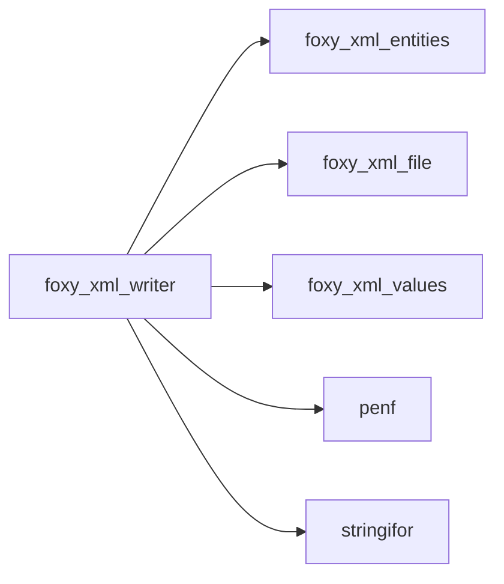

## Contents

- [open_element](#open-element)
- [xml_writer](#xml-writer)
- [cdata](#cdata)
- [close](#close)
- [comment](#comment)
- [declaration](#declaration)
- [end](#end)
- [flush](#flush)
- [open](#open)
- [pi](#pi)
- [raw](#raw)
- [start](#start)
- [text_character](#text-character)
- [attribute_character](#attribute-character)
- [attribute_i1p](#attribute-i1p)
- [attribute_i2p](#attribute-i2p)
- [attribute_i4p](#attribute-i4p)
- [attribute_i8p](#attribute-i8p)
- [attribute_r4p](#attribute-r4p)
- [attribute_r8p](#attribute-r8p)
- [attribute_logical](#attribute-logical)
- [attribute_i1p_1](#attribute-i1p-1)
- [attribute_i2p_1](#attribute-i2p-1)
- [attribute_i4p_1](#attribute-i4p-1)
- [attribute_i8p_1](#attribute-i8p-1)
- [attribute_r4p_1](#attribute-r4p-1)
- [attribute_r8p_1](#attribute-r8p-1)
- [text_i1p](#text-i1p)
- [text_i1p_1](#text-i1p-1)
- [text_i2p](#text-i2p)
- [text_i2p_1](#text-i2p-1)
- [text_i4p](#text-i4p)
- [text_i4p_1](#text-i4p-1)
- [text_i8p](#text-i8p)
- [text_i8p_1](#text-i8p-1)
- [text_r4p](#text-r4p)
- [text_r4p_1](#text-r4p-1)
- [text_r8p](#text-r8p)
- [text_r8p_1](#text-r8p-1)
- [text_logical](#text-logical)
- [fail](#fail)
- [flush_pending](#flush-pending)
- [markup_line](#markup-line)
- [put](#put)
- [report](#report)
- [string](#string)
- [is_writable](#is-writable)
- [start_content](#start-content)
- [is_xml_target](#is-xml-target)
- [indentation](#indentation)
- [new_line_](#new-line)

## Variables

| Name | Type | Attributes | Description |
|------|------|------------|-------------|
| `INITIAL_BUFFER_LEN` | integer(kind=[I8P](/api/src/third_party/PENF/src/lib/penf_global_parameters_variables)) | parameter | Initial length of the memory buffer, doubled when full. |
| `INITIAL_DEPTH` | integer(kind=[I4P](/api/src/third_party/PENF/src/lib/penf_global_parameters_variables)) | parameter | Initial capacity of the open elements stack, doubled when full. |

## Derived Types

### open_element

An open element.

#### Components

| Name | Type | Attributes | Description |
|------|------|------------|-------------|
| `name` | character(len=:) | allocatable | Element name. |
| `is_inline` | logical |  | It holds text: its content and end tag are written inline. |
| `in_inline` | logical |  | It is inside an inline element: no layout around it. |

### xml_writer

XML writer.

#### Components

| Name | Type | Attributes | Description |
|------|------|------------|-------------|
| `unit` | integer |  | Output unit (file or unit target). |
| `is_memory` | logical |  | The target is memory. |
| `is_open` | logical |  | The writer is open. |
| `is_unit_owned` | logical |  | The unit is opened (and closed) by the writer. |
| `buffer` | character(len=:) | allocatable | Memory target buffer. |
| `n` | integer(kind=[I8P](/api/src/third_party/PENF/src/lib/penf_global_parameters_variables)) |  | Used length of the memory buffer. |
| `indent` | integer(kind=[I4P](/api/src/third_party/PENF/src/lib/penf_global_parameters_variables)) |  | Spaces per indentation level, 0 for no layout. |
| `stack` | type([open_element](/api/src/third_party/FoXy/src/lib/foxy_xml_writer#open-element)) | allocatable | Open elements. |
| `depth` | integer(kind=[I4P](/api/src/third_party/PENF/src/lib/penf_global_parameters_variables)) |  | Number of open elements. |
| `pending` | character(len=:) | allocatable | Pending start tag (`<name attributes`), unallocated if none. |
| `pending_names` | character(len=:) | allocatable | Attributes names of the pending start tag, ` a b `. |
| `is_empty` | logical |  | Nothing written yet. |
| `roots` | integer(kind=[I4P](/api/src/third_party/PENF/src/lib/penf_global_parameters_variables)) |  | Root elements started (a document has one). |
| `error` | integer(kind=[I4P](/api/src/third_party/PENF/src/lib/penf_global_parameters_variables)) |  | First error status, 0 if none. |
| `error_message` | character(len=:) | allocatable | First error message. |
| `is_reported` | logical |  | The error has been returned to the caller. |

#### Type-Bound Procedures

| Name | Attributes | Description |
|------|------------|-------------|
| `attribute` |  | Add an attribute to the pending start tag. |
| `cdata` | pass(self) | Write a CDATA section. |
| `close` | pass(self) | Close all the open elements and the writer. |
| `comment` | pass(self) | Write a comment. |
| `declaration` | pass(self) | Write the XML declaration. |
| `end` | pass(self) | Close the innermost open element. |
| `flush` | pass(self) | Complete the pending start tag, for direct writes to the unit. |
| `open` | pass(self) | Open the writer on a file, a unit or memory. |
| `pi` | pass(self) | Write a processing instruction. |
| `raw` | pass(self) | Write characters as they are. |
| `start` | pass(self) | Open an element. |
| `string` | pass(self) | Return the memory target content. |
| `text` |  | Write character data (escaped), a number, a logical or a list. |
| `attribute_character` | pass(self) | Add a character attribute. |
| `attribute_i1p` | pass(self) | Add an integer attribute. |
| `attribute_i2p` | pass(self) | Add an integer attribute. |
| `attribute_i4p` | pass(self) | Add an integer attribute. |
| `attribute_i8p` | pass(self) | Add an integer attribute. |
| `attribute_r4p` | pass(self) | Add a real attribute. |
| `attribute_r8p` | pass(self) | Add a real attribute. |
| `attribute_logical` | pass(self) | Add a logical attribute. |
| `attribute_i1p_1` | pass(self) | Add a list attribute. |
| `attribute_i2p_1` | pass(self) | Add a list attribute. |
| `attribute_i4p_1` | pass(self) | Add a list attribute. |
| `attribute_i8p_1` | pass(self) | Add a list attribute. |
| `attribute_r4p_1` | pass(self) | Add a list attribute. |
| `attribute_r8p_1` | pass(self) | Add a list attribute. |
| `text_character` | pass(self) | Write escaped character data. |
| `text_i1p` | pass(self) | Write a number. |
| `text_i2p` | pass(self) | Write a number. |
| `text_i4p` | pass(self) | Write a number. |
| `text_i8p` | pass(self) | Write a number. |
| `text_r4p` | pass(self) | Write a number. |
| `text_r8p` | pass(self) | Write a number. |
| `text_logical` | pass(self) | Write a logical. |
| `text_i1p_1` | pass(self) | Write a list of numbers. |
| `text_i2p_1` | pass(self) | Write a list of numbers. |
| `text_i4p_1` | pass(self) | Write a list of numbers. |
| `text_i8p_1` | pass(self) | Write a list of numbers. |
| `text_r4p_1` | pass(self) | Write a list of numbers. |
| `text_r8p_1` | pass(self) | Write a list of numbers. |
| `fail` | pass(self) | Record the first error. |
| `flush_pending` | pass(self) | Complete the pending start tag. |
| `is_writable` | pass(self) | Check that the writer is open and without errors. |
| `markup_line` | pass(self) | Write a comment or PI. |
| `put` | pass(self) | Write characters to the target. |
| `report` | pass(self) | Return the error status. |
| `start_content` | pass(self) | Prepare the innermost element for inline content. |

## Subroutines

### cdata

Write a CDATA section (`]]>` in *string* is split across two sections).

```fortran
subroutine cdata(self, string, iostat, iomsg)
```

**Arguments**

| Name | Type | Intent | Attributes | Description |
|------|------|--------|------------|-------------|
| `self` | class([xml_writer](/api/src/third_party/FoXy/src/lib/foxy_xml_writer#xml-writer)) | inout |  | XML writer. |
| `string` | character(len=*) | in |  | Characters. |
| `iostat` | integer(kind=[I4P](/api/src/third_party/PENF/src/lib/penf_global_parameters_variables)) | out | optional | IO status. |
| `iomsg` | character(len=*) | inout | optional | IO message. |

**Call graph**

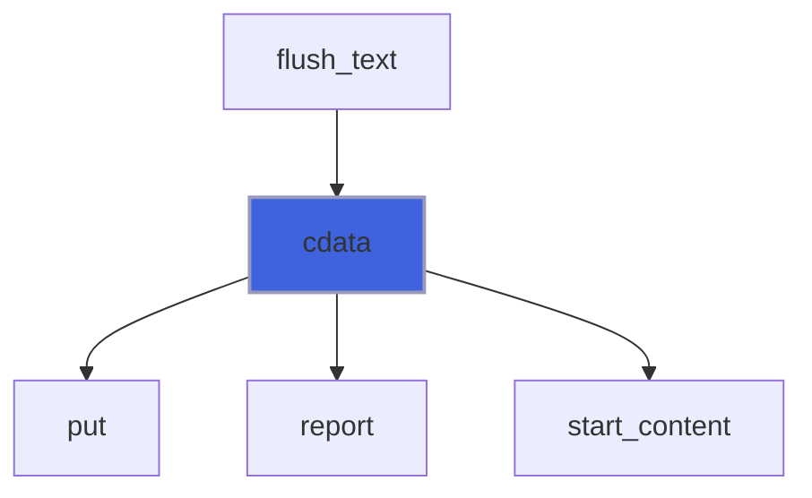

### close

Close all the open elements and the writer (a file opened by the writer is closed, a unit passed is left open; the
 memory target content stays available to *string*); without *iostat*, an error not yet returned to the caller stops
 the program.

```fortran
subroutine close(self, iostat, iomsg)
```

**Arguments**

| Name | Type | Intent | Attributes | Description |
|------|------|--------|------------|-------------|
| `self` | class([xml_writer](/api/src/third_party/FoXy/src/lib/foxy_xml_writer#xml-writer)) | inout |  | XML writer. |
| `iostat` | integer(kind=[I4P](/api/src/third_party/PENF/src/lib/penf_global_parameters_variables)) | out | optional | IO status: 0, the runtime I/O error code or *XML_MALFORMED*. |
| `iomsg` | character(len=*) | inout | optional | IO message, unchanged if no error. |

**Call graph**


### comment

Write a comment (`<!--string-->`); *string* cannot contain `--` nor end with `-`.

```fortran
subroutine comment(self, string, iostat, iomsg)
```

**Arguments**

| Name | Type | Intent | Attributes | Description |
|------|------|--------|------------|-------------|
| `self` | class([xml_writer](/api/src/third_party/FoXy/src/lib/foxy_xml_writer#xml-writer)) | inout |  | XML writer. |
| `string` | character(len=*) | in |  | Comment. |
| `iostat` | integer(kind=[I4P](/api/src/third_party/PENF/src/lib/penf_global_parameters_variables)) | out | optional | IO status. |
| `iomsg` | character(len=*) | inout | optional | IO message. |

**Call graph**

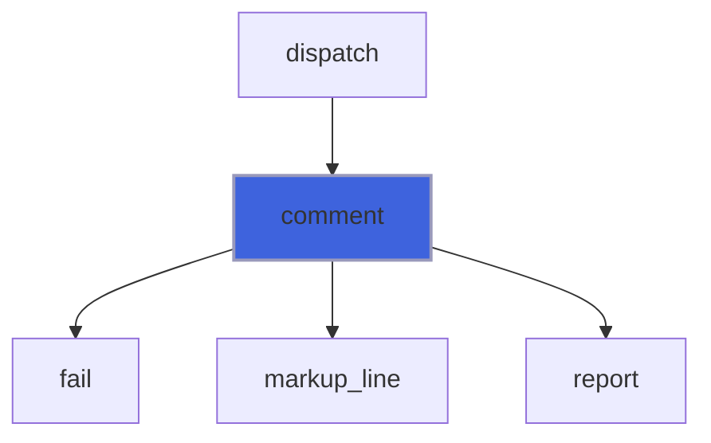

### declaration

Write the XML declaration, only as the first thing of the document.

```fortran
subroutine declaration(self, version, encoding, iostat, iomsg)
```

**Arguments**

| Name | Type | Intent | Attributes | Description |
|------|------|--------|------------|-------------|
| `self` | class([xml_writer](/api/src/third_party/FoXy/src/lib/foxy_xml_writer#xml-writer)) | inout |  | XML writer. |
| `version` | character(len=*) | in | optional | XML version (default `1.0`). |
| `encoding` | character(len=*) | in | optional | Encoding (not written if not passed): UTF-8 (any alias) only. |
| `iostat` | integer(kind=[I4P](/api/src/third_party/PENF/src/lib/penf_global_parameters_variables)) | out | optional | IO status. |
| `iomsg` | character(len=*) | inout | optional | IO message. |

**Call graph**

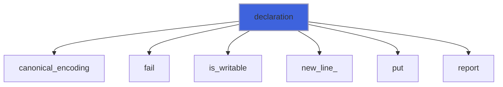

### end

Close the innermost open element (self closing if it has no content); *name*, if passed, must be its name.

```fortran
subroutine end(self, name, iostat, iomsg)
```

**Arguments**

| Name | Type | Intent | Attributes | Description |
|------|------|--------|------------|-------------|
| `self` | class([xml_writer](/api/src/third_party/FoXy/src/lib/foxy_xml_writer#xml-writer)) | inout |  | XML writer. |
| `name` | character(len=*) | in | optional | Name of the element to close. |
| `iostat` | integer(kind=[I4P](/api/src/third_party/PENF/src/lib/penf_global_parameters_variables)) | out | optional | IO status. |
| `iomsg` | character(len=*) | inout | optional | IO message. |

**Call graph**

```mermaid
flowchart TD
  end["end"] --> fail["fail"]
  end["end"] --> indentation["indentation"]
  end["end"] --> is_writable["is_writable"]
  end["end"] --> new_line_["new_line_"]
  end["end"] --> put["put"]
  end["end"] --> report["report"]
  style end fill:#3e63dd,stroke:#99b,stroke-width:2px
```

### flush

Complete the pending start tag of the innermost element as for block content (a new line follows), so that the
 caller can write directly to the unit (e.g. binary data); the element end tag is then written on its own line.

```fortran
subroutine flush(self, iostat, iomsg)
```

**Arguments**

| Name | Type | Intent | Attributes | Description |
|------|------|--------|------------|-------------|
| `self` | class([xml_writer](/api/src/third_party/FoXy/src/lib/foxy_xml_writer#xml-writer)) | inout |  | XML writer. |
| `iostat` | integer(kind=[I4P](/api/src/third_party/PENF/src/lib/penf_global_parameters_variables)) | out | optional | IO status. |
| `iomsg` | character(len=*) | inout | optional | IO message. |

**Call graph**

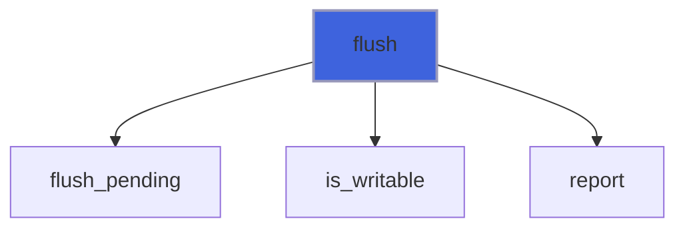

### open

Open the writer: on a file (created, replaced if it exists), on a unit (already open for stream unformatted access,
 left open by *close*) or, if neither is passed, on memory (see *string*).

```fortran
subroutine open(self, filename, unit, indent, iostat, iomsg)
```

**Arguments**

| Name | Type | Intent | Attributes | Description |
|------|------|--------|------------|-------------|
| `self` | class([xml_writer](/api/src/third_party/FoXy/src/lib/foxy_xml_writer#xml-writer)) | inout |  | XML writer. |
| `filename` | character(len=*) | in | optional | File name. |
| `unit` | integer | in | optional | Unit, open for stream unformatted access. |
| `indent` | integer(kind=[I4P](/api/src/third_party/PENF/src/lib/penf_global_parameters_variables)) | in | optional | Spaces per indentation level (default 2), 0 for no layout. |
| `iostat` | integer(kind=[I4P](/api/src/third_party/PENF/src/lib/penf_global_parameters_variables)) | out | optional | IO status. |
| `iomsg` | character(len=*) | inout | optional | IO message. |

**Call graph**

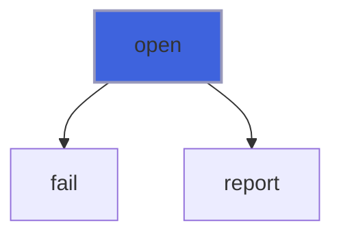

### pi

Write a processing instruction (`<?target string?>`): *target* is an XML name other than `xml` (any case), *string*
 cannot contain `?>`.

```fortran
subroutine pi(self, target, string, iostat, iomsg)
```

**Arguments**

| Name | Type | Intent | Attributes | Description |
|------|------|--------|------------|-------------|
| `self` | class([xml_writer](/api/src/third_party/FoXy/src/lib/foxy_xml_writer#xml-writer)) | inout |  | XML writer. |
| `target` | character(len=*) | in |  | PI target. |
| `string` | character(len=*) | in | optional | PI content. |
| `iostat` | integer(kind=[I4P](/api/src/third_party/PENF/src/lib/penf_global_parameters_variables)) | out | optional | IO status. |
| `iomsg` | character(len=*) | inout | optional | IO message. |

**Call graph**

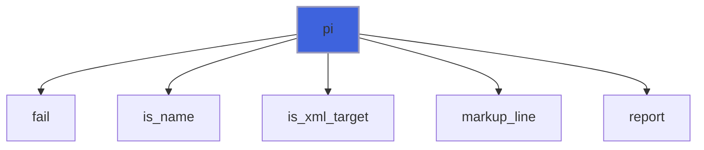

### raw

Write characters as they are (e.g. pre-formatted numbers, base64 data): inline, or with *is_block* on their own line
 (indented, the end tag of the element on its own line too). Large data can be written in pieces, with many calls.

```fortran
subroutine raw(self, string, is_block, iostat, iomsg)
```

**Arguments**

| Name | Type | Intent | Attributes | Description |
|------|------|--------|------------|-------------|
| `self` | class([xml_writer](/api/src/third_party/FoXy/src/lib/foxy_xml_writer#xml-writer)) | inout |  | XML writer. |
| `string` | character(len=*) | in |  | Characters. |
| `is_block` | logical | in | optional | Write on their own line. |
| `iostat` | integer(kind=[I4P](/api/src/third_party/PENF/src/lib/penf_global_parameters_variables)) | out | optional | IO status. |
| `iomsg` | character(len=*) | inout | optional | IO message. |

**Call graph**

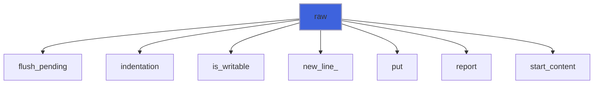

### start

Open an element: its start tag stays pending (attributes can be added) up to its first content or its end.

```fortran
subroutine start(self, name, iostat, iomsg)
```

**Arguments**

| Name | Type | Intent | Attributes | Description |
|------|------|--------|------------|-------------|
| `self` | class([xml_writer](/api/src/third_party/FoXy/src/lib/foxy_xml_writer#xml-writer)) | inout |  | XML writer. |
| `name` | character(len=*) | in |  | Element name. |
| `iostat` | integer(kind=[I4P](/api/src/third_party/PENF/src/lib/penf_global_parameters_variables)) | out | optional | IO status. |
| `iomsg` | character(len=*) | inout | optional | IO message. |

**Call graph**

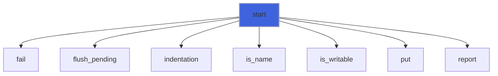

### text_character

Write character data, escaped (`&`, `<`, `>`, `"`, `'`); the element is written inline.

```fortran
subroutine text_character(self, string, iostat, iomsg)
```

**Arguments**

| Name | Type | Intent | Attributes | Description |
|------|------|--------|------------|-------------|
| `self` | class([xml_writer](/api/src/third_party/FoXy/src/lib/foxy_xml_writer#xml-writer)) | inout |  | XML writer. |
| `string` | character(len=*) | in |  | Character data. |
| `iostat` | integer(kind=[I4P](/api/src/third_party/PENF/src/lib/penf_global_parameters_variables)) | out | optional | IO status. |
| `iomsg` | character(len=*) | inout | optional | IO message. |

**Call graph**

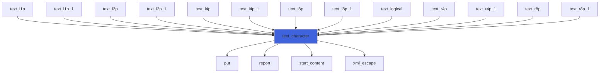

### attribute_character

Add an attribute to the pending start tag (the value is escaped, tab, new line and CR as references: it reads back
 exactly).

```fortran
subroutine attribute_character(self, name, value, iostat, iomsg)
```

**Arguments**

| Name | Type | Intent | Attributes | Description |
|------|------|--------|------------|-------------|
| `self` | class([xml_writer](/api/src/third_party/FoXy/src/lib/foxy_xml_writer#xml-writer)) | inout |  | XML writer. |
| `name` | character(len=*) | in |  | Attribute name. |
| `value` | character(len=*) | in |  | Attribute value. |
| `iostat` | integer(kind=[I4P](/api/src/third_party/PENF/src/lib/penf_global_parameters_variables)) | out | optional | IO status. |
| `iomsg` | character(len=*) | inout | optional | IO message. |

**Call graph**

```mermaid
flowchart TD
  attribute_i1p["attribute_i1p"] --> attribute_character["attribute_character"]
  attribute_i1p_1["attribute_i1p_1"] --> attribute_character["attribute_character"]
  attribute_i2p["attribute_i2p"] --> attribute_character["attribute_character"]
  attribute_i2p_1["attribute_i2p_1"] --> attribute_character["attribute_character"]
  attribute_i4p["attribute_i4p"] --> attribute_character["attribute_character"]
  attribute_i4p_1["attribute_i4p_1"] --> attribute_character["attribute_character"]
  attribute_i8p["attribute_i8p"] --> attribute_character["attribute_character"]
  attribute_i8p_1["attribute_i8p_1"] --> attribute_character["attribute_character"]
  attribute_logical["attribute_logical"] --> attribute_character["attribute_character"]
  attribute_r4p["attribute_r4p"] --> attribute_character["attribute_character"]
  attribute_r4p_1["attribute_r4p_1"] --> attribute_character["attribute_character"]
  attribute_r8p["attribute_r8p"] --> attribute_character["attribute_character"]
  attribute_r8p_1["attribute_r8p_1"] --> attribute_character["attribute_character"]
  attribute_character["attribute_character"] --> fail["fail"]
  attribute_character["attribute_character"] --> is_name["is_name"]
  attribute_character["attribute_character"] --> is_writable["is_writable"]
  attribute_character["attribute_character"] --> report["report"]
  attribute_character["attribute_character"] --> xml_escape["xml_escape"]
  style attribute_character fill:#3e63dd,stroke:#99b,stroke-width:2px
```

### attribute_i1p

Add a integer attribute: integers with their digits (a sign only if negative), or as formatted by *fmt*.

```fortran
subroutine attribute_i1p(self, name, value, fmt, iostat, iomsg)
```

**Arguments**

| Name | Type | Intent | Attributes | Description |
|------|------|--------|------------|-------------|
| `self` | class([xml_writer](/api/src/third_party/FoXy/src/lib/foxy_xml_writer#xml-writer)) | inout |  | XML writer. |
| `name` | character(len=*) | in |  | Attribute name. |
| `value` | integer(kind=[I1P](/api/src/third_party/PENF/src/lib/penf_global_parameters_variables)) | in |  | Attribute value. |
| `fmt` | character(len=*) | in | optional | Format, e.g. `(F6.3)`. |
| `iostat` | integer(kind=[I4P](/api/src/third_party/PENF/src/lib/penf_global_parameters_variables)) | out | optional | IO status. |
| `iomsg` | character(len=*) | inout | optional | IO message. |

**Call graph**


### attribute_i2p

Add a integer attribute: integers with their digits (a sign only if negative), or as formatted by *fmt*.

```fortran
subroutine attribute_i2p(self, name, value, fmt, iostat, iomsg)
```

**Arguments**

| Name | Type | Intent | Attributes | Description |
|------|------|--------|------------|-------------|
| `self` | class([xml_writer](/api/src/third_party/FoXy/src/lib/foxy_xml_writer#xml-writer)) | inout |  | XML writer. |
| `name` | character(len=*) | in |  | Attribute name. |
| `value` | integer(kind=[I2P](/api/src/third_party/PENF/src/lib/penf_global_parameters_variables)) | in |  | Attribute value. |
| `fmt` | character(len=*) | in | optional | Format, e.g. `(F6.3)`. |
| `iostat` | integer(kind=[I4P](/api/src/third_party/PENF/src/lib/penf_global_parameters_variables)) | out | optional | IO status. |
| `iomsg` | character(len=*) | inout | optional | IO message. |

**Call graph**


### attribute_i4p

Add a integer attribute: integers with their digits (a sign only if negative), or as formatted by *fmt*.

```fortran
subroutine attribute_i4p(self, name, value, fmt, iostat, iomsg)
```

**Arguments**

| Name | Type | Intent | Attributes | Description |
|------|------|--------|------------|-------------|
| `self` | class([xml_writer](/api/src/third_party/FoXy/src/lib/foxy_xml_writer#xml-writer)) | inout |  | XML writer. |
| `name` | character(len=*) | in |  | Attribute name. |
| `value` | integer(kind=[I4P](/api/src/third_party/PENF/src/lib/penf_global_parameters_variables)) | in |  | Attribute value. |
| `fmt` | character(len=*) | in | optional | Format, e.g. `(F6.3)`. |
| `iostat` | integer(kind=[I4P](/api/src/third_party/PENF/src/lib/penf_global_parameters_variables)) | out | optional | IO status. |
| `iomsg` | character(len=*) | inout | optional | IO message. |

**Call graph**


### attribute_i8p

Add a integer attribute: integers with their digits (a sign only if negative), or as formatted by *fmt*.

```fortran
subroutine attribute_i8p(self, name, value, fmt, iostat, iomsg)
```

**Arguments**

| Name | Type | Intent | Attributes | Description |
|------|------|--------|------------|-------------|
| `self` | class([xml_writer](/api/src/third_party/FoXy/src/lib/foxy_xml_writer#xml-writer)) | inout |  | XML writer. |
| `name` | character(len=*) | in |  | Attribute name. |
| `value` | integer(kind=[I8P](/api/src/third_party/PENF/src/lib/penf_global_parameters_variables)) | in |  | Attribute value. |
| `fmt` | character(len=*) | in | optional | Format, e.g. `(F6.3)`. |
| `iostat` | integer(kind=[I4P](/api/src/third_party/PENF/src/lib/penf_global_parameters_variables)) | out | optional | IO status. |
| `iomsg` | character(len=*) | inout | optional | IO message. |

**Call graph**


### attribute_r4p

Add a real attribute: the shortest text that reads back exactly (StringiFor `shortest`), or as formatted by *fmt*.

```fortran
subroutine attribute_r4p(self, name, value, fmt, iostat, iomsg)
```

**Arguments**

| Name | Type | Intent | Attributes | Description |
|------|------|--------|------------|-------------|
| `self` | class([xml_writer](/api/src/third_party/FoXy/src/lib/foxy_xml_writer#xml-writer)) | inout |  | XML writer. |
| `name` | character(len=*) | in |  | Attribute name. |
| `value` | real(kind=[R4P](/api/src/third_party/PENF/src/lib/penf_global_parameters_variables)) | in |  | Attribute value. |
| `fmt` | character(len=*) | in | optional | Format, e.g. `(F6.3)`. |
| `iostat` | integer(kind=[I4P](/api/src/third_party/PENF/src/lib/penf_global_parameters_variables)) | out | optional | IO status. |
| `iomsg` | character(len=*) | inout | optional | IO message. |

**Call graph**


### attribute_r8p

Add a real attribute: the shortest text that reads back exactly (StringiFor `shortest`), or as formatted by *fmt*.

```fortran
subroutine attribute_r8p(self, name, value, fmt, iostat, iomsg)
```

**Arguments**

| Name | Type | Intent | Attributes | Description |
|------|------|--------|------------|-------------|
| `self` | class([xml_writer](/api/src/third_party/FoXy/src/lib/foxy_xml_writer#xml-writer)) | inout |  | XML writer. |
| `name` | character(len=*) | in |  | Attribute name. |
| `value` | real(kind=[R8P](/api/src/third_party/PENF/src/lib/penf_global_parameters_variables)) | in |  | Attribute value. |
| `fmt` | character(len=*) | in | optional | Format, e.g. `(F6.3)`. |
| `iostat` | integer(kind=[I4P](/api/src/third_party/PENF/src/lib/penf_global_parameters_variables)) | out | optional | IO status. |
| `iomsg` | character(len=*) | inout | optional | IO message. |

**Call graph**

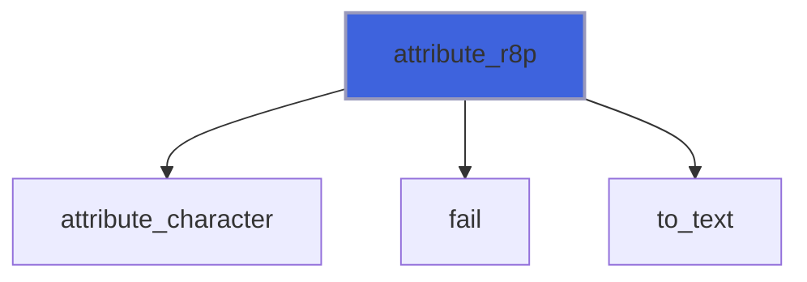

### attribute_logical

Add a logical attribute, as `true` or `false`.

```fortran
subroutine attribute_logical(self, name, value, iostat, iomsg)
```

**Arguments**

| Name | Type | Intent | Attributes | Description |
|------|------|--------|------------|-------------|
| `self` | class([xml_writer](/api/src/third_party/FoXy/src/lib/foxy_xml_writer#xml-writer)) | inout |  | XML writer. |
| `name` | character(len=*) | in |  | Attribute name. |
| `value` | logical | in |  | Attribute value. |
| `iostat` | integer(kind=[I4P](/api/src/third_party/PENF/src/lib/penf_global_parameters_variables)) | out | optional | IO status. |
| `iomsg` | character(len=*) | inout | optional | IO message. |

**Call graph**

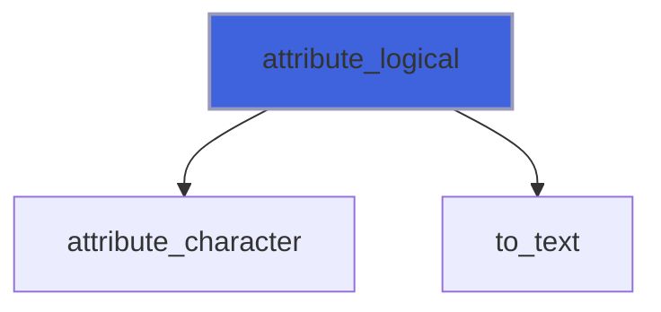

### attribute_i1p_1

Add an attribute holding a list of integer values, separated by one space (each as the scalar *attribute*).

```fortran
subroutine attribute_i1p_1(self, name, values, fmt, iostat, iomsg)
```

**Arguments**

| Name | Type | Intent | Attributes | Description |
|------|------|--------|------------|-------------|
| `self` | class([xml_writer](/api/src/third_party/FoXy/src/lib/foxy_xml_writer#xml-writer)) | inout |  | XML writer. |
| `name` | character(len=*) | in |  | Attribute name. |
| `values` | integer(kind=[I1P](/api/src/third_party/PENF/src/lib/penf_global_parameters_variables)) | in |  | Attribute values. |
| `fmt` | character(len=*) | in | optional | Format of each value, e.g. `(F6.3)`. |
| `iostat` | integer(kind=[I4P](/api/src/third_party/PENF/src/lib/penf_global_parameters_variables)) | out | optional | IO status. |
| `iomsg` | character(len=*) | inout | optional | IO message. |

**Call graph**

```mermaid
flowchart TD
  attribute_i1p_1["attribute_i1p_1"] --> attribute_character["attribute_character"]
  attribute_i1p_1["attribute_i1p_1"] --> fail["fail"]
  attribute_i1p_1["attribute_i1p_1"] --> to_text["to_text"]
  style attribute_i1p_1 fill:#3e63dd,stroke:#99b,stroke-width:2px
```

### attribute_i2p_1

Add an attribute holding a list of integer values, separated by one space (each as the scalar *attribute*).

```fortran
subroutine attribute_i2p_1(self, name, values, fmt, iostat, iomsg)
```

**Arguments**

| Name | Type | Intent | Attributes | Description |
|------|------|--------|------------|-------------|
| `self` | class([xml_writer](/api/src/third_party/FoXy/src/lib/foxy_xml_writer#xml-writer)) | inout |  | XML writer. |
| `name` | character(len=*) | in |  | Attribute name. |
| `values` | integer(kind=[I2P](/api/src/third_party/PENF/src/lib/penf_global_parameters_variables)) | in |  | Attribute values. |
| `fmt` | character(len=*) | in | optional | Format of each value, e.g. `(F6.3)`. |
| `iostat` | integer(kind=[I4P](/api/src/third_party/PENF/src/lib/penf_global_parameters_variables)) | out | optional | IO status. |
| `iomsg` | character(len=*) | inout | optional | IO message. |

**Call graph**

```mermaid
flowchart TD
  attribute_i2p_1["attribute_i2p_1"] --> attribute_character["attribute_character"]
  attribute_i2p_1["attribute_i2p_1"] --> fail["fail"]
  attribute_i2p_1["attribute_i2p_1"] --> to_text["to_text"]
  style attribute_i2p_1 fill:#3e63dd,stroke:#99b,stroke-width:2px
```

### attribute_i4p_1

Add an attribute holding a list of integer values, separated by one space (each as the scalar *attribute*).

```fortran
subroutine attribute_i4p_1(self, name, values, fmt, iostat, iomsg)
```

**Arguments**

| Name | Type | Intent | Attributes | Description |
|------|------|--------|------------|-------------|
| `self` | class([xml_writer](/api/src/third_party/FoXy/src/lib/foxy_xml_writer#xml-writer)) | inout |  | XML writer. |
| `name` | character(len=*) | in |  | Attribute name. |
| `values` | integer(kind=[I4P](/api/src/third_party/PENF/src/lib/penf_global_parameters_variables)) | in |  | Attribute values. |
| `fmt` | character(len=*) | in | optional | Format of each value, e.g. `(F6.3)`. |
| `iostat` | integer(kind=[I4P](/api/src/third_party/PENF/src/lib/penf_global_parameters_variables)) | out | optional | IO status. |
| `iomsg` | character(len=*) | inout | optional | IO message. |

**Call graph**

```mermaid
flowchart TD
  attribute_i4p_1["attribute_i4p_1"] --> attribute_character["attribute_character"]
  attribute_i4p_1["attribute_i4p_1"] --> fail["fail"]
  attribute_i4p_1["attribute_i4p_1"] --> to_text["to_text"]
  style attribute_i4p_1 fill:#3e63dd,stroke:#99b,stroke-width:2px
```

### attribute_i8p_1

Add an attribute holding a list of integer values, separated by one space (each as the scalar *attribute*).

```fortran
subroutine attribute_i8p_1(self, name, values, fmt, iostat, iomsg)
```

**Arguments**

| Name | Type | Intent | Attributes | Description |
|------|------|--------|------------|-------------|
| `self` | class([xml_writer](/api/src/third_party/FoXy/src/lib/foxy_xml_writer#xml-writer)) | inout |  | XML writer. |
| `name` | character(len=*) | in |  | Attribute name. |
| `values` | integer(kind=[I8P](/api/src/third_party/PENF/src/lib/penf_global_parameters_variables)) | in |  | Attribute values. |
| `fmt` | character(len=*) | in | optional | Format of each value, e.g. `(F6.3)`. |
| `iostat` | integer(kind=[I4P](/api/src/third_party/PENF/src/lib/penf_global_parameters_variables)) | out | optional | IO status. |
| `iomsg` | character(len=*) | inout | optional | IO message. |

**Call graph**

```mermaid
flowchart TD
  attribute_i8p_1["attribute_i8p_1"] --> attribute_character["attribute_character"]
  attribute_i8p_1["attribute_i8p_1"] --> fail["fail"]
  attribute_i8p_1["attribute_i8p_1"] --> to_text["to_text"]
  style attribute_i8p_1 fill:#3e63dd,stroke:#99b,stroke-width:2px
```

### attribute_r4p_1

Add an attribute holding a list of real values, separated by one space (each as the scalar *attribute*).

```fortran
subroutine attribute_r4p_1(self, name, values, fmt, iostat, iomsg)
```

**Arguments**

| Name | Type | Intent | Attributes | Description |
|------|------|--------|------------|-------------|
| `self` | class([xml_writer](/api/src/third_party/FoXy/src/lib/foxy_xml_writer#xml-writer)) | inout |  | XML writer. |
| `name` | character(len=*) | in |  | Attribute name. |
| `values` | real(kind=[R4P](/api/src/third_party/PENF/src/lib/penf_global_parameters_variables)) | in |  | Attribute values. |
| `fmt` | character(len=*) | in | optional | Format of each value, e.g. `(F6.3)`. |
| `iostat` | integer(kind=[I4P](/api/src/third_party/PENF/src/lib/penf_global_parameters_variables)) | out | optional | IO status. |
| `iomsg` | character(len=*) | inout | optional | IO message. |

**Call graph**

```mermaid
flowchart TD
  attribute_r4p_1["attribute_r4p_1"] --> attribute_character["attribute_character"]
  attribute_r4p_1["attribute_r4p_1"] --> fail["fail"]
  attribute_r4p_1["attribute_r4p_1"] --> to_text["to_text"]
  style attribute_r4p_1 fill:#3e63dd,stroke:#99b,stroke-width:2px
```

### attribute_r8p_1

Add an attribute holding a list of real values, separated by one space (each as the scalar *attribute*).

```fortran
subroutine attribute_r8p_1(self, name, values, fmt, iostat, iomsg)
```

**Arguments**

| Name | Type | Intent | Attributes | Description |
|------|------|--------|------------|-------------|
| `self` | class([xml_writer](/api/src/third_party/FoXy/src/lib/foxy_xml_writer#xml-writer)) | inout |  | XML writer. |
| `name` | character(len=*) | in |  | Attribute name. |
| `values` | real(kind=[R8P](/api/src/third_party/PENF/src/lib/penf_global_parameters_variables)) | in |  | Attribute values. |
| `fmt` | character(len=*) | in | optional | Format of each value, e.g. `(F6.3)`. |
| `iostat` | integer(kind=[I4P](/api/src/third_party/PENF/src/lib/penf_global_parameters_variables)) | out | optional | IO status. |
| `iomsg` | character(len=*) | inout | optional | IO message. |

**Call graph**

```mermaid
flowchart TD
  attribute_r8p_1["attribute_r8p_1"] --> attribute_character["attribute_character"]
  attribute_r8p_1["attribute_r8p_1"] --> fail["fail"]
  attribute_r8p_1["attribute_r8p_1"] --> to_text["to_text"]
  style attribute_r8p_1 fill:#3e63dd,stroke:#99b,stroke-width:2px
```

### text_i1p

Write a integer value as character data (as *attribute*); the element is written inline.

```fortran
subroutine text_i1p(self, value, fmt, iostat, iomsg)
```

**Arguments**

| Name | Type | Intent | Attributes | Description |
|------|------|--------|------------|-------------|
| `self` | class([xml_writer](/api/src/third_party/FoXy/src/lib/foxy_xml_writer#xml-writer)) | inout |  | XML writer. |
| `value` | integer(kind=[I1P](/api/src/third_party/PENF/src/lib/penf_global_parameters_variables)) | in |  | Value. |
| `fmt` | character(len=*) | in | optional | Format, e.g. `(F6.3)`. |
| `iostat` | integer(kind=[I4P](/api/src/third_party/PENF/src/lib/penf_global_parameters_variables)) | out | optional | IO status. |
| `iomsg` | character(len=*) | inout | optional | IO message. |

**Call graph**

```mermaid
flowchart TD
  text_i1p["text_i1p"] --> fail["fail"]
  text_i1p["text_i1p"] --> text_character["text_character"]
  text_i1p["text_i1p"] --> to_text["to_text"]
  style text_i1p fill:#3e63dd,stroke:#99b,stroke-width:2px
```

### text_i1p_1

Write a list of integer values, separated by one space, as character data (as *attribute*); the element is written inline.

```fortran
subroutine text_i1p_1(self, values, fmt, iostat, iomsg)
```

**Arguments**

| Name | Type | Intent | Attributes | Description |
|------|------|--------|------------|-------------|
| `self` | class([xml_writer](/api/src/third_party/FoXy/src/lib/foxy_xml_writer#xml-writer)) | inout |  | XML writer. |
| `values` | integer(kind=[I1P](/api/src/third_party/PENF/src/lib/penf_global_parameters_variables)) | in |  | Values. |
| `fmt` | character(len=*) | in | optional | Format of each value, e.g. `(F6.3)`. |
| `iostat` | integer(kind=[I4P](/api/src/third_party/PENF/src/lib/penf_global_parameters_variables)) | out | optional | IO status. |
| `iomsg` | character(len=*) | inout | optional | IO message. |

**Call graph**

```mermaid
flowchart TD
  text_i1p_1["text_i1p_1"] --> fail["fail"]
  text_i1p_1["text_i1p_1"] --> text_character["text_character"]
  text_i1p_1["text_i1p_1"] --> to_text["to_text"]
  style text_i1p_1 fill:#3e63dd,stroke:#99b,stroke-width:2px
```

### text_i2p

Write a integer value as character data (as *attribute*); the element is written inline.

```fortran
subroutine text_i2p(self, value, fmt, iostat, iomsg)
```

**Arguments**

| Name | Type | Intent | Attributes | Description |
|------|------|--------|------------|-------------|
| `self` | class([xml_writer](/api/src/third_party/FoXy/src/lib/foxy_xml_writer#xml-writer)) | inout |  | XML writer. |
| `value` | integer(kind=[I2P](/api/src/third_party/PENF/src/lib/penf_global_parameters_variables)) | in |  | Value. |
| `fmt` | character(len=*) | in | optional | Format, e.g. `(F6.3)`. |
| `iostat` | integer(kind=[I4P](/api/src/third_party/PENF/src/lib/penf_global_parameters_variables)) | out | optional | IO status. |
| `iomsg` | character(len=*) | inout | optional | IO message. |

**Call graph**

```mermaid
flowchart TD
  text_i2p["text_i2p"] --> fail["fail"]
  text_i2p["text_i2p"] --> text_character["text_character"]
  text_i2p["text_i2p"] --> to_text["to_text"]
  style text_i2p fill:#3e63dd,stroke:#99b,stroke-width:2px
```

### text_i2p_1

Write a list of integer values, separated by one space, as character data (as *attribute*); the element is written inline.

```fortran
subroutine text_i2p_1(self, values, fmt, iostat, iomsg)
```

**Arguments**

| Name | Type | Intent | Attributes | Description |
|------|------|--------|------------|-------------|
| `self` | class([xml_writer](/api/src/third_party/FoXy/src/lib/foxy_xml_writer#xml-writer)) | inout |  | XML writer. |
| `values` | integer(kind=[I2P](/api/src/third_party/PENF/src/lib/penf_global_parameters_variables)) | in |  | Values. |
| `fmt` | character(len=*) | in | optional | Format of each value, e.g. `(F6.3)`. |
| `iostat` | integer(kind=[I4P](/api/src/third_party/PENF/src/lib/penf_global_parameters_variables)) | out | optional | IO status. |
| `iomsg` | character(len=*) | inout | optional | IO message. |

**Call graph**

```mermaid
flowchart TD
  text_i2p_1["text_i2p_1"] --> fail["fail"]
  text_i2p_1["text_i2p_1"] --> text_character["text_character"]
  text_i2p_1["text_i2p_1"] --> to_text["to_text"]
  style text_i2p_1 fill:#3e63dd,stroke:#99b,stroke-width:2px
```

### text_i4p

Write a integer value as character data (as *attribute*); the element is written inline.

```fortran
subroutine text_i4p(self, value, fmt, iostat, iomsg)
```

**Arguments**

| Name | Type | Intent | Attributes | Description |
|------|------|--------|------------|-------------|
| `self` | class([xml_writer](/api/src/third_party/FoXy/src/lib/foxy_xml_writer#xml-writer)) | inout |  | XML writer. |
| `value` | integer(kind=[I4P](/api/src/third_party/PENF/src/lib/penf_global_parameters_variables)) | in |  | Value. |
| `fmt` | character(len=*) | in | optional | Format, e.g. `(F6.3)`. |
| `iostat` | integer(kind=[I4P](/api/src/third_party/PENF/src/lib/penf_global_parameters_variables)) | out | optional | IO status. |
| `iomsg` | character(len=*) | inout | optional | IO message. |

**Call graph**

```mermaid
flowchart TD
  text_i4p["text_i4p"] --> fail["fail"]
  text_i4p["text_i4p"] --> text_character["text_character"]
  text_i4p["text_i4p"] --> to_text["to_text"]
  style text_i4p fill:#3e63dd,stroke:#99b,stroke-width:2px
```

### text_i4p_1

Write a list of integer values, separated by one space, as character data (as *attribute*); the element is written inline.

```fortran
subroutine text_i4p_1(self, values, fmt, iostat, iomsg)
```

**Arguments**

| Name | Type | Intent | Attributes | Description |
|------|------|--------|------------|-------------|
| `self` | class([xml_writer](/api/src/third_party/FoXy/src/lib/foxy_xml_writer#xml-writer)) | inout |  | XML writer. |
| `values` | integer(kind=[I4P](/api/src/third_party/PENF/src/lib/penf_global_parameters_variables)) | in |  | Values. |
| `fmt` | character(len=*) | in | optional | Format of each value, e.g. `(F6.3)`. |
| `iostat` | integer(kind=[I4P](/api/src/third_party/PENF/src/lib/penf_global_parameters_variables)) | out | optional | IO status. |
| `iomsg` | character(len=*) | inout | optional | IO message. |

**Call graph**

```mermaid
flowchart TD
  text_i4p_1["text_i4p_1"] --> fail["fail"]
  text_i4p_1["text_i4p_1"] --> text_character["text_character"]
  text_i4p_1["text_i4p_1"] --> to_text["to_text"]
  style text_i4p_1 fill:#3e63dd,stroke:#99b,stroke-width:2px
```

### text_i8p

Write a integer value as character data (as *attribute*); the element is written inline.

```fortran
subroutine text_i8p(self, value, fmt, iostat, iomsg)
```

**Arguments**

| Name | Type | Intent | Attributes | Description |
|------|------|--------|------------|-------------|
| `self` | class([xml_writer](/api/src/third_party/FoXy/src/lib/foxy_xml_writer#xml-writer)) | inout |  | XML writer. |
| `value` | integer(kind=[I8P](/api/src/third_party/PENF/src/lib/penf_global_parameters_variables)) | in |  | Value. |
| `fmt` | character(len=*) | in | optional | Format, e.g. `(F6.3)`. |
| `iostat` | integer(kind=[I4P](/api/src/third_party/PENF/src/lib/penf_global_parameters_variables)) | out | optional | IO status. |
| `iomsg` | character(len=*) | inout | optional | IO message. |

**Call graph**

```mermaid
flowchart TD
  text_i8p["text_i8p"] --> fail["fail"]
  text_i8p["text_i8p"] --> text_character["text_character"]
  text_i8p["text_i8p"] --> to_text["to_text"]
  style text_i8p fill:#3e63dd,stroke:#99b,stroke-width:2px
```

### text_i8p_1

Write a list of integer values, separated by one space, as character data (as *attribute*); the element is written inline.

```fortran
subroutine text_i8p_1(self, values, fmt, iostat, iomsg)
```

**Arguments**

| Name | Type | Intent | Attributes | Description |
|------|------|--------|------------|-------------|
| `self` | class([xml_writer](/api/src/third_party/FoXy/src/lib/foxy_xml_writer#xml-writer)) | inout |  | XML writer. |
| `values` | integer(kind=[I8P](/api/src/third_party/PENF/src/lib/penf_global_parameters_variables)) | in |  | Values. |
| `fmt` | character(len=*) | in | optional | Format of each value, e.g. `(F6.3)`. |
| `iostat` | integer(kind=[I4P](/api/src/third_party/PENF/src/lib/penf_global_parameters_variables)) | out | optional | IO status. |
| `iomsg` | character(len=*) | inout | optional | IO message. |

**Call graph**

```mermaid
flowchart TD
  text_i8p_1["text_i8p_1"] --> fail["fail"]
  text_i8p_1["text_i8p_1"] --> text_character["text_character"]
  text_i8p_1["text_i8p_1"] --> to_text["to_text"]
  style text_i8p_1 fill:#3e63dd,stroke:#99b,stroke-width:2px
```

### text_r4p

Write a real value as character data (as *attribute*); the element is written inline.

```fortran
subroutine text_r4p(self, value, fmt, iostat, iomsg)
```

**Arguments**

| Name | Type | Intent | Attributes | Description |
|------|------|--------|------------|-------------|
| `self` | class([xml_writer](/api/src/third_party/FoXy/src/lib/foxy_xml_writer#xml-writer)) | inout |  | XML writer. |
| `value` | real(kind=[R4P](/api/src/third_party/PENF/src/lib/penf_global_parameters_variables)) | in |  | Value. |
| `fmt` | character(len=*) | in | optional | Format, e.g. `(F6.3)`. |
| `iostat` | integer(kind=[I4P](/api/src/third_party/PENF/src/lib/penf_global_parameters_variables)) | out | optional | IO status. |
| `iomsg` | character(len=*) | inout | optional | IO message. |

**Call graph**

```mermaid
flowchart TD
  text_r4p["text_r4p"] --> fail["fail"]
  text_r4p["text_r4p"] --> text_character["text_character"]
  text_r4p["text_r4p"] --> to_text["to_text"]
  style text_r4p fill:#3e63dd,stroke:#99b,stroke-width:2px
```

### text_r4p_1

Write a list of real values, separated by one space, as character data (as *attribute*); the element is written inline.

```fortran
subroutine text_r4p_1(self, values, fmt, iostat, iomsg)
```

**Arguments**

| Name | Type | Intent | Attributes | Description |
|------|------|--------|------------|-------------|
| `self` | class([xml_writer](/api/src/third_party/FoXy/src/lib/foxy_xml_writer#xml-writer)) | inout |  | XML writer. |
| `values` | real(kind=[R4P](/api/src/third_party/PENF/src/lib/penf_global_parameters_variables)) | in |  | Values. |
| `fmt` | character(len=*) | in | optional | Format of each value, e.g. `(F6.3)`. |
| `iostat` | integer(kind=[I4P](/api/src/third_party/PENF/src/lib/penf_global_parameters_variables)) | out | optional | IO status. |
| `iomsg` | character(len=*) | inout | optional | IO message. |

**Call graph**

```mermaid
flowchart TD
  text_r4p_1["text_r4p_1"] --> fail["fail"]
  text_r4p_1["text_r4p_1"] --> text_character["text_character"]
  text_r4p_1["text_r4p_1"] --> to_text["to_text"]
  style text_r4p_1 fill:#3e63dd,stroke:#99b,stroke-width:2px
```

### text_r8p

Write a real value as character data (as *attribute*); the element is written inline.

```fortran
subroutine text_r8p(self, value, fmt, iostat, iomsg)
```

**Arguments**

| Name | Type | Intent | Attributes | Description |
|------|------|--------|------------|-------------|
| `self` | class([xml_writer](/api/src/third_party/FoXy/src/lib/foxy_xml_writer#xml-writer)) | inout |  | XML writer. |
| `value` | real(kind=[R8P](/api/src/third_party/PENF/src/lib/penf_global_parameters_variables)) | in |  | Value. |
| `fmt` | character(len=*) | in | optional | Format, e.g. `(F6.3)`. |
| `iostat` | integer(kind=[I4P](/api/src/third_party/PENF/src/lib/penf_global_parameters_variables)) | out | optional | IO status. |
| `iomsg` | character(len=*) | inout | optional | IO message. |

**Call graph**

```mermaid
flowchart TD
  text_r8p["text_r8p"] --> fail["fail"]
  text_r8p["text_r8p"] --> text_character["text_character"]
  text_r8p["text_r8p"] --> to_text["to_text"]
  style text_r8p fill:#3e63dd,stroke:#99b,stroke-width:2px
```

### text_r8p_1

Write a list of real values, separated by one space, as character data (as *attribute*); the element is written inline.

```fortran
subroutine text_r8p_1(self, values, fmt, iostat, iomsg)
```

**Arguments**

| Name | Type | Intent | Attributes | Description |
|------|------|--------|------------|-------------|
| `self` | class([xml_writer](/api/src/third_party/FoXy/src/lib/foxy_xml_writer#xml-writer)) | inout |  | XML writer. |
| `values` | real(kind=[R8P](/api/src/third_party/PENF/src/lib/penf_global_parameters_variables)) | in |  | Values. |
| `fmt` | character(len=*) | in | optional | Format of each value, e.g. `(F6.3)`. |
| `iostat` | integer(kind=[I4P](/api/src/third_party/PENF/src/lib/penf_global_parameters_variables)) | out | optional | IO status. |
| `iomsg` | character(len=*) | inout | optional | IO message. |

**Call graph**

```mermaid
flowchart TD
  text_r8p_1["text_r8p_1"] --> fail["fail"]
  text_r8p_1["text_r8p_1"] --> text_character["text_character"]
  text_r8p_1["text_r8p_1"] --> to_text["to_text"]
  style text_r8p_1 fill:#3e63dd,stroke:#99b,stroke-width:2px
```

### text_logical

Write a logical value as character data, `true` or `false`; the element is written inline.

```fortran
subroutine text_logical(self, value, iostat, iomsg)
```

**Arguments**

| Name | Type | Intent | Attributes | Description |
|------|------|--------|------------|-------------|
| `self` | class([xml_writer](/api/src/third_party/FoXy/src/lib/foxy_xml_writer#xml-writer)) | inout |  | XML writer. |
| `value` | logical | in |  | Value. |
| `iostat` | integer(kind=[I4P](/api/src/third_party/PENF/src/lib/penf_global_parameters_variables)) | out | optional | IO status. |
| `iomsg` | character(len=*) | inout | optional | IO message. |

**Call graph**

```mermaid
flowchart TD
  text_logical["text_logical"] --> text_character["text_character"]
  text_logical["text_logical"] --> to_text["to_text"]
  style text_logical fill:#3e63dd,stroke:#99b,stroke-width:2px
```

### fail

Record an error, if it is the first one.

```fortran
subroutine fail(self, error, message)
```

**Arguments**

| Name | Type | Intent | Attributes | Description |
|------|------|--------|------------|-------------|
| `self` | class([xml_writer](/api/src/third_party/FoXy/src/lib/foxy_xml_writer#xml-writer)) | inout |  | XML writer. |
| `error` | integer(kind=[I4P](/api/src/third_party/PENF/src/lib/penf_global_parameters_variables)) | in |  | Error status. |
| `message` | character(len=*) | in |  | Error message. |

**Call graph**

```mermaid
flowchart TD
  attribute_character["attribute_character"] --> fail["fail"]
  attribute_i1p["attribute_i1p"] --> fail["fail"]
  attribute_i1p_1["attribute_i1p_1"] --> fail["fail"]
  attribute_i2p["attribute_i2p"] --> fail["fail"]
  attribute_i2p_1["attribute_i2p_1"] --> fail["fail"]
  attribute_i4p["attribute_i4p"] --> fail["fail"]
  attribute_i4p_1["attribute_i4p_1"] --> fail["fail"]
  attribute_i8p["attribute_i8p"] --> fail["fail"]
  attribute_i8p_1["attribute_i8p_1"] --> fail["fail"]
  attribute_r4p["attribute_r4p"] --> fail["fail"]
  attribute_r4p_1["attribute_r4p_1"] --> fail["fail"]
  attribute_r8p["attribute_r8p"] --> fail["fail"]
  attribute_r8p_1["attribute_r8p_1"] --> fail["fail"]
  class_item["class_item"] --> fail["fail"]
  close["close"] --> fail["fail"]
  comment["comment"] --> fail["fail"]
  compile["compile"] --> fail["fail"]
  declaration["declaration"] --> fail["fail"]
  emit["emit"] --> fail["fail"]
  end["end"] --> fail["fail"]
  escape_code["escape_code"] --> fail["fail"]
  is_writable["is_writable"] --> fail["fail"]
  new_group["new_group"] --> fail["fail"]
  open["open"] --> fail["fail"]
  parse_atom["parse_atom"] --> fail["fail"]
  parse_class["parse_class"] --> fail["fail"]
  parse_escape["parse_escape"] --> fail["fail"]
  parse_repeat["parse_repeat"] --> fail["fail"]
  pi["pi"] --> fail["fail"]
  put["put"] --> fail["fail"]
  set_flag["set_flag"] --> fail["fail"]
  start["start"] --> fail["fail"]
  start_content["start_content"] --> fail["fail"]
  text_i1p["text_i1p"] --> fail["fail"]
  text_i1p_1["text_i1p_1"] --> fail["fail"]
  text_i2p["text_i2p"] --> fail["fail"]
  text_i2p_1["text_i2p_1"] --> fail["fail"]
  text_i4p["text_i4p"] --> fail["fail"]
  text_i4p_1["text_i4p_1"] --> fail["fail"]
  text_i8p["text_i8p"] --> fail["fail"]
  text_i8p_1["text_i8p_1"] --> fail["fail"]
  text_r4p["text_r4p"] --> fail["fail"]
  text_r4p_1["text_r4p_1"] --> fail["fail"]
  text_r8p["text_r8p"] --> fail["fail"]
  text_r8p_1["text_r8p_1"] --> fail["fail"]
  to_values_I1P["to_values_I1P"] --> fail["fail"]
  to_values_I2P["to_values_I2P"] --> fail["fail"]
  to_values_I4P["to_values_I4P"] --> fail["fail"]
  to_values_I8P["to_values_I8P"] --> fail["fail"]
  to_values_R4P["to_values_R4P"] --> fail["fail"]
  to_values_R8P["to_values_R8P"] --> fail["fail"]
  style fail fill:#3e63dd,stroke:#99b,stroke-width:2px
```

### flush_pending

Complete the pending start tag of the innermost element, before its first content (a new line follows, unless the
 element is inline).

```fortran
subroutine flush_pending(self)
```

**Arguments**

| Name | Type | Intent | Attributes | Description |
|------|------|--------|------------|-------------|
| `self` | class([xml_writer](/api/src/third_party/FoXy/src/lib/foxy_xml_writer#xml-writer)) | inout |  | XML writer. |

**Call graph**

```mermaid
flowchart TD
  flush["flush"] --> flush_pending["flush_pending"]
  markup_line["markup_line"] --> flush_pending["flush_pending"]
  raw["raw"] --> flush_pending["flush_pending"]
  start["start"] --> flush_pending["flush_pending"]
  start_content["start_content"] --> flush_pending["flush_pending"]
  flush_pending["flush_pending"] --> new_line_["new_line_"]
  flush_pending["flush_pending"] --> put["put"]
  style flush_pending fill:#3e63dd,stroke:#99b,stroke-width:2px
```

### markup_line

Write a comment or PI: on its own line, or inline inside an inline element.

```fortran
subroutine markup_line(self, markup)
```

**Arguments**

| Name | Type | Intent | Attributes | Description |
|------|------|--------|------------|-------------|
| `self` | class([xml_writer](/api/src/third_party/FoXy/src/lib/foxy_xml_writer#xml-writer)) | inout |  | XML writer. |
| `markup` | character(len=*) | in |  | Markup. |

**Call graph**

```mermaid
flowchart TD
  comment["comment"] --> markup_line["markup_line"]
  pi["pi"] --> markup_line["markup_line"]
  markup_line["markup_line"] --> flush_pending["flush_pending"]
  markup_line["markup_line"] --> indentation["indentation"]
  markup_line["markup_line"] --> is_writable["is_writable"]
  markup_line["markup_line"] --> new_line_["new_line_"]
  markup_line["markup_line"] --> put["put"]
  style markup_line fill:#3e63dd,stroke:#99b,stroke-width:2px
```

### put

Write characters to the target (unit or memory).

```fortran
subroutine put(self, string)
```

**Arguments**

| Name | Type | Intent | Attributes | Description |
|------|------|--------|------------|-------------|
| `self` | class([xml_writer](/api/src/third_party/FoXy/src/lib/foxy_xml_writer#xml-writer)) | inout |  | XML writer. |
| `string` | character(len=*) | in |  | Characters. |

**Call graph**

```mermaid
flowchart TD
  cdata["cdata"] --> put["put"]
  declaration["declaration"] --> put["put"]
  end["end"] --> put["put"]
  flush_pending["flush_pending"] --> put["put"]
  markup_line["markup_line"] --> put["put"]
  raw["raw"] --> put["put"]
  single_byte["single_byte"] --> put["put"]
  start["start"] --> put["put"]
  text_character["text_character"] --> put["put"]
  utf16["utf16"] --> put["put"]
  utf32["utf32"] --> put["put"]
  put["put"] --> fail["fail"]
  style put fill:#3e63dd,stroke:#99b,stroke-width:2px
```

### report

Return the error status (*iomsg* only if there is an error), through *iostat* if passed.

```fortran
subroutine report(self, iostat, iomsg)
```

**Arguments**

| Name | Type | Intent | Attributes | Description |
|------|------|--------|------------|-------------|
| `self` | class([xml_writer](/api/src/third_party/FoXy/src/lib/foxy_xml_writer#xml-writer)) | inout |  | XML writer. |
| `iostat` | integer(kind=[I4P](/api/src/third_party/PENF/src/lib/penf_global_parameters_variables)) | out | optional | IO status. |
| `iomsg` | character(len=*) | inout | optional | IO message. |

**Call graph**

```mermaid
flowchart TD
  attribute_character["attribute_character"] --> report["report"]
  cdata["cdata"] --> report["report"]
  check_references["check_references"] --> report["report"]
  close["close"] --> report["report"]
  close_reference["close_reference"] --> report["report"]
  comment["comment"] --> report["report"]
  declaration["declaration"] --> report["report"]
  delete_attribute["delete_attribute"] --> report["report"]
  end["end"] --> report["report"]
  feed["feed"] --> report["report"]
  flush["flush"] --> report["report"]
  get_attribute_I1P["get_attribute_I1P"] --> report["report"]
  get_attribute_I1P["get_attribute_I1P"] --> report["report"]
  get_attribute_I1P_1["get_attribute_I1P_1"] --> report["report"]
  get_attribute_I1P_1["get_attribute_I1P_1"] --> report["report"]
  get_attribute_I2P["get_attribute_I2P"] --> report["report"]
  get_attribute_I2P["get_attribute_I2P"] --> report["report"]
  get_attribute_I2P_1["get_attribute_I2P_1"] --> report["report"]
  get_attribute_I2P_1["get_attribute_I2P_1"] --> report["report"]
  get_attribute_I4P["get_attribute_I4P"] --> report["report"]
  get_attribute_I4P["get_attribute_I4P"] --> report["report"]
  get_attribute_I4P_1["get_attribute_I4P_1"] --> report["report"]
  get_attribute_I4P_1["get_attribute_I4P_1"] --> report["report"]
  get_attribute_I8P["get_attribute_I8P"] --> report["report"]
  get_attribute_I8P["get_attribute_I8P"] --> report["report"]
  get_attribute_I8P_1["get_attribute_I8P_1"] --> report["report"]
  get_attribute_I8P_1["get_attribute_I8P_1"] --> report["report"]
  get_attribute_R4P["get_attribute_R4P"] --> report["report"]
  get_attribute_R4P["get_attribute_R4P"] --> report["report"]
  get_attribute_R4P_1["get_attribute_R4P_1"] --> report["report"]
  get_attribute_R4P_1["get_attribute_R4P_1"] --> report["report"]
  get_attribute_R8P["get_attribute_R8P"] --> report["report"]
  get_attribute_R8P["get_attribute_R8P"] --> report["report"]
  get_attribute_R8P_1["get_attribute_R8P_1"] --> report["report"]
  get_attribute_R8P_1["get_attribute_R8P_1"] --> report["report"]
  get_attribute_logical["get_attribute_logical"] --> report["report"]
  get_attribute_logical["get_attribute_logical"] --> report["report"]
  get_content_I1P["get_content_I1P"] --> report["report"]
  get_content_I1P["get_content_I1P"] --> report["report"]
  get_content_I1P_1["get_content_I1P_1"] --> report["report"]
  get_content_I1P_1["get_content_I1P_1"] --> report["report"]
  get_content_I2P["get_content_I2P"] --> report["report"]
  get_content_I2P["get_content_I2P"] --> report["report"]
  get_content_I2P_1["get_content_I2P_1"] --> report["report"]
  get_content_I2P_1["get_content_I2P_1"] --> report["report"]
  get_content_I4P["get_content_I4P"] --> report["report"]
  get_content_I4P["get_content_I4P"] --> report["report"]
  get_content_I4P_1["get_content_I4P_1"] --> report["report"]
  get_content_I4P_1["get_content_I4P_1"] --> report["report"]
  get_content_I8P["get_content_I8P"] --> report["report"]
  get_content_I8P["get_content_I8P"] --> report["report"]
  get_content_I8P_1["get_content_I8P_1"] --> report["report"]
  get_content_I8P_1["get_content_I8P_1"] --> report["report"]
  get_content_R4P["get_content_R4P"] --> report["report"]
  get_content_R4P["get_content_R4P"] --> report["report"]
  get_content_R4P_1["get_content_R4P_1"] --> report["report"]
  get_content_R4P_1["get_content_R4P_1"] --> report["report"]
  get_content_R8P["get_content_R8P"] --> report["report"]
  get_content_R8P["get_content_R8P"] --> report["report"]
  get_content_R8P_1["get_content_R8P_1"] --> report["report"]
  get_content_R8P_1["get_content_R8P_1"] --> report["report"]
  get_content_logical["get_content_logical"] --> report["report"]
  get_content_logical["get_content_logical"] --> report["report"]
  open["open"] --> report["report"]
  pi["pi"] --> report["report"]
  raw["raw"] --> report["report"]
  report_markup["report_markup"] --> report["report"]
  select["select"] --> report["report"]
  select["select"] --> report["report"]
  set_attribute_I1P["set_attribute_I1P"] --> report["report"]
  set_attribute_I1P_1["set_attribute_I1P_1"] --> report["report"]
  set_attribute_I2P["set_attribute_I2P"] --> report["report"]
  set_attribute_I2P_1["set_attribute_I2P_1"] --> report["report"]
  set_attribute_I4P["set_attribute_I4P"] --> report["report"]
  set_attribute_I4P_1["set_attribute_I4P_1"] --> report["report"]
  set_attribute_I8P["set_attribute_I8P"] --> report["report"]
  set_attribute_I8P_1["set_attribute_I8P_1"] --> report["report"]
  set_attribute_R4P["set_attribute_R4P"] --> report["report"]
  set_attribute_R4P_1["set_attribute_R4P_1"] --> report["report"]
  set_attribute_R8P["set_attribute_R8P"] --> report["report"]
  set_attribute_R8P_1["set_attribute_R8P_1"] --> report["report"]
  set_attribute_character["set_attribute_character"] --> report["report"]
  set_attribute_logical["set_attribute_logical"] --> report["report"]
  set_content_I1P["set_content_I1P"] --> report["report"]
  set_content_I1P_1["set_content_I1P_1"] --> report["report"]
  set_content_I2P["set_content_I2P"] --> report["report"]
  set_content_I2P_1["set_content_I2P_1"] --> report["report"]
  set_content_I4P["set_content_I4P"] --> report["report"]
  set_content_I4P_1["set_content_I4P_1"] --> report["report"]
  set_content_I8P["set_content_I8P"] --> report["report"]
  set_content_I8P_1["set_content_I8P_1"] --> report["report"]
  set_content_R4P["set_content_R4P"] --> report["report"]
  set_content_R4P_1["set_content_R4P_1"] --> report["report"]
  set_content_R8P["set_content_R8P"] --> report["report"]
  set_content_R8P_1["set_content_R8P_1"] --> report["report"]
  set_content_character["set_content_character"] --> report["report"]
  set_content_logical["set_content_logical"] --> report["report"]
  set_name["set_name"] --> report["report"]
  start["start"] --> report["report"]
  text_character["text_character"] --> report["report"]
  style report fill:#3e63dd,stroke:#99b,stroke-width:2px
```

## Functions

### string

Return the content of the memory target (empty for a file or unit target).

**Attributes**: pure

**Returns**: `character(len=:)`

```fortran
function string(self) result(content)
```

**Arguments**

| Name | Type | Intent | Attributes | Description |
|------|------|--------|------------|-------------|
| `self` | class([xml_writer](/api/src/third_party/FoXy/src/lib/foxy_xml_writer#xml-writer)) | in |  | XML writer. |

### is_writable

Check that the writer is open and without errors (a call on a writer not open is an error).

**Returns**: `logical`

```fortran
function is_writable(self)
```

**Arguments**

| Name | Type | Intent | Attributes | Description |
|------|------|--------|------------|-------------|
| `self` | class([xml_writer](/api/src/third_party/FoXy/src/lib/foxy_xml_writer#xml-writer)) | inout |  | XML writer. |

**Call graph**

```mermaid
flowchart TD
  attribute_character["attribute_character"] --> is_writable["is_writable"]
  declaration["declaration"] --> is_writable["is_writable"]
  end["end"] --> is_writable["is_writable"]
  flush["flush"] --> is_writable["is_writable"]
  markup_line["markup_line"] --> is_writable["is_writable"]
  raw["raw"] --> is_writable["is_writable"]
  start["start"] --> is_writable["is_writable"]
  start_content["start_content"] --> is_writable["is_writable"]
  is_writable["is_writable"] --> fail["fail"]
  style is_writable fill:#3e63dd,stroke:#99b,stroke-width:2px
```

### start_content

Prepare the innermost element for inline content (text, data, CDATA): its start tag is completed, it becomes inline.

**Returns**: `logical`

```fortran
function start_content(self, what) result(is_ready)
```

**Arguments**

| Name | Type | Intent | Attributes | Description |
|------|------|--------|------------|-------------|
| `self` | class([xml_writer](/api/src/third_party/FoXy/src/lib/foxy_xml_writer#xml-writer)) | inout |  | XML writer. |
| `what` | character(len=*) | in |  | Content kind, for the error message. |

**Call graph**

```mermaid
flowchart TD
  cdata["cdata"] --> start_content["start_content"]
  raw["raw"] --> start_content["start_content"]
  text_character["text_character"] --> start_content["start_content"]
  start_content["start_content"] --> fail["fail"]
  start_content["start_content"] --> flush_pending["flush_pending"]
  start_content["start_content"] --> is_writable["is_writable"]
  style start_content fill:#3e63dd,stroke:#99b,stroke-width:2px
```

### is_xml_target

Return true if a PI target is `xml` in any case, reserved by XML 1.0 (2.6) for the XML declaration.

**Attributes**: pure

**Returns**: `logical`

```fortran
function is_xml_target(target) result(is_xml)
```

**Arguments**

| Name | Type | Intent | Attributes | Description |
|------|------|--------|------------|-------------|
| `target` | character(len=*) | in |  | PI target. |

**Call graph**

```mermaid
flowchart TD
  pi["pi"] --> is_xml_target["is_xml_target"]
  style is_xml_target fill:#3e63dd,stroke:#99b,stroke-width:2px
```

### indentation

Return the indentation of a depth.

**Attributes**: pure

**Returns**: `character(len=:)`

```fortran
function indentation(self, depth) result(blanks)
```

**Arguments**

| Name | Type | Intent | Attributes | Description |
|------|------|--------|------------|-------------|
| `self` | type([xml_writer](/api/src/third_party/FoXy/src/lib/foxy_xml_writer#xml-writer)) | in |  | XML writer. |
| `depth` | integer(kind=[I4P](/api/src/third_party/PENF/src/lib/penf_global_parameters_variables)) | in |  | Depth. |

**Call graph**

```mermaid
flowchart TD
  end["end"] --> indentation["indentation"]
  markup_line["markup_line"] --> indentation["indentation"]
  raw["raw"] --> indentation["indentation"]
  start["start"] --> indentation["indentation"]
  style indentation fill:#3e63dd,stroke:#99b,stroke-width:2px
```

### new_line_

Return a new line, or nothing without layout.

**Attributes**: pure

**Returns**: `character(len=:)`

```fortran
function new_line_(self) result(nl)
```

**Arguments**

| Name | Type | Intent | Attributes | Description |
|------|------|--------|------------|-------------|
| `self` | type([xml_writer](/api/src/third_party/FoXy/src/lib/foxy_xml_writer#xml-writer)) | in |  | XML writer. |

**Call graph**

```mermaid
flowchart TD
  declaration["declaration"] --> new_line_["new_line_"]
  end["end"] --> new_line_["new_line_"]
  flush_pending["flush_pending"] --> new_line_["new_line_"]
  markup_line["markup_line"] --> new_line_["new_line_"]
  raw["raw"] --> new_line_["new_line_"]
  style new_line_ fill:#3e63dd,stroke:#99b,stroke-width:2px
```
