# stringifor_encodings

> StringiFor, text encodings: byte order marks, encoding names and conversion to UTF-8.

 StringiFor works on UTF-8. Text in another encoding is converted on input by [to_utf8](/api/src/third_party/StringiFor/src/lib/stringifor_encodings#to-utf8), which reads it in pieces
 (an incomplete character at the end of a piece is carried to the next one), so a file can be converted in chunks.
 The supported encodings are UTF-8, US-ASCII, ISO-8859-1 (Latin-1), windows-1252, UTF-16 and UTF-32 (little or big
 endian); [canonical_encoding](/api/src/third_party/StringiFor/src/lib/stringifor_encodings#canonical-encoding) folds their IANA names and aliases. [bom_encoding](/api/src/third_party/StringiFor/src/lib/stringifor_encodings#bom-encoding) and [bom_length](/api/src/third_party/StringiFor/src/lib/stringifor_encodings#bom-length) read a byte
 order mark. An invalid sequence becomes a replacement (U+FFFD by default) and is reported by its position, as Python
 `bytes.decode(encoding, errors='replace')` does.

**Source**: `src/third_party/StringiFor/src/lib/stringifor_encodings.F90`

**Dependencies**

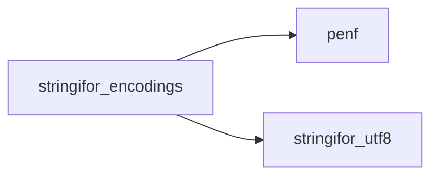

## Contents

- [to_utf8](#to-utf8)
- [close_tail](#close-tail)
- [put](#put)
- [single_byte](#single-byte)
- [utf16](#utf16)
- [replace_unit](#replace-unit)
- [utf32](#utf32)
- [bom_encoding](#bom-encoding)
- [bom_length](#bom-length)
- [canonical_encoding](#canonical-encoding)
- [bom_kind](#bom-kind)
- [byte_value](#byte-value)
- [encoding_kind](#encoding-kind)
- [itoa](#itoa)
- [lowered](#lowered)
- [len_trim_bytes](#len-trim-bytes)
- [unit16](#unit16)

## Variables

| Name | Type | Attributes | Description |
|------|------|------------|-------------|
| `ENC_UNKNOWN` | integer | parameter | Not supported. |
| `ENC_UTF8` | integer | parameter | UTF-8. |
| `ENC_ASCII` | integer | parameter | US-ASCII. |
| `ENC_LATIN1` | integer | parameter | ISO-8859-1. |
| `ENC_CP1252` | integer | parameter | windows-1252. |
| `ENC_UTF16LE` | integer | parameter | UTF-16, little endian. |
| `ENC_UTF16BE` | integer | parameter | UTF-16, big endian. |
| `ENC_UTF32LE` | integer | parameter | UTF-32, little endian. |
| `ENC_UTF32BE` | integer | parameter | UTF-32, big endian. |
| `UNDEFINED` | integer | parameter | A windows-1252 byte without a character. |
| `CP1252_HIGH` | integer | parameter | windows-1252 0x80..0x9F. |
| `LOWER` | character(len=*) | parameter | Lowercase letters. |
| `UPPER` | character(len=*) | parameter | Uppercase letters. |

## Subroutines

### to_utf8

Convert `bytes` in `encoding` (a name or an alias of [canonical_encoding](/api/src/third_party/StringiFor/src/lib/stringifor_encodings#canonical-encoding)) to UTF-8.

 + A source read in pieces passes `carry`: it is prepended to `bytes` and, unless `is_last`, receives the bytes of an
   incomplete character at the end (a UTF-16 unit split, a surrogate pair split, a UTF-32 unit split). Without
   `carry` (or with `is_last`, the default), an incomplete character at the end is invalid.
 + An invalid sequence becomes `replacement` (default U+FFFD): a US-ASCII byte above 127, one of the 5 windows-1252
   bytes without a character, an unpaired UTF-16 surrogate (each unit), a UTF-32 unit that is not a Unicode scalar
   value, an incomplete character at the end (as a whole). `iostat` is then the position of the first one in `carry`
   followed by `bytes`, 0 if there is none.
 + `UTF-16` and `UTF-32` without an endianness are big endian (RFC 2781); a byte order mark is not removed (it
   becomes U+FEFF): read it first with [bom_encoding](/api/src/third_party/StringiFor/src/lib/stringifor_encodings#bom-encoding) and [bom_length](/api/src/third_party/StringiFor/src/lib/stringifor_encodings#bom-length). UTF-8 is returned as it is (check it
   with `string%utf8_error`).
 + An encoding not supported gives an empty `utf8`, `iostat=-1` and `iomsg` saying so.

```fortran
 character(len=:), allocatable :: utf8
 character(len=:), allocatable :: carry
 integer                       :: iostat
 logical                       :: test_passed(5)
 call to_utf8(bytes='caf'//char(233), encoding='latin1', utf8=utf8)
 test_passed(1) = utf8=='caf'//char(195)//char(169)
 call to_utf8(bytes=char(128)//'5', encoding='windows-1252', utf8=utf8)
 test_passed(2) = utf8==char(226)//char(130)//char(172)//'5'
 carry = ''
 call to_utf8(bytes='a'//char(0)//char(61), encoding='UTF-16LE', utf8=utf8, carry=carry, is_last=.false.)
 test_passed(3) = utf8=='a'.and.len(carry)==1
 call to_utf8(bytes=char(216)//char(0)//char(222), encoding='UTF-16LE', utf8=utf8, carry=carry, is_last=.true.)
 test_passed(4) = utf8==char(240)//char(159)//char(152)//char(128)
 call to_utf8(bytes='a'//char(0)//char(0)//char(220), encoding='UTF-16LE', utf8=utf8, iostat=iostat)
 test_passed(5) = utf8=='a'//char(239)//char(191)//char(189).and.iostat==3
 print '(L1)', all(test_passed)
```

**Attributes**: pure

```fortran
subroutine to_utf8(bytes, encoding, utf8, carry, is_last, replacement, iostat, iomsg)
```

**Arguments**

| Name | Type | Intent | Attributes | Description |
|------|------|--------|------------|-------------|
| `bytes` | character(len=*) | in |  | Bytes in the encoding. |
| `encoding` | character(len=*) | in |  | Encoding name. |
| `utf8` | character(len=:) | out | allocatable | Bytes in UTF-8. |
| `carry` | character(len=:) | inout | allocatable, optional | Incomplete character between pieces. |
| `is_last` | logical | in | optional | The source ends with these bytes. |
| `replacement` | character(len=*) | in | optional | Replacement of an invalid sequence. |
| `iostat` | integer | out | optional | Position of the first invalid sequence. |
| `iomsg` | character(len=*) | inout | optional | Message of an error. |

**Call graph**

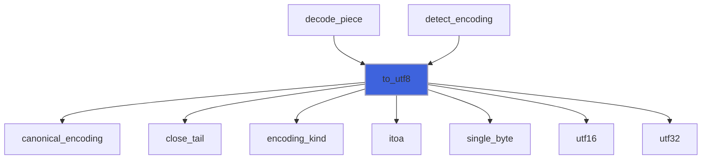

### close_tail

Carry the incomplete character at the end of the input (*is_carried*), or replace it.

**Attributes**: pure

```fortran
subroutine close_tail(input, tail, is_carried, rep, buffer, n, first_error, carried)
```

**Arguments**

| Name | Type | Intent | Attributes | Description |
|------|------|--------|------------|-------------|
| `input` | character(len=*) | in |  | Bytes. |
| `tail` | integer | in |  | First byte of the incomplete character. |
| `is_carried` | logical | in |  | The incomplete character is carried. |
| `rep` | character(len=*) | in |  | Replacement. |
| `buffer` | character(len=*) | inout |  | Output buffer. |
| `n` | integer | inout |  | Output length. |
| `first_error` | integer | inout |  | Position of the first invalid sequence. |
| `carried` | character(len=:) | inout | allocatable | Incomplete character carried. |

**Call graph**

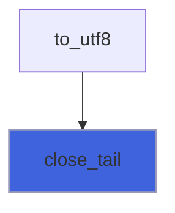

### put

Append the UTF-8 encoding of a codepoint to the buffer.

**Attributes**: pure

```fortran
subroutine put(buffer, n, codepoint)
```

**Arguments**

| Name | Type | Intent | Attributes | Description |
|------|------|--------|------------|-------------|
| `buffer` | character(len=*) | inout |  | Output buffer. |
| `n` | integer | inout |  | Output length. |
| `codepoint` | integer | in |  | Codepoint (a Unicode scalar value). |

**Call graph**

```mermaid
flowchart TD
  cdata["cdata"] --> put["put"]
  declaration["declaration"] --> put["put"]
  end["end"] --> put["put"]
  flush_pending["flush_pending"] --> put["put"]
  markup_line["markup_line"] --> put["put"]
  raw["raw"] --> put["put"]
  single_byte["single_byte"] --> put["put"]
  start["start"] --> put["put"]
  text_character["text_character"] --> put["put"]
  utf16["utf16"] --> put["put"]
  utf32["utf32"] --> put["put"]
  put["put"] --> len_trim_bytes["len_trim_bytes"]
  put["put"] --> utf8_encode["utf8_encode"]
  style put fill:#3e63dd,stroke:#99b,stroke-width:2px
```

### single_byte

Convert a single byte encoding (US-ASCII, ISO-8859-1, windows-1252): ASCII runs are copied as they are.

**Attributes**: pure

```fortran
subroutine single_byte(input, kind_, rep, buffer, n, first_error)
```

**Arguments**

| Name | Type | Intent | Attributes | Description |
|------|------|--------|------------|-------------|
| `input` | character(len=*) | in |  | Bytes. |
| `kind_` | integer | in |  | Encoding. |
| `rep` | character(len=*) | in |  | Replacement. |
| `buffer` | character(len=*) | inout |  | Output buffer. |
| `n` | integer | out |  | Output length. |
| `first_error` | integer | inout |  | Position of the first invalid byte. |

**Call graph**

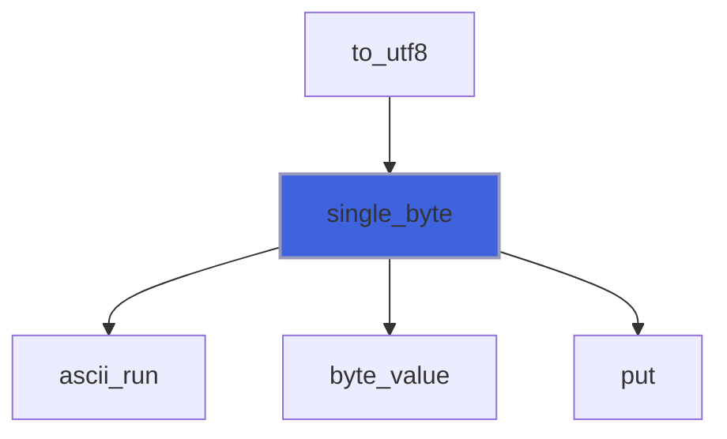

### utf16

Convert UTF-16; *tail* is the first byte of an incomplete character at the end, len(input)+1 if there is none.

**Attributes**: pure

```fortran
subroutine utf16(input, is_big, rep, buffer, n, first_error, tail)
```

**Arguments**

| Name | Type | Intent | Attributes | Description |
|------|------|--------|------------|-------------|
| `input` | character(len=*) | in |  | Bytes. |
| `is_big` | logical | in |  | Big endian. |
| `rep` | character(len=*) | in |  | Replacement. |
| `buffer` | character(len=*) | inout |  | Output buffer. |
| `n` | integer | out |  | Output length. |
| `first_error` | integer | inout |  | Position of the first invalid sequence. |
| `tail` | integer | out |  | First byte of the incomplete character at the end. |

**Call graph**

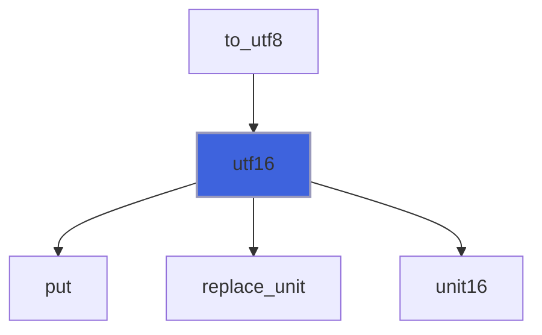

### replace_unit

Append the replacement of an invalid sequence at byte *at*.

**Attributes**: pure

```fortran
subroutine replace_unit(rep, buffer, n, first_error, at)
```

**Arguments**

| Name | Type | Intent | Attributes | Description |
|------|------|--------|------------|-------------|
| `rep` | character(len=*) | in |  | Replacement. |
| `buffer` | character(len=*) | inout |  | Output buffer. |
| `n` | integer | inout |  | Output length. |
| `first_error` | integer | inout |  | Position of the first invalid sequence. |
| `at` | integer | in |  | Position of the sequence. |

**Call graph**

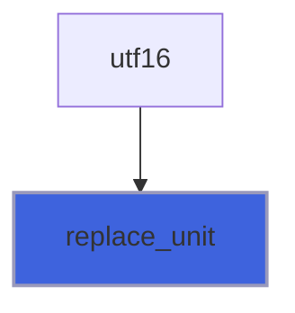

### utf32

Convert UTF-32; *tail* is the first byte of an incomplete unit at the end, len(input)+1 if there is none.

**Attributes**: pure

```fortran
subroutine utf32(input, is_big, rep, buffer, n, first_error, tail)
```

**Arguments**

| Name | Type | Intent | Attributes | Description |
|------|------|--------|------------|-------------|
| `input` | character(len=*) | in |  | Bytes. |
| `is_big` | logical | in |  | Big endian. |
| `rep` | character(len=*) | in |  | Replacement. |
| `buffer` | character(len=*) | inout |  | Output buffer. |
| `n` | integer | out |  | Output length. |
| `first_error` | integer | inout |  | Position of the first invalid unit. |
| `tail` | integer | out |  | First byte of the incomplete unit at the end. |

**Call graph**

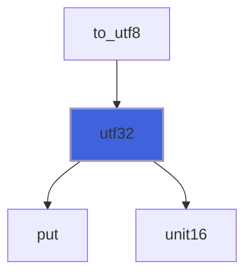

## Functions

### bom_encoding

Return the encoding named by the byte order mark that starts `bytes`: `UTF-8`, `UTF-16LE`, `UTF-16BE`,
 `UTF-32LE`, `UTF-32BE`, or an empty string if there is none.

 @note `FF FE 00 00` is read as the UTF-32LE mark (not as the UTF-16LE mark followed by U+0000).

```fortran
 logical :: test_passed(4)
 test_passed(1) = bom_encoding(char(239)//char(187)//char(191)//'<a/>')=='UTF-8'
 test_passed(2) = bom_encoding(char(255)//char(254)//'<'//char(0))=='UTF-16LE'
 test_passed(3) = bom_encoding(char(0)//char(0)//char(254)//char(255))=='UTF-32BE'
 test_passed(4) = bom_encoding('<a/>')==''
 print '(L1)', all(test_passed)
```

**Attributes**: pure

**Returns**: `character(len=:)`

```fortran
function bom_encoding(bytes) result(encoding)
```

**Arguments**

| Name | Type | Intent | Attributes | Description |
|------|------|--------|------------|-------------|
| `bytes` | character(len=*) | in |  | Bytes, the first ones at least. |

**Call graph**

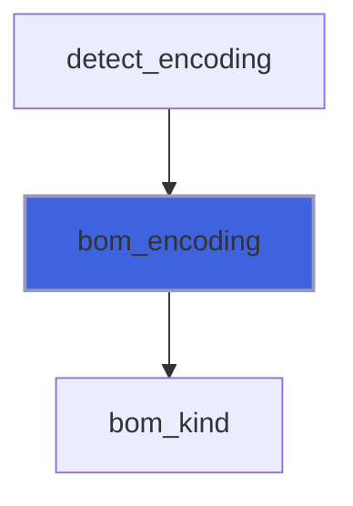

### bom_length

Return the length in bytes of the byte order mark that starts `bytes` (3 for UTF-8, 2 for UTF-16, 4 for UTF-32),
 0 if there is none.

```fortran
 logical :: test_passed(3)
 test_passed(1) = bom_length(char(239)//char(187)//char(191)//'x')==3
 test_passed(2) = bom_length(char(254)//char(255)//char(0)//'x')==2
 test_passed(3) = bom_length('x')==0
 print '(L1)', all(test_passed)
```

**Attributes**: pure

**Returns**: `integer`

```fortran
function bom_length(bytes) result(n)
```

**Arguments**

| Name | Type | Intent | Attributes | Description |
|------|------|--------|------------|-------------|
| `bytes` | character(len=*) | in |  | Bytes, the first ones at least. |

**Call graph**

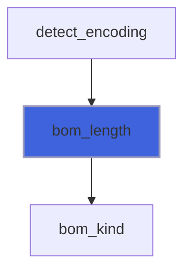

### canonical_encoding

Return the canonical name of a supported encoding, given its name or one of its aliases (IANA character sets,
 case ignored, blanks around ignored), or an empty string if it is not supported.

 The canonical names are `UTF-8`, `US-ASCII`, `ISO-8859-1`, `windows-1252`, `UTF-16`, `UTF-16LE`, `UTF-16BE`,
 `UTF-32`, `UTF-32LE` and `UTF-32BE`.

```fortran
 logical :: test_passed(5)
 test_passed(1) = canonical_encoding('utf8')=='UTF-8'
 test_passed(2) = canonical_encoding(' Latin1 ')=='ISO-8859-1'
 test_passed(3) = canonical_encoding('CP1252')=='windows-1252'
 test_passed(4) = canonical_encoding('ascii')=='US-ASCII'
 test_passed(5) = canonical_encoding('Shift_JIS')==''
 print '(L1)', all(test_passed)
```

**Attributes**: pure

**Returns**: `character(len=:)`

```fortran
function canonical_encoding(name) result(canonical)
```

**Arguments**

| Name | Type | Intent | Attributes | Description |
|------|------|--------|------------|-------------|
| `name` | character(len=*) | in |  | Encoding name. |

**Call graph**

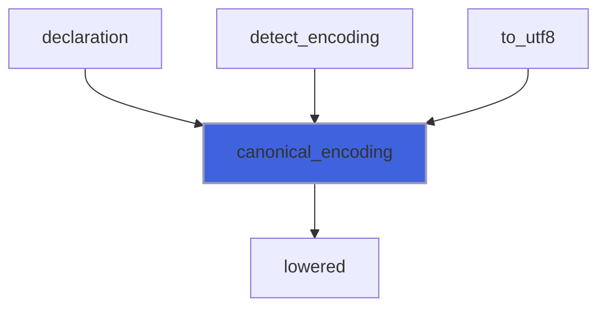

### bom_kind

Return the encoding of the byte order mark that starts `bytes`, ENC_UNKNOWN if there is none.

**Attributes**: pure

**Returns**: `integer`

```fortran
function bom_kind(bytes) result(kind_)
```

**Arguments**

| Name | Type | Intent | Attributes | Description |
|------|------|--------|------------|-------------|
| `bytes` | character(len=*) | in |  | Bytes. |

**Call graph**

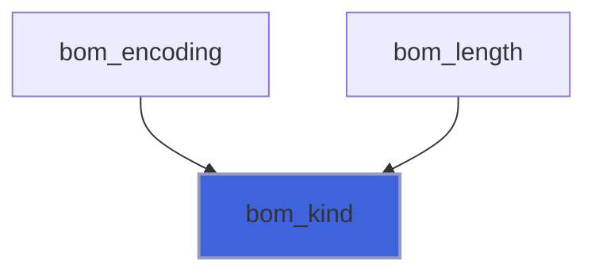

### byte_value

Return the value 0..255 of a byte (`ichar` may be signed above 127 on some processors).

**Attributes**: elemental

**Returns**: `integer`

```fortran
function byte_value(c) result(value)
```

**Arguments**

| Name | Type | Intent | Attributes | Description |
|------|------|--------|------------|-------------|
| `c` | character(len=1) | in |  | Byte. |

**Call graph**

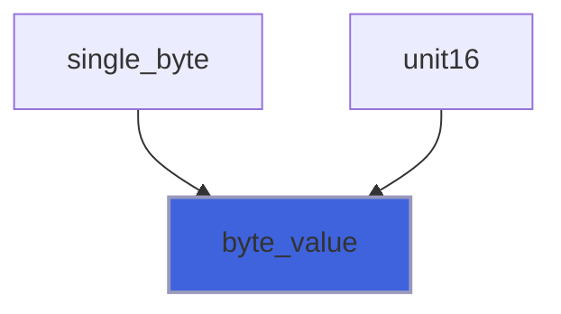

### encoding_kind

Return the encoding of a canonical name (see [canonical_encoding](/api/src/third_party/StringiFor/src/lib/stringifor_encodings#canonical-encoding)), ENC_UNKNOWN for an empty one.

**Attributes**: pure

**Returns**: `integer`

```fortran
function encoding_kind(canonical) result(kind_)
```

**Arguments**

| Name | Type | Intent | Attributes | Description |
|------|------|--------|------------|-------------|
| `canonical` | character(len=*) | in |  | Canonical name. |

**Call graph**

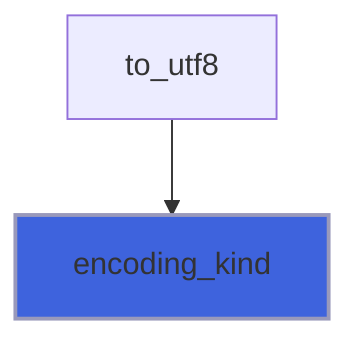

### itoa

Return the decimal digits of a non negative integer.

**Attributes**: pure

**Returns**: `character(len=:)`

```fortran
function itoa(i) result(text)
```

**Arguments**

| Name | Type | Intent | Attributes | Description |
|------|------|--------|------------|-------------|
| `i` | integer | in |  | Integer. |

**Call graph**

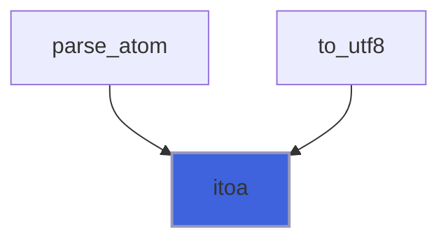

### lowered

Return the text with its ASCII letters lowercased.

**Attributes**: pure

**Returns**: `character(len=len)`

```fortran
function lowered(text) result(lower_text)
```

**Arguments**

| Name | Type | Intent | Attributes | Description |
|------|------|--------|------------|-------------|
| `text` | character(len=*) | in |  | Text. |

**Call graph**

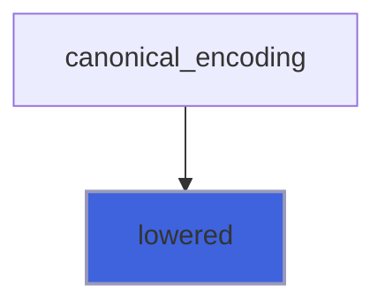

### len_trim_bytes

Return the UTF-8 length of a Unicode scalar value.

**Attributes**: elemental

**Returns**: `integer`

```fortran
function len_trim_bytes(codepoint) result(m)
```

**Arguments**

| Name | Type | Intent | Attributes | Description |
|------|------|--------|------------|-------------|
| `codepoint` | integer | in |  | Codepoint. |

**Call graph**

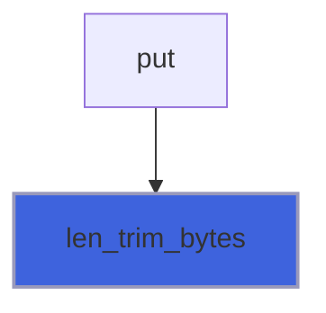

### unit16

Return the value of a 16-bit unit.

**Attributes**: pure

**Returns**: `integer`

```fortran
function unit16(pair, is_big) result(value)
```

**Arguments**

| Name | Type | Intent | Attributes | Description |
|------|------|--------|------------|-------------|
| `pair` | character(len=2) | in |  | Two bytes. |
| `is_big` | logical | in |  | Big endian. |

**Call graph**

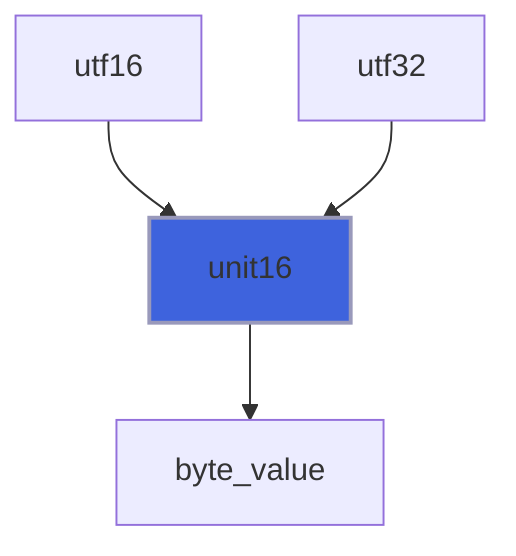
