# stringifor_numbers

> StringiFor, conversions between decimal and binary reals on 64 bit integers (internal module, not re-exported).

 Fortran has no unsigned integer, and a signed overflow is not allowed: the 64 bit words are handled as bit patterns,
 and the arithmetic on them goes through 32 bit limbs that cannot overflow.

**Source**: `src/third_party/StringiFor/src/lib/stringifor_numbers.F90`

**Dependencies**

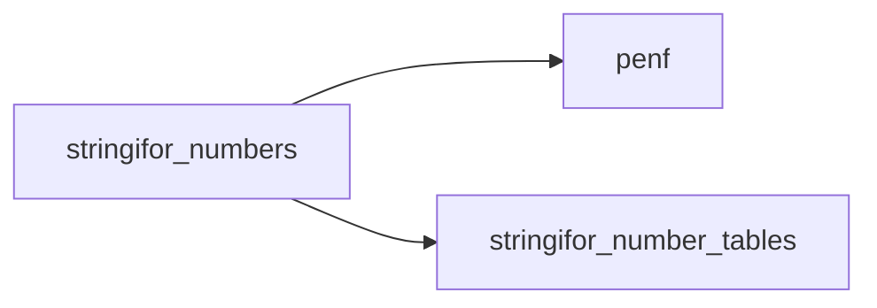

## Contents

- [significant_digits](#significant-digits)
- [load_digits](#load-digits)
- [shift_decimal](#shift-decimal)
- [shift_binary](#shift-binary)
- [multiply_small](#multiply-small)
- [shortest_digits](#shortest-digits)
- [strip_zeros](#strip-zeros)
- [add](#add)
- [multiply](#multiply)
- [multiply32](#multiply32)
- [decimal_to_r8](#decimal-to-r8)
- [decimal_to_r4](#decimal-to-r4)
- [settle_r8](#settle-r8)
- [settle_r4](#settle-r4)
- [settle](#settle)
- [compare](#compare)
- [floor_shift](#floor-shift)
- [BIAS_BITS](#bias-bits)
- [round_to_odd](#round-to-odd)
- [eisel_lemire](#eisel-lemire)

## Variables

| Name | Type | Attributes | Description |
|------|------|------------|-------------|
| `LOW32` | integer(kind=[I8P](/api/src/third_party/PENF/src/lib/penf_global_parameters_variables)) | parameter | The low 32 bits. |
| `LIMB` | integer(kind=[I8P](/api/src/third_party/PENF/src/lib/penf_global_parameters_variables)) | parameter | Base of the big integers of the exact comparison. |

## Subroutines

### significant_digits

Return the digits of the mantissa of a number, without the leading zeros and the point.

**Attributes**: pure

```fortran
subroutine significant_digits(raw, digits, n)
```

**Arguments**

| Name | Type | Intent | Attributes | Description |
|------|------|--------|------------|-------------|
| `raw` | character(len=*) | in |  | The number, as text. |
| `digits` | character(len=*) | out |  | The digits. |
| `n` | integer | out |  | Number of digits. |

**Call graph**

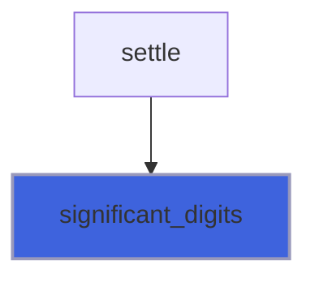

### load_digits

Load decimal digits in a big integer, 9 digits per limb from the last.

**Attributes**: pure

```fortran
subroutine load_digits(digits, big)
```

**Arguments**

| Name | Type | Intent | Attributes | Description |
|------|------|--------|------------|-------------|
| `digits` | character(len=*) | in |  | The digits. |
| `big` | integer(kind=[I8P](/api/src/third_party/PENF/src/lib/penf_global_parameters_variables)) | out |  | The big integer, low limb first. |

**Call graph**

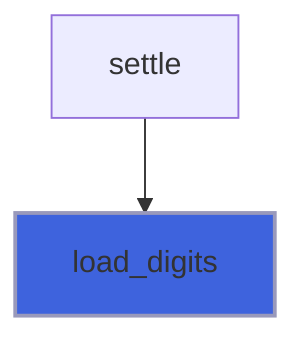

### shift_decimal

Multiply a big integer by 10**power.

**Attributes**: pure

```fortran
subroutine shift_decimal(big, power)
```

**Arguments**

| Name | Type | Intent | Attributes | Description |
|------|------|--------|------------|-------------|
| `big` | integer(kind=[I8P](/api/src/third_party/PENF/src/lib/penf_global_parameters_variables)) | inout |  | The big integer. |
| `power` | integer | in |  | The power. |

**Call graph**

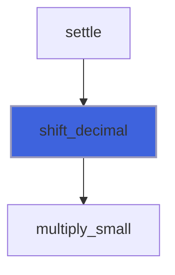

### shift_binary

Multiply a big integer by 2**power.

**Attributes**: pure

```fortran
subroutine shift_binary(big, power)
```

**Arguments**

| Name | Type | Intent | Attributes | Description |
|------|------|--------|------------|-------------|
| `big` | integer(kind=[I8P](/api/src/third_party/PENF/src/lib/penf_global_parameters_variables)) | inout |  | The big integer. |
| `power` | integer | in |  | The power. |

**Call graph**

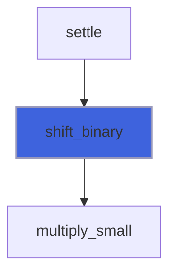

### multiply_small

Multiply a big integer by a factor of at most 10**9: a limb times the factor stays far from the signed limit.

**Attributes**: pure

```fortran
subroutine multiply_small(big, factor)
```

**Arguments**

| Name | Type | Intent | Attributes | Description |
|------|------|--------|------------|-------------|
| `big` | integer(kind=[I8P](/api/src/third_party/PENF/src/lib/penf_global_parameters_variables)) | inout |  | The big integer. |
| `factor` | integer(kind=[I8P](/api/src/third_party/PENF/src/lib/penf_global_parameters_variables)) | in |  | The factor. |

**Call graph**

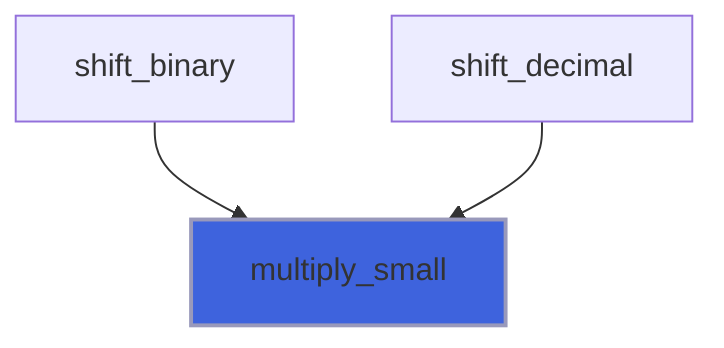

### shortest_digits

Return the shortest decimal digits * 10**exponent that reads back as the binary float, the closest of them if more
 than one (Schubfach: Giulietti, The Schubfach way to render doubles, 2020). Finite and not zero; no trailing zeros.

 The float is given by its fields, so one kernel serves R4P and R8P: every step only relies on the 128 bits of the power.

**Attributes**: elemental

```fortran
subroutine shortest_digits(fraction, biased, mantissa_bits, digits, exponent)
```

**Arguments**

| Name | Type | Intent | Attributes | Description |
|------|------|--------|------------|-------------|
| `fraction` | integer(kind=[I8P](/api/src/third_party/PENF/src/lib/penf_global_parameters_variables)) | in |  | Stored mantissa. |
| `biased` | integer | in |  | Biased exponent. |
| `mantissa_bits` | integer | in |  | Bits of the stored mantissa. |
| `digits` | integer(kind=[I8P](/api/src/third_party/PENF/src/lib/penf_global_parameters_variables)) | out |  | Decimal digits. |
| `exponent` | integer | out |  | Decimal exponent. |

**Call graph**

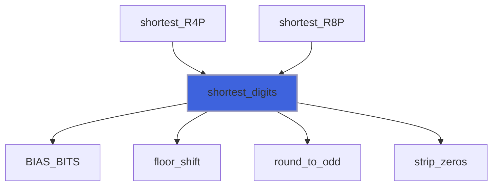

### strip_zeros

Move the trailing zeros of the digits to the exponent.

**Attributes**: elemental

```fortran
subroutine strip_zeros(digits, exponent)
```

**Arguments**

| Name | Type | Intent | Attributes | Description |
|------|------|--------|------------|-------------|
| `digits` | integer(kind=[I8P](/api/src/third_party/PENF/src/lib/penf_global_parameters_variables)) | inout |  | Decimal digits, not zero. |
| `exponent` | integer | inout |  | Decimal exponent. |

**Call graph**


### add

Add two words as unsigned integers.

**Attributes**: elemental

```fortran
subroutine add(a, b, sum, carry)
```

**Arguments**

| Name | Type | Intent | Attributes | Description |
|------|------|--------|------------|-------------|
| `a` | integer(kind=[I8P](/api/src/third_party/PENF/src/lib/penf_global_parameters_variables)) | in |  | First word. |
| `b` | integer(kind=[I8P](/api/src/third_party/PENF/src/lib/penf_global_parameters_variables)) | in |  | Second word. |
| `sum` | integer(kind=[I8P](/api/src/third_party/PENF/src/lib/penf_global_parameters_variables)) | out |  | Low 64 bits of the sum. |
| `carry` | integer(kind=[I8P](/api/src/third_party/PENF/src/lib/penf_global_parameters_variables)) | out |  | Carry, 0 or 1. |

**Call graph**

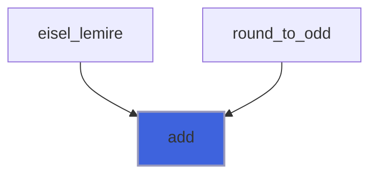

### multiply

Multiply two words as unsigned integers, 64 x 64 = 128 bits.

**Attributes**: elemental

```fortran
subroutine multiply(a, b, high, low)
```

**Arguments**

| Name | Type | Intent | Attributes | Description |
|------|------|--------|------------|-------------|
| `a` | integer(kind=[I8P](/api/src/third_party/PENF/src/lib/penf_global_parameters_variables)) | in |  | First word. |
| `b` | integer(kind=[I8P](/api/src/third_party/PENF/src/lib/penf_global_parameters_variables)) | in |  | Second word. |
| `high` | integer(kind=[I8P](/api/src/third_party/PENF/src/lib/penf_global_parameters_variables)) | out |  | High word. |
| `low` | integer(kind=[I8P](/api/src/third_party/PENF/src/lib/penf_global_parameters_variables)) | out |  | Low word. |

**Call graph**

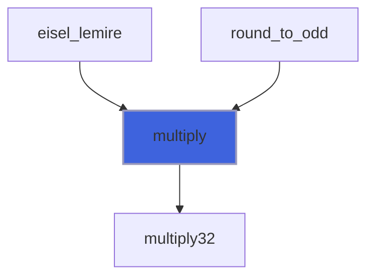

### multiply32

Multiply two 32 bit limbs: a product of a limb and 16 bits fits in a signed word, a product of two limbs may not.

**Attributes**: elemental

```fortran
subroutine multiply32(a, b, high, low)
```

**Arguments**

| Name | Type | Intent | Attributes | Description |
|------|------|--------|------------|-------------|
| `a` | integer(kind=[I8P](/api/src/third_party/PENF/src/lib/penf_global_parameters_variables)) | in |  | First limb. |
| `b` | integer(kind=[I8P](/api/src/third_party/PENF/src/lib/penf_global_parameters_variables)) | in |  | Second limb. |
| `high` | integer(kind=[I8P](/api/src/third_party/PENF/src/lib/penf_global_parameters_variables)) | out |  | High limb. |
| `low` | integer(kind=[I8P](/api/src/third_party/PENF/src/lib/penf_global_parameters_variables)) | out |  | Low limb. |

**Call graph**

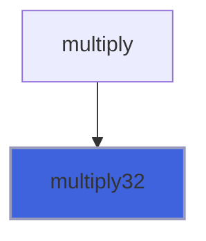

## Functions

### decimal_to_r8

Return the real nearest to mantissa * 10**exponent, ties to even (Eisel-Lemire). Mantissa not negative.

**Attributes**: elemental

**Returns**: real(kind=[R8P](/api/src/third_party/PENF/src/lib/penf_global_parameters_variables))

```fortran
function decimal_to_r8(mantissa, exponent) result(number)
```

**Arguments**

| Name | Type | Intent | Attributes | Description |
|------|------|--------|------------|-------------|
| `mantissa` | integer(kind=[I8P](/api/src/third_party/PENF/src/lib/penf_global_parameters_variables)) | in |  | Digits, as an integer. |
| `exponent` | integer | in |  | Decimal exponent. |

**Call graph**


### decimal_to_r4

Return the real nearest to mantissa * 10**exponent, ties to even (Eisel-Lemire). Mantissa not negative.

**Attributes**: elemental

**Returns**: real(kind=[R4P](/api/src/third_party/PENF/src/lib/penf_global_parameters_variables))

```fortran
function decimal_to_r4(mantissa, exponent) result(number)
```

**Arguments**

| Name | Type | Intent | Attributes | Description |
|------|------|--------|------------|-------------|
| `mantissa` | integer(kind=[I8P](/api/src/third_party/PENF/src/lib/penf_global_parameters_variables)) | in |  | Digits, as an integer. |
| `exponent` | integer | in |  | Decimal exponent. |

**Call graph**

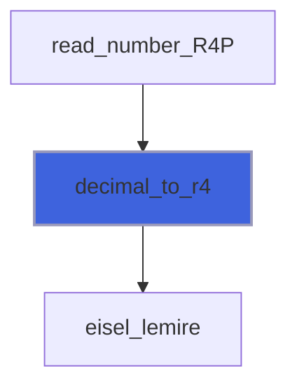

### settle_r8

Return the real nearest to a number of more than 18 digits, when its first 18 digits leave two candidates.

 See [settle](/api/src/third_party/StringiFor/src/lib/stringifor_numbers#settle). `raw` is a number accepted by the parser, `exponent` its exponent for the first 18 digits, `low` the
 real nearest to those 18 digits, the lower candidate.

**Attributes**: elemental

**Returns**: real(kind=[R8P](/api/src/third_party/PENF/src/lib/penf_global_parameters_variables))

```fortran
function settle_r8(raw, exponent, low) result(number)
```

**Arguments**

| Name | Type | Intent | Attributes | Description |
|------|------|--------|------------|-------------|
| `raw` | character(len=*) | in |  | The number, as text. |
| `exponent` | integer | in |  | Decimal exponent of the first 18 digits. |
| `low` | real(kind=[R8P](/api/src/third_party/PENF/src/lib/penf_global_parameters_variables)) | in |  | The lower candidate. |

**Call graph**

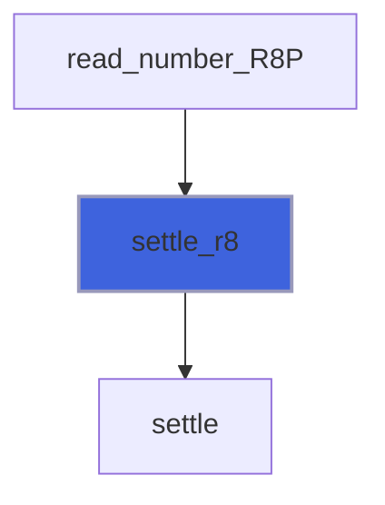

### settle_r4

Return the real nearest to a number of more than 18 digits, when its first 18 digits leave two candidates.

 See [settle](/api/src/third_party/StringiFor/src/lib/stringifor_numbers#settle) and [settle_r8](/api/src/third_party/StringiFor/src/lib/stringifor_numbers#settle-r8).

**Attributes**: elemental

**Returns**: real(kind=[R4P](/api/src/third_party/PENF/src/lib/penf_global_parameters_variables))

```fortran
function settle_r4(raw, exponent, low) result(number)
```

**Arguments**

| Name | Type | Intent | Attributes | Description |
|------|------|--------|------------|-------------|
| `raw` | character(len=*) | in |  | The number, as text. |
| `exponent` | integer | in |  | Decimal exponent of the first 18 digits. |
| `low` | real(kind=[R4P](/api/src/third_party/PENF/src/lib/penf_global_parameters_variables)) | in |  | The lower candidate. |

**Call graph**


### settle

Return the bits of `low` or of the next float, comparing all the digits with the midpoint of the two, exactly.

 The digits D, times 10**q, against the midpoint (2m + 1) * 2**p: each side takes the factors that would be negative
 powers on the other, so both are integers. In base 10**9 a power of ten is mostly a shift of limbs, so the cost is
 linear in the digits.

**Attributes**: pure

**Returns**: integer(kind=[I8P](/api/src/third_party/PENF/src/lib/penf_global_parameters_variables))

```fortran
function settle(raw, exponent, low, mantissa_bits, bias) result(bits)
```

**Arguments**

| Name | Type | Intent | Attributes | Description |
|------|------|--------|------------|-------------|
| `raw` | character(len=*) | in |  | The number, as text. |
| `exponent` | integer | in |  | Decimal exponent of the first 18 digits. |
| `low` | integer(kind=[I8P](/api/src/third_party/PENF/src/lib/penf_global_parameters_variables)) | in |  | Bits of the lower candidate, sign clear. |
| `mantissa_bits` | integer | in |  | Bits of the stored mantissa. |
| `bias` | integer | in |  | Exponent bias. |

**Call graph**

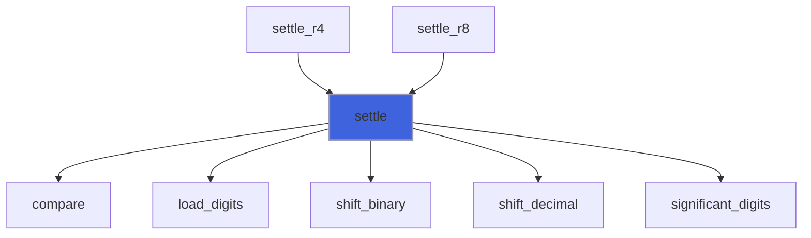

### compare

Return the sign of a - b, two big integers of the same size.

**Attributes**: pure

**Returns**: `integer`

```fortran
function compare(a, b) result(order)
```

**Arguments**

| Name | Type | Intent | Attributes | Description |
|------|------|--------|------------|-------------|
| `a` | integer(kind=[I8P](/api/src/third_party/PENF/src/lib/penf_global_parameters_variables)) | in |  | First big integer. |
| `b` | integer(kind=[I8P](/api/src/third_party/PENF/src/lib/penf_global_parameters_variables)) | in |  | Second big integer. |

**Call graph**

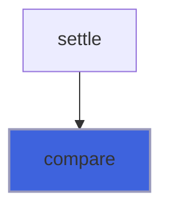

### floor_shift

Return floor(value / 2**bits): nvfortran has no SHIFTA, and a right shift of a negative number needs the floor.

**Attributes**: elemental

**Returns**: `integer`

```fortran
function floor_shift(value, bits) result(shifted)
```

**Arguments**

| Name | Type | Intent | Attributes | Description |
|------|------|--------|------------|-------------|
| `value` | integer | in |  | The value. |
| `bits` | integer | in |  | The bits of the shift. |

**Call graph**

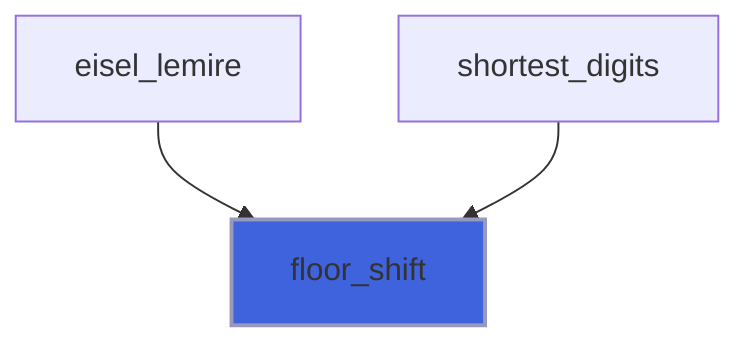

### BIAS_BITS

Return the bits of the exponent field of a format.

**Attributes**: elemental

**Returns**: `integer`

```fortran
function BIAS_BITS(mantissa_bits) result(bits)
```

**Arguments**

| Name | Type | Intent | Attributes | Description |
|------|------|--------|------------|-------------|
| `mantissa_bits` | integer | in |  | Bits of the stored mantissa. |

**Call graph**

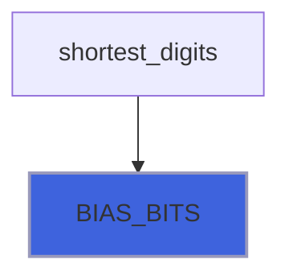

### round_to_odd

Return the high word of g * cp (g of 128 bits) with its lowest bit set if any bit below is set.

**Attributes**: elemental

**Returns**: integer(kind=[I8P](/api/src/third_party/PENF/src/lib/penf_global_parameters_variables))

```fortran
function round_to_odd(g_high, g_low, cp) result(rounded)
```

**Arguments**

| Name | Type | Intent | Attributes | Description |
|------|------|--------|------------|-------------|
| `g_high` | integer(kind=[I8P](/api/src/third_party/PENF/src/lib/penf_global_parameters_variables)) | in |  | High word of g. |
| `g_low` | integer(kind=[I8P](/api/src/third_party/PENF/src/lib/penf_global_parameters_variables)) | in |  | Low word of g. |
| `cp` | integer(kind=[I8P](/api/src/third_party/PENF/src/lib/penf_global_parameters_variables)) | in |  | The multiplier. |

**Call graph**

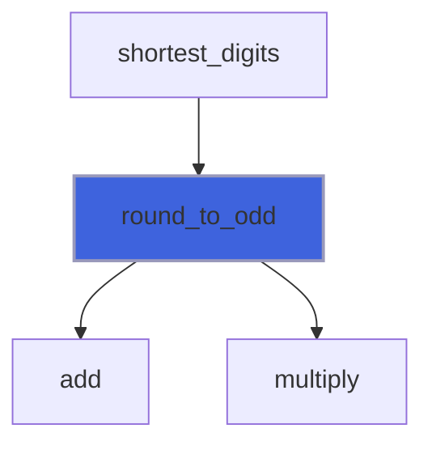

### eisel_lemire

Return the bits of the positive binary float nearest to digits * 10**q, of the format with those parameters.

 The 128 bits of the table are enough for every 64 bit `digits`, so this has no fallback (Mushtak, Lemire, Fast Number
 Parsing Without Fallback, 2023); the oracle checks it against exact arithmetic.

**Attributes**: elemental

**Returns**: integer(kind=[I8P](/api/src/third_party/PENF/src/lib/penf_global_parameters_variables))

```fortran
function eisel_lemire(digits, q, mantissa_bits, bias, infinity, even_min, even_max) result(bits)
```

**Arguments**

| Name | Type | Intent | Attributes | Description |
|------|------|--------|------------|-------------|
| `digits` | integer(kind=[I8P](/api/src/third_party/PENF/src/lib/penf_global_parameters_variables)) | in |  | Decimal digits, not zero. |
| `q` | integer | in |  | Decimal exponent, in the range of the table. |
| `mantissa_bits` | integer | in |  | Bits of the stored mantissa. |
| `bias` | integer | in |  | Exponent bias. |
| `infinity` | integer | in |  | Biased exponent of the infinity. |
| `even_min` | integer | in |  | Lowest q where a product can be an exact tie. |
| `even_max` | integer | in |  | Highest q where a product can be an exact tie. |

**Call graph**

```mermaid
flowchart TD
  decimal_to_r4["decimal_to_r4"] --> eisel_lemire["eisel_lemire"]
  decimal_to_r8["decimal_to_r8"] --> eisel_lemire["eisel_lemire"]
  eisel_lemire["eisel_lemire"] --> add["add"]
  eisel_lemire["eisel_lemire"] --> floor_shift["floor_shift"]
  eisel_lemire["eisel_lemire"] --> multiply["multiply"]
  style eisel_lemire fill:#3e63dd,stroke:#99b,stroke-width:2px
```
