# stringifor_regex

> StringiFor, regular expressions: a Pike VM, linear in the subject.

 A pattern is parsed into a syntax tree, compiled into a program of a small virtual machine and run by a Pike VM: a
 simulation of the Thompson NFA that carries the capture positions with each thread. The time is O(n m), n the length
 of the subject and m the size of the program, whatever the pattern: there is no backtracking. Among the matches
 starting at the leftmost position the VM picks the one a backtracking engine (Perl, Python) would find first.

 Matching is by unit, as the rest of StringiFor: a well-formed UTF-8 sequence, or a single byte that is not part of one.
 Internally a unit is a code: its codepoint, or U+DC00 + b for an ill-formed byte b, as Python's surrogateescape.

**Source**: `src/third_party/StringiFor/src/lib/stringifor_regex.F90`

**Dependencies**

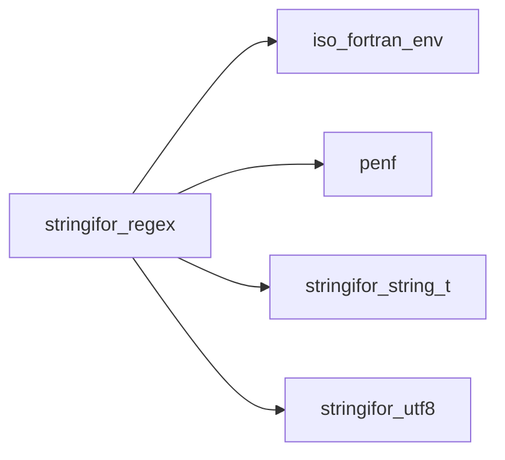

## Contents

- [regex](#regex)
- [regex_match](#regex-match)
- [parser](#parser)
- [re_search](#re-search)
- [re_fullmatch](#re-fullmatch)
- [re_findall](#re-findall)
- [re_split](#re-split)
- [re_sub](#re-sub)
- [compile](#compile)
- [add_thread](#add-thread)
- [all_matches](#all-matches)
- [parse_template](#parse-template)
- [add_piece](#add-piece)
- [fail](#fail)
- [set_flag](#set-flag)
- [parse_global_flags](#parse-global-flags)
- [new_node](#new-node)
- [add_child](#add-child)
- [parse_alternation](#parse-alternation)
- [parse_concatenation](#parse-concatenation)
- [parse_repeat](#parse-repeat)
- [quantifier](#quantifier)
- [read_count](#read-count)
- [parse_atom](#parse-atom)
- [new_group](#new-group)
- [grow_names](#grow-names)
- [parse_escape](#parse-escape)
- [escape_code](#escape-code)
- [new_class](#new-class)
- [add_range](#add-range)
- [add_escape_class](#add-escape-class)
- [add_complement](#add-complement)
- [close_class](#close-class)
- [parse_class](#parse-class)
- [class_item](#class-item)
- [sort_ranges](#sort-ranges)
- [emit](#emit)
- [compile_node](#compile-node)
- [set_split](#set-split)
- [is_compiled](#is-compiled)
- [group_count](#group-count)
- [group_index](#group-index)
- [search_character](#search-character)
- [search_string](#search-string)
- [match_character](#match-character)
- [match_string](#match-string)
- [fullmatch_character](#fullmatch-character)
- [fullmatch_string](#fullmatch-string)
- [finditer_character](#finditer-character)
- [finditer_string](#finditer-string)
- [findall_character](#findall-character)
- [findall_string](#findall-string)
- [split_character](#split-character)
- [split_string](#split-string)
- [sub_character](#sub-character)
- [sub_string](#sub-string)
- [span_number](#span-number)
- [span_name](#span-name)
- [group_number](#group-number)
- [group_name](#group-name)
- [groups](#groups)
- [name_index](#name-index)
- [run](#run)
- [assertion](#assertion)
- [is_word](#is-word)
- [fold](#fold)
- [in_class](#in-class)
- [to_int](#to-int)
- [re_search_cc](#re-search-cc)
- [re_search_cr](#re-search-cr)
- [re_search_sc](#re-search-sc)
- [re_search_sr](#re-search-sr)
- [re_fullmatch_cc](#re-fullmatch-cc)
- [re_fullmatch_cr](#re-fullmatch-cr)
- [re_fullmatch_sc](#re-fullmatch-sc)
- [re_fullmatch_sr](#re-fullmatch-sr)
- [re_findall_cc](#re-findall-cc)
- [re_findall_cr](#re-findall-cr)
- [re_findall_sc](#re-findall-sc)
- [re_findall_sr](#re-findall-sr)
- [re_split_cc](#re-split-cc)
- [re_split_cr](#re-split-cr)
- [re_split_sc](#re-split-sc)
- [re_split_sr](#re-split-sr)
- [re_sub_cc](#re-sub-cc)
- [re_sub_cr](#re-sub-cr)
- [re_sub_sc](#re-sub-sc)
- [re_sub_sr](#re-sub-sr)
- [is_identifier](#is-identifier)
- [hex_value](#hex-value)
- [nullable](#nullable)
- [itoa](#itoa)

## Variables

| Name | Type | Attributes | Description |
|------|------|------------|-------------|
| `MAX_PROGRAM` | integer | parameter | Largest program, in instructions. |
| `MAX_DEPTH` | integer | parameter | Deepest nesting of groups. |
| `MAX_REPEAT` | integer | parameter | Largest count of a {m,n} quantifier. |
| `MAX_GROUPS` | integer | parameter | Most capturing groups. |
| `MAX_CODE` | integer | parameter | Largest code of a unit (U+10FFFF). |
| `BYTE_BASE` | integer | parameter | Code of the ill-formed byte b: BYTE_BASE + b (U+DC00 + b). |
| `BACKSLASH` | character(len=1) | parameter | Backslash (nvfortran reads backslash escapes in literals). |
| `OP_CHAR` | integer | parameter | Match the unit of code arg1. |
| `OP_CHARI` | integer | parameter | Match the unit of code arg1, ASCII case ignored (arg1 is lowercase). |
| `OP_ANY` | integer | parameter | Match any unit but LF. |
| `OP_ANYNL` | integer | parameter | Match any unit. |
| `OP_CLASS` | integer | parameter | Match a unit of the class arg1. |
| `OP_SPLIT` | integer | parameter | Continue at arg1 (preferred) and at arg2. |
| `OP_JMP` | integer | parameter | Continue at arg1. |
| `OP_SAVE` | integer | parameter | Save the position into the slot arg1. |
| `OP_ASSERT` | integer | parameter | Continue if the assertion arg1 holds at the position. |
| `OP_MARK` | integer | parameter | Save the position into the register arg1 (start of a loop iteration). |
| `OP_CHECK` | integer | parameter | Continue at arg2 if the iteration was empty (register arg1 = position), else at arg3. |
| `OP_MATCH` | integer | parameter | A match. |
| `AS_BOT` | integer | parameter | \A, and ^ without m: start of the subject. |
| `AS_EOT` | integer | parameter | \z (\Z): end of the subject. |
| `AS_MBOL` | integer | parameter | ^ with m: start of a line. |
| `AS_EOL` | integer | parameter | $ without m: end of the subject, or before a LF ending it. |
| `AS_MEOL` | integer | parameter | $ with m: end of a line. |
| `AS_WORDB` | integer | parameter | \b: a word boundary (ASCII word characters). |
| `AS_NWORDB` | integer | parameter | \B: not a word boundary. |
| `N_EMPTY` | integer | parameter | Nothing. |
| `N_LIT` | integer | parameter | A unit, code val1. |
| `N_ANY` | integer | parameter | The dot. |
| `N_CLASS` | integer | parameter | A class, index val1. |
| `N_ASSERT` | integer | parameter | An assertion, kind val1. |
| `N_GROUP` | integer | parameter | A group, capturing if val1 > 0 (its number): one child. |
| `N_CAT` | integer | parameter | A concatenation of the children. |
| `N_ALT` | integer | parameter | An alternation of the children. |
| `N_REPEAT` | integer | parameter | The child repeated val1 to val2 times (val2 < 0: no limit), greedy if val3 = 1. |

## Derived Types

### regex

A compiled regular expression.

 Compile it with [compile](/api/src/third_party/StringiFor/src/lib/stringifor_regex#compile), then match it with [search](/api/src/third_party/StringiFor/src/lib/stringifor_string_t#search), [match](/api/src/third_party/StringiFor/src/lib/stringifor_string_t#match) or fullmatch.

#### Components

| Name | Type | Attributes | Description |
|------|------|------------|-------------|
| `compiled` | logical |  | True once compiled. |
| `ngroups` | integer |  | Number of capturing groups. |
| `nregs` | integer |  | Number of loop registers. |
| `op` | integer | allocatable | Instructions. |
| `arg1` | integer | allocatable | First argument of the instructions. |
| `arg2` | integer | allocatable | Second argument of the instructions. |
| `arg3` | integer | allocatable | Third argument of the instructions. |
| `ranges` | integer(kind=[I4P](/api/src/third_party/PENF/src/lib/penf_global_parameters_variables)) | allocatable | Ranges [first, last] of codes of all the classes. |
| `class_first` | integer | allocatable | First range of each class. |
| `class_last` | integer | allocatable | Last range of each class. |
| `class_negated` | logical | allocatable | True if the class is negated. |
| `names` | type([string](/api/src/third_party/StringiFor/src/lib/stringifor_string_t#string)) | allocatable | Name of each group, null if unnamed. |

#### Type-Bound Procedures

| Name | Attributes | Description |
|------|------------|-------------|
| `compile` | pass(self) | Compile a pattern. |
| `is_compiled` | pass(self) | Return true if the regex is compiled. |
| `group_count` | pass(self) | Return the number of capturing groups. |
| `group_index` | pass(self) | Return the number of a named group, 0 if there is none. |
| `search` |  | Search the leftmost match. |
| `match` |  | Match at the start. |
| `fullmatch` |  | Match the whole subject. |
| `finditer` |  | Return all the matches. |
| `findall` |  | Return the text of a group of all the matches. |
| `split` |  | Split the subject at the matches. |
| `sub` |  | Replace the matches. |
| `search_character` | pass(self) | Search the leftmost match in a character. |
| `search_string` | pass(self) | Search the leftmost match in a string. |
| `match_character` | pass(self) | Match at the start of a character. |
| `match_string` | pass(self) | Match at the start of a string. |
| `fullmatch_character` | pass(self) | Match the whole character. |
| `fullmatch_string` | pass(self) | Match the whole string. |
| `finditer_character` | pass(self) | All the matches in a character. |
| `finditer_string` | pass(self) | All the matches in a string. |
| `findall_character` | pass(self) | Group texts of all the matches in a character. |
| `findall_string` | pass(self) | Group texts of all the matches in a string. |
| `split_character` | pass(self) | Split a character. |
| `split_string` | pass(self) | Split a string. |
| `sub_character` | pass(self) | Replace the matches in a character. |
| `sub_string` | pass(self) | Replace the matches in a string. |

### regex_match

The result of a match: whether it was found, and the position and the text of each group.

#### Components

| Name | Type | Attributes | Description |
|------|------|------------|-------------|
| `found` | logical |  | True if there is a match. |
| `spans` | integer | allocatable | First and last byte of each group 0..n; [0, -1] if it did not match. |
| `texts` | type([string](/api/src/third_party/StringiFor/src/lib/stringifor_string_t#string)) | allocatable | Text of each group 0..n; not allocated if it did not match. |
| `names` | type([string](/api/src/third_party/StringiFor/src/lib/stringifor_string_t#string)) | allocatable | Name of each group 1..n, null if unnamed. |

#### Type-Bound Procedures

| Name | Attributes | Description |
|------|------------|-------------|
| `span` |  | Return the first and last byte of a group. |
| `group` |  | Return the text of a group. |
| `groups` | pass(self) | Return the texts of the groups 1..n. |
| `span_number` | pass(self) | Span of a group by number. |
| `span_name` | pass(self) | Span of a group by name. |
| `group_number` | pass(self) | Text of a group by number. |
| `group_name` | pass(self) | Text of a group by name. |

### parser

State of the parser and of the compiler of a pattern.

#### Components

| Name | Type | Attributes | Description |
|------|------|------------|-------------|
| `pattern` | character(kind=[CK](/api/src/third_party/StringiFor/src/lib/stringifor_string_t), len=:) | allocatable | The pattern. |
| `ip` | integer |  | Position in the pattern. |
| `nocase` | logical |  | Flag i. |
| `multiline` | logical |  | Flag m. |
| `dotall` | logical |  | Flag s. |
| `nnodes` | integer |  | Number of nodes. |
| `kind` | integer | allocatable | Kind of each node. |
| `val1` | integer | allocatable | First value of each node. |
| `val2` | integer | allocatable | Second value of each node. |
| `val3` | integer | allocatable | Third value of each node. |
| `child` | integer | allocatable | First child of each node. |
| `sibling` | integer | allocatable | Next sibling of each node. |
| `nranges` | integer |  | Number of ranges. |
| `ranges` | integer(kind=[I4P](/api/src/third_party/PENF/src/lib/penf_global_parameters_variables)) | allocatable | Ranges of the classes. |
| `nclasses` | integer |  | Number of classes. |
| `class_first` | integer | allocatable | First range of each class. |
| `class_last` | integer | allocatable | Last range of each class. |
| `class_negated` | logical | allocatable | True if the class is negated. |
| `ngroups` | integer |  | Number of capturing groups. |
| `names` | type([string](/api/src/third_party/StringiFor/src/lib/stringifor_string_t#string)) | allocatable | Names of the groups. |
| `nregs` | integer |  | Number of loop registers. |
| `npc` | integer |  | Size of the program. |
| `op` | integer | allocatable | Instructions. |
| `arg1` | integer | allocatable | First arguments. |
| `arg2` | integer | allocatable | Second arguments. |
| `arg3` | integer | allocatable | Third arguments. |
| `error` | integer |  | Position of the first error, 0 if none. |
| `message` | character(len=:) | allocatable | Message of the first error. |

## Interfaces

### re_search

Overloading of re_search for character and string subjects, character and compiled patterns.

**Module procedures**: [`re_search_cc`](/api/src/third_party/StringiFor/src/lib/stringifor_regex#re-search-cc), [`re_search_cr`](/api/src/third_party/StringiFor/src/lib/stringifor_regex#re-search-cr), [`re_search_sc`](/api/src/third_party/StringiFor/src/lib/stringifor_regex#re-search-sc), [`re_search_sr`](/api/src/third_party/StringiFor/src/lib/stringifor_regex#re-search-sr)

### re_fullmatch

Overloading of re_fullmatch for character and string subjects, character and compiled patterns.

**Module procedures**: [`re_fullmatch_cc`](/api/src/third_party/StringiFor/src/lib/stringifor_regex#re-fullmatch-cc), [`re_fullmatch_cr`](/api/src/third_party/StringiFor/src/lib/stringifor_regex#re-fullmatch-cr), [`re_fullmatch_sc`](/api/src/third_party/StringiFor/src/lib/stringifor_regex#re-fullmatch-sc), [`re_fullmatch_sr`](/api/src/third_party/StringiFor/src/lib/stringifor_regex#re-fullmatch-sr)

### re_findall

Overloading of re_findall for character and string subjects, character and compiled patterns.

**Module procedures**: [`re_findall_cc`](/api/src/third_party/StringiFor/src/lib/stringifor_regex#re-findall-cc), [`re_findall_cr`](/api/src/third_party/StringiFor/src/lib/stringifor_regex#re-findall-cr), [`re_findall_sc`](/api/src/third_party/StringiFor/src/lib/stringifor_regex#re-findall-sc), [`re_findall_sr`](/api/src/third_party/StringiFor/src/lib/stringifor_regex#re-findall-sr)

### re_split

Overloading of re_split for character and string subjects, character and compiled patterns.

**Module procedures**: [`re_split_cc`](/api/src/third_party/StringiFor/src/lib/stringifor_regex#re-split-cc), [`re_split_cr`](/api/src/third_party/StringiFor/src/lib/stringifor_regex#re-split-cr), [`re_split_sc`](/api/src/third_party/StringiFor/src/lib/stringifor_regex#re-split-sc), [`re_split_sr`](/api/src/third_party/StringiFor/src/lib/stringifor_regex#re-split-sr)

### re_sub

Overloading of re_sub for character and string subjects, character and compiled patterns.

**Module procedures**: [`re_sub_cc`](/api/src/third_party/StringiFor/src/lib/stringifor_regex#re-sub-cc), [`re_sub_cr`](/api/src/third_party/StringiFor/src/lib/stringifor_regex#re-sub-cr), [`re_sub_sc`](/api/src/third_party/StringiFor/src/lib/stringifor_regex#re-sub-sc), [`re_sub_sr`](/api/src/third_party/StringiFor/src/lib/stringifor_regex#re-sub-sr)

## Subroutines

### compile

Compile a pattern.

 `flags` holds the letters of the flags: `i` (ASCII case ignored), `m` (multiline: `^` and `$` at the line ends), `s`
 (the dot matches LF too); they can also start the pattern, as `(?im)`. On a malformed pattern `iostat` is the byte
 position of the error and `iomsg` says what it is, and the regex is left not compiled; without `iostat` the program
 stops with that message.

```fortran
 type(regex) :: re
 integer     :: iostat
 character(len=99) :: iomsg
 logical     :: test_passed(6)
 call re%compile('(\d+)-(\d+)', iostat=iostat)
 test_passed(1) = iostat==0.and.re%group_count()==2
 call re%compile('a(b', iostat=iostat, iomsg=iomsg)
 test_passed(2) = iostat==4.and.trim(iomsg)=='missing ), unterminated group opened at byte 2'
 call re%compile('x{2,1}', iostat=iostat)
 test_passed(3) = iostat==2
 call re%compile('a{1001}', iostat=iostat, iomsg=iomsg)
 test_passed(4) = iostat==2.and.trim(iomsg)=='repeat count above 1000'
 call re%compile(repeat('(', 300)//repeat(')', 300), iostat=iostat, iomsg=iomsg)
 test_passed(5) = iostat==201.and.trim(iomsg)=='groups nested too deep'
 call re%compile('(a{1000}){1000}', iostat=iostat, iomsg=iomsg)
 test_passed(6) = iostat==1.and.index(iomsg, 'pattern too large')==1.and..not.re%is_compiled()
 print '(L1)', all(test_passed)
```

```fortran
subroutine compile(self, pattern, flags, iostat, iomsg)
```

**Arguments**

| Name | Type | Intent | Attributes | Description |
|------|------|--------|------------|-------------|
| `self` | class([regex](/api/src/third_party/StringiFor/src/lib/stringifor_regex#regex)) | inout |  | The regex. |
| `pattern` | character(len=*) | in |  | The pattern. |
| `flags` | character(len=*) | in | optional | Flags: letters i, m, s. |
| `iostat` | integer | out | optional | Byte position of the error, 0 if none. |
| `iomsg` | character(len=*) | inout | optional | Message of the error. |

**Call graph**

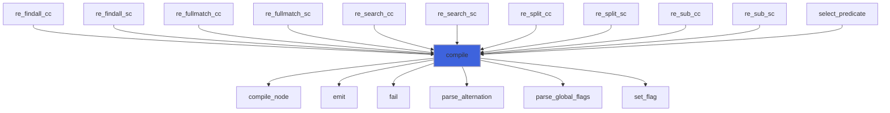

### add_thread

Add to a list the threads reached from the instruction pc0 at the position pos, in priority order.

 The epsilon closure is followed with an explicit stack, so a long program never overflows the call stack. A
 negative entry restores a slot when the branch that set it is done.

**Attributes**: pure

```fortran
subroutine add_thread(self, subject, stack, mark, caps, list_pc, list_cap, count, gen, pc0, pos)
```

**Arguments**

| Name | Type | Intent | Attributes | Description |
|------|------|--------|------------|-------------|
| `self` | type([regex](/api/src/third_party/StringiFor/src/lib/stringifor_regex#regex)) | in |  | The regex. |
| `subject` | character(len=*) | in |  | The subject. |
| `stack` | integer | inout |  | Stack: (instruction or -slot, value). |
| `mark` | integer | inout |  | Generation in which each instruction was added. |
| `caps` | integer | inout |  | Slots of the thread being added, restored on exit. |
| `list_pc` | integer | inout |  | Instructions of the list. |
| `list_cap` | integer | inout |  | Slots of the list. |
| `count` | integer | inout |  | Threads in the list. |
| `gen` | integer | in |  | Generation of the list. |
| `pc0` | integer | in |  | First instruction. |
| `pos` | integer | in |  | Position. |

**Call graph**

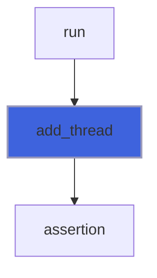

### all_matches

Find the matches left to right from the byte start, at most limit of them (0: no limit), as Python's finditer: the
 search goes on at the end of each match, and after an empty match the next one may not be empty at that position.

**Attributes**: pure

```fortran
subroutine all_matches(self, subject, start, limit, matches, n)
```

**Arguments**

| Name | Type | Intent | Attributes | Description |
|------|------|--------|------------|-------------|
| `self` | type([regex](/api/src/third_party/StringiFor/src/lib/stringifor_regex#regex)) | in |  | The regex. |
| `subject` | character(len=*) | in |  | The subject. |
| `start` | integer | in | optional | First byte, default 1. |
| `limit` | integer | in |  | Most matches, 0 if no limit. |
| `matches` | type([regex_match](/api/src/third_party/StringiFor/src/lib/stringifor_regex#regex-match)) | out | allocatable | The matches, the first n used. |
| `n` | integer | out |  | Number of matches. |

**Call graph**

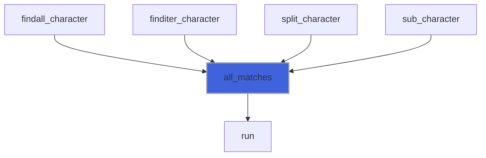

### parse_template

Parse a replacement template into pieces: a text (group -1) or the text of a group.

**Attributes**: pure

```fortran
subroutine parse_template(self, repl, piece_group, piece_text, error, message)
```

**Arguments**

| Name | Type | Intent | Attributes | Description |
|------|------|--------|------------|-------------|
| `self` | type([regex](/api/src/third_party/StringiFor/src/lib/stringifor_regex#regex)) | in |  | The regex. |
| `repl` | character(len=*) | in |  | Template. |
| `piece_group` | integer | out | allocatable | Group of each piece, -1 for a text. |
| `piece_text` | type([string](/api/src/third_party/StringiFor/src/lib/stringifor_string_t#string)) | out | allocatable | Text of each piece. |
| `error` | integer | out |  | Position of the first error, 0 if none. |
| `message` | character(len=:) | out | allocatable | Message of the error. |

**Call graph**

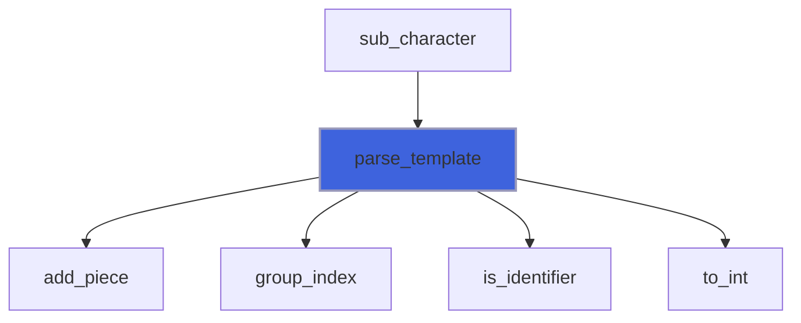

### add_piece

Close the text collected so far as a piece, if any, then add the group (if group >= 0) as a piece.

**Attributes**: pure

```fortran
subroutine add_piece(piece_group, piece_text, text, group)
```

**Arguments**

| Name | Type | Intent | Attributes | Description |
|------|------|--------|------------|-------------|
| `piece_group` | integer | inout | allocatable | Group of each piece, -1 for a text. |
| `piece_text` | type([string](/api/src/third_party/StringiFor/src/lib/stringifor_string_t#string)) | inout | allocatable | Text of each piece. |
| `text` | character(len=:) | inout | allocatable | Text collected, emptied. |
| `group` | integer | in |  | Group, -1 to close the text only. |

**Call graph**

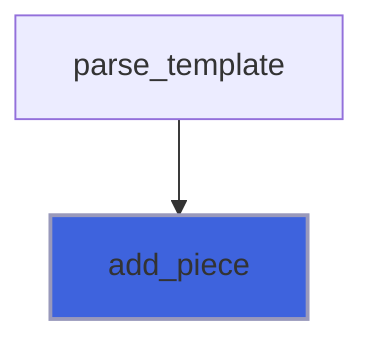

### fail

Record the first error.

**Attributes**: pure

```fortran
subroutine fail(p, pos, message)
```

**Arguments**

| Name | Type | Intent | Attributes | Description |
|------|------|--------|------------|-------------|
| `p` | type([parser](/api/src/third_party/StringiFor/src/lib/stringifor_regex#parser)) | inout |  | Parser. |
| `pos` | integer | in |  | Byte position of the error. |
| `message` | character(len=*) | in |  | What is wrong. |

**Call graph**

```mermaid
flowchart TD
  attribute_character["attribute_character"] --> fail["fail"]
  attribute_i1p["attribute_i1p"] --> fail["fail"]
  attribute_i1p_1["attribute_i1p_1"] --> fail["fail"]
  attribute_i2p["attribute_i2p"] --> fail["fail"]
  attribute_i2p_1["attribute_i2p_1"] --> fail["fail"]
  attribute_i4p["attribute_i4p"] --> fail["fail"]
  attribute_i4p_1["attribute_i4p_1"] --> fail["fail"]
  attribute_i8p["attribute_i8p"] --> fail["fail"]
  attribute_i8p_1["attribute_i8p_1"] --> fail["fail"]
  attribute_r4p["attribute_r4p"] --> fail["fail"]
  attribute_r4p_1["attribute_r4p_1"] --> fail["fail"]
  attribute_r8p["attribute_r8p"] --> fail["fail"]
  attribute_r8p_1["attribute_r8p_1"] --> fail["fail"]
  class_item["class_item"] --> fail["fail"]
  close["close"] --> fail["fail"]
  comment["comment"] --> fail["fail"]
  compile["compile"] --> fail["fail"]
  declaration["declaration"] --> fail["fail"]
  emit["emit"] --> fail["fail"]
  end["end"] --> fail["fail"]
  escape_code["escape_code"] --> fail["fail"]
  is_writable["is_writable"] --> fail["fail"]
  new_group["new_group"] --> fail["fail"]
  open["open"] --> fail["fail"]
  parse_atom["parse_atom"] --> fail["fail"]
  parse_class["parse_class"] --> fail["fail"]
  parse_escape["parse_escape"] --> fail["fail"]
  parse_repeat["parse_repeat"] --> fail["fail"]
  pi["pi"] --> fail["fail"]
  put["put"] --> fail["fail"]
  set_flag["set_flag"] --> fail["fail"]
  start["start"] --> fail["fail"]
  start_content["start_content"] --> fail["fail"]
  text_i1p["text_i1p"] --> fail["fail"]
  text_i1p_1["text_i1p_1"] --> fail["fail"]
  text_i2p["text_i2p"] --> fail["fail"]
  text_i2p_1["text_i2p_1"] --> fail["fail"]
  text_i4p["text_i4p"] --> fail["fail"]
  text_i4p_1["text_i4p_1"] --> fail["fail"]
  text_i8p["text_i8p"] --> fail["fail"]
  text_i8p_1["text_i8p_1"] --> fail["fail"]
  text_r4p["text_r4p"] --> fail["fail"]
  text_r4p_1["text_r4p_1"] --> fail["fail"]
  text_r8p["text_r8p"] --> fail["fail"]
  text_r8p_1["text_r8p_1"] --> fail["fail"]
  to_values_I1P["to_values_I1P"] --> fail["fail"]
  to_values_I2P["to_values_I2P"] --> fail["fail"]
  to_values_I4P["to_values_I4P"] --> fail["fail"]
  to_values_I8P["to_values_I8P"] --> fail["fail"]
  to_values_R4P["to_values_R4P"] --> fail["fail"]
  to_values_R8P["to_values_R8P"] --> fail["fail"]
  style fail fill:#3e63dd,stroke:#99b,stroke-width:2px
```

### set_flag

Set a flag from its letter.

**Attributes**: pure

```fortran
subroutine set_flag(p, letter, pos)
```

**Arguments**

| Name | Type | Intent | Attributes | Description |
|------|------|--------|------------|-------------|
| `p` | type([parser](/api/src/third_party/StringiFor/src/lib/stringifor_regex#parser)) | inout |  | Parser. |
| `letter` | character(len=1) | in |  | Letter of the flag. |
| `pos` | integer | in |  | Position of the letter in the pattern, 0 if in the flags argument. |

**Call graph**

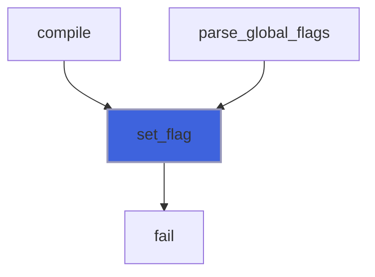

### parse_global_flags

Parse the flags `(?ims)` at the start of the pattern.

**Attributes**: pure

```fortran
subroutine parse_global_flags(p)
```

**Arguments**

| Name | Type | Intent | Attributes | Description |
|------|------|--------|------------|-------------|
| `p` | type([parser](/api/src/third_party/StringiFor/src/lib/stringifor_regex#parser)) | inout |  | Parser. |

**Call graph**

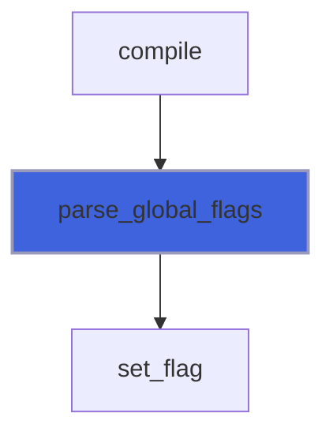

### new_node

Add a node to the tree.

**Attributes**: pure

```fortran
subroutine new_node(p, node, kind, val1, val2, val3)
```

**Arguments**

| Name | Type | Intent | Attributes | Description |
|------|------|--------|------------|-------------|
| `p` | type([parser](/api/src/third_party/StringiFor/src/lib/stringifor_regex#parser)) | inout |  | Parser. |
| `node` | integer | out |  | The node. |
| `kind` | integer | in |  | Kind of node. |
| `val1` | integer | in | optional | First value. |
| `val2` | integer | in | optional | Second value. |
| `val3` | integer | in | optional | Third value. |

**Call graph**

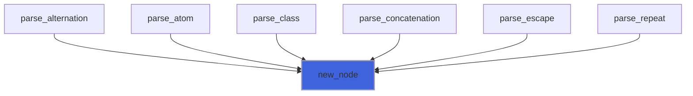

### add_child

Append a child to a node; last is its last child so far (0 if none), updated.

**Attributes**: pure

```fortran
subroutine add_child(p, parent, last, node)
```

**Arguments**

| Name | Type | Intent | Attributes | Description |
|------|------|--------|------------|-------------|
| `p` | type([parser](/api/src/third_party/StringiFor/src/lib/stringifor_regex#parser)) | inout |  | Parser. |
| `parent` | integer | in |  | Parent node. |
| `last` | integer | inout |  | Last child. |
| `node` | integer | in |  | New child. |

**Call graph**

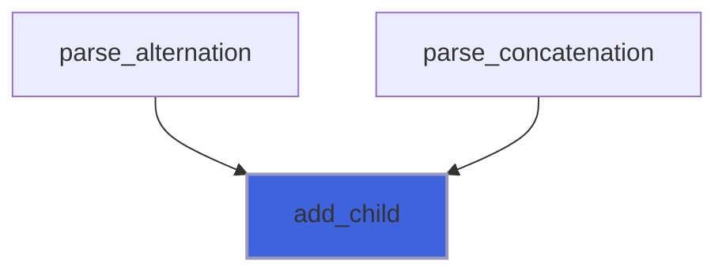

### parse_alternation

Parse `concatenation ( '|' concatenation )*`.

**Attributes**: pure, recursive

```fortran
subroutine parse_alternation(p, depth, node)
```

**Arguments**

| Name | Type | Intent | Attributes | Description |
|------|------|--------|------------|-------------|
| `p` | type([parser](/api/src/third_party/StringiFor/src/lib/stringifor_regex#parser)) | inout |  | Parser. |
| `depth` | integer | in |  | Nesting depth of the groups. |
| `node` | integer | out |  | The node. |

**Call graph**

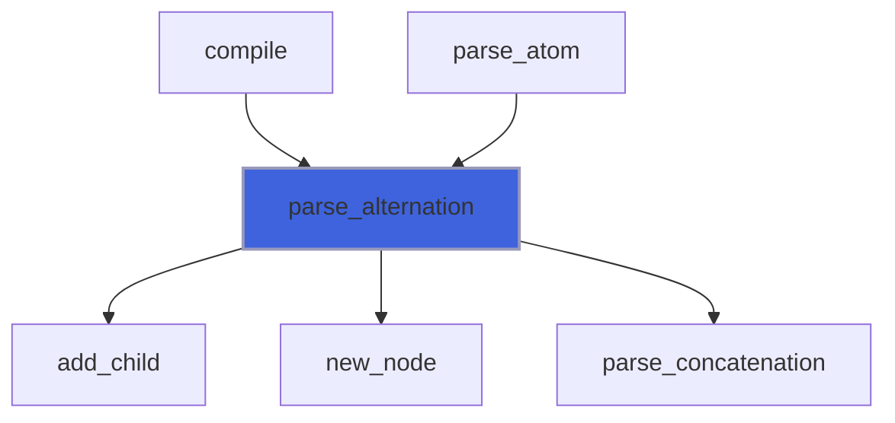

### parse_concatenation

Parse a sequence of repeated atoms, up to `|`, `)` or the end.

**Attributes**: pure, recursive

```fortran
subroutine parse_concatenation(p, depth, node)
```

**Arguments**

| Name | Type | Intent | Attributes | Description |
|------|------|--------|------------|-------------|
| `p` | type([parser](/api/src/third_party/StringiFor/src/lib/stringifor_regex#parser)) | inout |  | Parser. |
| `depth` | integer | in |  | Nesting depth of the groups. |
| `node` | integer | out |  | The node. |

**Call graph**

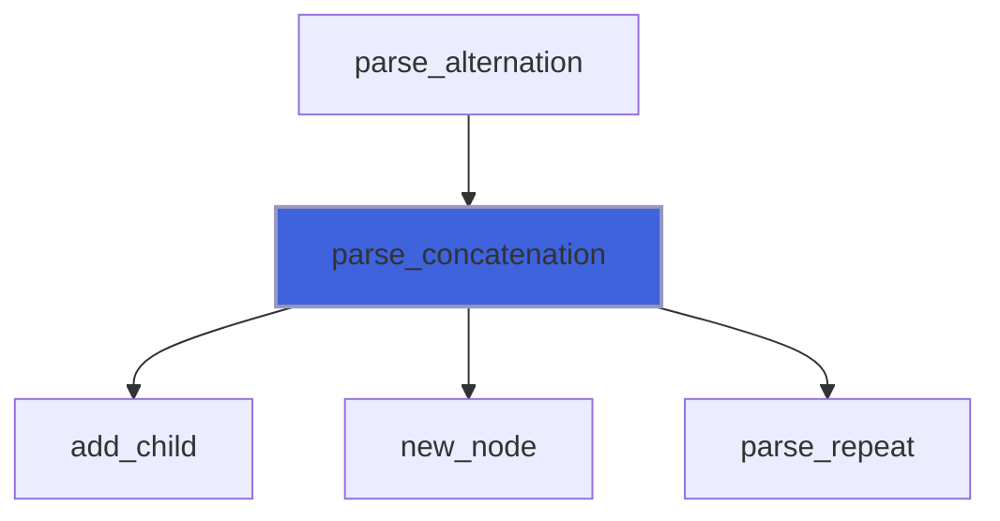

### parse_repeat

Parse an atom and its quantifier, if any: `*`, `+`, `?`, `{m}`, `{m,}`, `{,n}`, `{m,n}`, each followed by an
 optional `?` (lazy).

**Attributes**: pure, recursive

```fortran
subroutine parse_repeat(p, depth, node)
```

**Arguments**

| Name | Type | Intent | Attributes | Description |
|------|------|--------|------------|-------------|
| `p` | type([parser](/api/src/third_party/StringiFor/src/lib/stringifor_regex#parser)) | inout |  | Parser. |
| `depth` | integer | in |  | Nesting depth of the groups. |
| `node` | integer | out |  | The node. |

**Call graph**

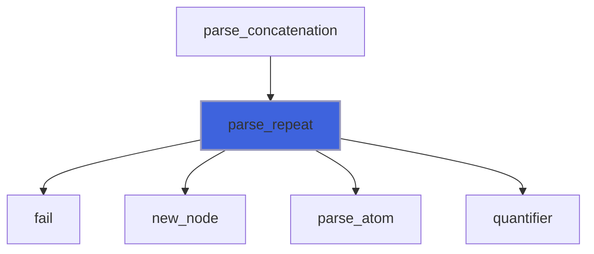

### quantifier

Read the quantifier at pos, if any. A `{` that does not start `{m}`, `{m,}`, `{,n}`, `{m,n}` or `{,}` is a literal.

**Attributes**: pure

```fortran
subroutine quantifier(p, pos, is_quantifier, lo, hi, after)
```

**Arguments**

| Name | Type | Intent | Attributes | Description |
|------|------|--------|------------|-------------|
| `p` | type([parser](/api/src/third_party/StringiFor/src/lib/stringifor_regex#parser)) | in |  | Parser. |
| `pos` | integer | in |  | Position. |
| `is_quantifier` | logical | out |  | True if a quantifier is there. |
| `lo` | integer | out |  | Minimum count. |
| `hi` | integer | out |  | Maximum count, -1 if none. |
| `after` | integer | out |  | Position after the quantifier. |

**Call graph**

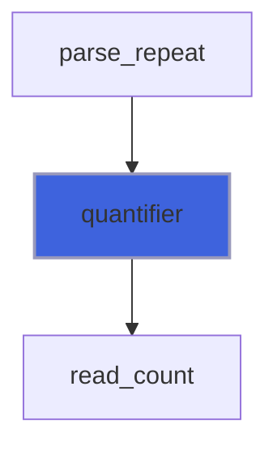

### read_count

Read decimal digits at j, saturated above MAX_REPEAT + 1; j moves after them.

**Attributes**: pure

```fortran
subroutine read_count(text, j, value, has_digits)
```

**Arguments**

| Name | Type | Intent | Attributes | Description |
|------|------|--------|------------|-------------|
| `text` | character(len=*) | in |  | Text. |
| `j` | integer | inout |  | Position. |
| `value` | integer | out |  | Value. |
| `has_digits` | logical | out |  | True if there was at least one digit. |

**Call graph**

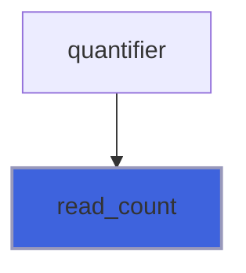

### parse_atom

Parse an atom: a group, a class, the dot, an anchor, an escape or a unit.

**Attributes**: pure, recursive

```fortran
subroutine parse_atom(p, depth, node)
```

**Arguments**

| Name | Type | Intent | Attributes | Description |
|------|------|--------|------------|-------------|
| `p` | type([parser](/api/src/third_party/StringiFor/src/lib/stringifor_regex#parser)) | inout |  | Parser. |
| `depth` | integer | in |  | Nesting depth of the groups. |
| `node` | integer | out |  | The node. |

**Call graph**

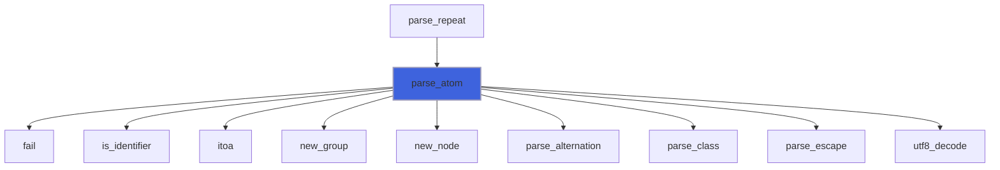

### new_group

Number a new capturing group.

**Attributes**: pure

```fortran
subroutine new_group(p, name, pos, group)
```

**Arguments**

| Name | Type | Intent | Attributes | Description |
|------|------|--------|------------|-------------|
| `p` | type([parser](/api/src/third_party/StringiFor/src/lib/stringifor_regex#parser)) | inout |  | Parser. |
| `name` | character(len=*) | in |  | Name, empty if unnamed. |
| `pos` | integer | in |  | Position, for the errors. |
| `group` | integer | out |  | Number of the group. |

**Call graph**

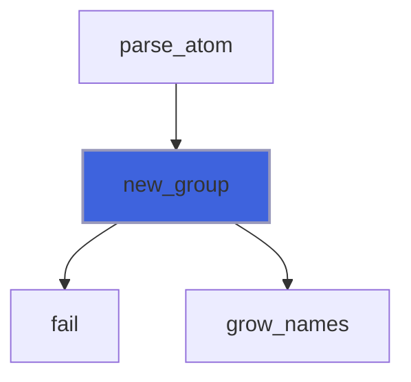

### grow_names

Double the room for the names of the groups; the new ones are not allocated (unnamed).

**Attributes**: pure

```fortran
subroutine grow_names(p)
```

**Arguments**

| Name | Type | Intent | Attributes | Description |
|------|------|--------|------------|-------------|
| `p` | type([parser](/api/src/third_party/StringiFor/src/lib/stringifor_regex#parser)) | inout |  | Parser. |

**Call graph**

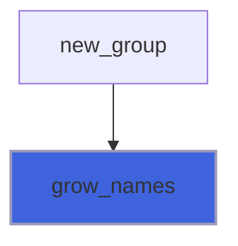

### parse_escape

Parse an escape outside a class.

**Attributes**: pure

```fortran
subroutine parse_escape(p, node)
```

**Arguments**

| Name | Type | Intent | Attributes | Description |
|------|------|--------|------------|-------------|
| `p` | type([parser](/api/src/third_party/StringiFor/src/lib/stringifor_regex#parser)) | inout |  | Parser. |
| `node` | integer | out |  | The node. |

**Call graph**

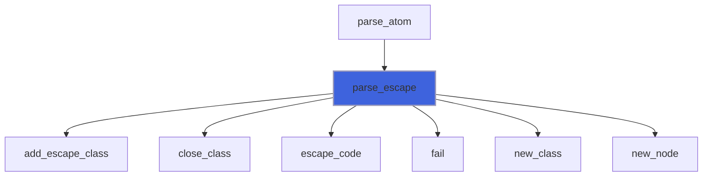

### escape_code

Parse the escape of a single unit at p%ip (the backslash) and move after it.

**Attributes**: pure

```fortran
subroutine escape_code(p, code)
```

**Arguments**

| Name | Type | Intent | Attributes | Description |
|------|------|--------|------------|-------------|
| `p` | type([parser](/api/src/third_party/StringiFor/src/lib/stringifor_regex#parser)) | inout |  | Parser. |
| `code` | integer(kind=[I4P](/api/src/third_party/PENF/src/lib/penf_global_parameters_variables)) | out |  | Code of the unit. |

**Call graph**

```mermaid
flowchart TD
  class_item["class_item"] --> escape_code["escape_code"]
  parse_escape["parse_escape"] --> escape_code["escape_code"]
  escape_code["escape_code"] --> fail["fail"]
  escape_code["escape_code"] --> hex_value["hex_value"]
  escape_code["escape_code"] --> utf8_decode["utf8_decode"]
  style escape_code fill:#3e63dd,stroke:#99b,stroke-width:2px
```

### new_class

Open a new class.

**Attributes**: pure

```fortran
subroutine new_class(p, k)
```

**Arguments**

| Name | Type | Intent | Attributes | Description |
|------|------|--------|------------|-------------|
| `p` | type([parser](/api/src/third_party/StringiFor/src/lib/stringifor_regex#parser)) | inout |  | Parser. |
| `k` | integer | out |  | The class. |

**Call graph**

```mermaid
flowchart TD
  parse_class["parse_class"] --> new_class["new_class"]
  parse_escape["parse_escape"] --> new_class["new_class"]
  style new_class fill:#3e63dd,stroke:#99b,stroke-width:2px
```

### add_range

Add a range of codes to the class being built.

**Attributes**: pure

```fortran
subroutine add_range(p, first, last)
```

**Arguments**

| Name | Type | Intent | Attributes | Description |
|------|------|--------|------------|-------------|
| `p` | type([parser](/api/src/third_party/StringiFor/src/lib/stringifor_regex#parser)) | inout |  | Parser. |
| `first` | integer(kind=[I4P](/api/src/third_party/PENF/src/lib/penf_global_parameters_variables)) | in |  | First code. |
| `last` | integer(kind=[I4P](/api/src/third_party/PENF/src/lib/penf_global_parameters_variables)) | in |  | Last code. |

**Call graph**

```mermaid
flowchart TD
  add_complement["add_complement"] --> add_range["add_range"]
  add_escape_class["add_escape_class"] --> add_range["add_range"]
  close_class["close_class"] --> add_range["add_range"]
  parse_class["parse_class"] --> add_range["add_range"]
  style add_range fill:#3e63dd,stroke:#99b,stroke-width:2px
```

### add_escape_class

Add the ranges of `\d`, `\w`, `\s` to the class being built; for `\D`, `\W`, `\S` the complement if negated is not
 wanted by the caller (inside brackets), else the plain ranges with negated true.

**Attributes**: pure

```fortran
subroutine add_escape_class(p, letter, negated)
```

**Arguments**

| Name | Type | Intent | Attributes | Description |
|------|------|--------|------------|-------------|
| `p` | type([parser](/api/src/third_party/StringiFor/src/lib/stringifor_regex#parser)) | inout |  | Parser. |
| `letter` | character(len=1) | in |  | d, D, w, W, s, S. |
| `negated` | logical | out |  | True for D, W, S. |

**Call graph**

```mermaid
flowchart TD
  class_item["class_item"] --> add_escape_class["add_escape_class"]
  parse_escape["parse_escape"] --> add_escape_class["add_escape_class"]
  add_escape_class["add_escape_class"] --> add_range["add_range"]
  style add_escape_class fill:#3e63dd,stroke:#99b,stroke-width:2px
```

### add_complement

Replace the ranges of the class from the range `first` on (sorted, disjoint) with their complement in [0, MAX_CODE].

**Attributes**: pure

```fortran
subroutine add_complement(p, first)
```

**Arguments**

| Name | Type | Intent | Attributes | Description |
|------|------|--------|------------|-------------|
| `p` | type([parser](/api/src/third_party/StringiFor/src/lib/stringifor_regex#parser)) | inout |  | Parser. |
| `first` | integer | in |  | First range to complement. |

**Call graph**

```mermaid
flowchart TD
  class_item["class_item"] --> add_complement["add_complement"]
  add_complement["add_complement"] --> add_range["add_range"]
  style add_complement fill:#3e63dd,stroke:#99b,stroke-width:2px
```

### close_class

Finish the class k: with flag i, add the other case of the ASCII letters it holds.

**Attributes**: pure

```fortran
subroutine close_class(p, k)
```

**Arguments**

| Name | Type | Intent | Attributes | Description |
|------|------|--------|------------|-------------|
| `p` | type([parser](/api/src/third_party/StringiFor/src/lib/stringifor_regex#parser)) | inout |  | Parser. |
| `k` | integer | in |  | The class. |

**Call graph**

```mermaid
flowchart TD
  parse_class["parse_class"] --> close_class["close_class"]
  parse_escape["parse_escape"] --> close_class["close_class"]
  close_class["close_class"] --> add_range["add_range"]
  style close_class fill:#3e63dd,stroke:#99b,stroke-width:2px
```

### parse_class

Parse a class `[...]`: `^` negates it, a `]` first is a literal, a `-` first or last is a literal, ranges `a-z`,
 escapes as outside plus `\b` (backspace), and the class escapes `\d \w \s \D \W \S`.

**Attributes**: pure

```fortran
subroutine parse_class(p, node)
```

**Arguments**

| Name | Type | Intent | Attributes | Description |
|------|------|--------|------------|-------------|
| `p` | type([parser](/api/src/third_party/StringiFor/src/lib/stringifor_regex#parser)) | inout |  | Parser. |
| `node` | integer | out |  | The node. |

**Call graph**

```mermaid
flowchart TD
  parse_atom["parse_atom"] --> parse_class["parse_class"]
  parse_class["parse_class"] --> add_range["add_range"]
  parse_class["parse_class"] --> class_item["class_item"]
  parse_class["parse_class"] --> close_class["close_class"]
  parse_class["parse_class"] --> fail["fail"]
  parse_class["parse_class"] --> new_class["new_class"]
  parse_class["parse_class"] --> new_node["new_node"]
  parse_class["parse_class"] --> sort_ranges["sort_ranges"]
  style parse_class fill:#3e63dd,stroke:#99b,stroke-width:2px
```

### class_item

Parse an item of a class: a unit, an escape or a class escape (whose ranges are added at once).

**Attributes**: pure

```fortran
subroutine class_item(p, code, is_set)
```

**Arguments**

| Name | Type | Intent | Attributes | Description |
|------|------|--------|------------|-------------|
| `p` | type([parser](/api/src/third_party/StringiFor/src/lib/stringifor_regex#parser)) | inout |  | Parser. |
| `code` | integer(kind=[I4P](/api/src/third_party/PENF/src/lib/penf_global_parameters_variables)) | out |  | Code of the unit. |
| `is_set` | logical | out |  | The item was a class escape. |

**Call graph**

```mermaid
flowchart TD
  parse_class["parse_class"] --> class_item["class_item"]
  class_item["class_item"] --> add_complement["add_complement"]
  class_item["class_item"] --> add_escape_class["add_escape_class"]
  class_item["class_item"] --> escape_code["escape_code"]
  class_item["class_item"] --> fail["fail"]
  class_item["class_item"] --> utf8_decode["utf8_decode"]
  style class_item fill:#3e63dd,stroke:#99b,stroke-width:2px
```

### sort_ranges

Sort the ranges of the class k by their first code (insertion sort: classes are small).

**Attributes**: pure

```fortran
subroutine sort_ranges(p, k)
```

**Arguments**

| Name | Type | Intent | Attributes | Description |
|------|------|--------|------------|-------------|
| `p` | type([parser](/api/src/third_party/StringiFor/src/lib/stringifor_regex#parser)) | inout |  | Parser. |
| `k` | integer | in |  | The class. |

**Call graph**

```mermaid
flowchart TD
  parse_class["parse_class"] --> sort_ranges["sort_ranges"]
  style sort_ranges fill:#3e63dd,stroke:#99b,stroke-width:2px
```

### emit

Append an instruction to the program.

**Attributes**: pure

```fortran
subroutine emit(p, op, a1, a2, a3)
```

**Arguments**

| Name | Type | Intent | Attributes | Description |
|------|------|--------|------------|-------------|
| `p` | type([parser](/api/src/third_party/StringiFor/src/lib/stringifor_regex#parser)) | inout |  | Parser. |
| `op` | integer | in |  | Instruction. |
| `a1` | integer | in | optional | First argument. |
| `a2` | integer | in | optional | Second argument. |
| `a3` | integer | in | optional | Third argument. |

**Call graph**

```mermaid
flowchart TD
  compile["compile"] --> emit["emit"]
  compile_node["compile_node"] --> emit["emit"]
  emit["emit"] --> fail["fail"]
  style emit fill:#3e63dd,stroke:#99b,stroke-width:2px
```

### compile_node

Compile a node into the program.

**Attributes**: pure, recursive

```fortran
subroutine compile_node(p, node)
```

**Arguments**

| Name | Type | Intent | Attributes | Description |
|------|------|--------|------------|-------------|
| `p` | type([parser](/api/src/third_party/StringiFor/src/lib/stringifor_regex#parser)) | inout |  | Parser. |
| `node` | integer | in |  | The node. |

**Call graph**

```mermaid
flowchart TD
  compile["compile"] --> compile_node["compile_node"]
  compile_node["compile_node"] --> compile_node["compile_node"]
  compile_node["compile_node"] --> compile_node["compile_node"]
  compile_node["compile_node"] --> emit["emit"]
  compile_node["compile_node"] --> fold["fold"]
  compile_node["compile_node"] --> nullable["nullable"]
  compile_node["compile_node"] --> set_split["set_split"]
  style compile_node fill:#3e63dd,stroke:#99b,stroke-width:2px
```

### set_split

Set the targets of a split: the body first if greedy, the exit first if lazy.

**Attributes**: pure

```fortran
subroutine set_split(p, pc, body, out, greedy)
```

**Arguments**

| Name | Type | Intent | Attributes | Description |
|------|------|--------|------------|-------------|
| `p` | type([parser](/api/src/third_party/StringiFor/src/lib/stringifor_regex#parser)) | inout |  | Parser. |
| `pc` | integer | in |  | The split. |
| `body` | integer | in |  | The body. |
| `out` | integer | in |  | The exit. |
| `greedy` | logical | in |  | Greedy. |

**Call graph**

```mermaid
flowchart TD
  compile_node["compile_node"] --> set_split["set_split"]
  style set_split fill:#3e63dd,stroke:#99b,stroke-width:2px
```

## Functions

### is_compiled

Return true if the regex is compiled.

**Attributes**: elemental

**Returns**: `logical`

```fortran
function is_compiled(self)
```

**Arguments**

| Name | Type | Intent | Attributes | Description |
|------|------|--------|------------|-------------|
| `self` | class([regex](/api/src/third_party/StringiFor/src/lib/stringifor_regex#regex)) | in |  | The regex. |

**Call graph**

```mermaid
flowchart TD
  matching["matching"] --> is_compiled["is_compiled"]
  tree_matching["tree_matching"] --> is_compiled["is_compiled"]
  style is_compiled fill:#3e63dd,stroke:#99b,stroke-width:2px
```

### group_count

Return the number of capturing groups.

**Attributes**: elemental

**Returns**: `integer`

```fortran
function group_count(self) result(n)
```

**Arguments**

| Name | Type | Intent | Attributes | Description |
|------|------|--------|------------|-------------|
| `self` | class([regex](/api/src/third_party/StringiFor/src/lib/stringifor_regex#regex)) | in |  | The regex. |

### group_index

Return the number of the group named `name`, 0 if there is none.

**Attributes**: elemental

**Returns**: `integer`

```fortran
function group_index(self, name) result(n)
```

**Arguments**

| Name | Type | Intent | Attributes | Description |
|------|------|--------|------------|-------------|
| `self` | class([regex](/api/src/third_party/StringiFor/src/lib/stringifor_regex#regex)) | in |  | The regex. |
| `name` | character(len=*) | in |  | Name of a group. |

**Call graph**

```mermaid
flowchart TD
  parse_template["parse_template"] --> group_index["group_index"]
  style group_index fill:#3e63dd,stroke:#99b,stroke-width:2px
```

### search_character

Search the leftmost match in the subject, from the byte `start` (default 1).

 @note As Python `pattern.search(subject, start)`: `^` and `\A` still mean the start of the subject, and `\b` looks at
 the byte before `start`.

```fortran
 type(regex)       :: re
 type(regex_match) :: m
 logical           :: test_passed(4)
 call re%compile('(?P<key>\w+)\s*=\s*(?P<value>\w*)')
 m = re%search('# x = 1, y=two')
 test_passed(1) = m%found.and.all(m%span(0) == [3, 7])
 test_passed(2) = m%group('key')=='x'.and.m%group(2)=='1'
 m = re%search('# x = 1, y=two', start=8)
 test_passed(3) = m%group(0)=='y=two'
 m = re%search('nothing here')
 test_passed(4) = .not.m%found
 print '(L1)', all(test_passed)
```

**Attributes**: pure

**Returns**: type([regex_match](/api/src/third_party/StringiFor/src/lib/stringifor_regex#regex-match))

```fortran
function search_character(self, subject, start) result(found)
```

**Arguments**

| Name | Type | Intent | Attributes | Description |
|------|------|--------|------------|-------------|
| `self` | class([regex](/api/src/third_party/StringiFor/src/lib/stringifor_regex#regex)) | in |  | The regex. |
| `subject` | character(len=*) | in |  | The subject. |
| `start` | integer | in | optional | First byte of the search, default 1. |

**Call graph**

```mermaid
flowchart TD
  search_character["search_character"] --> run["run"]
  style search_character fill:#3e63dd,stroke:#99b,stroke-width:2px
```

### search_string

Search the leftmost match in the subject, from the byte `start` (default 1); see [search_character](/api/src/third_party/StringiFor/src/lib/stringifor_regex#search-character).

 @note The doctest is not necessary, this being tested by [search_character](/api/src/third_party/StringiFor/src/lib/stringifor_regex#search-character).

**Attributes**: pure

**Returns**: type([regex_match](/api/src/third_party/StringiFor/src/lib/stringifor_regex#regex-match))

```fortran
function search_string(self, subject, start) result(found)
```

**Arguments**

| Name | Type | Intent | Attributes | Description |
|------|------|--------|------------|-------------|
| `self` | class([regex](/api/src/third_party/StringiFor/src/lib/stringifor_regex#regex)) | in |  | The regex. |
| `subject` | type([string](/api/src/third_party/StringiFor/src/lib/stringifor_string_t#string)) | in |  | The subject. |
| `start` | integer | in | optional | First byte of the search, default 1. |

**Call graph**

```mermaid
flowchart TD
  search_string["search_string"] --> run["run"]
  style search_string fill:#3e63dd,stroke:#99b,stroke-width:2px
```

### match_character

Match at the byte `start` (default 1) of the subject only.

```fortran
 type(regex)       :: re
 type(regex_match) :: m
 logical           :: test_passed(2)
 call re%compile('\d+')
 m = re%match('42 and 7')
 test_passed(1) = m%group(0)=='42'
 m = re%match('x42')
 test_passed(2) = .not.m%found
 print '(L1)', all(test_passed)
```

**Attributes**: pure

**Returns**: type([regex_match](/api/src/third_party/StringiFor/src/lib/stringifor_regex#regex-match))

```fortran
function match_character(self, subject, start) result(found)
```

**Arguments**

| Name | Type | Intent | Attributes | Description |
|------|------|--------|------------|-------------|
| `self` | class([regex](/api/src/third_party/StringiFor/src/lib/stringifor_regex#regex)) | in |  | The regex. |
| `subject` | character(len=*) | in |  | The subject. |
| `start` | integer | in | optional | Byte where the match must start, default 1. |

**Call graph**

```mermaid
flowchart TD
  match_character["match_character"] --> run["run"]
  style match_character fill:#3e63dd,stroke:#99b,stroke-width:2px
```

### match_string

Match at the byte `start` (default 1) of the subject only; see [match_character](/api/src/third_party/StringiFor/src/lib/stringifor_regex#match-character).

 @note The doctest is not necessary, this being tested by [match_character](/api/src/third_party/StringiFor/src/lib/stringifor_regex#match-character).

**Attributes**: pure

**Returns**: type([regex_match](/api/src/third_party/StringiFor/src/lib/stringifor_regex#regex-match))

```fortran
function match_string(self, subject, start) result(found)
```

**Arguments**

| Name | Type | Intent | Attributes | Description |
|------|------|--------|------------|-------------|
| `self` | class([regex](/api/src/third_party/StringiFor/src/lib/stringifor_regex#regex)) | in |  | The regex. |
| `subject` | type([string](/api/src/third_party/StringiFor/src/lib/stringifor_string_t#string)) | in |  | The subject. |
| `start` | integer | in | optional | Byte where the match must start, default 1. |

**Call graph**

```mermaid
flowchart TD
  match_string["match_string"] --> run["run"]
  style match_string fill:#3e63dd,stroke:#99b,stroke-width:2px
```

### fullmatch_character

Match the whole subject, from the byte `start` (default 1) to its end.

```fortran
 type(regex)       :: re
 type(regex_match) :: m
 logical           :: test_passed(3)
 call re%compile('a|ab')
 m = re%fullmatch('ab')
 test_passed(1) = m%group(0)=='ab'
 m = re%search('ab')
 test_passed(2) = m%group(0)=='a'
 call re%compile('caf'//char(92)//'u00e9|tea', flags='i')
 m = re%fullmatch('CAF'//char(195)//char(169))
 test_passed(3) = m%found
 print '(L1)', all(test_passed)
```

**Attributes**: pure

**Returns**: type([regex_match](/api/src/third_party/StringiFor/src/lib/stringifor_regex#regex-match))

```fortran
function fullmatch_character(self, subject, start) result(found)
```

**Arguments**

| Name | Type | Intent | Attributes | Description |
|------|------|--------|------------|-------------|
| `self` | class([regex](/api/src/third_party/StringiFor/src/lib/stringifor_regex#regex)) | in |  | The regex. |
| `subject` | character(len=*) | in |  | The subject. |
| `start` | integer | in | optional | Byte where the match must start, default 1. |

**Call graph**

```mermaid
flowchart TD
  fullmatch_character["fullmatch_character"] --> run["run"]
  style fullmatch_character fill:#3e63dd,stroke:#99b,stroke-width:2px
```

### fullmatch_string

Match the whole subject, from the byte `start` (default 1); see [fullmatch_character](/api/src/third_party/StringiFor/src/lib/stringifor_regex#fullmatch-character).

 @note The doctest is not necessary, this being tested by [fullmatch_character](/api/src/third_party/StringiFor/src/lib/stringifor_regex#fullmatch-character).

**Attributes**: pure

**Returns**: type([regex_match](/api/src/third_party/StringiFor/src/lib/stringifor_regex#regex-match))

```fortran
function fullmatch_string(self, subject, start) result(found)
```

**Arguments**

| Name | Type | Intent | Attributes | Description |
|------|------|--------|------------|-------------|
| `self` | class([regex](/api/src/third_party/StringiFor/src/lib/stringifor_regex#regex)) | in |  | The regex. |
| `subject` | type([string](/api/src/third_party/StringiFor/src/lib/stringifor_string_t#string)) | in |  | The subject. |
| `start` | integer | in | optional | Byte where the match must start, default 1. |

**Call graph**

```mermaid
flowchart TD
  fullmatch_string["fullmatch_string"] --> run["run"]
  style fullmatch_string fill:#3e63dd,stroke:#99b,stroke-width:2px
```

### finditer_character

Return all the matches, left to right and not overlapping, from the byte `start` (default 1).

 @note As Python `finditer`: after an empty match the next one may not be empty at the same position, and an empty
 match is allowed right after a non-empty one.

```fortran
 type(regex)                    :: re
 type(regex_match), allocatable :: m(:)
 logical                        :: test_passed(3)
 call re%compile('\d+')
 m = re%finditer('a1 b22 c333')
 test_passed(1) = size(m)==3.and.m(3)%group(0)=='333'.and.all(m(2)%span(0)==[5, 6])
 call re%compile('x*')
 m = re%finditer('axb')
 test_passed(2) = size(m)==4 ! '' at 1, 'x' at 2, '' at 3 (after a non-empty match), '' at the end
 test_passed(3) = all(m(3)%span(0)==[3, 2]).and.all(m(4)%span(0)==[4, 3])
 print '(L1)', all(test_passed)
```

**Attributes**: pure

**Returns**: type([regex_match](/api/src/third_party/StringiFor/src/lib/stringifor_regex#regex-match))

```fortran
function finditer_character(self, subject, start) result(matches)
```

**Arguments**

| Name | Type | Intent | Attributes | Description |
|------|------|--------|------------|-------------|
| `self` | class([regex](/api/src/third_party/StringiFor/src/lib/stringifor_regex#regex)) | in |  | The regex. |
| `subject` | character(len=*) | in |  | The subject. |
| `start` | integer | in | optional | First byte of the search, default 1. |

**Call graph**

```mermaid
flowchart TD
  finditer_string["finditer_string"] --> finditer_character["finditer_character"]
  finditer_character["finditer_character"] --> all_matches["all_matches"]
  style finditer_character fill:#3e63dd,stroke:#99b,stroke-width:2px
```

### finditer_string

Return all the matches, left to right; see [finditer_character](/api/src/third_party/StringiFor/src/lib/stringifor_regex#finditer-character).

 @note The doctest is not necessary, this being tested by [finditer_character](/api/src/third_party/StringiFor/src/lib/stringifor_regex#finditer-character).

**Attributes**: pure

**Returns**: type([regex_match](/api/src/third_party/StringiFor/src/lib/stringifor_regex#regex-match))

```fortran
function finditer_string(self, subject, start) result(matches)
```

**Arguments**

| Name | Type | Intent | Attributes | Description |
|------|------|--------|------------|-------------|
| `self` | class([regex](/api/src/third_party/StringiFor/src/lib/stringifor_regex#regex)) | in |  | The regex. |
| `subject` | type([string](/api/src/third_party/StringiFor/src/lib/stringifor_string_t#string)) | in |  | The subject. |
| `start` | integer | in | optional | First byte of the search, default 1. |

**Call graph**

```mermaid
flowchart TD
  finditer_string["finditer_string"] --> finditer_character["finditer_character"]
  style finditer_string fill:#3e63dd,stroke:#99b,stroke-width:2px
```

### findall_character

Return the text of a group of every match, left to right (see [finditer_character](/api/src/third_party/StringiFor/src/lib/stringifor_regex#finditer-character)).

 @note The group is by default 1 if the regex has exactly one capturing group, else 0 (the whole match), as Python
 `findall` for 0 or 1 group; with more groups Python returns tuples, here one group is chosen with `group`. A group
 that did not match gives an empty string.

```fortran
 type(regex)               :: re
 type(string), allocatable :: t(:)
 logical                   :: test_passed(3)
 call re%compile('-?\d+(?:\.\d+)?')
 t = re%findall('x=1.5, y=-2, z=30')
 test_passed(1) = size(t)==3.and.t(2)=='-2'
 call re%compile('(\w+)=')
 t = re%findall('x=1.5, y=-2')
 test_passed(2) = size(t)==2.and.t(1)=='x'.and.t(2)=='y'
 t = re%findall('x=1.5, y=-2', group=0)
 test_passed(3) = t(2)=='y='
 print '(L1)', all(test_passed)
```

**Attributes**: pure

**Returns**: type([string](/api/src/third_party/StringiFor/src/lib/stringifor_string_t#string))

```fortran
function findall_character(self, subject, group) result(texts)
```

**Arguments**

| Name | Type | Intent | Attributes | Description |
|------|------|--------|------------|-------------|
| `self` | class([regex](/api/src/third_party/StringiFor/src/lib/stringifor_regex#regex)) | in |  | The regex. |
| `subject` | character(len=*) | in |  | The subject. |
| `group` | integer | in | optional | Group, default 1 if there is one group, else 0. |

**Call graph**

```mermaid
flowchart TD
  findall_string["findall_string"] --> findall_character["findall_character"]
  findall_character["findall_character"] --> all_matches["all_matches"]
  findall_character["findall_character"] --> group["group"]
  style findall_character fill:#3e63dd,stroke:#99b,stroke-width:2px
```

### findall_string

Return the text of a group of every match; see [findall_character](/api/src/third_party/StringiFor/src/lib/stringifor_regex#findall-character).

 @note The doctest is not necessary, this being tested by [findall_character](/api/src/third_party/StringiFor/src/lib/stringifor_regex#findall-character).

**Attributes**: pure

**Returns**: type([string](/api/src/third_party/StringiFor/src/lib/stringifor_string_t#string))

```fortran
function findall_string(self, subject, group) result(texts)
```

**Arguments**

| Name | Type | Intent | Attributes | Description |
|------|------|--------|------------|-------------|
| `self` | class([regex](/api/src/third_party/StringiFor/src/lib/stringifor_regex#regex)) | in |  | The regex. |
| `subject` | type([string](/api/src/third_party/StringiFor/src/lib/stringifor_string_t#string)) | in |  | The subject. |
| `group` | integer | in | optional | Group, default 1 if there is one group, else 0. |

**Call graph**

```mermaid
flowchart TD
  findall_string["findall_string"] --> findall_character["findall_character"]
  style findall_string fill:#3e63dd,stroke:#99b,stroke-width:2px
```

### split_character

Return the subject split at the matches, at most `maxsplit` times (default, or 0: no limit).

 @note As Python `re.split`: the texts of the groups of each match are inserted between the pieces (a group that did
 not match is a not allocated string), and an empty match splits too.

```fortran
 type(regex)               :: re
 type(string), allocatable :: p(:)
 logical                   :: test_passed(3)
 call re%compile('\s*[,;]\s*')
 p = re%split('a , b;c ;  d')
 test_passed(1) = size(p)==4.and.p(4)=='d'
 p = re%split('a , b;c ;  d', maxsplit=1)
 test_passed(2) = size(p)==2.and.p(2)=='b;c ;  d'
 call re%compile('([,;])')
 p = re%split('a,b;c')
 test_passed(3) = size(p)==5.and.p(2)==','.and.p(4)==';'
 print '(L1)', all(test_passed)
```

**Attributes**: pure

**Returns**: type([string](/api/src/third_party/StringiFor/src/lib/stringifor_string_t#string))

```fortran
function split_character(self, subject, maxsplit) result(pieces)
```

**Arguments**

| Name | Type | Intent | Attributes | Description |
|------|------|--------|------------|-------------|
| `self` | class([regex](/api/src/third_party/StringiFor/src/lib/stringifor_regex#regex)) | in |  | The regex. |
| `subject` | character(len=*) | in |  | The subject. |
| `maxsplit` | integer | in | optional | Most splits, default 0: no limit. |

**Call graph**

```mermaid
flowchart TD
  split_string["split_string"] --> split_character["split_character"]
  split_character["split_character"] --> all_matches["all_matches"]
  style split_character fill:#3e63dd,stroke:#99b,stroke-width:2px
```

### split_string

Return the subject split at the matches; see [split_character](/api/src/third_party/StringiFor/src/lib/stringifor_regex#split-character).

 @note The doctest is not necessary, this being tested by [split_character](/api/src/third_party/StringiFor/src/lib/stringifor_regex#split-character).

**Attributes**: pure

**Returns**: type([string](/api/src/third_party/StringiFor/src/lib/stringifor_string_t#string))

```fortran
function split_string(self, subject, maxsplit) result(pieces)
```

**Arguments**

| Name | Type | Intent | Attributes | Description |
|------|------|--------|------------|-------------|
| `self` | class([regex](/api/src/third_party/StringiFor/src/lib/stringifor_regex#regex)) | in |  | The regex. |
| `subject` | type([string](/api/src/third_party/StringiFor/src/lib/stringifor_string_t#string)) | in |  | The subject. |
| `maxsplit` | integer | in | optional | Most splits, default 0: no limit. |

**Call graph**

```mermaid
flowchart TD
  split_string["split_string"] --> split_character["split_character"]
  style split_string fill:#3e63dd,stroke:#99b,stroke-width:2px
```

### sub_character

Return the subject with the matches replaced by the template `repl`, at most `count` of them (default, or 0: all).

 @note In the template `\1`..`\99` and `\g<n>` are the text of a group, `\g<name>` of a named group, `\g<0>` the
 whole match; a group that did not match gives an empty text. `\\ \n \t \r \f \v \a \b` are escapes, a backslash
 before any other character that is not an ASCII letter or a digit stays. `nsub` returns the number of replacements
 (Python `subn`). A malformed template (an unknown escape, a group that does not exist) sets `iostat` to the byte
 position of the error in `repl` and returns the subject unchanged; without `iostat` the program stops.

```fortran
 type(regex)  :: re
 type(string) :: s
 integer      :: n
 logical      :: test_passed(3)
 call re%compile('(?P<y>\d{4})-(?P<m>\d\d)-(?P<d>\d\d)')
 s = re%sub('\g<d>/\g<m>/\g<y>', 'from 2026-10-30 to 2026-11-02', nsub=n)
 test_passed(1) = s=='from 30/10/2026 to 02/11/2026'.and.n==2
 call re%compile('\s+')
 s = re%sub(' ', '  too   many spaces ', count=2)
 test_passed(2) = s==' too many spaces '
 s = re%sub('\q', 'a b', iostat=n)
 test_passed(3) = n==1.and.s=='a b'
 print '(L1)', all(test_passed)
```

**Returns**: type([string](/api/src/third_party/StringiFor/src/lib/stringifor_string_t#string))

```fortran
function sub_character(self, repl, subject, count, nsub, iostat, iomsg) result(replaced)
```

**Arguments**

| Name | Type | Intent | Attributes | Description |
|------|------|--------|------------|-------------|
| `self` | class([regex](/api/src/third_party/StringiFor/src/lib/stringifor_regex#regex)) | in |  | The regex. |
| `repl` | character(len=*) | in |  | Template of the replacement. |
| `subject` | character(len=*) | in |  | The subject. |
| `count` | integer | in | optional | Most replacements, default 0: all. |
| `nsub` | integer | out | optional | Number of replacements. |
| `iostat` | integer | out | optional | Byte position of an error in repl, 0 if none. |
| `iomsg` | character(len=*) | inout | optional | Message of the error. |

**Call graph**

```mermaid
flowchart TD
  sub_string["sub_string"] --> sub_character["sub_character"]
  sub_character["sub_character"] --> all_matches["all_matches"]
  sub_character["sub_character"] --> append["append"]
  sub_character["sub_character"] --> parse_template["parse_template"]
  style sub_character fill:#3e63dd,stroke:#99b,stroke-width:2px
```

### sub_string

Return the subject with the matches replaced; see [sub_character](/api/src/third_party/StringiFor/src/lib/stringifor_regex#sub-character).

 @note The doctest is not necessary, this being tested by [sub_character](/api/src/third_party/StringiFor/src/lib/stringifor_regex#sub-character).

**Returns**: type([string](/api/src/third_party/StringiFor/src/lib/stringifor_string_t#string))

```fortran
function sub_string(self, repl, subject, count, nsub, iostat, iomsg) result(replaced)
```

**Arguments**

| Name | Type | Intent | Attributes | Description |
|------|------|--------|------------|-------------|
| `self` | class([regex](/api/src/third_party/StringiFor/src/lib/stringifor_regex#regex)) | in |  | The regex. |
| `repl` | character(len=*) | in |  | Template of the replacement. |
| `subject` | type([string](/api/src/third_party/StringiFor/src/lib/stringifor_string_t#string)) | in |  | The subject. |
| `count` | integer | in | optional | Most replacements, default 0: all. |
| `nsub` | integer | out | optional | Number of replacements. |
| `iostat` | integer | out | optional | Byte position of an error in repl, 0 if none. |
| `iomsg` | character(len=*) | inout | optional | Message of the error. |

**Call graph**

```mermaid
flowchart TD
  sub_string["sub_string"] --> sub_character["sub_character"]
  style sub_string fill:#3e63dd,stroke:#99b,stroke-width:2px
```

### span_number

Return the first and the last byte of a group (0: the whole match); [0, -1] if the group did not match.

 @note An empty group at byte p gives [p, p-1], so `subject(span(1):span(2))` is always its text.

```fortran
 type(regex)       :: re
 type(regex_match) :: m
 logical           :: test_passed(3)
 call re%compile('(a)|(b)|(x*)')
 m = re%search('b')
 test_passed(1) = all(m%span(0) == [1, 1]).and.all(m%span(2) == [1, 1])
 test_passed(2) = all(m%span(1) == [0, -1])
 m = re%search('c')
 test_passed(3) = all(m%span(3) == [1, 0])
 print '(L1)', all(test_passed)
```

**Attributes**: pure

**Returns**: `integer`

```fortran
function span_number(self, group) result(span)
```

**Arguments**

| Name | Type | Intent | Attributes | Description |
|------|------|--------|------------|-------------|
| `self` | class([regex_match](/api/src/third_party/StringiFor/src/lib/stringifor_regex#regex-match)) | in |  | The match. |
| `group` | integer | in |  | Number of the group. |

**Call graph**

```mermaid
flowchart TD
  span_name["span_name"] --> span_number["span_number"]
  style span_number fill:#3e63dd,stroke:#99b,stroke-width:2px
```

### span_name

Return the first and the last byte of a named group; [0, -1] if it did not match or there is no such group.

 @note The doctest is not necessary, this being tested by [search_character](/api/src/third_party/StringiFor/src/lib/stringifor_regex#search-character).

**Attributes**: pure

**Returns**: `integer`

```fortran
function span_name(self, group) result(span)
```

**Arguments**

| Name | Type | Intent | Attributes | Description |
|------|------|--------|------------|-------------|
| `self` | class([regex_match](/api/src/third_party/StringiFor/src/lib/stringifor_regex#regex-match)) | in |  | The match. |
| `group` | character(len=*) | in |  | Name of the group. |

**Call graph**

```mermaid
flowchart TD
  span_name["span_name"] --> name_index["name_index"]
  span_name["span_name"] --> span_number["span_number"]
  style span_name fill:#3e63dd,stroke:#99b,stroke-width:2px
```

### group_number

Return the text of a group (0: the whole match); a not allocated string if the group did not match.

```fortran
 type(regex)       :: re
 type(regex_match) :: m
 type(string)      :: g
 logical           :: test_passed(2)
 call re%compile('(\d+)(?:\.(\d+))?')
 m = re%search('v12')
 test_passed(1) = m%group(1)=='12'
 g = m%group(2)
 test_passed(2) = .not.g%is_allocated()
 print '(L1)', all(test_passed)
```

**Attributes**: pure

**Returns**: type([string](/api/src/third_party/StringiFor/src/lib/stringifor_string_t#string))

```fortran
function group_number(self, group) result(text)
```

**Arguments**

| Name | Type | Intent | Attributes | Description |
|------|------|--------|------------|-------------|
| `self` | class([regex_match](/api/src/third_party/StringiFor/src/lib/stringifor_regex#regex-match)) | in |  | The match. |
| `group` | integer | in |  | Number of the group. |

**Call graph**

```mermaid
flowchart TD
  group_name["group_name"] --> group_number["group_number"]
  style group_number fill:#3e63dd,stroke:#99b,stroke-width:2px
```

### group_name

Return the text of a named group; a not allocated string if it did not match or there is no such group.

 @note The doctest is not necessary, this being tested by [search_character](/api/src/third_party/StringiFor/src/lib/stringifor_regex#search-character).

**Attributes**: pure

**Returns**: type([string](/api/src/third_party/StringiFor/src/lib/stringifor_string_t#string))

```fortran
function group_name(self, group) result(text)
```

**Arguments**

| Name | Type | Intent | Attributes | Description |
|------|------|--------|------------|-------------|
| `self` | class([regex_match](/api/src/third_party/StringiFor/src/lib/stringifor_regex#regex-match)) | in |  | The match. |
| `group` | character(len=*) | in |  | Name of the group. |

**Call graph**

```mermaid
flowchart TD
  group_name["group_name"] --> group_number["group_number"]
  group_name["group_name"] --> name_index["name_index"]
  style group_name fill:#3e63dd,stroke:#99b,stroke-width:2px
```

### groups

Return the texts of the groups 1..n; a group that did not match is a not allocated string.

```fortran
 type(regex)               :: re
 type(regex_match)         :: m
 type(string), allocatable :: g(:)
 call re%compile('(\w+)@(\w+)\.(\w+)')
 m = re%search('mail: ann@example.org')
 g = m%groups()
 print '(L1)', size(g)==3.and.g(1)=='ann'.and.g(3)=='org'
```

**Attributes**: pure

**Returns**: type([string](/api/src/third_party/StringiFor/src/lib/stringifor_string_t#string))

```fortran
function groups(self) result(texts)
```

**Arguments**

| Name | Type | Intent | Attributes | Description |
|------|------|--------|------------|-------------|
| `self` | class([regex_match](/api/src/third_party/StringiFor/src/lib/stringifor_regex#regex-match)) | in |  | The match. |

### name_index

Return the number of the group named `name` in a match, -1 if there is none.

**Attributes**: pure

**Returns**: `integer`

```fortran
function name_index(self, name) result(n)
```

**Arguments**

| Name | Type | Intent | Attributes | Description |
|------|------|--------|------------|-------------|
| `self` | type([regex_match](/api/src/third_party/StringiFor/src/lib/stringifor_regex#regex-match)) | in |  | The match. |
| `name` | character(len=*) | in |  | Name of a group. |

**Call graph**

```mermaid
flowchart TD
  group_name["group_name"] --> name_index["name_index"]
  span_name["span_name"] --> name_index["name_index"]
  style name_index fill:#3e63dd,stroke:#99b,stroke-width:2px
```

### run

Run the Pike VM on the subject from the byte `start`.

 `anchored`: the match must start at `start`; `full`: it must end at the end of the subject; `advance`: an empty match
 at `start` is not accepted (the search after an empty match, as Python's finditer, sub and split do).

**Attributes**: pure

**Returns**: type([regex_match](/api/src/third_party/StringiFor/src/lib/stringifor_regex#regex-match))

```fortran
function run(self, subject, start, anchored, full, advance) result(found)
```

**Arguments**

| Name | Type | Intent | Attributes | Description |
|------|------|--------|------------|-------------|
| `self` | type([regex](/api/src/third_party/StringiFor/src/lib/stringifor_regex#regex)) | in |  | The regex. |
| `subject` | character(len=*) | in |  | The subject. |
| `start` | integer | in | optional | First byte of the search, default 1. |
| `anchored` | logical | in |  | The match must start at start. |
| `full` | logical | in |  | The match must end at the end of the subject. |
| `advance` | logical | in |  | No empty match at start. |

**Call graph**

```mermaid
flowchart TD
  all_matches["all_matches"] --> run["run"]
  fullmatch_character["fullmatch_character"] --> run["run"]
  fullmatch_string["fullmatch_string"] --> run["run"]
  match_character["match_character"] --> run["run"]
  match_string["match_string"] --> run["run"]
  search_character["search_character"] --> run["run"]
  search_string["search_string"] --> run["run"]
  run["run"] --> add_thread["add_thread"]
  run["run"] --> fold["fold"]
  run["run"] --> in_class["in_class"]
  run["run"] --> utf8_decode["utf8_decode"]
  style run fill:#3e63dd,stroke:#99b,stroke-width:2px
```

### assertion

Return true if the assertion holds at the position pos of the subject.

**Attributes**: pure

**Returns**: `logical`

```fortran
function assertion(kind, subject, pos) result(holds)
```

**Arguments**

| Name | Type | Intent | Attributes | Description |
|------|------|--------|------------|-------------|
| `kind` | integer | in |  | Kind of assertion. |
| `subject` | character(len=*) | in |  | The subject. |
| `pos` | integer | in |  | Position, 1 to len(subject) + 1. |

**Call graph**

```mermaid
flowchart TD
  add_thread["add_thread"] --> assertion["assertion"]
  assertion["assertion"] --> is_word["is_word"]
  style assertion fill:#3e63dd,stroke:#99b,stroke-width:2px
```

### is_word

Return true if the byte at pos is an ASCII word character, letter, digit or underscore (false outside).

**Attributes**: pure

**Returns**: `logical`

```fortran
function is_word(subject, pos) result(word)
```

**Arguments**

| Name | Type | Intent | Attributes | Description |
|------|------|--------|------------|-------------|
| `subject` | character(len=*) | in |  | The subject. |
| `pos` | integer | in |  | Position. |

**Call graph**

```mermaid
flowchart TD
  assertion["assertion"] --> is_word["is_word"]
  parse_special_number["parse_special_number"] --> is_word["is_word"]
  style is_word fill:#3e63dd,stroke:#99b,stroke-width:2px
```

### fold

Return the code with the ASCII uppercase letters lowercased.

**Attributes**: elemental

**Returns**: integer(kind=[I4P](/api/src/third_party/PENF/src/lib/penf_global_parameters_variables))

```fortran
function fold(code) result(folded)
```

**Arguments**

| Name | Type | Intent | Attributes | Description |
|------|------|--------|------------|-------------|
| `code` | integer(kind=[I4P](/api/src/third_party/PENF/src/lib/penf_global_parameters_variables)) | in |  | Code of a unit. |

**Call graph**

```mermaid
flowchart TD
  compile_node["compile_node"] --> fold["fold"]
  run["run"] --> fold["fold"]
  style fold fill:#3e63dd,stroke:#99b,stroke-width:2px
```

### in_class

Return true if the code belongs to the class k.

**Attributes**: pure

**Returns**: `logical`

```fortran
function in_class(self, k, code) result(inside)
```

**Arguments**

| Name | Type | Intent | Attributes | Description |
|------|------|--------|------------|-------------|
| `self` | type([regex](/api/src/third_party/StringiFor/src/lib/stringifor_regex#regex)) | in |  | The regex. |
| `k` | integer | in |  | Class. |
| `code` | integer(kind=[I4P](/api/src/third_party/PENF/src/lib/penf_global_parameters_variables)) | in |  | Code of a unit. |

**Call graph**

```mermaid
flowchart TD
  run["run"] --> in_class["in_class"]
  style in_class fill:#3e63dd,stroke:#99b,stroke-width:2px
```

### to_int

Return the value of decimal digits, saturated above MAX_GROUPS + 1.

**Attributes**: pure

**Returns**: `integer`

```fortran
function to_int(digits) result(value)
```

**Arguments**

| Name | Type | Intent | Attributes | Description |
|------|------|--------|------------|-------------|
| `digits` | character(len=*) | in |  | Digits. |

**Call graph**

```mermaid
flowchart TD
  parse_template["parse_template"] --> to_int["to_int"]
  style to_int fill:#3e63dd,stroke:#99b,stroke-width:2px
```

### re_search_cc

Search the leftmost match of a pattern in a subject (see [search_character](/api/src/third_party/StringiFor/src/lib/stringifor_regex#search-character)).

 @note A character pattern is compiled at each call (a malformed one stops the program): compile it once with
 [compile](/api/src/third_party/StringiFor/src/lib/stringifor_regex#compile) and pass the regex to repeat the search.

```fortran
 type(regex_match) :: m
 logical           :: test_passed(2)
 m = re_search('key = 42', '(\w+)\s*=\s*(\d+)')
 test_passed(1) = m%group(1)=='key'.and.m%group(2)=='42'
 m = re_search('KEY=1', 'key=(\d)', flags='i')
 test_passed(2) = m%group(1)=='1'
 print '(L1)', all(test_passed)
```

**Returns**: type([regex_match](/api/src/third_party/StringiFor/src/lib/stringifor_regex#regex-match))

```fortran
function re_search_cc(subject, pattern, flags, start) result(found)
```

**Arguments**

| Name | Type | Intent | Attributes | Description |
|------|------|--------|------------|-------------|
| `subject` | character(len=*) | in |  | The subject. |
| `pattern` | character(len=*) | in |  | The pattern. |
| `flags` | character(len=*) | in | optional | Flags: letters i, m, s. |
| `start` | integer | in | optional | First byte of the search, default 1. |

**Call graph**

```mermaid
flowchart TD
  re_search_cc["re_search_cc"] --> compile["compile"]
  re_search_cc["re_search_cc"] --> search["search"]
  style re_search_cc fill:#3e63dd,stroke:#99b,stroke-width:2px
```

### re_search_cr

Search the leftmost match of a pattern in a subject (see [search_character](/api/src/third_party/StringiFor/src/lib/stringifor_regex#search-character)).

 @note The doctest is not necessary, this being tested by [re_search_cc](/api/src/third_party/StringiFor/src/lib/stringifor_regex#re-search-cc).

**Returns**: type([regex_match](/api/src/third_party/StringiFor/src/lib/stringifor_regex#regex-match))

```fortran
function re_search_cr(subject, pattern, start) result(found)
```

**Arguments**

| Name | Type | Intent | Attributes | Description |
|------|------|--------|------------|-------------|
| `subject` | character(len=*) | in |  | The subject. |
| `pattern` | type([regex](/api/src/third_party/StringiFor/src/lib/stringifor_regex#regex)) | in |  | The compiled pattern. |
| `start` | integer | in | optional | First byte of the search, default 1. |

**Call graph**

```mermaid
flowchart TD
  re_search_cr["re_search_cr"] --> search["search"]
  style re_search_cr fill:#3e63dd,stroke:#99b,stroke-width:2px
```

### re_search_sc

Search the leftmost match of a pattern in a subject (see [search_character](/api/src/third_party/StringiFor/src/lib/stringifor_regex#search-character)).

 @note The doctest is not necessary, this being tested by [re_search_cc](/api/src/third_party/StringiFor/src/lib/stringifor_regex#re-search-cc).

**Returns**: type([regex_match](/api/src/third_party/StringiFor/src/lib/stringifor_regex#regex-match))

```fortran
function re_search_sc(subject, pattern, flags, start) result(found)
```

**Arguments**

| Name | Type | Intent | Attributes | Description |
|------|------|--------|------------|-------------|
| `subject` | type([string](/api/src/third_party/StringiFor/src/lib/stringifor_string_t#string)) | in |  | The subject. |
| `pattern` | character(len=*) | in |  | The pattern. |
| `flags` | character(len=*) | in | optional | Flags: letters i, m, s. |
| `start` | integer | in | optional | First byte of the search, default 1. |

**Call graph**

```mermaid
flowchart TD
  re_search_sc["re_search_sc"] --> compile["compile"]
  re_search_sc["re_search_sc"] --> search["search"]
  style re_search_sc fill:#3e63dd,stroke:#99b,stroke-width:2px
```

### re_search_sr

Search the leftmost match of a pattern in a subject (see [search_character](/api/src/third_party/StringiFor/src/lib/stringifor_regex#search-character)).

 @note The doctest is not necessary, this being tested by [re_search_cc](/api/src/third_party/StringiFor/src/lib/stringifor_regex#re-search-cc).

**Returns**: type([regex_match](/api/src/third_party/StringiFor/src/lib/stringifor_regex#regex-match))

```fortran
function re_search_sr(subject, pattern, start) result(found)
```

**Arguments**

| Name | Type | Intent | Attributes | Description |
|------|------|--------|------------|-------------|
| `subject` | type([string](/api/src/third_party/StringiFor/src/lib/stringifor_string_t#string)) | in |  | The subject. |
| `pattern` | type([regex](/api/src/third_party/StringiFor/src/lib/stringifor_regex#regex)) | in |  | The compiled pattern. |
| `start` | integer | in | optional | First byte of the search, default 1. |

**Call graph**

```mermaid
flowchart TD
  re_search_sr["re_search_sr"] --> search["search"]
  style re_search_sr fill:#3e63dd,stroke:#99b,stroke-width:2px
```

### re_fullmatch_cc

Match a pattern against a whole subject (see [fullmatch_character](/api/src/third_party/StringiFor/src/lib/stringifor_regex#fullmatch-character)).

 @note A character pattern is compiled at each call (a malformed one stops the program): compile it once with
 [compile](/api/src/third_party/StringiFor/src/lib/stringifor_regex#compile) and pass the regex to repeat the search.

```fortran
 logical :: test_passed(2)
 type(regex_match) :: m
 m = re_fullmatch('2026-10-30', '\d{4}-\d\d-\d\d')
 test_passed(1) = m%found
 m = re_fullmatch('2026-10-30 ', '\d{4}-\d\d-\d\d')
 test_passed(2) = .not.m%found
 print '(L1)', all(test_passed)
```

**Returns**: type([regex_match](/api/src/third_party/StringiFor/src/lib/stringifor_regex#regex-match))

```fortran
function re_fullmatch_cc(subject, pattern, flags) result(found)
```

**Arguments**

| Name | Type | Intent | Attributes | Description |
|------|------|--------|------------|-------------|
| `subject` | character(len=*) | in |  | The subject. |
| `pattern` | character(len=*) | in |  | The pattern. |
| `flags` | character(len=*) | in | optional | Flags: letters i, m, s. |

**Call graph**

```mermaid
flowchart TD
  re_fullmatch_cc["re_fullmatch_cc"] --> compile["compile"]
  re_fullmatch_cc["re_fullmatch_cc"] --> fullmatch["fullmatch"]
  style re_fullmatch_cc fill:#3e63dd,stroke:#99b,stroke-width:2px
```

### re_fullmatch_cr

Match a pattern against a whole subject (see [fullmatch_character](/api/src/third_party/StringiFor/src/lib/stringifor_regex#fullmatch-character)).

 @note The doctest is not necessary, this being tested by [re_fullmatch_cc](/api/src/third_party/StringiFor/src/lib/stringifor_regex#re-fullmatch-cc).

**Returns**: type([regex_match](/api/src/third_party/StringiFor/src/lib/stringifor_regex#regex-match))

```fortran
function re_fullmatch_cr(subject, pattern) result(found)
```

**Arguments**

| Name | Type | Intent | Attributes | Description |
|------|------|--------|------------|-------------|
| `subject` | character(len=*) | in |  | The subject. |
| `pattern` | type([regex](/api/src/third_party/StringiFor/src/lib/stringifor_regex#regex)) | in |  | The compiled pattern. |

**Call graph**

```mermaid
flowchart TD
  re_fullmatch_cr["re_fullmatch_cr"] --> fullmatch["fullmatch"]
  style re_fullmatch_cr fill:#3e63dd,stroke:#99b,stroke-width:2px
```

### re_fullmatch_sc

Match a pattern against a whole subject (see [fullmatch_character](/api/src/third_party/StringiFor/src/lib/stringifor_regex#fullmatch-character)).

 @note The doctest is not necessary, this being tested by [re_fullmatch_cc](/api/src/third_party/StringiFor/src/lib/stringifor_regex#re-fullmatch-cc).

**Returns**: type([regex_match](/api/src/third_party/StringiFor/src/lib/stringifor_regex#regex-match))

```fortran
function re_fullmatch_sc(subject, pattern, flags) result(found)
```

**Arguments**

| Name | Type | Intent | Attributes | Description |
|------|------|--------|------------|-------------|
| `subject` | type([string](/api/src/third_party/StringiFor/src/lib/stringifor_string_t#string)) | in |  | The subject. |
| `pattern` | character(len=*) | in |  | The pattern. |
| `flags` | character(len=*) | in | optional | Flags: letters i, m, s. |

**Call graph**

```mermaid
flowchart TD
  re_fullmatch_sc["re_fullmatch_sc"] --> compile["compile"]
  re_fullmatch_sc["re_fullmatch_sc"] --> fullmatch["fullmatch"]
  style re_fullmatch_sc fill:#3e63dd,stroke:#99b,stroke-width:2px
```

### re_fullmatch_sr

Match a pattern against a whole subject (see [fullmatch_character](/api/src/third_party/StringiFor/src/lib/stringifor_regex#fullmatch-character)).

 @note The doctest is not necessary, this being tested by [re_fullmatch_cc](/api/src/third_party/StringiFor/src/lib/stringifor_regex#re-fullmatch-cc).

**Returns**: type([regex_match](/api/src/third_party/StringiFor/src/lib/stringifor_regex#regex-match))

```fortran
function re_fullmatch_sr(subject, pattern) result(found)
```

**Arguments**

| Name | Type | Intent | Attributes | Description |
|------|------|--------|------------|-------------|
| `subject` | type([string](/api/src/third_party/StringiFor/src/lib/stringifor_string_t#string)) | in |  | The subject. |
| `pattern` | type([regex](/api/src/third_party/StringiFor/src/lib/stringifor_regex#regex)) | in |  | The compiled pattern. |

**Call graph**

```mermaid
flowchart TD
  re_fullmatch_sr["re_fullmatch_sr"] --> fullmatch["fullmatch"]
  style re_fullmatch_sr fill:#3e63dd,stroke:#99b,stroke-width:2px
```

### re_findall_cc

Return the text of a group of every match of a pattern in a subject (see [findall_character](/api/src/third_party/StringiFor/src/lib/stringifor_regex#findall-character)).

 @note A character pattern is compiled at each call (a malformed one stops the program): compile it once with
 [compile](/api/src/third_party/StringiFor/src/lib/stringifor_regex#compile) and pass the regex to repeat the search.

```fortran
 type(string), allocatable :: words(:)
 words = re_findall('one, two;three', '\w+')
 print '(L1)', size(words)==3.and.words(3)=='three'
```

**Returns**: type([string](/api/src/third_party/StringiFor/src/lib/stringifor_string_t#string))

```fortran
function re_findall_cc(subject, pattern, flags, group) result(found)
```

**Arguments**

| Name | Type | Intent | Attributes | Description |
|------|------|--------|------------|-------------|
| `subject` | character(len=*) | in |  | The subject. |
| `pattern` | character(len=*) | in |  | The pattern. |
| `flags` | character(len=*) | in | optional | Flags: letters i, m, s. |
| `group` | integer | in | optional | Group, default 1 if there is one group, else 0. |

**Call graph**

```mermaid
flowchart TD
  re_findall_cc["re_findall_cc"] --> compile["compile"]
  re_findall_cc["re_findall_cc"] --> findall["findall"]
  style re_findall_cc fill:#3e63dd,stroke:#99b,stroke-width:2px
```

### re_findall_cr

Return the text of a group of every match of a pattern in a subject (see [findall_character](/api/src/third_party/StringiFor/src/lib/stringifor_regex#findall-character)).

 @note The doctest is not necessary, this being tested by [re_findall_cc](/api/src/third_party/StringiFor/src/lib/stringifor_regex#re-findall-cc).

**Returns**: type([string](/api/src/third_party/StringiFor/src/lib/stringifor_string_t#string))

```fortran
function re_findall_cr(subject, pattern, group) result(found)
```

**Arguments**

| Name | Type | Intent | Attributes | Description |
|------|------|--------|------------|-------------|
| `subject` | character(len=*) | in |  | The subject. |
| `pattern` | type([regex](/api/src/third_party/StringiFor/src/lib/stringifor_regex#regex)) | in |  | The compiled pattern. |
| `group` | integer | in | optional | Group, default 1 if there is one group, else 0. |

**Call graph**

```mermaid
flowchart TD
  re_findall_cr["re_findall_cr"] --> findall["findall"]
  style re_findall_cr fill:#3e63dd,stroke:#99b,stroke-width:2px
```

### re_findall_sc

Return the text of a group of every match of a pattern in a subject (see [findall_character](/api/src/third_party/StringiFor/src/lib/stringifor_regex#findall-character)).

 @note The doctest is not necessary, this being tested by [re_findall_cc](/api/src/third_party/StringiFor/src/lib/stringifor_regex#re-findall-cc).

**Returns**: type([string](/api/src/third_party/StringiFor/src/lib/stringifor_string_t#string))

```fortran
function re_findall_sc(subject, pattern, flags, group) result(found)
```

**Arguments**

| Name | Type | Intent | Attributes | Description |
|------|------|--------|------------|-------------|
| `subject` | type([string](/api/src/third_party/StringiFor/src/lib/stringifor_string_t#string)) | in |  | The subject. |
| `pattern` | character(len=*) | in |  | The pattern. |
| `flags` | character(len=*) | in | optional | Flags: letters i, m, s. |
| `group` | integer | in | optional | Group, default 1 if there is one group, else 0. |

**Call graph**

```mermaid
flowchart TD
  re_findall_sc["re_findall_sc"] --> compile["compile"]
  re_findall_sc["re_findall_sc"] --> findall["findall"]
  style re_findall_sc fill:#3e63dd,stroke:#99b,stroke-width:2px
```

### re_findall_sr

Return the text of a group of every match of a pattern in a subject (see [findall_character](/api/src/third_party/StringiFor/src/lib/stringifor_regex#findall-character)).

 @note The doctest is not necessary, this being tested by [re_findall_cc](/api/src/third_party/StringiFor/src/lib/stringifor_regex#re-findall-cc).

**Returns**: type([string](/api/src/third_party/StringiFor/src/lib/stringifor_string_t#string))

```fortran
function re_findall_sr(subject, pattern, group) result(found)
```

**Arguments**

| Name | Type | Intent | Attributes | Description |
|------|------|--------|------------|-------------|
| `subject` | type([string](/api/src/third_party/StringiFor/src/lib/stringifor_string_t#string)) | in |  | The subject. |
| `pattern` | type([regex](/api/src/third_party/StringiFor/src/lib/stringifor_regex#regex)) | in |  | The compiled pattern. |
| `group` | integer | in | optional | Group, default 1 if there is one group, else 0. |

**Call graph**

```mermaid
flowchart TD
  re_findall_sr["re_findall_sr"] --> findall["findall"]
  style re_findall_sr fill:#3e63dd,stroke:#99b,stroke-width:2px
```

### re_split_cc

Split a subject at the matches of a pattern (see [split_character](/api/src/third_party/StringiFor/src/lib/stringifor_regex#split-character)).

 @note A character pattern is compiled at each call (a malformed one stops the program): compile it once with
 [compile](/api/src/third_party/StringiFor/src/lib/stringifor_regex#compile) and pass the regex to repeat the search.

```fortran
 type(string), allocatable :: fields(:)
 fields = re_split('a1b22c', '\d+')
 print '(L1)', size(fields)==3.and.fields(2)=='b'
```

**Returns**: type([string](/api/src/third_party/StringiFor/src/lib/stringifor_string_t#string))

```fortran
function re_split_cc(subject, pattern, flags, maxsplit) result(found)
```

**Arguments**

| Name | Type | Intent | Attributes | Description |
|------|------|--------|------------|-------------|
| `subject` | character(len=*) | in |  | The subject. |
| `pattern` | character(len=*) | in |  | The pattern. |
| `flags` | character(len=*) | in | optional | Flags: letters i, m, s. |
| `maxsplit` | integer | in | optional | Most splits, default 0: no limit. |

**Call graph**

```mermaid
flowchart TD
  re_split_cc["re_split_cc"] --> compile["compile"]
  re_split_cc["re_split_cc"] --> split["split"]
  style re_split_cc fill:#3e63dd,stroke:#99b,stroke-width:2px
```

### re_split_cr

Split a subject at the matches of a pattern (see [split_character](/api/src/third_party/StringiFor/src/lib/stringifor_regex#split-character)).

 @note The doctest is not necessary, this being tested by [re_split_cc](/api/src/third_party/StringiFor/src/lib/stringifor_regex#re-split-cc).

**Returns**: type([string](/api/src/third_party/StringiFor/src/lib/stringifor_string_t#string))

```fortran
function re_split_cr(subject, pattern, maxsplit) result(found)
```

**Arguments**

| Name | Type | Intent | Attributes | Description |
|------|------|--------|------------|-------------|
| `subject` | character(len=*) | in |  | The subject. |
| `pattern` | type([regex](/api/src/third_party/StringiFor/src/lib/stringifor_regex#regex)) | in |  | The compiled pattern. |
| `maxsplit` | integer | in | optional | Most splits, default 0: no limit. |

**Call graph**

```mermaid
flowchart TD
  re_split_cr["re_split_cr"] --> split["split"]
  style re_split_cr fill:#3e63dd,stroke:#99b,stroke-width:2px
```

### re_split_sc

Split a subject at the matches of a pattern (see [split_character](/api/src/third_party/StringiFor/src/lib/stringifor_regex#split-character)).

 @note The doctest is not necessary, this being tested by [re_split_cc](/api/src/third_party/StringiFor/src/lib/stringifor_regex#re-split-cc).

**Returns**: type([string](/api/src/third_party/StringiFor/src/lib/stringifor_string_t#string))

```fortran
function re_split_sc(subject, pattern, flags, maxsplit) result(found)
```

**Arguments**

| Name | Type | Intent | Attributes | Description |
|------|------|--------|------------|-------------|
| `subject` | type([string](/api/src/third_party/StringiFor/src/lib/stringifor_string_t#string)) | in |  | The subject. |
| `pattern` | character(len=*) | in |  | The pattern. |
| `flags` | character(len=*) | in | optional | Flags: letters i, m, s. |
| `maxsplit` | integer | in | optional | Most splits, default 0: no limit. |

**Call graph**

```mermaid
flowchart TD
  re_split_sc["re_split_sc"] --> compile["compile"]
  re_split_sc["re_split_sc"] --> split["split"]
  style re_split_sc fill:#3e63dd,stroke:#99b,stroke-width:2px
```

### re_split_sr

Split a subject at the matches of a pattern (see [split_character](/api/src/third_party/StringiFor/src/lib/stringifor_regex#split-character)).

 @note The doctest is not necessary, this being tested by [re_split_cc](/api/src/third_party/StringiFor/src/lib/stringifor_regex#re-split-cc).

**Returns**: type([string](/api/src/third_party/StringiFor/src/lib/stringifor_string_t#string))

```fortran
function re_split_sr(subject, pattern, maxsplit) result(found)
```

**Arguments**

| Name | Type | Intent | Attributes | Description |
|------|------|--------|------------|-------------|
| `subject` | type([string](/api/src/third_party/StringiFor/src/lib/stringifor_string_t#string)) | in |  | The subject. |
| `pattern` | type([regex](/api/src/third_party/StringiFor/src/lib/stringifor_regex#regex)) | in |  | The compiled pattern. |
| `maxsplit` | integer | in | optional | Most splits, default 0: no limit. |

**Call graph**

```mermaid
flowchart TD
  re_split_sr["re_split_sr"] --> split["split"]
  style re_split_sr fill:#3e63dd,stroke:#99b,stroke-width:2px
```

### re_sub_cc

Return a subject with the matches of a pattern replaced by a template (see [sub_character](/api/src/third_party/StringiFor/src/lib/stringifor_regex#sub-character)).

 @note A character pattern is compiled at each call (a malformed one stops the program): compile it once with
 [compile](/api/src/third_party/StringiFor/src/lib/stringifor_regex#compile) and pass the regex to repeat the search.

```fortran
 type(string) :: s
 s = re_sub('x=1, y=22', '(\w)=(\d+)', '\2=\1')
 print '(L1)', s=='1=x, 22=y'
```

**Returns**: type([string](/api/src/third_party/StringiFor/src/lib/stringifor_string_t#string))

```fortran
function re_sub_cc(subject, pattern, repl, flags, count) result(found)
```

**Arguments**

| Name | Type | Intent | Attributes | Description |
|------|------|--------|------------|-------------|
| `subject` | character(len=*) | in |  | The subject. |
| `pattern` | character(len=*) | in |  | The pattern. |
| `repl` | character(len=*) | in |  | Template of the replacement (see [sub_character](/api/src/third_party/StringiFor/src/lib/stringifor_regex#sub-character)). |
| `flags` | character(len=*) | in | optional | Flags: letters i, m, s. |
| `count` | integer | in | optional | Most replacements, default 0: all. |

**Call graph**

```mermaid
flowchart TD
  re_sub_cc["re_sub_cc"] --> compile["compile"]
  re_sub_cc["re_sub_cc"] --> sub["sub"]
  style re_sub_cc fill:#3e63dd,stroke:#99b,stroke-width:2px
```

### re_sub_cr

Return a subject with the matches of a pattern replaced by a template (see [sub_character](/api/src/third_party/StringiFor/src/lib/stringifor_regex#sub-character)).

 @note The doctest is not necessary, this being tested by [re_sub_cc](/api/src/third_party/StringiFor/src/lib/stringifor_regex#re-sub-cc).

**Returns**: type([string](/api/src/third_party/StringiFor/src/lib/stringifor_string_t#string))

```fortran
function re_sub_cr(subject, pattern, repl, count) result(found)
```

**Arguments**

| Name | Type | Intent | Attributes | Description |
|------|------|--------|------------|-------------|
| `subject` | character(len=*) | in |  | The subject. |
| `pattern` | type([regex](/api/src/third_party/StringiFor/src/lib/stringifor_regex#regex)) | in |  | The compiled pattern. |
| `repl` | character(len=*) | in |  | Template of the replacement (see [sub_character](/api/src/third_party/StringiFor/src/lib/stringifor_regex#sub-character)). |
| `count` | integer | in | optional | Most replacements, default 0: all. |

**Call graph**

```mermaid
flowchart TD
  re_sub_cr["re_sub_cr"] --> sub["sub"]
  style re_sub_cr fill:#3e63dd,stroke:#99b,stroke-width:2px
```

### re_sub_sc

Return a subject with the matches of a pattern replaced by a template (see [sub_character](/api/src/third_party/StringiFor/src/lib/stringifor_regex#sub-character)).

 @note The doctest is not necessary, this being tested by [re_sub_cc](/api/src/third_party/StringiFor/src/lib/stringifor_regex#re-sub-cc).

**Returns**: type([string](/api/src/third_party/StringiFor/src/lib/stringifor_string_t#string))

```fortran
function re_sub_sc(subject, pattern, repl, flags, count) result(found)
```

**Arguments**

| Name | Type | Intent | Attributes | Description |
|------|------|--------|------------|-------------|
| `subject` | type([string](/api/src/third_party/StringiFor/src/lib/stringifor_string_t#string)) | in |  | The subject. |
| `pattern` | character(len=*) | in |  | The pattern. |
| `repl` | character(len=*) | in |  | Template of the replacement (see [sub_character](/api/src/third_party/StringiFor/src/lib/stringifor_regex#sub-character)). |
| `flags` | character(len=*) | in | optional | Flags: letters i, m, s. |
| `count` | integer | in | optional | Most replacements, default 0: all. |

**Call graph**

```mermaid
flowchart TD
  re_sub_sc["re_sub_sc"] --> compile["compile"]
  re_sub_sc["re_sub_sc"] --> sub["sub"]
  style re_sub_sc fill:#3e63dd,stroke:#99b,stroke-width:2px
```

### re_sub_sr

Return a subject with the matches of a pattern replaced by a template (see [sub_character](/api/src/third_party/StringiFor/src/lib/stringifor_regex#sub-character)).

 @note The doctest is not necessary, this being tested by [re_sub_cc](/api/src/third_party/StringiFor/src/lib/stringifor_regex#re-sub-cc).

**Returns**: type([string](/api/src/third_party/StringiFor/src/lib/stringifor_string_t#string))

```fortran
function re_sub_sr(subject, pattern, repl, count) result(found)
```

**Arguments**

| Name | Type | Intent | Attributes | Description |
|------|------|--------|------------|-------------|
| `subject` | type([string](/api/src/third_party/StringiFor/src/lib/stringifor_string_t#string)) | in |  | The subject. |
| `pattern` | type([regex](/api/src/third_party/StringiFor/src/lib/stringifor_regex#regex)) | in |  | The compiled pattern. |
| `repl` | character(len=*) | in |  | Template of the replacement (see [sub_character](/api/src/third_party/StringiFor/src/lib/stringifor_regex#sub-character)). |
| `count` | integer | in | optional | Most replacements, default 0: all. |

**Call graph**

```mermaid
flowchart TD
  re_sub_sr["re_sub_sr"] --> sub["sub"]
  style re_sub_sr fill:#3e63dd,stroke:#99b,stroke-width:2px
```

### is_identifier

Return true if the name is an ASCII identifier: a letter or underscore, then letters, digits, underscores.

**Attributes**: pure

**Returns**: `logical`

```fortran
function is_identifier(name) result(ok)
```

**Arguments**

| Name | Type | Intent | Attributes | Description |
|------|------|--------|------------|-------------|
| `name` | character(len=*) | in |  | Name. |

**Call graph**

```mermaid
flowchart TD
  parse_atom["parse_atom"] --> is_identifier["is_identifier"]
  parse_template["parse_template"] --> is_identifier["is_identifier"]
  style is_identifier fill:#3e63dd,stroke:#99b,stroke-width:2px
```

### hex_value

Return the value of exactly `digits` hexadecimal digits at first, -1 if they are not there.

**Attributes**: pure

**Returns**: integer(kind=[I4P](/api/src/third_party/PENF/src/lib/penf_global_parameters_variables))

```fortran
function hex_value(text, first, digits) result(value)
```

**Arguments**

| Name | Type | Intent | Attributes | Description |
|------|------|--------|------------|-------------|
| `text` | character(len=*) | in |  | Text. |
| `first` | integer | in |  | Position of the first digit. |
| `digits` | integer | in |  | Number of digits. |

**Call graph**

```mermaid
flowchart TD
  escape_code["escape_code"] --> hex_value["hex_value"]
  style hex_value fill:#3e63dd,stroke:#99b,stroke-width:2px
```

### nullable

Return true if the node can match the empty string.

**Attributes**: pure, recursive

**Returns**: `logical`

```fortran
function nullable(p, node) result(empty)
```

**Arguments**

| Name | Type | Intent | Attributes | Description |
|------|------|--------|------------|-------------|
| `p` | type([parser](/api/src/third_party/StringiFor/src/lib/stringifor_regex#parser)) | in |  | Parser. |
| `node` | integer | in |  | The node. |

**Call graph**

```mermaid
flowchart TD
  compile_node["compile_node"] --> nullable["nullable"]
  nullable["nullable"] --> nullable["nullable"]
  nullable["nullable"] --> nullable["nullable"]
  style nullable fill:#3e63dd,stroke:#99b,stroke-width:2px
```

### itoa

Return an integer as text.

**Attributes**: pure

**Returns**: `character(len=:)`

```fortran
function itoa(n) result(text)
```

**Arguments**

| Name | Type | Intent | Attributes | Description |
|------|------|--------|------------|-------------|
| `n` | integer | in |  | Integer. |

**Call graph**

```mermaid
flowchart TD
  parse_atom["parse_atom"] --> itoa["itoa"]
  to_utf8["to_utf8"] --> itoa["itoa"]
  style itoa fill:#3e63dd,stroke:#99b,stroke-width:2px
```
