# stringifor_string_t

> StringiFor, definition of `string` type.

**Source**: `src/third_party/StringiFor/src/lib/stringifor_string_t.F90`

**Dependencies**

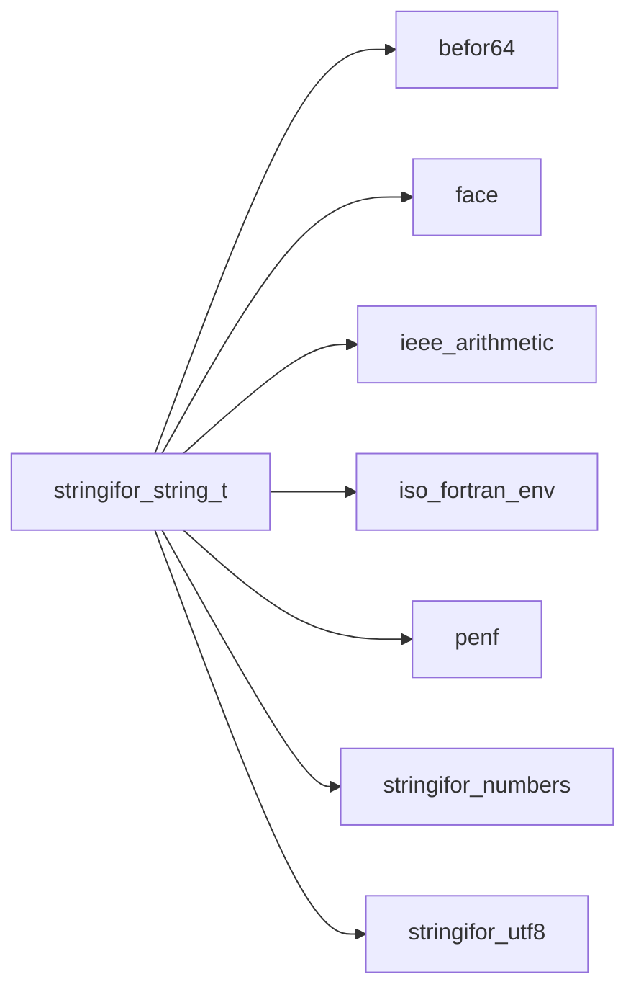

## Contents

- [string](#string)
- [shortest](#shortest)
- [glob](#glob)
- [strjoin](#strjoin)
- [adjustl](#adjustl)
- [adjustr](#adjustr)
- [count](#count)
- [index](#index)
- [len_trim](#len-trim)
- [repeat](#repeat)
- [scan](#scan)
- [trim](#trim)
- [verify](#verify)
- [shortest_special](#shortest-special)
- [shortest_layout](#shortest-layout)
- [strsort](#strsort)
- [free](#free)
- [glob_character](#glob-character)
- [glob_string](#glob-string)
- [justify](#justify)
- [read_file](#read-file)
- [read_line](#read-line)
- [read_lines](#read-lines)
- [split](#split)
- [split_chunked](#split-chunked)
- [read_number_I1P](#read-number-i1p)
- [read_number_I2P](#read-number-i2p)
- [read_number_I4P](#read-number-i4p)
- [read_number_I8P](#read-number-i8p)
- [read_number_R4P](#read-number-r4p)
- [read_number_R8P](#read-number-r8p)
- [read_number_R16P](#read-number-r16p)
- [write_file](#write-file)
- [write_line](#write-line)
- [write_lines](#write-lines)
- [string_assign_string](#string-assign-string)
- [string_assign_character](#string-assign-character)
- [string_assign_integer_I1P](#string-assign-integer-i1p)
- [string_assign_integer_I2P](#string-assign-integer-i2p)
- [string_assign_integer_I4P](#string-assign-integer-i4p)
- [string_assign_integer_I8P](#string-assign-integer-i8p)
- [string_assign_real_R4P](#string-assign-real-r4p)
- [string_assign_real_R8P](#string-assign-real-r8p)
- [string_assign_real_R16P](#string-assign-real-r16p)
- [read_formatted](#read-formatted)
- [read_delimited](#read-delimited)
- [read_undelimited_listdirected](#read-undelimited-listdirected)
- [read_undelimited](#read-undelimited)
- [write_formatted](#write-formatted)
- [read_unformatted](#read-unformatted)
- [write_unformatted](#write-unformatted)
- [parse_long_integer](#parse-long-integer)
- [parse_special_number](#parse-special-number)
- [parse_number_fast](#parse-number-fast)
- [append_to_buffer](#append-to-buffer)
- [write_bom](#write-bom)
- [squeeze_bytes](#squeeze-bytes)
- [parse_c_escape](#parse-c-escape)
- [parse_xml_reference](#parse-xml-reference)
- [read_hex](#read-hex)
- [get_delimiter_mode](#get-delimiter-mode)
- [get_next_non_blank_character_this_record](#get-next-non-blank-character-this-record)
- [get_next_non_blank_character_any_record](#get-next-non-blank-character-any-record)
- [get_decimal_mode](#get-decimal-mode)
- [string_](#string)
- [edit_distance_string](#edit-distance-string)
- [edit_distance_character](#edit-distance-character)
- [shortest_R8P](#shortest-r8p)
- [shortest_R4P](#shortest-r4p)
- [from_codepoints](#from-codepoints)
- [strless](#strless)
- [strless_nocase](#strless-nocase)
- [strless_natural](#strless-natural)
- [sadjustl_character](#sadjustl-character)
- [sadjustr_character](#sadjustr-character)
- [count_substring](#count-substring)
- [sindex_character_string](#sindex-character-string)
- [sscan_character_string](#sscan-character-string)
- [sverify_character_string](#sverify-character-string)
- [sadjustl](#sadjustl)
- [sadjustr](#sadjustr)
- [scount](#scount)
- [sindex_string_string](#sindex-string-string)
- [sindex_string_character](#sindex-string-character)
- [slen](#slen)
- [slen_trim](#slen-trim)
- [srepeat_string_string](#srepeat-string-string)
- [srepeat_character_string](#srepeat-character-string)
- [sscan_string_string](#sscan-string-string)
- [sscan_string_character](#sscan-string-character)
- [strim](#strim)
- [sverify_string_string](#sverify-string-string)
- [sverify_string_character](#sverify-string-character)
- [basedir](#basedir)
- [basename](#basename)
- [camelcase](#camelcase)
- [capitalize](#capitalize)
- [center](#center)
- [codepoints](#codepoints)
- [byte_pos](#byte-pos)
- [char_pos](#char-pos)
- [chars](#chars)
- [colorize_str](#colorize-str)
- [common_prefix_string](#common-prefix-string)
- [common_prefix_character](#common-prefix-character)
- [common_prefix_strings](#common-prefix-strings)
- [compact](#compact)
- [compare_version_string](#compare-version-string)
- [compare_version_character](#compare-version-character)
- [decode](#decode)
- [encode](#encode)
- [escape](#escape)
- [escape_c](#escape-c)
- [escape_xml](#escape-xml)
- [escapes_error](#escapes-error)
- [expand_tabs](#expand-tabs)
- [extension](#extension)
- [fill](#fill)
- [hex](#hex)
- [insert_character](#insert-character)
- [insert_string](#insert-string)
- [join_strings](#join-strings)
- [join_characters](#join-characters)
- [strjoin_strings](#strjoin-strings)
- [strjoin_characters](#strjoin-characters)
- [strjoin_strings_array](#strjoin-strings-array)
- [strjoin_characters_array](#strjoin-characters-array)
- [len_last_word](#len-last-word)
- [ljust](#ljust)
- [lstrip](#lstrip)
- [lower](#lower)
- [partition](#partition)
- [quote](#quote)
- [replace](#replace)
- [reverse](#reverse)
- [reverse_words](#reverse-words)
- [rjust](#rjust)
- [rstrip](#rstrip)
- [search](#search)
- [slice](#slice)
- [snakecase](#snakecase)
- [squeeze](#squeeze)
- [startcase](#startcase)
- [strip](#strip)
- [swapcase](#swapcase)
- [tempname](#tempname)
- [to_integer_I1P](#to-integer-i1p)
- [to_integer_I2P](#to-integer-i2p)
- [to_integer_I4P](#to-integer-i4p)
- [to_integer_I8P](#to-integer-i8p)
- [to_real_R4P](#to-real-r4p)
- [to_real_R8P](#to-real-r8p)
- [to_real_R16P](#to-real-r16p)
- [to_valid_utf8](#to-valid-utf8)
- [transliterate](#transliterate)
- [unescape](#unescape)
- [unescape_c](#unescape-c)
- [unescape_xml](#unescape-xml)
- [unique](#unique)
- [unquote](#unquote)
- [upper](#upper)
- [display_width](#display-width)
- [utf8_error](#utf8-error)
- [xml_error](#xml-error)
- [end_with](#end-with)
- [is_allocated](#is-allocated)
- [has_bom](#has-bom)
- [is_alnum](#is-alnum)
- [is_alpha](#is-alpha)
- [is_digit](#is-digit)
- [is_integer](#is-integer)
- [is_lower](#is-lower)
- [is_number](#is-number)
- [is_punct](#is-punct)
- [is_real](#is-real)
- [is_space](#is-space)
- [is_upper](#is-upper)
- [is_utf8](#is-utf8)
- [is_xdigit](#is-xdigit)
- [match](#match)
- [start_with](#start-with)
- [string_concat_string](#string-concat-string)
- [string_concat_character](#string-concat-character)
- [character_concat_string](#character-concat-string)
- [string_concat_string_string](#string-concat-string-string)
- [string_concat_character_string](#string-concat-character-string)
- [character_concat_string_string](#character-concat-string-string)
- [string_eq_string](#string-eq-string)
- [string_eq_character](#string-eq-character)
- [character_eq_string](#character-eq-string)
- [string_ne_string](#string-ne-string)
- [string_ne_character](#string-ne-character)
- [character_ne_string](#character-ne-string)
- [string_lt_string](#string-lt-string)
- [string_lt_character](#string-lt-character)
- [character_lt_string](#character-lt-string)
- [string_le_string](#string-le-string)
- [string_le_character](#string-le-character)
- [character_le_string](#character-le-string)
- [string_ge_string](#string-ge-string)
- [string_ge_character](#string-ge-character)
- [character_ge_string](#character-ge-string)
- [string_gt_string](#string-gt-string)
- [string_gt_character](#string-gt-character)
- [character_gt_string](#character-gt-string)
- [find_occurrence](#find-occurrence)
- [strip_characters](#strip-characters)
- [strip_set](#strip-set)
- [is_digit_char](#is-digit-char)
- [is_punct_char](#is-punct-char)
- [is_space_char](#is-space-char)
- [is_xdigit_char](#is-xdigit-char)
- [is_lower_char](#is-lower-char)
- [is_upper_char](#is-upper-char)
- [lower_char](#lower-char)
- [upper_char](#upper-char)
- [match_token](#match-token)
- [byte_safe_position](#byte-safe-position)
- [measure](#measure)
- [to_unit](#to-unit)
- [unit_length](#unit-length)
- [range_code](#range-code)
- [shell_escape](#shell-escape)
- [replace_substring](#replace-substring)
- [hex_lower](#hex-lower)
- [unique_substring](#unique-substring)
- [join_raws](#join-raws)
- [join_chars](#join-chars)
- [compare_versions](#compare-versions)

## Variables

| Name | Type | Attributes | Description |
|------|------|------------|-------------|
| `CK` | integer | parameter | Default character kind. |
| `SF_BYTES` | integer | parameter | Unit of the `by=` arguments: positions and lengths in bytes (the default). |
| `SF_CHARS` | integer | parameter | Unit of the `by=` arguments: in characters (UTF-8 units). |
| `SF_COLUMNS` | integer | parameter | Unit of the `by=` width arguments: in display columns of a terminal. |
| `CASE_SHIFT` | integer | parameter | ASCII distance of the cases. |
| `P10_R8P` | real(kind=[R8P](/api/src/third_party/PENF/src/lib/penf_global_parameters_variables)) | parameter | 1e0..1e22. |
| `P10_R4P` | real(kind=[R4P](/api/src/third_party/PENF/src/lib/penf_global_parameters_variables)) | parameter | 1e0..1e10. |
| `SPECIAL_NAN` | integer | parameter | A string holding a NaN. |
| `SPECIAL_INF` | integer | parameter | A string holding an infinity. |
| `SPACE` | character(kind=[CK](/api/src/third_party/StringiFor/src/lib/stringifor_string_t), len=1) | parameter | Space character. |
| `TAB` | character(kind=[CK](/api/src/third_party/StringiFor/src/lib/stringifor_string_t), len=1) | parameter | Tab character. |
| `UIX_DIR_SEP` | character(kind=[CK](/api/src/third_party/StringiFor/src/lib/stringifor_string_t), len=1) | parameter | Unix/Linux directories separator (/). |
| `BACKSLASH` | character(kind=[CK](/api/src/third_party/StringiFor/src/lib/stringifor_string_t), len=1) | parameter | Backslash character. |
| `BOM` | character(kind=[CK](/api/src/third_party/StringiFor/src/lib/stringifor_string_t), len=3) | parameter | UTF-8 byte order mark, U+FEFF. |

## Derived Types

### string

OOP designed string class.

#### Components

| Name | Type | Attributes | Description |
|------|------|------------|-------------|
| `raw` | character(kind=[CK](/api/src/third_party/StringiFor/src/lib/stringifor_string_t), len=:) | allocatable | Raw data. |

#### Type-Bound Procedures

| Name | Attributes | Description |
|------|------------|-------------|
| `adjustl` | pass(self) | Adjustl replacement. |
| `adjustr` | pass(self) | Adjustr replacement. |
| `count` | pass(self) | Count replacement. |
| `index` |  | Index replacement. |
| `len` | pass(self) | Len replacement. |
| `len_trim` | pass(self) | Len_trim replacement. |
| `repeat` |  | Repeat replacement. |
| `scan` |  | Scan replacement. |
| `trim` | pass(self) | Trim replacement. |
| `verify` |  | Verify replacement. |
| `basedir` | pass(self) | Return the base directory name of a string containing a file name. |
| `basename` | pass(self) | Return the base file name of a string containing a file name. |
| `camelcase` | pass(self) | Return a string with all words capitalized without spaces. |
| `capitalize` | pass(self) | Return a string with its first character capitalized and the rest lowercased. |
| `center` | pass(self) | Return the string centered in a given width. |
| `byte_pos` | pass(self) | Return the byte position of the first byte of a character. |
| `char_pos` | pass(self) | Return the character holding a byte. |
| `chars` | pass(self) | Return the raw characters data. |
| `codepoints` | pass(self) | Return the codepoints of the string, one per unit. |
| `colorize` |  | Colorize and stylize strings. |
| `common_prefix` |  | Return the longest common prefix shared with other string(s). |
| `compare_version` |  | Compare two version numbers, return -1, 0 or 1. |
| `compact` | pass(self) | Return the words of the string separated by one separator, whitespace collapsed. |
| `decode` | pass(self) | Decode string. |
| `edit_distance` |  | Return the Levenshtein distance from another string. |
| `encode` | pass(self) | Encode string. |
| `escape` | pass(self) | Escape backslashes (or custom escape character). |
| `escape_c` | pass(self) | Return the string with C escapes for what is not printable. |
| `escape_xml` | pass(self) | Return the string with the XML markup characters escaped. |
| `escapes_error` | pass(self) | Return the position of the first malformed C escape, 0 if none. |
| `expand_tabs` | pass(self) | Return a string with the tabs expanded to spaces. |
| `extension` | pass(self) | Return the extension of a string containing a file name. |
| `fill` | pass(self) | Pad string on the left (or right) with zeros (or other char) to fill width. |
| `free` | pass(self) | Free dynamic memory. |
| `glob` |  | Glob search, finds all the pathnames matching a given pattern. |
| `hex` | pass(self) | Return the hexadecimal representation of the integer into the string. |
| `insert` |  | Insert substring into string at a specified position. |
| `join` |  | Return a string that is a join of an array of strings or characters. |
| `strjoin` |  | Return a string that is a join of an array of strings or characters; |
| `justify` | pass(self) | Return the words of the string packed into fully justified lines. |
| `len_last_word` | pass(self) | Return the length of the last word of the string. |
| `ljust` | pass(self) | Return the string left justified in a given width. |
| `lower` | pass(self) | Return a string with all lowercase characters. |
| `lstrip` | pass(self) | Return a string with the leading characters removed. |
| `partition` | pass(self) | Split string at separator and return the 3 parts (before, the separator and after). |
| `quote` | pass(self) | Return the string quoted, the inner quotes doubled. |
| `read_file` | pass(self) | Read a file a single string stream. |
| `read_line` | pass(self) | Read line (record) from a connected unit. |
| `read_lines` | pass(self) | Read (all) lines (records) from a connected unit as a single ascii stream. |
| `read_number` |  | Cast string to number, with an error status. |
| `replace` | pass(self) | Return a string with all occurrences of substring old replaced by new. |
| `reverse` | pass(self) | Return a reversed string. |
| `reverse_words` | pass(self) | Return a string with the words order reversed. |
| `rjust` | pass(self) | Return the string right justified in a given width. |
| `rstrip` | pass(self) | Return a string with the trailing characters removed. |
| `search` | pass(self) | Search for *tagged* record into string. |
| `slice` | pass(self) | Return the raw characters data sliced. |
| `snakecase` | pass(self) | Return a string with all words lowercase separated by "_". |
| `split` | pass(self) | Return a list of substring in the string, using sep as the delimiter string. |
| `split_chunked` | pass(self) | Return a list of substring in the string, using sep as the delimiter string. |
| `squeeze` | pass(self) | Return a string with the runs of a repeated character reduced to one. |
| `startcase` | pass(self) | Return a string with all words capitalized, e.g. title case. |
| `strip` | pass(self) | Return a string with the leading and trailing characters removed. |
| `swapcase` | pass(self) | Return a string with uppercase chars converted to lowercase and vice versa. |
| `tempname` | pass(self) | Return a safe temporary name suitable for temporary file or directories. |
| `to_number` |  | Cast string to number. |
| `to_valid_utf8` | pass(self) | Return the string with the ill-formed UTF-8 replaced. |
| `transliterate` | pass(self) | Return a string with the characters of a set replaced by the ones of another. |
| `unescape` | pass(self) | Unescape double backslashes (or custom escaped character). |
| `unescape_c` | pass(self) | Return the string with its C escapes expanded. |
| `unescape_xml` | pass(self) | Return the string with its XML references expanded. |
| `unique` | pass(self) | Reduce to one (unique) multiple occurrences of a substring into a string. |
| `unquote` | pass(self) | Return the string unquoted, the inner doubled quotes undoubled. |
| `upper` | pass(self) | Return a string with all uppercase characters. |
| `width` | pass(self) | Return the display width of the string, in terminal columns. |
| `utf8_error` | pass(self) | Return the position of the first ill-formed UTF-8 byte, 0 if none. |
| `write_file` | pass(self) | Write a single string stream into file. |
| `write_line` | pass(self) | Write line (record) to a connected unit. |
| `write_lines` | pass(self) | Write lines (records) to a connected unit. |
| `xml_error` | pass(self) | Return the position of the first malformed XML reference, 0 if none. |
| `end_with` | pass(self) | Return true if a string ends with a specified suffix. |
| `has_bom` | pass(self) | Return true if the string starts with a UTF-8 byte order mark. |
| `is_allocated` | pass(self) | Return true if the string is allocated. |
| `is_alnum` | pass(self) | Return true if all characters in the string are letters or digits. |
| `is_alpha` | pass(self) | Return true if all characters in the string are letters. |
| `is_digit` | pass(self) | Return true if all characters in the string are digits. |
| `is_integer` | pass(self) | Return true if the string contains an integer. |
| `is_lower` | pass(self) | Return true if all characters in the string are lowercase. |
| `is_number` | pass(self) | Return true if the string contains a number (real or integer). |
| `is_punct` | pass(self) | Return true if all characters in the string are punctuation characters. |
| `is_real` | pass(self) | Return true if the string contains an real. |
| `is_space` | pass(self) | Return true if all characters in the string are whitespace. |
| `is_upper` | pass(self) | Return true if all characters in the string are uppercase. |
| `is_utf8` | pass(self) | Return true if the string is well-formed UTF-8. |
| `is_xdigit` | pass(self) | Return true if all characters in the string are hexadecimal digits. |
| `match` | pass(self) | Return true if the string matches a wildcard pattern. |
| `start_with` | pass(self) | Return true if a string starts with a specified prefix. |
| `assignment(=)` |  | Assignment operator overloading. |
| `operator(//)` |  | Concatenation operator overloading. |
| `operator(.cat.)` |  | Concatenation operator (string output) overloading. |
| `operator(==)` |  | Equal operator overloading. |
| `operator(/=)` |  | Not equal operator overloading. |
| `operator(<)` |  | Lower than operator overloading. |
| `operator(<=)` |  | Lower equal than operator overloading. |
| `operator(>=)` |  | Greater equal than operator overloading. |
| `operator(>)` |  | Greater than operator overloading. |
| `read(formatted)` |  | Formatted input. |
| `write(formatted)` |  | Formatted output. |
| `read(unformatted)` |  | Unformatted input. |
| `write(unformatted)` |  | Unformatted output. |
| `sindex_string_string` | pass(self) | Index replacement. |
| `sindex_string_character` | pass(self) | Index replacement. |
| `srepeat_string_string` | pass(self) | Repeat replacement. |
| `srepeat_character_string` | nopass | Repeat replacement. |
| `sscan_string_string` | pass(self) | Scan replacement. |
| `sscan_string_character` | pass(self) | Scan replacement. |
| `sverify_string_string` | pass(self) | Verify replacement. |
| `sverify_string_character` | pass(self) | Verify replacement. |
| `colorize_str` | pass(self) | Colorize and stylize strings. |
| `common_prefix_string` | pass(self) | Longest common prefix shared with a string. |
| `common_prefix_character` | pass(self) | Longest common prefix shared with a character. |
| `common_prefix_strings` | pass(self) | Longest common prefix shared with an array of strings. |
| `compare_version_string` | pass(self) | Compare version number with a string one. |
| `compare_version_character` | pass(self) | Compare version number with a character one. |
| `glob_character` | pass(self) | Glob search (character output). |
| `glob_string` | pass(self) | Glob search (string output). |
| `insert_string` | pass(self) | Insert substring into string at a specified position. |
| `insert_character` | pass(self) | Insert substring into string at a specified position. |
| `join_strings` | pass(self) | Return join string of an array of strings. |
| `join_characters` | pass(self) | Return join string of an array of characters. |
| `strjoin_strings` | nopass | Return join string of an array of strings. |
| `strjoin_characters` | nopass | Return join string of an array of strings. |
| `strjoin_strings_array` | nopass | Return join 1D string array of an 2D array of strings in columns or rows. |
| `strjoin_characters_array` | nopass | Return join 1D string array of an 2D array of characters in columns or rows. |
| `to_integer_I1P` | pass(self) | Cast string to integer. |
| `to_integer_I2P` | pass(self) | Cast string to integer. |
| `to_integer_I4P` | pass(self) | Cast string to integer. |
| `to_integer_I8P` | pass(self) | Cast string to integer. |
| `to_real_R4P` | pass(self) | Cast string to real. |
| `to_real_R8P` | pass(self) | Cast string to real. |
| `to_real_R16P` | pass(self) | Cast string to real. |
| `edit_distance_character` | pass(self) | Levenshtein distance from a character. |
| `edit_distance_string` | pass(self) | Levenshtein distance from a string. |
| `read_number_I1P` | pass(self) | Cast string to integer, with an error status. |
| `read_number_I2P` | pass(self) | Cast string to integer, with an error status. |
| `read_number_I4P` | pass(self) | Cast string to integer, with an error status. |
| `read_number_I8P` | pass(self) | Cast string to integer, with an error status. |
| `read_number_R4P` | pass(self) | Cast string to real, with an error status. |
| `read_number_R8P` | pass(self) | Cast string to real, with an error status. |
| `read_number_R16P` | pass(self) | Cast string to real, with an error status. |
| `string_assign_string` | pass(lhs) | Assignment operator from string input. |
| `string_assign_character` | pass(lhs) | Assignment operator from character input. |
| `string_assign_integer_I1P` | pass(lhs) | Assignment operator from integer input. |
| `string_assign_integer_I2P` | pass(lhs) | Assignment operator from integer input. |
| `string_assign_integer_I4P` | pass(lhs) | Assignment operator from integer input. |
| `string_assign_integer_I8P` | pass(lhs) | Assignment operator from integer input. |
| `string_assign_real_R4P` | pass(lhs) | Assignment operator from real input. |
| `string_assign_real_R8P` | pass(lhs) | Assignment operator from real input. |
| `string_assign_real_R16P` | pass(lhs) | Assignment operator from real input. |
| `string_concat_string` | pass(lhs) | Concatenation with string. |
| `string_concat_character` | pass(lhs) | Concatenation with character. |
| `character_concat_string` | pass(rhs) | Concatenation with character (inverted). |
| `string_concat_string_string` | pass(lhs) | Concatenation with string (string output). |
| `string_concat_character_string` | pass(lhs) | Concatenation with character (string output). |
| `character_concat_string_string` | pass(rhs) | Concatenation with character (inverted, string output). |
| `string_eq_string` | pass(lhs) | Equal to string logical operator. |
| `string_eq_character` | pass(lhs) | Equal to character logical operator. |
| `character_eq_string` | pass(rhs) | Equal to character (inverted) logical operator. |
| `string_ne_string` | pass(lhs) | Not equal to string logical operator. |
| `string_ne_character` | pass(lhs) | Not equal to character logical operator. |
| `character_ne_string` | pass(rhs) | Not equal to character (inverted) logical operator. |
| `string_lt_string` | pass(lhs) | Lower than to string logical operator. |
| `string_lt_character` | pass(lhs) | Lower than to character logical operator. |
| `character_lt_string` | pass(rhs) | Lower than to character (inverted) logical operator. |
| `string_le_string` | pass(lhs) | Lower equal than to string logical operator. |
| `string_le_character` | pass(lhs) | Lower equal than to character logical operator. |
| `character_le_string` | pass(rhs) | Lower equal than to character (inverted) logical operator. |
| `string_ge_string` | pass(lhs) | Greater equal than to string logical operator. |
| `string_ge_character` | pass(lhs) | Greater equal than to character logical operator. |
| `character_ge_string` | pass(rhs) | Greater equal than to character (inverted) logical operator. |
| `string_gt_string` | pass(lhs) | Greater than to string logical operator. |
| `string_gt_character` | pass(lhs) | Greater than to character logical operator. |
| `character_gt_string` | pass(rhs) | Greater than to character (inverted) logical operator. |
| `read_formatted` | pass(dtv) | Formatted input. |
| `read_delimited` | pass(dtv) | Read a delimited input. |
| `read_undelimited` | pass(dtv) | Read an undelimited input. |
| `read_undelimited_listdirected` | pass(dtv) | Read an undelimited list directed input. |
| `write_formatted` | pass(dtv) | Formatted output. |
| `read_unformatted` | pass(dtv) | Unformatted input. |
| `write_unformatted` | pass(dtv) | Unformatted output. |

## Interfaces

### shortest

Shortest text of a real that reads back as exactly that number.

**Module procedures**: [`shortest_R4P`](/api/src/third_party/StringiFor/src/lib/stringifor_string_t#shortest-r4p), [`shortest_R8P`](/api/src/third_party/StringiFor/src/lib/stringifor_string_t#shortest-r8p)

### glob

Overloading glob procedure.
```fortran
 type(string)                  :: astring
 character(len=:), allocatable :: alist_chr(:)
 type(string),     allocatable :: alist_str(:)
 integer, parameter            :: Nf=5
 character(14)                 :: files(1:Nf)
 integer                       :: file_unit
 integer                       :: f
 integer                       :: ff
 logical                       :: test_passed
 do f=1, Nf
    files(f) = astring%tempname(prefix='foo-')
    open(newunit=file_unit, file=files(f))
    write(file_unit, *)f
    close(unit=file_unit)
 enddo
 call glob(self=astring, pattern='foo-*', list=alist_chr)
 call glob(self=astring, pattern='foo-*', list=alist_str)
 do f=1, Nf
    open(newunit=file_unit, file=files(f))
    close(unit=file_unit, status='delete')
 enddo
 test_passed = .false.
 outer_chr: do f=1, size(alist_chr, dim=1)
    do ff=1, Nf
       test_passed = alist_chr(f) == files(ff)
       if (test_passed) cycle outer_chr
    enddo
 enddo outer_chr
 if (test_passed) then
    test_passed = .false.
    outer_str: do f=1, size(alist_str, dim=1)
       do ff=1, Nf
          test_passed = alist_str(f) == files(ff)
          if (test_passed) cycle outer_str
       enddo
    enddo outer_str
 endif
 print '(L1)', test_passed
```

**Module procedures**: [`glob_character`](/api/src/third_party/StringiFor/src/lib/stringifor_string_t#glob-character), [`glob_string`](/api/src/third_party/StringiFor/src/lib/stringifor_string_t#glob-string)

### strjoin

**Module procedures**: [`strjoin_strings`](/api/src/third_party/StringiFor/src/lib/stringifor_string_t#strjoin-strings), [`strjoin_characters`](/api/src/third_party/StringiFor/src/lib/stringifor_string_t#strjoin-characters), [`strjoin_strings_array`](/api/src/third_party/StringiFor/src/lib/stringifor_string_t#strjoin-strings-array), [`strjoin_characters_array`](/api/src/third_party/StringiFor/src/lib/stringifor_string_t#strjoin-characters-array)

### adjustl

Builtin adjustl overloading.

**Module procedures**: [`sadjustl_character`](/api/src/third_party/StringiFor/src/lib/stringifor_string_t#sadjustl-character)

### adjustr

Builtin adjustr overloading.

**Module procedures**: [`sadjustr_character`](/api/src/third_party/StringiFor/src/lib/stringifor_string_t#sadjustr-character)

### count

Builtin count overloading.

**Module procedures**: [`count_substring`](/api/src/third_party/StringiFor/src/lib/stringifor_string_t#count-substring)

### index

Builtin index overloading.

**Module procedures**: [`sindex_string_string`](/api/src/third_party/StringiFor/src/lib/stringifor_string_t#sindex-string-string), [`sindex_string_character`](/api/src/third_party/StringiFor/src/lib/stringifor_string_t#sindex-string-character), [`sindex_character_string`](/api/src/third_party/StringiFor/src/lib/stringifor_string_t#sindex-character-string)

### len_trim

Builtin len_trim overloading.

**Module procedures**: [`slen_trim`](/api/src/third_party/StringiFor/src/lib/stringifor_string_t#slen-trim)

### repeat

Builtin repeat overloading.

**Module procedures**: [`srepeat_string_string`](/api/src/third_party/StringiFor/src/lib/stringifor_string_t#srepeat-string-string)

### scan

Builtin scan overloading.

**Module procedures**: [`sscan_string_string`](/api/src/third_party/StringiFor/src/lib/stringifor_string_t#sscan-string-string), [`sscan_string_character`](/api/src/third_party/StringiFor/src/lib/stringifor_string_t#sscan-string-character), [`sscan_character_string`](/api/src/third_party/StringiFor/src/lib/stringifor_string_t#sscan-character-string)

### trim

Builtin trim overloading.

**Module procedures**: [`strim`](/api/src/third_party/StringiFor/src/lib/stringifor_string_t#strim)

### verify

Builtin verify overloading.

**Module procedures**: [`sverify_string_string`](/api/src/third_party/StringiFor/src/lib/stringifor_string_t#sverify-string-string), [`sverify_string_character`](/api/src/third_party/StringiFor/src/lib/stringifor_string_t#sverify-string-character), [`sverify_character_string`](/api/src/third_party/StringiFor/src/lib/stringifor_string_t#sverify-character-string)

## Subroutines

### shortest_special

Return the text of a zero, an infinity or a NaN.

**Attributes**: pure

```fortran
subroutine shortest_special(not_finite, has_fraction, negative, astring)
```

**Arguments**

| Name | Type | Intent | Attributes | Description |
|------|------|--------|------------|-------------|
| `not_finite` | logical | in |  | An infinity or a NaN, else a zero. |
| `has_fraction` | logical | in |  | With a not finite: a NaN. |
| `negative` | logical | in |  | The sign bit. |
| `astring` | type([string](/api/src/third_party/StringiFor/src/lib/stringifor_string_t#string)) | out |  | The text. |

**Call graph**

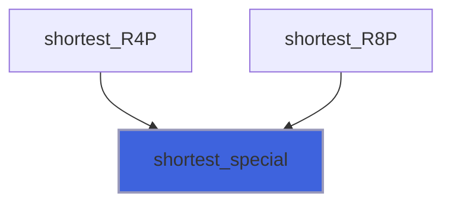

### shortest_layout

Lay out digits * 10**exponent as Python's `repr` does.

**Attributes**: pure

```fortran
subroutine shortest_layout(digits, exponent, negative, astring)
```

**Arguments**

| Name | Type | Intent | Attributes | Description |
|------|------|--------|------------|-------------|
| `digits` | integer(kind=[I8P](/api/src/third_party/PENF/src/lib/penf_global_parameters_variables)) | in |  | Decimal digits, no trailing zeros. |
| `exponent` | integer | in |  | Decimal exponent. |
| `negative` | logical | in |  | The sign bit. |
| `astring` | type([string](/api/src/third_party/StringiFor/src/lib/stringifor_string_t#string)) | out |  | The text. |

**Call graph**

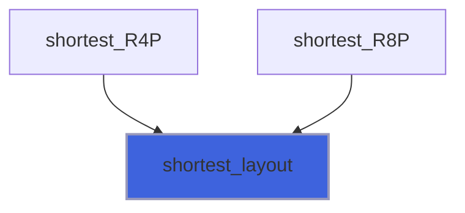

### strsort

Sort an array of strings in place: a stable merge sort, O(n log n) comparisons.

 The order is `less`, a `pure logical function less(a, b)` of two characters (see strsort_less); by default
 [strless](/api/src/third_party/StringiFor/src/lib/stringifor_string_t#strless), the byte order, which is the codepoint order for well-formed UTF-8. [strless_nocase](/api/src/third_party/StringiFor/src/lib/stringifor_string_t#strless-nocase) ignores the ASCII
 case, [strless_natural](/api/src/third_party/StringiFor/src/lib/stringifor_string_t#strless-natural) compares the runs of digits as numbers (`file2` before `file10`). Strings that are equal
 for `less` keep their order. A not allocated string sorts as an empty one and stays not allocated.

 `index`, if passed, returns the permutation: the string now at position `i` was at position `index(i)`.

```fortran
 type(string) :: names(5)
 integer      :: perm(5)
 logical      :: test_passed(3)
 names = [string('file10'), string('File2'), string('file2'), string('b'), string('file1')]
 call strsort(names, index=perm)
 test_passed(1) = all(names == [string('File2'), string('b'), string('file1'), string('file10'), string('file2')]).and. &
                  all(perm == [2, 4, 5, 1, 3])
 call strsort(names, less=strless_natural)
 test_passed(2) = all(names == [string('File2'), string('b'), string('file1'), string('file2'), string('file10')])
 call strsort(names, less=strless_nocase)
 test_passed(3) = all(names == [string('b'), string('file1'), string('file10'), string('File2'), string('file2')])
 print '(L1)', all(test_passed)
```

**Attributes**: pure

```fortran
subroutine strsort(strings, index, less)
```

**Arguments**

| Name | Type | Intent | Attributes | Description |
|------|------|--------|------------|-------------|
| `strings` | type([string](/api/src/third_party/StringiFor/src/lib/stringifor_string_t#string)) | inout |  | The strings, sorted on exit. |
| `index` | integer | out | optional | Permutation: the string at i was at index(i); size(strings). |
| `less` | procedure(strsort_less) |  | optional | Order, default byte order. |

### free

Free dynamic memory.

```fortran
 type(string) :: astring
 astring = 'this is string example....wow!!!'
 call astring%free
 print '(L1)', astring%is_allocated().eqv..false.
```

**Attributes**: elemental

```fortran
subroutine free(self)
```

**Arguments**

| Name | Type | Intent | Attributes | Description |
|------|------|--------|------------|-------------|
| `self` | class([string](/api/src/third_party/StringiFor/src/lib/stringifor_string_t#string)) | inout |  | The string. |

### glob_character

Glob search (character output), finds all the pathnames matching a given pattern according to the rules used by the Unix shell.

 @note Method not portable: works only on Unix/GNU Linux OS.

```fortran
 type(string)                  :: astring
 character(len=:), allocatable :: alist_chr(:)
 integer, parameter            :: Nf=5
 character(14)                 :: files(1:Nf)
 integer                       :: file_unit
 integer                       :: f
 integer                       :: ff
 logical                       :: test_passed
 do f=1, Nf
    files(f) = astring%tempname(prefix='foo-')
    open(newunit=file_unit, file=files(f))
    write(file_unit, *)f
    close(unit=file_unit)
 enddo
 call astring%glob(pattern='foo-*', list=alist_chr)
 do f=1, Nf
    open(newunit=file_unit, file=files(f))
    close(unit=file_unit, status='delete')
 enddo
 test_passed = .false.
 outer_chr: do f=1, size(alist_chr, dim=1)
    do ff=1, Nf
       test_passed = alist_chr(f) == files(ff)
       if (test_passed) cycle outer_chr
    enddo
 enddo outer_chr
 print '(L1)', test_passed
```

```fortran
subroutine glob_character(self, pattern, list)
```

**Arguments**

| Name | Type | Intent | Attributes | Description |
|------|------|--------|------------|-------------|
| `self` | class([string](/api/src/third_party/StringiFor/src/lib/stringifor_string_t#string)) | in |  | The string. |
| `pattern` | character(len=*) | in |  | Given pattern. |
| `list` | character(len=:) | out | allocatable | List of matching pathnames. |

**Call graph**

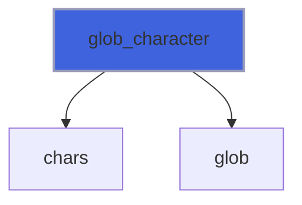

### glob_string

Glob search (string output), finds all the pathnames matching a given pattern according to the rules used by the Unix shell.

 @note Method not portable: works only on Unix/GNU Linux OS (it runs `ls` through the shell).

 @note If no pathname matches the pattern `list` is allocated with zero size.

 @note Only the wildcards `*`, `?` and `[...]` are special: every other character of the pattern is passed to the shell
 escaped, so spaces, `;`, `$`, quotes or a leading `-` are part of the names searched, never shell syntax. A pattern
 holding a new line matches nothing. A matching directory is listed itself, not its content. Match a list of names
 already in memory with [match](/api/src/third_party/StringiFor/src/lib/stringifor_string_t#match).

```fortran
 type(string)                  :: astring
 type(string),     allocatable :: alist_str(:)
 character(len=:), allocatable :: alist_chr(:)
 logical                       :: test_passed(2)
 call astring%glob(pattern='no-file-has-this-name-*', list=alist_str)
 test_passed(1) = allocated(alist_str).and.size(alist_str, dim=1)==0
 call astring%glob(pattern='no-file-has-this-name-*', list=alist_chr)
 test_passed(2) = allocated(alist_chr).and.size(alist_chr, dim=1)==0
 print '(L1)', all(test_passed)
```


```fortran
 type(string)                  :: astring
 type(string),     allocatable :: alist_str(:)
 character(len=:), allocatable :: files(:)
 character(len=:), allocatable :: directory
 integer                       :: file_unit
 integer                       :: f
 logical                       :: is_injected
 logical                       :: test_passed(5)
 files = [character(len=20) :: astring%tempname(prefix='glob test-'), astring%tempname(prefix='glob test-'), &
          astring%tempname(prefix='-glob-')]
 do f=1, size(files, dim=1)
    open(newunit=file_unit, file=files(f))
    close(unit=file_unit)
 enddo
 call astring%glob(pattern='glob test-*.tmp', list=alist_str)
 test_passed(1) = size(alist_str, dim=1)==2
 if (test_passed(1)) test_passed(1) = all(alist_str==files(1).or.alist_str==files(2))
 call astring%glob(pattern=files(3), list=alist_str)
 test_passed(2) = size(alist_str, dim=1)==1
 call astring%glob(pattern='glob test-*; touch glob-injected', list=alist_str)
 inquire(file='glob-injected', exist=is_injected)
 test_passed(3) = size(alist_str, dim=1)==0.and..not.is_injected
 do f=1, size(files, dim=1)
    open(newunit=file_unit, file=files(f))
    close(unit=file_unit, status='delete')
 enddo
 directory = astring%tempname(is_file=.false., prefix='glob-dir-')
 call execute_command_line('mkdir '//directory)
 call astring%glob(pattern=directory, list=alist_str)
 test_passed(4) = size(alist_str, dim=1)==1
 if (test_passed(4)) test_passed(4) = alist_str(1)==directory
 call execute_command_line('rmdir '//directory)
 call astring%glob(pattern='', list=alist_str)
 test_passed(5) = size(alist_str, dim=1)==0
 print '(L1)', all(test_passed)
```

```fortran
subroutine glob_string(self, pattern, list)
```

**Arguments**

| Name | Type | Intent | Attributes | Description |
|------|------|--------|------------|-------------|
| `self` | class([string](/api/src/third_party/StringiFor/src/lib/stringifor_string_t#string)) | in |  | The string. |
| `pattern` | character(len=*) | in |  | Given pattern. |
| `list` | type([string](/api/src/third_party/StringiFor/src/lib/stringifor_string_t#string)) | out | allocatable | List of matching pathnames. |

**Call graph**

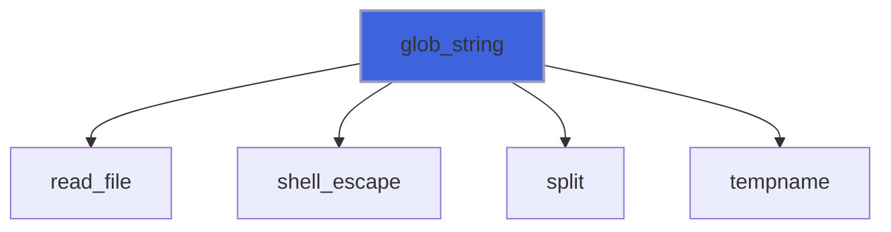

### justify

Return the words of the string packed into fully justified lines of (at least) `width` characters.

 The words (separated by spaces) are greedily packed into lines; the blanks are evenly distributed between the words of each
 line, the leftmost gaps taking the extra ones. The last line and the lines made of one word are left-justified and padded
 with trailing blanks.

 @note A word longer than `width` is not broken: it is placed alone into a line longer than `width`.

 @note If the string is not allocated or it has no words `lines` has zero size.

 @note This is a subroutine, like [split](/api/src/third_party/StringiFor/src/lib/stringifor_string_t#split): a function returning the lines would need an assignment to an
 unallocated array, that is not allowed for a type with a defined assignment.

 @note With `by=SF_CHARS` the width counts characters (UTF-8 units) instead of bytes, with `by=SF_COLUMNS` the
 display columns of a terminal (see width).

```fortran
 type(string)              :: astring
 type(string), allocatable :: lines(:)
 logical                   :: test_passed(10)
 astring = 'This is an example of text justification.'
 call astring%justify(lines=lines, width=16)
 test_passed(1) = size(lines, dim=1)==3
 test_passed(2) = lines(1)//''=='This    is    an'
 test_passed(3) = lines(2)//''=='example  of text'
 test_passed(4) = lines(3)//''=='justification.  '
 astring = '  What must be   acknowledgment shall be '
 call astring%justify(lines=lines, width=16)
 test_passed(5) = lines(1)//''=='What   must   be'
 test_passed(6) = lines(2)//''=='acknowledgment  '
 test_passed(7) = lines(3)//''=='shall be        '
 call astring%justify(lines=lines, width=4)
 test_passed(8) = size(lines, dim=1)==6.and.lines(4)//''=='acknowledgment'
 astring = '   '
 call astring%justify(lines=lines, width=16)
 test_passed(9) = size(lines, dim=1)==0
 astring = 'caf'//char(195)//char(169)//' au lait'
 call astring%justify(lines=lines, width=4, by=SF_CHARS)
 test_passed(10) = lines(1)//''=='caf'//char(195)//char(169).and.lines(2)//''=='au  '
 print '(L1)', all(test_passed)
```

**Attributes**: pure

```fortran
subroutine justify(self, lines, width, by)
```

**Arguments**

| Name | Type | Intent | Attributes | Description |
|------|------|--------|------------|-------------|
| `self` | class([string](/api/src/third_party/StringiFor/src/lib/stringifor_string_t#string)) | in |  | The string. |
| `lines` | type([string](/api/src/third_party/StringiFor/src/lib/stringifor_string_t#string)) | out | allocatable | Justified lines. |
| `width` | integer | in |  | Width of the justified lines. |
| `by` | integer | in | optional | Unit of width: SF_BYTES (default) or SF_CHARS. |

**Call graph**

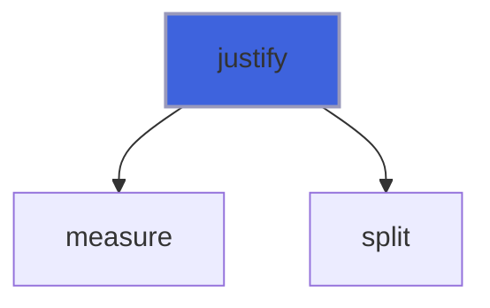

### read_file

Read a file as a single string stream.

 @note All the lines are stored into the string self as a single ascii stream. Each line (record) is separated by a `new_line`
 character.

 @note For unformatted read only `access='stream'` is supported with new_line as line terminator.

 @note *Fast* file reading allows a very efficient reading of streamed file, but it dumps file as single streamed string.

 @note With `skip_bom=.true.` a leading UTF-8 byte order mark (EF BB BF, see [has_bom](/api/src/third_party/StringiFor/src/lib/stringifor_string_t#has-bom)) is dropped.

```fortran
 type(string)              :: astring
 type(string), allocatable :: strings(:)
 type(string)              :: line(3)
 integer                   :: iostat
 character(len=99)         :: iomsg
 integer                   :: scratch
 integer                   :: l
 logical                   :: test_passed(9)
 line(1) = ' Hello World!   '
 line(2) = 'How are you?  '
 line(3) = '   All say: "Fine thanks"'
 open(newunit=scratch, file='read_file_test.tmp')
 write(scratch, "(A)") line(1)%chars()
 write(scratch, "(A)") line(2)%chars()
 write(scratch, "(A)") line(3)%chars()
 close(scratch)
 call astring%read_file(file='read_file_test.tmp', iostat=iostat, iomsg=iomsg)
 call astring%split(tokens=strings, sep=new_line('a'))
 test_passed(1) = (size(strings, dim=1)==size(line, dim=1))
 do l=1, size(strings, dim=1)
   test_passed(l+1) = (strings(l)==line(l))
 enddo
 open(newunit=scratch, file='read_file_test.tmp', form='UNFORMATTED', access='STREAM')
 write(scratch) line(1)%chars()//new_line('a')
 write(scratch) line(2)%chars()//new_line('a')
 write(scratch) line(3)%chars()//new_line('a')
 close(scratch)
 call astring%read_file(file='read_file_test.tmp', form='unformatted', iostat=iostat, iomsg=iomsg)
 call astring%split(tokens=strings, sep=new_line('a'))
 test_passed(5) = (size(strings, dim=1)==size(line, dim=1))
 do l=1, size(strings, dim=1)
   test_passed(l+5) = (strings(l)==line(l))
 enddo
 open(newunit=scratch, file='read_file_test.tmp', form='UNFORMATTED', access='STREAM')
 close(scratch, status='DELETE')
 call astring%read_file(file='read_file_test.tmp', iostat=iostat)
 test_passed(9) = (iostat/=0)
 print '(L1)', all(test_passed)
```

```fortran
subroutine read_file(self, file, is_fast, form, iostat, iomsg, skip_bom)
```

**Arguments**

| Name | Type | Intent | Attributes | Description |
|------|------|--------|------------|-------------|
| `self` | class([string](/api/src/third_party/StringiFor/src/lib/stringifor_string_t#string)) | inout |  | The string. |
| `file` | character(len=*) | in |  | File name. |
| `is_fast` | logical | in | optional | Flag to enable (super) fast file reading. |
| `form` | character(len=*) | in | optional | Format of unit. |
| `iostat` | integer | out | optional | IO status code. |
| `iomsg` | character(len=*) | inout | optional | IO status message. |
| `skip_bom` | logical | in | optional | Drop a leading UTF-8 byte order mark. |

**Call graph**

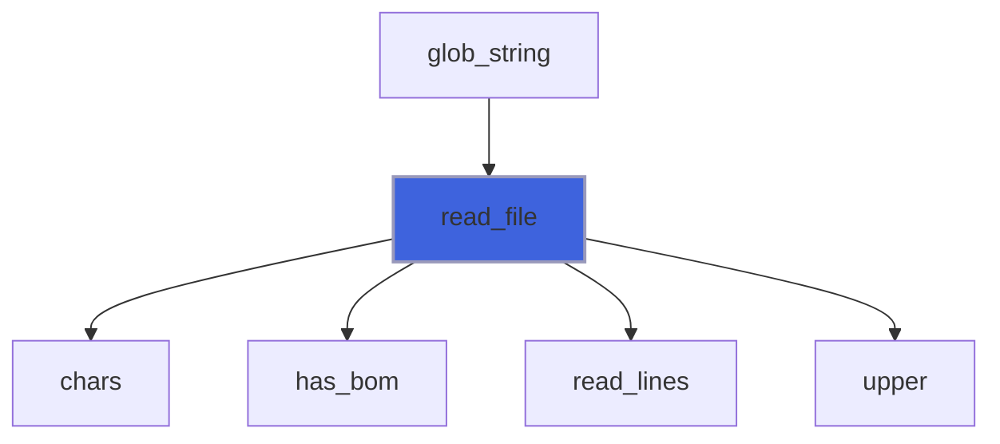

### read_line

Read line (record) from a connected unit.

 The line is read as an ascii stream read until the eor is reached.

 @note `iostat` is zero when a line has been read, an empty one included: the string is then set to the line. At the end
 of the file `iostat` is the end-of-file code and the string is left unchanged, as it is on an error.

 @note For unformatted read only `access='stream'` is supported with new_line as line terminator.

```fortran
 type(string) :: astring
 integer      :: iostat
 integer      :: scratch
 integer      :: l
 logical      :: test_passed(6)
 open(newunit=scratch, status='SCRATCH')
 write(scratch, "(A)") 'first'
 write(scratch, "(A)") ''
 write(scratch, "(A)") 'third'
 rewind(scratch)
 astring = 'untouched'
 call astring%read_line(unit=scratch, iostat=iostat)
 test_passed(1) = (iostat==0.and.astring=='first')
 call astring%read_line(unit=scratch, iostat=iostat)
 test_passed(2) = (iostat==0.and.astring%len()==0)
 call astring%read_line(unit=scratch, iostat=iostat)
 test_passed(3) = (iostat==0.and.astring=='third')
 call astring%read_line(unit=scratch, iostat=iostat)
 test_passed(4) = (is_iostat_end(iostat).and.astring=='third')
 close(scratch)
 open(newunit=scratch, status='SCRATCH', form='UNFORMATTED', access='STREAM')
 write(scratch) 'first'//new_line('a')//new_line('a')//'last, not terminated'
 rewind(scratch)
 l = 0
 do
   call astring%read_line(unit=scratch, iostat=iostat, form='unformatted')
   if (iostat/=0) exit
   l = l + 1
 enddo
 test_passed(5) = (l==3.and.astring=='last, not terminated')
 test_passed(6) = is_iostat_end(iostat)
 close(scratch)
 print '(L1)', all(test_passed)
```


```fortran
 type(string)      :: astring
 type(string)      :: line(3)
 integer           :: iostat
 character(len=99) :: iomsg
 integer           :: scratch
 integer           :: l
 logical           :: test_passed(6)
 line(1) = ' Hello World!   '
 line(2) = 'How are you?  '
 line(3) = '   All say: "Fine thanks"'
 open(newunit=scratch, status='SCRATCH')
 write(scratch, "(A)") line(1)%chars()
 write(scratch, "(A)") line(2)%chars()
 write(scratch, "(A)") line(3)%chars()
 rewind(scratch)
 l = 0
 iostat = 0
 do
   l = l + 1
   call astring%read_line(unit=scratch, iostat=iostat, iomsg=iomsg)
   if (iostat/=0.and..not.is_iostat_eor(iostat)) then
     exit
   else
     test_passed(l) = (astring==line(l))
   endif
 enddo
 close(scratch)
 open(newunit=scratch, status='SCRATCH', form='UNFORMATTED', access='STREAM')
 write(scratch) line(1)%chars()//new_line('a')
 write(scratch) line(2)%chars()//new_line('a')
 write(scratch) line(3)%chars()//new_line('a')
 rewind(scratch)
 l = 0
 iostat = 0
 do
   l = l + 1
   call astring%read_line(unit=scratch, iostat=iostat, iomsg=iomsg, form='UnfORMatteD')
   if (iostat/=0.and..not.is_iostat_eor(iostat)) then
     exit
   else
     test_passed(l+3) = (astring==line(l))
   endif
 enddo
 close(scratch)
 print '(L1)', all(test_passed)
```

```fortran
subroutine read_line(self, unit, form, iostat, iomsg)
```

**Arguments**

| Name | Type | Intent | Attributes | Description |
|------|------|--------|------------|-------------|
| `self` | class([string](/api/src/third_party/StringiFor/src/lib/stringifor_string_t#string)) | inout |  | The string. |
| `unit` | integer | in |  | Logical unit. |
| `form` | character(len=*) | in | optional | Format of unit. |
| `iostat` | integer | out | optional | IO status code. |
| `iomsg` | character(len=*) | inout | optional | IO status message. |

**Call graph**

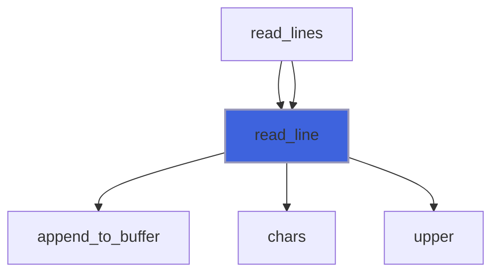

### read_lines

Read (all) lines (records) from a connected unit as a single ascii stream.

 @note All the lines are stored into the string self as a single ascii stream. Each line (record) is separated by a `new_line`
 character. The line is read as an ascii stream read until the eor is reached.

 @note The connected unit is rewinded. At a successful exit current record is at eof, at the beginning otherwise.

 @note With `skip_bom=.true.` a leading UTF-8 byte order mark (EF BB BF, see [has_bom](/api/src/third_party/StringiFor/src/lib/stringifor_string_t#has-bom)) is dropped.

 @note For unformatted read only `access='stream'` is supported with new_line as line terminator.

```fortran
 type(string)              :: astring
 type(string), allocatable :: strings(:)
 type(string)              :: line(3)
 integer                   :: iostat
 character(len=99)         :: iomsg
 integer                   :: scratch
 integer                   :: l
 logical                   :: test_passed(8)

 line(1) = ' Hello World!   '
 line(2) = 'How are you?  '
 line(3) = '   All say: "Fine thanks"'
 open(newunit=scratch, status='SCRATCH')
 write(scratch, "(A)") line(1)%chars()
 write(scratch, "(A)") line(2)%chars()
 write(scratch, "(A)") line(3)%chars()
 call astring%read_lines(unit=scratch, iostat=iostat, iomsg=iomsg)
 call astring%split(tokens=strings, sep=new_line('a'))
 test_passed(1) = (size(strings, dim=1)==size(line, dim=1))
 do l=1, size(strings, dim=1)
   test_passed(l+1) = (strings(l)==line(l))
 enddo
 close(scratch)
 open(newunit=scratch, status='SCRATCH', form='UNFORMATTED', access='STREAM')
 write(scratch) line(1)%chars()//new_line('a')
 write(scratch) line(2)%chars()//new_line('a')
 write(scratch) line(3)%chars()//new_line('a')
 call astring%read_lines(unit=scratch, form='unformatted', iostat=iostat, iomsg=iomsg)
 call astring%split(tokens=strings, sep=new_line('a'))
 test_passed(5) = (size(strings, dim=1)==size(line, dim=1))
 do l=1, size(strings, dim=1)
   test_passed(l+5) = (strings(l)==line(l))
 enddo
 close(scratch)
 print '(L1)', all(test_passed)
```

```fortran
subroutine read_lines(self, unit, form, iostat, iomsg, skip_bom)
```

**Arguments**

| Name | Type | Intent | Attributes | Description |
|------|------|--------|------------|-------------|
| `self` | class([string](/api/src/third_party/StringiFor/src/lib/stringifor_string_t#string)) | inout |  | The string. |
| `unit` | integer | in |  | Logical unit. |
| `form` | character(len=*) | in | optional | Format of unit. |
| `iostat` | integer | out | optional | IO status code. |
| `iomsg` | character(len=*) | inout | optional | IO status message. |
| `skip_bom` | logical | in | optional | Drop a leading UTF-8 byte order mark. |

**Call graph**

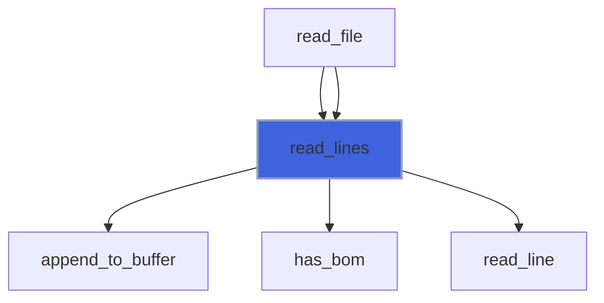

### split

Return a list of substring in the string, using sep as the delimiter string.

 @note Multiple subsequent separators are collapsed to one occurrence.

 @note With `keep_empty=.true.` nothing is collapsed and the empty fields are tokens (as Python `str.split(sep)`): `'a,,b'`
 gives `'a'`, `''` and `'b'`, a null string gives one null token; `max_tokens` is then the number of splits, the last token
 being the rest of the string.

 @note If `max_tokens` is passed the returned number of tokens is either `max_tokens` or `max_tokens + 1`.

 @note A string made only of separators has no tokens (`tokens` is allocated with size 0).

```fortran
 type(string)              :: astring
 type(string), allocatable :: strings(:)
 logical                   :: test_passed(14)
 astring = '+ab-++cre-++cre-ab+'
 call astring%split(tokens=strings, sep='+')
 test_passed(1) = (strings(1)//''=='ab-'.and.strings(2)//''=='cre-'.and.strings(3)//''=='cre-ab')
 astring = 'ab-++cre-++cre-ab+'
 call astring%split(tokens=strings, sep='+')
 test_passed(2) = (strings(1)//''=='ab-'.and.strings(2)//''=='cre-'.and.strings(3)//''=='cre-ab')
 astring = 'ab-++cre-++cre-ab'
 call astring%split(tokens=strings, sep='+')
 test_passed(3) = (strings(1)//''=='ab-'.and.strings(2)//''=='cre-'.and.strings(3)//''=='cre-ab')
 astring = 'Hello '//new_line('a')//'World!'
 call astring%split(tokens=strings, sep=new_line('a'))
 test_passed(4) = (strings(1)//''=='Hello '.and.strings(2)//''=='World!')
 astring = 'Hello World!'
 call astring%split(tokens=strings)
 test_passed(5) = (strings(1)//''=='Hello'.and.strings(2)//''=='World!')
 astring = '+ab-'
 call astring%split(tokens=strings, sep='+')
 test_passed(6) = (strings(1)//''=='ab-')
 astring = '+ab-'
 call astring%split(tokens=strings, sep='-')
 test_passed(7) = (strings(1)//''=='+ab')
 astring = '+ab-+cd-'
 call astring%split(tokens=strings, sep='+')
 test_passed(8) = (strings(1)//''=='ab-'.and.strings(2)//''=='cd-')
 astring = 'ab-+cd-+'
 call astring%split(tokens=strings, sep='+')
 test_passed(9) = (strings(1)//''=='ab-'.and.strings(2)//''=='cd-')
 astring = '+ab-+cd-+'
 call astring%split(tokens=strings, sep='+')
 test_passed(10) = (strings(1)//''=='ab-'.and.strings(2)//''=='cd-')
 astring = '1-2-3-4-5-6-7-8'
 call astring%split(tokens=strings, sep='-', max_tokens=3)
 test_passed(11) = (strings(1)//''=='1'.and.strings(2)//''=='2'.and.strings(3)//''=='3'.and.strings(4)//''=='4-5-6-7-8')
 astring = '+++'
 call astring%split(tokens=strings, sep='+')
 test_passed(12) = (size(strings, dim=1)==0)
 astring = ',a,,b,'
 call astring%split(tokens=strings, sep=',', keep_empty=.true.)
 test_passed(13) = size(strings, dim=1)==5
 if (test_passed(13)) test_passed(13) = all(strings==['  ', 'a ', '  ', 'b ', '  ']).and.all(strings%len()==[0, 1, 0, 1, 0])
 call astring%split(tokens=strings, sep=',', max_tokens=2, keep_empty=.true.)
 test_passed(14) = size(strings, dim=1)==3
 if (test_passed(14)) test_passed(14) = strings(1)//''==''.and.strings(2)//''=='a'.and.strings(3)//''==',b,'
 print '(L1)', all(test_passed)
```

**Attributes**: pure

```fortran
subroutine split(self, tokens, sep, max_tokens, keep_empty)
```

**Arguments**

| Name | Type | Intent | Attributes | Description |
|------|------|--------|------------|-------------|
| `self` | class([string](/api/src/third_party/StringiFor/src/lib/stringifor_string_t#string)) | in |  | The string. |
| `tokens` | type([string](/api/src/third_party/StringiFor/src/lib/stringifor_string_t#string)) | out | allocatable | Tokens substring. |
| `sep` | character(kind=[CK](/api/src/third_party/StringiFor/src/lib/stringifor_string_t), len=*) | in | optional | Separator. |
| `max_tokens` | integer | in | optional | Fix the maximum number of returned tokens. |
| `keep_empty` | logical | in | optional | Keep the empty fields, collapsing nothing. |

**Call graph**

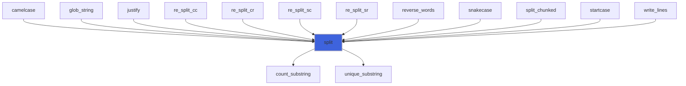

### split_chunked

Return a list of substring in the string, using sep as the delimiter string, chunked (memory-efficient) algorithm.

 @note Multiple subsequent separators are collapsed to one occurrence.

 @note The split is performed in chunks of `#chunks` to avoid excessive memory consumption.

 @note As [split](/api/src/third_party/StringiFor/src/lib/stringifor_string_t#split), a string made only of separators has no tokens (`tokens` is allocated with size 0) and a
 null string has one null token.

```fortran
 type(string)              :: astring
 type(string), allocatable :: strings(:)
 logical                   :: test_passed(3)
 astring = '-1-2-3-4-5-6-7-8-'
 call astring%split_chunked(tokens=strings, sep='-', chunks=3)
 test_passed(1) = (strings(1)//''=='1'.and.strings(2)//''=='2'.and.strings(3)//''=='3'.and.strings(4)//''=='4'.and. &
                   strings(5)//''=='5'.and.strings(6)//''=='6'.and.strings(7)//''=='7'.and.strings(8)//''=='8')
 astring = '--'
 call astring%split_chunked(tokens=strings, sep='-', chunks=2)
 test_passed(2) = size(strings)==0
 astring = ''
 call astring%split_chunked(tokens=strings, sep='-', chunks=2)
 test_passed(3) = size(strings)==1
 print '(L1)', all(test_passed)
```

**Attributes**: pure

```fortran
subroutine split_chunked(self, tokens, chunks, sep)
```

**Arguments**

| Name | Type | Intent | Attributes | Description |
|------|------|--------|------------|-------------|
| `self` | class([string](/api/src/third_party/StringiFor/src/lib/stringifor_string_t#string)) | in |  | The string. |
| `tokens` | type([string](/api/src/third_party/StringiFor/src/lib/stringifor_string_t#string)) | out | allocatable | Tokens substring. |
| `chunks` | integer | in |  | Number of chunks. |
| `sep` | character(kind=[CK](/api/src/third_party/StringiFor/src/lib/stringifor_string_t), len=*) | in | optional | Separator. |

**Call graph**

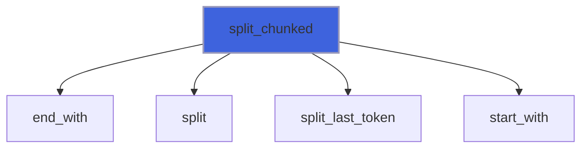

### read_number_I1P

Cast string to integer (I1P), with an error status.

 @note If the string is not an integer `number` is 0 and `iostat` is positive: unlike `to_number`, the failure is
 reported. As the `read` statement, `iomsg` is changed only on failure. See [is_integer](/api/src/third_party/StringiFor/src/lib/stringifor_string_t#is-integer).

 @note The doctest is not necessary, this being tested by the I4P one.

**Attributes**: elemental

```fortran
subroutine read_number_I1P(self, number, iostat, iomsg)
```

**Arguments**

| Name | Type | Intent | Attributes | Description |
|------|------|--------|------------|-------------|
| `self` | class([string](/api/src/third_party/StringiFor/src/lib/stringifor_string_t#string)) | in |  | The string. |
| `number` | integer(kind=[I1P](/api/src/third_party/PENF/src/lib/penf_global_parameters_variables)) | out |  | The number into the string. |
| `iostat` | integer | out | optional | IO status code: 0 on success, positive otherwise. |
| `iomsg` | character(len=*) | inout | optional | IO status message, set on failure. |

**Call graph**


### read_number_I2P

Cast string to integer (I2P), with an error status.

 @note If the string is not an integer `number` is 0 and `iostat` is positive: unlike `to_number`, the failure is
 reported. As the `read` statement, `iomsg` is changed only on failure. See [is_integer](/api/src/third_party/StringiFor/src/lib/stringifor_string_t#is-integer).

 @note The doctest is not necessary, this being tested by the I4P one.

**Attributes**: elemental

```fortran
subroutine read_number_I2P(self, number, iostat, iomsg)
```

**Arguments**

| Name | Type | Intent | Attributes | Description |
|------|------|--------|------------|-------------|
| `self` | class([string](/api/src/third_party/StringiFor/src/lib/stringifor_string_t#string)) | in |  | The string. |
| `number` | integer(kind=[I2P](/api/src/third_party/PENF/src/lib/penf_global_parameters_variables)) | out |  | The number into the string. |
| `iostat` | integer | out | optional | IO status code: 0 on success, positive otherwise. |
| `iomsg` | character(len=*) | inout | optional | IO status message, set on failure. |

**Call graph**


### read_number_I4P

Cast string to integer (I4P), with an error status.

 @note If the string is not an integer `number` is 0 and `iostat` is positive: unlike `to_number`, the failure is
 reported. As the `read` statement, `iomsg` is changed only on failure. See [is_integer](/api/src/third_party/StringiFor/src/lib/stringifor_string_t#is-integer).

```fortran
 use penf
 type(string)      :: astring
 integer(I4P)      :: integer_
 integer           :: iostat
 character(len=99) :: iomsg
 logical           :: test_passed(4)
 astring = '127'
 call astring%read_number(integer_, iostat=iostat)
 test_passed(1) = integer_==127_I4P.and.iostat==0
 astring = '12x'
 call astring%read_number(integer_, iostat=iostat, iomsg=iomsg)
 test_passed(2) = integer_==0_I4P.and.iostat>0.and.trim(iomsg)=='the string is not an integer'
 astring = '99999999999'
 call astring%read_number(integer_, iostat=iostat)
 test_passed(3) = integer_==0_I4P.and.iostat/=0
 call astring%free
 call astring%read_number(integer_, iostat=iostat)
 test_passed(4) = iostat>0
 print '(L1)', all(test_passed)
```

**Attributes**: elemental

```fortran
subroutine read_number_I4P(self, number, iostat, iomsg)
```

**Arguments**

| Name | Type | Intent | Attributes | Description |
|------|------|--------|------------|-------------|
| `self` | class([string](/api/src/third_party/StringiFor/src/lib/stringifor_string_t#string)) | in |  | The string. |
| `number` | integer(kind=[I4P](/api/src/third_party/PENF/src/lib/penf_global_parameters_variables)) | out |  | The number into the string. |
| `iostat` | integer | out | optional | IO status code: 0 on success, positive otherwise. |
| `iomsg` | character(len=*) | inout | optional | IO status message, set on failure. |

**Call graph**


### read_number_I8P

Cast string to integer (I8P), with an error status.

 @note If the string is not an integer `number` is 0 and `iostat` is positive: unlike `to_number`, the failure is
 reported. As the `read` statement, `iomsg` is changed only on failure. See [is_integer](/api/src/third_party/StringiFor/src/lib/stringifor_string_t#is-integer).

 @note The doctest is not necessary, this being tested by the I4P one.

**Attributes**: elemental

```fortran
subroutine read_number_I8P(self, number, iostat, iomsg)
```

**Arguments**

| Name | Type | Intent | Attributes | Description |
|------|------|--------|------------|-------------|
| `self` | class([string](/api/src/third_party/StringiFor/src/lib/stringifor_string_t#string)) | in |  | The string. |
| `number` | integer(kind=[I8P](/api/src/third_party/PENF/src/lib/penf_global_parameters_variables)) | out |  | The number into the string. |
| `iostat` | integer | out | optional | IO status code: 0 on success, positive otherwise. |
| `iomsg` | character(len=*) | inout | optional | IO status message, set on failure. |

**Call graph**

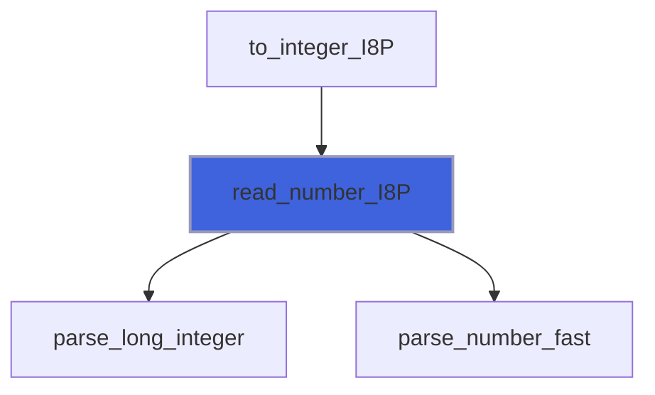

### read_number_R4P

Cast string to real (R4P), with an error status.

 @note If the string is not a number `number` is a quiet NaN and `iostat` is positive: unlike `to_number`, the failure is
 reported. As the `read` statement, `iomsg` is changed only on failure. See [is_number](/api/src/third_party/StringiFor/src/lib/stringifor_string_t#is-number).

 @note The doctest is not necessary, this being tested by the R8P one.

**Attributes**: elemental

```fortran
subroutine read_number_R4P(self, number, iostat, iomsg)
```

**Arguments**

| Name | Type | Intent | Attributes | Description |
|------|------|--------|------------|-------------|
| `self` | class([string](/api/src/third_party/StringiFor/src/lib/stringifor_string_t#string)) | in |  | The string. |
| `number` | real(kind=[R4P](/api/src/third_party/PENF/src/lib/penf_global_parameters_variables)) | out |  | The number into the string. |
| `iostat` | integer | out | optional | IO status code: 0 on success, positive otherwise. |
| `iomsg` | character(len=*) | inout | optional | IO status message, set on failure. |

**Call graph**

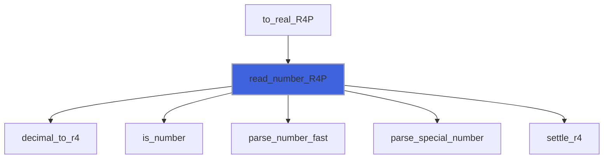

### read_number_R8P

Cast string to real (R8P), with an error status.

 @note If the string is not a number `number` is a quiet NaN and `iostat` is positive: unlike `to_number`, the failure is
 reported. As the `read` statement, `iomsg` is changed only on failure. See [is_number](/api/src/third_party/StringiFor/src/lib/stringifor_string_t#is-number).

```fortran
 use penf
 type(string) :: astrings(4)
 real(R8P)    :: reals(4)
 integer      :: iostats(4)
 logical      :: test_passed(4)
 astrings(1) = '3.4e9'
 astrings(2) = '12'
 astrings(3) = 'twelve'
 astrings(4) = '1.5-101'
 call astrings%read_number(reals, iostat=iostats)
 test_passed(1) = reals(1)==3.4e9_R8P.and.iostats(1)==0
 test_passed(2) = reals(2)==12._R8P.and.iostats(2)==0
 test_passed(3) = reals(3)/=reals(3).and.iostats(3)>0
 test_passed(4) = reals(4)==1.5e-101_R8P.and.iostats(4)==0
 print '(L1)', all(test_passed)
```

**Attributes**: elemental

```fortran
subroutine read_number_R8P(self, number, iostat, iomsg)
```

**Arguments**

| Name | Type | Intent | Attributes | Description |
|------|------|--------|------------|-------------|
| `self` | class([string](/api/src/third_party/StringiFor/src/lib/stringifor_string_t#string)) | in |  | The string. |
| `number` | real(kind=[R8P](/api/src/third_party/PENF/src/lib/penf_global_parameters_variables)) | out |  | The number into the string. |
| `iostat` | integer | out | optional | IO status code: 0 on success, positive otherwise. |
| `iomsg` | character(len=*) | inout | optional | IO status message, set on failure. |

**Call graph**


### read_number_R16P

Cast string to real (R16P), with an error status.

 @note If the string is not a number `number` is a quiet NaN and `iostat` is positive: unlike `to_number`, the failure is
 reported. As the `read` statement, `iomsg` is changed only on failure. See [is_number](/api/src/third_party/StringiFor/src/lib/stringifor_string_t#is-number).

 @note The doctest is not necessary, this being tested by the R8P one.

**Attributes**: elemental

```fortran
subroutine read_number_R16P(self, number, iostat, iomsg)
```

**Arguments**

| Name | Type | Intent | Attributes | Description |
|------|------|--------|------------|-------------|
| `self` | class([string](/api/src/third_party/StringiFor/src/lib/stringifor_string_t#string)) | in |  | The string. |
| `number` | real(kind=[R16P](/api/src/third_party/PENF/src/lib/penf_global_parameters_variables)) | out |  | The number into the string. |
| `iostat` | integer | out | optional | IO status code: 0 on success, positive otherwise. |
| `iomsg` | character(len=*) | inout | optional | IO status message, set on failure. |

**Call graph**

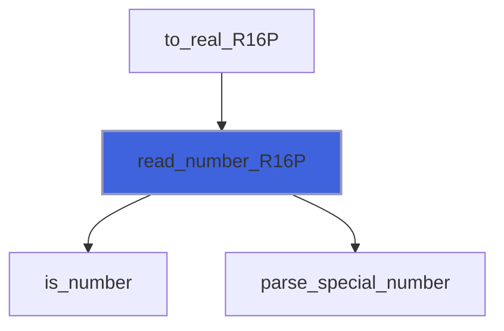

### write_file

Write a single string stream into file.

 @note For unformatted read only `access='stream'` is supported with new_line as line terminator.

 @note With `bom=.true.` the file starts with a UTF-8 byte order mark (EF BB BF), unless the string starts with one.

```fortran
 type(string)              :: astring
 type(string)              :: anotherstring
 type(string), allocatable :: strings(:)
 type(string)              :: line(3)
 integer                   :: iostat
 character(len=99)         :: iomsg
 integer                   :: scratch
 integer                   :: l
 logical                   :: test_passed(8)
 line(1) = ' Hello World!   '
 line(2) = 'How are you?  '
 line(3) = '   All say: "Fine thanks"'
 anotherstring = anotherstring%join(array=line, sep=new_line('a'))
 call anotherstring%write_file(file='write_file_test.tmp', iostat=iostat, iomsg=iomsg)
 call astring%read_file(file='write_file_test.tmp', iostat=iostat, iomsg=iomsg)
 call astring%split(tokens=strings, sep=new_line('a'))
 test_passed(1) = (size(strings, dim=1)==size(line, dim=1))
 do l=1, size(strings, dim=1)
   test_passed(l+1) = (strings(l)==line(l))
 enddo
 call anotherstring%write_file(file='write_file_test.tmp', form='unformatted', iostat=iostat, iomsg=iomsg)
 call astring%read_file(file='write_file_test.tmp', form='unformatted', iostat=iostat, iomsg=iomsg)
 call astring%split(tokens=strings, sep=new_line('a'))
 test_passed(5) = (size(strings, dim=1)==size(line, dim=1))
 do l=1, size(strings, dim=1)
   test_passed(l+5) = (strings(l)==line(l))
 enddo
 open(newunit=scratch, file='write_file_test.tmp')
 close(unit=scratch, status='delete')
 print '(L1)', all(test_passed)
```

```fortran
subroutine write_file(self, file, form, iostat, iomsg, bom)
```

**Arguments**

| Name | Type | Intent | Attributes | Description |
|------|------|--------|------------|-------------|
| `self` | class([string](/api/src/third_party/StringiFor/src/lib/stringifor_string_t#string)) | in |  | The string. |
| `file` | character(len=*) | in |  | File name. |
| `form` | character(len=*) | in | optional | Format of unit. |
| `iostat` | integer | out | optional | IO status code. |
| `iomsg` | character(len=*) | inout | optional | IO status message. |
| `bom` | logical | in | optional | Start the file with a UTF-8 byte order mark (if the string has none). |

**Call graph**

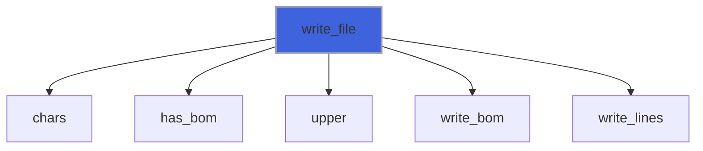

### write_line

Write line (record) to a connected unit.

 @note If the connected unit is unformatted a `new_line()` character is added at the end (if necessary) to mark the end of line.

 @note There is no doctests, this being tested by means of [write_file](/api/src/third_party/StringiFor/src/lib/stringifor_string_t#write-file) doctests.

```fortran
subroutine write_line(self, unit, form, iostat, iomsg)
```

**Arguments**

| Name | Type | Intent | Attributes | Description |
|------|------|--------|------------|-------------|
| `self` | class([string](/api/src/third_party/StringiFor/src/lib/stringifor_string_t#string)) | in |  | The string. |
| `unit` | integer | in |  | Logical unit. |
| `form` | character(len=*) | in | optional | Format of unit. |
| `iostat` | integer | out | optional | IO status code. |
| `iomsg` | character(len=*) | inout | optional | IO status message. |

**Call graph**

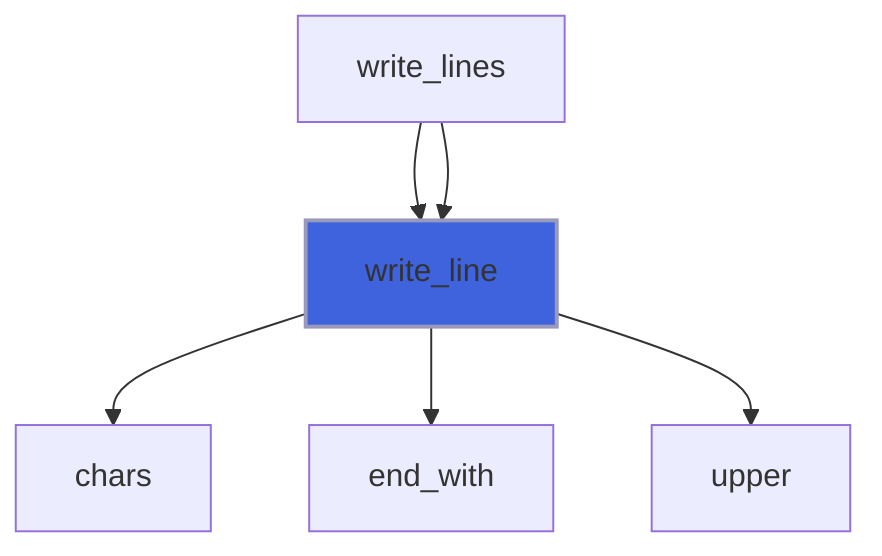

### write_lines

Write lines (records) to a connected unit.

 This method checks if self contains more than one line (records) and writes them as lines (records).

 @note If the connected unit is unformatted a `new_line()` character is added at the end (if necessary) to mark the end of line.

 @note There is no doctests, this being tested by means of [write_file](/api/src/third_party/StringiFor/src/lib/stringifor_string_t#write-file) doctests.

```fortran
subroutine write_lines(self, unit, form, iostat, iomsg)
```

**Arguments**

| Name | Type | Intent | Attributes | Description |
|------|------|--------|------------|-------------|
| `self` | class([string](/api/src/third_party/StringiFor/src/lib/stringifor_string_t#string)) | in |  | The string. |
| `unit` | integer | in |  | Logical unit. |
| `form` | character(len=*) | in | optional | Format of unit. |
| `iostat` | integer | out | optional | IO status code. |
| `iomsg` | character(len=*) | inout | optional | IO status message. |

**Call graph**

```mermaid
flowchart TD
  write_file["write_file"] --> write_lines["write_lines"]
  write_file["write_file"] --> write_lines["write_lines"]
  write_lines["write_lines"] --> split["split"]
  write_lines["write_lines"] --> write_line["write_line"]
  style write_lines fill:#3e63dd,stroke:#99b,stroke-width:2px
```

### string_assign_string

Assignment operator from string input.

```fortran
 type(string) :: astring
 type(string) :: anotherstring
 type(string) :: notallocated
 logical      :: test_passed(2)
 astring = 'hello'
 anotherstring = astring
 test_passed(1) = astring%chars()==anotherstring%chars()
 anotherstring = notallocated
 test_passed(2) = .not.anotherstring%is_allocated()
 print '(L1)', all(test_passed)
```

**Attributes**: pure

```fortran
subroutine string_assign_string(lhs, rhs)
```

**Arguments**

| Name | Type | Intent | Attributes | Description |
|------|------|--------|------------|-------------|
| `lhs` | class([string](/api/src/third_party/StringiFor/src/lib/stringifor_string_t#string)) | inout |  | Left hand side. |
| `rhs` | type([string](/api/src/third_party/StringiFor/src/lib/stringifor_string_t#string)) | in |  | Right hand side. |

### string_assign_character

Assignment operator from character input.

 @note The right hand side can be a part of the left hand side itself (`astring = astring%raw(2:)`): it is copied
 into the new data before the old data are freed.

```fortran
 type(string) :: astring
 logical      :: test_passed(4)
 astring = 'hello'
 test_passed(1) = astring%chars()=='hello'
 astring = astring%raw(2:)
 test_passed(2) = astring%chars()=='ello'
 astring = astring%raw(1:2)//astring%raw
 test_passed(3) = astring%chars()=='elello'
 astring = astring%raw
 test_passed(4) = astring%chars()=='elello'
 print '(L1)', all(test_passed)
```

**Attributes**: pure

```fortran
subroutine string_assign_character(lhs, rhs)
```

**Arguments**

| Name | Type | Intent | Attributes | Description |
|------|------|--------|------------|-------------|
| `lhs` | class([string](/api/src/third_party/StringiFor/src/lib/stringifor_string_t#string)) | inout |  | Left hand side. |
| `rhs` | character(kind=[CK](/api/src/third_party/StringiFor/src/lib/stringifor_string_t), len=*) | in |  | Right hand side. |

### string_assign_integer_I1P

Assignment operator from integer input.

```fortran
 use penf
 type(string) :: astring
 logical      :: test_passed(1)
 astring = 127_I1P
 test_passed(1) = astring%to_number(kind=1_I1P)==127_I1P
 print '(L1)', all(test_passed)
```

**Attributes**: pure

```fortran
subroutine string_assign_integer_I1P(lhs, rhs)
```

**Arguments**

| Name | Type | Intent | Attributes | Description |
|------|------|--------|------------|-------------|
| `lhs` | class([string](/api/src/third_party/StringiFor/src/lib/stringifor_string_t#string)) | inout |  | Left hand side. |
| `rhs` | integer(kind=[I1P](/api/src/third_party/PENF/src/lib/penf_global_parameters_variables)) | in |  | Right hand side. |

**Call graph**

```mermaid
flowchart TD
  string_assign_integer_I1P["string_assign_integer_I1P"] --> str["str"]
  style string_assign_integer_I1P fill:#3e63dd,stroke:#99b,stroke-width:2px
```

### string_assign_integer_I2P

Assignment operator from integer input.

```fortran
 use penf
 type(string) :: astring
 logical      :: test_passed(1)
 astring = 127_I2P
 test_passed(1) = astring%to_number(kind=1_I2P)==127_I2P
 print '(L1)', all(test_passed)
```

**Attributes**: pure

```fortran
subroutine string_assign_integer_I2P(lhs, rhs)
```

**Arguments**

| Name | Type | Intent | Attributes | Description |
|------|------|--------|------------|-------------|
| `lhs` | class([string](/api/src/third_party/StringiFor/src/lib/stringifor_string_t#string)) | inout |  | Left hand side. |
| `rhs` | integer(kind=[I2P](/api/src/third_party/PENF/src/lib/penf_global_parameters_variables)) | in |  | Right hand side. |

**Call graph**

```mermaid
flowchart TD
  string_assign_integer_I2P["string_assign_integer_I2P"] --> str["str"]
  style string_assign_integer_I2P fill:#3e63dd,stroke:#99b,stroke-width:2px
```

### string_assign_integer_I4P

Assignment operator from integer input.

```fortran
 use penf
 type(string) :: astring
 logical      :: test_passed(1)
 astring = 127_I4P
 test_passed(1) = astring%to_number(kind=1_I4P)==127_I4P
 print '(L1)', all(test_passed)
```

**Attributes**: pure

```fortran
subroutine string_assign_integer_I4P(lhs, rhs)
```

**Arguments**

| Name | Type | Intent | Attributes | Description |
|------|------|--------|------------|-------------|
| `lhs` | class([string](/api/src/third_party/StringiFor/src/lib/stringifor_string_t#string)) | inout |  | Left hand side. |
| `rhs` | integer(kind=[I4P](/api/src/third_party/PENF/src/lib/penf_global_parameters_variables)) | in |  | Right hand side. |

**Call graph**

```mermaid
flowchart TD
  string_assign_integer_I4P["string_assign_integer_I4P"] --> str["str"]
  style string_assign_integer_I4P fill:#3e63dd,stroke:#99b,stroke-width:2px
```

### string_assign_integer_I8P

Assignment operator from integer input.

```fortran
 use penf
 type(string) :: astring
 logical      :: test_passed(1)
 astring = 127_I8P
 test_passed(1) = astring%to_number(kind=1_I8P)==127_I8P
 print '(L1)', all(test_passed)
```

**Attributes**: pure

```fortran
subroutine string_assign_integer_I8P(lhs, rhs)
```

**Arguments**

| Name | Type | Intent | Attributes | Description |
|------|------|--------|------------|-------------|
| `lhs` | class([string](/api/src/third_party/StringiFor/src/lib/stringifor_string_t#string)) | inout |  | Left hand side. |
| `rhs` | integer(kind=[I8P](/api/src/third_party/PENF/src/lib/penf_global_parameters_variables)) | in |  | Right hand side. |

**Call graph**

```mermaid
flowchart TD
  string_assign_integer_I8P["string_assign_integer_I8P"] --> str["str"]
  style string_assign_integer_I8P fill:#3e63dd,stroke:#99b,stroke-width:2px
```

### string_assign_real_R4P

Assignment operator from real input.

```fortran
 use penf
 type(string) :: astring
 logical      :: test_passed(1)
 astring = 3.021e6_R4P
 test_passed(1) = astring%to_number(kind=1._R4P)==3.021e6_R4P
 print '(L1)', all(test_passed)
```

**Attributes**: pure

```fortran
subroutine string_assign_real_R4P(lhs, rhs)
```

**Arguments**

| Name | Type | Intent | Attributes | Description |
|------|------|--------|------------|-------------|
| `lhs` | class([string](/api/src/third_party/StringiFor/src/lib/stringifor_string_t#string)) | inout |  | Left hand side. |
| `rhs` | real(kind=[R4P](/api/src/third_party/PENF/src/lib/penf_global_parameters_variables)) | in |  | Right hand side. |

**Call graph**

```mermaid
flowchart TD
  string_assign_real_R4P["string_assign_real_R4P"] --> str["str"]
  style string_assign_real_R4P fill:#3e63dd,stroke:#99b,stroke-width:2px
```

### string_assign_real_R8P

Assignment operator from real input.

```fortran
 use penf
 type(string) :: astring
 logical      :: test_passed(1)
 astring = 3.021e6_R8P
 test_passed(1) = astring%to_number(kind=1._R8P)==3.021e6_R8P
 print '(L1)', all(test_passed)
```

**Attributes**: pure

```fortran
subroutine string_assign_real_R8P(lhs, rhs)
```

**Arguments**

| Name | Type | Intent | Attributes | Description |
|------|------|--------|------------|-------------|
| `lhs` | class([string](/api/src/third_party/StringiFor/src/lib/stringifor_string_t#string)) | inout |  | Left hand side. |
| `rhs` | real(kind=[R8P](/api/src/third_party/PENF/src/lib/penf_global_parameters_variables)) | in |  | Right hand side. |

**Call graph**

```mermaid
flowchart TD
  string_assign_real_R8P["string_assign_real_R8P"] --> str["str"]
  style string_assign_real_R8P fill:#3e63dd,stroke:#99b,stroke-width:2px
```

### string_assign_real_R16P

Assignment operator from real input.

```fortran
 use penf
 type(string) :: astring
 logical      :: test_passed(1)
 astring = 3.021e6_R8P
 test_passed(1) = astring%to_number(kind=1._R8P)==3.021e6_R8P
 print '(L1)', all(test_passed)
```

**Attributes**: pure

```fortran
subroutine string_assign_real_R16P(lhs, rhs)
```

**Arguments**

| Name | Type | Intent | Attributes | Description |
|------|------|--------|------------|-------------|
| `lhs` | class([string](/api/src/third_party/StringiFor/src/lib/stringifor_string_t#string)) | inout |  | Left hand side. |
| `rhs` | real(kind=[R16P](/api/src/third_party/PENF/src/lib/penf_global_parameters_variables)) | in |  | Right hand side. |

**Call graph**

```mermaid
flowchart TD
  string_assign_real_R16P["string_assign_real_R16P"] --> str["str"]
  style string_assign_real_R16P fill:#3e63dd,stroke:#99b,stroke-width:2px
```

### read_formatted

Formatted input.

 @bug Change temporary acks: find a more precise length of the input string and avoid the trimming!

 @bug Read listdirected with and without delimiters does not work.

```fortran
subroutine read_formatted(dtv, unit, iotype, v_list, iostat, iomsg)
```

**Arguments**

| Name | Type | Intent | Attributes | Description |
|------|------|--------|------------|-------------|
| `dtv` | class([string](/api/src/third_party/StringiFor/src/lib/stringifor_string_t#string)) | inout |  | The string. |
| `unit` | integer | in |  | Logical unit. |
| `iotype` | character(len=*) | in |  | Edit descriptor. |
| `v_list` | integer | in |  | Edit descriptor list. |
| `iostat` | integer | out |  | IO status code. |
| `iomsg` | character(len=*) | inout |  | IO status message. |

**Call graph**

```mermaid
flowchart TD
  read_formatted["read_formatted"] --> get_next_non_blank_character_any_record["get_next_non_blank_character_any_record"]
  read_formatted["read_formatted"] --> read_delimited["read_delimited"]
  read_formatted["read_formatted"] --> read_undelimited_listdirected["read_undelimited_listdirected"]
  style read_formatted fill:#3e63dd,stroke:#99b,stroke-width:2px
```

### read_delimited

Read a delimited string from a unit connected for formatted input.

 If the closing delimiter is followed by end of record, then we return end of record.

 @note This does not need a doctest, it being tested by [[string::read_formatted]].

```fortran
subroutine read_delimited(dtv, unit, delim, iostat, iomsg)
```

**Arguments**

| Name | Type | Intent | Attributes | Description |
|------|------|--------|------------|-------------|
| `dtv` | class([string](/api/src/third_party/StringiFor/src/lib/stringifor_string_t#string)) | inout |  | The string. |
| `unit` | integer | in |  | Logical unit. |
| `delim` | character(kind=[CK](/api/src/third_party/StringiFor/src/lib/stringifor_string_t), len=1) | in |  | String delimiter. |
| `iostat` | integer | out |  | IO status code. |
| `iomsg` | character(kind=[CK](/api/src/third_party/StringiFor/src/lib/stringifor_string_t), len=*) | inout |  | IO status message. |

**Call graph**

```mermaid
flowchart TD
  read_formatted["read_formatted"] --> read_delimited["read_delimited"]
  style read_delimited fill:#3e63dd,stroke:#99b,stroke-width:2px
```

### read_undelimited_listdirected

Read an undelimited (no leading apostrophe or double quote) character value according to the rules for list directed input.

 A blank, comma/semicolon (depending on the decimal mode), slash or end of record terminates the string.

 If input is terminated by end of record, then this procedure returns an end-of-record condition.

```fortran
subroutine read_undelimited_listdirected(dtv, unit, iostat, iomsg)
```

**Arguments**

| Name | Type | Intent | Attributes | Description |
|------|------|--------|------------|-------------|
| `dtv` | class([string](/api/src/third_party/StringiFor/src/lib/stringifor_string_t#string)) | inout |  | The string. |
| `unit` | integer | in |  | Logical unit. |
| `iostat` | integer | out |  | IO status code. |
| `iomsg` | character(len=*) | inout |  | IO status message. |

**Call graph**

```mermaid
flowchart TD
  read_formatted["read_formatted"] --> read_undelimited_listdirected["read_undelimited_listdirected"]
  read_undelimited_listdirected["read_undelimited_listdirected"] --> get_decimal_mode["get_decimal_mode"]
  read_undelimited_listdirected["read_undelimited_listdirected"] --> read_undelimited["read_undelimited"]
  style read_undelimited_listdirected fill:#3e63dd,stroke:#99b,stroke-width:2px
```

### read_undelimited

Read an undelimited string up until end of record or a character from a set of terminators is encountered.

 If a terminator is encountered, the file position will be at that terminating character. If end of record is encountered, the
 file remains at end of record.

```fortran
subroutine read_undelimited(dtv, unit, terminators, iostat, iomsg)
```

**Arguments**

| Name | Type | Intent | Attributes | Description |
|------|------|--------|------------|-------------|
| `dtv` | class([string](/api/src/third_party/StringiFor/src/lib/stringifor_string_t#string)) | inout |  | The string. |
| `unit` | integer | in |  | Logical unit. |
| `terminators` | character(kind=[CK](/api/src/third_party/StringiFor/src/lib/stringifor_string_t), len=*) | in |  | Characters that are considered to terminate the string. |
| `iostat` | integer | out |  | IO status code. |
| `iomsg` | character(len=*) | inout |  | IO status message. |

**Call graph**

```mermaid
flowchart TD
  read_undelimited_listdirected["read_undelimited_listdirected"] --> read_undelimited["read_undelimited"]
  style read_undelimited fill:#3e63dd,stroke:#99b,stroke-width:2px
```

### write_formatted

Formatted output.

```fortran
subroutine write_formatted(dtv, unit, iotype, v_list, iostat, iomsg)
```

**Arguments**

| Name | Type | Intent | Attributes | Description |
|------|------|--------|------------|-------------|
| `dtv` | class([string](/api/src/third_party/StringiFor/src/lib/stringifor_string_t#string)) | in |  | The string. |
| `unit` | integer | in |  | Logical unit. |
| `iotype` | character(kind=[CK](/api/src/third_party/StringiFor/src/lib/stringifor_string_t), len=*) | in |  | Edit descriptor. |
| `v_list` | integer | in |  | Edit descriptor list. |
| `iostat` | integer | out |  | IO status code. |
| `iomsg` | character(kind=[CK](/api/src/third_party/StringiFor/src/lib/stringifor_string_t), len=*) | inout |  | IO status message. |

### read_unformatted

Unformatted input.

 @note The string is stored as its length (an `I8P` integer) followed by its characters, see [write_unformatted](/api/src/third_party/StringiFor/src/lib/stringifor_string_t#write-unformatted).

```fortran
 type(string) :: astring
 type(string) :: bstring
 type(string) :: cstring
 integer      :: scratch
 logical      :: test_passed(4)
 astring = repeat('a', 250)//'  '
 open(newunit=scratch, status='SCRATCH', form='UNFORMATTED')
 write(scratch) astring, bstring
 rewind(scratch)
 read(scratch) cstring, bstring
 close(scratch)
 test_passed(1) = cstring%len()==252.and.cstring==astring
 test_passed(2) = bstring%is_allocated().and.bstring%len()==0
 open(newunit=scratch, status='SCRATCH', form='UNFORMATTED', access='STREAM')
 write(scratch) astring
 rewind(scratch)
 read(scratch) cstring
 close(scratch)
 test_passed(3) = cstring%len()==252
 test_passed(4) = cstring==astring
 print '(L1)', all(test_passed)
```

```fortran
subroutine read_unformatted(dtv, unit, iostat, iomsg)
```

**Arguments**

| Name | Type | Intent | Attributes | Description |
|------|------|--------|------------|-------------|
| `dtv` | class([string](/api/src/third_party/StringiFor/src/lib/stringifor_string_t#string)) | inout |  | The string. |
| `unit` | integer | in |  | Logical unit. |
| `iostat` | integer | out |  | IO status code. |
| `iomsg` | character(kind=[CK](/api/src/third_party/StringiFor/src/lib/stringifor_string_t), len=*) | inout |  | IO status message. |

### write_unformatted

Unformatted output.

 @note The string is stored as its length (an `I8P` integer) followed by its characters, a not allocated string being
 stored as a null one.

 @note The doctest is not necessary, this being tested by [read_unformatted](/api/src/third_party/StringiFor/src/lib/stringifor_string_t#read-unformatted).

```fortran
subroutine write_unformatted(dtv, unit, iostat, iomsg)
```

**Arguments**

| Name | Type | Intent | Attributes | Description |
|------|------|--------|------------|-------------|
| `dtv` | class([string](/api/src/third_party/StringiFor/src/lib/stringifor_string_t#string)) | in |  | The string. |
| `unit` | integer | in |  | Logical unit. |
| `iostat` | integer | out |  | IO status code. |
| `iomsg` | character(kind=[CK](/api/src/third_party/StringiFor/src/lib/stringifor_string_t), len=*) | inout |  | IO status message. |

### parse_long_integer

Parse an integer as [is_integer](/api/src/third_party/StringiFor/src/lib/stringifor_string_t#is-integer) accepts it, `[blanks][sign]digits[e|E[+]digits][blanks]`, of any length: the
 value if it fits in I8P, whose lowest value has no positive counterpart, so it accumulates on the negative side.

 @note The doctest is not necessary, this being tested by the oracle.

**Attributes**: pure

```fortran
subroutine parse_long_integer(raw, is_plain, number, fits)
```

**Arguments**

| Name | Type | Intent | Attributes | Description |
|------|------|--------|------------|-------------|
| `raw` | character(kind=[CK](/api/src/third_party/StringiFor/src/lib/stringifor_string_t), len=*) | in |  | Raw characters data. |
| `is_plain` | logical | out |  | The string has that form. |
| `number` | integer(kind=[I8P](/api/src/third_party/PENF/src/lib/penf_global_parameters_variables)) | out |  | The value, if it fits. |
| `fits` | logical | out |  | The value fits in I8P. |

**Call graph**

```mermaid
flowchart TD
  read_number_I1P["read_number_I1P"] --> parse_long_integer["parse_long_integer"]
  read_number_I2P["read_number_I2P"] --> parse_long_integer["parse_long_integer"]
  read_number_I4P["read_number_I4P"] --> parse_long_integer["parse_long_integer"]
  read_number_I8P["read_number_I8P"] --> parse_long_integer["parse_long_integer"]
  style parse_long_integer fill:#3e63dd,stroke:#99b,stroke-width:2px
```

### parse_special_number

Recognize `[blanks][sign]nan[(chars)][blanks]` and `[blanks][sign]inf|infinity[blanks]`, in any case, the special values
 the read statement accepts. `special` is SPECIAL_NAN, SPECIAL_INF, or 0 for anything else.

 @note The doctest is not necessary, this being tested by read_number and by the oracle.

**Attributes**: pure

```fortran
subroutine parse_special_number(raw, special, negative)
```

**Arguments**

| Name | Type | Intent | Attributes | Description |
|------|------|--------|------------|-------------|
| `raw` | character(kind=[CK](/api/src/third_party/StringiFor/src/lib/stringifor_string_t), len=*) | in |  | Raw characters data. |
| `special` | integer | out |  | Kind of the special value. |
| `negative` | logical | out |  | The value is negative. |

**Call graph**

```mermaid
flowchart TD
  is_real["is_real"] --> parse_special_number["parse_special_number"]
  read_number_R16P["read_number_R16P"] --> parse_special_number["parse_special_number"]
  read_number_R4P["read_number_R4P"] --> parse_special_number["parse_special_number"]
  read_number_R8P["read_number_R8P"] --> parse_special_number["parse_special_number"]
  parse_special_number["parse_special_number"] --> is_word["is_word"]
  style parse_special_number fill:#3e63dd,stroke:#99b,stroke-width:2px
```

### parse_number_fast

Parse a plain decimal number, `[blanks][sign]digits[.digits][e|E|d|D[sign]digits][blanks]` (only the integer part if
 `is_integer`), into its sign, its digits as an integer and its decimal exponent. After a decimal point the exponent
 can also be a sign and exactly 3 digits, without the letter, the form E and ES edit descriptors write (`1.5-301`).

 `is_ok` is false for anything else: the caller then falls back to the read statement. The accepted strings are a subset
 of the ones accepted by [is_number](/api/src/third_party/StringiFor/src/lib/stringifor_string_t#is-number) and by the read statement. An integer of more than 18 significant digits
 is not accepted; a real keeps the first 18, the exponent accounts for the others, and `truncated` tells whether any
 of those dropped was not zero: the number is then between mantissa and mantissa + 1, times the power of ten.

 @note The doctest is not necessary, this being tested by read_number and by the differential test.

**Attributes**: pure

```fortran
subroutine parse_number_fast(raw, is_integer, negative, mantissa, exponent, is_ok, truncated)
```

**Arguments**

| Name | Type | Intent | Attributes | Description |
|------|------|--------|------------|-------------|
| `raw` | character(kind=[CK](/api/src/third_party/StringiFor/src/lib/stringifor_string_t), len=*) | in |  | Raw characters data. |
| `is_integer` | logical | in |  | Accept an integer only, no fraction nor exponent. |
| `negative` | logical | out |  | The number is negative. |
| `mantissa` | integer(kind=[I8P](/api/src/third_party/PENF/src/lib/penf_global_parameters_variables)) | out |  | Significant digits, as an integer. |
| `exponent` | integer | out |  | Decimal exponent: the number is mantissa * 10**exponent. |
| `is_ok` | logical | out |  | The string is a plain decimal number. |
| `truncated` | logical | out | optional | Digits that are not zero were dropped. |

**Call graph**

```mermaid
flowchart TD
  read_number_I1P["read_number_I1P"] --> parse_number_fast["parse_number_fast"]
  read_number_I2P["read_number_I2P"] --> parse_number_fast["parse_number_fast"]
  read_number_I4P["read_number_I4P"] --> parse_number_fast["parse_number_fast"]
  read_number_I8P["read_number_I8P"] --> parse_number_fast["parse_number_fast"]
  read_number_R4P["read_number_R4P"] --> parse_number_fast["parse_number_fast"]
  read_number_R8P["read_number_R8P"] --> parse_number_fast["parse_number_fast"]
  style parse_number_fast fill:#3e63dd,stroke:#99b,stroke-width:2px
```

### append_to_buffer

Append a piece to the first length characters of a buffer, doubling the buffer when it is full.

 @note The doctest is not necessary, this being tested by [read_line](/api/src/third_party/StringiFor/src/lib/stringifor_string_t#read-line) and [read_lines](/api/src/third_party/StringiFor/src/lib/stringifor_string_t#read-lines).

**Attributes**: pure

```fortran
subroutine append_to_buffer(buffer, length, piece)
```

**Arguments**

| Name | Type | Intent | Attributes | Description |
|------|------|--------|------------|-------------|
| `buffer` | character(kind=[CK](/api/src/third_party/StringiFor/src/lib/stringifor_string_t), len=:) | inout | allocatable | Buffer, only its first length characters are used. |
| `length` | integer | inout |  | Length of the used part of the buffer. |
| `piece` | character(kind=[CK](/api/src/third_party/StringiFor/src/lib/stringifor_string_t), len=*) | in |  | Piece to append. |

**Call graph**

```mermaid
flowchart TD
  compact["compact"] --> append_to_buffer["append_to_buffer"]
  expand_tabs["expand_tabs"] --> append_to_buffer["append_to_buffer"]
  read_line["read_line"] --> append_to_buffer["append_to_buffer"]
  read_lines["read_lines"] --> append_to_buffer["append_to_buffer"]
  style append_to_buffer fill:#3e63dd,stroke:#99b,stroke-width:2px
```

### write_bom

Write a UTF-8 byte order mark at the start of the current record (formatted) or of the stream (unformatted).

```fortran
subroutine write_bom(unit, form, iostat, iomsg)
```

**Arguments**

| Name | Type | Intent | Attributes | Description |
|------|------|--------|------------|-------------|
| `unit` | integer | in |  | Logical unit. |
| `form` | character(len=*) | in |  | Format of unit, FORMATTED or UNFORMATTED. |
| `iostat` | integer | out |  | IO status code. |
| `iomsg` | character(len=*) | inout |  | IO status message. |

**Call graph**

```mermaid
flowchart TD
  write_file["write_file"] --> write_bom["write_bom"]
  style write_bom fill:#3e63dd,stroke:#99b,stroke-width:2px
```

### squeeze_bytes

Return the bytes with every run of a repeated byte reduced to one, only for the bytes of `set` if passed: the byte
 loop of [squeeze](/api/src/third_party/StringiFor/src/lib/stringifor_string_t#squeeze), for ASCII text.

**Attributes**: pure

```fortran
subroutine squeeze_bytes(raw, squeezed, set)
```

**Arguments**

| Name | Type | Intent | Attributes | Description |
|------|------|--------|------------|-------------|
| `raw` | character(kind=[CK](/api/src/third_party/StringiFor/src/lib/stringifor_string_t), len=*) | in |  | Raw characters data. |
| `squeezed` | character(kind=[CK](/api/src/third_party/StringiFor/src/lib/stringifor_string_t), len=:) | out | allocatable | Squeezed bytes. |
| `set` | character(kind=[CK](/api/src/third_party/StringiFor/src/lib/stringifor_string_t), len=*) | in | optional | Bytes whose runs are reduced, default all. |

**Call graph**

```mermaid
flowchart TD
  squeeze["squeeze"] --> squeeze_bytes["squeeze_bytes"]
  style squeeze_bytes fill:#3e63dd,stroke:#99b,stroke-width:2px
```

### parse_c_escape

Parse the C escape starting with the backslash at byte i (see [unescape_c](/api/src/third_party/StringiFor/src/lib/stringifor_string_t#unescape-c)).

**Attributes**: pure

```fortran
subroutine parse_c_escape(raw, i, value, is_byte, n)
```

**Arguments**

| Name | Type | Intent | Attributes | Description |
|------|------|--------|------------|-------------|
| `raw` | character(kind=[CK](/api/src/third_party/StringiFor/src/lib/stringifor_string_t), len=*) | in |  | Bytes. |
| `i` | integer | in |  | Position of the backslash. |
| `value` | integer(kind=[I4P](/api/src/third_party/PENF/src/lib/penf_global_parameters_variables)) | out |  | Byte or codepoint. |
| `is_byte` | logical | out |  | True if value is a byte, false if it is a codepoint. |
| `n` | integer | out |  | Length of the escape, backslash included; 0 if malformed. |

**Call graph**

```mermaid
flowchart TD
  escapes_error["escapes_error"] --> parse_c_escape["parse_c_escape"]
  unescape_c["unescape_c"] --> parse_c_escape["parse_c_escape"]
  parse_c_escape["parse_c_escape"] --> read_hex["read_hex"]
  style parse_c_escape fill:#3e63dd,stroke:#99b,stroke-width:2px
```

### parse_xml_reference

Parse the XML reference starting with the ampersand at byte i (see [unescape_xml](/api/src/third_party/StringiFor/src/lib/stringifor_string_t#unescape-xml)).

**Attributes**: pure

```fortran
subroutine parse_xml_reference(raw, i, value, n)
```

**Arguments**

| Name | Type | Intent | Attributes | Description |
|------|------|--------|------------|-------------|
| `raw` | character(kind=[CK](/api/src/third_party/StringiFor/src/lib/stringifor_string_t), len=*) | in |  | Bytes. |
| `i` | integer | in |  | Position of the ampersand. |
| `value` | integer(kind=[I4P](/api/src/third_party/PENF/src/lib/penf_global_parameters_variables)) | out |  | Codepoint. |
| `n` | integer | out |  | Length of the reference, `&` and `;` included; 0 if malformed. |

**Call graph**

```mermaid
flowchart TD
  unescape_xml["unescape_xml"] --> parse_xml_reference["parse_xml_reference"]
  xml_error["xml_error"] --> parse_xml_reference["parse_xml_reference"]
  style parse_xml_reference fill:#3e63dd,stroke:#99b,stroke-width:2px
```

### read_hex

Read exactly `digits` hexadecimal digits starting at byte `first`; false if they are not there.

**Attributes**: pure

```fortran
subroutine read_hex(raw, first, digits, value, is_ok)
```

**Arguments**

| Name | Type | Intent | Attributes | Description |
|------|------|--------|------------|-------------|
| `raw` | character(kind=[CK](/api/src/third_party/StringiFor/src/lib/stringifor_string_t), len=*) | in |  | Bytes. |
| `first` | integer | in |  | Position of the first digit. |
| `digits` | integer | in |  | Number of digits, at most 8. |
| `value` | integer(kind=[I4P](/api/src/third_party/PENF/src/lib/penf_global_parameters_variables)) | out |  | Value read, saturated at huge(value) above 7FFFFFFF. |
| `is_ok` | logical | out |  | True if the digits are there. |

**Call graph**

```mermaid
flowchart TD
  parse_c_escape["parse_c_escape"] --> read_hex["read_hex"]
  style read_hex fill:#3e63dd,stroke:#99b,stroke-width:2px
```

### get_delimiter_mode

Get the DELIM changeable connection mode for the given unit.

 If the unit is connected to an internal file, then the default value of NONE is always returned.

```fortran
subroutine get_delimiter_mode(unit, delim, iostat, iomsg)
```

**Arguments**

| Name | Type | Intent | Attributes | Description |
|------|------|--------|------------|-------------|
| `unit` | integer | in |  | The unit for the connection. |
| `delim` | character(kind=[CK](/api/src/third_party/StringiFor/src/lib/stringifor_string_t), len=1) | out |  | Represents the value of the DELIM mode. |
| `iostat` | integer | out |  | IOSTAT error code, non-zero on error. |
| `iomsg` | character(len=*) | inout |  | IOMSG explanatory message - only defined if iostat is non-zero. |

### get_next_non_blank_character_this_record

Get the next non-blank character in the current record.

```fortran
subroutine get_next_non_blank_character_this_record(unit, ch, iostat, iomsg)
```

**Arguments**

| Name | Type | Intent | Attributes | Description |
|------|------|--------|------------|-------------|
| `unit` | integer | in |  | Logical unit. |
| `ch` | character(kind=[CK](/api/src/third_party/StringiFor/src/lib/stringifor_string_t), len=1) | out |  | The non-blank character read. Not valid if IOSTAT is non-zero. |
| `iostat` | integer | out |  | IO status code. |
| `iomsg` | character(kind=[CK](/api/src/third_party/StringiFor/src/lib/stringifor_string_t), len=*) | inout |  | IO status message. |

**Call graph**

```mermaid
flowchart TD
  get_next_non_blank_character_any_record["get_next_non_blank_character_any_record"] --> get_next_non_blank_character_this_record["get_next_non_blank_character_this_record"]
  style get_next_non_blank_character_this_record fill:#3e63dd,stroke:#99b,stroke-width:2px
```

### get_next_non_blank_character_any_record

Get the next non-blank character, advancing records if necessary.

```fortran
subroutine get_next_non_blank_character_any_record(unit, ch, iostat, iomsg)
```

**Arguments**

| Name | Type | Intent | Attributes | Description |
|------|------|--------|------------|-------------|
| `unit` | integer | in |  | Logical unit. |
| `ch` | character(kind=[CK](/api/src/third_party/StringiFor/src/lib/stringifor_string_t), len=1) | out |  | The non-blank character read. Not valid if IOSTAT is non-zero. |
| `iostat` | integer | out |  | IO status code. |
| `iomsg` | character(kind=[CK](/api/src/third_party/StringiFor/src/lib/stringifor_string_t), len=*) | inout |  | IO status message. |

**Call graph**

```mermaid
flowchart TD
  read_formatted["read_formatted"] --> get_next_non_blank_character_any_record["get_next_non_blank_character_any_record"]
  get_next_non_blank_character_any_record["get_next_non_blank_character_any_record"] --> get_next_non_blank_character_this_record["get_next_non_blank_character_this_record"]
  style get_next_non_blank_character_any_record fill:#3e63dd,stroke:#99b,stroke-width:2px
```

### get_decimal_mode

Get the DECIMAL changeable connection mode for the given unit.

 If the unit is connected to an internal file, then the default value of DECIMAL is always returned. This may not be the
 actual value in force at the time of the call to this procedure.

```fortran
subroutine get_decimal_mode(unit, decimal_point, iostat, iomsg)
```

**Arguments**

| Name | Type | Intent | Attributes | Description |
|------|------|--------|------------|-------------|
| `unit` | integer | in |  | Logical unit. |
| `decimal_point` | logical | out |  | True if the decimal mode is POINT, false otherwise. |
| `iostat` | integer | out |  | IO status code. |
| `iomsg` | character(kind=[CK](/api/src/third_party/StringiFor/src/lib/stringifor_string_t), len=*) | inout |  | IO status message. |

**Call graph**

```mermaid
flowchart TD
  read_undelimited_listdirected["read_undelimited_listdirected"] --> get_decimal_mode["get_decimal_mode"]
  style get_decimal_mode fill:#3e63dd,stroke:#99b,stroke-width:2px
```

## Functions

### string_

Return a string given a character input.

```fortran
 print "(L1)", string('Hello World')//''=='Hello World'
```

**Attributes**: pure

**Returns**: type([string](/api/src/third_party/StringiFor/src/lib/stringifor_string_t#string))

```fortran
function string_(c)
```

**Arguments**

| Name | Type | Intent | Attributes | Description |
|------|------|--------|------------|-------------|
| `c` | character(len=*) | in |  | Character. |

### edit_distance_string

Return the Levenshtein distance from another string: the fewest insertions, deletions and substitutions between them.

 @note The cost is the product of the two lengths, the memory the shorter of them. A string not allocated is empty.

```fortran
 type(string) :: astring
 type(string) :: another
 logical      :: test_passed(4)
 astring = 'kitten'
 another = 'sitting'
 test_passed(1) = astring%edit_distance(another)==3
 test_passed(2) = astring%edit_distance('kitten')==0
 astring = 'caf'//char(195)//char(169)
 test_passed(3) = astring%edit_distance('cafe')==2
 test_passed(4) = astring%edit_distance('cafe', by=SF_CHARS)==1
 print '(L1)', all(test_passed)
```

**Attributes**: elemental

**Returns**: `integer`

```fortran
function edit_distance_string(self, other, by) result(distance)
```

**Arguments**

| Name | Type | Intent | Attributes | Description |
|------|------|--------|------------|-------------|
| `self` | class([string](/api/src/third_party/StringiFor/src/lib/stringifor_string_t#string)) | in |  | The string. |
| `other` | type([string](/api/src/third_party/StringiFor/src/lib/stringifor_string_t#string)) | in |  | The other string. |
| `by` | integer | in | optional | Unit of the distance: SF_BYTES (default) or SF_CHARS. |

**Call graph**

```mermaid
flowchart TD
  edit_distance_string["edit_distance_string"] --> edit_distance_character["edit_distance_character"]
  style edit_distance_string fill:#3e63dd,stroke:#99b,stroke-width:2px
```

### edit_distance_character

Return the Levenshtein distance from a character. See edit_distance.

 @note The doctest is not necessary, this being tested by the string one.

**Attributes**: elemental

**Returns**: `integer`

```fortran
function edit_distance_character(self, other, by) result(distance)
```

**Arguments**

| Name | Type | Intent | Attributes | Description |
|------|------|--------|------------|-------------|
| `self` | class([string](/api/src/third_party/StringiFor/src/lib/stringifor_string_t#string)) | in |  | The string. |
| `other` | character(kind=[CK](/api/src/third_party/StringiFor/src/lib/stringifor_string_t), len=*) | in |  | The other string. |
| `by` | integer | in | optional | Unit of the distance: SF_BYTES (default) or SF_CHARS. |

**Call graph**

```mermaid
flowchart TD
  edit_distance_string["edit_distance_string"] --> edit_distance_character["edit_distance_character"]
  edit_distance_character["edit_distance_character"] --> codepoints["codepoints"]
  edit_distance_character["edit_distance_character"] --> levenshtein["levenshtein"]
  style edit_distance_character fill:#3e63dd,stroke:#99b,stroke-width:2px
```

### shortest_R8P

Return the shortest text that reads back as exactly this number, in the layout of Python's `repr`.

 @note Assigning a real to a string writes all the digits of the kind: `+0.10000000000000001E+000`. This writes `0.1`.
 Plain notation for a decimal exponent from -4 to 15, otherwise `1e+23`; `nan`, `inf` and `-inf` for the special values.

```fortran
 use penf
 type(string) :: astring
 logical      :: test_passed(4)
 astring = shortest(0.1_R8P)
 test_passed(1) = astring%raw=='0.1'
 astring = shortest(1.e23_R8P)
 test_passed(2) = astring%raw=='1e+23'
 astring = shortest(100._R8P)
 test_passed(3) = astring%raw=='100.0'
 test_passed(4) = astring%to_number(1._R8P)==100._R8P
 print '(L1)', all(test_passed)
```

**Attributes**: elemental

**Returns**: type([string](/api/src/third_party/StringiFor/src/lib/stringifor_string_t#string))

```fortran
function shortest_R8P(number) result(astring)
```

**Arguments**

| Name | Type | Intent | Attributes | Description |
|------|------|--------|------------|-------------|
| `number` | real(kind=[R8P](/api/src/third_party/PENF/src/lib/penf_global_parameters_variables)) | in |  | The number. |

**Call graph**

```mermaid
flowchart TD
  shortest_R8P["shortest_R8P"] --> shortest_digits["shortest_digits"]
  shortest_R8P["shortest_R8P"] --> shortest_layout["shortest_layout"]
  shortest_R8P["shortest_R8P"] --> shortest_special["shortest_special"]
  style shortest_R8P fill:#3e63dd,stroke:#99b,stroke-width:2px
```

### shortest_R4P

Return the shortest text that reads back as exactly this number, in the layout of Python's `repr`.

 @note The doctest is not necessary, this being tested by the R8P one and by the oracle.

**Attributes**: elemental

**Returns**: type([string](/api/src/third_party/StringiFor/src/lib/stringifor_string_t#string))

```fortran
function shortest_R4P(number) result(astring)
```

**Arguments**

| Name | Type | Intent | Attributes | Description |
|------|------|--------|------------|-------------|
| `number` | real(kind=[R4P](/api/src/third_party/PENF/src/lib/penf_global_parameters_variables)) | in |  | The number. |

**Call graph**

```mermaid
flowchart TD
  shortest_R4P["shortest_R4P"] --> shortest_digits["shortest_digits"]
  shortest_R4P["shortest_R4P"] --> shortest_layout["shortest_layout"]
  shortest_R4P["shortest_R4P"] --> shortest_special["shortest_special"]
  style shortest_R4P fill:#3e63dd,stroke:#99b,stroke-width:2px
```

### from_codepoints

Return a string given its codepoints, encoded in UTF-8: the inverse of [codepoints](/api/src/third_party/StringiFor/src/lib/stringifor_string_t#codepoints).

 @note A value in -255..-128 gives back the raw byte (the ill-formed bytes of [codepoints](/api/src/third_party/StringiFor/src/lib/stringifor_string_t#codepoints)), so
 `from_codepoints(astring%codepoints())` is `astring` for any bytes. Any other value that is not a Unicode scalar
 value (a surrogate U+D800..U+DFFF, a value above U+10FFFF or a negative one) gives U+FFFD.

```fortran
 type(string) :: astring
 logical      :: test_passed(4)
 astring = from_codepoints([104, 233, 20320])
 test_passed(1) = astring%raw=='h'//char(195)//char(169)//char(228)//char(189)//char(160)
 astring = from_codepoints([97, -255])
 test_passed(2) = astring%raw=='a'//char(255)
 astring = from_codepoints([55296])
 test_passed(3) = astring%raw==char(239)//char(191)//char(189)
 astring = 'x'//char(192)//char(175)//'y'
 astring = from_codepoints(astring%codepoints())
 test_passed(4) = astring%raw=='x'//char(192)//char(175)//'y'
 print '(L1)', all(test_passed)
```

**Attributes**: pure

**Returns**: type([string](/api/src/third_party/StringiFor/src/lib/stringifor_string_t#string))

```fortran
function from_codepoints(codes) result(astring)
```

**Arguments**

| Name | Type | Intent | Attributes | Description |
|------|------|--------|------------|-------------|
| `codes` | integer(kind=[I4P](/api/src/third_party/PENF/src/lib/penf_global_parameters_variables)) | in |  | Codepoints. |

**Call graph**

```mermaid
flowchart TD
  from_codepoints["from_codepoints"] --> utf8_encode["utf8_encode"]
  from_codepoints["from_codepoints"] --> utf8_encoded_len["utf8_encoded_len"]
  style from_codepoints fill:#3e63dd,stroke:#99b,stroke-width:2px
```

### strless

Return true if `a` is before `b` in byte order: the order of [strsort](/api/src/third_party/StringiFor/src/lib/stringifor_string_t#strsort) by default.

 @note The bytes compare as unsigned values and a prefix is before the longer string, as Python `bytes` (the
 intrinsic `<` pads the shorter string with blanks instead). For well-formed UTF-8 it is the codepoint order.

```fortran
 logical :: test_passed(3)
 test_passed(1) = strless('a', 'a'//achar(9))
 test_passed(2) = strless('z', char(195)//char(169))
 test_passed(3) = .not.strless('ab', 'ab')
 print '(L1)', all(test_passed)
```

**Attributes**: pure

**Returns**: `logical`

```fortran
function strless(a, b) result(is_less)
```

**Arguments**

| Name | Type | Intent | Attributes | Description |
|------|------|--------|------------|-------------|
| `a` | character(kind=[CK](/api/src/third_party/StringiFor/src/lib/stringifor_string_t), len=*) | in |  | A string. |
| `b` | character(kind=[CK](/api/src/third_party/StringiFor/src/lib/stringifor_string_t), len=*) | in |  | Another string. |

**Call graph**

```mermaid
flowchart TD
  strless_natural["strless_natural"] --> strless["strless"]
  style strless fill:#3e63dd,stroke:#99b,stroke-width:2px
```

### strless_nocase

Return true if `a` is before `b` in byte order with the ASCII letters lowercased: an order for [strsort](/api/src/third_party/StringiFor/src/lib/stringifor_string_t#strsort).

 @note Strings that differ in the case of their letters only are equal, so [strsort](/api/src/third_party/StringiFor/src/lib/stringifor_string_t#strsort) keeps their order.

```fortran
 logical :: test_passed(3)
 test_passed(1) = strless_nocase('Apple', 'banana')
 test_passed(2) = .not.strless_nocase('ABC', 'abc').and..not.strless_nocase('abc', 'ABC')
 test_passed(3) = strless('Z', '_').and..not.strless_nocase('Z', '_') ! '_' is between 'Z' and 'z'
 print '(L1)', all(test_passed)
```

**Attributes**: pure

**Returns**: `logical`

```fortran
function strless_nocase(a, b) result(is_less)
```

**Arguments**

| Name | Type | Intent | Attributes | Description |
|------|------|--------|------------|-------------|
| `a` | character(kind=[CK](/api/src/third_party/StringiFor/src/lib/stringifor_string_t), len=*) | in |  | A string. |
| `b` | character(kind=[CK](/api/src/third_party/StringiFor/src/lib/stringifor_string_t), len=*) | in |  | Another string. |

### strless_natural

Return true if `a` is before `b` in natural order: an order for [strsort](/api/src/third_party/StringiFor/src/lib/stringifor_string_t#strsort), with `file2` before `file10`.

 @note The strings are compared run by run, a run being a maximal sequence of ASCII digits or of other bytes. Two runs
 of digits compare as numbers, of any size (`007` equals `7`); other runs compare in byte order, as [strless](/api/src/third_party/StringiFor/src/lib/stringifor_string_t#strless),
 and a run of digits compares with another run by its first byte. When all the runs are equal the string with fewer
 runs is first. Strings that differ only in leading zeros are equal, so [strsort](/api/src/third_party/StringiFor/src/lib/stringifor_string_t#strsort) keeps their order.

```fortran
 logical :: test_passed(4)
 test_passed(1) = strless_natural('file2', 'file10')
 test_passed(2) = strless_natural('v1.9.1', 'v1.10.0')
 test_passed(3) = .not.strless_natural('a007', 'a7').and..not.strless_natural('a7', 'a007')
 test_passed(4) = strless_natural('x99999999999999999999998', 'x99999999999999999999999')
 print '(L1)', all(test_passed)
```

**Attributes**: pure

**Returns**: `logical`

```fortran
function strless_natural(a, b) result(is_less)
```

**Arguments**

| Name | Type | Intent | Attributes | Description |
|------|------|--------|------------|-------------|
| `a` | character(kind=[CK](/api/src/third_party/StringiFor/src/lib/stringifor_string_t), len=*) | in |  | A string. |
| `b` | character(kind=[CK](/api/src/third_party/StringiFor/src/lib/stringifor_string_t), len=*) | in |  | Another string. |

**Call graph**

```mermaid
flowchart TD
  strless_natural["strless_natural"] --> is_digit_char["is_digit_char"]
  strless_natural["strless_natural"] --> run_end["run_end"]
  strless_natural["strless_natural"] --> strless["strless"]
  style strless_natural fill:#3e63dd,stroke:#99b,stroke-width:2px
```

### sadjustl_character

Left adjust a string by removing leading spaces (character output).

```fortran
 type(string) :: astring
 astring = '   Hello World!'
 print "(L1)", adjustl(astring)=='Hello World!   '
```

**Attributes**: pure

**Returns**: character(kind=[CK](/api/src/third_party/StringiFor/src/lib/stringifor_string_t), len=:)

```fortran
function sadjustl_character(s) result(adjusted)
```

**Arguments**

| Name | Type | Intent | Attributes | Description |
|------|------|--------|------------|-------------|
| `s` | class([string](/api/src/third_party/StringiFor/src/lib/stringifor_string_t#string)) | in |  | String. |

### sadjustr_character

Right adjust a string by removing leading spaces (character output).

```fortran
 type(string) :: astring
 astring = 'Hello World!   '
 print "(L1)", adjustr(astring)=='   Hello World!'
```

**Attributes**: pure

**Returns**: character(kind=[CK](/api/src/third_party/StringiFor/src/lib/stringifor_string_t), len=:)

```fortran
function sadjustr_character(s) result(adjusted)
```

**Arguments**

| Name | Type | Intent | Attributes | Description |
|------|------|--------|------------|-------------|
| `s` | class([string](/api/src/third_party/StringiFor/src/lib/stringifor_string_t#string)) | in |  | String. |

### count_substring

Count the number of occurences of a substring into a string.

 @note The occurrences are not overlapping, counted from left to right (as Python `str.count`), unless `overlapping` is
 true. A null substring has no occurrences.

```fortran
 logical :: test_passed(6)
 test_passed(1) = count('hello', substring='ll')==1
 test_passed(2) = count('aaaa', substring='a')==4
 test_passed(3) = count('aaaa', substring='aa')==2
 test_passed(4) = count('abc', substring='')==0
 test_passed(5) = count('aaaa', substring='aa', overlapping=.true.)==3
 test_passed(6) = count('abab', substring='ab', overlapping=.true.)==2
 print '(L1)', all(test_passed)
```

**Attributes**: elemental

**Returns**: integer(kind=[I4P](/api/src/third_party/PENF/src/lib/penf_global_parameters_variables))

```fortran
function count_substring(s, substring, overlapping) result(No)
```

**Arguments**

| Name | Type | Intent | Attributes | Description |
|------|------|--------|------------|-------------|
| `s` | character(len=*) | in |  | String. |
| `substring` | character(len=*) | in |  | Substring. |
| `overlapping` | logical | in | optional | Count the overlapping occurrences too. |

**Call graph**

```mermaid
flowchart TD
  split["split"] --> count_substring["count_substring"]
  style count_substring fill:#3e63dd,stroke:#99b,stroke-width:2px
```

### sindex_character_string

Return the position of the start of the first occurrence of string `substring` as a substring in `string`, counting from one.
 If `substring` is not present in `string`, zero is returned. If the back argument is present and true, the return value is
 the start of the last occurrence rather than the first.

```fortran
 type(string) :: string1
 logical      :: test_passed(2)
 string1 = 'llo'
 test_passed(1) = index(s='Hello World Hello!', substring=string1)==index(string='Hello World Hello!', substring='llo')
 test_passed(2) = index(s='Hello World Hello!', substring=string1, back=.true.)==index(string='Hello World Hello!', &
                                                                                       substring='llo', back=.true.)
 print '(L1)', all(test_passed)
```

**Attributes**: elemental

**Returns**: `integer`

```fortran
function sindex_character_string(s, substring, back, occurrence) result(i)
```

**Arguments**

| Name | Type | Intent | Attributes | Description |
|------|------|--------|------------|-------------|
| `s` | character(kind=[CK](/api/src/third_party/StringiFor/src/lib/stringifor_string_t), len=*) | in |  | String. |
| `substring` | type([string](/api/src/third_party/StringiFor/src/lib/stringifor_string_t#string)) | in |  | Searched substring. |
| `back` | logical | in | optional | Start of the last occurrence rather than the first. |
| `occurrence` | integer | in | optional | Number of the occurrence, default 1. |

**Call graph**

```mermaid
flowchart TD
  sindex_character_string["sindex_character_string"] --> find_occurrence["find_occurrence"]
  style sindex_character_string fill:#3e63dd,stroke:#99b,stroke-width:2px
```

### sscan_character_string

Return the leftmost (if `back` is either absent or equals false, otherwise the rightmost) character of string that is in `set`.

```fortran
 type(string) :: string1
 logical      :: test_passed(2)
 string1 = 'llo'
 test_passed(1) = scan(s='Hello World Hello!', set=string1)==scan(string='Hello World Hello!', set='llo')
 test_passed(2) = scan(s='Hello World Hello!', set=string1, back=.true.)==scan(string='Hello World Hello!', &
                                                                               set='llo', back=.true.)
 print '(L1)', all(test_passed)
```

**Attributes**: elemental

**Returns**: `integer`

```fortran
function sscan_character_string(s, set, back) result(i)
```

**Arguments**

| Name | Type | Intent | Attributes | Description |
|------|------|--------|------------|-------------|
| `s` | character(kind=[CK](/api/src/third_party/StringiFor/src/lib/stringifor_string_t), len=*) | in |  | String. |
| `set` | type([string](/api/src/third_party/StringiFor/src/lib/stringifor_string_t#string)) | in |  | Searched set. |
| `back` | logical | in | optional | Start of the last occurrence rather than the first. |

**Call graph**

```mermaid
flowchart TD
  sscan_character_string["sscan_character_string"] --> utf8_scan["utf8_scan"]
  style sscan_character_string fill:#3e63dd,stroke:#99b,stroke-width:2px
```

### sverify_character_string

Return the leftmost (if `back` is either absent or equals false, otherwise the rightmost) character of string that is not
 in `set`. If all characters of `string` are found in `set`, the result is zero.

```fortran
 type(string) :: string1
 logical      :: test_passed(2)
 string1 = 'ell'
 test_passed(1) = verify(s='Hello World Hello!', set=string1)==verify(string='Hello World Hello!', set='llo')
 test_passed(2) = verify(s='Hello World Hello!', set=string1, back=.true.)==verify(string='Hello World Hello!', set='llo', &
                                                                                   back=.true.)
 print '(L1)', all(test_passed)
```

**Attributes**: elemental

**Returns**: `integer`

```fortran
function sverify_character_string(s, set, back) result(i)
```

**Arguments**

| Name | Type | Intent | Attributes | Description |
|------|------|--------|------------|-------------|
| `s` | character(kind=[CK](/api/src/third_party/StringiFor/src/lib/stringifor_string_t), len=*) | in |  | String. |
| `set` | type([string](/api/src/third_party/StringiFor/src/lib/stringifor_string_t#string)) | in |  | Searched set. |
| `back` | logical | in | optional | Start of the last occurrence rather than the first. |

**Call graph**

```mermaid
flowchart TD
  sverify_character_string["sverify_character_string"] --> utf8_scan["utf8_scan"]
  style sverify_character_string fill:#3e63dd,stroke:#99b,stroke-width:2px
```

### sadjustl

Left adjust a string by removing leading spaces.

```fortran
 type(string) :: astring
 astring = '   Hello World!'
 print "(L1)", astring%adjustl()//''=='Hello World!   '
```

**Attributes**: elemental

**Returns**: type([string](/api/src/third_party/StringiFor/src/lib/stringifor_string_t#string))

```fortran
function sadjustl(self) result(adjusted)
```

**Arguments**

| Name | Type | Intent | Attributes | Description |
|------|------|--------|------------|-------------|
| `self` | class([string](/api/src/third_party/StringiFor/src/lib/stringifor_string_t#string)) | in |  | The string. |

### sadjustr

Right adjust a string by removing leading spaces.

```fortran
 type(string) :: astring
 astring = 'Hello World!   '
 print "(L1)", astring%adjustr()//''=='   Hello World!'
```

**Attributes**: elemental

**Returns**: type([string](/api/src/third_party/StringiFor/src/lib/stringifor_string_t#string))

```fortran
function sadjustr(self) result(adjusted)
```

**Arguments**

| Name | Type | Intent | Attributes | Description |
|------|------|--------|------------|-------------|
| `self` | class([string](/api/src/third_party/StringiFor/src/lib/stringifor_string_t#string)) | in |  | The string. |

### scount

Count the number of occurences of a substring into a string.

 @note The occurrences are not overlapping, counted from left to right (as Python `str.count`), unless `overlapping` is
 true: `'aaaa'` holds 2 occurrences of `'aa'`, 3 overlapping ones.

 @note If `ignore_isolated` is set to true the eventual "isolated" occurences are ignored: an isolated occurrences are those
 occurrences happening at the start of string (thus not having a left companion) or at the end of the string (thus not having a
 right companion).

```fortran
 type(string) :: astring
 logical      :: test_passed(6)
 astring = '   Hello World  !    '
 test_passed(1) = astring%count(substring=' ')==10
 astring = 'Hello World  !    '
 test_passed(2) = astring%count(substring=' ', ignore_isolated=.true.)==6
 astring = '    Hello World  !'
 test_passed(3) = astring%count(substring=' ', ignore_isolated=.true.)==6
 astring = '   Hello World  !    '
 test_passed(4) = astring%count(substring=' ', ignore_isolated=.true.)==8
 test_passed(5) = astring%count(substring='')==0
 astring = 'aaaa'
 test_passed(6) = astring%count('aa')==2.and.astring%count('aa', overlapping=.true.)==3
 print '(L1)', all(test_passed)
```

**Attributes**: elemental

**Returns**: `integer`

```fortran
function scount(self, substring, ignore_isolated, overlapping) result(No)
```

**Arguments**

| Name | Type | Intent | Attributes | Description |
|------|------|--------|------------|-------------|
| `self` | class([string](/api/src/third_party/StringiFor/src/lib/stringifor_string_t#string)) | in |  | The string. |
| `substring` | character(len=*) | in |  | Substring. |
| `ignore_isolated` | logical | in | optional | Ignore "isolated" occurrences. |
| `overlapping` | logical | in | optional | Count the overlapping occurrences too. |

### sindex_string_string

Return the position of the start of the first occurrence of string `substring` as a substring in `string`, counting from one.
 If `substring` is not present in `string`, zero is returned. If the back argument is present and true, the return value is
 the start of the last occurrence rather than the first.

 @note With `occurrence=k` the start of the k-th occurrence is returned (counted from the end if `back` is true), zero if
 there are fewer: the occurrences are not overlapping, as for [count](/api/src/third_party/StringiFor/src/lib/stringifor_string_t#count).

```fortran
 type(string) :: string1
 type(string) :: string2
 logical      :: test_passed(4)
 string1 = 'Hello World Hello!'
 string2 = 'llo'
 test_passed(1) = string1%index(substring=string2)==index(string='Hello World Hello!', substring='llo')
 test_passed(2) = string1%index(substring=string2, back=.true.)==index(string='Hello World Hello!', substring='llo', &
                                                                       back=.true.)
 string1 = 'ab-ab-ab'
 string2 = 'ab'
 test_passed(3) = string1%index(string2, occurrence=2)==4.and.string1%index(string2, occurrence=4)==0
 test_passed(4) = string1%index(string2, back=.true., occurrence=2)==4
 print '(L1)', all(test_passed)
```

**Attributes**: elemental

**Returns**: `integer`

```fortran
function sindex_string_string(self, substring, back, occurrence, by) result(i)
```

**Arguments**

| Name | Type | Intent | Attributes | Description |
|------|------|--------|------------|-------------|
| `self` | class([string](/api/src/third_party/StringiFor/src/lib/stringifor_string_t#string)) | in |  | The string. |
| `substring` | type([string](/api/src/third_party/StringiFor/src/lib/stringifor_string_t#string)) | in |  | Searched substring. |
| `back` | logical | in | optional | Start of the last occurrence rather than the first. |
| `occurrence` | integer | in | optional | Number of the occurrence, default 1. |
| `by` | integer | in | optional | Unit of the result: SF_BYTES (default) or SF_CHARS. |

**Call graph**

```mermaid
flowchart TD
  sindex_string_string["sindex_string_string"] --> find_occurrence["find_occurrence"]
  sindex_string_string["sindex_string_string"] --> to_unit["to_unit"]
  style sindex_string_string fill:#3e63dd,stroke:#99b,stroke-width:2px
```

### sindex_string_character

Return the position of the start of the first occurrence of string `substring` as a substring in `string`, counting from one.
 If `substring` is not present in `string`, zero is returned. If the back argument is present and true, the return value is
 the start of the last occurrence rather than the first.

```fortran
 type(string) :: string1
 logical      :: test_passed(2)
 string1 = 'Hello World Hello!'
 test_passed(1) = string1%index(substring='llo')==index(string='Hello World Hello!', substring='llo')
 test_passed(2) = string1%index(substring='llo', back=.true.)==index(string='Hello World Hello!', substring='llo', back=.true.)
 print '(L1)', all(test_passed)
```

**Attributes**: elemental

**Returns**: `integer`

```fortran
function sindex_string_character(self, substring, back, occurrence, by) result(i)
```

**Arguments**

| Name | Type | Intent | Attributes | Description |
|------|------|--------|------------|-------------|
| `self` | class([string](/api/src/third_party/StringiFor/src/lib/stringifor_string_t#string)) | in |  | The string. |
| `substring` | character(kind=[CK](/api/src/third_party/StringiFor/src/lib/stringifor_string_t), len=*) | in |  | Searched substring. |
| `back` | logical | in | optional | Start of the last occurrence rather than the first. |
| `occurrence` | integer | in | optional | Number of the occurrence, default 1. |
| `by` | integer | in | optional | Unit of the result: SF_BYTES (default) or SF_CHARS. |

**Call graph**

```mermaid
flowchart TD
  sindex_string_character["sindex_string_character"] --> find_occurrence["find_occurrence"]
  sindex_string_character["sindex_string_character"] --> to_unit["to_unit"]
  style sindex_string_character fill:#3e63dd,stroke:#99b,stroke-width:2px
```

### slen

Return the length of a string, in bytes or, with `by=SF_CHARS`, in characters.

 @note A character is a unit: a well-formed UTF-8 sequence, or a byte that is not part of one.

```fortran
 type(string) :: astring
 logical      :: test_passed(3)
 astring = 'Hello World!   '
 test_passed(1) = astring%len()==len('Hello World!   ')
 astring = 'caf'//char(195)//char(169)
 test_passed(2) = astring%len()==5
 test_passed(3) = astring%len(by=SF_CHARS)==4
 print '(L1)', all(test_passed)
```

**Attributes**: elemental

**Returns**: `integer`

```fortran
function slen(self, by) result(l)
```

**Arguments**

| Name | Type | Intent | Attributes | Description |
|------|------|--------|------------|-------------|
| `self` | class([string](/api/src/third_party/StringiFor/src/lib/stringifor_string_t#string)) | in |  | The string. |
| `by` | integer | in | optional | Unit of the result: SF_BYTES (default) or SF_CHARS. |

**Call graph**

```mermaid
flowchart TD
  slen["slen"] --> utf8_units["utf8_units"]
  style slen fill:#3e63dd,stroke:#99b,stroke-width:2px
```

### slen_trim

Return the length of a string, ignoring any trailing blanks.

```fortran
 type(string) :: astring
 astring = 'Hello World!   '
 print "(L1)", astring%len_trim()==len_trim('Hello World!   ')
```

**Attributes**: elemental

**Returns**: `integer`

```fortran
function slen_trim(self) result(l)
```

**Arguments**

| Name | Type | Intent | Attributes | Description |
|------|------|--------|------------|-------------|
| `self` | class([string](/api/src/third_party/StringiFor/src/lib/stringifor_string_t#string)) | in |  | The string. |

### srepeat_string_string

Concatenates several copies of an input string.

```fortran
 type(string) :: astring
 astring = 'x'
 print "(L1)", astring%repeat(5)//''=='xxxxx'
```

**Attributes**: elemental

**Returns**: type([string](/api/src/third_party/StringiFor/src/lib/stringifor_string_t#string))

```fortran
function srepeat_string_string(self, ncopies) result(repeated)
```

**Arguments**

| Name | Type | Intent | Attributes | Description |
|------|------|--------|------------|-------------|
| `self` | class([string](/api/src/third_party/StringiFor/src/lib/stringifor_string_t#string)) | in |  | String to be repeated. |
| `ncopies` | integer | in |  | Number of string copies. |

### srepeat_character_string

Concatenates several copies of an input string.

```fortran
 type(string) :: astring
 astring = 'y'
 print "(L1)", astring%repeat('x', 5)//''=='xxxxx'
```

**Attributes**: elemental

**Returns**: type([string](/api/src/third_party/StringiFor/src/lib/stringifor_string_t#string))

```fortran
function srepeat_character_string(rstring, ncopies) result(repeated)
```

**Arguments**

| Name | Type | Intent | Attributes | Description |
|------|------|--------|------------|-------------|
| `rstring` | character(kind=[CK](/api/src/third_party/StringiFor/src/lib/stringifor_string_t), len=*) | in |  | String to be repeated. |
| `ncopies` | integer | in |  | Number of string copies. |

### sscan_string_string

Return the leftmost (if `back` is either absent or equals false, otherwise the rightmost) character of string that is in `set`.

```fortran
 type(string) :: string1
 type(string) :: string2
 logical      :: test_passed(2)
 string1 = 'Hello World Hello!'
 string2 = 'llo'
 test_passed(1) = string1%scan(set=string2)==scan(string='Hello World Hello!', set='llo')
 test_passed(2) = string1%scan(set=string2, back=.true.)==scan(string='Hello World Hello!', set='llo', back=.true.)
 print '(L1)', all(test_passed)
```

**Attributes**: elemental

**Returns**: `integer`

```fortran
function sscan_string_string(self, set, back, by) result(i)
```

**Arguments**

| Name | Type | Intent | Attributes | Description |
|------|------|--------|------------|-------------|
| `self` | class([string](/api/src/third_party/StringiFor/src/lib/stringifor_string_t#string)) | in |  | The string. |
| `set` | type([string](/api/src/third_party/StringiFor/src/lib/stringifor_string_t#string)) | in |  | Searched set. |
| `back` | logical | in | optional | Start of the last occurrence rather than the first. |
| `by` | integer | in | optional | Unit of the result: SF_BYTES (default) or SF_CHARS. |

**Call graph**

```mermaid
flowchart TD
  sscan_string_string["sscan_string_string"] --> to_unit["to_unit"]
  sscan_string_string["sscan_string_string"] --> utf8_scan["utf8_scan"]
  style sscan_string_string fill:#3e63dd,stroke:#99b,stroke-width:2px
```

### sscan_string_character

Return the leftmost (if `back` is either absent or equals false, otherwise the rightmost) character of string that is in `set`.

 @note The string and the set are made of units: a well-formed UTF-8 sequence, or a byte that is not part of one. A
 unit matches a member of the set only as a whole (`a`//U+00E3 has no member of the set U+00E9, though both start with
 the byte C3), and the result is the byte position of the first byte of the unit found.

```fortran
 type(string) :: string1
 logical      :: test_passed(4)
 string1 = 'Hello World Hello!'
 test_passed(1) = string1%scan(set='llo')==scan(string='Hello World Hello!', set='llo')
 test_passed(2) = string1%scan(set='llo', back=.true.)==scan(string='Hello World Hello!', set='llo', back=.true.)
 string1 = 'a'//char(195)//char(163)
 test_passed(3) = string1%scan(set=char(195)//char(169))==0
 test_passed(4) = string1%scan(set='x'//char(195)//char(163))==2
 print '(L1)', all(test_passed)
```

**Attributes**: elemental

**Returns**: `integer`

```fortran
function sscan_string_character(self, set, back, by) result(i)
```

**Arguments**

| Name | Type | Intent | Attributes | Description |
|------|------|--------|------------|-------------|
| `self` | class([string](/api/src/third_party/StringiFor/src/lib/stringifor_string_t#string)) | in |  | The string. |
| `set` | character(kind=[CK](/api/src/third_party/StringiFor/src/lib/stringifor_string_t), len=*) | in |  | Searched set. |
| `back` | logical | in | optional | Start of the last occurrence rather than the first. |
| `by` | integer | in | optional | Unit of the result: SF_BYTES (default) or SF_CHARS. |

**Call graph**

```mermaid
flowchart TD
  sscan_string_character["sscan_string_character"] --> to_unit["to_unit"]
  sscan_string_character["sscan_string_character"] --> utf8_scan["utf8_scan"]
  style sscan_string_character fill:#3e63dd,stroke:#99b,stroke-width:2px
```

### strim

Remove trailing spaces.

```fortran
 type(string) :: astring
 astring = 'Hello World!   '
 print "(L1)", astring%trim()==trim('Hello World!   ')
```

**Attributes**: elemental

**Returns**: type([string](/api/src/third_party/StringiFor/src/lib/stringifor_string_t#string))

```fortran
function strim(self) result(trimmed)
```

**Arguments**

| Name | Type | Intent | Attributes | Description |
|------|------|--------|------------|-------------|
| `self` | class([string](/api/src/third_party/StringiFor/src/lib/stringifor_string_t#string)) | in |  | The string. |

### sverify_string_string

Return the leftmost (if `back` is either absent or equals false, otherwise the rightmost) character of string that is not
 in `set`. If all characters of `string` are found in `set`, the result is zero.

```fortran
 type(string) :: string1
 type(string) :: string2
 logical      :: test_passed(2)
 string1 = 'Hello World Hello!'
 string2 = 'llo'
 test_passed(1) = string1%verify(set=string2)==verify(string='Hello World Hello!', set='llo')
 test_passed(2) = string1%verify(set=string2, back=.true.)==verify(string='Hello World Hello!', set='llo', back=.true.)
 print '(L1)', all(test_passed)
```

**Attributes**: elemental

**Returns**: `integer`

```fortran
function sverify_string_string(self, set, back, by) result(i)
```

**Arguments**

| Name | Type | Intent | Attributes | Description |
|------|------|--------|------------|-------------|
| `self` | class([string](/api/src/third_party/StringiFor/src/lib/stringifor_string_t#string)) | in |  | The string. |
| `set` | type([string](/api/src/third_party/StringiFor/src/lib/stringifor_string_t#string)) | in |  | Searched set. |
| `back` | logical | in | optional | Start of the last occurrence rather than the first. |
| `by` | integer | in | optional | Unit of the result: SF_BYTES (default) or SF_CHARS. |

**Call graph**

```mermaid
flowchart TD
  sverify_string_string["sverify_string_string"] --> to_unit["to_unit"]
  sverify_string_string["sverify_string_string"] --> utf8_scan["utf8_scan"]
  style sverify_string_string fill:#3e63dd,stroke:#99b,stroke-width:2px
```

### sverify_string_character

Return the leftmost (if `back` is either absent or equals false, otherwise the rightmost) character of string that is not
 in `set`. If all characters of `string` are found in `set`, the result is zero.

 @note The string and the set are made of units: a well-formed UTF-8 sequence, or a byte that is not part of one. A
 unit matches a member of the set only as a whole (`a`//U+00E3 has no member of the set U+00E9, though both start with
 the byte C3), and the result is the byte position of the first byte of the unit found.

```fortran
 type(string) :: string1
 logical      :: test_passed(4)
 string1 = 'Hello World Hello!'
 test_passed(1) = string1%verify(set='llo')==verify(string='Hello World Hello!', set='llo')
 test_passed(2) = string1%verify(set='llo', back=.true.)==verify(string='Hello World Hello!', set='llo', back=.true.)
 string1 = 'a'//char(195)//char(169)
 test_passed(3) = string1%verify(set='a', back=.true.)==2
 test_passed(4) = string1%verify(set='a'//char(195)//char(169))==0
 print '(L1)', all(test_passed)
```

**Attributes**: elemental

**Returns**: `integer`

```fortran
function sverify_string_character(self, set, back, by) result(i)
```

**Arguments**

| Name | Type | Intent | Attributes | Description |
|------|------|--------|------------|-------------|
| `self` | class([string](/api/src/third_party/StringiFor/src/lib/stringifor_string_t#string)) | in |  | The string. |
| `set` | character(kind=[CK](/api/src/third_party/StringiFor/src/lib/stringifor_string_t), len=*) | in |  | Searched set. |
| `back` | logical | in | optional | Start of the last occurrence rather than the first. |
| `by` | integer | in | optional | Unit of the result: SF_BYTES (default) or SF_CHARS. |

**Call graph**

```mermaid
flowchart TD
  sverify_string_character["sverify_string_character"] --> to_unit["to_unit"]
  sverify_string_character["sverify_string_character"] --> utf8_scan["utf8_scan"]
  style sverify_string_character fill:#3e63dd,stroke:#99b,stroke-width:2px
```

### basedir

Return the base directory name of a string containing a file name.

 @note A file name without a directory has a null base directory.

```fortran
 type(string) :: string1
 logical      :: test_passed(5)
 string1 = '/bar/foo.tar.bz2'
 test_passed(1) = string1%basedir()//''=='/bar'
 string1 = './bar/foo.tar.bz2'
 test_passed(2) = string1%basedir()//''=='./bar'
 string1 = 'bar/foo.tar.bz2'
 test_passed(3) = string1%basedir()//''=='bar'
 string1 = '\bar\foo.tar.bz2'
 test_passed(4) = string1%basedir(sep='\')//''=='\bar'
 string1 = 'foo.tar.bz2'
 test_passed(5) = string1%basedir()//''==''
 print '(L1)', all(test_passed)
```

**Attributes**: elemental

**Returns**: type([string](/api/src/third_party/StringiFor/src/lib/stringifor_string_t#string))

```fortran
function basedir(self, sep)
```

**Arguments**

| Name | Type | Intent | Attributes | Description |
|------|------|--------|------------|-------------|
| `self` | class([string](/api/src/third_party/StringiFor/src/lib/stringifor_string_t#string)) | in |  | The string. |
| `sep` | character(kind=[CK](/api/src/third_party/StringiFor/src/lib/stringifor_string_t), len=*) | in | optional | Directory separator. |

### basename

Return the base file name of a string containing a file name.

 Optionally, the extension is also stripped if provided or the last one if required, e.g.

```fortran
 type(string) :: astring
 logical      :: test_passed(5)
 astring = 'bar/foo.tar.bz2'
 test_passed(1) = astring%basename()//''=='foo.tar.bz2'
 test_passed(2) = astring%basename(extension='.tar.bz2')//''=='foo'
 test_passed(3) = astring%basename(strip_last_extension=.true.)//''=='foo.tar'
 astring = '\bar\foo.tar.bz2'
 test_passed(4) = astring%basename(sep='\')//''=='foo.tar.bz2'
 astring = 'bar'
 test_passed(5) = astring%basename(strip_last_extension=.true.)//''=='bar'
 print '(L1)', all(test_passed)
```

**Attributes**: elemental

**Returns**: type([string](/api/src/third_party/StringiFor/src/lib/stringifor_string_t#string))

```fortran
function basename(self, sep, extension, strip_last_extension)
```

**Arguments**

| Name | Type | Intent | Attributes | Description |
|------|------|--------|------------|-------------|
| `self` | class([string](/api/src/third_party/StringiFor/src/lib/stringifor_string_t#string)) | in |  | The string. |
| `sep` | character(kind=[CK](/api/src/third_party/StringiFor/src/lib/stringifor_string_t), len=*) | in | optional | Directory separator. |
| `extension` | character(kind=[CK](/api/src/third_party/StringiFor/src/lib/stringifor_string_t), len=*) | in | optional | File extension. |
| `strip_last_extension` | logical | in | optional | Flag to enable the stripping of last extension. |

### camelcase

Return a string with all words capitalized without spaces.

 @note Multiple subsequent separators are collapsed to one occurence.

```fortran
 type(string) :: astring
 logical      :: test_passed(2)
 astring = 'caMeL caSe var'
 test_passed(1) = astring%camelcase()//''=='CamelCaseVar'
 astring = '   '
 test_passed(2) = astring%camelcase()//''==''
 print '(L1)', all(test_passed)
```

**Attributes**: elemental

**Returns**: type([string](/api/src/third_party/StringiFor/src/lib/stringifor_string_t#string))

```fortran
function camelcase(self, sep)
```

**Arguments**

| Name | Type | Intent | Attributes | Description |
|------|------|--------|------------|-------------|
| `self` | class([string](/api/src/third_party/StringiFor/src/lib/stringifor_string_t#string)) | in |  | The string. |
| `sep` | character(kind=[CK](/api/src/third_party/StringiFor/src/lib/stringifor_string_t), len=*) | in | optional | Separator. |

**Call graph**

```mermaid
flowchart TD
  camelcase["camelcase"] --> capitalize["capitalize"]
  camelcase["camelcase"] --> join["join"]
  camelcase["camelcase"] --> split["split"]
  style camelcase fill:#3e63dd,stroke:#99b,stroke-width:2px
```

### capitalize

Return a string with its first character capitalized and the rest lowercased.

```fortran
 type(string) :: astring
 logical      :: test_passed(2)
 astring = 'say all Hello WorLD!'
 test_passed(1) = astring%capitalize()//''=='Say all hello world!'
 astring = ''
 test_passed(2) = astring%capitalize()//''==''
 print '(L1)', all(test_passed)
```

**Attributes**: elemental

**Returns**: type([string](/api/src/third_party/StringiFor/src/lib/stringifor_string_t#string))

```fortran
function capitalize(self) result(capitalized)
```

**Arguments**

| Name | Type | Intent | Attributes | Description |
|------|------|--------|------------|-------------|
| `self` | class([string](/api/src/third_party/StringiFor/src/lib/stringifor_string_t#string)) | in |  | The string. |

**Call graph**

```mermaid
flowchart TD
  camelcase["camelcase"] --> capitalize["capitalize"]
  startcase["startcase"] --> capitalize["capitalize"]
  capitalize["capitalize"] --> lower["lower"]
  capitalize["capitalize"] --> upper_char["upper_char"]
  style capitalize fill:#3e63dd,stroke:#99b,stroke-width:2px
```

### center

Return the string centered in a string of length `width`, padded with `fill_char` (default a space).

 @note As Python `str.center`: a string not shorter than `width` is returned unchanged; when the padding is odd the extra
 fill character goes on the left if `width` is odd, on the right otherwise.

 @note With `by=SF_CHARS` the width counts characters (UTF-8 units) instead of bytes, with `by=SF_COLUMNS` the
 display columns of a terminal (see width).

```fortran
 type(string) :: astring
 type(string) :: centered
 logical      :: test_passed(6)
 astring = 'abc'
 test_passed(1) = astring%center(7, '*')//''=='**abc**'
 centered = astring%center(6)
 test_passed(2) = centered%len()==6.and.centered//''==' abc'
 test_passed(3) = astring%center(2)//''=='abc'
 astring = 'ab'
 test_passed(4) = astring%center(5, '-')//''=='--ab-'
 astring = 'caf'//char(195)//char(169)
 test_passed(5) = astring%center(6, '*', by=SF_CHARS)//''=='*'//'caf'//char(195)//char(169)//'*'
 astring = char(228)//char(189)//char(160)
 test_passed(6) = astring%center(6, '*', by=SF_COLUMNS)//''=='**'//char(228)//char(189)//char(160)//'**'
 print '(L1)', all(test_passed)
```

**Attributes**: elemental

**Returns**: type([string](/api/src/third_party/StringiFor/src/lib/stringifor_string_t#string))

```fortran
function center(self, width, fill_char, by) result(centered)
```

**Arguments**

| Name | Type | Intent | Attributes | Description |
|------|------|--------|------------|-------------|
| `self` | class([string](/api/src/third_party/StringiFor/src/lib/stringifor_string_t#string)) | in |  | The string. |
| `width` | integer | in |  | Width of the result. |
| `fill_char` | character(kind=[CK](/api/src/third_party/StringiFor/src/lib/stringifor_string_t), len=1) | in | optional | Fill character, default a space. |
| `by` | integer | in | optional | Unit of width: SF_BYTES (default) or SF_CHARS. |

**Call graph**

```mermaid
flowchart TD
  center["center"] --> measure["measure"]
  style center fill:#3e63dd,stroke:#99b,stroke-width:2px
```

### codepoints

Return the codepoints of the string, one per unit (a well-formed UTF-8 sequence, or a byte that is not part of one).

 @note A byte that is not part of a well-formed UTF-8 sequence (Unicode Table 3-7: an overlong form, a surrogate, a
 value above U+10FFFF, a truncated sequence, a stray continuation byte) is returned as minus its value, -255..-128:
 the result is never confused with a codepoint, and [from_codepoints](/api/src/third_party/StringiFor/src/lib/stringifor_string_t#from-codepoints) gives back the same bytes. A null or not
 allocated string gives an empty array.

```fortran
 type(string) :: astring
 logical      :: test_passed(4)
 astring = 'h'//char(195)//char(169)//char(228)//char(189)//char(160)
 test_passed(1) = all(astring%codepoints()==[104, 233, 20320])
 astring = 'a'//char(255)//char(192)//char(175)
 test_passed(2) = all(astring%codepoints()==[97, -255, -192, -175])
 astring = char(240)//char(159)//char(152)//char(128)
 test_passed(3) = all(astring%codepoints()==[128512])
 astring = ''
 test_passed(4) = size(astring%codepoints())==0
 print '(L1)', all(test_passed)
```

**Attributes**: pure

**Returns**: integer(kind=[I4P](/api/src/third_party/PENF/src/lib/penf_global_parameters_variables))

```fortran
function codepoints(self) result(codes)
```

**Arguments**

| Name | Type | Intent | Attributes | Description |
|------|------|--------|------------|-------------|
| `self` | class([string](/api/src/third_party/StringiFor/src/lib/stringifor_string_t#string)) | in |  | The string. |

**Call graph**

```mermaid
flowchart TD
  edit_distance_character["edit_distance_character"] --> codepoints["codepoints"]
  is_name["is_name"] --> codepoints["codepoints"]
  codepoints["codepoints"] --> utf8_decode["utf8_decode"]
  codepoints["codepoints"] --> utf8_units["utf8_units"]
  style codepoints fill:#3e63dd,stroke:#99b,stroke-width:2px
```

### byte_pos

Return the byte position of the first byte of the character number `char_pos`.

 @note A character is a unit: a well-formed UTF-8 sequence, or a byte that is not part of one. One past the last
 character gives `len+1`; any other position out of the string gives 0. The inverse is [char_pos](/api/src/third_party/StringiFor/src/lib/stringifor_string_t#char-pos).

```fortran
 type(string) :: astring
 logical      :: test_passed(4)
 astring = 'caf'//char(195)//char(169)//'!'
 test_passed(1) = astring%byte_pos(4)==4
 test_passed(2) = astring%byte_pos(5)==6
 test_passed(3) = astring%byte_pos(6)==7
 test_passed(4) = astring%byte_pos(7)==0
 print '(L1)', all(test_passed)
```

**Attributes**: elemental

**Returns**: `integer`

```fortran
function byte_pos(self, char_pos) result(position)
```

**Arguments**

| Name | Type | Intent | Attributes | Description |
|------|------|--------|------------|-------------|
| `self` | class([string](/api/src/third_party/StringiFor/src/lib/stringifor_string_t#string)) | in |  | The string. |
| `char_pos` | integer | in |  | Character number. |

**Call graph**

```mermaid
flowchart TD
  byte_pos["byte_pos"] --> utf8_byte_pos["utf8_byte_pos"]
  style byte_pos fill:#3e63dd,stroke:#99b,stroke-width:2px
```

### char_pos

Return the number of the character holding the byte at `byte_pos`.

 @note A character is a unit: a well-formed UTF-8 sequence, or a byte that is not part of one. `len+1` gives the
 number of characters + 1; any other position out of the string gives 0. The inverse is [byte_pos](/api/src/third_party/StringiFor/src/lib/stringifor_string_t#byte-pos).

```fortran
 type(string) :: astring
 logical      :: test_passed(4)
 astring = 'caf'//char(195)//char(169)//'!'
 test_passed(1) = astring%char_pos(4)==4
 test_passed(2) = astring%char_pos(5)==4
 test_passed(3) = astring%char_pos(6)==5
 test_passed(4) = astring%char_pos(7)==6
 print '(L1)', all(test_passed)
```

**Attributes**: elemental

**Returns**: `integer`

```fortran
function char_pos(self, byte_pos) result(position)
```

**Arguments**

| Name | Type | Intent | Attributes | Description |
|------|------|--------|------------|-------------|
| `self` | class([string](/api/src/third_party/StringiFor/src/lib/stringifor_string_t#string)) | in |  | The string. |
| `byte_pos` | integer | in |  | Byte position. |

**Call graph**

```mermaid
flowchart TD
  char_pos["char_pos"] --> utf8_char_pos["utf8_char_pos"]
  style char_pos fill:#3e63dd,stroke:#99b,stroke-width:2px
```

### chars

Return the raw characters data.

```fortran
 type(string) :: astring
 astring = 'say all Hello WorLD!'
 print '(L1)', astring%chars()=='say all Hello WorLD!'
```

**Attributes**: pure

**Returns**: character(kind=[CK](/api/src/third_party/StringiFor/src/lib/stringifor_string_t), len=:)

```fortran
function chars(self) result(raw)
```

**Arguments**

| Name | Type | Intent | Attributes | Description |
|------|------|--------|------------|-------------|
| `self` | class([string](/api/src/third_party/StringiFor/src/lib/stringifor_string_t#string)) | in |  | The string. |

**Call graph**

```mermaid
flowchart TD
  blanks_as_spaces["blanks_as_spaces"] --> chars["chars"]
  colorize_str["colorize_str"] --> chars["chars"]
  compare_version_character["compare_version_character"] --> chars["chars"]
  compare_version_string["compare_version_string"] --> chars["chars"]
  get_attribute["get_attribute"] --> chars["chars"]
  get_attribute_name["get_attribute_name"] --> chars["chars"]
  get_content["get_content"] --> chars["chars"]
  get_tail["get_tail"] --> chars["chars"]
  glob_character["glob_character"] --> chars["chars"]
  name["name"] --> chars["chars"]
  open_block["open_block"] --> chars["chars"]
  open_file["open_file"] --> chars["chars"]
  open_file["open_file"] --> chars["chars"]
  read_file["read_file"] --> chars["chars"]
  read_file["read_file"] --> chars["chars"]
  read_line["read_line"] --> chars["chars"]
  read_lines["read_lines"] --> chars["chars"]
  stringify["stringify"] --> chars["chars"]
  to_text_R4P["to_text_R4P"] --> chars["chars"]
  to_text_R8P["to_text_R8P"] --> chars["chars"]
  write_file["write_file"] --> chars["chars"]
  write_file["write_file"] --> chars["chars"]
  write_line["write_line"] --> chars["chars"]
  write_tag["write_tag"] --> chars["chars"]
  style chars fill:#3e63dd,stroke:#99b,stroke-width:2px
```

### colorize_str

Colorize and stylize strings, DEFAULT kind.

```fortran
 type(string) :: astring
 astring = 'say all Hello WorLD!'
 print '(L1)', astring%colorize(color_fg='red')=='say all Hello WorLD!'
```

**Attributes**: pure

**Returns**: `character(len=:)`

```fortran
function colorize_str(self, color_fg, color_bg, style) result(colorized)
```

**Arguments**

| Name | Type | Intent | Attributes | Description |
|------|------|--------|------------|-------------|
| `self` | class([string](/api/src/third_party/StringiFor/src/lib/stringifor_string_t#string)) | in |  | The string. |
| `color_fg` | character(len=*) | in | optional | Foreground color definition. |
| `color_bg` | character(len=*) | in | optional | Background color definition. |
| `style` | character(len=*) | in | optional | Style definition. |

**Call graph**

```mermaid
flowchart TD
  colorize_str["colorize_str"] --> chars["chars"]
  colorize_str["colorize_str"] --> colorize["colorize"]
  style colorize_str fill:#3e63dd,stroke:#99b,stroke-width:2px
```

### common_prefix_string

Return the longest common prefix shared with another string.

 @note An unallocated `other` shares only the null prefix.

```fortran
 type(string) :: astring
 type(string) :: anotherstring
 logical      :: test_passed(3)
 astring = 'src/lib/stringifor.F90'
 anotherstring = 'src/lib/stringifor_string_t.F90'
 test_passed(1) = astring%common_prefix(anotherstring)//''=='src/lib/stringifor'
 anotherstring = 'docs/index.md'
 test_passed(2) = astring%common_prefix(anotherstring)//''==''
 call anotherstring%free
 test_passed(3) = astring%common_prefix(anotherstring)//''==''
 print '(L1)', all(test_passed)
```

**Attributes**: elemental

**Returns**: type([string](/api/src/third_party/StringiFor/src/lib/stringifor_string_t#string))

```fortran
function common_prefix_string(self, other) result(prefix)
```

**Arguments**

| Name | Type | Intent | Attributes | Description |
|------|------|--------|------------|-------------|
| `self` | class([string](/api/src/third_party/StringiFor/src/lib/stringifor_string_t#string)) | in |  | The string. |
| `other` | type([string](/api/src/third_party/StringiFor/src/lib/stringifor_string_t#string)) | in |  | Other string. |

**Call graph**

```mermaid
flowchart TD
  common_prefix_strings["common_prefix_strings"] --> common_prefix_string["common_prefix_string"]
  common_prefix_string["common_prefix_string"] --> common_prefix_character["common_prefix_character"]
  style common_prefix_string fill:#3e63dd,stroke:#99b,stroke-width:2px
```

### common_prefix_character

Return the longest common prefix shared with a character.

```fortran
 type(string) :: astring
 type(string) :: prefix
 logical      :: test_passed(4)
 astring = 'flower'
 test_passed(1) = astring%common_prefix('flow')//''=='flow'
 test_passed(2) = astring%common_prefix('flight')//''=='fl'
 test_passed(3) = astring%common_prefix('dog')//''==''
 call astring%free
 prefix = astring%common_prefix('flow')
 test_passed(4) = prefix%is_allocated().eqv..false.
 print '(L1)', all(test_passed)
```

**Attributes**: elemental

**Returns**: type([string](/api/src/third_party/StringiFor/src/lib/stringifor_string_t#string))

```fortran
function common_prefix_character(self, other) result(prefix)
```

**Arguments**

| Name | Type | Intent | Attributes | Description |
|------|------|--------|------------|-------------|
| `self` | class([string](/api/src/third_party/StringiFor/src/lib/stringifor_string_t#string)) | in |  | The string. |
| `other` | character(kind=[CK](/api/src/third_party/StringiFor/src/lib/stringifor_string_t), len=*) | in |  | Other string. |

**Call graph**

```mermaid
flowchart TD
  common_prefix_string["common_prefix_string"] --> common_prefix_character["common_prefix_character"]
  style common_prefix_character fill:#3e63dd,stroke:#99b,stroke-width:2px
```

### common_prefix_strings

Return the longest common prefix shared with all the elements of an array of strings.

 @note An unallocated element of `array` shares only the null prefix.

```fortran
 type(string) :: astring
 type(string) :: strings(3)
 logical      :: test_passed(3)
 strings(1) = 'flower'
 strings(2) = 'flow'
 strings(3) = 'flight'
 astring = strings(1)%common_prefix(array=strings)
 test_passed(1) = astring//''=='fl'
 astring = strings(1)%common_prefix(array=strings(1:2))
 test_passed(2) = astring//''=='flow'
 strings(1) = 'dog'
 strings(2) = 'racecar'
 strings(3) = 'car'
 astring = strings(1)%common_prefix(array=strings)
 test_passed(3) = astring//''==''
 print '(L1)', all(test_passed)
```

**Attributes**: pure

**Returns**: type([string](/api/src/third_party/StringiFor/src/lib/stringifor_string_t#string))

```fortran
function common_prefix_strings(self, array) result(prefix)
```

**Arguments**

| Name | Type | Intent | Attributes | Description |
|------|------|--------|------------|-------------|
| `self` | class([string](/api/src/third_party/StringiFor/src/lib/stringifor_string_t#string)) | in |  | The string. |
| `array` | type([string](/api/src/third_party/StringiFor/src/lib/stringifor_string_t#string)) | in |  | Array of other strings. |

**Call graph**

```mermaid
flowchart TD
  common_prefix_strings["common_prefix_strings"] --> common_prefix_string["common_prefix_string"]
  style common_prefix_strings fill:#3e63dd,stroke:#99b,stroke-width:2px
```

### compact

Return the words of the string separated by `sep` (default a space): every run of whitespace becomes one separator, the
 leading and trailing whitespace is removed.

 @note As Python `sep.join(s.split())`; the whitespace is the one of [is_space](/api/src/third_party/StringiFor/src/lib/stringifor_string_t#is-space), ASCII or, with
 `unicode=.true.`, Unicode White_Space. A null `sep` removes it.

```fortran
 type(string) :: astring
 logical      :: test_passed(4)
 astring = '  one'//achar(9)//' two'//new_line('a')//'three  '
 test_passed(1) = astring%compact()//''=='one two three'
 test_passed(2) = astring%compact(sep=', ')//''=='one, two, three'
 test_passed(3) = astring%compact(sep='')//''=='onetwothree'
 astring = 'one'//char(227)//char(128)//char(128)//'two'//char(194)//char(160)
 test_passed(4) = astring%compact(unicode=.true.)//''=='one two'
 print '(L1)', all(test_passed)
```

**Attributes**: elemental

**Returns**: type([string](/api/src/third_party/StringiFor/src/lib/stringifor_string_t#string))

```fortran
function compact(self, sep, unicode) result(compacted)
```

**Arguments**

| Name | Type | Intent | Attributes | Description |
|------|------|--------|------------|-------------|
| `self` | class([string](/api/src/third_party/StringiFor/src/lib/stringifor_string_t#string)) | in |  | The string. |
| `sep` | character(kind=[CK](/api/src/third_party/StringiFor/src/lib/stringifor_string_t), len=*) | in | optional | Separator of the words, default a space. |
| `unicode` | logical | in | optional | The whitespace is Unicode White_Space, not ASCII. |

**Call graph**

```mermaid
flowchart TD
  compact["compact"] --> append_to_buffer["append_to_buffer"]
  compact["compact"] --> is_space_char["is_space_char"]
  compact["compact"] --> utf8_space_len["utf8_space_len"]
  style compact fill:#3e63dd,stroke:#99b,stroke-width:2px
```

### compare_version_string

Compare the version number into the string with the one into another string.

 See [compare_version_character](/api/src/third_party/StringiFor/src/lib/stringifor_string_t#compare-version-character) for the comparison rules.

```fortran
 type(string) :: astring
 type(string) :: anotherstring
 logical      :: test_passed(2)
 astring = '1.2.0'
 anotherstring = '1.10'
 test_passed(1) = astring%compare_version(anotherstring)==-1
 test_passed(2) = anotherstring%compare_version(astring)==1
 print '(L1)', all(test_passed)
```

**Attributes**: elemental

**Returns**: `integer`

```fortran
function compare_version_string(self, other, sep) result(order)
```

**Arguments**

| Name | Type | Intent | Attributes | Description |
|------|------|--------|------------|-------------|
| `self` | class([string](/api/src/third_party/StringiFor/src/lib/stringifor_string_t#string)) | in |  | The string. |
| `other` | type([string](/api/src/third_party/StringiFor/src/lib/stringifor_string_t#string)) | in |  | Other version. |
| `sep` | character(kind=[CK](/api/src/third_party/StringiFor/src/lib/stringifor_string_t), len=*) | in | optional | Fields separator, default ".". |

**Call graph**

```mermaid
flowchart TD
  compare_version_string["compare_version_string"] --> chars["chars"]
  compare_version_string["compare_version_string"] --> compare_version_character["compare_version_character"]
  style compare_version_string fill:#3e63dd,stroke:#99b,stroke-width:2px
```

### compare_version_character

Compare the version number into the string with the one into a character.

 The versions are compared field by field, the fields being separated by `sep`: two fields made only of digits are compared
 as integers of arbitrary size (leading zeros are ignored), otherwise they are compared lexically. Missing or null fields count
 as zero, thus `1.0` is equal to `1.0.0`.

 @note The comparison is not *semantic versioning* aware: a pre-release tag is compared lexically, thus `1.0.0-rc1` is greater
 than `1.0.0`.

```fortran
 type(string) :: astring
 logical      :: test_passed(8)
 astring = '1.01'
 test_passed(1) = astring%compare_version('1.001')==0
 astring = '1.0'
 test_passed(2) = astring%compare_version('1.0.0')==0
 astring = '0.1'
 test_passed(3) = astring%compare_version('1.1')==-1
 astring = '1.10'
 test_passed(4) = astring%compare_version('1.9')==1
 astring = '1-2-3'
 test_passed(5) = astring%compare_version('1-2-4', sep='-')==-1
 astring = '1.99999999999999999999999'
 test_passed(6) = astring%compare_version('1.100000000000000000000000')==-1
 astring = '1.2.b'
 test_passed(7) = astring%compare_version('1.2.a')==1
 astring = '1.'
 test_passed(8) = astring%compare_version('1')==0
 print '(L1)', all(test_passed)
```

**Attributes**: elemental

**Returns**: `integer`

```fortran
function compare_version_character(self, other, sep) result(order)
```

**Arguments**

| Name | Type | Intent | Attributes | Description |
|------|------|--------|------------|-------------|
| `self` | class([string](/api/src/third_party/StringiFor/src/lib/stringifor_string_t#string)) | in |  | The string. |
| `other` | character(kind=[CK](/api/src/third_party/StringiFor/src/lib/stringifor_string_t), len=*) | in |  | Other version. |
| `sep` | character(kind=[CK](/api/src/third_party/StringiFor/src/lib/stringifor_string_t), len=*) | in | optional | Fields separator, default ".". |

**Call graph**

```mermaid
flowchart TD
  compare_version_string["compare_version_string"] --> compare_version_character["compare_version_character"]
  compare_version_character["compare_version_character"] --> chars["chars"]
  compare_version_character["compare_version_character"] --> compare_versions["compare_versions"]
  style compare_version_character fill:#3e63dd,stroke:#99b,stroke-width:2px
```

### decode

Return a string decoded accordingly the codec.

 @note Only BASE64 codec is currently available.

 @note The decoded string has exactly the length encoded into the code: the padding characters `=` are honored (and they
 can be omitted), the eventual leading/trailing white spaces and null characters of the decoded data are preserved. An
 invalid code, namely one with a length that cannot be produced by an encoding, is decoded to a null string.

 @note An unknown codec gives a not allocated string, to be checked by means of `is_allocated`.

```fortran
 type(string) :: astring
 type(string) :: decoded
 logical      :: test_passed(11)
 astring = 'SG93IGFyZSB5b3U/'
 test_passed(1) = astring%decode(codec='base64')//''=='How are you?'
 astring = 'SGVsbG8gV29ybGQ='
 test_passed(2) = astring%decode(codec='base64')//''=='Hello World'
 astring = 'aGVsbG8gd29ybGQhIQ=='
 test_passed(3) = astring%decode(codec='base64')//''=='hello world!!'
 astring = 'SGVsbG8gV29ybGQ'
 test_passed(4) = astring%decode(codec='base64')//''=='Hello World'
 astring = '  spaces kept  '
 astring = astring%encode(codec='base64')
 test_passed(5) = astring%decode(codec='base64')//''=='  spaces kept  '
 test_passed(6) = len(astring%decode(codec='base64')//'')==15
 astring = 'YQ=='
 test_passed(7) = astring%decode(codec='base64')//''=='a'
 astring = 'YWJjZ'
 test_passed(8) = len(astring%decode(codec='base64')//'')==0
 astring = ''
 test_passed(9) = len(astring%decode(codec='base64')//'')==0
 astring = 'SGVsbG8gV29ybGQ='
 decoded = astring%decode(codec='BASE64')
 test_passed(10) = decoded%is_allocated().and.decoded=='Hello World'
 decoded = astring%decode(codec='rot13')
 test_passed(11) = .not.decoded%is_allocated()
 print '(L1)', all(test_passed)
```

**Attributes**: elemental

**Returns**: type([string](/api/src/third_party/StringiFor/src/lib/stringifor_string_t#string))

```fortran
function decode(self, codec) result(decoded)
```

**Arguments**

| Name | Type | Intent | Attributes | Description |
|------|------|--------|------------|-------------|
| `self` | class([string](/api/src/third_party/StringiFor/src/lib/stringifor_string_t#string)) | in |  | The string. |
| `codec` | character(kind=[CK](/api/src/third_party/StringiFor/src/lib/stringifor_string_t), len=*) | in |  | Encoding codec. |

**Call graph**

```mermaid
flowchart TD
  decode["decode"] --> b64_decode["b64_decode"]
  decode["decode"] --> upper["upper"]
  style decode fill:#3e63dd,stroke:#99b,stroke-width:2px
```

### encode

Return a string encoded accordingly the codec.

 @note Only BASE64 codec is currently available.

 @note An unknown codec gives a not allocated string, to be checked by means of `is_allocated`.

```fortran
 type(string) :: astring
 type(string) :: encoded
 logical      :: test_passed(3)
 astring = 'How are you?'
 test_passed(1) = astring%encode(codec='base64')//''=='SG93IGFyZSB5b3U/'
 encoded = astring%encode(codec='BASE64')
 test_passed(2) = encoded%is_allocated().and.encoded=='SG93IGFyZSB5b3U/'
 encoded = astring%encode(codec='rot13')
 test_passed(3) = .not.encoded%is_allocated()
 print '(L1)', all(test_passed)
```

**Attributes**: elemental

**Returns**: type([string](/api/src/third_party/StringiFor/src/lib/stringifor_string_t#string))

```fortran
function encode(self, codec) result(encoded)
```

**Arguments**

| Name | Type | Intent | Attributes | Description |
|------|------|--------|------------|-------------|
| `self` | class([string](/api/src/third_party/StringiFor/src/lib/stringifor_string_t#string)) | in |  | The string. |
| `codec` | character(kind=[CK](/api/src/third_party/StringiFor/src/lib/stringifor_string_t), len=*) | in |  | Encoding codec. |

**Call graph**

```mermaid
flowchart TD
  encode["encode"] --> b64_encode["b64_encode"]
  encode["encode"] --> upper["upper"]
  style encode fill:#3e63dd,stroke:#99b,stroke-width:2px
```

### escape

Escape backslashes (or custom escape character).

```fortran
 type(string) :: astring
 logical      :: test_passed(2)
 astring = '^\s \d+\s*'
 test_passed(1) = astring%escape(to_escape='\')//''=='^\\s \\d+\\s*'
 test_passed(2) = astring%escape(to_escape='\', esc='|')//''=='^|\s |\d+|\s*'
 print '(L1)', all(test_passed)
```

**Attributes**: elemental

**Returns**: type([string](/api/src/third_party/StringiFor/src/lib/stringifor_string_t#string))

```fortran
function escape(self, to_escape, esc) result(escaped)
```

**Arguments**

| Name | Type | Intent | Attributes | Description |
|------|------|--------|------------|-------------|
| `self` | class([string](/api/src/third_party/StringiFor/src/lib/stringifor_string_t#string)) | in |  | The string. |
| `to_escape` | character(kind=[CK](/api/src/third_party/StringiFor/src/lib/stringifor_string_t), len=1) | in |  | Character to be escaped. |
| `esc` | character(kind=[CK](/api/src/third_party/StringiFor/src/lib/stringifor_string_t), len=*) | in | optional | Character used to escape. |

**Call graph**

```mermaid
flowchart TD
  escape["escape"] --> replace_substring["replace_substring"]
  style escape fill:#3e63dd,stroke:#99b,stroke-width:2px
```

### escape_c

Return the string with C escapes for what is not printable: the inverse of [unescape_c](/api/src/third_party/StringiFor/src/lib/stringifor_string_t#unescape-c).

 @note A backslash becomes `\\`; BEL, BS, TAB, LF, VT, FF and CR become `\a \b \t \n \v \f \r`; the other ASCII
 controls and DEL become `\xHH`; a byte that is not part of a well-formed UTF-8 sequence becomes `\xHH`; a
 well-formed non-ASCII character becomes `\uXXXX` (up to U+FFFF) or `\UXXXXXXXX`, hexadecimal digits in lowercase.
 The result is printable ASCII, and `unescape_c` gives back the same bytes, whatever they are. With `ascii=.false.`
 the well-formed non-ASCII characters are kept as they are, except the C1 controls U+0080..U+009F. Quotes are
 not escaped.

```fortran
 type(string) :: astring
 logical      :: test_passed(4)
 astring = 'caf'//char(195)//char(169)//achar(9)//'!'
 test_passed(1) = astring%escape_c()=='caf'//char(92)//'u00e9'//char(92)//'t!'
 test_passed(2) = astring%escape_c(ascii=.false.)=='caf'//char(195)//char(169)//char(92)//'t!'
 astring = 'a'//char(255)//char(92)
 test_passed(3) = astring%escape_c()=='a'//char(92)//'xff'//char(92)//char(92)
 astring = char(240)//char(159)//char(152)//char(128)
 test_passed(4) = astring%escape_c()==char(92)//'U0001f600'
 print '(L1)', all(test_passed)
```

**Attributes**: elemental

**Returns**: type([string](/api/src/third_party/StringiFor/src/lib/stringifor_string_t#string))

```fortran
function escape_c(self, ascii) result(escaped)
```

**Arguments**

| Name | Type | Intent | Attributes | Description |
|------|------|--------|------------|-------------|
| `self` | class([string](/api/src/third_party/StringiFor/src/lib/stringifor_string_t#string)) | in |  | The string. |
| `ascii` | logical | in | optional | Escape every non-ASCII character (default), or only the C1 controls. |

**Call graph**

```mermaid
flowchart TD
  escape_c["escape_c"] --> hex_lower["hex_lower"]
  escape_c["escape_c"] --> utf8_decode["utf8_decode"]
  style escape_c fill:#3e63dd,stroke:#99b,stroke-width:2px
```

### escape_xml

Return the string with the XML markup characters escaped: the inverse of [unescape_xml](/api/src/third_party/StringiFor/src/lib/stringifor_string_t#unescape-xml).

 @note `& < > " '` become `&amp; &lt; &gt; &quot; &apos;`, so the result can be the content of an element or the
 value of an attribute, in single or double quotes. With `attribute=.true.` TAB, LF and CR also become `&#9; &#10;
 &#13;`: a parser turns them into spaces in an attribute value, and a CR into a LF in an element. Every other byte
 is kept, so `unescape_xml` gives back the same bytes, whatever they are; the C0 controls other than TAB, LF and CR
 cannot be written in XML 1.0, not even as references, so a string holding one gives text that is not XML 1.0.

```fortran
 type(string) :: astring
 logical      :: test_passed(3)
 astring = 'a<b & "c"'
 test_passed(1) = astring%escape_xml()=='a&lt;b &amp; &quot;c&quot;'
 astring = 'it''s'//achar(10)
 test_passed(2) = astring%escape_xml()=='it&apos;s'//achar(10)
 test_passed(3) = astring%escape_xml(attribute=.true.)=='it&apos;s&#10;'
 print '(L1)', all(test_passed)
```

**Attributes**: elemental

**Returns**: type([string](/api/src/third_party/StringiFor/src/lib/stringifor_string_t#string))

```fortran
function escape_xml(self, attribute) result(escaped)
```

**Arguments**

| Name | Type | Intent | Attributes | Description |
|------|------|--------|------------|-------------|
| `self` | class([string](/api/src/third_party/StringiFor/src/lib/stringifor_string_t#string)) | in |  | The string. |
| `attribute` | logical | in | optional | Also escape TAB, LF and CR, for an attribute value. |

**Call graph**

```mermaid
flowchart TD
  xml_escape["xml_escape"] --> escape_xml["escape_xml"]
  style escape_xml fill:#3e63dd,stroke:#99b,stroke-width:2px
```

### escapes_error

Return the byte position of the first malformed C escape, 0 if there is none (see [unescape_c](/api/src/third_party/StringiFor/src/lib/stringifor_string_t#unescape-c)).

 @note Malformed is a backslash at the end, an unknown escape (`\q`), `\x` without 2 hexadecimal digits, `\u`
 without 4, `\U` without 8, a surrogate or a value above U+10FFFF in `\u` or `\U`, an octal escape above `\377`.

```fortran
 type(string) :: astring
 logical      :: test_passed(3)
 astring = 'ok'//char(92)//'n'//char(92)//'u00e9'
 test_passed(1) = astring%escapes_error()==0
 astring = 'ab'//char(92)//'q'
 test_passed(2) = astring%escapes_error()==3
 astring = char(92)//'n'//char(92)//'ud800'
 test_passed(3) = astring%escapes_error()==3
 print '(L1)', all(test_passed)
```

**Attributes**: elemental

**Returns**: `integer`

```fortran
function escapes_error(self) result(position)
```

**Arguments**

| Name | Type | Intent | Attributes | Description |
|------|------|--------|------------|-------------|
| `self` | class([string](/api/src/third_party/StringiFor/src/lib/stringifor_string_t#string)) | in |  | The string. |

**Call graph**

```mermaid
flowchart TD
  escapes_error["escapes_error"] --> parse_c_escape["parse_c_escape"]
  style escapes_error fill:#3e63dd,stroke:#99b,stroke-width:2px
```

### expand_tabs

Return a string with every tab replaced by the spaces up to the next tab stop, every `tab_size` columns (default 8).

 @note As Python `str.expandtabs`: the column restarts after a new line or a carriage return; a `tab_size` not positive
 removes the tabs.

 @note With `by=SF_CHARS` the width counts characters (UTF-8 units) instead of bytes, with `by=SF_COLUMNS` the
 display columns of a terminal (see width).

```fortran
 type(string) :: astring
 logical      :: test_passed(4)
 astring = 'a'//achar(9)//'bc'//achar(9)//'d'
 test_passed(1) = astring%expand_tabs()//''=='a       bc      d'
 test_passed(2) = astring%expand_tabs(4)//''=='a   bc  d'
 astring = 'abcd'//achar(9)//'e'//new_line('a')//achar(9)//'f'
 test_passed(3) = astring%expand_tabs(4)//''=='abcd    e'//new_line('a')//'    f'
 astring = 'caf'//char(195)//char(169)//achar(9)//'x'
 test_passed(4) = astring%expand_tabs(8, by=SF_CHARS)//''=='caf'//char(195)//char(169)//'    x'
 print '(L1)', all(test_passed)
```

**Attributes**: elemental

**Returns**: type([string](/api/src/third_party/StringiFor/src/lib/stringifor_string_t#string))

```fortran
function expand_tabs(self, tab_size, by) result(expanded)
```

**Arguments**

| Name | Type | Intent | Attributes | Description |
|------|------|--------|------------|-------------|
| `self` | class([string](/api/src/third_party/StringiFor/src/lib/stringifor_string_t#string)) | in |  | The string. |
| `tab_size` | integer | in | optional | Columns between tab stops, default 8. |
| `by` | integer | in | optional | Unit of a column: SF_BYTES (default), SF_CHARS, SF_COLUMNS. |

**Call graph**

```mermaid
flowchart TD
  expand_tabs["expand_tabs"] --> append_to_buffer["append_to_buffer"]
  expand_tabs["expand_tabs"] --> unit_length["unit_length"]
  expand_tabs["expand_tabs"] --> utf8_decode["utf8_decode"]
  expand_tabs["expand_tabs"] --> utf8_unit_width["utf8_unit_width"]
  style expand_tabs fill:#3e63dd,stroke:#99b,stroke-width:2px
```

### extension

Return the extension of a string containing a file name.

```fortran
 type(string) :: astring
 astring = '/bar/foo.tar.bz2'
 print '(L1)', astring%extension()//''=='.bz2'
```

**Attributes**: elemental

**Returns**: type([string](/api/src/third_party/StringiFor/src/lib/stringifor_string_t#string))

```fortran
function extension(self)
```

**Arguments**

| Name | Type | Intent | Attributes | Description |
|------|------|--------|------------|-------------|
| `self` | class([string](/api/src/third_party/StringiFor/src/lib/stringifor_string_t#string)) | in |  | The string. |

### fill

Pad string on the left (or right) with zeros (or other char) to fill width.

 @note A string already as wide as (or wider than) `width` is returned unchanged.

 @note With `by=SF_CHARS` the width counts characters (UTF-8 units) instead of bytes, with `by=SF_COLUMNS` the
 display columns of a terminal (see width).

```fortran
 type(string) :: astring
 logical      :: test_passed(7)
 astring = 'this is string example....wow!!!'
 test_passed(1) = astring%fill(width=40)//''=='00000000this is string example....wow!!!'
 test_passed(2) = astring%fill(width=50)//''=='000000000000000000this is string example....wow!!!'
 test_passed(3) = astring%fill(width=50, right=.true.)//''=='this is string example....wow!!!000000000000000000'
 test_passed(4) = astring%fill(width=40, filling_char='*')//''=='********this is string example....wow!!!'
 test_passed(5) = astring%fill(width=32)//''=='this is string example....wow!!!'
 test_passed(6) = astring%fill(width=5)//''=='this is string example....wow!!!'
 astring = 'caf'//char(195)//char(169)
 test_passed(7) = astring%fill(width=5, by=SF_CHARS)//''=='0'//'caf'//char(195)//char(169)
 print '(L1)', all(test_passed)
```

**Attributes**: elemental

**Returns**: type([string](/api/src/third_party/StringiFor/src/lib/stringifor_string_t#string))

```fortran
function fill(self, width, right, filling_char, by) result(filled)
```

**Arguments**

| Name | Type | Intent | Attributes | Description |
|------|------|--------|------------|-------------|
| `self` | class([string](/api/src/third_party/StringiFor/src/lib/stringifor_string_t#string)) | in |  | The string. |
| `width` | integer | in |  | Final width of filled string. |
| `right` | logical | in | optional | Fill on the right instead of left. |
| `filling_char` | character(kind=[CK](/api/src/third_party/StringiFor/src/lib/stringifor_string_t), len=1) | in | optional | Filling character (default "0"). |
| `by` | integer | in | optional | Unit of width: SF_BYTES (default) or SF_CHARS. |

**Call graph**

```mermaid
flowchart TD
  fill["fill"] --> measure["measure"]
  style fill fill:#3e63dd,stroke:#99b,stroke-width:2px
```

### hex

Return the hexadecimal representation of the integer number into the string.

 Negative numbers are represented in two's complement on `bits` bits. The number is truncated to its `bits` lowest bits and
 the leading zeros are removed.

 @note If the string does not contain an integer the result is not allocated.

```fortran
 type(string) :: astring
 type(string) :: hexed
 logical      :: test_passed(7)
 astring = 26
 test_passed(1) = astring%hex()//''=='1a'
 astring = -1
 test_passed(2) = astring%hex(bits=32)//''=='ffffffff'
 test_passed(3) = astring%hex()//''=='ffffffffffffffff'
 astring = 0
 test_passed(4) = astring%hex()//''=='0'
 astring = '255'
 test_passed(5) = astring%hex(uppercase=.true.)//''=='FF'
 astring = 4096
 test_passed(6) = astring%hex(bits=8)//''=='0'
 astring = 'not a number'
 hexed = astring%hex()
 test_passed(7) = hexed%is_allocated().eqv..false.
 print '(L1)', all(test_passed)
```

**Attributes**: elemental

**Returns**: type([string](/api/src/third_party/StringiFor/src/lib/stringifor_string_t#string))

```fortran
function hex(self, bits, uppercase) result(hexed)
```

**Arguments**

| Name | Type | Intent | Attributes | Description |
|------|------|--------|------------|-------------|
| `self` | class([string](/api/src/third_party/StringiFor/src/lib/stringifor_string_t#string)) | in |  | The string. |
| `bits` | integer | in | optional | Width of the representation, in [4, 64], default 64. |
| `uppercase` | logical | in | optional | Use uppercase digits, default lowercase. |

**Call graph**

```mermaid
flowchart TD
  hex["hex"] --> is_integer["is_integer"]
  hex["hex"] --> to_number["to_number"]
  style hex fill:#3e63dd,stroke:#99b,stroke-width:2px
```

### insert_character

Insert substring into string at a specified position.

 @note With `by=SF_CHARS` the position counts characters (UTF-8 units) instead of bytes.

```fortran
 type(string)                  :: astring
 character(len=:), allocatable :: acharacter
 logical                       :: test_passed(6)
 astring = 'this is string example wow!!!'
 acharacter = '... '
 test_passed(1) = astring%insert(substring=acharacter, pos=1)//''=='... this is string example wow!!!'
 test_passed(2) = astring%insert(substring=acharacter, pos=23)//''=='this is string example...  wow!!!'
 test_passed(3) = astring%insert(substring=acharacter, pos=29)//''=='this is string example wow!!!... '
 test_passed(4) = astring%insert(substring=acharacter, pos=-1)//''=='... this is string example wow!!!'
 test_passed(5) = astring%insert(substring=acharacter, pos=100)//''=='this is string example wow!!!... '
 astring = 'caf'//char(195)//char(169)//'s'
 test_passed(6) = astring%insert(substring='+', pos=4, by=SF_CHARS)//''=='caf+'//char(195)//char(169)//'s'
 print '(L1)', all(test_passed)
```

**Attributes**: elemental

**Returns**: type([string](/api/src/third_party/StringiFor/src/lib/stringifor_string_t#string))

```fortran
function insert_character(self, substring, pos, by) result(inserted)
```

**Arguments**

| Name | Type | Intent | Attributes | Description |
|------|------|--------|------------|-------------|
| `self` | class([string](/api/src/third_party/StringiFor/src/lib/stringifor_string_t#string)) | in |  | The string. |
| `substring` | character(len=*) | in |  | Substring. |
| `pos` | integer | in |  | Position from which insert substring. |
| `by` | integer | in | optional | Unit of pos: SF_BYTES (default) or SF_CHARS. |

**Call graph**

```mermaid
flowchart TD
  insert_character["insert_character"] --> byte_safe_position["byte_safe_position"]
  style insert_character fill:#3e63dd,stroke:#99b,stroke-width:2px
```

### insert_string

Insert substring into string at a specified position.

```fortran
 type(string) :: astring
 type(string) :: anotherstring
 logical      :: test_passed(5)
 astring = 'this is string example wow!!!'
 anotherstring = '... '
 test_passed(1) = astring%insert(substring=anotherstring, pos=1)//''=='... this is string example wow!!!'
 test_passed(2) = astring%insert(substring=anotherstring, pos=23)//''=='this is string example...  wow!!!'
 test_passed(3) = astring%insert(substring=anotherstring, pos=29)//''=='this is string example wow!!!... '
 test_passed(4) = astring%insert(substring=anotherstring, pos=-1)//''=='... this is string example wow!!!'
 test_passed(5) = astring%insert(substring=anotherstring, pos=100)//''=='this is string example wow!!!... '
 print '(L1)', all(test_passed)
```

**Attributes**: elemental

**Returns**: type([string](/api/src/third_party/StringiFor/src/lib/stringifor_string_t#string))

```fortran
function insert_string(self, substring, pos, by) result(inserted)
```

**Arguments**

| Name | Type | Intent | Attributes | Description |
|------|------|--------|------------|-------------|
| `self` | class([string](/api/src/third_party/StringiFor/src/lib/stringifor_string_t#string)) | in |  | The string. |
| `substring` | type([string](/api/src/third_party/StringiFor/src/lib/stringifor_string_t#string)) | in |  | Substring. |
| `pos` | integer | in |  | Position from which insert substring. |
| `by` | integer | in | optional | Unit of pos: SF_BYTES (default) or SF_CHARS. |

**Call graph**

```mermaid
flowchart TD
  insert_string["insert_string"] --> byte_safe_position["byte_safe_position"]
  style insert_string fill:#3e63dd,stroke:#99b,stroke-width:2px
```

### join_strings

Return a string that is a join of an array of strings.

 The join-separator is set equals to self if self has a value or it is set to a null string ''. This value can be overridden
 passing a custom separator.

```fortran
 type(string) :: astring
 type(string) :: strings(3)
 logical      :: test_passed(5)
 strings(1) = 'one'
 strings(2) = 'two'
 strings(3) = 'three'
 test_passed(1) = (astring%join(array=strings)//''==strings(1)//strings(2)//strings(3))
 test_passed(2) = (astring%join(array=strings, sep='-')//''==strings(1)//'-'//strings(2)//'-'//strings(3))
 call strings(1)%free
 strings(2) = 'two'
 strings(3) = 'three'
 test_passed(3) = (astring%join(array=strings, sep='-')//''==strings(2)//'-'//strings(3))
 strings(1) = 'one'
 strings(2) = 'two'
 call strings(3)%free
 test_passed(4) = (astring%join(array=strings, sep='-')//''==strings(1)//'-'//strings(2))
 strings(1) = 'one'
 call strings(2)%free
 strings(3) = 'three'
 test_passed(5) = (astring%join(array=strings, sep='-')//''==strings(1)//'-'//strings(3))
 print '(L1)', all(test_passed)
```

**Attributes**: pure

**Returns**: type([string](/api/src/third_party/StringiFor/src/lib/stringifor_string_t#string))

```fortran
function join_strings(self, array, sep) result(join)
```

**Arguments**

| Name | Type | Intent | Attributes | Description |
|------|------|--------|------------|-------------|
| `self` | class([string](/api/src/third_party/StringiFor/src/lib/stringifor_string_t#string)) | in |  | The string. |
| `array` | type([string](/api/src/third_party/StringiFor/src/lib/stringifor_string_t#string)) | in |  | Array to be joined. |
| `sep` | character(kind=[CK](/api/src/third_party/StringiFor/src/lib/stringifor_string_t), len=*) | in | optional | Separator. |

**Call graph**

```mermaid
flowchart TD
  join_strings["join_strings"] --> join_raws["join_raws"]
  style join_strings fill:#3e63dd,stroke:#99b,stroke-width:2px
```

### join_characters

Return a string that is a join of an array of characters.

 The join-separator is set equals to self if self has a value or it is set to a null string ''. This value can be overridden
 passing a custom separator.

```fortran
 type(string) :: astring
 character(5) :: characters(3)
 logical      :: test_passed(6)
 characters(1) = 'one'
 characters(2) = 'two'
 characters(3) = 'three'
 test_passed(1) = (astring%join(array=characters)//''==characters(1)//characters(2)//characters(3))
 test_passed(2) = (astring%join(array=characters, sep='-')//''==characters(1)//'-'//characters(2)//'-'//characters(3))
 characters(1) = ''
 characters(2) = 'two'
 characters(3) = 'three'
 test_passed(3) = (astring%join(array=characters, sep='-')//''==characters(2)//'-'//characters(3))
 characters(1) = 'one'
 characters(2) = 'two'
 characters(3) = ''
 test_passed(4) = (astring%join(array=characters, sep='-')//''==characters(1)//'-'//characters(2))
 characters(1) = 'one'
 characters(2) = ''
 characters(3) = 'three'
 test_passed(5) = (astring%join(array=characters, sep='-')//''==characters(1)//'-'//characters(3))
 characters(1) = 'one'
 characters(2) = 'two'
 characters(3) = 'three'
 astring = '_'
 test_passed(6) = (astring%join(array=characters)//''==characters(1)//'_'//characters(2)//'_'//characters(3))
 print '(L1)', all(test_passed)
```

**Attributes**: pure

**Returns**: type([string](/api/src/third_party/StringiFor/src/lib/stringifor_string_t#string))

```fortran
function join_characters(self, array, sep) result(join)
```

**Arguments**

| Name | Type | Intent | Attributes | Description |
|------|------|--------|------------|-------------|
| `self` | class([string](/api/src/third_party/StringiFor/src/lib/stringifor_string_t#string)) | in |  | The string. |
| `array` | character(kind=[CK](/api/src/third_party/StringiFor/src/lib/stringifor_string_t), len=*) | in |  | Array to be joined. |
| `sep` | character(kind=[CK](/api/src/third_party/StringiFor/src/lib/stringifor_string_t), len=*) | in | optional | Separator. |

**Call graph**

```mermaid
flowchart TD
  join_characters["join_characters"] --> join_chars["join_chars"]
  style join_characters fill:#3e63dd,stroke:#99b,stroke-width:2px
```

### strjoin_strings

Return a string that is a join of an array of strings.

 The join-separator is set equals to a null string '' if custom separator isn't specified.

```fortran
 type(string)     :: strings(3)
 logical          :: test_passed(5)
 strings(1) = 'one'
 strings(2) = 'two'
 strings(3) = 'three'
 test_passed(1) = (strjoin(array=strings)//''==strings(1)//strings(2)//strings(3))
 test_passed(2) = (strjoin(array=strings, sep='-')//''==strings(1)//'-'//strings(2)//'-'//strings(3))
 call strings(1)%free
 strings(2) = 'two'
 strings(3) = 'three'
 test_passed(3) = (strjoin(array=strings, sep='-')//''==strings(2)//'-'//strings(3))
 strings(1) = 'one'
 strings(2) = 'two'
 call strings(3)%free
 test_passed(4) = (strjoin(array=strings, sep='-')//''==strings(1)//'-'//strings(2))
 strings(1) = 'one'
 call strings(2)%free
 strings(3) = 'three'
 test_passed(5) = (strjoin(array=strings, sep='-')//''==strings(1)//'-'//strings(3))
 print '(L1)', all(test_passed)
```

**Attributes**: pure

**Returns**: type([string](/api/src/third_party/StringiFor/src/lib/stringifor_string_t#string))

```fortran
function strjoin_strings(array, sep) result(join)
```

**Arguments**

| Name | Type | Intent | Attributes | Description |
|------|------|--------|------------|-------------|
| `array` | class([string](/api/src/third_party/StringiFor/src/lib/stringifor_string_t#string)) | in |  | Array to be joined. |
| `sep` | character(kind=[CK](/api/src/third_party/StringiFor/src/lib/stringifor_string_t), len=*) | in | optional | Separator. |

**Call graph**

```mermaid
flowchart TD
  strjoin_strings_array["strjoin_strings_array"] --> strjoin_strings["strjoin_strings"]
  strjoin_strings["strjoin_strings"] --> join_raws["join_raws"]
  style strjoin_strings fill:#3e63dd,stroke:#99b,stroke-width:2px
```

### strjoin_characters

Return a string that is a join of an array of characters.

 The join-separator is set equals to a null string '' if custom separator isn't specified.
 The trim function is applied to array items if optional logical is_trim variable isn't set to .false.

```fortran
 character(5) :: characters(3)
 logical      :: test_passed(13)
 characters(1) = 'one'
 characters(2) = 'two'
 characters(3) = 'three'
 test_passed(1) = (strjoin(array=characters)//''==trim(characters(1))//trim(characters(2))//trim(characters(3)))
 test_passed(2) = (strjoin(array=characters, sep='-')//''==trim(characters(1))//'-'//trim(characters(2))//'-'//trim(characters(3)))
 test_passed(3) = ( strjoin(array=characters, is_trim=.false.)//''==characters(1)//characters(2)//characters(3))
 test_passed(4) = ( strjoin(array=characters, sep='-', is_trim=.false.)//''==characters(1)//'-'//characters(2)//'-'//characters(3))
 characters(1) = ''
 characters(2) = 'two'
 characters(3) = 'three'
 test_passed(5) = (strjoin(array=characters)//''==trim(characters(2))//trim(characters(3)))
 characters(1) = 'one'
 characters(2) = 'two'
 characters(3) = ''
 test_passed(6) = (strjoin(array=characters)//''==trim(characters(1))//trim(characters(2)))
 characters(1) = 'one'
 characters(2) = ''
 characters(3) = 'three'
 test_passed(7) = (strjoin(array=characters)//''==trim(characters(1))//trim(characters(3)))
 characters(1) = ''
 characters(2) = 'two'
 characters(3) = 'three'
 test_passed(8) = (strjoin(array=characters, sep='-')//''==trim(characters(2))//'-'//trim(characters(3)))
 characters(1) = 'one'
 characters(2) = 'two'
 characters(3) = ''
 test_passed(9) = (strjoin(array=characters, sep='-')//''==trim(characters(1))//'-'//trim(characters(2)))
 characters(1) = 'one'
 characters(2) = ''
 characters(3) = 'three'
 test_passed(10) = (strjoin(array=characters, sep='-')//''==trim(characters(1))//'-'//trim(characters(3)))
 characters(1) = ''
 characters(2) = 'two'
 characters(3) = 'three'
 test_passed(11) = (strjoin(array=characters, sep='-', is_trim=.false.)//''==characters(2)//'-'//characters(3))
 characters(1) = 'one'
 characters(2) = 'two'
 characters(3) = ''
 test_passed(12) = (strjoin(array=characters, sep='-', is_trim=.false.)//''==characters(1)//'-'//characters(2))
 characters(1) = 'one'
 characters(2) = ''
 characters(3) = 'three'
 test_passed(13) = (strjoin(array=characters, sep='-', is_trim=.false.)//''==characters(1)//'-'//characters(3))
 print '(L1)', all(test_passed)
```

**Attributes**: pure

**Returns**: type([string](/api/src/third_party/StringiFor/src/lib/stringifor_string_t#string))

```fortran
function strjoin_characters(array, sep, is_trim) result(join)
```

**Arguments**

| Name | Type | Intent | Attributes | Description |
|------|------|--------|------------|-------------|
| `array` | character(kind=[CK](/api/src/third_party/StringiFor/src/lib/stringifor_string_t), len=*) | in |  | Array to be joined. |
| `sep` | character(kind=[CK](/api/src/third_party/StringiFor/src/lib/stringifor_string_t), len=*) | in | optional | Separator. |
| `is_trim` | logical | in | optional | Flag to setup trim character or not |

**Call graph**

```mermaid
flowchart TD
  strjoin_characters_array["strjoin_characters_array"] --> strjoin_characters["strjoin_characters"]
  strjoin_characters["strjoin_characters"] --> join_chars["join_chars"]
  style strjoin_characters fill:#3e63dd,stroke:#99b,stroke-width:2px
```

### strjoin_strings_array

Return a string that is a join of columns or rows of an array of strings.

 The join-separator is set equals to a null string '' if custom separator isn't specified.
 The is_col is setup the direction of join: within default columns (.true.) or rows(.false.).

```fortran
 type(string), allocatable :: strings_arr(:, :)
 logical                   :: test_passed(5)

 strings_arr = reshape( source = &
                        [string('one'), string('two'), string('three'),  &
                         string('ONE'), string('TWO'), string('THREE')], &
                        shape = [3, 2] )

 test_passed(1) = all( strjoin(array=strings_arr) == &
                       reshape([string('onetwothree'), string('ONETWOTHREE')], &
                       shape = [2]) )

 test_passed(2) = all( strjoin(array=strings_arr, sep='_') == &
                       reshape([string('one_two_three'), string('ONE_TWO_THREE')], &
                       shape = [2]) )

  test_passed(3) = all( strjoin(array=strings_arr, is_col=.false.) == &
                        reshape([string('oneONE'), string('twoTWO'), string('threeTHREE')], &
                        shape = [3]) )

  test_passed(4) = all( strjoin(array=strings_arr, sep='_', is_col=.false.) == &
                        reshape([string('one_ONE'), string('two_TWO'), string('three_THREE')], &
                        shape = [3]) )

 call strings_arr(2, 1)%free
 test_passed(5) = all( strjoin(array=strings_arr, sep='_', is_col=.false.) == &
                  reshape([string('one_ONE'), string('TWO'), string('three_THREE')], &
                  shape = [3]) )

 print '(L1)', all(test_passed)
```

**Attributes**: pure

**Returns**: type([string](/api/src/third_party/StringiFor/src/lib/stringifor_string_t#string))

```fortran
function strjoin_strings_array(array, sep, is_col) result(join)
```

**Arguments**

| Name | Type | Intent | Attributes | Description |
|------|------|--------|------------|-------------|
| `array` | class([string](/api/src/third_party/StringiFor/src/lib/stringifor_string_t#string)) | in |  | Array to be joined. |
| `sep` | character(kind=[CK](/api/src/third_party/StringiFor/src/lib/stringifor_string_t), len=*) | in | optional | Separator. |
| `is_col` | logical | in | optional | Direction: 'columns' if .true. or 'rows' if .false. |

**Call graph**

```mermaid
flowchart TD
  strjoin_strings_array["strjoin_strings_array"] --> strjoin_strings["strjoin_strings"]
  style strjoin_strings_array fill:#3e63dd,stroke:#99b,stroke-width:2px
```

### strjoin_characters_array

Return a string that is a join of columns or rows of an array of characters.

 The join-separator is set equals to a null string '' if custom separator isn't specified.
 The trim function is applied to array items if optional logical is_trim variable isn't set to .false.
 The is_col is setup the direction of join: within default columns (.true.) or rows(.false.).

```fortran
 character(len=10)         :: chars_arr(3, 2)
 logical                   :: test_passed(9)
 chars_arr(:, 1) = ['one       ', 'two       ', 'three     ']
 chars_arr(:, 2) = ['ONE       ', 'TWO       ', 'THREE     ']

 test_passed(1) = all( strjoin(array=chars_arr) == &
                       reshape([string('onetwothree'), string('ONETWOTHREE')], &
                       shape = [2]) )

 test_passed(2) = all( strjoin(array=chars_arr, is_trim=.false.) ==  &
                       reshape([string('one       two       three     '),  &
                                string('ONE       TWO       THREE     ')], &
                       shape = [2]) )

 test_passed(3) = all( strjoin(array=chars_arr, sep='_') == &
                       reshape([string('one_two_three'), string('ONE_TWO_THREE')], &
                       shape = [2]) )

 test_passed(4) = all( strjoin(array=chars_arr, sep='_', is_trim=.false.) ==  &
                       reshape([string('one       _two       _three     '),  &
                                string('ONE       _TWO       _THREE     ')], &
                       shape = [2]) )

 test_passed(5) = all( strjoin(array=chars_arr, is_col=.false.) == &
                       reshape([string('oneONE'), string('twoTWO'), string('threeTHREE')], &
                       shape = [3]) )

 test_passed(6) = all( strjoin(array=chars_arr, is_trim=.false., is_col=.false.) ==  &
                       reshape([string('one       ONE       '),  &
                                string('two       TWO       '),  &
                                string('three     THREE     ')], &
                       shape = [3]) )

 test_passed(7) = all( strjoin(array=chars_arr, sep='_', is_col=.false.) == &
                       reshape([string('one_ONE'), string('two_TWO'), string('three_THREE')], &
                       shape = [3]) )

 test_passed(8) = all( strjoin(array=chars_arr, sep='_', is_trim=.false., is_col=.false.) ==  &
                       reshape([string('one       _ONE       '),  &
                                string('two       _TWO       '),  &
                                string('three     _THREE     ')], &
                       shape = [3]) )

 chars_arr(2,1) = ''
 test_passed(9) = all( strjoin(array=chars_arr, sep='_', is_col=.false.) ==  &
                       reshape([string('one_ONE'),  &
                                string('TWO'),  &
                                string('three_THREE')], &
                       shape = [3]) )

 print '(L1)', all(test_passed)
```

 all items of character array have equal lengths

**Attributes**: pure

**Returns**: type([string](/api/src/third_party/StringiFor/src/lib/stringifor_string_t#string))

```fortran
function strjoin_characters_array(array, sep, is_trim, is_col) result(join)
```

**Arguments**

| Name | Type | Intent | Attributes | Description |
|------|------|--------|------------|-------------|
| `array` | character(kind=[CK](/api/src/third_party/StringiFor/src/lib/stringifor_string_t), len=*) | in |  | Array to be joined. |
| `sep` | character(kind=[CK](/api/src/third_party/StringiFor/src/lib/stringifor_string_t), len=*) | in | optional | Separator. |
| `is_trim` | logical | in | optional | Flag to setup trim character or not |
| `is_col` | logical | in | optional | Direction: 'columns' if .true. or 'rows' if .false. |

**Call graph**

```mermaid
flowchart TD
  strjoin_characters_array["strjoin_characters_array"] --> strjoin_characters["strjoin_characters"]
  style strjoin_characters_array fill:#3e63dd,stroke:#99b,stroke-width:2px
```

### len_last_word

Return the length of the last word of the string.

 @note The trailing separators are ignored. With `by=SF_CHARS` the length counts characters (UTF-8 units).

```fortran
 type(string) :: astring
 logical      :: test_passed(7)
 astring = 'Hello World'
 test_passed(1) = astring%len_last_word()==5
 astring = '   fly me   to   the moon  '
 test_passed(2) = astring%len_last_word()==4
 astring = 'joyboy'
 test_passed(3) = astring%len_last_word()==6
 astring = 'src/lib/stringifor//'
 test_passed(4) = astring%len_last_word(sep='/')==10
 astring = '    '
 test_passed(5) = astring%len_last_word()==0
 call astring%free
 test_passed(6) = astring%len_last_word()==0
 astring = 'un caf'//char(195)//char(169)
 test_passed(7) = astring%len_last_word()==5.and.astring%len_last_word(by=SF_CHARS)==4
 print '(L1)', all(test_passed)
```

**Attributes**: elemental

**Returns**: `integer`

```fortran
function len_last_word(self, sep, by) result(length)
```

**Arguments**

| Name | Type | Intent | Attributes | Description |
|------|------|--------|------------|-------------|
| `self` | class([string](/api/src/third_party/StringiFor/src/lib/stringifor_string_t#string)) | in |  | The string. |
| `sep` | character(kind=[CK](/api/src/third_party/StringiFor/src/lib/stringifor_string_t), len=*) | in | optional | Separator. |
| `by` | integer | in | optional | Unit of the result: SF_BYTES (default) or SF_CHARS. |

**Call graph**

```mermaid
flowchart TD
  len_last_word["len_last_word"] --> utf8_units["utf8_units"]
  style len_last_word fill:#3e63dd,stroke:#99b,stroke-width:2px
```

### ljust

Return the string left justified in a string of length `width`, padded with `fill_char` (default a space).

 @note As Python `str.ljust`: a string not shorter than `width` is returned unchanged.

 @note With `by=SF_CHARS` the width counts characters (UTF-8 units) instead of bytes, with `by=SF_COLUMNS` the
 display columns of a terminal (see width).

```fortran
 type(string) :: astring
 type(string) :: centered
 logical      :: test_passed(4)
 astring = 'abc'
 test_passed(1) = astring%ljust(6, '.')//''=='abc...'
 centered = astring%ljust(6)
 test_passed(2) = centered%len()==6.and.centered//''=='abc'
 test_passed(3) = astring%ljust(2)//''=='abc'
 astring = 'caf'//char(195)//char(169)
 test_passed(4) = astring%ljust(5, '.', by=SF_CHARS)//''=='caf'//char(195)//char(169)//'.'
 print '(L1)', all(test_passed)
```

**Attributes**: elemental

**Returns**: type([string](/api/src/third_party/StringiFor/src/lib/stringifor_string_t#string))

```fortran
function ljust(self, width, fill_char, by) result(justified)
```

**Arguments**

| Name | Type | Intent | Attributes | Description |
|------|------|--------|------------|-------------|
| `self` | class([string](/api/src/third_party/StringiFor/src/lib/stringifor_string_t#string)) | in |  | The string. |
| `width` | integer | in |  | Width of the result. |
| `fill_char` | character(kind=[CK](/api/src/third_party/StringiFor/src/lib/stringifor_string_t), len=1) | in | optional | Fill character, default a space. |
| `by` | integer | in | optional | Unit of width: SF_BYTES (default) or SF_CHARS. |

**Call graph**

```mermaid
flowchart TD
  ljust["ljust"] --> measure["measure"]
  style ljust fill:#3e63dd,stroke:#99b,stroke-width:2px
```

### lstrip

Return a copy of the string with the leading characters removed: spaces by default, the characters of the set `remove`
 if passed, plus the whitespace of [is_space](/api/src/third_party/StringiFor/src/lib/stringifor_string_t#is-space) if `whitespace` is true (as Python `str.lstrip`).

```fortran
 type(string) :: astring
 logical      :: test_passed(3)
 astring = '  xx-ab-xx  '
 test_passed(1) = astring%lstrip()//'|'=='xx-ab-xx  |'
 test_passed(2) = astring%lstrip(remove=' x')//''=='-ab-xx'
 test_passed(3) = astring%lstrip(remove='')//''==astring//''
 print '(L1)', all(test_passed)
```

**Attributes**: elemental

**Returns**: type([string](/api/src/third_party/StringiFor/src/lib/stringifor_string_t#string))

```fortran
function lstrip(self, remove, whitespace, unicode) result(stripped)
```

**Arguments**

| Name | Type | Intent | Attributes | Description |
|------|------|--------|------------|-------------|
| `self` | class([string](/api/src/third_party/StringiFor/src/lib/stringifor_string_t#string)) | in |  | The string. |
| `remove` | character(kind=[CK](/api/src/third_party/StringiFor/src/lib/stringifor_string_t), len=*) | in | optional | Set of characters to be removed, default space. |
| `whitespace` | logical | in | optional | Remove the whitespace too. |
| `unicode` | logical | in | optional | The whitespace is Unicode White_Space, not ASCII. |

**Call graph**

```mermaid
flowchart TD
  lstrip["lstrip"] --> strip_characters["strip_characters"]
  lstrip["lstrip"] --> strip_set["strip_set"]
  style lstrip fill:#3e63dd,stroke:#99b,stroke-width:2px
```

### lower

Return a string with all lowercase characters.

```fortran
 type(string) :: astring
 logical      :: test_passed(1)
 astring = 'Hello WorLD!'
 test_passed(1) = astring%lower()//''=='hello world!'
 print '(L1)', all(test_passed)
```

**Attributes**: elemental

**Returns**: type([string](/api/src/third_party/StringiFor/src/lib/stringifor_string_t#string))

```fortran
function lower(self)
```

**Arguments**

| Name | Type | Intent | Attributes | Description |
|------|------|--------|------------|-------------|
| `self` | class([string](/api/src/third_party/StringiFor/src/lib/stringifor_string_t#string)) | in |  | The string. |

**Call graph**

```mermaid
flowchart TD
  capitalize["capitalize"] --> lower["lower"]
  snakecase["snakecase"] --> lower["lower"]
  lower["lower"] --> lower_char["lower_char"]
  style lower fill:#3e63dd,stroke:#99b,stroke-width:2px
```

### partition

Split string at separator and return the 3 parts (before, the separator and after).

 @note As Python `str.partition`: if the separator is not found the parts are the string and two null strings. The
 default separator is a space.

```fortran
 type(string) :: astring
 type(string) :: strings(3)
 logical      :: test_passed(5)
 astring = 'Hello WorLD!'
 strings = astring%partition(sep='lo Wo')
 test_passed(1) = (strings(1)//''=='Hel'.and.strings(2)//''=='lo Wo'.and.strings(3)//''=='rLD!')
 strings = astring%partition(sep='Hello')
 test_passed(2) = (strings(1)//''==''.and.strings(2)//''=='Hello'.and.strings(3)//''==' WorLD!')
 astring = 'Hello WorLD!'
 strings = astring%partition()
 test_passed(3) = (strings(1)//''=='Hello'.and.strings(2)//''==' '.and.strings(3)//''=='WorLD!')
 strings = astring%partition(sep='xyz')
 test_passed(4) = (strings(1)//''=='Hello WorLD!'.and.strings(2)//''==''.and.strings(3)//''=='')
 astring = 'ab'
 strings = astring%partition(sep='ab')
 test_passed(5) = (strings(1)//''==''.and.strings(2)//''=='ab'.and.strings(3)//''=='')
 print '(L1)', all(test_passed)
```

**Attributes**: pure

**Returns**: type([string](/api/src/third_party/StringiFor/src/lib/stringifor_string_t#string))

```fortran
function partition(self, sep) result(partitions)
```

**Arguments**

| Name | Type | Intent | Attributes | Description |
|------|------|--------|------------|-------------|
| `self` | class([string](/api/src/third_party/StringiFor/src/lib/stringifor_string_t#string)) | in |  | The string. |
| `sep` | character(kind=[CK](/api/src/third_party/StringiFor/src/lib/stringifor_string_t), len=*) | in | optional | Separator. |

### quote

Return the string between `quote_char` (default `"`), every `quote_char` inside it doubled.

 @note The quoting of Fortran list-directed output and of CSV, undone by [unquote](/api/src/third_party/StringiFor/src/lib/stringifor_string_t#unquote).

```fortran
 type(string) :: astring
 logical      :: test_passed(3)
 astring = 'say "hi"'
 test_passed(1) = astring%quote()//''=='"say ""hi"""'
 test_passed(2) = astring%quote("'")//''=="'say ""hi""'"
 astring = astring%quote()
 test_passed(3) = astring%unquote()//''=='say "hi"'
 print '(L1)', all(test_passed)
```

**Attributes**: elemental

**Returns**: type([string](/api/src/third_party/StringiFor/src/lib/stringifor_string_t#string))

```fortran
function quote(self, quote_char) result(quoted)
```

**Arguments**

| Name | Type | Intent | Attributes | Description |
|------|------|--------|------------|-------------|
| `self` | class([string](/api/src/third_party/StringiFor/src/lib/stringifor_string_t#string)) | in |  | The string. |
| `quote_char` | character(kind=[CK](/api/src/third_party/StringiFor/src/lib/stringifor_string_t), len=1) | in | optional | Quote character, default `"`. |

**Call graph**

```mermaid
flowchart TD
  quote["quote"] --> replace_substring["replace_substring"]
  style quote fill:#3e63dd,stroke:#99b,stroke-width:2px
```

### replace

Return a string with all occurrences of substring old replaced by new.

 @note The occurrences are not overlapping, found from left to right, and the replaced text is not searched again
 (as Python `str.replace`): `'aaaa'` with `'aa'` replaced by `'a'` gives `'aa'`. If `count` is passed only the first
 `count` occurrences are replaced, none if `count<=0`. A null `old` substring leaves the string unchanged.

```fortran
 type(string) :: astring
 logical      :: test_passed(8)
 astring = 'When YOU are sad YOU should think to me :-)'
 test_passed(1) = (astring%replace(old='YOU', new='THEY')//''=='When THEY are sad THEY should think to me :-)')
 test_passed(2) = (astring%replace(old='YOU', new='THEY', count=1)//''=='When THEY are sad YOU should think to me :-)')
 astring = repeat(new_line('a')//'abcd', 20)
 astring = astring%replace(old=new_line('a'), new='|cr|')
 astring = astring%replace(old='|cr|', new=new_line('a')//'    ')
 test_passed(3) = (astring//''==repeat(new_line('a')//'    '//'abcd', 20))
 astring = 'abcd  efg    hlmn'
 astring = astring%replace(old='', new='-')
 test_passed(4) = (astring//''=='abcd  efg    hlmn')
 astring = 'aaa'
 test_passed(5) = (astring%replace(old='a', new='aa')//''=='aaaaaa')
 astring = 'aaaa'
 test_passed(6) = (astring%replace(old='aa', new='a')//''=='aa')
 astring = 'abab'
 test_passed(7) = (astring%replace(old='ab', new='x', count=0)//''=='abab')
 test_passed(8) = (astring%replace(old='ab', new='')//''=='')
 print '(L1)', all(test_passed)
```

**Attributes**: elemental

**Returns**: type([string](/api/src/third_party/StringiFor/src/lib/stringifor_string_t#string))

```fortran
function replace(self, old, new, count) result(replaced)
```

**Arguments**

| Name | Type | Intent | Attributes | Description |
|------|------|--------|------------|-------------|
| `self` | class([string](/api/src/third_party/StringiFor/src/lib/stringifor_string_t#string)) | in |  | The string. |
| `old` | character(kind=[CK](/api/src/third_party/StringiFor/src/lib/stringifor_string_t), len=*) | in |  | Old substring. |
| `new` | character(kind=[CK](/api/src/third_party/StringiFor/src/lib/stringifor_string_t), len=*) | in |  | New substring. |
| `count` | integer | in | optional | Number of old occurences to be replaced. |

**Call graph**

```mermaid
flowchart TD
  blanks_as_spaces["blanks_as_spaces"] --> replace["replace"]
  replace["replace"] --> replace_substring["replace_substring"]
  style replace fill:#3e63dd,stroke:#99b,stroke-width:2px
```

### reverse

Return a reversed string.

 @note The units are reversed, a unit being a well-formed UTF-8 sequence or a byte that is not part of one: the bytes
 of a character keep their order, so the result of a well-formed string is well-formed.

```fortran
 type(string) :: astring
 logical      :: test_passed(3)
 astring = 'abcdefghilmnopqrstuvz'
 test_passed(1) = (astring%reverse()//''=='zvutsrqponmlihgfedcba')
 astring = '0123456789'
 test_passed(2) = (astring%reverse()//''=='9876543210')
 astring = 'ab'//char(228)//char(189)//char(160)//char(195)//char(169)
 test_passed(3) = (astring%reverse()//''==char(195)//char(169)//char(228)//char(189)//char(160)//'ba')
 print '(L1)', all(test_passed)
```

**Attributes**: elemental

**Returns**: type([string](/api/src/third_party/StringiFor/src/lib/stringifor_string_t#string))

```fortran
function reverse(self) result(reversed)
```

**Arguments**

| Name | Type | Intent | Attributes | Description |
|------|------|--------|------------|-------------|
| `self` | class([string](/api/src/third_party/StringiFor/src/lib/stringifor_string_t#string)) | in |  | The string. |

**Call graph**

```mermaid
flowchart TD
  reverse["reverse"] --> is_ascii["is_ascii"]
  reverse["reverse"] --> utf8_unit_len["utf8_unit_len"]
  style reverse fill:#3e63dd,stroke:#99b,stroke-width:2px
```

### reverse_words

Return a string with the words order reversed.

 @note Multiple subsequent separators are collapsed to one occurence, leading and trailing ones are removed.

```fortran
 type(string) :: astring
 logical      :: test_passed(5)
 astring = 'the sky is blue'
 test_passed(1) = astring%reverse_words()//''=='blue is sky the'
 astring = '  hello world  '
 test_passed(2) = astring%reverse_words()//''=='world hello'
 astring = 'a good   example'
 test_passed(3) = astring%reverse_words()//''=='example good a'
 astring = 'src/lib/stringifor'
 test_passed(4) = astring%reverse_words(sep='/')//''=='stringifor/lib/src'
 astring = '   '
 test_passed(5) = astring%reverse_words()//''==''
 print '(L1)', all(test_passed)
```

**Attributes**: elemental

**Returns**: type([string](/api/src/third_party/StringiFor/src/lib/stringifor_string_t#string))

```fortran
function reverse_words(self, sep) result(reversed)
```

**Arguments**

| Name | Type | Intent | Attributes | Description |
|------|------|--------|------------|-------------|
| `self` | class([string](/api/src/third_party/StringiFor/src/lib/stringifor_string_t#string)) | in |  | The string. |
| `sep` | character(kind=[CK](/api/src/third_party/StringiFor/src/lib/stringifor_string_t), len=*) | in | optional | Separator. |

**Call graph**

```mermaid
flowchart TD
  reverse_words["reverse_words"] --> join["join"]
  reverse_words["reverse_words"] --> split["split"]
  style reverse_words fill:#3e63dd,stroke:#99b,stroke-width:2px
```

### rjust

Return the string right justified in a string of length `width`, padded with `fill_char` (default a space).

 @note As Python `str.rjust`: a string not shorter than `width` is returned unchanged.

 @note With `by=SF_CHARS` the width counts characters (UTF-8 units) instead of bytes, with `by=SF_COLUMNS` the
 display columns of a terminal (see width).

```fortran
 type(string) :: astring
 type(string) :: centered
 logical      :: test_passed(4)
 astring = 'abc'
 test_passed(1) = astring%rjust(6, '.')//''=='...abc'
 centered = astring%rjust(6)
 test_passed(2) = centered%len()==6.and.centered//''=='   abc'
 test_passed(3) = astring%rjust(2)//''=='abc'
 astring = 'caf'//char(195)//char(169)
 test_passed(4) = astring%rjust(5, '.', by=SF_CHARS)//''=='.'//'caf'//char(195)//char(169)
 print '(L1)', all(test_passed)
```

**Attributes**: elemental

**Returns**: type([string](/api/src/third_party/StringiFor/src/lib/stringifor_string_t#string))

```fortran
function rjust(self, width, fill_char, by) result(justified)
```

**Arguments**

| Name | Type | Intent | Attributes | Description |
|------|------|--------|------------|-------------|
| `self` | class([string](/api/src/third_party/StringiFor/src/lib/stringifor_string_t#string)) | in |  | The string. |
| `width` | integer | in |  | Width of the result. |
| `fill_char` | character(kind=[CK](/api/src/third_party/StringiFor/src/lib/stringifor_string_t), len=1) | in | optional | Fill character, default a space. |
| `by` | integer | in | optional | Unit of width: SF_BYTES (default) or SF_CHARS. |

**Call graph**

```mermaid
flowchart TD
  rjust["rjust"] --> measure["measure"]
  style rjust fill:#3e63dd,stroke:#99b,stroke-width:2px
```

### rstrip

Return a copy of the string with the trailing characters removed: spaces by default, the characters of the set `remove`
 if passed, plus the whitespace of [is_space](/api/src/third_party/StringiFor/src/lib/stringifor_string_t#is-space) if `whitespace` is true (as Python `str.rstrip`).

```fortran
 type(string) :: astring
 logical      :: test_passed(3)
 astring = '  xx-ab-xx'//achar(9)//new_line('a')
 test_passed(1) = '|'//astring%rstrip(whitespace=.true.)=='|  xx-ab-xx'
 test_passed(2) = astring%rstrip(remove='x', whitespace=.true.)//''=='  xx-ab-'
 test_passed(3) = astring%rstrip()//''==astring//''
 print '(L1)', all(test_passed)
```

**Attributes**: elemental

**Returns**: type([string](/api/src/third_party/StringiFor/src/lib/stringifor_string_t#string))

```fortran
function rstrip(self, remove, whitespace, unicode) result(stripped)
```

**Arguments**

| Name | Type | Intent | Attributes | Description |
|------|------|--------|------------|-------------|
| `self` | class([string](/api/src/third_party/StringiFor/src/lib/stringifor_string_t#string)) | in |  | The string. |
| `remove` | character(kind=[CK](/api/src/third_party/StringiFor/src/lib/stringifor_string_t), len=*) | in | optional | Set of characters to be removed, default space. |
| `whitespace` | logical | in | optional | Remove the whitespace too. |
| `unicode` | logical | in | optional | The whitespace is Unicode White_Space, not ASCII. |

**Call graph**

```mermaid
flowchart TD
  rstrip["rstrip"] --> strip_characters["strip_characters"]
  rstrip["rstrip"] --> strip_set["strip_set"]
  style rstrip fill:#3e63dd,stroke:#99b,stroke-width:2px
```

### search

Search for *tagged* record into string, return the first record found (if any) matching the tags.

 Optionally, returns the indexes of tag start/end, thus this is not an `elemental` function.

 @note The tagged record is searched into self if allocated otherwise into `in_string` if passed or, eventually, into
 `in_character` is passed. If tag is not found the return string is not allocated and the start/end indexes (if requested) are
 zero.

```fortran
 type(string)                  :: astring
 type(string)                  :: anotherstring
 character(len=:), allocatable :: acharacter
 integer                       :: istart
 integer                       :: iend
 logical                       :: test_passed(5)
 astring = '<test> <first> hello </first> <first> not the first </first> </test>'
 anotherstring = astring%search(tag_start='<first>', tag_end='</first>')
 test_passed(1) = anotherstring//''=='<first> hello </first>'
 astring = '<test> <a> <a> <a> the nested a </a> </a> </a> </test>'
 anotherstring = astring%search(tag_start='<a>', tag_end='</a>')
 test_passed(2) = anotherstring//''=='<a> <a> <a> the nested a </a> </a> </a>'
 call astring%free
 anotherstring = '<test> <a> <a> <a> the nested a </a> </a> </a> </test>'
 astring = astring%search(in_string=anotherstring, tag_start='<a>', tag_end='</a>')
 test_passed(3) = astring//''=='<a> <a> <a> the nested a </a> </a> </a>'
 call astring%free
 acharacter = '<test> <a> <a> <a> the nested a </a> </a> </a> </test>'
 astring = astring%search(in_character=acharacter, tag_start='<a>', tag_end='</a>')
 test_passed(4) = astring//''=='<a> <a> <a> the nested a </a> </a> </a>'
 acharacter = '<test> <first> hello </first> <sec> <sec>not the first</sec> </sec> </test>'
 astring = astring%search(in_character=acharacter, tag_start='<sec>', tag_end='</sec>', istart=istart, iend=iend)
 test_passed(5) = astring//''==acharacter(31:67)
 print '(L1)', all(test_passed)
```

**Returns**: type([string](/api/src/third_party/StringiFor/src/lib/stringifor_string_t#string))

```fortran
function search(self, tag_start, tag_end, in_string, in_character, istart, iend) result(tag)
```

**Arguments**

| Name | Type | Intent | Attributes | Description |
|------|------|--------|------------|-------------|
| `self` | class([string](/api/src/third_party/StringiFor/src/lib/stringifor_string_t#string)) | in |  | The string. |
| `tag_start` | character(kind=[CK](/api/src/third_party/StringiFor/src/lib/stringifor_string_t), len=*) | in |  | Start tag. |
| `tag_end` | character(kind=[CK](/api/src/third_party/StringiFor/src/lib/stringifor_string_t), len=*) | in |  | End tag. |
| `in_string` | type([string](/api/src/third_party/StringiFor/src/lib/stringifor_string_t#string)) | in | optional | Search into this string. |
| `in_character` | character(kind=[CK](/api/src/third_party/StringiFor/src/lib/stringifor_string_t), len=*) | in | optional | Search into this character string. |
| `istart` | integer | out | optional | Starting index of tag inside the string. |
| `iend` | integer | out | optional | Ending index of tag inside the string. |

**Call graph**

```mermaid
flowchart TD
  re_search_cc["re_search_cc"] --> search["search"]
  re_search_cr["re_search_cr"] --> search["search"]
  re_search_sc["re_search_sc"] --> search["search"]
  re_search_sr["re_search_sr"] --> search["search"]
  regex_matches["regex_matches"] --> search["search"]
  style search fill:#3e63dd,stroke:#99b,stroke-width:2px
```

### slice

Return the raw characters data sliced.

 The slice is `first:last:stride`, like a Fortran array section, both bounds being included. All the arguments are optional:
 `stride` defaults to 1, `first` and `last` default to the string bounds, namely `1:len` for a positive stride and `len:1`
 for a negative one. The bounds are clamped into the string ones, thus a slice never goes out of bounds: it is null if the
 clamped section is empty, if `stride` is zero or if the string is not allocated.

 @note With `by=SF_CHARS` first, last and stride count characters (UTF-8 units), which are never cut.

 @note `istart` and `iend` are deprecated aliases of `first` and `last`, kept for backward compatibility of keyword calls:
 they are ignored if `first` and `last` are passed.

```fortran
 type(string) :: astring
 astring = 'the Quick Brown fox Jumps over the Lazy Dog.'
 print "(A)", astring%slice(11,25)
```


```fortran
 type(string) :: astring
 logical      :: test_passed(14)
 astring = 'Hello World'
 test_passed(1) = astring%slice(first=1, last=5)=='Hello'
 test_passed(2) = astring%slice(first=7)=='World'
 test_passed(3) = astring%slice(last=5)=='Hello'
 test_passed(4) = astring%slice()=='Hello World'
 test_passed(5) = astring%slice(stride=2)=='HloWrd'
 test_passed(6) = astring%slice(stride=-1)=='dlroW olleH'
 test_passed(7) = astring%slice(first=5, last=1, stride=-2)=='olH'
 test_passed(8) = astring%slice(first=-3, last=100)=='Hello World'
 test_passed(9) = len(astring%slice(first=7, last=5))==0
 test_passed(10) = len(astring%slice(stride=0))==0
 test_passed(11) = astring%slice(istart=1, iend=5)=='Hello'
 call astring%free
 test_passed(12) = len(astring%slice(first=1, last=5))==0
 astring = 'caf'//char(195)//char(169)//'!'
 test_passed(13) = astring%slice(first=4, last=4, by=SF_CHARS)==char(195)//char(169)
 test_passed(14) = astring%slice(stride=-1, by=SF_CHARS)=='!'//char(195)//char(169)//'fac'
 print '(L1)', all(test_passed)
```

**Attributes**: pure

**Returns**: character(kind=[CK](/api/src/third_party/StringiFor/src/lib/stringifor_string_t), len=:)

```fortran
function slice(self, first, last, stride, istart, iend, by) result(raw)
```

**Arguments**

| Name | Type | Intent | Attributes | Description |
|------|------|--------|------------|-------------|
| `self` | class([string](/api/src/third_party/StringiFor/src/lib/stringifor_string_t#string)) | in |  | The string. |
| `first` | integer | in | optional | Slice first index, default 1 (len for negative stride). |
| `last` | integer | in | optional | Slice last index, default len (1 for negative stride). |
| `stride` | integer | in | optional | Slice stride, default 1. |
| `istart` | integer | in | optional | Deprecated alias of first. |
| `iend` | integer | in | optional | Deprecated alias of last. |
| `by` | integer | in | optional | Unit of first, last and stride: SF_BYTES (default) or SF_CHARS. |

**Call graph**

```mermaid
flowchart TD
  slice["slice"] --> is_ascii["is_ascii"]
  slice["slice"] --> unit_length["unit_length"]
  slice["slice"] --> utf8_units["utf8_units"]
  style slice fill:#3e63dd,stroke:#99b,stroke-width:2px
```

### snakecase

Return a string with all words lowercase separated by "_".

 @note Multiple subsequent separators are collapsed to one occurence.

```fortran
 type(string) :: astring
 logical      :: test_passed(2)
 astring = 'the Quick Brown fox Jumps over the Lazy Dog.'
 test_passed(1) = astring%snakecase()//''=='the_quick_brown_fox_jumps_over_the_lazy_dog.'
 astring = '   '
 test_passed(2) = astring%snakecase()//''==''
 print '(L1)', all(test_passed)
```

**Attributes**: elemental

**Returns**: type([string](/api/src/third_party/StringiFor/src/lib/stringifor_string_t#string))

```fortran
function snakecase(self, sep)
```

**Arguments**

| Name | Type | Intent | Attributes | Description |
|------|------|--------|------------|-------------|
| `self` | class([string](/api/src/third_party/StringiFor/src/lib/stringifor_string_t#string)) | in |  | The string. |
| `sep` | character(kind=[CK](/api/src/third_party/StringiFor/src/lib/stringifor_string_t), len=*) | in | optional | Separator. |

**Call graph**

```mermaid
flowchart TD
  snakecase["snakecase"] --> join["join"]
  snakecase["snakecase"] --> lower["lower"]
  snakecase["snakecase"] --> split["split"]
  style snakecase fill:#3e63dd,stroke:#99b,stroke-width:2px
```

### squeeze

Return a string with every run of a repeated character reduced to one, only for the characters of `set` if passed.

 @note As `tr -s`. To reduce the runs of a substring see [unique](/api/src/third_party/StringiFor/src/lib/stringifor_string_t#unique). A character is a unit, a well-formed
 UTF-8 sequence or a byte that is not part of one, and `set` is a set of units.

```fortran
 type(string) :: astring
 logical      :: test_passed(4)
 astring = 'bookkeeper  --  aa'
 test_passed(1) = astring%squeeze()//''=='bokeper - a'
 test_passed(2) = astring%squeeze(set=' -')//''=='bookkeeper - aa'
 astring = 'n'//char(195)//char(169)//char(195)//char(169)//'e'
 test_passed(3) = astring%squeeze()//''=='n'//char(195)//char(169)//'e'
 test_passed(4) = astring%squeeze(set=char(195))//''==astring//''
 print '(L1)', all(test_passed)
```

**Attributes**: elemental

**Returns**: type([string](/api/src/third_party/StringiFor/src/lib/stringifor_string_t#string))

```fortran
function squeeze(self, set) result(squeezed)
```

**Arguments**

| Name | Type | Intent | Attributes | Description |
|------|------|--------|------------|-------------|
| `self` | class([string](/api/src/third_party/StringiFor/src/lib/stringifor_string_t#string)) | in |  | The string. |
| `set` | character(kind=[CK](/api/src/third_party/StringiFor/src/lib/stringifor_string_t), len=*) | in | optional | Characters whose runs are reduced, default all. |

**Call graph**

```mermaid
flowchart TD
  squeeze["squeeze"] --> is_ascii["is_ascii"]
  squeeze["squeeze"] --> squeeze_bytes["squeeze_bytes"]
  squeeze["squeeze"] --> utf8_in_set["utf8_in_set"]
  squeeze["squeeze"] --> utf8_unit_len["utf8_unit_len"]
  style squeeze fill:#3e63dd,stroke:#99b,stroke-width:2px
```

### startcase

Return a string with all words capitalized, e.g. title case.

 @note Multiple subsequent separators are collapsed to one occurence.

```fortran
 type(string) :: astring
 logical      :: test_passed(2)
 astring = 'the Quick Brown fox Jumps over the Lazy Dog.'
 test_passed(1) = astring%startcase()//''=='The Quick Brown Fox Jumps Over The Lazy Dog.'
 astring = '   '
 test_passed(2) = astring%startcase()//''==''
 print '(L1)', all(test_passed)
```

**Attributes**: elemental

**Returns**: type([string](/api/src/third_party/StringiFor/src/lib/stringifor_string_t#string))

```fortran
function startcase(self, sep)
```

**Arguments**

| Name | Type | Intent | Attributes | Description |
|------|------|--------|------------|-------------|
| `self` | class([string](/api/src/third_party/StringiFor/src/lib/stringifor_string_t#string)) | in |  | The string. |
| `sep` | character(kind=[CK](/api/src/third_party/StringiFor/src/lib/stringifor_string_t), len=*) | in | optional | Separator. |

**Call graph**

```mermaid
flowchart TD
  startcase["startcase"] --> capitalize["capitalize"]
  startcase["startcase"] --> join["join"]
  startcase["startcase"] --> split["split"]
  style startcase fill:#3e63dd,stroke:#99b,stroke-width:2px
```

### strip

Return a copy of the string with the leading and trailing characters removed.

 By default the leading and trailing spaces are removed. If `remove` is passed, it is the set of characters to be removed:
 all the leading and trailing characters of the string belonging to the set are removed, in any order they occur. If
 `whitespace` is true, the whitespace of [is_space](/api/src/third_party/StringiFor/src/lib/stringifor_string_t#is-space) (space, tab, new line, vertical tab, form feed, carriage
 return) is removed too, as Python `str.strip()`; with `unicode=.true.` it is the Unicode White_Space instead (see
 [is_space](/api/src/third_party/StringiFor/src/lib/stringifor_string_t#is-space)), `unicode` having no effect without `whitespace`. To strip one side only see [lstrip](/api/src/third_party/StringiFor/src/lib/stringifor_string_t#lstrip)
 and [rstrip](/api/src/third_party/StringiFor/src/lib/stringifor_string_t#rstrip).

 @note `remove` is a set of units, a well-formed UTF-8 sequence or a byte that is not part of one: a character is
 removed as a whole or not at all.

```fortran
 type(string) :: astring
 logical      :: test_passed(14)
 astring = '  Hello World!   '
 test_passed(1) = astring%strip()//''=='Hello World!'
 astring = '   hello   '
 test_passed(2) = astring%strip(remove=' h')//''=='ello'
 astring = 'xxyHello Worldyx'
 test_passed(3) = astring%strip(remove='xy')//''=='Hello World'
 test_passed(4) = astring%strip(remove='')//''=='xxyHello Worldyx'
 astring = 'xyxy'
 test_passed(5) = astring%strip(remove='xy')//''==''
 astring = '  ab'//char(0)//char(0)
 test_passed(6) = astring%strip(remove_nulls=.true.)//''=='ab'
 astring = ''
 test_passed(7) = astring%strip(remove=' ')//''==''
 astring = '--a-b--'
 test_passed(8) = astring%strip(remove='-')//''=='a-b'
 astring = achar(9)//' a b'//new_line('a')
 test_passed(9) = astring%strip(whitespace=.true.)//''=='a b'
 test_passed(10) = astring%strip(remove='b', whitespace=.true.)//''=='a'
 astring = char(195)//char(169)//'a'//char(195)//char(169)
 test_passed(11) = astring%strip(remove=char(195)//char(169))//''=='a'
 astring = char(195)//char(163)//'a'
 test_passed(12) = astring%strip(remove=char(195)//char(169))//''==char(195)//char(163)//'a'
 astring = char(227)//char(128)//char(128)//'a b'//char(194)//char(160)//achar(10)
 test_passed(13) = astring%strip(whitespace=.true., unicode=.true.)//''=='a b'
 test_passed(14) = astring%strip(whitespace=.true.)//''==char(227)//char(128)//char(128)//'a b'//char(194)//char(160)
 print '(L1)', all(test_passed)
```

**Attributes**: elemental

**Returns**: type([string](/api/src/third_party/StringiFor/src/lib/stringifor_string_t#string))

```fortran
function strip(self, remove_nulls, remove, whitespace, unicode)
```

**Arguments**

| Name | Type | Intent | Attributes | Description |
|------|------|--------|------------|-------------|
| `self` | class([string](/api/src/third_party/StringiFor/src/lib/stringifor_string_t#string)) | in |  | The string. |
| `remove_nulls` | logical | in | optional | Remove null characters at the end. |
| `remove` | character(kind=[CK](/api/src/third_party/StringiFor/src/lib/stringifor_string_t), len=*) | in | optional | Set of characters to be removed, default space. |
| `whitespace` | logical | in | optional | Remove the whitespace too. |
| `unicode` | logical | in | optional | The whitespace is Unicode White_Space, not ASCII. |

**Call graph**

```mermaid
flowchart TD
  strip["strip"] --> strip_characters["strip_characters"]
  strip["strip"] --> strip_set["strip_set"]
  style strip fill:#3e63dd,stroke:#99b,stroke-width:2px
```

### swapcase

Return a copy of the string with uppercase characters converted to lowercase and vice versa.

```fortran
 type(string) :: astring
 logical      :: test_passed(1)
 astring = '  Hello World!   '
 test_passed(1) = astring%swapcase()//''=='  hELLO wORLD!   '
 print '(L1)', all(test_passed)
```

**Attributes**: elemental

**Returns**: type([string](/api/src/third_party/StringiFor/src/lib/stringifor_string_t#string))

```fortran
function swapcase(self)
```

**Arguments**

| Name | Type | Intent | Attributes | Description |
|------|------|--------|------------|-------------|
| `self` | class([string](/api/src/third_party/StringiFor/src/lib/stringifor_string_t#string)) | in |  | The string. |

**Call graph**

```mermaid
flowchart TD
  swapcase["swapcase"] --> is_upper_char["is_upper_char"]
  swapcase["swapcase"] --> lower_char["lower_char"]
  swapcase["swapcase"] --> upper_char["upper_char"]
  style swapcase fill:#3e63dd,stroke:#99b,stroke-width:2px
```

### tempname

Return a safe temporary name suitable for temporary file or directories.

```fortran
 type(string) :: astring
 character(len=:), allocatable :: tmpname
 logical                       :: test_passed(5)
 tmpname = astring%tempname()
 inquire(file=tmpname, exist=test_passed(1))
 test_passed(1) = .not.test_passed(1)
 tmpname = astring%tempname(is_file=.false.)
 inquire(file=tmpname, exist=test_passed(2))
 test_passed(2) = .not.test_passed(2)
 tmpname = astring%tempname(path='./')
 inquire(file=tmpname, exist=test_passed(3))
 test_passed(3) = .not.test_passed(3)
 astring = 'me-'
 tmpname = astring%tempname()
 inquire(file=tmpname, exist=test_passed(4))
 test_passed(4) = .not.test_passed(4)
 tmpname = astring%tempname(prefix='you-')
 inquire(file=tmpname, exist=test_passed(5))
 test_passed(5) = .not.test_passed(5)
 print '(L1)', all(test_passed)
```

**Returns**: `character(len=:)`

```fortran
function tempname(self, is_file, prefix, path)
```

**Arguments**

| Name | Type | Intent | Attributes | Description |
|------|------|--------|------------|-------------|
| `self` | class([string](/api/src/third_party/StringiFor/src/lib/stringifor_string_t#string)) | in |  | The string. |
| `is_file` | logical | in | optional | True if tempname should be used for file (the default). |
| `prefix` | character(len=*) | in | optional | Name prefix, otherwise self is used (if allocated). |
| `path` | character(len=*) | in | optional | Path where file/directory should be used, default `./`. |

**Call graph**

```mermaid
flowchart TD
  glob_string["glob_string"] --> tempname["tempname"]
  open_block["open_block"] --> tempname["tempname"]
  style tempname fill:#3e63dd,stroke:#99b,stroke-width:2px
```

### to_integer_I1P

Cast string to integer (I1P).

 @note A string that is not an integer gives 0, see [is_integer](/api/src/third_party/StringiFor/src/lib/stringifor_string_t#is-integer).

```fortran
 use penf
 type(string) :: astring
 integer(I1P) :: integer_
 logical      :: test_passed(1)
 astring = '127'
 integer_ = astring%to_number(kind=1_I1P)
 test_passed(1) = integer_==127_I1P
 print '(L1)', all(test_passed)
```

**Attributes**: elemental

**Returns**: integer(kind=[I1P](/api/src/third_party/PENF/src/lib/penf_global_parameters_variables))

```fortran
function to_integer_I1P(self, kind) result(to_number)
```

**Arguments**

| Name | Type | Intent | Attributes | Description |
|------|------|--------|------------|-------------|
| `self` | class([string](/api/src/third_party/StringiFor/src/lib/stringifor_string_t#string)) | in |  | The string. |
| `kind` | integer(kind=[I1P](/api/src/third_party/PENF/src/lib/penf_global_parameters_variables)) | in |  | Mold parameter for kind detection. |

**Call graph**

```mermaid
flowchart TD
  to_integer_I1P["to_integer_I1P"] --> read_number_I1P["read_number_I1P"]
  style to_integer_I1P fill:#3e63dd,stroke:#99b,stroke-width:2px
```

### to_integer_I2P

Cast string to integer (I2P).

 @note A string that is not an integer gives 0, see [is_integer](/api/src/third_party/StringiFor/src/lib/stringifor_string_t#is-integer).

```fortran
 use penf
 type(string) :: astring
 integer(I2P) :: integer_
 logical      :: test_passed(1)
 astring = '127'
 integer_ = astring%to_number(kind=1_I2P)
 test_passed(1) = integer_==127_I2P
 print '(L1)', all(test_passed)
```

**Attributes**: elemental

**Returns**: integer(kind=[I2P](/api/src/third_party/PENF/src/lib/penf_global_parameters_variables))

```fortran
function to_integer_I2P(self, kind) result(to_number)
```

**Arguments**

| Name | Type | Intent | Attributes | Description |
|------|------|--------|------------|-------------|
| `self` | class([string](/api/src/third_party/StringiFor/src/lib/stringifor_string_t#string)) | in |  | The string. |
| `kind` | integer(kind=[I2P](/api/src/third_party/PENF/src/lib/penf_global_parameters_variables)) | in |  | Mold parameter for kind detection. |

**Call graph**

```mermaid
flowchart TD
  to_integer_I2P["to_integer_I2P"] --> read_number_I2P["read_number_I2P"]
  style to_integer_I2P fill:#3e63dd,stroke:#99b,stroke-width:2px
```

### to_integer_I4P

Cast string to integer (I4P).

 @note A string that is not an integer gives 0, see [is_integer](/api/src/third_party/StringiFor/src/lib/stringifor_string_t#is-integer).

```fortran
 use penf
 type(string) :: astring
 integer(I4P) :: integer_
 logical      :: test_passed(2)
 astring = '127'
 integer_ = astring%to_number(kind=1_I4P)
 test_passed(1) = integer_==127_I4P
 astring = '12x'
 integer_ = astring%to_number(kind=1_I4P)
 test_passed(2) = integer_==0_I4P
 print '(L1)', all(test_passed)
```

**Attributes**: elemental

**Returns**: integer(kind=[I4P](/api/src/third_party/PENF/src/lib/penf_global_parameters_variables))

```fortran
function to_integer_I4P(self, kind) result(to_number)
```

**Arguments**

| Name | Type | Intent | Attributes | Description |
|------|------|--------|------------|-------------|
| `self` | class([string](/api/src/third_party/StringiFor/src/lib/stringifor_string_t#string)) | in |  | The string. |
| `kind` | integer(kind=[I4P](/api/src/third_party/PENF/src/lib/penf_global_parameters_variables)) | in |  | Mold parameter for kind detection. |

**Call graph**

```mermaid
flowchart TD
  to_integer_I4P["to_integer_I4P"] --> read_number_I4P["read_number_I4P"]
  style to_integer_I4P fill:#3e63dd,stroke:#99b,stroke-width:2px
```

### to_integer_I8P

Cast string to integer (I8P).

 @note A string that is not an integer gives 0, see [is_integer](/api/src/third_party/StringiFor/src/lib/stringifor_string_t#is-integer).

```fortran
 use penf
 type(string) :: astring
 integer(I8P) :: integer_
 logical      :: test_passed(1)
 astring = '127'
 integer_ = astring%to_number(kind=1_I8P)
 test_passed(1) = integer_==127_I8P
 print '(L1)', all(test_passed)
```

**Attributes**: elemental

**Returns**: integer(kind=[I8P](/api/src/third_party/PENF/src/lib/penf_global_parameters_variables))

```fortran
function to_integer_I8P(self, kind) result(to_number)
```

**Arguments**

| Name | Type | Intent | Attributes | Description |
|------|------|--------|------------|-------------|
| `self` | class([string](/api/src/third_party/StringiFor/src/lib/stringifor_string_t#string)) | in |  | The string. |
| `kind` | integer(kind=[I8P](/api/src/third_party/PENF/src/lib/penf_global_parameters_variables)) | in |  | Mold parameter for kind detection. |

**Call graph**

```mermaid
flowchart TD
  to_integer_I8P["to_integer_I8P"] --> read_number_I8P["read_number_I8P"]
  style to_integer_I8P fill:#3e63dd,stroke:#99b,stroke-width:2px
```

### to_real_R4P

Cast string to real (R4P).

 @note A string that is not a number gives a quiet NaN, see [is_number](/api/src/third_party/StringiFor/src/lib/stringifor_string_t#is-number).

```fortran
 use penf
 type(string) :: astring
 real(R4P)    :: real_
 logical      :: test_passed(1)
 astring = '3.4e9'
 real_ = astring%to_number(kind=1._R4P)
 test_passed(1) = real_==3.4e9_R4P
 print '(L1)', all(test_passed)
```

**Attributes**: elemental

**Returns**: real(kind=[R4P](/api/src/third_party/PENF/src/lib/penf_global_parameters_variables))

```fortran
function to_real_R4P(self, kind) result(to_number)
```

**Arguments**

| Name | Type | Intent | Attributes | Description |
|------|------|--------|------------|-------------|
| `self` | class([string](/api/src/third_party/StringiFor/src/lib/stringifor_string_t#string)) | in |  | The string. |
| `kind` | real(kind=[R4P](/api/src/third_party/PENF/src/lib/penf_global_parameters_variables)) | in |  | Mold parameter for kind detection. |

**Call graph**

```mermaid
flowchart TD
  to_real_R4P["to_real_R4P"] --> read_number_R4P["read_number_R4P"]
  style to_real_R4P fill:#3e63dd,stroke:#99b,stroke-width:2px
```

### to_real_R8P

Cast string to real (R8P).

 @note A string that is not a number gives a quiet NaN, see [is_number](/api/src/third_party/StringiFor/src/lib/stringifor_string_t#is-number).

```fortran
 use penf
 type(string) :: astring
 real(R8P)    :: real_
 logical      :: test_passed(2)
 astring = '3.4e9'
 real_ = astring%to_number(kind=1._R8P)
 test_passed(1) = real_==3.4e9_R8P
 astring = '12x'
 real_ = astring%to_number(kind=1._R8P)
 test_passed(2) = real_/=real_
 print '(L1)', all(test_passed)
```

**Attributes**: elemental

**Returns**: real(kind=[R8P](/api/src/third_party/PENF/src/lib/penf_global_parameters_variables))

```fortran
function to_real_R8P(self, kind) result(to_number)
```

**Arguments**

| Name | Type | Intent | Attributes | Description |
|------|------|--------|------------|-------------|
| `self` | class([string](/api/src/third_party/StringiFor/src/lib/stringifor_string_t#string)) | in |  | The string. |
| `kind` | real(kind=[R8P](/api/src/third_party/PENF/src/lib/penf_global_parameters_variables)) | in |  | Mold parameter for kind detection. |

**Call graph**

```mermaid
flowchart TD
  to_real_R8P["to_real_R8P"] --> read_number_R8P["read_number_R8P"]
  style to_real_R8P fill:#3e63dd,stroke:#99b,stroke-width:2px
```

### to_real_R16P

Cast string to real (R16P).

 @note A string that is not a number gives a quiet NaN, see [is_number](/api/src/third_party/StringiFor/src/lib/stringifor_string_t#is-number).

```fortran
 use penf
 type(string) :: astring
 real(R16P)   :: real_
 logical      :: test_passed(1)
 astring = '3.4e9'
 real_ = astring%to_number(kind=1._R16P)
 test_passed(1) = real_==3.4e9_R16P
 print '(L1)', all(test_passed)
```

**Attributes**: elemental

**Returns**: real(kind=[R16P](/api/src/third_party/PENF/src/lib/penf_global_parameters_variables))

```fortran
function to_real_R16P(self, kind) result(to_number)
```

**Arguments**

| Name | Type | Intent | Attributes | Description |
|------|------|--------|------------|-------------|
| `self` | class([string](/api/src/third_party/StringiFor/src/lib/stringifor_string_t#string)) | in |  | The string. |
| `kind` | real(kind=[R16P](/api/src/third_party/PENF/src/lib/penf_global_parameters_variables)) | in |  | Mold parameter for kind detection. |

**Call graph**

```mermaid
flowchart TD
  to_real_R16P["to_real_R16P"] --> read_number_R16P["read_number_R16P"]
  style to_real_R16P fill:#3e63dd,stroke:#99b,stroke-width:2px
```

### to_valid_utf8

Return the string with every ill-formed UTF-8 sequence replaced, by U+FFFD by default.

 @note Each maximal subpart of an ill-formed sequence (the longest prefix of a well-formed sequence found there, or
 a single byte that cannot start one) is replaced by one `replacement`, as Unicode recommends (chapter 3.9) and
 Python's `errors='replace'` does: `E4 BD` (a truncated 3-byte sequence) gives one U+FFFD, `C0 AF` (an overlong
 form) gives two. A well-formed string is returned unchanged.

```fortran
 type(string) :: astring
 logical      :: test_passed(3)
 astring = 'a'//char(228)//char(189)//'b'
 astring = astring%to_valid_utf8()
 test_passed(1) = astring%raw=='a'//char(239)//char(191)//char(189)//'b'
 astring = char(192)//char(175)
 astring = astring%to_valid_utf8(replacement='?')
 test_passed(2) = astring%raw=='^
 astring = 'caf'//char(195)//char(169)
 test_passed(3) = astring%to_valid_utf8()==astring
 print '(L1)', all(test_passed)
```

**Attributes**: elemental

**Returns**: type([string](/api/src/third_party/StringiFor/src/lib/stringifor_string_t#string))

```fortran
function to_valid_utf8(self, replacement) result(valid)
```

**Arguments**

| Name | Type | Intent | Attributes | Description |
|------|------|--------|------------|-------------|
| `self` | class([string](/api/src/third_party/StringiFor/src/lib/stringifor_string_t#string)) | in |  | The string. |
| `replacement` | character(kind=[CK](/api/src/third_party/StringiFor/src/lib/stringifor_string_t), len=*) | in | optional | Replacement of an ill-formed sequence (U+FFFD). |

**Call graph**

```mermaid
flowchart TD
  to_valid_utf8["to_valid_utf8"] --> utf8_first_error["utf8_first_error"]
  to_valid_utf8["to_valid_utf8"] --> utf8_subpart_len["utf8_subpart_len"]
  to_valid_utf8["to_valid_utf8"] --> utf8_unit_len["utf8_unit_len"]
  style to_valid_utf8 fill:#3e63dd,stroke:#99b,stroke-width:2px
```

### transliterate

Return a string with every character of `old_set` replaced by the character at the same position in `new_set`.

 @note As GNU `tr`: if `new_set` is shorter than `old_set` its last character replaces the remaining ones, if it is null
 the characters of `old_set` are deleted. A character repeated in `old_set` is replaced as its first occurrence. A
 character is a unit, a well-formed UTF-8 sequence or a byte that is not part of one: `old_set` and `new_set` are
 sequences of units, and the result can be longer than the string.

```fortran
 type(string) :: astring
 logical      :: test_passed(5)
 astring = 'hello world'
 test_passed(1) = astring%transliterate('lo', 'LO')//''=='heLLO wOrLd'
 test_passed(2) = astring%transliterate('elo', 'x')//''=='hxxxx wxrxd'
 test_passed(3) = astring%transliterate('lo', '')//''=='he wrd'
 astring = 'caf'//char(195)//char(169)
 test_passed(4) = astring%transliterate(char(195)//char(169), 'e')//''=='cafe'
 test_passed(5) = astring%transliterate('a'//char(195)//char(169), char(206)//char(177)//'E')//''== &
                  'c'//char(206)//char(177)//'fE'
 print '(L1)', all(test_passed)
```

**Attributes**: elemental

**Returns**: type([string](/api/src/third_party/StringiFor/src/lib/stringifor_string_t#string))

```fortran
function transliterate(self, old_set, new_set) result(transliterated)
```

**Arguments**

| Name | Type | Intent | Attributes | Description |
|------|------|--------|------------|-------------|
| `self` | class([string](/api/src/third_party/StringiFor/src/lib/stringifor_string_t#string)) | in |  | The string. |
| `old_set` | character(kind=[CK](/api/src/third_party/StringiFor/src/lib/stringifor_string_t), len=*) | in |  | Characters to replace. |
| `new_set` | character(kind=[CK](/api/src/third_party/StringiFor/src/lib/stringifor_string_t), len=*) | in |  | Replacing characters. |

**Call graph**

```mermaid
flowchart TD
  transliterate["transliterate"] --> is_ascii["is_ascii"]
  transliterate["transliterate"] --> utf8_nth_unit["utf8_nth_unit"]
  transliterate["transliterate"] --> utf8_unit_index["utf8_unit_index"]
  transliterate["transliterate"] --> utf8_unit_len["utf8_unit_len"]
  style transliterate fill:#3e63dd,stroke:#99b,stroke-width:2px
```

### unescape

Unescape double backslashes (or custom escaped character).

```fortran
 type(string) :: astring
 logical      :: test_passed(3)
 astring = '^\\s \\d+\\s*'
 test_passed(1) = (astring%unescape(to_unescape='\')//''=='^\s \d+\s*')
 test_passed(2) = (astring%unescape(to_unescape='s')//''=='^\s \\d+\s*')
 astring = '^|\s |\d+|\s*'
 test_passed(3) = (astring%unescape(to_unescape='\', unesc='|')//''=='^\s \d+\s*')
 print '(L1)', all(test_passed)
```

**Attributes**: elemental

**Returns**: type([string](/api/src/third_party/StringiFor/src/lib/stringifor_string_t#string))

```fortran
function unescape(self, to_unescape, unesc) result(unescaped)
```

**Arguments**

| Name | Type | Intent | Attributes | Description |
|------|------|--------|------------|-------------|
| `self` | class([string](/api/src/third_party/StringiFor/src/lib/stringifor_string_t#string)) | in |  | The string. |
| `to_unescape` | character(kind=[CK](/api/src/third_party/StringiFor/src/lib/stringifor_string_t), len=1) | in |  | Character to be unescaped. |
| `unesc` | character(kind=[CK](/api/src/third_party/StringiFor/src/lib/stringifor_string_t), len=*) | in | optional | Character used to unescape. |

**Call graph**

```mermaid
flowchart TD
  unescape["unescape"] --> replace_substring["replace_substring"]
  style unescape fill:#3e63dd,stroke:#99b,stroke-width:2px
```

### unescape_c

Return the string with its C escapes expanded: the inverse of [escape_c](/api/src/third_party/StringiFor/src/lib/stringifor_string_t#escape-c).

 @note The escapes are `\\ \' \" \a \b \f \n \r \t \v`, `\e` (ESC), `\0`..`\377` (1 to 3 octal digits) and `\xHH`
 (exactly 2 hexadecimal digits), each giving one **byte**, and `\uXXXX` (exactly 4 hexadecimal digits) and
 `\UXXXXXXXX` (exactly 8), each giving a **codepoint** encoded in UTF-8. The backslash of a malformed escape (see
 [escapes_error](/api/src/third_party/StringiFor/src/lib/stringifor_string_t#escapes-error)) is kept as it is and the text after it is read normally.

```fortran
 type(string) :: astring
 logical      :: test_passed(4)
 astring = 'caf'//char(92)//'u00e9'//char(92)//'t!'
 test_passed(1) = astring%unescape_c()=='caf'//char(195)//char(169)//achar(9)//'!'
 astring = char(92)//'x41'//char(92)//'101'//char(92)//char(92)
 test_passed(2) = astring%unescape_c()=='AA'//char(92)
 astring = char(92)//'q'//char(92)//'x4'
 test_passed(3) = astring%unescape_c()==astring
 astring = 'a'//char(255)//char(9)
 astring = astring%escape_c()
 test_passed(4) = astring%unescape_c()=='a'//char(255)//char(9)
 print '(L1)', all(test_passed)
```

**Attributes**: elemental

**Returns**: type([string](/api/src/third_party/StringiFor/src/lib/stringifor_string_t#string))

```fortran
function unescape_c(self) result(unescaped)
```

**Arguments**

| Name | Type | Intent | Attributes | Description |
|------|------|--------|------------|-------------|
| `self` | class([string](/api/src/third_party/StringiFor/src/lib/stringifor_string_t#string)) | in |  | The string. |

**Call graph**

```mermaid
flowchart TD
  unescape_c["unescape_c"] --> parse_c_escape["parse_c_escape"]
  unescape_c["unescape_c"] --> utf8_encode["utf8_encode"]
  unescape_c["unescape_c"] --> utf8_encoded_len["utf8_encoded_len"]
  style unescape_c fill:#3e63dd,stroke:#99b,stroke-width:2px
```

### unescape_xml

Return the string with its XML references expanded: the inverse of [escape_xml](/api/src/third_party/StringiFor/src/lib/stringifor_string_t#escape-xml).

 @note The references are the 5 predefined entities `&amp; &lt; &gt; &quot; &apos;` and the character references
 `&#N;` (decimal) and `&#xH;` (hexadecimal, any number of digits), whose value must be a Unicode scalar value other
 than 0; a character reference gives its **codepoint** encoded in UTF-8. Names are case-sensitive. A malformed
 reference (see [xml_error](/api/src/third_party/StringiFor/src/lib/stringifor_string_t#xml-error)), as `&nbsp;` (an entity of HTML, not of XML), is kept as it is and the text
 after its `&` is read normally. Nothing else changes: line ends are not normalized, and CDATA sections and markup
 are not recognized.

```fortran
 type(string) :: astring
 logical      :: test_passed(3)
 astring = 'a&lt;b &amp; caf&#233;&#x21;'
 test_passed(1) = astring%unescape_xml()=='a<b & caf'//char(195)//char(169)//'!'
 astring = 'AT&T &nbsp; &#0;'
 test_passed(2) = astring%unescape_xml()==astring
 astring = 'x="'//char(255)//achar(10)//'"'
 astring = astring%escape_xml(attribute=.true.)
 test_passed(3) = astring%unescape_xml()=='x="'//char(255)//achar(10)//'"'
 print '(L1)', all(test_passed)
```

**Attributes**: elemental

**Returns**: type([string](/api/src/third_party/StringiFor/src/lib/stringifor_string_t#string))

```fortran
function unescape_xml(self) result(unescaped)
```

**Arguments**

| Name | Type | Intent | Attributes | Description |
|------|------|--------|------------|-------------|
| `self` | class([string](/api/src/third_party/StringiFor/src/lib/stringifor_string_t#string)) | in |  | The string. |

**Call graph**

```mermaid
flowchart TD
  xml_unescape["xml_unescape"] --> unescape_xml["unescape_xml"]
  unescape_xml["unescape_xml"] --> parse_xml_reference["parse_xml_reference"]
  unescape_xml["unescape_xml"] --> utf8_encode["utf8_encode"]
  unescape_xml["unescape_xml"] --> utf8_encoded_len["utf8_encoded_len"]
  style unescape_xml fill:#3e63dd,stroke:#99b,stroke-width:2px
```

### unique

Reduce to one (unique) multiple (sequential) occurrences of a substring into a string.

 For example the string ' ab-cre-cre-ab' is reduce to 'ab-cre-ab' if the substring is '-cre'.

 @note The leftmost occurrence of the doubled substring is reduced to one until none is left, so the result never
 contains the doubled substring. A null substring leaves the string unchanged.

```fortran
 type(string) :: astring
 logical      :: test_passed(3)
 astring = '+++ab-++cre-++cre-ab+++++'
 test_passed(1) = astring%unique(substring='+')//''=='+ab-+cre-+cre-ab+'
 astring = 'ab   '
 test_passed(2) = astring%unique()//''=='ab '
 astring = 'abab'
 test_passed(3) = astring%unique(substring='')//''=='abab'
 print '(L1)', all(test_passed)
```

**Attributes**: elemental

**Returns**: type([string](/api/src/third_party/StringiFor/src/lib/stringifor_string_t#string))

```fortran
function unique(self, substring) result(uniq)
```

**Arguments**

| Name | Type | Intent | Attributes | Description |
|------|------|--------|------------|-------------|
| `self` | class([string](/api/src/third_party/StringiFor/src/lib/stringifor_string_t#string)) | in |  | The string. |
| `substring` | character(kind=[CK](/api/src/third_party/StringiFor/src/lib/stringifor_string_t), len=*) | in | optional | Substring which multiple occurences must be reduced to one. |

**Call graph**

```mermaid
flowchart TD
  unique["unique"] --> unique_substring["unique_substring"]
  style unique fill:#3e63dd,stroke:#99b,stroke-width:2px
```

### unquote

Return the string without its quotes, if it starts and ends with the same quote character (`'` or `"`), the doubled
 quote characters inside it undoubled; any other string unchanged.

 @note The inverse of [quote](/api/src/third_party/StringiFor/src/lib/stringifor_string_t#quote).

```fortran
 type(string) :: astring
 logical      :: test_passed(4)
 astring = '"say ""hi"""'
 test_passed(1) = astring%unquote()//''=='say "hi"'
 astring = "'it''s'"
 test_passed(2) = astring%unquote()//''=="it's"
 astring = '"unbalanced'
 test_passed(3) = astring%unquote()//''=='"unbalanced'
 astring = '""'
 test_passed(4) = astring%unquote()//''==''.and.astring%len()==2
 print '(L1)', all(test_passed)
```

**Attributes**: elemental

**Returns**: type([string](/api/src/third_party/StringiFor/src/lib/stringifor_string_t#string))

```fortran
function unquote(self) result(unquoted)
```

**Arguments**

| Name | Type | Intent | Attributes | Description |
|------|------|--------|------------|-------------|
| `self` | class([string](/api/src/third_party/StringiFor/src/lib/stringifor_string_t#string)) | in |  | The string. |

**Call graph**

```mermaid
flowchart TD
  unquote["unquote"] --> replace_substring["replace_substring"]
  style unquote fill:#3e63dd,stroke:#99b,stroke-width:2px
```

### upper

Return a string with all uppercase characters.

```fortran
 type(string) :: astring
 logical      :: test_passed(1)
 astring = 'Hello WorLD!'
 test_passed(1) = astring%upper()//''=='HELLO WORLD!'
 print '(L1)', all(test_passed)
```

**Attributes**: elemental

**Returns**: type([string](/api/src/third_party/StringiFor/src/lib/stringifor_string_t#string))

```fortran
function upper(self)
```

**Arguments**

| Name | Type | Intent | Attributes | Description |
|------|------|--------|------------|-------------|
| `self` | class([string](/api/src/third_party/StringiFor/src/lib/stringifor_string_t#string)) | in |  | The string. |

**Call graph**

```mermaid
flowchart TD
  color_code["color_code"] --> upper["upper"]
  colorize_default["colorize_default"] --> upper["upper"]
  decode["decode"] --> upper["upper"]
  encode["encode"] --> upper["upper"]
  read_file["read_file"] --> upper["upper"]
  read_file["read_file"] --> upper["upper"]
  read_line["read_line"] --> upper["upper"]
  read_lines["read_lines"] --> upper["upper"]
  write_file["write_file"] --> upper["upper"]
  write_file["write_file"] --> upper["upper"]
  write_line["write_line"] --> upper["upper"]
  write_tag["write_tag"] --> upper["upper"]
  upper["upper"] --> upper_char["upper_char"]
  style upper fill:#3e63dd,stroke:#99b,stroke-width:2px
```

### display_width

Return the display width of the string, in the columns of a terminal (as `wcswidth`), bound as `width()`.

 @note Each unit (a well-formed UTF-8 sequence, or a byte that is not part of one) takes: 0 columns for a C0 or C1
 control or DEL, and for a zero-width character (General_Category Mn, Me, Cf except U+00AD, the Hangul jamo medial
 vowels and final consonants); 2 columns for East_Asian_Width W and F; 1 column otherwise, an ill-formed byte
 included. The tables come from the Unicode Character Database 17.0.0. Grapheme clusters are not considered: an emoji
 ZWJ sequence counts each of its emoji.

```fortran
 type(string) :: astring
 logical      :: test_passed(4)
 astring = 'caf'//char(195)//char(169)
 test_passed(1) = astring%width()==4
 astring = char(228)//char(189)//char(160)//char(229)//char(165)//char(189)
 test_passed(2) = astring%width()==4
 astring = 'e'//char(204)//char(129)
 test_passed(3) = astring%width()==1
 astring = 'a'//achar(9)//'b'
 test_passed(4) = astring%width()==2
 print '(L1)', all(test_passed)
```

**Attributes**: elemental

**Returns**: `integer`

```fortran
function display_width(self) result(columns)
```

**Arguments**

| Name | Type | Intent | Attributes | Description |
|------|------|--------|------------|-------------|
| `self` | class([string](/api/src/third_party/StringiFor/src/lib/stringifor_string_t#string)) | in |  | The string. |

**Call graph**

```mermaid
flowchart TD
  display_width["display_width"] --> utf8_width["utf8_width"]
  style display_width fill:#3e63dd,stroke:#99b,stroke-width:2px
```

### utf8_error

Return the byte position of the first byte that is not part of a well-formed UTF-8 sequence, 0 if there is none.

 @note Well-formed is Unicode Table 3-7: no overlong form, no surrogate, nothing above U+10FFFF, no truncated
 sequence, no stray continuation byte. A null or not allocated string gives 0.

```fortran
 type(string) :: astring
 logical      :: test_passed(3)
 astring = 'caf'//char(195)//char(169)
 test_passed(1) = astring%utf8_error()==0
 astring = 'ab'//char(237)//char(160)//char(128)
 test_passed(2) = astring%utf8_error()==3
 astring = 'x'//char(228)//char(189)
 test_passed(3) = astring%utf8_error()==2
 print '(L1)', all(test_passed)
```

**Attributes**: elemental

**Returns**: `integer`

```fortran
function utf8_error(self) result(position)
```

**Arguments**

| Name | Type | Intent | Attributes | Description |
|------|------|--------|------------|-------------|
| `self` | class([string](/api/src/third_party/StringiFor/src/lib/stringifor_string_t#string)) | in |  | The string. |

**Call graph**

```mermaid
flowchart TD
  first_utf8_error["first_utf8_error"] --> utf8_error["utf8_error"]
  utf8_error["utf8_error"] --> utf8_first_error["utf8_first_error"]
  style utf8_error fill:#3e63dd,stroke:#99b,stroke-width:2px
```

### xml_error

Return the byte position of the first malformed XML reference, 0 if there is none (see [unescape_xml](/api/src/third_party/StringiFor/src/lib/stringifor_string_t#unescape-xml)).

 @note Malformed is an `&` that does not start a predefined entity (`&amp; &lt; &gt; &quot; &apos;`) or a character
 reference (`&#N;`, `&#xH;`) whose value is a Unicode scalar value other than 0: a bare `&`, a missing `;`, an
 entity of HTML or of a DTD (`&nbsp;`), `&#X41;` (the `x` must be lowercase), a surrogate, a value above U+10FFFF.

```fortran
 type(string) :: astring
 logical      :: test_passed(3)
 astring = '&lt;a&gt; &#x1F600;'
 test_passed(1) = astring%xml_error()==0
 astring = 'Q&amp;A, R&D'
 test_passed(2) = astring%xml_error()==11
 astring = '&#xD800;'
 test_passed(3) = astring%xml_error()==1
 print '(L1)', all(test_passed)
```

**Attributes**: elemental

**Returns**: `integer`

```fortran
function xml_error(self) result(position)
```

**Arguments**

| Name | Type | Intent | Attributes | Description |
|------|------|--------|------------|-------------|
| `self` | class([string](/api/src/third_party/StringiFor/src/lib/stringifor_string_t#string)) | in |  | The string. |

**Call graph**

```mermaid
flowchart TD
  first_bad_reference["first_bad_reference"] --> xml_error["xml_error"]
  xml_error["xml_error"] --> parse_xml_reference["parse_xml_reference"]
  style xml_error fill:#3e63dd,stroke:#99b,stroke-width:2px
```

### end_with

Return true if a string ends with a specified suffix.

```fortran
 type(string) :: astring
 logical      :: test_passed(5)
 astring = 'Hello WorLD!'
 test_passed(1) = astring%end_with(suffix='LD!').eqv..true.
 test_passed(2) = astring%end_with(suffix='lD!').eqv..false.
 test_passed(3) = astring%end_with(suffix='orLD!', start=5).eqv..true.
 test_passed(4) = astring%end_with(suffix='orLD!', start=8, end=12).eqv..true.
 test_passed(5) = astring%end_with(suffix='!').eqv..true.
 print '(L1)', all(test_passed)
```

**Attributes**: elemental

**Returns**: `logical`

```fortran
function end_with(self, suffix, start, end, ignore_null_eof)
```

**Arguments**

| Name | Type | Intent | Attributes | Description |
|------|------|--------|------------|-------------|
| `self` | class([string](/api/src/third_party/StringiFor/src/lib/stringifor_string_t#string)) | in |  | The string. |
| `suffix` | character(kind=[CK](/api/src/third_party/StringiFor/src/lib/stringifor_string_t), len=*) | in |  | Searched suffix. |
| `start` | integer | in | optional | Start position into the string. |
| `end` | integer | in | optional | End position into the string. |
| `ignore_null_eof` | logical | in | optional | Ignore null character at the end of file. |

**Call graph**

```mermaid
flowchart TD
  split_chunked["split_chunked"] --> end_with["end_with"]
  write_line["write_line"] --> end_with["end_with"]
  style end_with fill:#3e63dd,stroke:#99b,stroke-width:2px
```

### is_allocated

Return true if the string is allocated.

```fortran
 type(string) :: astring
 logical      :: test_passed(2)
 test_passed(1) = astring%is_allocated().eqv..false.
 astring = 'hello'
 test_passed(2) = astring%is_allocated().eqv..true.
 print '(L1)', all(test_passed)
```

**Attributes**: elemental

**Returns**: `logical`

```fortran
function is_allocated(self)
```

**Arguments**

| Name | Type | Intent | Attributes | Description |
|------|------|--------|------------|-------------|
| `self` | class([string](/api/src/third_party/StringiFor/src/lib/stringifor_string_t#string)) | in |  | The string. |

**Call graph**

```mermaid
flowchart TD
  assign_tag["assign_tag"] --> is_allocated["is_allocated"]
  get_attribute["get_attribute"] --> is_allocated["is_allocated"]
  get_content["get_content"] --> is_allocated["is_allocated"]
  get_tail["get_tail"] --> is_allocated["is_allocated"]
  is_content_markup["is_content_markup"] --> is_allocated["is_allocated"]
  is_named["is_named"] --> is_allocated["is_allocated"]
  is_parsed["is_parsed"] --> is_allocated["is_allocated"]
  stringify["stringify"] --> is_allocated["is_allocated"]
  style is_allocated fill:#3e63dd,stroke:#99b,stroke-width:2px
```

### has_bom

Return true if the string starts with a UTF-8 byte order mark (the bytes EF BB BF, U+FEFF).

 @note Some editors, mostly on Windows, start UTF-8 files with it; [read_file](/api/src/third_party/StringiFor/src/lib/stringifor_string_t#read-file) and [read_lines](/api/src/third_party/StringiFor/src/lib/stringifor_string_t#read-lines) drop
 it with `skip_bom=.true.`, [write_file](/api/src/third_party/StringiFor/src/lib/stringifor_string_t#write-file) writes it with `bom=.true.`.

```fortran
 type(string) :: astring
 integer      :: scratch
 logical      :: test_passed(7)
 astring = char(239)//char(187)//char(191)//'text'
 test_passed(1) = astring%has_bom()
 astring = 'text'
 test_passed(2) = .not.astring%has_bom()
 astring = ''
 test_passed(3) = .not.astring%has_bom()
 astring = 'line one'//new_line('a')//'line two'
 call astring%write_file(file='has_bom_test.tmp', bom=.true.)
 call astring%read_file(file='has_bom_test.tmp')
 test_passed(4) = astring%has_bom()
 call astring%read_file(file='has_bom_test.tmp', skip_bom=.true.)
 test_passed(5) = astring%start_with('line one').and.(.not.astring%has_bom())
 call astring%read_file(file='has_bom_test.tmp', is_fast=.true., skip_bom=.true.)
 test_passed(6) = astring%start_with('line one')
 call astring%write_file(file='has_bom_test.tmp', bom=.true.) ! a string without a BOM: written once
 astring = char(239)//char(187)//char(191)//'x'
 call astring%write_file(file='has_bom_test.tmp', bom=.true.) ! a string with a BOM: not doubled
 call astring%read_file(file='has_bom_test.tmp', skip_bom=.true.)
 test_passed(7) = astring%start_with('x')
 open(newunit=scratch, file='has_bom_test.tmp')
 close(scratch, status='delete')
 print '(L1)', all(test_passed)
```

**Attributes**: elemental

**Returns**: `logical`

```fortran
function has_bom(self)
```

**Arguments**

| Name | Type | Intent | Attributes | Description |
|------|------|--------|------------|-------------|
| `self` | class([string](/api/src/third_party/StringiFor/src/lib/stringifor_string_t#string)) | in |  | The string. |

**Call graph**

```mermaid
flowchart TD
  read_file["read_file"] --> has_bom["has_bom"]
  read_lines["read_lines"] --> has_bom["has_bom"]
  read_lines["read_lines"] --> has_bom["has_bom"]
  write_file["write_file"] --> has_bom["has_bom"]
  write_file["write_file"] --> has_bom["has_bom"]
  style has_bom fill:#3e63dd,stroke:#99b,stroke-width:2px
```

### is_alnum

Return true if all characters in the string are letters or digits.

 @note The letters and the digits are the ASCII ones. A null or not allocated string gives false.

```fortran
 type(string) :: astring
 logical      :: test_passed(3)
 astring = 'Fortran2023'
 test_passed(1) = astring%is_alnum()
 astring = 'Fortran 2023'
 test_passed(2) = .not.astring%is_alnum()
 astring = ''
 test_passed(3) = .not.astring%is_alnum()
 print '(L1)', all(test_passed)
```

**Attributes**: elemental

**Returns**: `logical`

```fortran
function is_alnum(self)
```

**Arguments**

| Name | Type | Intent | Attributes | Description |
|------|------|--------|------------|-------------|
| `self` | class([string](/api/src/third_party/StringiFor/src/lib/stringifor_string_t#string)) | in |  | The string. |

**Call graph**

```mermaid
flowchart TD
  is_alnum["is_alnum"] --> is_digit_char["is_digit_char"]
  is_alnum["is_alnum"] --> is_lower_char["is_lower_char"]
  is_alnum["is_alnum"] --> is_upper_char["is_upper_char"]
  style is_alnum fill:#3e63dd,stroke:#99b,stroke-width:2px
```

### is_alpha

Return true if all characters in the string are letters.

 @note The letters are the ASCII ones. A null or not allocated string gives false.

```fortran
 type(string) :: astring
 logical      :: test_passed(3)
 astring = 'Fortran'
 test_passed(1) = astring%is_alpha()
 astring = 'Fortran2023'
 test_passed(2) = .not.astring%is_alpha()
 astring = ''
 test_passed(3) = .not.astring%is_alpha()
 print '(L1)', all(test_passed)
```

**Attributes**: elemental

**Returns**: `logical`

```fortran
function is_alpha(self)
```

**Arguments**

| Name | Type | Intent | Attributes | Description |
|------|------|--------|------------|-------------|
| `self` | class([string](/api/src/third_party/StringiFor/src/lib/stringifor_string_t#string)) | in |  | The string. |

**Call graph**

```mermaid
flowchart TD
  is_alpha["is_alpha"] --> is_lower_char["is_lower_char"]
  is_alpha["is_alpha"] --> is_upper_char["is_upper_char"]
  style is_alpha fill:#3e63dd,stroke:#99b,stroke-width:2px
```

### is_digit

Return true if all characters in the string are digits.

```fortran
 type(string) :: astring
 logical      :: test_passed(2)
 astring = '   -1212112.3 '
 test_passed(1) = astring%is_digit().eqv..false.
 astring = '12121123'
 test_passed(2) = astring%is_digit().eqv..true.
 print '(L1)', all(test_passed)
```

**Attributes**: elemental

**Returns**: `logical`

```fortran
function is_digit(self)
```

**Arguments**

| Name | Type | Intent | Attributes | Description |
|------|------|--------|------------|-------------|
| `self` | class([string](/api/src/third_party/StringiFor/src/lib/stringifor_string_t#string)) | in |  | The string. |

### is_integer

Return true if the string contains an integer.

 The regular expression is `\s*[\+\-]?\d+([eE]\+?\d+)?\s*`. The parse algorithm is done in stages:

 | S0  | S1      | S2  | S3   | S4  | S5  | S6  |
 |-----|---------|-----|------|-----|-----|-----|
 |`\s*`|`[\+\-]?`|`\d+`|`[eE]`|`\+?`|`\d+`|`\s*`|

 Exit on stages-parsing results in:

 | S0 | S1 | S2 | S3 | S4 | S5 | S6 |
 |----|----|----|----|----|----|----|
 |  F |  F |  T |  F |  F |  T |  T |

 @note This implementation is courtesy of
 [tomedunn](https://github.com/tomedunn/fortran-string-utility-module/blob/master/src/string_utility_module.f90#L294)

```fortran
 type(string) :: astring
 logical      :: test_passed(7)
 astring = '1 2'
 test_passed(7) = astring%is_integer().eqv..false.
 astring = '   -1212112 '
 test_passed(1) = astring%is_integer().eqv..true.
 astring = '   -1212112'
 test_passed(2) = astring%is_integer(allow_spaces=.false.).eqv..false.
 astring = '-1212112   '
 test_passed(3) = astring%is_integer(allow_spaces=.false.).eqv..false.
 astring = '+2e20'
 test_passed(4) = astring%is_integer().eqv..true.
 astring = ' -2E13 '
 test_passed(5) = astring%is_integer().eqv..true.
 astring = ' -2 E13 '
 test_passed(6) = astring%is_integer().eqv..false.
 print '(L1)', all(test_passed)
```

**Attributes**: elemental

**Returns**: `logical`

```fortran
function is_integer(self, allow_spaces)
```

**Arguments**

| Name | Type | Intent | Attributes | Description |
|------|------|--------|------------|-------------|
| `self` | class([string](/api/src/third_party/StringiFor/src/lib/stringifor_string_t#string)) | in |  | The string. |
| `allow_spaces` | logical | in | optional | Allow leading-trailing spaces. |

**Call graph**

```mermaid
flowchart TD
  hex["hex"] --> is_integer["is_integer"]
  is_number["is_number"] --> is_integer["is_integer"]
  style is_integer fill:#3e63dd,stroke:#99b,stroke-width:2px
```

### is_lower

Return true if all characters in the string are lowercase.

```fortran
 type(string) :: astring
 logical      :: test_passed(3)
 astring = ' Hello World'
 test_passed(1) = astring%is_lower().eqv..false.
 astring = ' HELLO WORLD'
 test_passed(2) = astring%is_lower().eqv..false.
 astring = ' hello world'
 test_passed(3) = astring%is_lower().eqv..true.
 print '(L1)', all(test_passed)
```

**Attributes**: elemental

**Returns**: `logical`

```fortran
function is_lower(self)
```

**Arguments**

| Name | Type | Intent | Attributes | Description |
|------|------|--------|------------|-------------|
| `self` | class([string](/api/src/third_party/StringiFor/src/lib/stringifor_string_t#string)) | in |  | The string. |

**Call graph**

```mermaid
flowchart TD
  is_lower["is_lower"] --> is_upper_char["is_upper_char"]
  style is_lower fill:#3e63dd,stroke:#99b,stroke-width:2px
```

### is_number

Return true if the string contains a number (real or integer).

```fortran
 type(string) :: astring
 logical      :: test_passed(7)
 astring = '   -1212112 '
 test_passed(1) = astring%is_number().eqv..true.
 astring = '   -121.2112 '
 test_passed(2) = astring%is_number().eqv..true.
 astring = '   -1212112'
 test_passed(3) = astring%is_number(allow_spaces=.false.).eqv..false.
 astring = '-12121.12   '
 test_passed(4) = astring%is_number(allow_spaces=.false.).eqv..false.
 astring = '+2e20'
 test_passed(5) = astring%is_number().eqv..true.
 astring = ' -2.4E13 '
 test_passed(6) = astring%is_number().eqv..true.
 astring = ' -2 E13 '
 test_passed(7) = astring%is_number().eqv..false.
 print '(L1)', all(test_passed)
```

**Attributes**: elemental

**Returns**: `logical`

```fortran
function is_number(self, allow_spaces)
```

**Arguments**

| Name | Type | Intent | Attributes | Description |
|------|------|--------|------------|-------------|
| `self` | class([string](/api/src/third_party/StringiFor/src/lib/stringifor_string_t#string)) | in |  | The string. |
| `allow_spaces` | logical | in | optional | Allow leading-trailing spaces. |

**Call graph**

```mermaid
flowchart TD
  read_number_R16P["read_number_R16P"] --> is_number["is_number"]
  read_number_R4P["read_number_R4P"] --> is_number["is_number"]
  read_number_R8P["read_number_R8P"] --> is_number["is_number"]
  is_number["is_number"] --> is_integer["is_integer"]
  is_number["is_number"] --> is_real["is_real"]
  style is_number fill:#3e63dd,stroke:#99b,stroke-width:2px
```

### is_punct

Return true if all characters in the string are punctuation characters.

 @note The punctuation characters are the printable ASCII ones that are not letters, digits or space (as C `ispunct`).
 A null or not allocated string gives false.

```fortran
 type(string) :: astring
 logical      :: test_passed(3)
 astring = '!?(),.;'
 test_passed(1) = astring%is_punct()
 astring = '!? ok'
 test_passed(2) = .not.astring%is_punct()
 astring = ''
 test_passed(3) = .not.astring%is_punct()
 print '(L1)', all(test_passed)
```

**Attributes**: elemental

**Returns**: `logical`

```fortran
function is_punct(self)
```

**Arguments**

| Name | Type | Intent | Attributes | Description |
|------|------|--------|------------|-------------|
| `self` | class([string](/api/src/third_party/StringiFor/src/lib/stringifor_string_t#string)) | in |  | The string. |

**Call graph**

```mermaid
flowchart TD
  is_punct["is_punct"] --> is_punct_char["is_punct_char"]
  style is_punct fill:#3e63dd,stroke:#99b,stroke-width:2px
```

### is_real

Return true if the string contains a real.

 A real must have a decimal point or an exponent (or both): a string containing an integer, e.g. `42`, is not a real, see
 [is_integer](/api/src/third_party/StringiFor/src/lib/stringifor_string_t#is-integer) and [is_number](/api/src/third_party/StringiFor/src/lib/stringifor_string_t#is-number).

 The regular expression is `\s*[\+\-]?\d*(\.\d*([deDE][\+\-]?\d+)?|[deDE][\+\-]?\d+)\s*`. The parse algorithm is done in
 stages:

 | S0  | S1      | S2  | S3  | S4  | S5     | S6      | S7  | S8  |
 |-----|---------|-----|-----|-----|--------|---------|-----|-----|
 |`\s*`|`[\+\-]?`|`\d*`|`\.?`|`\d*`|`[deDE]`|`[\+\-]?`|`\d*`|`\s*`|

 Exit on stages-parsing results in:

 | S0 | S1 | S2 | S3 | S4 | S5 | S6 | S7 | S8 |
 |----|----|----|----|----|----|----|----|----|
 |  F |  F |  F |  T |  T |  F |  F |  T |  T |

 The exit on S8 is true only if a decimal point or an exponent has been parsed.

 @note This implementation is courtesy of
 [tomedunn](https://github.com/tomedunn/fortran-string-utility-module/blob/master/src/string_utility_module.f90#L614)

```fortran
 type(string) :: astring
 logical      :: test_passed(12)
 astring = '   -1212112.d0 '
 test_passed(1) = astring%is_real().eqv..true.
 astring = '   -1212112.d0'
 test_passed(2) = astring%is_real(allow_spaces=.false.).eqv..false.
 astring = '-1212112.d0   '
 test_passed(3) = astring%is_real(allow_spaces=.false.).eqv..false.
 astring = '+2.e20'
 test_passed(4) = astring%is_real().eqv..true.
 astring = ' -2.01E13 '
 test_passed(5) = astring%is_real().eqv..true.
 astring = ' -2.01 E13 '
 test_passed(6) = astring%is_real().eqv..false.
 astring = '42'
 test_passed(7) = astring%is_real().eqv..false.
 astring = ' -42  '
 test_passed(8) = astring%is_real().eqv..false.
 astring = '42.'
 test_passed(9) = astring%is_real().eqv..true.
 astring = '.5'
 test_passed(10) = astring%is_real().eqv..true.
 astring = '2e20'
 test_passed(11) = astring%is_real().eqv..true.
 call astring%free
 test_passed(12) = astring%is_real().eqv..false.
 print '(L1)', all(test_passed)
```

**Attributes**: elemental

**Returns**: `logical`

```fortran
function is_real(self, allow_spaces)
```

**Arguments**

| Name | Type | Intent | Attributes | Description |
|------|------|--------|------------|-------------|
| `self` | class([string](/api/src/third_party/StringiFor/src/lib/stringifor_string_t#string)) | in |  | The string. |
| `allow_spaces` | logical | in | optional | Allow leading-trailing spaces. |

**Call graph**

```mermaid
flowchart TD
  is_number["is_number"] --> is_real["is_real"]
  is_real["is_real"] --> parse_special_number["parse_special_number"]
  style is_real fill:#3e63dd,stroke:#99b,stroke-width:2px
```

### is_space

Return true if all characters in the string are whitespace.

 @note The whitespace is space, tab, new line, vertical tab, form feed and carriage return (as C `isspace`). With
 `unicode=.true.` it is the characters with the Unicode White_Space property: these 6, U+0085 (NEL), U+00A0
 (no-break space), U+1680, U+2000..U+200A, U+2028, U+2029, U+202F, U+205F and U+3000 (ideographic space). A byte that
 is not part of a well-formed UTF-8 sequence is not whitespace. A null or not allocated string gives false.

```fortran
 type(string) :: astring
 logical      :: test_passed(4)
 astring = ' '//achar(9)//new_line('a')
 test_passed(1) = astring%is_space()
 astring = ' x '
 test_passed(2) = .not.astring%is_space()
 astring = ''
 test_passed(3) = .not.astring%is_space()
 astring = char(194)//char(160)//char(227)//char(128)//char(128)//' '
 test_passed(4) = astring%is_space(unicode=.true.).and..not.astring%is_space()
 print '(L1)', all(test_passed)
```

**Attributes**: elemental

**Returns**: `logical`

```fortran
function is_space(self, unicode)
```

**Arguments**

| Name | Type | Intent | Attributes | Description |
|------|------|--------|------------|-------------|
| `self` | class([string](/api/src/third_party/StringiFor/src/lib/stringifor_string_t#string)) | in |  | The string. |
| `unicode` | logical | in | optional | The whitespace is Unicode White_Space, not ASCII. |

**Call graph**

```mermaid
flowchart TD
  is_space["is_space"] --> is_space_char["is_space_char"]
  is_space["is_space"] --> utf8_space_len["utf8_space_len"]
  style is_space fill:#3e63dd,stroke:#99b,stroke-width:2px
```

### is_upper

Return true if all characters in the string are uppercase.

```fortran
 type(string) :: astring
 logical      :: test_passed(3)
 astring = ' Hello World'
 test_passed(1) = astring%is_upper().eqv..false.
 astring = ' HELLO WORLD'
 test_passed(2) = astring%is_upper().eqv..true.
 astring = ' hello world'
 test_passed(3) = astring%is_upper().eqv..false.
 print '(L1)', all(test_passed)
```

**Attributes**: elemental

**Returns**: `logical`

```fortran
function is_upper(self)
```

**Arguments**

| Name | Type | Intent | Attributes | Description |
|------|------|--------|------------|-------------|
| `self` | class([string](/api/src/third_party/StringiFor/src/lib/stringifor_string_t#string)) | in |  | The string. |

**Call graph**

```mermaid
flowchart TD
  is_upper["is_upper"] --> is_lower_char["is_lower_char"]
  style is_upper fill:#3e63dd,stroke:#99b,stroke-width:2px
```

### is_utf8

Return true if the string is well-formed UTF-8.

 @note Well-formed is Unicode Table 3-7: no overlong form, no surrogate, nothing above U+10FFFF, no truncated
 sequence, no stray continuation byte. ASCII is well-formed UTF-8. A null or not allocated string gives true (as
 Python `str.isascii`): it has no ill-formed byte. [utf8_error](/api/src/third_party/StringiFor/src/lib/stringifor_string_t#utf8-error) tells where the first error is.

```fortran
 type(string) :: astring
 logical      :: test_passed(4)
 astring = 'caf'//char(195)//char(169)
 test_passed(1) = astring%is_utf8()
 astring = 'caf'//char(233)
 test_passed(2) = .not.astring%is_utf8()
 astring = char(192)//char(175)
 test_passed(3) = .not.astring%is_utf8()
 astring = ''
 test_passed(4) = astring%is_utf8()
 print '(L1)', all(test_passed)
```

**Attributes**: elemental

**Returns**: `logical`

```fortran
function is_utf8(self)
```

**Arguments**

| Name | Type | Intent | Attributes | Description |
|------|------|--------|------------|-------------|
| `self` | class([string](/api/src/third_party/StringiFor/src/lib/stringifor_string_t#string)) | in |  | The string. |

**Call graph**

```mermaid
flowchart TD
  is_utf8["is_utf8"] --> utf8_first_error["utf8_first_error"]
  style is_utf8 fill:#3e63dd,stroke:#99b,stroke-width:2px
```

### is_xdigit

Return true if all characters in the string are hexadecimal digits.

 @note The hexadecimal digits are `0-9`, `a-f` and `A-F`. A null or not allocated string gives false.

```fortran
 type(string) :: astring
 logical      :: test_passed(3)
 astring = '00ff7FA9'
 test_passed(1) = astring%is_xdigit()
 astring = '0x00ff'
 test_passed(2) = .not.astring%is_xdigit()
 astring = ''
 test_passed(3) = .not.astring%is_xdigit()
 print '(L1)', all(test_passed)
```

**Attributes**: elemental

**Returns**: `logical`

```fortran
function is_xdigit(self)
```

**Arguments**

| Name | Type | Intent | Attributes | Description |
|------|------|--------|------------|-------------|
| `self` | class([string](/api/src/third_party/StringiFor/src/lib/stringifor_string_t#string)) | in |  | The string. |

**Call graph**

```mermaid
flowchart TD
  is_xdigit["is_xdigit"] --> is_xdigit_char["is_xdigit_char"]
  style is_xdigit fill:#3e63dd,stroke:#99b,stroke-width:2px
```

### match

Return true if the whole string matches a wildcard pattern.

 The wildcards are the ones of the shell (as Python `fnmatch.fnmatchcase`):

+ `*` matches any sequence of characters, also empty;
+ `?` matches any single character;
+ `[seq]` matches any character of `seq`, where `a-z` is a range; `[!seq]` any character not in `seq`; a `]` just after
  `[` or `[!` is a member of `seq`; a `[` without its closing `]` is a plain character.

 Any other character matches itself: the match is case-sensitive, there is no escape character (match a wildcard with a
 one-character class, `[*]`) and a leading dot is not special. A not allocated string matches nothing.

 A character is a unit, a well-formed UTF-8 sequence or a byte that is not part of one: `?` and a class match one
 unit, and a range compares codepoints (an ill-formed byte b counts as U+DC00+b, as Python's surrogateescape).

```fortran
 type(string) :: astring
 logical      :: test_passed(11)
 astring = 'data/report-2026.csv'
 test_passed(1) = astring%match('*.csv')
 test_passed(2) = astring%match('data/report-????.csv')
 test_passed(3) = astring%match('*-20[0-9][0-9].*')
 test_passed(4) = .not.astring%match('*.CSV')
 test_passed(5) = .not.astring%match('report*')
 test_passed(6) = astring%match('*[!a-z].csv')
 astring = 'a*b'
 test_passed(7) = astring%match('a[*]b').and..not.astring%match('a[*]c')
 astring = ''
 test_passed(8) = astring%match('*').and..not.astring%match('?')
 astring = '[x]'
 test_passed(9) = astring%match('[[]x]').and.astring%match('[[]x[]]').and..not.astring%match('[]x]*')
 astring = 'caf'//char(195)//char(169)
 test_passed(10) = astring%match('caf?').and..not.astring%match('caf^)
 test_passed(11) = astring%match('caf['//char(195)//char(160)//'-'//char(195)//char(191)//']')
 print '(L1)', all(test_passed)
```

**Attributes**: elemental

**Returns**: `logical`

```fortran
function match(self, pattern) result(is_match)
```

**Arguments**

| Name | Type | Intent | Attributes | Description |
|------|------|--------|------------|-------------|
| `self` | class([string](/api/src/third_party/StringiFor/src/lib/stringifor_string_t#string)) | in |  | The string. |
| `pattern` | character(kind=[CK](/api/src/third_party/StringiFor/src/lib/stringifor_string_t), len=*) | in |  | Wildcard pattern. |

**Call graph**

```mermaid
flowchart TD
  match["match"] --> match_token["match_token"]
  match["match"] --> utf8_unit_len["utf8_unit_len"]
  style match fill:#3e63dd,stroke:#99b,stroke-width:2px
```

### start_with

Return true if a string starts with a specified prefix.

```fortran
 type(string) :: astring
 logical      :: test_passed(4)
 astring = 'Hello WorLD!'
 test_passed(1) = astring%start_with(prefix='Hello').eqv..true.
 test_passed(2) = astring%start_with(prefix='hell').eqv..false.
 test_passed(3) = astring%start_with(prefix='llo Wor', start=3).eqv..true.
 test_passed(4) = astring%start_with(prefix='lo W', start=4, end=7).eqv..true.
 print '(L1)', all(test_passed)
```

**Attributes**: elemental

**Returns**: `logical`

```fortran
function start_with(self, prefix, start, end)
```

**Arguments**

| Name | Type | Intent | Attributes | Description |
|------|------|--------|------------|-------------|
| `self` | class([string](/api/src/third_party/StringiFor/src/lib/stringifor_string_t#string)) | in |  | The string. |
| `prefix` | character(kind=[CK](/api/src/third_party/StringiFor/src/lib/stringifor_string_t), len=*) | in |  | Searched prefix. |
| `start` | integer | in | optional | Start position into the string. |
| `end` | integer | in | optional | End position into the string. |

**Call graph**

```mermaid
flowchart TD
  split_chunked["split_chunked"] --> start_with["start_with"]
  style start_with fill:#3e63dd,stroke:#99b,stroke-width:2px
```

### string_concat_string

Concatenation with string.

```fortran
 type(string) :: astring
 type(string) :: anotherstring
 logical      :: test_passed(1)
 astring = 'Hello '
 anotherstring = 'Bye bye'
 test_passed(1) = astring//anotherstring=='Hello Bye bye'
 print '(L1)', all(test_passed)
```

**Attributes**: pure

**Returns**: character(kind=[CK](/api/src/third_party/StringiFor/src/lib/stringifor_string_t), len=:)

```fortran
function string_concat_string(lhs, rhs) result(concat)
```

**Arguments**

| Name | Type | Intent | Attributes | Description |
|------|------|--------|------------|-------------|
| `lhs` | class([string](/api/src/third_party/StringiFor/src/lib/stringifor_string_t#string)) | in |  | Left hand side. |
| `rhs` | type([string](/api/src/third_party/StringiFor/src/lib/stringifor_string_t#string)) | in |  | Right hand side. |

### string_concat_character

Concatenation with character.

```fortran
 type(string)                  :: astring
 character(len=:), allocatable :: acharacter
 logical                       :: test_passed(1)
 astring = 'Hello '
 acharacter = 'World!'
 test_passed(1) = astring//acharacter=='Hello World!'
 print '(L1)', all(test_passed)
```

**Attributes**: pure

**Returns**: character(kind=[CK](/api/src/third_party/StringiFor/src/lib/stringifor_string_t), len=:)

```fortran
function string_concat_character(lhs, rhs) result(concat)
```

**Arguments**

| Name | Type | Intent | Attributes | Description |
|------|------|--------|------------|-------------|
| `lhs` | class([string](/api/src/third_party/StringiFor/src/lib/stringifor_string_t#string)) | in |  | Left hand side. |
| `rhs` | character(kind=[CK](/api/src/third_party/StringiFor/src/lib/stringifor_string_t), len=*) | in |  | Right hand side. |

### character_concat_string

Concatenation with character (inverted).

```fortran
 type(string)                  :: astring
 character(len=:), allocatable :: acharacter
 logical                       :: test_passed(1)
 astring = 'Hello '
 acharacter = 'World!'
 test_passed(1) = acharacter//astring=='World!Hello '
 print '(L1)', all(test_passed)
```

**Attributes**: pure

**Returns**: character(kind=[CK](/api/src/third_party/StringiFor/src/lib/stringifor_string_t), len=:)

```fortran
function character_concat_string(lhs, rhs) result(concat)
```

**Arguments**

| Name | Type | Intent | Attributes | Description |
|------|------|--------|------------|-------------|
| `lhs` | character(kind=[CK](/api/src/third_party/StringiFor/src/lib/stringifor_string_t), len=*) | in |  | Left hand side. |
| `rhs` | class([string](/api/src/third_party/StringiFor/src/lib/stringifor_string_t#string)) | in |  | Right hand side. |

### string_concat_string_string

Concatenation with string.

```fortran
 type(string) :: astring
 type(string) :: anotherstring
 type(string) :: yetanotherstring
 logical      :: test_passed(1)
 astring = 'Hello '
 anotherstring = 'Bye bye'
 yetanotherstring = astring.cat.anotherstring
 test_passed(1) = yetanotherstring%chars()=='Hello Bye bye'
 print '(L1)', all(test_passed)
```

**Attributes**: elemental

**Returns**: type([string](/api/src/third_party/StringiFor/src/lib/stringifor_string_t#string))

```fortran
function string_concat_string_string(lhs, rhs) result(concat)
```

**Arguments**

| Name | Type | Intent | Attributes | Description |
|------|------|--------|------------|-------------|
| `lhs` | class([string](/api/src/third_party/StringiFor/src/lib/stringifor_string_t#string)) | in |  | Left hand side. |
| `rhs` | type([string](/api/src/third_party/StringiFor/src/lib/stringifor_string_t#string)) | in |  | Right hand side. |

### string_concat_character_string

Concatenation with character.

```fortran
 type(string)                  :: astring
 type(string)                  :: yetanotherstring
 character(len=:), allocatable :: acharacter
 logical                       :: test_passed(1)
 astring = 'Hello '
 acharacter = 'World!'
 yetanotherstring = astring.cat.acharacter
 test_passed(1) = yetanotherstring%chars()=='Hello World!'
 print '(L1)', all(test_passed)
```

**Attributes**: elemental

**Returns**: type([string](/api/src/third_party/StringiFor/src/lib/stringifor_string_t#string))

```fortran
function string_concat_character_string(lhs, rhs) result(concat)
```

**Arguments**

| Name | Type | Intent | Attributes | Description |
|------|------|--------|------------|-------------|
| `lhs` | class([string](/api/src/third_party/StringiFor/src/lib/stringifor_string_t#string)) | in |  | Left hand side. |
| `rhs` | character(kind=[CK](/api/src/third_party/StringiFor/src/lib/stringifor_string_t), len=*) | in |  | Right hand side. |

### character_concat_string_string

Concatenation with character (inverted).

```fortran
 type(string)                  :: astring
 type(string)                  :: yetanotherstring
 character(len=:), allocatable :: acharacter
 logical                       :: test_passed(1)
 astring = 'Hello '
 acharacter = 'World!'
 yetanotherstring = acharacter.cat.astring
 test_passed(1) = yetanotherstring%chars()=='World!Hello '
 print '(L1)', all(test_passed)
```

**Attributes**: elemental

**Returns**: type([string](/api/src/third_party/StringiFor/src/lib/stringifor_string_t#string))

```fortran
function character_concat_string_string(lhs, rhs) result(concat)
```

**Arguments**

| Name | Type | Intent | Attributes | Description |
|------|------|--------|------------|-------------|
| `lhs` | character(kind=[CK](/api/src/third_party/StringiFor/src/lib/stringifor_string_t), len=*) | in |  | Left hand side. |
| `rhs` | class([string](/api/src/third_party/StringiFor/src/lib/stringifor_string_t#string)) | in |  | Right hand side. |

### string_eq_string

Equal to string logical operator.

```fortran
 type(string) :: astring
 type(string) :: anotherstring
 logical      :: test_passed(2)
 astring = '  one '
 anotherstring = 'two'
 test_passed(1) = ((astring==anotherstring).eqv..false.)
 astring = 'the same '
 anotherstring = 'the same '
 test_passed(2) = ((astring==anotherstring).eqv..true.)
 print '(L1)', all(test_passed)
```

**Attributes**: elemental

**Returns**: `logical`

```fortran
function string_eq_string(lhs, rhs) result(is_it)
```

**Arguments**

| Name | Type | Intent | Attributes | Description |
|------|------|--------|------------|-------------|
| `lhs` | class([string](/api/src/third_party/StringiFor/src/lib/stringifor_string_t#string)) | in |  | Left hand side. |
| `rhs` | type([string](/api/src/third_party/StringiFor/src/lib/stringifor_string_t#string)) | in |  | Right hand side. |

### string_eq_character

Equal to character logical operator.

```fortran
 type(string)                  :: astring
 character(len=:), allocatable :: acharacter
 logical                       :: test_passed(2)
 astring = '  one '
 acharacter = 'three'
 test_passed(1) = ((astring==acharacter).eqv..false.)
 astring = 'the same '
 acharacter = 'the same '
 test_passed(2) = ((astring==acharacter).eqv..true.)
 print '(L1)', all(test_passed)
```

**Attributes**: elemental

**Returns**: `logical`

```fortran
function string_eq_character(lhs, rhs) result(is_it)
```

**Arguments**

| Name | Type | Intent | Attributes | Description |
|------|------|--------|------------|-------------|
| `lhs` | class([string](/api/src/third_party/StringiFor/src/lib/stringifor_string_t#string)) | in |  | Left hand side. |
| `rhs` | character(kind=[CK](/api/src/third_party/StringiFor/src/lib/stringifor_string_t), len=*) | in |  | Right hand side. |

### character_eq_string

Equal to character (inverted) logical operator.

```fortran
 type(string)                  :: astring
 character(len=:), allocatable :: acharacter
 logical                       :: test_passed(2)
 astring = '  one '
 acharacter = 'three'
 test_passed(1) = ((acharacter==astring).eqv..false.)
 astring = 'the same '
 acharacter = 'the same '
 test_passed(2) = ((acharacter==astring).eqv..true.)
 print '(L1)', all(test_passed)
```

**Attributes**: elemental

**Returns**: `logical`

```fortran
function character_eq_string(lhs, rhs) result(is_it)
```

**Arguments**

| Name | Type | Intent | Attributes | Description |
|------|------|--------|------------|-------------|
| `lhs` | character(kind=[CK](/api/src/third_party/StringiFor/src/lib/stringifor_string_t), len=*) | in |  | Left hand side. |
| `rhs` | class([string](/api/src/third_party/StringiFor/src/lib/stringifor_string_t#string)) | in |  | Right hand side. |

### string_ne_string

Not equal to string logical operator.

```fortran
 type(string) :: astring
 type(string) :: anotherstring
 logical      :: test_passed(2)
 astring = '  one '
 anotherstring = 'two'
 test_passed(1) = ((astring/=anotherstring).eqv..true.)
 astring = 'the same '
 anotherstring = 'the same '
 test_passed(2) = ((astring/=anotherstring).eqv..false.)
 print '(L1)', all(test_passed)
```

**Attributes**: elemental

**Returns**: `logical`

```fortran
function string_ne_string(lhs, rhs) result(is_it)
```

**Arguments**

| Name | Type | Intent | Attributes | Description |
|------|------|--------|------------|-------------|
| `lhs` | class([string](/api/src/third_party/StringiFor/src/lib/stringifor_string_t#string)) | in |  | Left hand side. |
| `rhs` | type([string](/api/src/third_party/StringiFor/src/lib/stringifor_string_t#string)) | in |  | Right hand side. |

### string_ne_character

Not equal to character logical operator.

```fortran
 type(string)                  :: astring
 character(len=:), allocatable :: acharacter
 logical                       :: test_passed(2)
 astring = '  one '
 acharacter = 'three'
 test_passed(1) = ((astring/=acharacter).eqv..true.)
 astring = 'the same '
 acharacter = 'the same '
 test_passed(2) = ((astring/=acharacter).eqv..false.)
 print '(L1)', all(test_passed)
```

**Attributes**: elemental

**Returns**: `logical`

```fortran
function string_ne_character(lhs, rhs) result(is_it)
```

**Arguments**

| Name | Type | Intent | Attributes | Description |
|------|------|--------|------------|-------------|
| `lhs` | class([string](/api/src/third_party/StringiFor/src/lib/stringifor_string_t#string)) | in |  | Left hand side. |
| `rhs` | character(kind=[CK](/api/src/third_party/StringiFor/src/lib/stringifor_string_t), len=*) | in |  | Right hand side. |

### character_ne_string

Not equal to character (inverted) logical operator.

```fortran
 type(string)                  :: astring
 character(len=:), allocatable :: acharacter
 logical                       :: test_passed(2)
 astring = '  one '
 acharacter = 'three'
 test_passed(1) = ((acharacter/=astring).eqv..true.)
 astring = 'the same '
 acharacter = 'the same '
 test_passed(2) = ((acharacter/=astring).eqv..false.)
 print '(L1)', all(test_passed)
```

**Attributes**: elemental

**Returns**: `logical`

```fortran
function character_ne_string(lhs, rhs) result(is_it)
```

**Arguments**

| Name | Type | Intent | Attributes | Description |
|------|------|--------|------------|-------------|
| `lhs` | character(kind=[CK](/api/src/third_party/StringiFor/src/lib/stringifor_string_t), len=*) | in |  | Left hand side. |
| `rhs` | class([string](/api/src/third_party/StringiFor/src/lib/stringifor_string_t#string)) | in |  | Right hand side. |

### string_lt_string

Lower than to string logical operator.

```fortran
 type(string) :: astring
 type(string) :: anotherstring
 logical      :: test_passed(2)
 astring = 'one'
 anotherstring = 'ONE'
 test_passed(1) = ((astring<anotherstring).eqv..false.)
 astring = 'ONE'
 anotherstring = 'one'
 test_passed(2) = ((astring<anotherstring).eqv..true.)
 print '(L1)', all(test_passed)
```

**Attributes**: elemental

**Returns**: `logical`

```fortran
function string_lt_string(lhs, rhs) result(is_it)
```

**Arguments**

| Name | Type | Intent | Attributes | Description |
|------|------|--------|------------|-------------|
| `lhs` | class([string](/api/src/third_party/StringiFor/src/lib/stringifor_string_t#string)) | in |  | Left hand side. |
| `rhs` | type([string](/api/src/third_party/StringiFor/src/lib/stringifor_string_t#string)) | in |  | Right hand side. |

### string_lt_character

Lower than to character logical operator.

```fortran
 type(string)                  :: astring
 character(len=:), allocatable :: acharacter
 logical                       :: test_passed(2)
 astring = 'one'
 acharacter = 'ONE'
 test_passed(1) = ((astring<acharacter).eqv..false.)
 astring = 'ONE'
 acharacter = 'one'
 test_passed(2) = ((astring<acharacter).eqv..true.)
 print '(L1)', all(test_passed)
```

**Attributes**: elemental

**Returns**: `logical`

```fortran
function string_lt_character(lhs, rhs) result(is_it)
```

**Arguments**

| Name | Type | Intent | Attributes | Description |
|------|------|--------|------------|-------------|
| `lhs` | class([string](/api/src/third_party/StringiFor/src/lib/stringifor_string_t#string)) | in |  | Left hand side. |
| `rhs` | character(kind=[CK](/api/src/third_party/StringiFor/src/lib/stringifor_string_t), len=*) | in |  | Right hand side. |

### character_lt_string

Lower than to character (inverted) logical operator.

```fortran
 type(string)                  :: astring
 character(len=:), allocatable :: acharacter
 logical                       :: test_passed(2)
 astring = 'one'
 acharacter = 'ONE'
 test_passed(1) = ((acharacter<astring).eqv..true.)
 astring = 'ONE'
 acharacter = 'one'
 test_passed(2) = ((acharacter<astring).eqv..false.)
 print '(L1)', all(test_passed)
```

**Attributes**: elemental

**Returns**: `logical`

```fortran
function character_lt_string(lhs, rhs) result(is_it)
```

**Arguments**

| Name | Type | Intent | Attributes | Description |
|------|------|--------|------------|-------------|
| `lhs` | character(kind=[CK](/api/src/third_party/StringiFor/src/lib/stringifor_string_t), len=*) | in |  | Left hand side. |
| `rhs` | class([string](/api/src/third_party/StringiFor/src/lib/stringifor_string_t#string)) | in |  | Right hand side. |

### string_le_string

Lower equal than to string logical operator.

```fortran
 type(string) :: astring
 type(string) :: anotherstring
 logical      :: test_passed(3)
 astring = 'one'
 anotherstring = 'ONE'
 test_passed(1) = ((astring<=anotherstring).eqv..false.)
 astring = 'ONE'
 anotherstring = 'one'
 test_passed(2) = ((astring<=anotherstring).eqv..true.)
 astring = 'ONE'
 anotherstring = 'ONE'
 test_passed(3) = ((astring<=anotherstring).eqv..true.)
 print '(L1)', all(test_passed)
```

**Attributes**: elemental

**Returns**: `logical`

```fortran
function string_le_string(lhs, rhs) result(is_it)
```

**Arguments**

| Name | Type | Intent | Attributes | Description |
|------|------|--------|------------|-------------|
| `lhs` | class([string](/api/src/third_party/StringiFor/src/lib/stringifor_string_t#string)) | in |  | Left hand side. |
| `rhs` | type([string](/api/src/third_party/StringiFor/src/lib/stringifor_string_t#string)) | in |  | Right hand side. |

### string_le_character

Lower equal than to character logical operator.

```fortran
 type(string)                  :: astring
 character(len=:), allocatable :: acharacter
 logical                       :: test_passed(3)
 astring = 'one'
 acharacter = 'ONE'
 test_passed(1) = ((astring<=acharacter).eqv..false.)
 astring = 'ONE'
 acharacter = 'one'
 test_passed(2) = ((astring<=acharacter).eqv..true.)
 astring = 'ONE'
 acharacter = 'ONE'
 test_passed(3) = ((astring<=acharacter).eqv..true.)
 print '(L1)', all(test_passed)
```

**Attributes**: elemental

**Returns**: `logical`

```fortran
function string_le_character(lhs, rhs) result(is_it)
```

**Arguments**

| Name | Type | Intent | Attributes | Description |
|------|------|--------|------------|-------------|
| `lhs` | class([string](/api/src/third_party/StringiFor/src/lib/stringifor_string_t#string)) | in |  | Left hand side. |
| `rhs` | character(kind=[CK](/api/src/third_party/StringiFor/src/lib/stringifor_string_t), len=*) | in |  | Right hand side. |

### character_le_string

Lower equal than to character (inverted) logical operator.

```fortran
 type(string)                  :: astring
 character(len=:), allocatable :: acharacter
 logical                       :: test_passed(3)
 astring = 'one'
 acharacter = 'ONE'
 test_passed(1) = ((acharacter<=astring).eqv..true.)
 astring = 'ONE'
 acharacter = 'one'
 test_passed(2) = ((acharacter<=astring).eqv..false.)
 astring = 'ONE'
 acharacter = 'ONE'
 test_passed(3) = ((acharacter<=astring).eqv..true.)
 print '(L1)', all(test_passed)
```

**Attributes**: elemental

**Returns**: `logical`

```fortran
function character_le_string(lhs, rhs) result(is_it)
```

**Arguments**

| Name | Type | Intent | Attributes | Description |
|------|------|--------|------------|-------------|
| `lhs` | character(kind=[CK](/api/src/third_party/StringiFor/src/lib/stringifor_string_t), len=*) | in |  | Left hand side. |
| `rhs` | class([string](/api/src/third_party/StringiFor/src/lib/stringifor_string_t#string)) | in |  | Right hand side. |

### string_ge_string

Greater equal than to string logical operator.

```fortran
 type(string) :: astring
 type(string) :: anotherstring
 logical      :: test_passed(3)
 astring = 'one'
 anotherstring = 'ONE'
 test_passed(1) = ((astring>=anotherstring).eqv..true.)
 astring = 'ONE'
 anotherstring = 'one'
 test_passed(2) = ((astring>=anotherstring).eqv..false.)
 astring = 'ONE'
 anotherstring = 'ONE'
 test_passed(3) = ((astring>=anotherstring).eqv..true.)
 print '(L1)', all(test_passed)
```

**Attributes**: elemental

**Returns**: `logical`

```fortran
function string_ge_string(lhs, rhs) result(is_it)
```

**Arguments**

| Name | Type | Intent | Attributes | Description |
|------|------|--------|------------|-------------|
| `lhs` | class([string](/api/src/third_party/StringiFor/src/lib/stringifor_string_t#string)) | in |  | Left hand side. |
| `rhs` | type([string](/api/src/third_party/StringiFor/src/lib/stringifor_string_t#string)) | in |  | Right hand side. |

### string_ge_character

Greater equal than to character logical operator.

```fortran
 type(string)                  :: astring
 character(len=:), allocatable :: acharacter
 logical                       :: test_passed(3)
 astring = 'one'
 acharacter = 'ONE'
 test_passed(1) = ((astring>=acharacter).eqv..true.)
 astring = 'ONE'
 acharacter = 'one'
 test_passed(2) = ((astring>=acharacter).eqv..false.)
 astring = 'ONE'
 acharacter = 'ONE'
 test_passed(3) = ((astring>=acharacter).eqv..true.)
 print '(L1)', all(test_passed)
```

**Attributes**: elemental

**Returns**: `logical`

```fortran
function string_ge_character(lhs, rhs) result(is_it)
```

**Arguments**

| Name | Type | Intent | Attributes | Description |
|------|------|--------|------------|-------------|
| `lhs` | class([string](/api/src/third_party/StringiFor/src/lib/stringifor_string_t#string)) | in |  | Left hand side. |
| `rhs` | character(kind=[CK](/api/src/third_party/StringiFor/src/lib/stringifor_string_t), len=*) | in |  | Right hand side. |

### character_ge_string

Greater equal than to character (inverted) logical operator.

```fortran
 type(string)                  :: astring
 character(len=:), allocatable :: acharacter
 logical                       :: test_passed(3)
 astring = 'one'
 acharacter = 'ONE'
 test_passed(1) = ((acharacter>=astring).eqv..false.)
 astring = 'ONE'
 acharacter = 'one'
 test_passed(2) = ((acharacter>=astring).eqv..true.)
 astring = 'ONE'
 acharacter = 'ONE'
 test_passed(3) = ((acharacter>=astring).eqv..true.)
 print '(L1)', all(test_passed)
```

**Attributes**: elemental

**Returns**: `logical`

```fortran
function character_ge_string(lhs, rhs) result(is_it)
```

**Arguments**

| Name | Type | Intent | Attributes | Description |
|------|------|--------|------------|-------------|
| `lhs` | character(kind=[CK](/api/src/third_party/StringiFor/src/lib/stringifor_string_t), len=*) | in |  | Left hand side. |
| `rhs` | class([string](/api/src/third_party/StringiFor/src/lib/stringifor_string_t#string)) | in |  | Right hand side. |

### string_gt_string

Greater than to string logical operator.

```fortran
 type(string) :: astring
 type(string) :: anotherstring
 logical      :: test_passed(2)
 astring = 'one'
 anotherstring = 'ONE'
 test_passed(1) = ((astring>anotherstring).eqv..true.)
 astring = 'ONE'
 anotherstring = 'one'
 test_passed(2) = ((astring>anotherstring).eqv..false.)
 print '(L1)', all(test_passed)
```

**Attributes**: elemental

**Returns**: `logical`

```fortran
function string_gt_string(lhs, rhs) result(is_it)
```

**Arguments**

| Name | Type | Intent | Attributes | Description |
|------|------|--------|------------|-------------|
| `lhs` | class([string](/api/src/third_party/StringiFor/src/lib/stringifor_string_t#string)) | in |  | Left hand side. |
| `rhs` | type([string](/api/src/third_party/StringiFor/src/lib/stringifor_string_t#string)) | in |  | Right hand side. |

### string_gt_character

Greater than to character logical operator.

```fortran
 type(string)                  :: astring
 character(len=:), allocatable :: acharacter
 logical                       :: test_passed(2)
 astring = 'one'
 acharacter = 'ONE'
 test_passed(1) = ((astring>acharacter).eqv..true.)
 astring = 'ONE'
 acharacter = 'one'
 test_passed(2) = ((astring>acharacter).eqv..false.)
 print '(L1)', all(test_passed)
```

**Attributes**: elemental

**Returns**: `logical`

```fortran
function string_gt_character(lhs, rhs) result(is_it)
```

**Arguments**

| Name | Type | Intent | Attributes | Description |
|------|------|--------|------------|-------------|
| `lhs` | class([string](/api/src/third_party/StringiFor/src/lib/stringifor_string_t#string)) | in |  | Left hand side. |
| `rhs` | character(kind=[CK](/api/src/third_party/StringiFor/src/lib/stringifor_string_t), len=*) | in |  | Right hand side. |

### character_gt_string

Greater than to character (inverted) logical operator.

```fortran
 type(string)                  :: astring
 character(len=:), allocatable :: acharacter
 logical                       :: test_passed(2)
 astring = 'one'
 acharacter = 'ONE'
 test_passed(1) = ((acharacter>astring).eqv..false.)
 astring = 'ONE'
 acharacter = 'one'
 test_passed(2) = ((acharacter>astring).eqv..true.)
 print '(L1)', all(test_passed)
```

**Attributes**: elemental

**Returns**: `logical`

```fortran
function character_gt_string(lhs, rhs) result(is_it)
```

**Arguments**

| Name | Type | Intent | Attributes | Description |
|------|------|--------|------------|-------------|
| `lhs` | character(kind=[CK](/api/src/third_party/StringiFor/src/lib/stringifor_string_t), len=*) | in |  | Left hand side. |
| `rhs` | class([string](/api/src/third_party/StringiFor/src/lib/stringifor_string_t#string)) | in |  | Right hand side. |

### find_occurrence

Return the start of the occurrence number `occurrence` of substring into raw, zero if there are fewer.

 The occurrences are not overlapping, counted from the start or, if `back` is true, from the end. A null substring is
 found by its first occurrence only, as the intrinsic `index`.

 @note The doctest is not necessary, this being tested by [index](/api/src/third_party/StringiFor/src/lib/stringifor_string_t#index).

**Attributes**: pure

**Returns**: `integer`

```fortran
function find_occurrence(raw, substring, occurrence, back) result(pos)
```

**Arguments**

| Name | Type | Intent | Attributes | Description |
|------|------|--------|------------|-------------|
| `raw` | character(kind=[CK](/api/src/third_party/StringiFor/src/lib/stringifor_string_t), len=*) | in |  | Raw characters data. |
| `substring` | character(kind=[CK](/api/src/third_party/StringiFor/src/lib/stringifor_string_t), len=*) | in |  | Searched substring. |
| `occurrence` | integer | in |  | Number of the occurrence. |
| `back` | logical | in | optional | Count from the end. |

**Call graph**

```mermaid
flowchart TD
  sindex_character_string["sindex_character_string"] --> find_occurrence["find_occurrence"]
  sindex_string_character["sindex_string_character"] --> find_occurrence["find_occurrence"]
  sindex_string_string["sindex_string_string"] --> find_occurrence["find_occurrence"]
  style find_occurrence fill:#3e63dd,stroke:#99b,stroke-width:2px
```

### strip_characters

Return the set of characters to strip: `remove` (default a space), plus the whitespace if `whitespace` is true, the
 Unicode White_Space if `unicode` is true too.

 @note The doctest is not necessary, this being tested by [strip](/api/src/third_party/StringiFor/src/lib/stringifor_string_t#strip).

**Attributes**: pure

**Returns**: character(kind=[CK](/api/src/third_party/StringiFor/src/lib/stringifor_string_t), len=:)

```fortran
function strip_characters(remove, whitespace, unicode) result(set)
```

**Arguments**

| Name | Type | Intent | Attributes | Description |
|------|------|--------|------------|-------------|
| `remove` | character(kind=[CK](/api/src/third_party/StringiFor/src/lib/stringifor_string_t), len=*) | in | optional | Set of characters to be removed, default space. |
| `whitespace` | logical | in | optional | Remove the whitespace too. |
| `unicode` | logical | in | optional | The whitespace is Unicode White_Space, not ASCII. |

**Call graph**

```mermaid
flowchart TD
  lstrip["lstrip"] --> strip_characters["strip_characters"]
  rstrip["rstrip"] --> strip_characters["strip_characters"]
  strip["strip"] --> strip_characters["strip_characters"]
  strip_characters["strip_characters"] --> utf8_white_space["utf8_white_space"]
  style strip_characters fill:#3e63dd,stroke:#99b,stroke-width:2px
```

### strip_set

Return raw without the leading (if left) and the trailing (if right) characters belonging to set.

 @note The doctest is not necessary, this being tested by [strip](/api/src/third_party/StringiFor/src/lib/stringifor_string_t#strip), [lstrip](/api/src/third_party/StringiFor/src/lib/stringifor_string_t#lstrip) and [rstrip](/api/src/third_party/StringiFor/src/lib/stringifor_string_t#rstrip).

**Attributes**: pure

**Returns**: character(kind=[CK](/api/src/third_party/StringiFor/src/lib/stringifor_string_t), len=:)

```fortran
function strip_set(raw, set, left, right) result(stripped)
```

**Arguments**

| Name | Type | Intent | Attributes | Description |
|------|------|--------|------------|-------------|
| `raw` | character(kind=[CK](/api/src/third_party/StringiFor/src/lib/stringifor_string_t), len=*) | in |  | Raw characters data. |
| `set` | character(kind=[CK](/api/src/third_party/StringiFor/src/lib/stringifor_string_t), len=*) | in |  | Set of characters to strip. |
| `left` | logical | in |  | Strip the leading characters. |
| `right` | logical | in |  | Strip the trailing characters. |

**Call graph**

```mermaid
flowchart TD
  lstrip["lstrip"] --> strip_set["strip_set"]
  rstrip["rstrip"] --> strip_set["strip_set"]
  strip["strip"] --> strip_set["strip_set"]
  strip_set["strip_set"] --> utf8_scan["utf8_scan"]
  strip_set["strip_set"] --> utf8_unit_len["utf8_unit_len"]
  style strip_set fill:#3e63dd,stroke:#99b,stroke-width:2px
```

### is_digit_char

Return true if the character is an ASCII digit.

 @note The doctest is not necessary, this being tested by [is_alnum](/api/src/third_party/StringiFor/src/lib/stringifor_string_t#is-alnum).

**Attributes**: elemental

**Returns**: `logical`

```fortran
function is_digit_char(c) result(is_digit)
```

**Arguments**

| Name | Type | Intent | Attributes | Description |
|------|------|--------|------------|-------------|
| `c` | character(kind=[CK](/api/src/third_party/StringiFor/src/lib/stringifor_string_t), len=1) | in |  | The character. |

**Call graph**

```mermaid
flowchart TD
  is_alnum["is_alnum"] --> is_digit_char["is_digit_char"]
  is_punct_char["is_punct_char"] --> is_digit_char["is_digit_char"]
  is_xdigit_char["is_xdigit_char"] --> is_digit_char["is_digit_char"]
  strless_natural["strless_natural"] --> is_digit_char["is_digit_char"]
  style is_digit_char fill:#3e63dd,stroke:#99b,stroke-width:2px
```

### is_punct_char

Return true if the character is printable ASCII and not a letter, a digit or a space (as C `ispunct`).

 @note The doctest is not necessary, this being tested by [is_punct](/api/src/third_party/StringiFor/src/lib/stringifor_string_t#is-punct).

**Attributes**: elemental

**Returns**: `logical`

```fortran
function is_punct_char(c) result(is_punct)
```

**Arguments**

| Name | Type | Intent | Attributes | Description |
|------|------|--------|------------|-------------|
| `c` | character(kind=[CK](/api/src/third_party/StringiFor/src/lib/stringifor_string_t), len=1) | in |  | The character. |

**Call graph**

```mermaid
flowchart TD
  is_punct["is_punct"] --> is_punct_char["is_punct_char"]
  is_punct_char["is_punct_char"] --> is_digit_char["is_digit_char"]
  is_punct_char["is_punct_char"] --> is_lower_char["is_lower_char"]
  is_punct_char["is_punct_char"] --> is_upper_char["is_upper_char"]
  style is_punct_char fill:#3e63dd,stroke:#99b,stroke-width:2px
```

### is_space_char

Return true if the character is a space, a tab, a new line, a vertical tab, a form feed or a carriage return.

 @note The doctest is not necessary, this being tested by [is_space](/api/src/third_party/StringiFor/src/lib/stringifor_string_t#is-space).

**Attributes**: elemental

**Returns**: `logical`

```fortran
function is_space_char(c) result(is_space)
```

**Arguments**

| Name | Type | Intent | Attributes | Description |
|------|------|--------|------------|-------------|
| `c` | character(kind=[CK](/api/src/third_party/StringiFor/src/lib/stringifor_string_t), len=1) | in |  | The character. |

**Call graph**

```mermaid
flowchart TD
  compact["compact"] --> is_space_char["is_space_char"]
  is_space["is_space"] --> is_space_char["is_space_char"]
  style is_space_char fill:#3e63dd,stroke:#99b,stroke-width:2px
```

### is_xdigit_char

Return true if the character is a hexadecimal digit.

 @note The doctest is not necessary, this being tested by [is_xdigit](/api/src/third_party/StringiFor/src/lib/stringifor_string_t#is-xdigit).

**Attributes**: elemental

**Returns**: `logical`

```fortran
function is_xdigit_char(c) result(is_xdigit)
```

**Arguments**

| Name | Type | Intent | Attributes | Description |
|------|------|--------|------------|-------------|
| `c` | character(kind=[CK](/api/src/third_party/StringiFor/src/lib/stringifor_string_t), len=1) | in |  | The character. |

**Call graph**

```mermaid
flowchart TD
  is_xdigit["is_xdigit"] --> is_xdigit_char["is_xdigit_char"]
  is_xdigit_char["is_xdigit_char"] --> is_digit_char["is_digit_char"]
  style is_xdigit_char fill:#3e63dd,stroke:#99b,stroke-width:2px
```

### is_lower_char

Return true if the character is an ASCII lowercase letter.

 @note The doctest is not necessary, this being tested by [is_upper](/api/src/third_party/StringiFor/src/lib/stringifor_string_t#is-upper) and [lower](/api/src/third_party/StringiFor/src/lib/stringifor_string_t#lower).

**Attributes**: elemental

**Returns**: `logical`

```fortran
function is_lower_char(c) result(is_lower)
```

**Arguments**

| Name | Type | Intent | Attributes | Description |
|------|------|--------|------------|-------------|
| `c` | character(kind=[CK](/api/src/third_party/StringiFor/src/lib/stringifor_string_t), len=1) | in |  | The character. |

**Call graph**

```mermaid
flowchart TD
  is_alnum["is_alnum"] --> is_lower_char["is_lower_char"]
  is_alpha["is_alpha"] --> is_lower_char["is_lower_char"]
  is_punct_char["is_punct_char"] --> is_lower_char["is_lower_char"]
  is_upper["is_upper"] --> is_lower_char["is_lower_char"]
  upper_char["upper_char"] --> is_lower_char["is_lower_char"]
  style is_lower_char fill:#3e63dd,stroke:#99b,stroke-width:2px
```

### is_upper_char

Return true if the character is an ASCII uppercase letter.

 @note The doctest is not necessary, this being tested by [is_lower](/api/src/third_party/StringiFor/src/lib/stringifor_string_t#is-lower) and [upper](/api/src/third_party/StringiFor/src/lib/stringifor_string_t#upper).

**Attributes**: elemental

**Returns**: `logical`

```fortran
function is_upper_char(c) result(is_upper)
```

**Arguments**

| Name | Type | Intent | Attributes | Description |
|------|------|--------|------------|-------------|
| `c` | character(kind=[CK](/api/src/third_party/StringiFor/src/lib/stringifor_string_t), len=1) | in |  | The character. |

**Call graph**

```mermaid
flowchart TD
  is_alnum["is_alnum"] --> is_upper_char["is_upper_char"]
  is_alpha["is_alpha"] --> is_upper_char["is_upper_char"]
  is_lower["is_lower"] --> is_upper_char["is_upper_char"]
  is_punct_char["is_punct_char"] --> is_upper_char["is_upper_char"]
  lower_char["lower_char"] --> is_upper_char["is_upper_char"]
  swapcase["swapcase"] --> is_upper_char["is_upper_char"]
  style is_upper_char fill:#3e63dd,stroke:#99b,stroke-width:2px
```

### lower_char

Return the lowercase of an ASCII uppercase letter, any other character unchanged.

 @note The doctest is not necessary, this being tested by [lower](/api/src/third_party/StringiFor/src/lib/stringifor_string_t#lower).

**Attributes**: elemental

**Returns**: character(kind=[CK](/api/src/third_party/StringiFor/src/lib/stringifor_string_t), len=1)

```fortran
function lower_char(c) result(lower)
```

**Arguments**

| Name | Type | Intent | Attributes | Description |
|------|------|--------|------------|-------------|
| `c` | character(kind=[CK](/api/src/third_party/StringiFor/src/lib/stringifor_string_t), len=1) | in |  | The character. |

**Call graph**

```mermaid
flowchart TD
  lower["lower"] --> lower_char["lower_char"]
  swapcase["swapcase"] --> lower_char["lower_char"]
  lower_char["lower_char"] --> is_upper_char["is_upper_char"]
  style lower_char fill:#3e63dd,stroke:#99b,stroke-width:2px
```

### upper_char

Return the uppercase of an ASCII lowercase letter, any other character unchanged.

 @note The doctest is not necessary, this being tested by [upper](/api/src/third_party/StringiFor/src/lib/stringifor_string_t#upper).

**Attributes**: elemental

**Returns**: character(kind=[CK](/api/src/third_party/StringiFor/src/lib/stringifor_string_t), len=1)

```fortran
function upper_char(c) result(upper)
```

**Arguments**

| Name | Type | Intent | Attributes | Description |
|------|------|--------|------------|-------------|
| `c` | character(kind=[CK](/api/src/third_party/StringiFor/src/lib/stringifor_string_t), len=1) | in |  | The character. |

**Call graph**

```mermaid
flowchart TD
  capitalize["capitalize"] --> upper_char["upper_char"]
  swapcase["swapcase"] --> upper_char["upper_char"]
  upper["upper"] --> upper_char["upper_char"]
  upper_char["upper_char"] --> is_lower_char["is_lower_char"]
  style upper_char fill:#3e63dd,stroke:#99b,stroke-width:2px
```

### match_token

Return the length of the token of a wildcard pattern starting at p if it matches the unit c, 0 otherwise.

 The token is `?`, a class `[seq]` or `[!seq]`, or a plain unit, see [match](/api/src/third_party/StringiFor/src/lib/stringifor_string_t#match); `*` is handled by the caller. A
 unit is a well-formed UTF-8 sequence or a byte that is not part of one; a range compares codepoints, an ill-formed
 byte b counting as U+DC00+b (as Python's surrogateescape).

 @note The doctest is not necessary, this being tested by [match](/api/src/third_party/StringiFor/src/lib/stringifor_string_t#match).

**Attributes**: pure

**Returns**: `integer`

```fortran
function match_token(pattern, p, c) result(token_len)
```

**Arguments**

| Name | Type | Intent | Attributes | Description |
|------|------|--------|------------|-------------|
| `pattern` | character(kind=[CK](/api/src/third_party/StringiFor/src/lib/stringifor_string_t), len=*) | in |  | Wildcard pattern. |
| `p` | integer | in |  | Position of the token into the pattern. |
| `c` | character(kind=[CK](/api/src/third_party/StringiFor/src/lib/stringifor_string_t), len=*) | in |  | Unit to match. |

**Call graph**

```mermaid
flowchart TD
  match["match"] --> match_token["match_token"]
  match_token["match_token"] --> range_code["range_code"]
  match_token["match_token"] --> unit_length["unit_length"]
  style match_token fill:#3e63dd,stroke:#99b,stroke-width:2px
```

### byte_safe_position

Return the insertion position of insert in bytes: pos clamped into 1..length (in the unit of `by`); the
 first character gives 1 (insert prepends), the last one len(raw) (insert appends), any other its first byte.

**Attributes**: pure

**Returns**: `integer`

```fortran
function byte_safe_position(raw, pos, by) result(safepos)
```

**Arguments**

| Name | Type | Intent | Attributes | Description |
|------|------|--------|------------|-------------|
| `raw` | character(kind=[CK](/api/src/third_party/StringiFor/src/lib/stringifor_string_t), len=*) | in |  | Bytes. |
| `pos` | integer | in |  | Position, in the unit of `by`. |
| `by` | integer | in | optional | Unit of pos. |

**Call graph**

```mermaid
flowchart TD
  insert_character["insert_character"] --> byte_safe_position["byte_safe_position"]
  insert_string["insert_string"] --> byte_safe_position["byte_safe_position"]
  byte_safe_position["byte_safe_position"] --> utf8_byte_pos["utf8_byte_pos"]
  byte_safe_position["byte_safe_position"] --> utf8_units["utf8_units"]
  style byte_safe_position fill:#3e63dd,stroke:#99b,stroke-width:2px
```

### measure

Return the length of raw in the unit asked by `by`: bytes (SF_BYTES or absent), characters (SF_CHARS) or display
 columns (SF_COLUMNS).

**Attributes**: pure

**Returns**: `integer`

```fortran
function measure(raw, by) result(size_)
```

**Arguments**

| Name | Type | Intent | Attributes | Description |
|------|------|--------|------------|-------------|
| `raw` | character(kind=[CK](/api/src/third_party/StringiFor/src/lib/stringifor_string_t), len=*) | in |  | Bytes. |
| `by` | integer | in | optional | Unit asked. |

**Call graph**

```mermaid
flowchart TD
  center["center"] --> measure["measure"]
  fill["fill"] --> measure["measure"]
  justify["justify"] --> measure["measure"]
  ljust["ljust"] --> measure["measure"]
  rjust["rjust"] --> measure["measure"]
  measure["measure"] --> utf8_units["utf8_units"]
  measure["measure"] --> utf8_width["utf8_width"]
  style measure fill:#3e63dd,stroke:#99b,stroke-width:2px
```

### to_unit

Return a byte position in the unit asked by `by`: unchanged for SF_BYTES (or absent), the character holding the
 byte for SF_CHARS; 0 stays 0.

**Attributes**: pure

**Returns**: `integer`

```fortran
function to_unit(raw, i, by) result(position)
```

**Arguments**

| Name | Type | Intent | Attributes | Description |
|------|------|--------|------------|-------------|
| `raw` | character(kind=[CK](/api/src/third_party/StringiFor/src/lib/stringifor_string_t), len=*) | in |  | Bytes. |
| `i` | integer | in |  | Byte position, 0 for none. |
| `by` | integer | in | optional | Unit asked. |

**Call graph**

```mermaid
flowchart TD
  sindex_string_character["sindex_string_character"] --> to_unit["to_unit"]
  sindex_string_string["sindex_string_string"] --> to_unit["to_unit"]
  sscan_string_character["sscan_string_character"] --> to_unit["to_unit"]
  sscan_string_string["sscan_string_string"] --> to_unit["to_unit"]
  sverify_string_character["sverify_string_character"] --> to_unit["to_unit"]
  sverify_string_string["sverify_string_string"] --> to_unit["to_unit"]
  to_unit["to_unit"] --> utf8_char_pos["utf8_char_pos"]
  style to_unit fill:#3e63dd,stroke:#99b,stroke-width:2px
```

### unit_length

Return the length of the unit starting at byte i: 1 for ASCII, else the length of the well-formed sequence, or 1.

**Attributes**: pure

**Returns**: `integer`

```fortran
function unit_length(raw, i) result(n)
```

**Arguments**

| Name | Type | Intent | Attributes | Description |
|------|------|--------|------------|-------------|
| `raw` | character(kind=[CK](/api/src/third_party/StringiFor/src/lib/stringifor_string_t), len=*) | in |  | Bytes. |
| `i` | integer | in |  | Position of the first byte. |

**Call graph**

```mermaid
flowchart TD
  expand_tabs["expand_tabs"] --> unit_length["unit_length"]
  match_token["match_token"] --> unit_length["unit_length"]
  slice["slice"] --> unit_length["unit_length"]
  unit_length["unit_length"] --> utf8_unit_len["utf8_unit_len"]
  style unit_length fill:#3e63dd,stroke:#99b,stroke-width:2px
```

### range_code

Return the code of the unit starting at byte i for the ranges of [match](/api/src/third_party/StringiFor/src/lib/stringifor_string_t#match): its codepoint, U+DC00+b for an
 ill-formed byte b (as Python's surrogateescape).

**Attributes**: pure

**Returns**: `integer`

```fortran
function range_code(raw, i) result(code)
```

**Arguments**

| Name | Type | Intent | Attributes | Description |
|------|------|--------|------------|-------------|
| `raw` | character(kind=[CK](/api/src/third_party/StringiFor/src/lib/stringifor_string_t), len=*) | in |  | Bytes. |
| `i` | integer | in |  | Position of the first byte. |

**Call graph**

```mermaid
flowchart TD
  match_token["match_token"] --> range_code["range_code"]
  range_code["range_code"] --> utf8_decode["utf8_decode"]
  style range_code fill:#3e63dd,stroke:#99b,stroke-width:2px
```

### shell_escape

Return raw with a backslash before every character that the POSIX shell could take as syntax.

 The letters, the digits, `._/-+,:@%=!` and the wildcards `*?[]` are left as they are: the shell still expands the
 wildcards, but spaces, `;`, `|`, `&`, `$`, quotes, parentheses, `~`, `#` and the like become plain characters.

 @note A new line cannot be escaped (a backslash before it continues the line): the caller must reject it.

 @note The doctest is not necessary, this being tested by [glob](/api/src/third_party/StringiFor/src/lib/stringifor_string_t#glob).

**Attributes**: pure

**Returns**: character(kind=[CK](/api/src/third_party/StringiFor/src/lib/stringifor_string_t), len=:)

```fortran
function shell_escape(raw) result(escaped)
```

**Arguments**

| Name | Type | Intent | Attributes | Description |
|------|------|--------|------------|-------------|
| `raw` | character(kind=[CK](/api/src/third_party/StringiFor/src/lib/stringifor_string_t), len=*) | in |  | Raw characters data. |

**Call graph**

```mermaid
flowchart TD
  glob_string["glob_string"] --> shell_escape["shell_escape"]
  shell_escape["shell_escape"] --> is_unsafe["is_unsafe"]
  style shell_escape fill:#3e63dd,stroke:#99b,stroke-width:2px
```

### replace_substring

Return raw with the occurrences of old replaced by new, in one pass.

 The occurrences are not overlapping, found from left to right, and the replaced text is not searched again.
 If `count` is passed only the first `count` occurrences are replaced, none if `count<=0`.

 @note The doctest is not necessary, this being tested by [replace](/api/src/third_party/StringiFor/src/lib/stringifor_string_t#replace), [escape](/api/src/third_party/StringiFor/src/lib/stringifor_string_t#escape) and [unescape](/api/src/third_party/StringiFor/src/lib/stringifor_string_t#unescape).

**Attributes**: pure

**Returns**: character(kind=[CK](/api/src/third_party/StringiFor/src/lib/stringifor_string_t), len=:)

```fortran
function replace_substring(raw, old, new, count) result(replaced)
```

**Arguments**

| Name | Type | Intent | Attributes | Description |
|------|------|--------|------------|-------------|
| `raw` | character(kind=[CK](/api/src/third_party/StringiFor/src/lib/stringifor_string_t), len=*) | in |  | Raw characters data. |
| `old` | character(kind=[CK](/api/src/third_party/StringiFor/src/lib/stringifor_string_t), len=*) | in |  | Old substring, not null. |
| `new` | character(kind=[CK](/api/src/third_party/StringiFor/src/lib/stringifor_string_t), len=*) | in |  | New substring. |
| `count` | integer | in | optional | Number of old occurences to be replaced. |

**Call graph**

```mermaid
flowchart TD
  escape["escape"] --> replace_substring["replace_substring"]
  quote["quote"] --> replace_substring["replace_substring"]
  replace["replace"] --> replace_substring["replace_substring"]
  unescape["unescape"] --> replace_substring["replace_substring"]
  unquote["unquote"] --> replace_substring["replace_substring"]
  style replace_substring fill:#3e63dd,stroke:#99b,stroke-width:2px
```

### hex_lower

Return a non-negative value in lowercase hexadecimal, zero-padded to `digits` digits.

**Attributes**: pure

**Returns**: character(kind=[CK](/api/src/third_party/StringiFor/src/lib/stringifor_string_t), len=digits)

```fortran
function hex_lower(value, digits) result(hex)
```

**Arguments**

| Name | Type | Intent | Attributes | Description |
|------|------|--------|------------|-------------|
| `value` | integer(kind=[I4P](/api/src/third_party/PENF/src/lib/penf_global_parameters_variables)) | in |  | Value. |
| `digits` | integer | in |  | Digits. |

**Call graph**

```mermaid
flowchart TD
  escape_c["escape_c"] --> hex_lower["hex_lower"]
  style hex_lower fill:#3e63dd,stroke:#99b,stroke-width:2px
```

### unique_substring

Return raw with the sequential occurrences of substring reduced to one, in one pass.

 The result is the one of replacing the leftmost occurrence of `substring//substring` by `substring` until none is
 left: the characters are appended one by one to the result and, when the result ends with `substring//substring`,
 the last `substring` is removed. The leftmost occurrence being the first to end, the two are the same.

 @note The doctest is not necessary, this being tested by [unique](/api/src/third_party/StringiFor/src/lib/stringifor_string_t#unique).

**Attributes**: pure

**Returns**: character(kind=[CK](/api/src/third_party/StringiFor/src/lib/stringifor_string_t), len=:)

```fortran
function unique_substring(raw, substring) result(uniq)
```

**Arguments**

| Name | Type | Intent | Attributes | Description |
|------|------|--------|------------|-------------|
| `raw` | character(kind=[CK](/api/src/third_party/StringiFor/src/lib/stringifor_string_t), len=*) | in |  | Raw characters data. |
| `substring` | character(kind=[CK](/api/src/third_party/StringiFor/src/lib/stringifor_string_t), len=*) | in |  | Substring which sequential occurrences are reduced to one. |

**Call graph**

```mermaid
flowchart TD
  split["split"] --> unique_substring["unique_substring"]
  unique["unique"] --> unique_substring["unique_substring"]
  style unique_substring fill:#3e63dd,stroke:#99b,stroke-width:2px
```

### join_raws

Return the join of the allocated strings of an array, the not allocated ones being skipped.

 @note The doctest is not necessary, this being tested by join and [strjoin](/api/src/third_party/StringiFor/src/lib/stringifor_string_t#strjoin).

**Attributes**: pure

**Returns**: character(kind=[CK](/api/src/third_party/StringiFor/src/lib/stringifor_string_t), len=:)

```fortran
function join_raws(array, sep) result(join)
```

**Arguments**

| Name | Type | Intent | Attributes | Description |
|------|------|--------|------------|-------------|
| `array` | class([string](/api/src/third_party/StringiFor/src/lib/stringifor_string_t#string)) | in |  | Array to be joined. |
| `sep` | character(kind=[CK](/api/src/third_party/StringiFor/src/lib/stringifor_string_t), len=*) | in |  | Separator. |

**Call graph**

```mermaid
flowchart TD
  join_strings["join_strings"] --> join_raws["join_raws"]
  strjoin_strings["strjoin_strings"] --> join_raws["join_raws"]
  style join_raws fill:#3e63dd,stroke:#99b,stroke-width:2px
```

### join_chars

Return the join of the not blank characters of an array, the blank ones being skipped.

 @note The doctest is not necessary, this being tested by join and [strjoin](/api/src/third_party/StringiFor/src/lib/stringifor_string_t#strjoin).

**Attributes**: pure

**Returns**: character(kind=[CK](/api/src/third_party/StringiFor/src/lib/stringifor_string_t), len=:)

```fortran
function join_chars(array, sep, is_trim) result(join)
```

**Arguments**

| Name | Type | Intent | Attributes | Description |
|------|------|--------|------------|-------------|
| `array` | character(kind=[CK](/api/src/third_party/StringiFor/src/lib/stringifor_string_t), len=*) | in |  | Array to be joined. |
| `sep` | character(kind=[CK](/api/src/third_party/StringiFor/src/lib/stringifor_string_t), len=*) | in |  | Separator. |
| `is_trim` | logical | in |  | Trim the items. |

**Call graph**

```mermaid
flowchart TD
  join_characters["join_characters"] --> join_chars["join_chars"]
  strjoin_characters["strjoin_characters"] --> join_chars["join_chars"]
  style join_chars fill:#3e63dd,stroke:#99b,stroke-width:2px
```

### compare_versions

Compare two version numbers field by field, see [compare_version_character](/api/src/third_party/StringiFor/src/lib/stringifor_string_t#compare-version-character).

**Attributes**: pure

**Returns**: `integer`

```fortran
function compare_versions(version_a, version_b, sep) result(order)
```

**Arguments**

| Name | Type | Intent | Attributes | Description |
|------|------|--------|------------|-------------|
| `version_a` | character(kind=[CK](/api/src/third_party/StringiFor/src/lib/stringifor_string_t), len=*) | in |  | First version. |
| `version_b` | character(kind=[CK](/api/src/third_party/StringiFor/src/lib/stringifor_string_t), len=*) | in |  | Second version. |
| `sep` | character(kind=[CK](/api/src/third_party/StringiFor/src/lib/stringifor_string_t), len=*) | in |  | Fields separator, it must be not null. |

**Call graph**

```mermaid
flowchart TD
  compare_version_character["compare_version_character"] --> compare_versions["compare_versions"]
  compare_versions["compare_versions"] --> compare_fields["compare_fields"]
  compare_versions["compare_versions"] --> field_end["field_end"]
  style compare_versions fill:#3e63dd,stroke:#99b,stroke-width:2px
```
