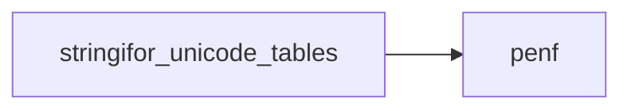
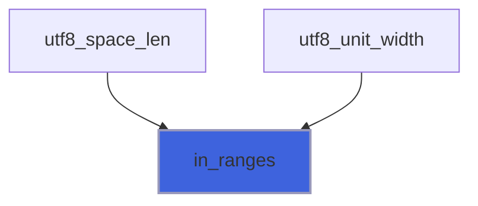

# stringifor_unicode_tables

> Unicode property tables of StringiFor, generated: do not edit.

**Source**: `src/third_party/StringiFor/src/lib/stringifor_unicode_tables.F90`

**Dependencies**



## Contents

- [in_ranges](#in-ranges)

## Variables

| Name | Type | Attributes | Description |
|------|------|------------|-------------|
| `UCD_VERSION` | character(len=*) | parameter | Version of the Unicode Character Database. |
| `WIDE_RANGES` | integer(kind=[I4P](/api/src/third_party/PENF/src/lib/penf_global_parameters_variables)) | parameter |  |
| `ZERO_WIDTH_RANGES` | integer(kind=[I4P](/api/src/third_party/PENF/src/lib/penf_global_parameters_variables)) | parameter |  |
| `WHITE_SPACE_RANGES` | integer(kind=[I4P](/api/src/third_party/PENF/src/lib/penf_global_parameters_variables)) | parameter |  |

## Functions

### in_ranges

Return true if the codepoint is in one of the ranges (binary search).

**Attributes**: pure

**Returns**: `logical`

```fortran
function in_ranges(codepoint, ranges) result(found)
```

**Arguments**

| Name | Type | Intent | Attributes | Description |
|------|------|--------|------------|-------------|
| `codepoint` | integer(kind=[I4P](/api/src/third_party/PENF/src/lib/penf_global_parameters_variables)) | in |  | Codepoint. |
| `ranges` | integer(kind=[I4P](/api/src/third_party/PENF/src/lib/penf_global_parameters_variables)) | in |  | Sorted disjoint ranges, one column [first, last] per range. |

**Call graph**


