# stringifor_utf8

> StringiFor, UTF-8 kernel: decoding, encoding and validation of raw bytes (internal module, not re-exported).

 A *unit* is either a well-formed UTF-8 sequence (Unicode Table 3-7: no overlong form, no surrogate, nothing above
 U+10FFFF, no truncated sequence) or a single byte that is not part of one. Every procedure works on units, so
 ill-formed input is never merged, dropped or rewritten unless a procedure says so.

**Source**: `src/third_party/StringiFor/src/lib/stringifor_utf8.F90`

**Dependencies**

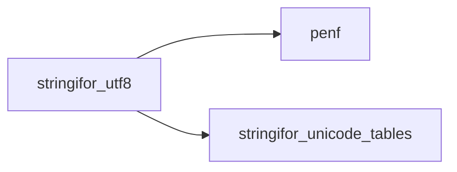

## Contents

- [utf8_decode](#utf8-decode)
- [utf8_nth_unit](#utf8-nth-unit)
- [utf8_unit_len](#utf8-unit-len)
- [utf8_subpart_len](#utf8-subpart-len)
- [utf8_encoded_len](#utf8-encoded-len)
- [utf8_encode](#utf8-encode)
- [utf8_first_error](#utf8-first-error)
- [utf8_units](#utf8-units)
- [utf8_unit_index](#utf8-unit-index)
- [utf8_in_set](#utf8-in-set)
- [utf8_scan](#utf8-scan)
- [utf8_unit_width](#utf8-unit-width)
- [utf8_width](#utf8-width)
- [utf8_space_len](#utf8-space-len)
- [utf8_white_space](#utf8-white-space)
- [utf8_byte_pos](#utf8-byte-pos)
- [utf8_char_pos](#utf8-char-pos)
- [ascii_run](#ascii-run)
- [is_ascii](#is-ascii)
- [byte](#byte)
- [expected_len](#expected-len)

## Variables

| Name | Type | Attributes | Description |
|------|------|------------|-------------|
| `HIGH_BITS` | integer(kind=[I8P](/api/src/third_party/PENF/src/lib/penf_global_parameters_variables)) | parameter | 8080808080808080: the high bit of 8 bytes. |
| `REPLACEMENT_CHARACTER` | character(len=*) | parameter | U+FFFD in UTF-8. |

## Subroutines

### utf8_decode

Decode the unit starting at byte i: its codepoint, or minus the byte value for an ill-formed byte, and its length.

**Attributes**: pure

```fortran
subroutine utf8_decode(raw, i, codepoint, n)
```

**Arguments**

| Name | Type | Intent | Attributes | Description |
|------|------|--------|------------|-------------|
| `raw` | character(len=*) | in |  | Bytes. |
| `i` | integer | in |  | Position of the first byte, 1 <= i <= len(raw). |
| `codepoint` | integer(kind=[I4P](/api/src/third_party/PENF/src/lib/penf_global_parameters_variables)) | out |  | Codepoint, or -byte (-255..-128) for an ill-formed byte. |
| `n` | integer | out |  | Length of the unit in bytes. |

**Call graph**

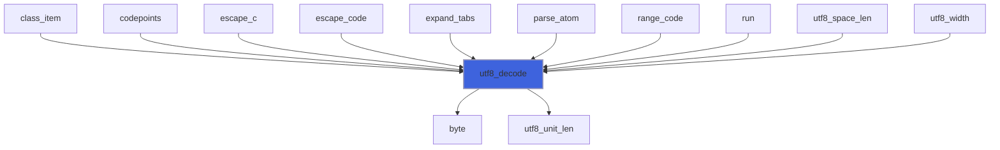

### utf8_nth_unit

Return the position and the length of the k-th unit of set (of its last unit if it has less than k), n=0 if the
 set is empty.

**Attributes**: pure

```fortran
subroutine utf8_nth_unit(set, k, first, n)
```

**Arguments**

| Name | Type | Intent | Attributes | Description |
|------|------|--------|------------|-------------|
| `set` | character(len=*) | in |  | Set of units. |
| `k` | integer | in |  | Ordinal of the unit. |
| `first` | integer | out |  | Position of its first byte. |
| `n` | integer | out |  | Its length, 0 if the set is empty. |

**Call graph**

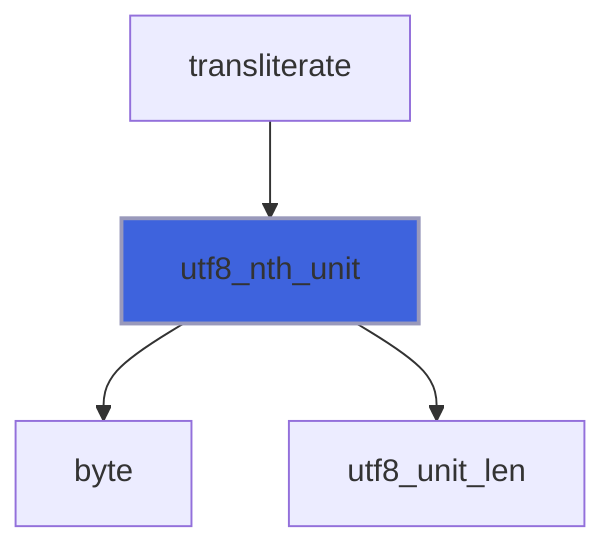

## Functions

### utf8_unit_len

Return the length in bytes of the unit starting at byte i: 2, 3 or 4 for a well-formed multibyte sequence, 1
 for an ASCII byte or a byte that does not start a well-formed sequence.

**Attributes**: pure

**Returns**: `integer`

```fortran
function utf8_unit_len(raw, i) result(n)
```

**Arguments**

| Name | Type | Intent | Attributes | Description |
|------|------|--------|------------|-------------|
| `raw` | character(len=*) | in |  | Bytes. |
| `i` | integer | in |  | Position of the first byte, 1 <= i <= len(raw). |

**Call graph**

```mermaid
flowchart TD
  match["match"] --> utf8_unit_len["utf8_unit_len"]
  reverse["reverse"] --> utf8_unit_len["utf8_unit_len"]
  squeeze["squeeze"] --> utf8_unit_len["utf8_unit_len"]
  strip_set["strip_set"] --> utf8_unit_len["utf8_unit_len"]
  to_valid_utf8["to_valid_utf8"] --> utf8_unit_len["utf8_unit_len"]
  transliterate["transliterate"] --> utf8_unit_len["utf8_unit_len"]
  unit_length["unit_length"] --> utf8_unit_len["utf8_unit_len"]
  utf8_byte_pos["utf8_byte_pos"] --> utf8_unit_len["utf8_unit_len"]
  utf8_char_pos["utf8_char_pos"] --> utf8_unit_len["utf8_unit_len"]
  utf8_decode["utf8_decode"] --> utf8_unit_len["utf8_unit_len"]
  utf8_first_error["utf8_first_error"] --> utf8_unit_len["utf8_unit_len"]
  utf8_in_set["utf8_in_set"] --> utf8_unit_len["utf8_unit_len"]
  utf8_nth_unit["utf8_nth_unit"] --> utf8_unit_len["utf8_unit_len"]
  utf8_scan["utf8_scan"] --> utf8_unit_len["utf8_unit_len"]
  utf8_unit_index["utf8_unit_index"] --> utf8_unit_len["utf8_unit_len"]
  utf8_units["utf8_units"] --> utf8_unit_len["utf8_unit_len"]
  utf8_unit_len["utf8_unit_len"] --> byte["byte"]
  utf8_unit_len["utf8_unit_len"] --> expected_len["expected_len"]
  utf8_unit_len["utf8_unit_len"] --> utf8_subpart_len["utf8_subpart_len"]
  style utf8_unit_len fill:#3e63dd,stroke:#99b,stroke-width:2px
```

### utf8_subpart_len

Return the length of the maximal subpart starting at byte i: the longest prefix of a well-formed sequence found
 there (Unicode 3.9, U+FFFD substitution of maximal subparts), at least 1. It is the unit length when the sequence
 is complete; a truncated sequence gives its valid prefix, replaced by one U+FFFD as a whole.

**Attributes**: pure

**Returns**: `integer`

```fortran
function utf8_subpart_len(raw, i) result(n)
```

**Arguments**

| Name | Type | Intent | Attributes | Description |
|------|------|--------|------------|-------------|
| `raw` | character(len=*) | in |  | Bytes. |
| `i` | integer | in |  | Position of the first byte, 1 <= i <= len(raw). |

**Call graph**

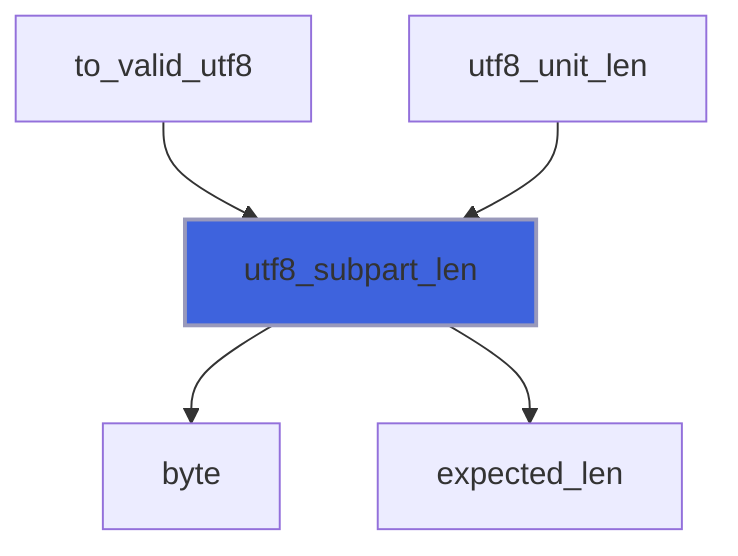

### utf8_encoded_len

Return the length of the UTF-8 encoding of a codepoint, 1 for an ill-formed byte (-255..-128), 3 (the length of
 U+FFFD) for any other value that is not a Unicode scalar value.

**Attributes**: pure

**Returns**: `integer`

```fortran
function utf8_encoded_len(codepoint) result(n)
```

**Arguments**

| Name | Type | Intent | Attributes | Description |
|------|------|--------|------------|-------------|
| `codepoint` | integer(kind=[I4P](/api/src/third_party/PENF/src/lib/penf_global_parameters_variables)) | in |  | Codepoint. |

**Call graph**

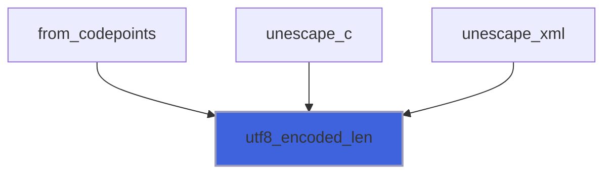

### utf8_encode

Return the UTF-8 encoding of a codepoint: the raw byte for -255..-128 (the ill-formed bytes of `utf8_decode`),
 U+FFFD for any other value that is not a Unicode scalar value.

**Attributes**: pure

**Returns**: `character(len=utf8_encoded_len)`

```fortran
function utf8_encode(codepoint) result(bytes)
```

**Arguments**

| Name | Type | Intent | Attributes | Description |
|------|------|--------|------------|-------------|
| `codepoint` | integer(kind=[I4P](/api/src/third_party/PENF/src/lib/penf_global_parameters_variables)) | in |  | Codepoint. |

**Call graph**

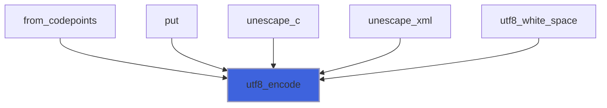

### utf8_first_error

Return the byte position of the first byte that is not part of a well-formed sequence, 0 if there is none.

**Attributes**: pure

**Returns**: `integer`

```fortran
function utf8_first_error(raw) result(position)
```

**Arguments**

| Name | Type | Intent | Attributes | Description |
|------|------|--------|------------|-------------|
| `raw` | character(len=*) | in |  | Bytes. |

**Call graph**

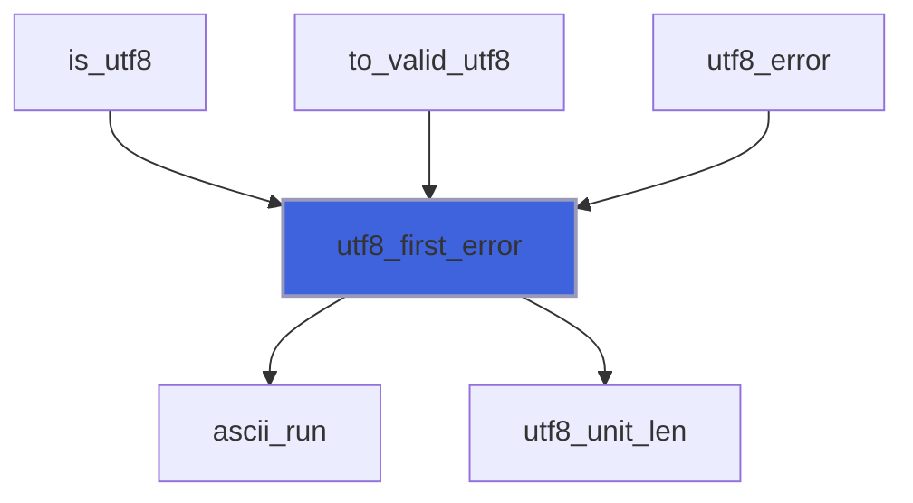

### utf8_units

Return the number of units of the bytes.

**Attributes**: pure

**Returns**: `integer`

```fortran
function utf8_units(raw) result(units)
```

**Arguments**

| Name | Type | Intent | Attributes | Description |
|------|------|--------|------------|-------------|
| `raw` | character(len=*) | in |  | Bytes. |

**Call graph**

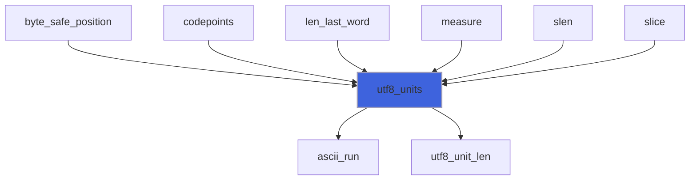

### utf8_unit_index

Return the ordinal of the first unit of set equal to the unit raw(i:i+n-1), 0 if there is none.

**Attributes**: pure

**Returns**: `integer`

```fortran
function utf8_unit_index(raw, i, n, set) result(k)
```

**Arguments**

| Name | Type | Intent | Attributes | Description |
|------|------|--------|------------|-------------|
| `raw` | character(len=*) | in |  | Bytes. |
| `i` | integer | in |  | Position of the unit. |
| `n` | integer | in |  | Length of the unit. |
| `set` | character(len=*) | in |  | Set of units. |

**Call graph**

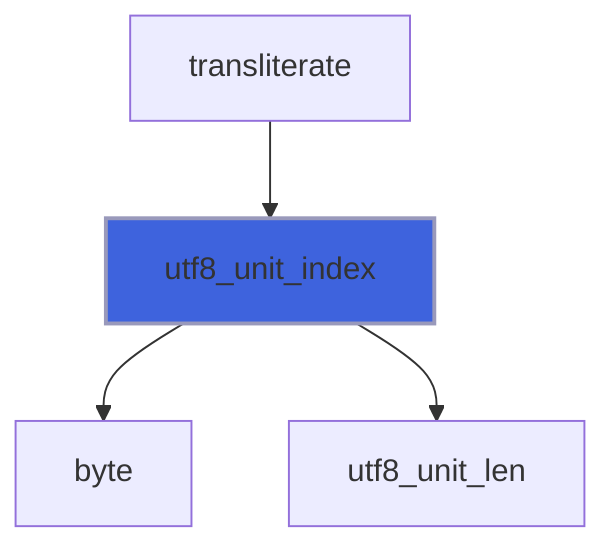

### utf8_in_set

Return true if the unit raw(i:i+n-1) is one of the units of set.

**Attributes**: pure

**Returns**: `logical`

```fortran
function utf8_in_set(raw, i, n, set) result(found)
```

**Arguments**

| Name | Type | Intent | Attributes | Description |
|------|------|--------|------------|-------------|
| `raw` | character(len=*) | in |  | Bytes. |
| `i` | integer | in |  | Position of the unit. |
| `n` | integer | in |  | Length of the unit. |
| `set` | character(len=*) | in |  | Set of units. |

**Call graph**

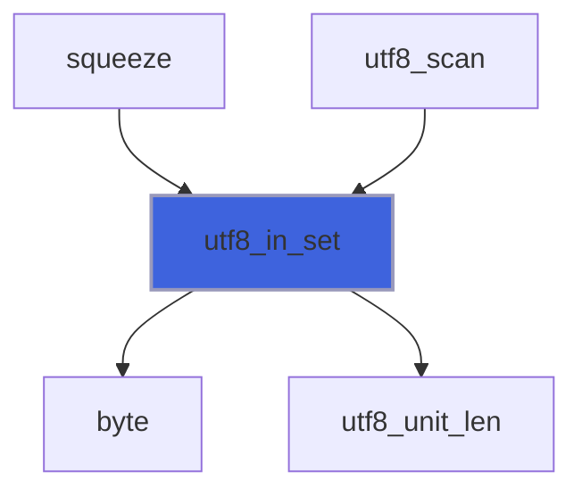

### utf8_scan

Return the byte position of the first (last if back) unit that is in the set (not in the set if .not.inside),
 0 if there is none: `scan` (inside) and `verify` (not inside) by units.

 With an ASCII set the intrinsic gives the answer, except a backward `verify` landing on a non-ASCII byte.

**Attributes**: pure

**Returns**: `integer`

```fortran
function utf8_scan(raw, set, back, inside) result(position)
```

**Arguments**

| Name | Type | Intent | Attributes | Description |
|------|------|--------|------------|-------------|
| `raw` | character(len=*) | in |  | Bytes. |
| `set` | character(len=*) | in |  | Set of units. |
| `back` | logical | in | optional | Search from the end. |
| `inside` | logical | in |  | Search a unit in the set (scan) or not in the set (verify). |

**Call graph**

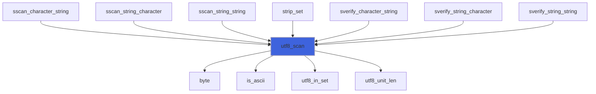

### utf8_unit_width

Return the display width, in terminal columns, of a unit given its codepoint (-byte for an ill-formed byte).

 0 for the C0 and C1 controls and DEL, and for the zero-width characters (Mn, Me, Cf except U+00AD, the Hangul
 jamo medial vowels and final consonants); 2 for East_Asian_Width W and F; 1 otherwise, an ill-formed byte included.

**Attributes**: pure

**Returns**: `integer`

```fortran
function utf8_unit_width(codepoint) result(columns)
```

**Arguments**

| Name | Type | Intent | Attributes | Description |
|------|------|--------|------------|-------------|
| `codepoint` | integer(kind=[I4P](/api/src/third_party/PENF/src/lib/penf_global_parameters_variables)) | in |  | Codepoint, or -byte. |

**Call graph**

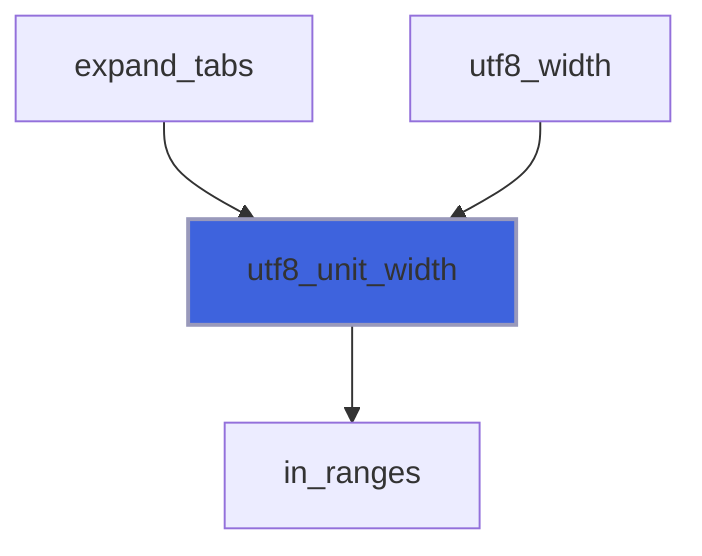

### utf8_width

Return the display width of the bytes, in terminal columns: the sum of the widths of their units.

**Attributes**: pure

**Returns**: `integer`

```fortran
function utf8_width(raw) result(columns)
```

**Arguments**

| Name | Type | Intent | Attributes | Description |
|------|------|--------|------------|-------------|
| `raw` | character(len=*) | in |  | Bytes. |

**Call graph**

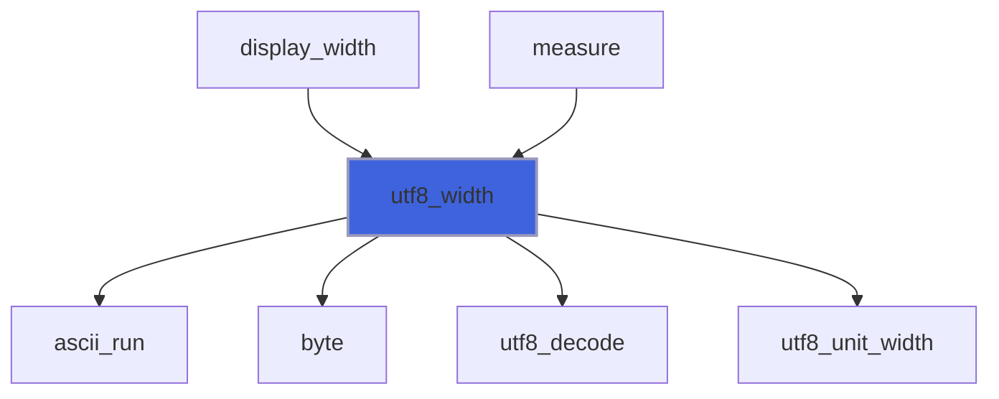

### utf8_space_len

Return the length in bytes of the unit starting at byte i if it has the Unicode White_Space property, 0 if not.

 White_Space (PropList.txt) is TAB, LF, VT, FF, CR, space, U+0085, U+00A0, U+1680, U+2000..U+200A, U+2028,
 U+2029, U+202F, U+205F and U+3000. An ill-formed byte is not whitespace.

**Attributes**: pure

**Returns**: `integer`

```fortran
function utf8_space_len(raw, i) result(n)
```

**Arguments**

| Name | Type | Intent | Attributes | Description |
|------|------|--------|------------|-------------|
| `raw` | character(len=*) | in |  | Bytes. |
| `i` | integer | in |  | Position of the first byte, 1 <= i <= len(raw). |

**Call graph**

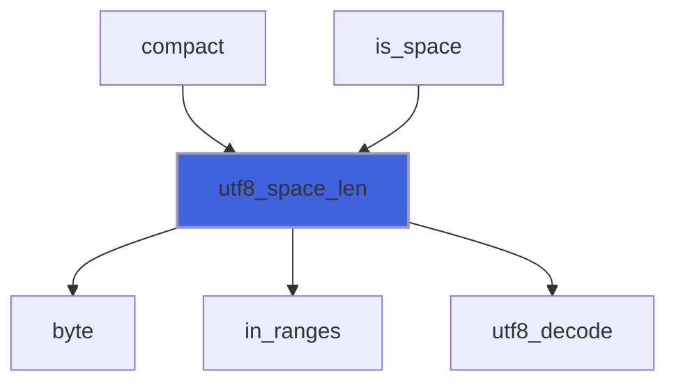

### utf8_white_space

Return every character with the Unicode White_Space property, encoded in UTF-8 one after the other.

**Attributes**: pure

**Returns**: `character(len=:)`

```fortran
function utf8_white_space() result(units)
```

**Call graph**

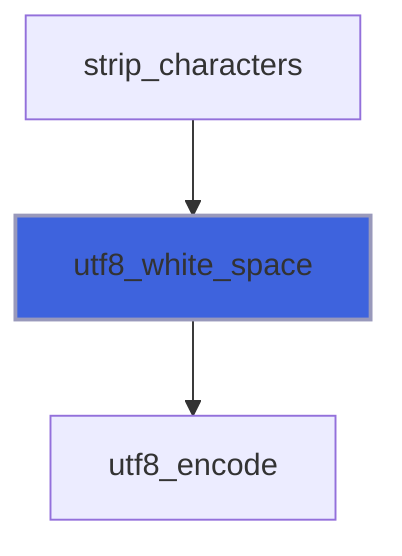

### utf8_byte_pos

Return the byte position of the first byte of the k-th unit, len(raw)+1 for k one past the last unit, 0 for any
 other k out of range.

**Attributes**: pure

**Returns**: `integer`

```fortran
function utf8_byte_pos(raw, k) result(position)
```

**Arguments**

| Name | Type | Intent | Attributes | Description |
|------|------|--------|------------|-------------|
| `raw` | character(len=*) | in |  | Bytes. |
| `k` | integer | in |  | Ordinal of the unit. |

**Call graph**

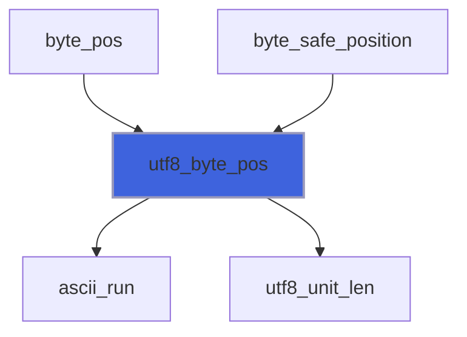

### utf8_char_pos

Return the ordinal of the unit holding byte b, the number of units + 1 for b = len(raw)+1, 0 for any other b out
 of range.

**Attributes**: pure

**Returns**: `integer`

```fortran
function utf8_char_pos(raw, b) result(k)
```

**Arguments**

| Name | Type | Intent | Attributes | Description |
|------|------|--------|------------|-------------|
| `raw` | character(len=*) | in |  | Bytes. |
| `b` | integer | in |  | Byte position. |

**Call graph**

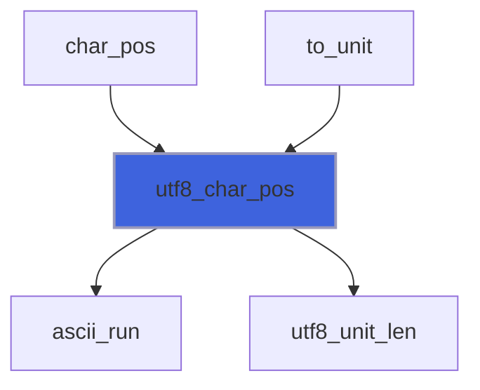

### ascii_run

Return the position of the first non-ASCII byte at or after byte i, len(raw)+1 if there is none.

 Eight bytes are tested at a time, their high bits masked in one 64-bit integer.

**Attributes**: pure

**Returns**: `integer`

```fortran
function ascii_run(raw, i) result(j)
```

**Arguments**

| Name | Type | Intent | Attributes | Description |
|------|------|--------|------------|-------------|
| `raw` | character(len=*) | in |  | Bytes. |
| `i` | integer | in |  | First byte tested. |

**Call graph**

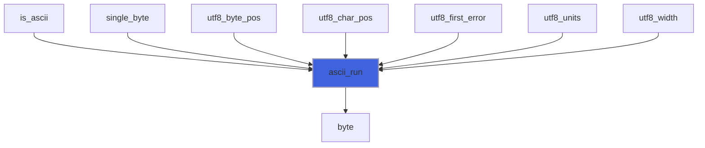

### is_ascii

Return true if every byte of text is ASCII.

**Attributes**: pure

**Returns**: `logical`

```fortran
function is_ascii(text) result(ascii)
```

**Arguments**

| Name | Type | Intent | Attributes | Description |
|------|------|--------|------------|-------------|
| `text` | character(len=*) | in |  | Bytes. |

**Call graph**

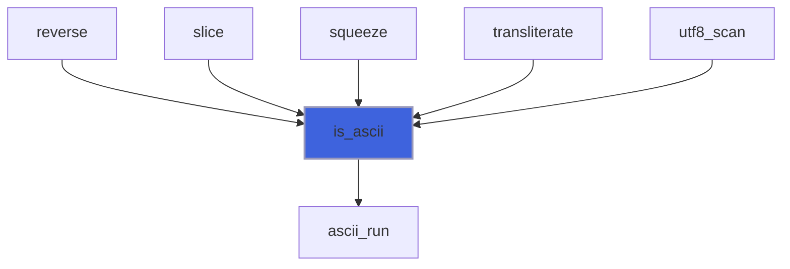

### byte

Return the value 0..255 of a byte (`ichar` may be signed above 127 on some processors).

**Attributes**: elemental

**Returns**: `integer`

```fortran
function byte(c) result(value)
```

**Arguments**

| Name | Type | Intent | Attributes | Description |
|------|------|--------|------------|-------------|
| `c` | character(len=1) | in |  | Byte. |

**Call graph**

```mermaid
flowchart TD
  ascii_run["ascii_run"] --> byte["byte"]
  utf8_decode["utf8_decode"] --> byte["byte"]
  utf8_in_set["utf8_in_set"] --> byte["byte"]
  utf8_nth_unit["utf8_nth_unit"] --> byte["byte"]
  utf8_scan["utf8_scan"] --> byte["byte"]
  utf8_space_len["utf8_space_len"] --> byte["byte"]
  utf8_subpart_len["utf8_subpart_len"] --> byte["byte"]
  utf8_unit_index["utf8_unit_index"] --> byte["byte"]
  utf8_unit_len["utf8_unit_len"] --> byte["byte"]
  utf8_width["utf8_width"] --> byte["byte"]
  style byte fill:#3e63dd,stroke:#99b,stroke-width:2px
```

### expected_len

Return the length of the sequence a first byte starts: 1 for ASCII, 2..4 for a valid lead byte, 0 for a byte that
 cannot start a well-formed sequence (80..C1, F5..FF).

**Attributes**: pure

**Returns**: `integer`

```fortran
function expected_len(lead) result(n)
```

**Arguments**

| Name | Type | Intent | Attributes | Description |
|------|------|--------|------------|-------------|
| `lead` | integer | in |  | First byte value. |

**Call graph**

```mermaid
flowchart TD
  utf8_subpart_len["utf8_subpart_len"] --> expected_len["expected_len"]
  utf8_unit_len["utf8_unit_len"] --> expected_len["expected_len"]
  style expected_len fill:#3e63dd,stroke:#99b,stroke-width:2px
```
